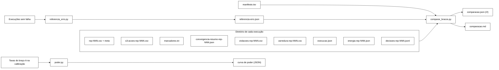

# analysis

Pipeline de análise estatística para os experimentos do TCC. Realiza B-16, B-17 e B-18 do *backlog* (`docs/planejamento-inicial.md`). Cobre as linhas **T13** (percentis) e **T22** (Mann-Whitney + *bootstrap*) da Tabela 1 do Cap. 3 §3.3.5.

## Componentes

| Script | Função | Cobertura |
|---|---|---|
| `percentis.py` | Lê CSVs de um cenário; calcula p50/p95/p99/p99,9 por operação; grava `summary.json` | T13 |
| `bootstrap_ic.py` | Reamostra com reposição 10 000 vezes; calcula IC 95% por percentil; grava `bootstrap.json` | T22 (bootstrap) |
| `compare_scenarios.py` | Compara dois cenários por operação via Mann-Whitney U bilateral; grava `comparacao.json` | T22 (Mann-Whitney) |
| `gerar_dados_sinteticos.py` | Produz CSVs sintéticos para validação do *pipeline* antes do *workload* real estar pronto | apoio |

## Instalação

```bash
cd analysis
python3 -m venv .venv
source .venv/bin/activate
pip install -r requirements.txt
```

Dependências: `numpy >= 1.24`, `scipy >= 1.10`. Nada além disso.

## Formato de entrada

Cada arquivo CSV é uma execução (repetição). O formato esperado, alinhado ao que o programa de carga (`workload/`) produzirá nas semanas 9 e 10, é:

```
op_id,operation,start_ns,end_ns,replica,return_code,key
0,Login,1700000000000000000,1700000000002500000,r1,OK,u_42
1,Validate,1700000000003000000,1700000000003450000,r2,VALID,u_42
...
```

Convenção: `start_ns` e `end_ns` em nanossegundos desde a *epoch*; `latencia = end_ns - start_ns`.

Códigos de retorno reconhecidos como sucesso: `OK`, `VALID`, `INVALID`, `COUNTED`, `ALREADY_INVALID`, `BLOCKED`, `ALREADY_BLOCKED`, `NOT_BLOCKED`, `NONE`. Qualquer outro código é contado como erro (entra em `taxa_erro`).

**B-33 (Q-9).** Dois códigos de erro são conhecidos: `ERROR_TRANSPORT` (falha de transporte: timeout, conexão) e `ERROR_UNAVAILABLE` (recusa por indisponibilidade, p. ex. cache `DEGRADED` sob `DENY_READ_WRITES`). Ambos entram em `taxa_erro`. Quando há ao menos um `ERROR_UNAVAILABLE`, `summary.json` ganha `taxa_indisponivel` por operação; sem ele o resumo é idêntico ao anterior. Execuções sem falha de partição nunca emitem o novo código.

O workload passa a emitir também as operações `Block` e `Unblock`. Com `--marker`, o CSV de eventos ganha uma coluna final opcional `phase` (`antes`, `durante`, `durante-pre-split`, `durante-pos-split`, `recuperacao`, `pos-convergencia`); colunas extras são aceitas. `percentis.py` só conta como execução os CSVs cujo cabeçalho tem as colunas de evento: `violacoes-rep-*.csv`, `convergencia-rep-*.csv` e `varredura-*.csv`, gravados no mesmo diretório, não entram em `execucoes`.

O contrato Java x Python é verificado por `test_contrato_csv.py` (`python -m unittest discover -s analysis -p "test_*.py"`, da raiz do repositório).

## Pipeline ponta a ponta (com dados sintéticos)

Para validar o pipeline sem depender do *cluster*:

```bash
cd analysis

# 1. Gerar dados sintéticos para três cenários
python3 gerar_dados_sinteticos.py ../runs/S1-sem-falha --cenario S1-sem-falha
python3 gerar_dados_sinteticos.py ../runs/S1-F1        --cenario S1-F1
python3 gerar_dados_sinteticos.py ../runs/S1-F3        --cenario S1-F3

# 2. Percentis e taxa de erro por operação
python3 percentis.py ../runs/S1-sem-falha
python3 percentis.py ../runs/S1-F1
python3 percentis.py ../runs/S1-F3

# 3. IC bootstrap para p50/p95/p99
python3 bootstrap_ic.py ../runs/S1-sem-falha --reamostragens 10000

# 4. Comparação cenário-base vs cenário-com-falha
python3 compare_scenarios.py ../runs/S1-sem-falha ../runs/S1-F1
python3 compare_scenarios.py ../runs/S1-sem-falha ../runs/S1-F3
```

Cada script produz um JSON estruturado no próprio diretório do cenário, consumível pelo trabalho acadêmico para alimentar o Capítulo 5 §5.1.

## Notas técnicas

### percentis.py

Usa `numpy.percentile` com `method="lower"` (interpolação descontínua), opção compatível com a definição de percentil empírico mais conservadora — não interpola entre amostras, escolhe sempre uma observação real. Isso evita reportar percentis "artificiais" que não correspondem a nenhuma latência efetivamente medida.

A regra de p99,9: só é reportada quando o número total de amostras da operação atinge $10^6$, conforme T13 da Tabela 1. Abaixo desse limiar, a estimativa de p99,9 fica em `null` no `summary.json`. Para uma rodada com 30 repetições de $10^6$ operações cada, qualquer operação que apareça em ao menos 3 % do *workload* terá amostra suficiente.

### bootstrap_ic.py

Calcula IC 95% por reamostragem com reposição. Para amostras grandes (acima de 5 milhões de operações no total, contando todas as repetições do cenário), usa loop em vez de vetorização total, para manter o consumo de memória controlado.

A semente padrão é fixada em `--seed 42` para reprodutibilidade dos JSONs. Cada `bootstrap.json` registra a semente usada, o que permite re-rodar a análise e obter o mesmo resultado.

### compare_scenarios.py

Aplica `scipy.stats.mannwhitneyu` com `alternative="two-sided"`. O teste bilateral é apropriado porque o experimento não pré-julga a direção da diferença: o cenário com falha pode ter latência maior ou menor que o *baseline* (em raros casos pode ser menor, p. ex. quando uma falha reduz a carga concorrente).

O tamanho de efeito $r = |Z| / \sqrt{N}$ é a métrica de efeito não-paramétrica padrão; conforme a literatura (Cohen, 1988), $r < 0,1$ é efeito pequeno, $0,3$ médio, $0,5$ grande. Esses limiares informam a interpretação prática para além da significância estatística estrita.

## Decisão sobre p-valor

Critério C1 do Cap. 3 §3.3.5: significância a $\alpha = 0,05$. O script registra `significativo_a_5pct: true|false` por operação. Em um conjunto de 12 cenários × 7 operações = 84 testes, correções por múltiplas comparações (Bonferroni, FDR) podem ser apropriadas; isto fica como decisão metodológica futura, possivelmente abordada por uma flag `--corrigir-multipla` em versão posterior.

## Comparação pareada A × B (`comparar_bracos.py`, esquema `comparar-bracos/2`, B-39.4)

Roda com `python -E -P` (numpy e scipy estão no *site* do usuário; decisão G2 de 28/10). Especificação: seções
3.1 a 3.5 de `docs/plano-alinhamento-objetivos-2026-11-04.md` e o W-5 de `docs/plano-execucao-2026-11-04.md`.



```bash
# referência de erro sem falha (Δ_rec de sensibilidade), por célula
python -E -P analysis/referencia_erro.py --saida runs/.../referencia-erro-async.json runs/.../none-*/rep-001.csv

# comparação das células com falha (valores do pré-registro B-40; os sem padrão são obrigatórios)
python -E -P analysis/comparar_bracos.py --manifesto M-falhas.tsv --semente-boot S --saida comparacao.json \
    --delta-latencia 0.10 --w-analise-s W --w-recovery-s WR --celulas-teste ASYNC-F1,ASYNC-F2 \
    --celulas-referencia SYNC-F2 \
    --referencia-erro ASYNC-F1=referencia-erro-async.json --p-max-w 181 --razao-ocioso-central 0.3

# célula sem falha em chamada própria: sem marcadores tudo é "antes" (A-2 da V-W5)
python -E -P analysis/comparar_bracos.py --manifesto M-sem-falha.tsv --semente-boot S --saida sem-falha.json \
    --delta-latencia 0.10 --w-analise-s W --w-recovery-s WR --celulas-descritivas ASYNC-none --fases antes

# curvas de poder para escolher o número de blocos (plano 3.3; m = células de teste do pré-registro)
python -E -P analysis/poder.py --taxas-a taxas-braco-a.txt --semente S --n-sim 10000 --m-celulas 2 --saida poder.json
```

| Desfecho | Família | Escala de d_b |
|---|---|---|
| `taxa_violacoes_por_1000` (I1 + I4 + I2 `REAL`, pares distintos das três origens; W-5c) | co-principal-V | y_B − y_A |
| `taxa_violacoes_por_1000:sem_forma2` (só com sonda ou varredura) | sensibilidade (sem Holm) | y_B − y_A |
| `acao_s3_p99_com_espera` | co-principal-L | ln(y_B/y_A) |
| `vazao_util` | não inferioridade (δ = 10 %) | ln |
| `delta_rec_s`, `delta_conv_s`, `divergencia_persistente`, `taxa_erro`, `falhas_percebidas_por_1000` | secundário | y_B − y_A |
| `evento_p99:*`, `acao_s3_p99_sem_espera`, `cpu_por_1000_uteis`, `energia_total_j_por_1000_uteis:0.3` | secundário | ln |
| `delta_rec_metodologia_s` | sensibilidade (sem Holm) | diferença |
| `taxa_erro:razao`, `falhas_percebidas_por_1000:razao` (razão com exclusão dos zeros), `energia_total_j_por_1000_uteis:0.5` | sensibilidade (sem Holm) | ln |

Regra de sucesso (D-1, intersecção-união de Berger 1982): por célula de teste, H_V (troca de sinal exata, bilateral,
média de d_b < 0) e H_L (limite superior do IC t 95 % da razão do p99 ≤ 1 + δ_L) rejeitadas, vazão não inferior e
trilha do braço B íntegra; p_IU = max(p_V, p_L); Holm entre as células de teste sobre p_IU. Célula descritiva ou de
referência não tem p, Holm nem IU (o IC é descritivo). Célula de teste: no máximo 16 blocos, trilha nos dois braços,
braço B com `atuador` ≠ `nulo` e `politica` ≠ `nenhuma`, mesmo `param_sha256` em A e B (exit 2 se não). Célula sem
nenhum evento nas fases pedidas: exit 2.

V (W-5c, rascunho do pré-registro do benchmark refeito, seção 2): numerador = pares distintos (chave, invariante)
com ao menos uma detecção nas fases, somando o auditor online (`origem` vazia), a sonda de *replay* do W-10
(`origem = sonda`) e a varredura final (`varredura-rep-NNN.csv`, só `REAL`, I2-PERDIDO na classe I2); linhas e
contagem por origem são só descritivas. O *replay* imediato e o online vão pelo instante da detecção; o tardio (a
violação da sonda depois do fim observado da carga) e a varredura, pelo instante da invalidação confirmada (o
`Logout` `NONE` da sid; o último `Block` `NONE` da identidade no I2 e no I2-PERDIDO); sem ela no `rep-NNN.csv`, a
detecção conta sem filtro de fase. Formas de I1: forma 1 com o `Logout` confirmado pelo nó da falha (`node=` do
marcador e `--servers` do `execucao.json`), forma 2 com o `Logout` por outro nó e a releitura `VALID` servida pelo
nó da falha entre `start` e `end`. `varredura-rep-NNN.erro.txt` deixa V ausente; na célula de teste, instrumentos
diferentes entre A e B dão exit 2. Os `ReplayValidate` ficam fora de latência, vazão, taxa de erro e denominador.
Detalhes: `docs/implementacao.md` (TD-017).

Δ_rec: última operação **iniciada** depois do marcador `end` que terminou em anomalia (`ERROR_TRANSPORT`,
`ERROR_UNAVAILABLE` ou falha percebida), censurada nos últimos W_c = `--w-analise-s` antes de `t_fim_carga_ns`; sem
`t_fim_carga_ns`, ausente. Δ_conv: `t_convergencia_abs_ns − t_religamento_ns` quando o AC-5 parou um nó; sem nó
parado, `t_convergencia_abs_ns − t_fim_carga_ns`. AC-5 aplicado sem o registro deixa Δ_conv e divergência não
avaliáveis, e `t_religamento_ns` anterior a `t_fim_carga_ns` é inválido. Desenho fixado pelo coordenador (05/11), a
levar ao W-6: `t_religamento_ns` fica no resumo de convergência, gravado pelo programa de carga. No fim da carga, se
houve AC-5, o programa sinaliza o fim, o orquestrador faz o `podman start` do nó parado, e o programa espera a
topologia completa (com prazo) antes do laço de convergência; o campo é o instante em que ele viu os três nós de volta.

Energia: modelo do `energia_proxy.py`, P_max = 181 W, razão ociosa 0,3 (Barroso e Hölzle 2007, p. 36) com 0,5
(p. 34) como sensibilidade, por decisão do Gestor de 05/11. Guarda G4: a comparação recusa (exit 2) energia
calculada com outro W, outros marcadores ou outra convergência. Poder: curva `independente` (pior caso com
correlação dentro do bloco ≥ 0) e `correlacao-perfeita` (limite superior), com α = 0,05/m do primeiro passo do Holm.
