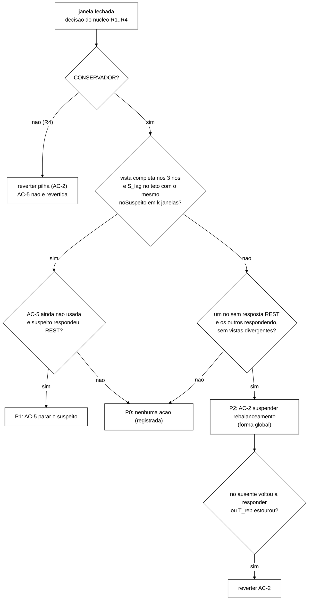

# Ações do controlador sobre o *cluster*: o que o Infinispan 15.0.21 permite (2026-11-05)

Autor: Senior. Branch `docs/plano-implementacao-controlador`. Substitui as seções 4.3 a 4.5 e 4.7 do
`docs/plano-execucao-2026-11-04.md` naquilo que trata das ações de *cluster*, e o prompt W-2 da seção 9
do mesmo plano. Nada aqui foi executado em *cluster*. Os fatos medidos vêm do B-44.1 (`8e57ce7`) e do B-44.1b (`12c1786`). Os achados
novos vêm do código-fonte da versão 15.0.21.Final, que li nesta sessão. **Tudo depende da validação do
Gestor (seção 9).**

> **Atualização de 05/11, depois do B-44.3** (`wt-b44-3`, `d73b01d`). A AC-6 (exclusão forçada do nó suspeito
> pelo JGroups), proposta em `docs/opcoes-arquitetura-configuracao-2026-11-05.md` (`155aa95`), foi verificada e
> **não substitui o AC-5. P1 continua com o AC-5**, e a tabela da seção 5 vale como está. Comparação e motivos em
> `opcoes-arquitetura-configuracao-2026-11-05.md` §9; resumo nas seções 0 (item 7), 3.1, 3.4 e 9 (D-K) abaixo.

Siglas e termos usados:

| Termo | Significado |
|---|---|
| REST | API HTTP de administração do servidor Infinispan (`/rest/v2/...`) |
| Hot Rod | protocolo binário que o programa de carga usa para ler e escrever nos *caches* |
| SYNC / ASYNC | replicação síncrona (a escrita espera a confirmação da outra réplica) e assíncrona (não espera) |
| JGroups | biblioteca de comunicação de grupo do Infinispan; decide quem é membro do *cluster* (a "vista") |
| FD_ALL3 | detector de falhas do JGroups por batimentos; com o padrão, suspeita de um nó depois de ~40 s sem batimento |
| MERGE3 | protocolo do JGroups que junta de novo dois lados depois que a rede volta (a "fusão") |
| S_top, S_lag, S_viol | sensores do controlador: topologia por REST, defasagem de replicação por Hot Rod, violações vistas pelo auditor |
| p99 | percentil 99 da duração de uma ação |
| JSONL | arquivo de texto com um objeto JSON por linha (trilha de decisões e ações) |
| TLA+ / TLC | linguagem da especificação formal / verificador de modelos que a executa |
| T_det | tempo entre o corte da rede e a mudança de vista |
| T_cham | prazo de uma chamada inteira do atuador (2 s) |

## 0. Resposta curta

1. **Nenhuma ação de *cluster* muda a política de replicação.** Modo SYNC/ASYNC, número de donos, `when-split`
   e `merge-policy` são imutáveis (B-44.1). A troca de *cache* por apelido não funciona (B-44.1b). Um *cache*
   espelho criado pela REST só passa a valer se o cliente escrever e ler nele, e isso é ação no cliente. O
   controlador, portanto, **não escolhe entre políticas de replicação**. Ele escolhe entre **políticas de
   reação operacional**.
2. **Sobram duas ações para a avaliação:**
   - **AC-5**, parar o nó suspeito com `POST /rest/v2/server/?action=stop` mandado ao próprio nó. É a única
     ação que mira um mecanismo de violação (M1). Pelo código, a parada é local e não passa pelo
     coordenador, então funciona no nó isolado. Ainda não foi testada. *(05/11: testada na tarefa zero do
     W-2a, 204 e primeira recusa em +3,06 s; integração I-3..I-5 em curso; ver seção 3.1.)*
   - **AC-2**, suspender o rebalanceamento **na forma global** (`POST /rest/v2/container?action=disable-rebalancing`),
     restrita à assinatura de queda, com reversão quando o nó volta e teto de 60 s. A forma por *cache* se
     perde quando o coordenador cai (P-34, B-44.1b R2). Não mira violação; mira o custo de transferência de
     estado. Tem um risco novo, achado no código: **com o rebalanceamento desligado, a fusão não resolve
     conflitos.**
3. **`acquire-timeout`** fica como exploratória, fora do braço B. **AC-1, AC-3, expiração, espelho, apelidos,
   `set-availability` à maioria, parada pelo coordenador, conectores, filtro de IP, *caches* ignorados e
   desligamento do contêiner ficam fora.** O detector de falhas adaptativo (FD_ALL3 com degraus) também fica
   fora desta campanha: é viável em tese pelo JGroups, mas não pela REST, e não foi verificado. *(05/11: não é
   viável em execução; gravar o `timeout` não muda a detecção dos membros atuais, pelo código e pelo B-44.3
   V-2; `opcoes-arquitetura-configuracao-2026-11-05.md` §2.2.)*
4. **O conjunto é fraco para "selecionar entre políticas" no sentido forte.** Uma ação só reduz violações,
   e só em um mecanismo (M1, partição ainda não detectada). M2 e M3 ficam sem ação. A seção 4 propõe a
   formulação honesta para o texto.
5. **Decisões pedidas pelo coordenador:** (a) o atuador do braço B **não muda nenhum atributo**, então nunca
   muda atributo com nó ausente; se a exploratória de `acquire-timeout` rodar, ela só age com a vista
   completa; (b) na VM entra o contorno "XML sem *caches* + criação pela REST", **sem** limpeza de
   `caches.xml`; (c) o teto de 60 s fica, com a origem da seção 3.2 (âncora na configuração, não medida
   ótima).
6. **Infraestrutura:** o XML da VM passa a não declarar *caches*. Os seis *caches* (`sessions*`, `counters*`,
   `canario*`) passam a ser criados pela REST pelo orquestrador. O TLA+ troca o `congelado` do AC-1 por
   `parado[r]` do AC-5, e o AC-2 não ganha ação no modelo.
7. **Depois do B-44.3 (05/11): P1 continua com o AC-5.** A AC-6 isola o nó em ~25 ms nos dois lados e livra a
   maioria de esperar por ele, mas o falso positivo dela é uma divisão seguida de fusão, e em ASYNC essa fusão
   reverteu um `Logout` confirmado (4 × I1) e deixou réplicas divergentes (1 × I5), n = 1, controle 0. O falso
   positivo do AC-5 é uma saída graciosa sem fusão, que custa vazão e não consistência. A AC-6 também não tem
   código, exige ligar o `diag` do JGroups na VM e adiaria a calibração. Ela vai para o texto como candidata
   verificada e não adotada (`opcoes-arquitetura-configuracao-2026-11-05.md` §9).

## 1. Ponto de partida

### 1.1 Fatos medidos (não contradizer)

| Fato | Fonte |
|---|---|
| Mutáveis em execução: `remote-timeout`, `acquire-timeout`, expiração, rebalanceamento (por *cache* e global), `set-availability` | B-44.1, `wt-b44-1`, `docs/b44-1-reconfiguracao-infinispan.md` §1 e §3, `8e57ce7` |
| `set-availability` vale por *cache* no *cluster* inteiro e vai ao coordenador. No nó isolado, ficou 41,6 s pendente e falhou | idem §4.1 |
| Imutáveis: modo, donos, segmentos, `when-split`, `merge-policy` | idem §3 |
| AC-1 inviável: `DEGRADED_MODE` não recusa operação por chave e recusa `clear`/varredura, o `Block` falha (59 `I2_CASCATA_INCOMPLETA`) | idem §4.1 |
| AC-3: `remote-timeout` curto em SYNC deixa escrita indeterminada e réplicas divergentes (P-31) | idem §4.4 |
| P-30: depois de mudar um atributo, o nó não reinicia (`ISPN000438`) | idem §4.3 |
| Apelidos inviáveis: o Hot Rod não resolve apelido, a troca não é atômica e deixa estado parcial | B-44.1b, `runs/b44-1b/efeito/A2-sonda-hotrod.txt` (`sess-ativo -> null`), `efeito-rest-alias.txt` |
| Criar e remover *cache* pela REST funciona: 8,04 s na primeira criação, 45 ms na seguinte, `DELETE` de 24 a 37 ms | `runs/b44-1b/chamadas.tsv` (C1) |
| *Cache* criado pela REST não causa `ISPN000438` no reinício; XML sem *caches* mais criação pela REST resolve o P-30 | `runs/b44-1b/fases.tsv` (INCB), `servidores/incB/` |
| Rebalanceamento desligado com um nó fora: ~2/3 das chaves com cópia única por todo o desligamento (1986/3000 por 87,4 s em R1; 2007/3000 por 86,8 s em R3), *cache* `AVAILABLE`, nenhuma perda; o nó que volta não recebe segmentos até religar; religar recupera em 35 ms (R1) e 130 ms (R3) | B-44.1b, `wt-b44-1`, `docs/b44-1b-alias-criacao-p30-rebalanceamento.md` §5 (`12c1786`) |
| **P-34:** o desligamento por *cache* se perde quando o coordenador cai (o novo coordenador rebalanceou 4,6 s depois); o global sobrevive, porque a recuperação agrega só o flag global (`ClusterTopologyManagerImpl.java:369`) | idem §5 (R2, R3); `docs/registro-de-problemas.md` P-34 |
| Contorno do P-30: XML sem *caches* + criação pela REST preserva o F1 com um `start`, se nenhum atributo mudou durante a queda; se mudou, o 1º `start` falha (3/3) e o 2º funciona; com limpeza de `caches.xml` na janela, um `start` basta (1/1) | idem §4 |
| Criação de *cache* pela REST: 45 a 144 ms, com uma exceção de 8,0 s não investigada | idem §3 |
| **P-35:** `inject-crash.sh` sai com 0 mesmo quando o nó não volta | `docs/registro-de-problemas.md` P-35 |
| A carga S3 ASYNC de A2 (80 s, sem ação sobre `sessions-async`) registrou 10 `I2_CASCATA_INCOMPLETA` sem explicação | B-44.1b §2 |
| Janela do M1 na VM: vista nova entre 39,8 e 46,4 s depois do corte; no S7, +43,2 s (isn3) e +45,3 s (isn1/isn2) | `wt-gate-v4/runs/vm-s7-2026-11-04/V-S7r.md:45` |
| Da fusão depois da cura: 18,9 s no local; 44,9 s e 53 s na VM | B-44.1 §4.1; `V-S7r.md:158` |
| *(05/11)* Tempo de fusão explicado pelo MERGE3: o verificador roda a cada 48 s (1,6 × `max_interval`), recomeça a cada troca de vista e só funde se recebeu uma INFO do outro lado desde a rodada anterior; 20 de 21 fusões caíram a ≤ 12 ms de 48 s ou 96 s depois da última troca de vista do líder. Faixa possível: 0 a ~96 s depois da cura | B-44.3 §4.1 (`d73b01d`), `runs/b44-3/analise/fusao.tsv` |
| *(05/11)* AC-5 sem corte: 204 em 37 ms; primeira recusa da saúde em +3059 ms; `ISPN000080` (canal desconectado) 219 ms depois de `ISPN080002`; os outros dois com 2 membros e `HEALTHY` | W-2a tarefa zero (`0b153f5`; brutos no tar `runs/b44-2/brutos-tarefa-zero-2026-11-05.tar` de `e983906`): `verificacao/b-parada-sem-barra.txt`, `b-parada-sem-barra-isn3.log:13-15`, `d-atuador-ac5.txt` |
| P-5: sensor e atuador sem `podman`, `sudo` ou disco no caminho crítico. Na VM, o disco trava por segundos e a criação de processos trava junto; REST e Hot Rod em memória seguem respondendo | `V-S7r.md:15`, `:61`, `:162`, `:234` |

### 1.2 Achados novos desta sessão (código 15.0.21.Final, *commit* `5bdc4de`, sem execução)

Caminhos relativos à raiz do repositório do Infinispan. Os números de linha valem para esta *tag*.

| # | Achado | Código |
|---|---|---|
| N-1 | **Existe parada local do servidor pela REST.** `POST /rest/v2/server/?action=stop` chama `serverStop` com a lista vazia. O servidor agenda a própria saída para 3 s depois, sem falar com o coordenador nem com o JGroups. Na saída, primeiro param os conectores (Hot Rod e REST) e depois o gerenciador de *caches* | `server/rest/.../ServerResource.java:117-119`, `:506-512`; `server/runtime/.../Server.java:208` (`SHUTDOWN_DELAY_SECONDS = 3`), `:573-588`, `:614-620`, `:644-648` |
| N-2 | **A parada pelo *cluster* precisa do JGroups até o alvo.** `POST /rest/v2/cluster?action=stop&server=<nome>` manda a ordem pelo executor do *cluster* (`filterTargets`). Sem o parâmetro `server`, para o *cluster* inteiro | `ClusterResource.java:54-56`, `:75-87`; `Server.java:578-585`, `:592-596` |
| N-3 | **Parar conector, filtro de IP e *caches* ignorados valem para os três nós.** As três operações gravam no *cache* de estado global, e um ouvinte clusterizado aplica a mudança em cada nó | `ServerResource.java:165-181`, `:228-246`; `server/runtime/.../state/ServerStateManagerImpl.java:95-111`, `:125-154`, `:281-337` |
| N-4 | **O desligamento do contêiner desliga os *caches* no *cluster* inteiro.** `POST /rest/v2/container?action=shutdown` chama `shutdownAllCaches`, e cada `cache.shutdown()` pede `requestClusterWideShutdown` | `ContainerResource.java:131-132`, `:431-436`; `Server.java:597-602`; `core/.../manager/DefaultCacheManager.java:896-925`; `core/.../cache/impl/CacheImpl.java:1067-1073` |
| N-5 | **Rebalanceamento desligado desliga a resolução de conflitos na fusão.** `resolveConflictsOnMerge()` só devolve verdadeiro se o rebalanceamento estiver ligado no *cache* e no *cluster*. O comentário do código diz que não faz sentido resolver conflitos sem rebalancear. Religar depois não refaz a resolução perdida (`startQueuedRebalance` só olha uma resolução já enfileirada) | `core/.../topology/ClusterCacheStatus.java:1172-1180`, `:1194-1204`, `:945-950` |
| N-6 | **O prazo do cliente Hot Rod domina os prazos do servidor.** O cliente usa `socketTimeout` = `hotrod_timeout_ms` = 2000 ms, com 1 nova tentativa. `remote-timeout` (17 500 ms) e `acquire-timeout` (15 000 ms) maiores que isso não mudam o que o cliente vê: ele desiste em 2 s e o servidor continua a operação sem ninguém esperando | `workload/.../session/S3Clientes.java:77-79`; `S3Parametros.java:117`; `runs/b44-1b/carga/C1-sync/s3-resumo-rep-001.json` |
| N-7 | **O sensor de topologia atual cria um processo por consulta** (`curl --digest`). Isso viola o P-5, porque no travamento de disco da VM a criação de processos também travou | `workload/.../session/ConsultaSaudeRest.java:36`, `:114`; `V-S7r.md:61` |
| N-8 | **A trilha JSONL grava com `flush` na *thread* do executor**, depois de cada chamada. Um travamento de disco atrasa a ação seguinte da fila | `controle/TrilhaJsonl.java:50-52`; `controle/ExecutorDeAcoes.java:519-522` |
| N-9 | **Detalhe do erro, confirmado pelo relatório do B-44.1b (3/3).** Com XML sem *caches*, mudar um atributo **enquanto um nó está fora** faz o primeiro `podman start` desse nó falhar com `ISPN000500` (não `ISPN000438`); o segundo `start` passa. Mudar antes da queda não causa o problema | `runs/b44-1b/fases.tsv` (B2 ok; B3 e B6 com o 1º *start* falho, 2º ok; B8 ok com limpeza), `servidores/incB/isn3-stdout.log:189`, `:428` |
| N-10 | Com *cache* criado pela REST, a **primeira** mudança de atributo funcionou sem escorva (200, leitura de volta igual nos três nós) | `runs/b44-1b/chamadas.tsv` (B1-set-rt, B1-get-rt-isn1..3) |
| N-11 | A partição injetada descarta só o tráfego IP entre os IPs dos nós (`tc` no *namespace* de rede de cada contêiner). A REST e o Hot Rod do programa de carga continuam chegando ao nó isolado | `scripts/inject-partition.sh:12-19`; B-44.1 §4.1 (P7: REST do isn3 respondeu) |

N-1, N-5 e N-9 mudam o desenho. N-6, N-7 e N-8 mudam o W-2.

## 2. O que é cliente e o que é servidor

O autor rejeitou ação no cliente. A linha que separa os dois lados, para este trabalho:

| Lado | O que inclui | Exemplos |
|---|---|---|
| **Servidor** | estado do *cluster* Infinispan, mudado só pela API REST de administração: atributos dos *caches*, disponibilidade, rebalanceamento, existência de *caches*, conectores, ciclo de vida de cada servidor | AC-2, AC-5, `acquire-timeout`, criar um *cache* |
| **Cliente** | tudo o que o servidor de aplicação (a lógica S3 e o cliente Hot Rod dele) decide: **qual *cache* usa**, **para qual nó manda**, quantas operações faz, quando espera, quando repete | AV-1 (desviar de nó), AV-2 (barreira de leitura), AV-3 (reafirmar), K1..K4, escrever num espelho, ler do espelho |

O controlador roda como *thread* dentro do processo da carga (plano de 04/11 §4.1). Isso não faz dele
cliente: a ação conta como de servidor quando o efeito passa só pela REST de administração e nenhuma operação
Hot Rod da carga muda de destino, de *cache*, de quantidade ou de ordem. O `ArquiteturaSemAcaoNoClienteTest`
já impõe isso no código. O W-2 acrescenta um teste de arquitetura que proíbe o atuador de usar o cliente Hot
Rod (seção 8, R-ARQ-1).

**O *cache* SYNC espelho é cliente.** O servidor só cria o *cache*. Para o espelho mudar alguma coisa, o
servidor de aplicação teria de fazer uma segunda escrita (cliente) e, depois da troca, ler dele (cliente).
Não há no 15.0.21 mecanismo de servidor que copie as escritas de um *cache* para outro sem código implantado
ou sem um segundo *site*: apelido não serve (B-44.1b), e a replicação entre *sites* exige outro *cluster* e
outro protocolo na pilha. Além disso, duas escritas sem atomicidade entre si criam uma divergência nova (uma
passa e a outra não), e os invariantes teriam de ser redefinidos sobre dois armazenamentos. Fica fora.

## 3. Candidatas, uma a uma

Mecanismos M1 a M5 do plano de execução §4.3 e do catálogo (`docs/catalogo-operacao-falha-invariante.md`).
Classe: plano de 22/10 §12.3 (a: só temporal; b: muda o momento da convergência; c: muda a semântica sob
partição).

### 3.1 AC-5: parar o nó suspeito pela REST local (nova, **entra**)

- **Chamada.** `POST /rest/v2/server/?action=stop` mandado **ao próprio nó suspeito** (Digest `admin`). Não
  usar `/rest/v2/cluster?action=stop&server=` (N-2): sob corte, a ordem não chega.
- **Mecanismo.** M1: escrita aceita no lado que vai perder, entre o corte e a detecção, e perdida (ou
  revertida) na fusão. Também o caso P-23 de M5 (fusão a partir de réplica atrasada): sem o nó isolado não há
  fusão. Traços TLA+ `I1F`, `I2Fa`, `I1M` sob partição (catálogo §4.1, §4.2, §4.4).
- **Fonte.** Código, N-1. Literatura: `alfatafta_partial_partitioning_2020` §5.4 (neutralizar o lado isolado
  em vez de deixá-lo atender); `gray_cheriton_leases_1989` (um nó sem contato deve parar de atender **antes**
  que o resto o dê por morto, o que aqui vira a condição `t_parada < T_det`); `huang_gray_failure_2017` e
  `huang_panorama_2018` (a falha pode ser vista por quem usa o nó antes de ser vista pelo detector de falhas;
  S_lag é esse observador); `gilbert_lynch_cap_2002` (escolha explícita de consistência sobre
  disponibilidade).
- **Assinatura que dispara.** Vista completa em todas as amostras da janela (os três nós respondem à REST e
  informam 3 membros) **e** S_lag no teto com o mesmo `noSuspeito` em k janelas seguidas. "No teto" quer dizer
  que a leitura cruzada não viu o valor novo dentro do prazo Hot Rod. Isso separa nó cortado de nó só lento.
  Na escala de suspeição de `hayashibara_phi_accrual_2004`, é o degrau alto. O degrau baixo
  (`lag_in` ≤ lag < teto) leva a CONSERVADOR sem ação.
- **Efeito esperado em ASYNC.** As escritas confirmadas pelo nó isolado entre o corte e a parada continuam
  perdidas. As que chegariam depois da parada passam a ser recusadas (erro de conexão no servidor de aplicação
  fixado nele). Não há fusão na cura, então a reversão por `Mesclar` não ocorre para as operações depois da
  parada. Fração da janela coberta ≈ `1 − (k·W + 3 s + t_par) / T_det`, em que 3 s é o atraso de saída do
  servidor (N-1) e `t_par` é o tempo de parada dos conectores, a medir.
- **Efeito esperado em SYNC.** Menor. Sob corte, toda escrita do nó isolado espera a outra réplica até o
  `remote-timeout` e o cliente desiste em 2 s (N-6), então o M1 em SYNC aparece como escrita indeterminada e
  leitura local defasada, não como escrita confirmada. A parada troca essas esperas por recusa imediata e
  corta as leituras defasadas do nó isolado. Do lado da maioria, nada muda até a detecção.
- **Risco de criar violação.** (1) Falso positivo: parar um nó saudável é uma queda induzida. Em ASYNC, se a
  saída não esvaziar a fila de replicação, escritas confirmadas pelo nó se perdem (I1, I5, I6 criados pela
  ação). O código para os conectores antes do gerenciador de *caches* (N-1), o que favorece o esvaziamento,
  mas isso não foi medido. (2) Um `Block` em curso no servidor de aplicação do nó parado fica com a cascata
  incompleta (`I2_CASCATA_INCOMPLETA`). (3) Pedido mandado a um nó pausado pode ficar no *buffer* do *socket* e
  ser executado quando o nó voltar. Por isso a política só manda AC-5 a nó que respondeu à REST na janela.
  (4) Parar um segundo nó com `owners=2` perde segmentos. Por isso a cota é 1 por execução e a vista tem de
  estar completa.
- **Falso positivo, conferido em 05/11** (`opcoes-arquitetura-configuracao-2026-11-05.md` §9.3). Sem corte, a
  saída é graciosa: o LEAVE chega à maioria, que segue com 2 membros e `HEALTHY` (tarefa zero do W-2a, seção 1.1).
  Pelo código, é uma vista nova comum (não `MergeView`) e passa por `onGracefulLeave`, que só rebalanceia; a
  resolução de conflitos só existe na fusão (`PreferConsistencyStrategy.java:93-115`, `:251-252`). O nó não volta dentro da execução, e o orquestrador recria o *cluster* depois
  dela. Se fosse religado na mesma execução, entraria por JOIN, com endereço novo no JGroups e sem dados (os
  *caches* não têm armazenamento persistente), e receberia segmentos pelo rebalanceamento, sem resolução de
  conflitos. Nenhum dado do nó parado entra numa fusão. O que falta é o risco 1 acima (I-4, em curso).
- **Comparação com a AC-6 (B-44.3).** A exclusão forçada pelo JGroups é melhor no acerto (isola em ~25 ms e cobre
  a metade do M1 da maioria, que o AC-5 não alcança), mas o falso positivo dela criou violação em ASYNC na fusão.
  P1 fica com o AC-5 (`opcoes-arquitetura-configuracao-2026-11-05.md` §9.1 e §9.2).
- **Atribuição de violações à ação.** A carga ASYNC de A2 do B-44.1b teve 10 `I2_CASCATA_INCOMPLETA` sem ação
  sobre o *cache* usado e sem explicação. Logo, uma `I2_CASCATA_INCOMPLETA` perto de uma ação não prova que a
  ação a causou. Toda medição de risco (W-2 e avaliação) compara com execução de controle sem ação no mesmo
  cenário e conta à parte as violações cujas operações se sobrepõem a `[t_pedido, t_pedido + prazo do tipo]`
  no servidor de aplicação afetado. A causa das 10 de A2 vira pendência própria (seção 9, D-I).
- **Custo.** O servidor de aplicação fixado no nó parado erra até o fim da execução (no braço A ele volta
  depois da fusão). A não inferioridade da vazão útil (δ = 10 %, decisão de 22/10) pode falhar por construção
  nas células de partição. Isso entra como expectativa no pré-registro e é relatado como troca entre violações
  e vazão.
- **Reversão.** Não há dentro da execução: religar exige `podman start`, que o P-5 tira do caminho do
  controlador. Também não é seguro religar durante a partição, porque o nó novo, sem conseguir entrar, forma
  um *cluster* de um nó. A ação fica **fora da pilha LIFO** e não é desfeita no R4. O orquestrador recria o
  *cluster* depois da execução, como já faz (plano de 22/10 §8.2).
- **Modelo.** `Parar(r)` com variável nova `parado` (seção 7). Remove passos, não cria traço.
- **Medir (W-2, *cluster* local).** Instantes do pedido, do 204, da primeira recusa Hot Rod no nó, da saída do
  processo e da vista nova da maioria, sob corte por `nftables` (script do B-44.1), em SYNC e ASYNC. Escritas
  confirmadas pelo nó nos últimos segundos antes de uma parada **sem** corte, para ver se chegam aos
  sobreviventes (risco 1). Comportamento do pedido mandado a nó pausado (risco 3). Permissão: a REST exige
  ADMIN e o servidor confere LIFECYCLE (`Server.java:574`). Com autorização desligada isso deve passar, mas
  precisa ser verificado.
- **Viabilidade numérica (a conferir na calibração).** Para a ação servir, `k·W + 3 s + t_par` precisa ficar
  abaixo do menor T_det medido, 39,8 s (`V-S7r.md:45`). Se a calibração der `k·W` grande demais, o AC-5 não
  adianta nada e isso deve ser dito antes da avaliação.

### 3.2 AC-2: suspender o rebalanceamento, forma global (já prevista, **entra com restrições**)

- **Chamada.** `POST /rest/v2/container?action=disable-rebalancing`. **Forma global, não por *cache*:** a por
  *cache* se perde quando o coordenador cai (P-34; B-44.1b R2, o novo coordenador rebalanceou em 4,6 s), e
  no F1 o nó derrubado pode ser o coordenador. A global sobreviveu à queda do coordenador (R3). Leitura de
  volta nos nós que respondem: `rebalancing_enabled` de `GET /rest/v2/container` e dos dois *caches* do modo
  ativo (forma dos *snapshots* do B-44.1, P5-global).
- **Efeito colateral da forma global.** Desliga também os `canario*` do S_lag. Não atrapalha: o AC-2 só vale
  com um nó ausente e o AC-5 exige vista completa, então as duas assinaturas não coexistem, e a leitura
  cruzada continua funcionando com um dono só.
- **Mecanismo.** Nenhum mecanismo de violação demonstrado. A ligação com I5/I6 em `Desenvolvimento.tex:197`
  (DES-55) não tem apoio em fonte (o "raramente" não está em Bailis). O que a ação mira de fato é o custo de
  transferência de estado durante a ausência de um nó: uma rodada de rebalanceamento na volta, em vez de duas
  (na saída e na volta). Durante a ausência, os segmentos ficam com um dono (B-44.1 P5), e em SYNC a escrita
  deixa de esperar a segunda réplica. Isso troca durabilidade por latência, e o texto deve dizer assim.
- **Fonte.** REST 15.0 §2.1.29, §2.1.30; código no B-44.1 §3; N-5 para o risco.
- **Assinatura que dispara.** Assinatura de **queda**: um nó sem resposta REST na janela e os outros
  respondendo. **Nunca** com vistas divergentes entre nós respondendo (partição detectada) e **nunca** por
  "oscilação" de topologia.
- **Por que não durante oscilação (mudança em relação ao plano).** A oscilação de topologia termina em fusão.
  Pelo N-5, uma fusão com o rebalanceamento desligado não resolve conflitos e religar depois não recupera essa
  resolução. Seria uma mudança de semântica sob partição (classe c), fora do modelo.
- **Efeito esperado em SYNC e ASYNC.** Pequeno ou nulo no p99, porque o conjunto de dados do S3 é pequeno (20
  usuários) e a recuperação ao religar levou 35 a 130 ms com 3000 chaves no *cluster* local (B-44.1b R1, R3;
  não vale para a VM). Em SYNC, escrita mais rápida durante a ausência (um dono só). Nenhum efeito esperado nas
  violações. Expectativa a pré-registrar assim.
- **Risco de criar violação.** (1) Segunda saída de nó durante a suspensão perde segmentos de dono único.
  Medido: ~2/3 das chaves ficam com uma cópia só enquanto durar o desligamento (B-44.1b R1, R3), sem perda nas
  execuções com uma falha. Nas campanhas só há uma falha por execução, então o risco fica registrado, limitado
  pelo teto e não exercido. (2) Fusão com a
  ação ativa (N-5): ocorre se um nó **pausado** (F1 silencioso), já excluído da vista, voltar e o JGroups o
  juntar por fusão antes da reversão. A política reverte quando a REST do nó volta a responder, em até
  `P_sonda + tick + T_cham` (2 s + tick + 2 s). As fusões medidas levaram de 18,9 s a 53 s (seção 1.1), mas
  **a configuração não garante esse mínimo**. Uma fusão com AC-2 ativa é detectada depois da execução, no log do
  servidor, e a execução é marcada como desvio de protocolo. *(05/11: o B-44.3 confirmou pelo mecanismo do MERGE3
  que a fusão pode vir de 0 a ~96 s depois da volta da rede, seção 1.1; o risco é real e depende da fase do tique
  de 48 s. O I-2 do W-2a mede a ordem entre reversão e fusão.)*
- **Reversão.** `POST /rest/v2/container?action=enable-rebalancing`, com leitura de volta, quando: (i) o nó
  ausente volta a responder à REST; (ii) passa o teto `T_reb`; (iii) R4; (iv) encerramento. Entra na pilha
  LIFO. A proposta do Worker religava "quando a topologia estabilizar"; fica a regra (i), que religa antes,
  na volta da REST, para reduzir a chance de fusão com a ação ativa (N-5).
- **Teto `T_reb` = 60 s (decisão do Senior, aceitando a proposta do B-44.1b).** Origem, dita como é: é uma
  **convenção ancorada em dois valores rastreáveis**, não um ótimo medido. (a) Precisa ser maior que o maior
  T_det medido, para que uma queda silenciosa seja detectada e o nó tenha chance de voltar dentro do teto:
  46,4 s na VM (`V-S7r.md:45`) e 46,8 s no local (B-44.1 §4.1). (b) 60 000 ms é o primeiro valor já declarado
  na configuração acima disso, o `state-transfer.timeout` (`cluster/infinispan-cluster.xml`, mantido nos JSON
  da seção 6). A coincidência com o `state-transfer.timeout` não é derivação: aquele atributo limita a espera
  da transferência de estado, não a exposição. A exposição fica limitada a 60 s com ~2/3 das chaves em cópia
  única. Conferência depois da calibração, sem mudar o teto: se o p95 do tempo entre a queda e a volta do nó
  nas execuções F1 da calibração passar de 60 s, o teto é quem encerra o AC-2 na maioria das execuções, e o
  pré-registro diz isso antes da avaliação.
- **Atributo?** Não. É estado da topologia, não vai para `caches.xml`, então o N-9 não se aplica.
- **Medir (W-2).** Sob carga S3 SYNC e ASYNC: `podman kill` mais `start` de um nó comum e, numa segunda
  execução, do **coordenador**, com AC-2 global ativa (repete R1 e R3 do B-44.1b com a reversão automática); pausa de isn3 por mais que T_det e retomada, medindo o intervalo entre
  a REST voltar e a reversão e entre a REST voltar e a vista de fusão; contar `ISPN100002` por fase.
- **Decisão pendente.** Se o teste de pausa mostrar fusão antes da reversão, AC-2 sai do braço B e vira
  exploratória (seção 9, D-B).

### 3.3 `acquire-timeout` (**exploratória, fora do braço B**)

- **Mecanismo.** Espera por trava sob contenção na mesma chave (latência). Nenhum mecanismo de violação.
- **Fonte.** `LockingConfiguration.java:20`, `AbstractLockingInterceptor.java:255-256` (B-44.1 §3).
- **Efeito.** Pelo N-6, só um valor abaixo de 2 s muda o que o cliente vê: em vez de esperar até desistir em
  2 s, ele recebe `ISPN000299` mais cedo e o servidor de aplicação repete. Em ASYNC a trava dura pouco e o
  efeito esperado é nulo.
- **Risco.** Um `Block` que falha no meio da varredura deixa cascata incompleta (o mesmo mecanismo das 59
  `I2_CASCATA_INCOMPLETA` do B-44.1 P6a). É atributo, então traz o N-9 (mudar com nó fora quebra o primeiro
  reinício) e a regra de leitura de volta do P-29. Se um dia rodar, só age com a vista completa nos três nós
  (decisão desta revisão), o que evita o N-9.
- **Métrica.** Recusar mais cedo melhora o p99 das ações bem-sucedidas por censura. Por isso, se um dia for
  avaliada, o p99 tem de contar a ação que falhou com a sua duração.
- **Reversão.** Gravar 15000, com leitura de volta nos três nós.
- **Por que não entra.** Efeito esperado pequeno, risco de violação real e nenhuma medida de contenção no S3
  hoje. Só se sobrar tempo, numa campanha à parte.

### 3.4 Fora

| Candidata | Por que fica fora | Fonte |
|---|---|---|
| AC-1, `DEGRADED_MODE` antecipado | não recusa operação por chave com a vista completa e quebra o `Block`; vale para o *cluster* inteiro; o nó isolado não alcança o coordenador | B-44.1 §4.1 |
| `set-availability` pedido à maioria **depois** da detecção | a maioria já está `AVAILABLE` e a minoria já ficou `DEGRADED` sozinha (`DENY_READ_WRITES`). Forçar `DEGRADED` na maioria só recusa as operações em massa e quebra o `Block`. Forçar `AVAILABLE` na minoria é classe c. Pedido **antes** da detecção, com a vista ainda completa, não recusa nada por chave | B-44.1 §4.1 (P6) |
| AC-3, `remote-timeout` curto | escrita indeterminada e réplicas divergentes (P-31) | B-44.1 §4.4 |
| `remote-timeout` longo (até T_det) | o cliente desiste em 2 s (N-6). O servidor terminaria depois uma escrita que o cliente deu por falha e já repetiu, uma escrita fantasma | N-6 |
| Expiração (`lifespan`, `max-idle`) | relação com invariante existe, e é negativa. Expirar um registro `INVALID` deixa a chave vazia; na fusão, `PREFERRED_NON_NULL` escolhe o `VALID` do outro lado e ressuscita a sessão (I1 criado pela ação). Expirar contador quebra a monotonicidade (I5/I6) por construção. O tempo ocioso da sessão do domínio já é tratado pela aplicação (`idle_timeout_sec`) | `infinispan_configuring_15` (política de fusão); catálogo §4.5 (`MesclarPerdeChave`) |
| *Cache* SYNC espelho / política de replicação escolhida pelo servidor | é cliente (seção 2); a escrita dupla não é atômica | seção 2 |
| Apelidos | Hot Rod não resolve; troca não atômica | B-44.1b |
| Rebalanceamento por *cache* | se perde quando o coordenador cai (P-34) | B-44.1b R2 |
| Parada por `/rest/v2/cluster?action=stop&server=` | a ordem precisa chegar ao alvo pelo JGroups; sob corte, não chega | N-2 |
| Parar conector Hot Rod, filtro de IP, *caches* ignorados | valem para os três nós (estado global). Pedidos ao nó isolado, a gravação não alcança os outros (não medido) | N-3 |
| Desligamento do contêiner | desliga os *caches* no *cluster* inteiro | N-4 |
| `DELETE` ou `clear` de *cache* | destrói estado; `clear` sob partição é recusado | B-44.1 P6d |
| Recusa de backup entre *sites* (`take-offline`) | não há segundo *site* | — |
| FD_ALL3 adaptativo (baixar o tempo do detector quando S_lag sobe) | é a ação que mira a janela do M1 de forma mais direta, e a literatura apoia: degraus de suspeição (`hayashibara_phi_accrual_2004`) e a troca entre completude e acurácia (`chandra_toueg_failure_detectors_1996`). Mas não existe na REST. Exigiria o canal de diagnóstico do JGroups (`diag.enabled=false` hoje, `cluster/jgroups-tcp.xml`) ou JMX remoto, as duas coisas configuradas estaticamente e não verificadas. Uma suspeita falsa provoca fusão, e a fusão é a fonte de M1 e de P-23. Trabalho futuro, com essas duas fontes. *(05/11: sem efeito em execução, pelo código e pelo B-44.3 V-2, em que o `timeout` gravado em 10 s deu T_det de 46,1 s e 46,7 s)* | `cluster/jgroups-tcp.xml`; `jgroups_manual_5` (conferir a seção de diagnóstico antes de citar); `opcoes-arquitetura-configuracao-2026-11-05.md` §2.2 |
| *(05/11)* AC-6, exclusão forçada do suspeito por `GMS.suspect` pelo *probe* do JGroups | verificada no B-44.3: funciona nos dois lados (7 de 7, ~25 ms), mas o falso positivo vira divisão e fusão, e em ASYNC a fusão reverteu um `Logout` confirmado (4 × I1, 1 × I5, n = 1); exige `diag` na VM, *passcode* fraco, sem código. Candidata verificada e não adotada | B-44.3 (`d73b01d`); `opcoes-arquitetura-configuracao-2026-11-05.md` §9 |

## 4. Classificação e a formulação honesta

| Classe | Ações |
|---|---|
| **Entra na avaliação (braço B)** | AC-5 (assinatura de partição não detectada); AC-2 (assinatura de queda, com reversão na volta e teto `T_reb` medido; condicionada ao teste da seção 3.2) |
| **Só exploratória** | `acquire-timeout`; AC-2 se o teste de pausa falhar |
| **Fora** | o resto da seção 3.4 |

**O conjunto é fraco para "selecionar entre políticas" no sentido de políticas de replicação.** Os motivos,
para o Gestor e o Escritor:

1. Uma única ação, AC-5, mira um mecanismo de violação (M1), e só nas células de partição. Em SYNC, o efeito
   esperado dela é menor.
2. M2 (leitura defasada em ASYNC) e M3 (atualização perdida em ASYNC) ficam sem ação de servidor. As ações
   que os cobriam eram de cliente e saíram.
3. AC-2 não reduz violação; no máximo melhora latência na queda, e o efeito esperado é pequeno.
4. A política de replicação (modo, donos, fusão) é fixa por *cache* na 15.0.21. Trocar de *cache* em execução
   exige o cliente.

**Formulação proposta para o texto** (vai ao Escritor pelo coordenador; o Senior não edita a monografia):

- Manter o objetivo específico (4) como está. "Selecione entre políticas" passa a ter definição explícita no
  Cap. 3: **política de reação operacional**. A cada janela, o controlador escolhe uma de três: P0, normal
  (nenhuma ação); P1, consistência sob suspeita de partição (isolar o nó suspeito, AC-5); P2, preservação sob
  ausência de membro (adiar o rebalanceamento, AC-2). A escolha depende da assinatura observada: vista
  completa com defasagem no teto, nó sem resposta, ou nenhuma das duas.
- Dizer, como resultado e não como desculpa, que **a política de replicação não é selecionável em tempo de
  execução no Infinispan 15.0.21** sem mudar o cliente. Citar a tabela do B-44.1 e os achados do B-44.1b.
  Esse é um achado do trabalho.
- Na seção de limitações: M2 e M3 sem ação de servidor; o AC-5 troca disponibilidade por consistência
  (`gilbert_lynch_cap_2002`) e custa vazão; o AC-5 não desfaz o que foi aceito antes da parada; o AC-2 não tem
  mecanismo de violação demonstrado.
- *(05/11)* A AC-6 entra no texto como **candidata verificada e não adotada**, com o motivo (o erro dela cria
  violação em ASYNC; o do AC-5 custa vazão), e com mais quatro achados do B-44.3: a janela de fusão do MERGE3 (0 a
  ~96 s depois da cura), os 2,25 s com o coordenador suspeito, o *passcode* repetível e o detector sem efeito em
  execução. Texto proposto em `opcoes-arquitetura-configuracao-2026-11-05.md` §9.5. Nas limitações, acrescentar
  que P1 só cobre a metade do M1 do lado isolado.
- Frase sugerida para o objetivo geral, se o autor quiser maior precisão sem mudar o sentido: "avaliar um
  mecanismo de decisão heurístico que, dentro do que a API administrativa do *data grid* permite alterar em
  tempo de execução, aplique ações operacionais para reduzir violações e controlar latência sob falhas". É
  opcional; o objetivo aprovado já cabe.

## 5. Política de ação (substitui a tabela do plano de 04/11 §4.5)

| Situação na janela | Ação |
|---|---|
| CONSERVADOR, vista completa, S_lag no teto com o mesmo `noSuspeito` em k janelas seguidas, suspeito respondeu à REST, AC-5 não usada na execução | AC-5 no suspeito |
| CONSERVADOR, um nó sem resposta REST, os outros respondendo, nenhum par de nós respondendo com vistas diferentes | AC-2 (se não ativa) |
| CONSERVADOR por violação, latência ou erro sem nenhuma das assinaturas acima | nenhuma ação (linha `acao` com motivo `sem-assinatura`) |
| vistas divergentes entre nós que respondem (partição detectada) | nenhuma ação; AC-2 ativa é revertida |
| AC-2 ativa e o nó ausente volta a responder, ou `T_reb` estourou | reverter AC-2 |
| R4 ou encerramento | reverter a pilha (só AC-2); AC-5 segue, e o orquestrador recria o *cluster* |
| braço A (`shadow`) | as mesmas linhas com `executada=false`, sem chamada HTTP |

*(05/11)* Tabela confirmada depois do B-44.3: P1 continua com o AC-5 (`opcoes-arquitetura-configuracao-2026-11-05.md`
§9). A proposta de `155aa95` §6 item 2 (AC-6 em P1, AC-5 como recuo com `motivo: diag-indisponivel`) não se aplica.

### 5.1 Números e origem

| Número | Valor | Origem |
|---|---|---|
| `T_cham` | 2 s | B-26.2; `LigacaoControlador.java:60` |
| prazo do AC-5 | `T_cham` + 3 s = 5 s | 3 s = `SHUTDOWN_DELAY_SECONDS` (`Server.java:208`); derivação |
| teto do S_lag (o que conta como "não viu") | `hotrod_timeout_ms` da campanha (2000 ms por padrão) | `S3Parametros.java:117`; W-4 grava a leitura não vista com esse valor |
| `k`, `W`, `lag_in`, `lag_out` | calibração | plano de alinhamento §3.5-3.6 e §4.2 (regra de Bonferroni com α = 0,05) |
| cota do AC-5 | 1 por execução | derivação: com `owners=2`, o *cluster* de 3 nós tolera um nó fora (`infinispan_configuring_15`, donos) |
| condição de viabilidade do AC-5 | `k·W + 3 s + t_par < 39,8 s` | menor T_det medido (`V-S7r.md:45`); `t_par` medido no W-2 |
| `T_reb` | 60 s | convenção: primeiro valor declarado na configuração (`state-transfer.timeout` = 60 000 ms) acima do maior T_det medido (46,4 s VM, `V-S7r.md:45`; 46,8 s local, B-44.1); exposição medida no B-44.1b §5 |
| atraso máximo da reversão do AC-2 | `P_sonda + tick + T_cham` | `P_sonda` = 2 s (B-26.2); tick = `min(W/5, P_sonda/2)` (V-W3, `3988e32`) |
| `A` em `T_enc = (A+1)·T_cham` | ≤ 1 (só AC-2 empilha) | AC-5 fora da pilha |

Nenhum número da tabela vem da avaliação.

## 6. O que muda na VM (XML e orquestrador)

1. **`cluster/infinispan-cluster.xml` sem *caches*.** Fica só o `cache-container` com o `transport`, igual a
   `wt-b44-1/runs/b44-1b/cluster/infinispan-sem-caches.xml`. Resolve o P-30 (B-44.1b).
2. **Configuração dos *caches* em JSON versionado**: `cluster/caches/{sessions,counters,sessions-async,
   counters-async,canario,canario-async}.json`, **sem o envoltório do nome** (com o nome, `counters` colide
   com o elemento `<counters>` do *parser*, `ISPN029520`, `runs/b44-1b/corpos/B0-cria-counters.txt`).
   `remote-timeout` explícito em 17 500 nos SYNC, o valor efetivo do XML antigo (B-44.1 §5). Sem isso, a
   criação pela REST dá 15 000 e o *rebaseline* deixa de ser comparável. Os `canario*` (W-4) entram aqui, e
   não no XML.
3. **Teste de irmãos.** `ClusterXmlIrmaosTest` passa a ler os JSON: pares só diferem em `mode`; `canario*`
   iguais aos irmãos; XML sem nenhum `distributed-cache`.
4. **Criação pelo orquestrador (W-6).** `scripts/cria-caches.sh`, promovido de `runs/b44-1b/scripts/`, depois
   de `HEALTHY` com 3 nós e antes da carga. Leitura de volta `?action=config` nos três nós, comparada com o
   JSON. A criação levou de 45 a 144 ms, com uma exceção de 8,0 s não investigada (B-44.1b §3): o orquestrador
   espera a resposta da chamada sem prazo curto, registra a duração de cada criação e, se passar de 8,0 s (o
   maior valor observado), anota para investigação sem abortar. Se qualquer leitura de volta divergir, a
   execução é de infraestrutura (DT-014).
5. **Camada 3 da reversão (W-6).** Antes e depois de cada execução: `rebalancing_enabled`, disponibilidade e
   atributos mutáveis de cada *cache* nos três nós, comparados com o JSON; número de nós de pé. Depois de
   execução com AC-5, `down`/`up` do *cluster* mais `cria-caches.sh`. Um nó parado pelo AC-5 não pode ser
   lido pelo K1..K10 como falha de infraestrutura: a linha `acao` do JSONL identifica o caso.
6. **Política de reinício do contêiner** continua sem reinício automático (o `podman-compose.yml` não tem
   `restart:`). O AC-5 depende disso. Conferir o arquivo da VM também.
7. **Contorno do P-30 escolhido: XML sem *caches* + criação pela REST, sem limpeza de `caches.xml`.** Motivo:
   preserva o F1 com um `start` quando nenhum atributo muda durante a queda (B-44.1b §4), e o braço B não muda
   atributo nenhum (AC-2 e AC-5 não são atributos; teste R-ARQ-3 do W-2a). A limpeza de `caches.xml` exige
   `podman cp` ou acesso ao volume, o que traz disco e `podman` para perto da recuperação do F1; fica só como
   recurso manual. Se, por erro, um atributo mudar com nó fora (N-9), o orquestrador tenta um segundo `start`
   antes de declarar falha, e a execução é marcada.
8. **P-35.** O orquestrador não confia no código de saída do `inject-crash.sh`: depois do `start`, confere
   pela REST (`/rest/v2/container/health/status` do nó e `number_of_nodes` = 3 nos três) dentro do prazo do
   roteiro do F1; se o nó não voltar, a execução é de infraestrutura.
9. **Calibração e avaliação com o XML novo.** As duas usam o mesmo XML e os mesmos JSON; registrar a mudança
   de infraestrutura no pré-registro (B-40) antes de qualquer dado. O *rebaseline* já feito usou *caches* no
   XML: a configuração é a mesma, mas declarar.
10. **Nada de diagnóstico do JGroups.** `diag.enabled` continua `false` (seção 3.4). *(05/11: confirmado depois
    do B-44.3; a AC-6 não entra, e a porta de diagnóstico não é publicada na VM,
    `opcoes-arquitetura-configuracao-2026-11-05.md` §9.6.)*

## 7. O que muda no TLA+ (nível 1 do plano de 04/11 §4.7)

1. **Sai** o `congelado` / `Congelar` / `Descongelar` do AC-1.
2. **Entra** `parado \in [REPLICAS -> BOOLEAN]`, inicial `FALSE`, e a ação
   `Parar(r) == /\ ~parado[r] /\ \A q \in REPLICAS: vivo[q] /\ paradas < MaxParadas /\ parado' = [parado EXCEPT ![r] = TRUE] /\ paradas' = paradas + 1 /\ UNCHANGED vars`.
   `PodeAgir(r)` ganha `/\ ~parado[r]`. `Parar` pode ocorrer **com ou sem** partição: com, é o uso previsto;
   sem, é o falso positivo. Não há `Religar`, porque a reversão é do orquestrador, entre execuções.
   `MaxParadas = 1` no `MCSession.tla`, a mesma cota da seção 5.1.
3. **Argumento de refinamento.** Projetado nas variáveis antigas, `Parar` é passo de gagueira. As demais
   ações só perdem habilitação, e `Mesclar` não muda. Logo, todo comportamento com controlador é
   comportamento do modelo antigo, e nenhuma propriedade de segurança que valia deixa de valer. TLC em `tiny` e
   `small` com `INSTANCE SessionStore` e a propriedade de refinamento, mais I1..I4. Entra na branch do B-45,
   depois do desempate do `ts`.
4. **O que o nível 1 prova, e o que não prova.** No modelo atual, `Particionar` corta e detecta no mesmo
   passo, e o lado minoritário já não age. Por isso `Parar` no nível 1 só mostra que **a ação não cria traço
   de violação**; não mostra redução. A redução só aparece no nível 2 (W-7, `Cortar`/`Detectar`): conferir
   que, com `Parar` entre `Cortar` e `Detectar`, os traços que nascem depois da parada deixam de ser
   alcançáveis, e os de antes continuam.
5. **Lacuna entre modelo e real, a declarar.** No modelo, as mensagens já postas no canal pela réplica parada
   continuam entregáveis, como se a saída esvaziasse a fila. No real, isso é o risco 1 do AC-5 (seção 3.1),
   medido no W-2.
6. **AC-2 não ganha ação no modelo** (classe b), **com uma condição nova**: o modelo só cobre AC-2 se nenhuma
   fusão ocorrer com a ação ativa (N-5). Uma fusão sem resolução de conflitos não é o `Mesclar` do modelo. A
   guarda da seção 3.2 é o que mantém a ação dentro do modelo, e a violação da guarda é desvio de protocolo.
7. **Decisão para o W-7 (não para o nível 1):** no nível 2, as propriedades serão checadas em todas as
   réplicas ou só nas não paradas? No real, o servidor de aplicação do nó parado não lê mais nada, então o
   auditor não vê violação ali. Fica como pergunta ao Gestor (D-E).

## 8. Prompt W-2 (atuador REST real)

> **W-2a: atuador do *cluster* pela REST de administração (B-44.2).** Branch `feature/b44-2-atuador-cluster`,
> a partir de `feature/controlador-integracao` em `19d45b9` (worktree `wt-ctrl-integ`). Especificação:
> `docs/acoes-controlador-cluster-2026-11-05.md` (branch `docs/plano-implementacao-controlador`), seções 3,
> 5 e 5.1. Fontes de comportamento: `wt-b44-1/docs/b44-1-reconfiguracao-infinispan.md` e
> `wt-b44-1/runs/b44-1b/`. Commits locais; **nada vai para `origin`**.
>
> **Regras do caminho crítico (P-5).** No pacote `controle` e no adaptador REST: nenhum `ProcessBuilder`,
> `Runtime.exec`, `podman`, `sudo`, nenhuma leitura ou escrita de arquivo. Só `java.net.http.HttpClient`, em
> memória. Uma chamada lenta nunca bloqueia a carga (já garantido pela fila do `ExecutorDeAcoes`).
>
> 0. **Tarefa zero, verificação no *cluster* local do B-44.1 (sem VM), registrada antes do código.**
>    (a) se a REST aceita Basic além de Digest. Se aceitar só Digest, implementar Digest (RFC 7616, MD5,
>    `qop=auth`, reaproveitando o *nonce*) num `session/ClienteAdminRest`. (b) `POST /rest/v2/server/?action=stop`
>    e a forma sem a barra final: código, tempo, instante da primeira recusa Hot Rod e da saída do processo,
>    com autorização desligada. (c) o campo exato de `rebalancing_enabled` em `GET /rest/v2/caches/{c}`
>    (comparar com `runs/b44-1/corpos/P5-*`). Brutos em `runs/b44-2/verificacao/`.
> 1. **`AcaoCluster.Tipo`:** retirar `AC_1` e `AC_3`; manter `AC_2` (rebalanceamento suspenso, **forma global**, P-34);
>    acrescentar `AC_5` (parada do nó suspeito). `reversivel()`: `AC_2` sim, `AC_5` não. `AC_5` exige `alvo`
>    não nulo e exatamente um nó; `AC_2` exige `alvo` nulo; os `caches` são os dois do modo ativo, usados só na leitura de volta. Javadoc de cada
>    tipo cita a seção 3.1 ou 3.2 do documento e a linha do B-44.1 ou o achado N-1.
> 2. **`ExecutorDeAcoes`:** ação não reversível não entra na pilha, não é desfeita no R4 nem no encerramento,
>    e gera uma linha `acao` com `reversao: "orquestrador"`. `A` do `T_enc` conta só a pilha. Prazo por tipo:
>    `AC_2` = `T_cham`; `AC_5` = `T_cham` + 3 s (origem `Server.java:208`).
> 3. **`EstadoTopologia`:** acrescentar, sem quebrar os construtores atuais (o antigo delega), por nó: se
>    respondeu em todas as amostras, em alguma, ou em nenhuma; menor e maior `number_of_nodes` lido. Derivar
>    `vistaCompleta()`, `noSemResposta()` (único ou nenhum) e `vistasDivergentes()`.
> 4. **`PoliticaPorAssinatura implements PoliticaDeAcao`** (pura, sem E/S, sem relógio), exatamente a tabela da
>    seção 5. Parâmetros obrigatórios, **sem valor padrão no código**: `k`, `tetoLagMs`, `tReb`,
>    `cotaAc5` (= 1). A persistência de k janelas no teto com o mesmo `noSuspeito` é contada pela política a
>    partir do `EstadoDefasagem` de cada janela (o W-4 grava a leitura não vista com `lagMaxMs` = teto; se o
>    W-4 ainda não estiver integrado, `EstadoDefasagem` indeterminado nunca dispara AC-5).
> 5. **`session/AtuadorRestInfinispan implements AtuadorCluster`** sobre `ClienteAdminRest`:
>    - `AC_2` aplicar: `POST /rest/v2/container?action=disable-rebalancing` num nó que respondeu na última
>      janela; depois `GET /rest/v2/container` e `GET /rest/v2/caches/{c}` dos dois *caches* ativos, em
>      paralelo, nos nós que respondem; `APLICADA` se ao menos 2 nós responderam (maioria de 3) e todos leram
>      `false`. Qualquer `true` lido é `FALHOU` (divergência). Reverter: o mesmo com `enable-rebalancing` e
>      `true`; idempotente. O teto `tReb` (60 s) vem do arquivo de parâmetros, com a origem da seção 3.2 no
>      Javadoc.
>    - `AC_5` aplicar: `POST /rest/v2/server/?action=stop` ao próprio alvo; `APLICADA` se 204 e, dentro do
>      prazo do tipo, a saúde do alvo (`/rest/v2/container/health/status`, anônima) parou de responder e os
>      outros dois seguiram respondendo (leitura de volta nos três nós, P-29). Reverter: `naoExecutada`.
>    - O prazo limita a chamada inteira (todos os pedidos e a leitura de volta), como manda o Javadoc de
>      `AtuadorCluster`. Responde a interrupção.
>    - Não usa nada de `org.infinispan.client.hotrod`, `S3Clientes` nem `RemoteCache`.
> 6. **`ArquiteturaSemAcaoNoClienteTest`:** acrescentar o par (`AtuadorRestInfinispan`, tipos de `controle`
>    que ele usa). **Este teste e os testes do item 8 são edições de testes existentes e precisam de
>    autorização do Gestor (D-C) antes do commit.** Testes novos de arquitetura: **R-ARQ-1**,
>    `AtuadorRestInfinispan` e `ClienteAdminRest` não usam o cliente Hot Rod, `ProcessBuilder`, `Runtime` nem
>    `java.nio.file`; **R-ARQ-2**, nenhuma classe de `controle` usa `ProcessBuilder`, `Runtime` ou
>    `java.nio.file`, salvo `TrilhaJsonl` e os leitores de arquivo de parâmetros já existentes (lista
>    fechada no teste); **R-ARQ-3**, nenhum código de `main` contém `set-mutable-attribute` (o braço B não
>    muda atributo, logo nunca muda atributo com nó ausente; decisão desta revisão, N-9).
> 7. **Testes, TDD (vermelhos antes do código):**
>    - política: cada linha da tabela 5; AC-5 nunca com vista incompleta, nunca para nó sem resposta, nunca
>      duas vezes, nunca com `noSuspeito` trocando entre janelas, nunca abaixo do teto; AC-2 nunca com vistas
>      divergentes; reversão do AC-2 na volta do nó, no `tReb` e no R4; AC-5 não revertida no R4; parâmetro
>      ausente recusado;
>    - atuador, com servidor falso (`com.sun.net.httpserver`): sucesso; 4xx; 5xx; prazo estourado num nó
>      lento (a chamada inteira termina dentro do prazo do tipo); leitura de volta divergente em um nó
>      (`FALHOU`, e o executor tenta a reversão); desafio Digest; AC-5 com alvo que continua respondendo
>      depois do 204 (`FALHOU`);
>    - `shadow`: servidor falso que falha o teste se receber qualquer pedido;
>    - mutantes que os testes têm de matar: pilha invertida; AC-5 empilhada; teto `tReb` esquecido; chamada
>      em `shadow`; AC-5 mandada a nó sem resposta; AC-2 por *cache* em vez de global (P-34).
> 8. **Testes existentes a ajustar (com autorização, D-C):** `ExecutorDeAcoesTest.java:31-33`, `:217`,
>    `:413-420` e `WorkloadMainCargaControleTest.java:132` usam `AC_1`/`AC_3`. Trocar pelos tipos novos sem
>    retirar nenhuma asserção. Listar no relatório cada linha mudada.
> 9. **Integração no *cluster* local** (o *harness* pode usar `podman` e `nftables`; o código do controlador,
>    não): XML sem *caches* + `cria-caches.sh`; carga S3 SYNC e ASYNC 120 s; `--controller active`.
>    - I-1: AC-2 global com `podman kill` + `start` de um nó comum e, noutra execução, do coordenador;
>      reversão automática na volta da REST; `rebalancing_enabled` nos vivos depois da queda do coordenador
>      (P-34 não pode reaparecer); `ISPN100002` por fase; chaves com cópia única (método do B-44.1b §5).
>    - Controle: para I-1 a I-4, uma execução sem ação no mesmo cenário. Violações contadas à parte quando a
>      operação se sobrepõe a `[t_pedido, t_pedido + prazo do tipo]` (seção 3.1, atribuição).
>    - I-2: AC-2 com `podman pause` de isn3 por mais que T_det e retomada; medir REST de volta → reversão e
>      REST de volta → vista de fusão. **Se a fusão vier antes da reversão, parar e reportar** (D-B).
>    - I-3: AC-5 com isn3 cortado por `nftables` (script do B-44.1), SYNC e ASYNC: instantes do corte, do
>      pedido, do 204, da primeira recusa Hot Rod em isn3, da saída e da vista nova da maioria; violações por
>      janela. Uma execução sem AC-5 no mesmo cenário, para descrição (n = 1, sem inferência).
>    - I-4: AC-5 forçado **sem** corte, ASYNC: as escritas confirmadas por isn3 nos últimos 5 s antes da
>      parada estão nos sobreviventes? (risco 1 da seção 3.1).
>    - I-5: pedido de parada a isn3 pausado, com o prazo de 2 s; retomar isn3; ele para depois? (risco 3).
> 10. **Aceite:** Surefire 0 falha, contagem = 905/0/0/1 (V-W3) − apagados + novos, com a conta no relatório;
>     `unittest discover -s analysis` igual (187 OK, 1 *skip*); *golden* S1/S2 idênticos;
>     `grep -rn "ProcessBuilder\|podman\|sudo" workload/src/main/java/br/unipampa/tcc/controle
>     workload/src/main/java/br/unipampa/tcc/session/AtuadorRestInfinispan.java
>     workload/src/main/java/br/unipampa/tcc/session/ClienteAdminRest.java` vazio; brutos em `runs/b44-2/`
>     com `MANIFEST.sha256`; relatório `docs/relatorio-b44-2-<data>.md` com as medições de 0, I-1..I-5 e
>     os números da seção 5.1 que elas fixam (`t_par`).
>
> **W-2b: caminho crítico sem disco e sem processo (P-5).** Branch separada `fix/p5-caminho-critico`, a
> partir da ponta do W-2a. Uma responsabilidade:
>
> 1. `TrilhaJsonl`: a gravação sai das *threads* do laço e do executor. Fila em memória e uma *thread*
>    gravadora. Capacidade = 4 × (linhas esperadas por execução = D/W decisões + ações), calculada na
>    criação; se a fila encher, conta as perdas e grava o total na última linha; nunca bloqueia quem chama.
>    Teste: uma trilha que trava 5 s não atrasa a chamada seguinte do atuador além do prazo do tipo.
> 2. `ConsultaSaudeRest`: trocar o `curl` por `ClienteAdminRest` (mesmo Digest, mesmo prazo de 2 s).
>    Teste de arquitetura: nenhum `ProcessBuilder` no caminho da sonda. Contrato da `SondaTopologia`
>    inalterado (os testes atuais passam sem edição).
> 3. Aceite: igual ao W-2a; *smoke* local S3 ASYNC 120 s com `active` sem mudança na trilha além da ordem de
>    gravação.

## 9. Pontos que precisam de validação do Gestor

| ID | Decisão | Recomendação do Senior |
|---|---|---|
| D-A | Aceitar o AC-5 (parar o nó suspeito) no braço B, sem reversão dentro da execução e com custo de vazão nas células de partição | aceitar; é a única ação que mira violação *(05/11: reforçada pela comparação com a AC-6, D-K)* |
| D-K | *(05/11)* P1 fica com o AC-5 depois do B-44.3; a AC-6 sai do braço B e vai para o texto como candidata verificada e não adotada | ratificar; decisões D-6, D-7 e D-8 de `opcoes-arquitetura-configuracao-2026-11-05.md` §7 |
| D-B | AC-2 no braço B só com assinatura de queda, condicionada ao I-2; se o I-2 falhar, vira exploratória | aceitar |
| D-C | Autorizar as edições de teste listadas no W-2a, itens 6 e 8 (troca de `AC_1`/`AC_3` e um par a mais na lista do teste de arquitetura), sem retirar asserção | autorizar |
| D-D | Formulação do texto da seção 4 (política de reação operacional; a política de replicação não é selecionável em execução) | aceitar; encaminhar ao Escritor |
| D-E | No nível 2 do TLA+ (W-7), checar as propriedades em todas as réplicas ou só nas não paradas | só nas não paradas, declarado como restrição do auditor real; a decisão é do Gestor |
| D-F | `acquire-timeout` e FD_ALL3 adaptativo fora da campanha (exploratória e trabalho futuro) | aceitar |
| D-G | XML sem *caches* e criação pela REST na VM, com o `remote-timeout` de 17 500 explícito, declarados no pré-registro antes da calibração | aceitar |
| D-H | Ordem: W-2a, depois W-2b, antes da calibração (N3); W-6 recebe os itens 4, 5, 7 e 8 da seção 6 | aceitar |
| D-I | Investigar as 10 `I2_CASCATA_INCOMPLETA` da carga ASYNC de A2 (B-44.1b) antes da calibração, num item próprio (sem VM): se o S3 ASYNC sem falha produz cascatas incompletas, isso entra na linha de base e muda a leitura de risco de toda ação | abrir item próprio |
| D-J | Pedidos do coordenador: o atuador não muda atributo (R-ARQ-3); contorno do P-30 na VM = XML sem *caches* + REST, sem limpeza de `caches.xml`; teto de 60 s com a origem da seção 3.2; AC-2 só na forma global | aceitar |

## 10. Fontes

- Código-fonte Infinispan, *tag* `15.0.21.Final`, *commit* `5bdc4defbcd34db8b789c927282d25af38ad6ffb` (clone
  esparso fora do git, no *scratchpad* desta sessão): `server/rest/src/main/java/org/infinispan/rest/resources/
  {ServerResource,ClusterResource,ContainerResource,CacheResourceV2}.java`;
  `server/runtime/src/main/java/org/infinispan/server/{Server,DefaultExitHandler}.java`;
  `server/runtime/src/main/java/org/infinispan/server/state/ServerStateManagerImpl.java`;
  `core/src/main/java/org/infinispan/topology/ClusterCacheStatus.java`;
  `core/src/main/java/org/infinispan/manager/DefaultCacheManager.java`;
  `core/src/main/java/org/infinispan/cache/impl/CacheImpl.java`.
- B-44.1: `wt-b44-1/docs/b44-1-reconfiguracao-infinispan.md` (`8e57ce7`), `wt-b44-1/runs/b44-1/`.
- B-44.1b: `wt-b44-1/docs/b44-1b-alias-criacao-p30-rebalanceamento.md` e `docs/registro-de-problemas.md` P-33..P-35 (`12c1786`); brutos em `wt-b44-1/runs/b44-1b/`: `fases.tsv`, `chamadas.tsv`, `corpos/`, `efeito/`,
  `servidores/incB/`, `scripts/cria-caches.sh`, `cluster/infinispan-sem-caches.xml`.
- V-S7r: `wt-gate-v4/runs/vm-s7-2026-11-04/V-S7r.md`.
- *(05/11)* B-44.3: `wt-b44-3/docs/b44-3-ac6-jgroups.md` (`d73b01d`), `wt-b44-3/runs/b44-3/analise/`. W-2a:
  `wt-w2a` (`e983906`), tarefa zero em `runs/b44-2/brutos-tarefa-zero-2026-11-05.tar`. Decisão do P1:
  `docs/opcoes-arquitetura-configuracao-2026-11-05.md` §9.
- Programa de carga em `wt-ctrl-integ` (`19d45b9`): `controle/{AcaoCluster,AtuadorCluster,ExecutorDeAcoes,
  PoliticaDeAcao,EstadoTopologia,TrilhaJsonl}.java`, `session/{S3Clientes,S3Parametros,ConsultaSaudeRest,
  LigacaoControlador}.java`.
- Modelo: `spec/SessionStore.tla:268-272` (`PodeAgir`), `:446-456` (`Cair`/`Reviver`), `:478-523`
  (`Particionar`/`Mesclar`).
- `.bib` (Decisão 021): `hayashibara_phi_accrual_2004`, `huang_gray_failure_2017`, `huang_panorama_2018`,
  `alfatafta_partial_partitioning_2020` (§5.4), `bailis_pbs_2012` e `wada_consistency_cloud_2011` (S_lag
  como medida de defasagem; regra do `lag_in`), `gray_cheriton_leases_1989`,
  `chandra_toueg_failure_detectors_1996`; também `gilbert_lynch_cap_2002`, `infinispan_configuring_15`,
  `jgroups_manual_5`. As páginas e seções de cada uso no texto ficam com o Bibliotecário.
