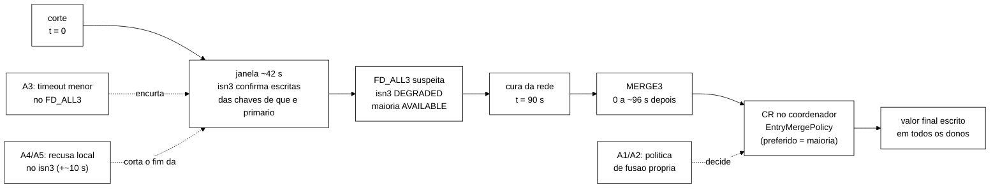

# Outras formas de tratar o *cluster* contra o logout perdido na fusão (2026-11-06)

Autor: Senior. Branch `docs/plano-implementacao-controlador`. **Só leitura**: nada foi executado em *cluster* nem
na VM. Complementa `docs/acoes-controlador-cluster-2026-11-05.md` e
`docs/opcoes-arquitetura-configuracao-2026-11-05.md`, que continuam valendo no que não for dito aqui.

Fontes: código do Infinispan 15.0.21.Final (*tag*, *commit* `5bdc4de`) e do JGroups 5.3.16.Final (*commit*
`d87c9cf`), lidos nesta sessão; guias oficiais da série 15.0 (`https://infinispan.org/docs/15.0.x/...`, baixados
nesta sessão para conferir os números de seção); manual do JGroups 5 (`http://www.jgroups.org/manual5/index.html`).
Os caminhos do Infinispan são relativos à raiz do repositório dele. Os do JGroups são relativos a `src/org/jgroups/`.
Um fato medido do próprio projeto é usado: as linhas `ISPN100012`/`ISPN100013` de
`wt-b44-3/runs/b44-3/analise/logs-INV-async-cura40.tsv`. **Tudo depende da validação do Gestor (seção 6).**

| Termo | Significado |
|---|---|
| CR | resolução de conflitos (*conflict resolution*): na fusão, o coordenador lê as cópias de cada chave nos dois lados e aplica a política de fusão |
| política de fusão | `merge-policy` do *cache*; uma implementação de `EntryMergePolicy` |
| semirreticulado | ordem em que a fusão é o máximo; fundir em qualquer ordem dá o mesmo resultado, e um valor maior nunca é desfeito |
| janela | intervalo entre o corte e a detecção pelo FD_ALL3 (~42 s), em que o isn3 ainda confirma escritas |
| perda permanente | o valor confirmado pelo isn3 some na fusão (o I1 da varredura) |
| exposição na janela | leitura do valor velho enquanto os dois lados divergem (VALID lido na maioria depois do logout confirmado no isn3) |

## 0. Resposta curta

1. **Existe uma forma de tratar o *cluster* que ataca a perda permanente na raiz: uma política de fusão própria.**
   O Infinispan Server 15 aceita uma classe `EntryMergePolicy` num JAR em `server/lib`, referenciada pelo nome em
   `merge-policy`, inclusive em *cache* criado pela REST com JSON. O guia oficial traz o exemplo em JSON com
   `DENY_READ_WRITES`. A CR roda na fusão com `DENY_READ_WRITES` (pelo código e pelos nossos logs) e recebe a cópia
   do isn3. Com a ordem de conteúdo do modelo (INVALID vence VALID), o logout confirmado pelo isn3 não volta a VALID.
   **Não reduz a exposição na janela.**
2. **Zero código, para testar a hipótese já:** `merge-policy="REMOVE_ALL"` só no `sessions-async`. A sessão em
   conflito é apagada em vez de voltar a VALID. Isso falha fechado: o usuário precisa entrar de novo, mas o logout
   não é desfeito. Serve também como experimento que separa as duas leituras possíveis da documentação (seção 2.2).
3. **A janela só encolhe com detecção mais cedo.** Baixar o `timeout` do FD_ALL3 na configuração (estático) encurta
   a janela dos dois lados. O custo é o falso positivo, que vira divisão e fusão. Com `PREFERRED_NON_NULL` em ASYNC,
   isso já criou I1 no B-44.3. Com a política do item 1, a fusão de um falso positivo deixa de desfazer logout.
   **Os itens 1 e 3 se completam.**
4. **Achado novo para o controlador:** `POST /rest/v2/server/ignored-caches/{cache}` mandado **ao próprio isn3**
   tem efeito local imediato pelo código (o conjunto em memória muda antes da gravação replicada, e o Hot Rod confere
   esse conjunto a cada pedido). Seria uma recusa em milissegundos, contra os ~13 s da parada. O risco é o falso
   positivo: sem corte, a gravação replica e os três nós passam a ignorar o *cache*. Não foi medido.
5. **Não resolvem:** `merge-policy="NONE"` com CR comandada depois (os valores do isn3 já foram descartados quando a
   tarefa rodaria); filtro de IP e parada de conector pela REST (passam pelo estado global replicado e alcançam o
   nó isolado só por acaso de posse); `ALLOW_READS` (piora a exposição depois da detecção); transações e operações
   versionadas do Hot Rod (exigem o cliente; o modo é imutável).

## 1. O mecanismo, confirmado no código

| Passo | O que o código faz | Código |
|---|---|---|
| Estratégia | Qualquer `when-split` diferente de `ALLOW_READ_WRITES` usa `PreferConsistencyStrategy` | `core/.../topology/ClusterTopologyManagerImpl.java:553-561` |
| CR ligada? | Só se `merge-policy` não for `NONE`, e se o rebalanceamento estiver ligado | `core/.../configuration/cache/PartitionHandlingConfiguration.java:42-48`; `core/.../topology/ClusterCacheStatus.java:1173-1180` |
| CR na fusão | Com `DENY_READ_WRITES`, há CR quando o resultado da fusão é `AVAILABLE` e há mais de um membro | `core/.../partitionhandling/impl/PreferConsistencyStrategy.java:251-268` |
| Quem é lido | O *hash* da CR é a **união** dos *hashes* de todas as partições, para ler "todos os donos possíveis antes do rebalanceamento". O isn3 entra, porque em `DEGRADED` o *hash* dele não muda | `ClusterCacheStatus.java:1183-1191`; `PreferConsistencyStrategy.java:254-266` |
| Onde roda | No coordenador, que guarda o `ClusterCacheStatus` | `ClusterCacheStatus.java:1314-1333` |
| O que a política recebe | `preferredEntry`: a cópia do lado preferido (a partição `AVAILABLE`, a maioria; com uma só cópia lá, essa; com várias, a do primário). `otherEntries`: as demais cópias não nulas | `core/.../conflict/impl/DefaultConflictManager.java:296-319`; contrato em `core/.../conflict/EntryMergePolicy.java:14-35` |
| Quando há conflito | Só se as cópias diferem (`distinct().count() > 1`) | `DefaultConflictManager.java:465-467` |
| O que é escrito | A entrada devolvida, com o valor e os metadados dela, a todos os donos; `null` apaga | `DefaultConflictManager.java:337-350` |
| `PREFERRED_NON_NULL` | Devolve a preferida se não for nula: o VALID da maioria vence o INVALID do isn3 | `core/.../conflict/MergePolicy.java:12-16` |

**Medido no projeto:** no B-44.3 ASYNC, o coordenador isn1 registrou `ISPN100012: Starting conflict resolution` e
`ISPN100013: Finished` para `sessions-async` e `counters-async` na fusão (09:07:55,520 a 09:07:55,603, 83 ms)
(`wt-b44-3/runs/b44-3/analise/logs-INV-async-cura40.tsv`). A CR roda de fato na nossa configuração, e é nela que o
logout se perde.

## 2. Alternativas, em ordem de chance de resolver

### 2.1 A1. Política de fusão própria (semirreticulado), no `sessions-async` — **chance alta para a perda permanente**

- **Existe no 15, para o Server, com JSON.** Guia *Configuring Infinispan* 15.0, §7.6 "Configuring custom merge
  policies" (`https://infinispan.org/docs/15.0.x/titles/configuring/configuring.html#configuring-custom-merge-policies_partition-handling`):
  implementar `EntryMergePolicy`; empacotar num JAR com `META-INF/services/org.infinispan.conflict.EntryMergePolicy`;
  pôr o JAR em `server/lib`; referenciar a classe em `merge-policy`. O exemplo JSON oficial é exatamente
  `{"distributed-cache":{"partition-handling":{"when-split":"DENY_READ_WRITES","merge-policy":"org.example.CustomMergePolicy"}}}`
  (fonte: `documentation/.../topics/json/custom_merge_policy.json`). Exemplo de classe:
  `documentation/.../topics/code_examples/CustomMergePolicyEntryMerge.java`. O guia do servidor, §1.10.1 "Server root
  directory", diz que `server/lib` guarda JARs de extensão
  (`https://infinispan.org/docs/15.0.x/titles/server/server.html#server_root_directory`).
- **Pelo código, funciona em *cache* criado pela REST.**
  - O *parser* transforma qualquer nome que não seja das cinco políticas embutidas em `CUSTOM` e instancia a classe
    pelo *classloader* do *holder* (`core/.../configuration/parsing/CacheParser.java:243-247`;
    `MergePolicy.java:34-39`).
  - A REST usa o `ParserRegistry` do `InvocationHelper`, criado com o *classloader* de contexto da *thread*
    (`server/rest/.../InvocationHelper.java:26`; `core/.../configuration/parsing/ParserRegistry.java:62-63`).
    O lançador do servidor põe `server/lib` nesse *classloader* e o fixa como contexto antes de subir o servidor
    (`server/runtime/.../loader/Loader.java:84-99`).
  - Os outros nós recebem a configuração pelo estado global e a analisam de novo com um `ParserRegistry` criado na
    subida (`core/.../globalstate/impl/GlobalConfigurationManagerImpl.java:109`). A política é gravada pelo nome da
    classe (`core/.../configuration/serializing/CoreConfigurationSerializer.java:654-665`). Por isso **o JAR precisa
    estar nos três nós**.
  - A política continua **imutável** depois da criação (`PartitionHandlingConfiguration.java:22-23`). É escolha de
    configuração, não ação do controlador.
- **Chamada na fusão depois de `DENY_READ_WRITES`?** Sim (seção 1). O comentário do contrato fala só em
  `ALLOW_READ_WRITES` (`EntryMergePolicy.java:15-17`), mas o código chama a CR também pela `PreferConsistencyStrategy`,
  e os nossos logs mostram `ISPN100012/13` com `DENY_READ_WRITES`.
- **Formato do valor.** Os nossos *caches* não declaram `encoding` (`wt-cs3-cc2b71c/cluster/caches/sessions-async.json`).
  No servidor, sem `encoding` e sem indexação, o tipo de armazenamento é `application/unknown`
  (`core/.../encoding/impl/StorageConfigurationManager.java:90-110`; o aviso `ISPN000599` sai em `:85-87`), e o valor
  fica embrulhado em `WrappedByteArray` (`core/.../encoding/DataConversion.java:41-46`). O cliente grava com
  `JavaSerializationMarshaller` (`workload/.../session/S3Clientes.java:75-76`), que é um `ObjectOutputStream` comum
  (`commons/.../marshall/JavaSerializationMarshaller.java:41-44`). A CR lê as cópias sem conversão: o contêiner de
  dados local e os blocos de transferência de estado dos outros donos (`DefaultConflictManager.java:493`;
  `core/.../conflict/impl/StateReceiverImpl.java:171`, `:224-226`). **Logo, a política recebe `CacheEntry` com valor
  `WrappedByteArray` contendo a serialização Java de `SessionState`.** O guia, §7.6, confirma o caso análogo: com
  `application/x-protostream`, a política recebe `byte[]`; para receber o objeto, seria preciso `application/x-java-object`
  e o *marshaller* no servidor. Ver também *Encoding* 15.0, §1.1 "Cache encoding" e §1.4 "Marshalled Java objects"
  (`https://infinispan.org/docs/15.0.x/titles/encoding/encoding.html#encoding`,
  `#marshalled-object-encoding_storage-formats`).
  - **Consequência prática:** o servidor não desserializa nada por conta própria. A política desserializa só para
    decidir, com um `ObjectInputStream` que resolve classes pelo *classloader* do JAR e aceita só
    `br.unipampa.tcc.session.*`, os `enum` deles e `java.time.Ser`. O JAR leva cópias de `SessionState` e
    `IdentityState` com o mesmo `serialVersionUID` (1L). A política **devolve uma das entradas recebidas, sem
    reserializar**, e assim o valor e os metadados gravados são os originais.
- **A regra.** Em `SessionState` o ciclo de vida é monótono: só existem `criar` (VALID, versão 1) e `invalidar`
  (INVALID, versão + 1), e `invalidar` sobre INVALID devolve o próprio registro
  (`workload/.../session/SessionState.java`). A fusão vira o **máximo** na ordem
  `(RankEstado, RankMotivo, versao, atualizadaEm)`, com os mesmos postos do T2 (`wt-b45/spec/SessionStore.tla:202-240`:
  NONE < VALID < INVALID; NONE < LOGOUT < EXPIRADA < ADMIN_BLOCK). Diferença em relação ao T2: aqui o **conteúdo vem
  antes da versão**. No domínio de sessões as duas ordens coincidem, porque o INVALID sempre tem versão maior. Pôr o
  conteúdo primeiro torna a invalidação absorvente mesmo se a versão estiver errada. Ignora-se qual entrada é a
  preferida. Máximo numa ordem total é associativo, comutativo e idempotente, então o resultado não depende de qual
  lado é a maioria nem de quantas cópias chegam. A política nunca devolve `null`.
- **`counters-async` (`IdentityState`) fica de fora na primeira rodada.** O registro não é monótono: existem
  `desbloquear` e `resetar`. Escolher um registro inteiro sempre perde alguma coisa. Com a versão primeiro (T2), um
  bloqueio no isn3 perde para dois incrementos na maioria. Com o conteúdo primeiro, um desbloqueio legítimo é desfeito
  e o contador pode descer (I5/I6). Uma fusão campo a campo (contador = máximo, status com regra própria) é possível,
  porque a política pode devolver uma entrada nova, mas isso é outra semântica e fica para decisão (D-2).
- **Ataca:** a **perda permanente** (o I1 da varredura). **Não ataca** a exposição na janela: até a fusão, a maioria
  lê VALID depois do logout confirmado no isn3, por toda a partição (90 s) mais 0 a ~96 s até o MERGE3. Também não
  evita que o isn3 confirme escritas na janela.
- **Também reduz o custo do falso positivo** de qualquer ação que force divisão e fusão (AC-6, FD_ALL3 curto, seção
  2.3): a fusão deixa de desfazer logout. Isso não vale para `counters-async` enquanto ele ficar com
  `PREFERRED_NON_NULL`.
- **Modelo.** Uma variante `MesclarJoin` no TLA+, em que a fusão é o máximo da ordem acima em vez do registro do lado
  vencedor, deixa o TLC conferir que `I1M` deixa de ter traço. Esse é o argumento formal para o texto.
- **Esforço para testar no local: ~1,5 a 2 dias.** Classe com cerca de 150 linhas e testes JUnit da ordem (bytes
  serializados de verdade, as permutações de `otherEntries` e a nulidade): meio dia. JAR, volume
  `/opt/infinispan/server/lib/` nos três serviços do `podman-compose-sem-caches.yml` e JSON novo: meio dia. Execução
  com o `inject-partition.sh` (isn3 por 90 s, ASYNC), comparada com a de controle: meio a um dia.
- **Riscos a verificar:** (1) o *classloader* na criação pela REST (critério: `GET ...?action=config` nos três nós
  devolve o nome da classe); (2) uma exceção na política é registrada como `ISPN000466` e a chave fica sem resolver
  (`DefaultConflictManager.java:321-330`), então a classe não pode lançar exceção (se não decidir, devolve a
  preferida); (3) a CR é desligada quando o rebalanceamento está desligado (N-5 de 05/11), então o AC-2 continua não
  podendo coincidir com a fusão; (4) a configuração muda e o *rebaseline* deixa de ser comparável, o que pede uma
  condição nova e pré-registrada (D-1).
- **Variante A1c (só se o Gestor quiser "selecionar entre políticas" em execução).** A classe implantada pode delegar a
  `PREFERRED_NON_NULL` ou ao semirreticulado conforme uma chave estática, trocada por uma tarefa de servidor
  (`POST /rest/v2/tasks/{nome}?action=exec`, modo `ALL_NODES`; seção 2.5). A CR roda no coordenador, que pode mudar,
  por isso a troca vai a todos os nós. Isso torna selecionável em execução a política de fusão, que o atributo deixa
  imutável. É desenho novo e pede decisão (D-3).

### 2.2 A2. `merge-policy="REMOVE_ALL"` no `sessions-async` — **chance média-alta, sem código**

- **O que é.** Política embutida: toda chave em conflito é apagada (`MergePolicy.java:18`; *Configuring* 15.0, §7.5
  "Merge policies", `#partition-handling-merge-policies_partition-handling`).
- **Efeito.** A sessão com logout no isn3 e VALID na maioria some. A aplicação lê nulo e trata como sessão inexistente:
  o logout não é desfeito e o I1 não ocorre. O custo é que logins e escritas feitos de um só lado na janela também
  somem e o usuário entra de novo. É perda de disponibilidade, não de segurança. **Não usar no `counters-async`:**
  apagar um `IdentityState` bloqueado equivale a desbloquear.
- **Valor como experimento decisivo.** O guia, §7.1.1 "Data consistency in a split cluster"
  (`#partition-handling-data-consistency_partition-handling`), diz que a escrita no lado menor antes da detecção "is
  lost ... regardless of any handling strategy or merge policy". O código (seção 1) diz que a CR lê também o isn3.
  Uma execução com `REMOVE_ALL` separa as duas leituras: se as sessões com logout no isn3 **somem** na fusão, a CR viu
  a cópia do isn3 e a A1 vai funcionar; se **voltam a VALID**, a cópia do isn3 foi descartada antes e a A1 não adianta.
  Para ver diretamente, basta o nível TRACE em `org.infinispan.conflict` no coordenador, que registra
  `applying EntryMergePolicy ... PreferredEntry ..., otherEntries ...` (`DefaultConflictManager.java:314-315`).
- **Estática.** Ataca só a perda permanente.
- **Esforço: 2 a 4 horas** (JSON, uma execução de partição, contagem na varredura).
- **Risco para a leitura dos invariantes.** O auditor pode contar a chave apagada como outro achado (o
  `MesclarPerdeChave` do catálogo). Isso deve ser declarado, não escondido.

### 2.3 A3. Detecção mais cedo, de forma estática (FD_ALL3 e VERIFY_SUSPECT2) — **chance média para a janela, parcial**

- **Números.** O tempo até a suspeita é
  `FD_ALL[2|3].timeout + FD_ALL[2|3].interval + VERIFY_SUSPECT[2].timeout + GMS.view_ack_collection_timeout`
  (*Configuring* 15.0, §7.1 "Split clusters and network partitions", `#partition-handling_partition-handling`).
  Padrões do JGroups 5.3.16: `timeout` = 40 000 ms e `interval` = 8 000 ms (`protocols/FailureDetection.java:27-32`);
  VERIFY_SUSPECT2 com 1 000 ms na nossa pilha (`cluster/jgroups-tcp.xml`). Isso explica os 39,8 a 46,4 s medidos. O
  FD_ALL3 suspeita quando todos os `timeout/interval` bits do membro ficam em zero, e **qualquer mensagem recebida
  conta como batimento** (manual JGroups 5, §6.8.4 "FD_ALL3"; §6.8 "Failure Detection"; §6.8.9 "VERIFY_SUSPECT2").
- **Efeito.** Cada lado detecta sozinho, então o isn3 também instala a vista de um nó e passa a `DEGRADED` mais cedo.
  É o único item que encurta a janela **dos dois lados** sem controlador. Com `timeout` = 10 s e `interval` = 2 s, a
  suspeita viria entre ~11 e ~13 s; com 5 s e 1 s, entre ~6 e ~7 s, mais a instalação da vista. Como as perdas se
  concentram nos primeiros ~15 s, mesmo 5 s não elimina a perda. Corta a cauda.
- **Custos e riscos documentados.**
  - Falso positivo: o Infinispan avisa que não distingue falha de rede de pausa da JVM por coleta de lixo (§7.1, nota).
    O manual do JGroups explica que mensagens fora de ordem (OOB) existem para que um batimento atrasado atrás de
    outras mensagens não cause "false suspicion" (manual JGroups 5, "Out-of-band messages"). O VERIFY_SUSPECT2 existe
    para reduzir suspeitas falsas (§6.8.8 e §6.8.9).
  - No projeto, o falso positivo é uma divisão seguida de fusão. Em ASYNC com `PREFERRED_NON_NULL`, isso criou 4 × I1
    e 1 × I5 no B-44.3. **Com a A1, o I1 dessa fusão deixa de ocorrer no `sessions-async`.**
  - Sob perda de pacotes (escala F4), `timeout` curto aumenta divisões e fusões repetidas.
  - A fusão continua dependendo do MERGE3: de 0 a ~96 s depois da cura (B-44.3).
- **Estática.** Não muda em execução: gravar o `timeout` não altera a detecção dos membros atuais (B-44.3 V-2,
  `opcoes-arquitetura-configuracao-2026-11-05.md` §2.2).
- **Ataca:** a exposição na janela e a quantidade de escritas aceitas pelo isn3. Não ataca a perda das escritas
  aceitas antes da detecção.
- **Esforço: ~meio dia por valor** (XML, execução de partição, execução sem falha com carga para contar suspeitas, e
  uma com `inject-pausa.sh` curta para ver o falso positivo).

### 2.4 A4. Ignorar o *cache* no próprio isn3 (`ignored-caches`) — **chance média para a janela; novo, não medido**

- **O que é.** `POST /rest/v2/server/ignored-caches/{cache}` exclui o *cache* dos pedidos de clientes; o Hot Rod
  responde `CacheUnavailableException` (*REST API* 15.0, §2.5.3 "Adding Caches to Ignore Lists" e §2.5.4,
  `https://infinispan.org/docs/15.0.x/titles/rest/rest.html`).
- **Achado de código.** `ignoreCache` muda o conjunto em memória **antes** de gravar no *cache* de estado global
  (`server/runtime/.../state/ServerStateManagerImpl.java:105-112`). O Hot Rod confere esse conjunto a cada pedido
  (`server/hotrod/.../HotRodServer.java:398-401`). Logo, no nó que recebe o pedido, o efeito é imediato e não
  depende da replicação. Isso corrige em parte a nota N-3 de 05/11, que tratava os *caches* ignorados junto com o
  conector e o filtro de IP. Esses dois só agem pelo ouvinte, depois da gravação (seção 2.6).
- **Efeito esperado.** Recusa no isn3 em milissegundos depois da decisão, contra ~13 s do AC-5 sob corte. Com S_lag
  em ~+10 s, a cobertura começaria em ~+10 s. O nó continua no *cluster*: não há LEAVE nem rebalanceamento.
  Desfaz-se com `DELETE` no mesmo caminho.
- **Riscos (todos a medir).** (1) **Falso positivo:** sem corte, a gravação no *cache* de estado (REPL_SYNC,
  `core/.../registry/impl/InternalCacheRegistryImpl.java:65-70`) replica, e o ouvinte dos outros nós aplica a lista
  (`ServerStateManagerImpl.java:282-296`). Os três nós passam a ignorar o *cache*. É perda de disponibilidade total,
  sem violação, até o `DELETE`. (2) Com corte, a resposta HTTP pode demorar até o `remote-timeout` do *cache* interno,
  então o atuador deve confirmar pelo efeito (recusa Hot Rod), não pelo 204. (3) Não se sabe o que a fusão faz com a
  entrada no *cache* de estado, que usa a política padrão (`InternalCacheRegistryImpl.java:66`, "TODO: choose a merge
  policy"). O isn3 pode continuar ignorando depois da fusão até um `DELETE`.
- **Ação em execução.** Ataca a exposição no isn3 depois da ação e as escritas que viriam depois dela. Não ataca o que
  foi aceito antes da ação.
- **Esforço: ~meio dia** (três medições: corte verdadeiro, falso positivo sem corte e estado depois da fusão).

### 2.5 A5. Tarefa de servidor que desliga o conector Hot Rod só no isn3 — **chance média para a janela; exige JAR**

- **Existe no 15.** Tarefas Java (`ServerTask`) num JAR em `server/lib` com
  `META-INF/services/org.infinispan.tasks.ServerTask`. Não há implantação em execução: é preciso parar o servidor
  (*Server* 15.0, §14.1 "Adding tasks to Infinispan Server deployments" e §14.1.1,
  `https://infinispan.org/docs/15.0.x/titles/server/server.html#adding-server-tasks_remote-execution`). A execução é
  `POST /rest/v2/tasks/{nome}?action=exec` (*REST API* 15.0, §2.8.2 "Executing Tasks"). Com `ONE_NODE`, a tarefa roda
  no nó que recebeu o pedido (`server/runtime/.../tasks/ServerTaskEngine.java:74-84`; carga em `Extensions.java:90-95`).
  Os *scripts* (§14.2) não evitam o JAR: o servidor não traz motor JavaScript (o `nashorn-core` só entra como
  dependência de teste em `tasks/scripting/pom.xml`).
- **O que a tarefa faria.** Pegar `ServerManagement` no registro global (o servidor o registra em
  `Server.java:449`), desligar a configuração do conector e fechar os canais. É o mesmo que o ouvinte do estado global
  faz (`ServerStateManagerImpl.java:299-312`), só que localmente. O `AccessControlFilter` recusa novas conexões quando
  o conector está desligado (`server/core/.../transport/AccessControlFilter.java:42-46`).
- **Comparação com a A4.** Mesma rapidez, sem o risco de propagar a recusa para os três nós no falso positivo, e com
  reversão local. O custo é que usa API interna, não documentada para tarefas, e exige JAR (o mesmo da A1 pode
  levar as duas classes).
- **Ação em execução.** Ataca a exposição no isn3 depois da ação. **Esforço: ~1 dia.**

### 2.6 A6. Filtro de IP no conector ou parada do conector pela REST — **chance baixa**

- **Existe no 15.** `GET/POST/DELETE /rest/v2/server/connectors/{conector}/ip-filter` e
  `POST /rest/v2/server/connectors/{conector}?action=stop` (`server/rest/.../ServerResource.java:157-184`). O guia
  documenta o filtro pela CLI e diz que as regras valem "across the cluster" (*Server* 15.0, §3.4 "Endpoint IP address
  filtering rules" e §3.5, `#endpoint-ip-address-filters_server-endpoints`, `#user_tool-server-endpoints`). O guia da
  REST 15.0 não documenta esses caminhos.
- **Por que não resolve.** As duas operações só gravam no *cache* de estado global REPL_SYNC
  (`ServerStateManagerImpl.java:131-148`). O efeito vem do ouvinte clusterizado, que fecha os canais
  (`ServerStateManagerImpl.java:299-339`, `:260-279`). No nó isolado, o efeito depende de onde está o dono primário da
  chave de estado e de a gravação terminar. Sem corte, vale para os três nós. Além disso, todos os clientes chegam pelo
  mesmo IP do *host* (portas publicadas do Podman), então o filtro não separa clientes. Quando age, a rapidez é igual
  à da A5 (fecha os canais na hora). O problema é se e onde age, não quão rápido.
- **Esforço para confirmar que não serve: ~2 horas.** Não recomendado.

### 2.7 A7. `merge-policy="NONE"` com CR comandada por tarefa — **não resolve**

- **Existe no 15.** `ConflictManagerFactory.get(cache.getAdvancedCache()).resolveConflicts(politica)` é API pública
  (*Configuring* 15.0, §7.7 "Manually merging partitions in embedded caches", `#merging-partitions-manually_partition-handling`;
  `code_examples/EmbeddedConflictManager.java`), e uma `ServerTask` alcança o `EmbeddedCacheManager`
  (`tasks/api/.../TaskContext.java:128`).
- **Por que não resolve.** (1) Com `NONE` não há CR na fusão (`PartitionHandlingConfiguration.java:42-48`). A topologia
  da maioria é instalada e o isn3 descarta os segmentos de que não é dono; o guia avisa: "Nodes drop segments for which
  they are not the primary owner, which can result in data loss" (§7.5). (2) A chamada manual usa os donos da topologia
  **atual**, sem a união dos *hashes* antigos (`DefaultConflictManager.java:238-241`, `:275-278`), e recusa rodar
  durante transferência de estado (`:208-210`). Depois da fusão, a cópia do isn3 já não existe. Antes dela, os lados
  não se veem. (3) Com `NONE`, `resolveConflicts()` sem argumento chama `MergePolicy.NONE`, que lança
  `UnsupportedOperationException` (`MergePolicy.java:8-9`, `:50-55`). (4) O momento da fusão depende do MERGE3 (0 a
  ~96 s), e não há gancho de servidor antes dela.
- **Esforço para demonstrar: ~1 dia.** Não recomendado.

### 2.8 A8. Outras opções de servidor — **não resolvem ou saem do escopo**

| Opção | Resultado | Evidência |
|---|---|---|
| `when-split="ALLOW_READS"` | Antes da detecção, nada muda (`AVAILABLE` libera tudo). Depois, o isn3 sozinho **continua servindo leituras** das chaves de que é dono, então a exposição piora. A fusão continua com a mesma política. Imutável | `PartitionHandlingManagerImpl.java:280-304`; *Configuring* 15.0, §7.4 |
| Versão das entradas | O servidor Hot Rod põe uma `NumericVersion` em cada escrita (`server/hotrod/.../CacheRequestProcessor.java:230`), formada por vista, posto do nó e contador (`core/.../container/versioning/NumericVersionGenerator.java:21`). Não é comparável entre partições. A A1 usa a `versao` do próprio registro | — |
| Operações condicionais (`replaceWithVersion`) | São do cliente (*Hot Rod Java* 15.0, §4.3 "MetadataValue API"). Mudam o cliente, fora da regra de 04/11 | `https://infinispan.org/docs/15.0.x/titles/hotrod_java/hotrod_java.html#hr_versioned_api` |
| Transações | Exigem o gerenciador de transações no cliente (*Hot Rod Java* 15.0, §4.7). O modo é imutável. Sob corte, a efetivação síncrona falharia em vez de confirmar, o que é o comportamento do SYNC já medido | `#hotrod_transactions` |
| Modo SYNC só para `sessions` | Resolveria (o isn3 não confirma sem a outra réplica), mas o modo é a variável do estudo (ASYNC é o alvo T1) | B-44.1 |
| Expiração | Já descartada (piora: `PREFERRED_NON_NULL` ressuscita) | `acoes-controlador-cluster-2026-11-05.md` §3.4 |

## 3. Quadro comparativo

| # | Alternativa | Estática ou execução | Perda permanente | Exposição na janela | Esforço local | Chance |
|---|---|---|---|---|---|---|
| A1 | Política de fusão própria (semirreticulado), `sessions-async` | estática (classe e JSON) | **elimina** (se a CR vê o isn3; confirmar com A2) | não | 1,5 a 2 dias | **alta** |
| A2 | `REMOVE_ALL` no `sessions-async` | estática (JSON) | elimina o I1 apagando a sessão (falha fechada) | não | 2 a 4 h | média-alta |
| A3 | FD_ALL3 com `timeout` menor | estática (pilha JGroups) | reduz (corta a cauda depois de ~6 a 13 s) | **reduz, dos dois lados** | meio dia por valor | média, parcial |
| A4 | `ignored-caches` mandado ao isn3 | execução (REST pronta) | reduz (depois da ação) | reduz no isn3 | meio dia | média, parcial; risco no falso positivo |
| A5 | Tarefa que desliga o Hot Rod só no isn3 | execução (tarefa em JAR) | reduz (depois da ação) | reduz no isn3 | 1 dia | média, parcial |
| A6 | Filtro de IP ou parada de conector pela REST | execução | incerta | incerta | 2 h | baixa |
| A7 | `NONE` com CR comandada | execução (tarefa) | não | não | 1 dia | nula |
| A8 | `ALLOW_READS`, versões, condicionais, transações | estática ou cliente | não | não ou piora | — | nula |

**Limite que nenhuma alternativa de servidor remove:** em ASYNC, enquanto ninguém detectou o corte, o isn3 confirma o
logout e a maioria lê VALID. Evitar isso exige recusar a escrita no isn3 antes da confirmação, e isso depende da
detecção (`gilbert_lynch_cap_2002`). As alternativas A3 a A5 só deslocam o início da recusa.

## 4. Recomendação

1. **Primeiro, A2 como experimento decisivo** (2 a 4 h), com TRACE em `org.infinispan.conflict` no coordenador. Se
   as sessões com logout no isn3 somem na fusão, a CR vê a cópia do isn3.
2. **Depois, A1 no `sessions-async`** (1,5 a 2 dias), com a variante `MesclarJoin` no TLA+ para o argumento formal.
   É a única alternativa que elimina a perda permanente sem trocar disponibilidade por consistência.
3. **A3 como complemento** (um valor, por exemplo `timeout` = 10 s e `interval` = 2 s, decidido pelo Gestor) só
   depois da A1, porque é a A1 que torna barato o falso positivo do detector.
4. **A4 ou A5 no lugar do AC-5 no P1**, se o Gestor quiser manter o controlador agindo na janela. A A4 não tem código.
   A A5 é mais segura no falso positivo. Medir antes de escolher.

## 5. O que não muda

- Os fatos medidos de 05/11 (imutabilidade de modo, donos, `when-split` e `merge-policy`; `DEGRADED` forçado sem
  recusa com 3 nós; AC-6 não adotada) continuam valendo. A A1 não muda atributo em execução: a política é escolhida
  na criação do *cache*.
- A regra de 04/11 continua: nenhuma alternativa acima muda o cliente Hot Rod.

## 6. Pontos para validação do Gestor

- **D-1.** A1/A2 mudam a configuração do *cache*. Entram como **condição nova e pré-registrada** (complemento ao
  B-40), separada do *rebaseline*, ou substituem a configuração da avaliação?
- **D-2.** `counters-async`: fica com `PREFERRED_NON_NULL` na primeira rodada (recomendação), ou entra a fusão campo a
  campo?
- **D-3.** A variante A1c (política de fusão selecionável em execução por tarefa) entra no escopo do objetivo (4), ou
  fica como trabalho futuro?
- **D-4.** Autorizar o experimento A2 e, se ele confirmar, a A1 (prompts a escrever).
- **D-5.** A3: qual valor de `timeout` testar, e se o teste de falso positivo usa o `inject-pausa.sh`.
- **D-6.** A4 contra A5 para o P1: medir as duas, ou só a A4 (sem código)?

## 7. Fontes

| Fonte | Seção | URL ou caminho |
|---|---|---|
| *Configuring Infinispan* 15.0 | §7.1 Split clusters and network partitions; §7.1.1 Data consistency in a split cluster; §7.4 Partition handling strategies; §7.5 Merge policies; §7.6 Configuring custom merge policies; §7.7 Manually merging partitions in embedded caches | `https://infinispan.org/docs/15.0.x/titles/configuring/configuring.html` (âncoras `#partition-handling_partition-handling`, `#partition-handling-data-consistency_partition-handling`, `#partition-handling-strategies_partition-handling`, `#partition-handling-merge-policies_partition-handling`, `#configuring-custom-merge-policies_partition-handling`, `#merging-partitions-manually_partition-handling`) |
| *Guide to Infinispan Server* 15.0 | §1.10.1 Server root directory; §3.4 Endpoint IP address filtering rules; §3.5 Inspecting and modifying rules for filtering IP addresses; §14.1 Adding tasks; §14.1.1 Infinispan Server tasks; §14.3 Running scripts and tasks | `https://infinispan.org/docs/15.0.x/titles/server/server.html`; cópia em `leituras/CAND-090-Infinispan15-Server-Guide.txt` |
| *Using the Infinispan REST API* 15.0 | §2.5.3 e §2.5.4 (ignore lists); §2.5.12 (stopping servers); §2.8.2 Executing Tasks | `https://infinispan.org/docs/15.0.x/titles/rest/rest.html`; cópia em `leituras/CAND-091-Infinispan15-REST-API.txt` |
| *Cache encoding and marshalling* 15.0 | §1.1 Cache encoding; §1.4 Marshalled Java objects; §1.6 Adding JARs to Infinispan Server installations | `https://infinispan.org/docs/15.0.x/titles/encoding/encoding.html` |
| *Hot Rod Java Client Guide* 15.0 | §4.3 MetadataValue API; §4.7 Hot Rod Java Client Transactions | `https://infinispan.org/docs/15.0.x/titles/hotrod_java/hotrod_java.html` |
| Manual do JGroups 5 | §6.7.1 MERGE3; §6.8 Failure Detection; §6.8.4 FD_ALL3; §6.8.8 VERIFY_SUSPECT; §6.8.9 VERIFY_SUSPECT2; "Out-of-band messages" | `http://www.jgroups.org/manual5/index.html` |
| Código Infinispan 15.0.21.Final (`5bdc4de`) | arquivos e linhas citados no texto | `https://github.com/infinispan/infinispan/tree/15.0.21.Final` |
| Código JGroups 5.3.16.Final (`d87c9cf`) | `protocols/FailureDetection.java:27-32`; `protocols/VERIFY_SUSPECT2.java:34-36` | `https://github.com/belaban/JGroups/tree/jgroups-5.3.16.Final` |
| Medição do projeto | `ISPN100012/13` na fusão ASYNC do B-44.3 | `wt-b44-3/runs/b44-3/analise/logs-INV-async-cura40.tsv` |
| Modelo TLA+ (T2) | `RankEstado`, `RankMotivo`, `RankStatus`, `ChaveSessao` | `wt-b45/spec/SessionStore.tla:202-240` |
