# Análise preliminar da avaliação fatorial, fase `nucleo` (Senior, 2026-11-07)

> **Preliminar, não oficial.** Lê a cópia do núcleo no *host* e a prévia do coordenador (semente 20261107). Não
> substitui a análise pré-registrada (DT-027, DT-028, `comparar_bracos.py` da tag `int/2026-11-06-aval` = `4b96798`),
> não muda regra nem desfecho e não decide nada sobre o protocolo. Serve para orientar a análise oficial e a escrita.
> Sem push. A VM não foi acessada; a atividade de leitura no *host* está em `docs/atividade-host.txt`.
>
> **Fase extra e reposições (F1 e F4): a completar.** Ainda rodando, fora do *host*. Ver a seção 8.

## 0. Fontes e como os números foram tirados

| Sigla | Arquivo ou comando |
|---|---|
| C | cópia `dados-vm/cs3-2026-11/fat-nucleo-previa-20261107T150934Z/campanha-s3-fatorial/` (64 pastas `exec-NNNN-<celula>-<braco>/`) |
| EJ, CH | `execucao.json`, `checagem.json` de cada execução |
| CV | `convergencia-resumo-rep-001.json` e `convergencia-rep-001.csv` |
| VI, VA, VID | `violacoes-rep-001.csv`, `varredura-rep-001.csv`, `varredura-identidades-rep-001.csv` |
| S3R, SO | `s3-resumo-rep-001.json`, `stdout.log` (linhas `Sonda replay`, `Varredura final`, `Hot Rod ISPN004005/7`) |
| DE, OB | `decisoes-rep-001.jsonl` (trilha do controlador), última linha `fim` de `observaveis-rep-001.jsonl` |
| EV, AC | `rep-001.csv` (eventos), `s3-acoes-rep-001.csv` (ações S3) |
| H4 | `C/h4/h4-nucleo.tsv` e `h4-nucleo.json`; `h4.txt` de cada execução |
| OR, RS | `C/nucleo/orquestrador.log`, `C/nucleo/resumo.md` |
| PV-F2, PV-F3, PV-none | prévia do coordenador, `.../previa/comparacao-F2.json/.md`, `comparacao-F3.*`, `comparacao-none.*` |
| X | `python -E -P extrai.py <saida>`: para cada execução chama `desfechos_execucao` do `comparar_bracos.py` da tag (fases `durante,recuperacao` nas F2 e F3, `antes` na sem falha; `--w-recovery-s 191`, W_c 4 s, `fusao_obrigatoria` na F2) e `energia_proxy.analisar_execucao` em memória (P_max 181 W, razões 0,3 e 0,5), mais contagens próprias de VI, VA, SO, DE, OB, EV e AC. Grava um JSON fora da cópia (`extrato.json`, 1,4 MB, refeito em ~12 s) |
| Q1 a Q7 | consultas sobre o JSON do X e leituras pontuais de EV, na pasta `docs/analise-preliminar-fatorial-2026-11-07/` (`q1_execucoes.py` a `q7d_logouts_isn3.py`) |

**Conferência do X contra a prévia.** Os valores por execução que o X tira (V, p99, taxa de erro, perda, exposição) são
os mesmos do `y_por_bloco` do PV-F2 (ex.: `exec-0000-ASYNC-F2-PO`, V 0,35503 e p99 1 503 292 175 ns nos dois), e a
reimplementação dos contrastes em `q5b_contrastes.py` dá os mesmos efeitos, IC *t* e p da troca de sinal do PV-F2 até a
quarta casa (V: A1 0,0186, A4 −0,1885, interação 0,0450; p99: 0,9717, 0,9718, 0,9441).

Unidades: V em pares (chave, invariante) por mil ações S3; "s desde o start" é o tempo desde o marcador `start` da
falha; fases como em `analysis/fases.py`.

## 1. Execuções

### 1.1 Contagem, vereditos e descartes

| Célula | Braços | Execuções | Veredito | Fonte |
|---|---|---|---|---|
| ASYNC-F2 (teste, fatorial) | PO, PL, AO, AL | 12 + 12 + 12 + 12 = 48 (blocos 0, 3, 8, 9, 12 a 19) | 48 ACEITA | CH, RS |
| ASYNC-F3 (descritiva) | A, B | 4 + 4 (blocos 2, 5, 6, 11) | 8 ACEITA | CH |
| ASYNC-none (descritiva) | A, B | 4 + 4 (blocos 1, 4, 7, 10) | 8 ACEITA | CH |
| **total** | | **64** | **64 ACEITA, 0 descarte, 0 motivo, 0 aviso** | RS (`Contagem: ACEITA=64`), Q1 |

Protocolo por execução, todas as 64 (Q1, EJ): `workload_exit` 0, `teto_estourado` false, `trilha.fim` true com
`linhas_perdidas` 0, camada 3 sem divergência antes e depois, `swap_usado_kb_k1` = 39 188 kB, política de fusão conferida
nos três nós (`fusao_config.ok` true: 40 `pnn` com `A1-POLITICA carregada` 0,0,0 e 24 `a1` com 2,1,1). Sementes 800 000
+ 100·bloco, iguais dentro do bloco (EJ `seed`).

**h4 (H4).** 0 de 64 execuções com h4; nenhuma parada. Pior janela de 10 s dentro das janelas de medição: mediana
0,173 s, máxima 1,327 s (i = 49, AL do bloco 16), contra o limiar h4a de 1,5 s. Fora das janelas houve 4 episódios em
7,21 h observadas (0,55 por hora; `h4-nucleo.json`, `episodios`). O núcleo rodou com folga de h4, ao contrário do
previsto no roteiro (seção 8: 13,8 % por execução na recalibração).

### 1.2 Duração

| Medida | F2 | F3 | sem falha | Fonte |
|---|---|---|---|---|
| lançamento da carga → fim (mediana; mín.; máx.) | 310,4 s; 310,3; **905,4 (i = 34)** | 311,3; 311,0; 311,3 | 310,4; 310,3; 310,5 | EJ `lancamento_utc`, `fim_utc` (Q1) |
| recriação do *cluster* → fim (mediana; máx.) | 388,4 s; **985,7 (i = 34)** | 390,8; 392,9 | 390,1; 392,8 | EJ `recriacao_ms` (Q1) |
| ciclo lançamento → lançamento seguinte | mediana 389,7 s (mín. 387,1); 476,2 s na parada do piloto (i = 7 → 8); 984,2 s depois da i = 34 | | | EJ (Q1) |

Fase inteira: primeiro lançamento 00:35:00,600Z, último fim 07:41:16,650Z (EJ), `FIM exit=0` às 07:41:17,988Z (OR):
~7 h 06 min com a pausa do piloto (i = 7 terminou 01:25:43,953Z; i = 8 lançada 01:28:28,860Z). Bate com a estimativa do
roteiro (64 × ~395 s ≈ 7,0 h).

### 1.3 Convergência e divergência persistente

- 63 de 64 convergiram na primeira rodada válida depois do fim da carga (CV `rodadas` 3, Δ_conv mediana 0,0115 s na F2,
  máx. 0,0201 s; 0,0143 s na F3; 0,0111 s na sem falha; Q1).
- **A i = 34 não convergiu** (`exec-0034-ASYNC-F2-PO`, bloco 12, braço **PO**): 150 rodadas em 600 s, `convergiu` false,
  `divergencia_persistente` true (CV). Uma chave com I5 em todas as rodadas (`chaves_divergentes_i5` = 1 nas 150), a
  sessão `82ec745e…` da identidade `s3-u-039`: réplicas `INVALID/LOGOUT` × `VALID/NONE` (VI, linha I5 das 04:32:42Z).
  **Por quê.** O `Logout` dessa sessão foi pedido ao `isn1` a +20,1 s, +25,4 s e +31,1 s do start e voltou
  `ERROR_TRANSPORT` nas três (EV; `q7`), isto é, o cliente não recebeu confirmação, mas a escrita ficou aplicada numa
  das réplicas. A fusão com `PREFERRED_NON_NULL` não reconcilia as duas cópias não nulas e o *cluster* não tem reparo de
  leitura, então a divergência não fecha. Não é I1 (o logout não foi confirmado), não entra em V e não entra na perda
  permanente (a varredura lê uma cópia por chave; a dela não achou I1). A execução levou 985,7 s; a checagem de fusão do
  programa saiu a +757 s do `end` só porque roda depois do laço de convergência (EJ `fusao_checagem.desde_end_s`).
- No fatorial, divergência persistente 1 em 24 execuções `pnn` e 0 em 24 `a1` (PV-F2 `divergencia_persistente`, efeito
  A1 −0,042, p = 1,0; não testável com um caso).

## 2. Falhas injetadas

| Falha | Execuções | Alvo e forma | Instante | Duração efetiva | Fonte |
|---|---|---|---|---|---|
| F2 (partição) | 48 | `isn3` isolado de `isn1` e `isn2` por `tc` *drop* nas duas direções, `DENY_READ_WRITES` | disparo a +49,04 a +49,26 s da âncora; marcador `start` a +49,55 a +50,16 s | **96,04 a 96,07 s entre `start` e `end`** (mediana 96,05) | EJ `inj_inicio_offset_s`, marcadores (Q2) |
| F3 (*jitter*) | 8 | `netem delay 20ms 13ms distribution normal` em `isn2` | disparo a +49,12 a +49,31 s; netem efetivo 2,03 a 2,06 s depois (+51,17 a +51,34 s) | 251,13 a 251,45 s (até o fim da carga) | EJ `falha_efetiva.netem_efetiva`, marcadores (Q2) |
| nenhuma | 8 | — | — | — | — |

- Nas 56 com falha, `injetor_exit` 0, sem resíduo de rede (`rede_pos.residuo` false) e *dead-man* armado (EJ).
- **A partição dura ~96 s, não 90 s.** O injetor aplica os filtros, espera ~6 s pela confirmação "isn3 não conecta a
  nenhum par" e só então conta os 90 s (`injetor.log`, ex.: 00:42:22Z aplicada, 00:42:28Z confirmada). O texto do TCC deve
  dizer "≈96 s" ou "90 s depois da confirmação", não "90 s".
- **Fusão depois do fim da falha** (48 de 48 com `t_fusao_ns`, nenhuma nula). Pela trilha (primeira amostra com os três
  nós em 3, campo `t_fusao_ns` que a análise usa): +43,98 a +46,33 s do `end`, mediana 44,30. Pela primeira linha
  `ISPN000093`: +41,54 a +45,35 s, mediana 43,37; diferença trilha − `ISPN000093` de 0,05 a 3,0 s (EJ `fusao_trilha`,
  `fusao_vista`). Medianas por braço iguais a menos de 1 s (PO 44,34; PL 44,22; AO 44,26; AL 44,33 pela trilha).
  Relativo ao start, a fusão cai em +137,6 a +141,4 s.
- **Detecção pelo *cluster*** (primeira recusa `ISPN000306` vista pelo cliente): +41,7 a +46,3 s do start nas 48 F2
  (SO, linha `Hot Rod ISPN004005`, `t_primeira_ns`; Q4b). Coerente com o +41,9 a +47,3 s do piloto (DT-026 §1).

Linha do tempo típica de uma F2 (faixas das 48 execuções; fontes nas seções 2 e 4):

```mermaid
%%{init: {'theme':'base','themeVariables':{'background':'#ffffff','primaryColor':'#ffffff','primaryTextColor':'#000000','primaryBorderColor':'#000000','lineColor':'#000000','secondaryColor':'#ffffff','tertiaryColor':'#ffffff','fontFamily':'Arial'}}}%%
flowchart LR
    A["start da F2<br/>+0 s"] --> B["controlador entra em CONSERVADOR<br/>+1,7 a +10,1 s"]
    B --> C["P1: AC-7 no isn3<br/>+6,0 a +10,4 s; efeito em 6 a 42 ms"]
    C --> D["cluster detecta a partição<br/>1a ISPN000306 a +41,7 a +46,3 s"]
    D --> E["AC-7 desfeito (R6)<br/>+45,8 a +50,4 s"]
    E --> F["end da F2<br/>+96,0 s"]
    F --> G["fusão, 1a ISPN000093<br/>+137,6 a +141,4 s"]
    G --> H["fim da carga ~+250 s;<br/>convergência, sonda tardia e varredura"]
```

## 3. Invariantes

### 3.1 Todas as linhas de violação do núcleo

660 linhas em VI nas 64 execuções (Q3): `I2_CASCATA_INCOMPLETA` 286, `I2_JANELA_CASCATA` 204, I1 154, I2 (REAL) 15, I5 1.
Nenhuma I3, I4 nem I6. Na varredura (VA), 85 achados: I1 REAL 20, I2 INCERTA 44, I2 ESPERADA-POR-DESENHO 21; nenhum I4,
I2 REAL nem I2-PERDIDO.

| Célula/braço | I1 (linhas; chaves) | I2 REAL | `I2_JANELA_CASCATA` (linhas; chaves) | `I2_CASCATA_INCOMPLETA` (linhas; chaves) | I5 | Varredura (VA) |
|---|---|---|---|---|---|---|
| F2 PO | 52; 37 | 0 | 66; 10 | 147; 7 | 1 (i = 34) | I1 REAL 11; I2 INCERTA 7; ESPERADA 7 |
| F2 PL | 25; 16 | 0 | 56; 10 | 59; 5 | 0 | I1 REAL 9; INCERTA 7; ESPERADA 5 |
| F2 AO | 41; 36 | 0 | 27; 10 | 42; 4 | 0 | INCERTA 17; ESPERADA 4 |
| F2 AL | 36; 19 | **15; 1** | 27; 11 | 38; 3 | 0 | INCERTA 13; ESPERADA 5 |
| F3 A / B | 0 / 0 | 0 | 17; 13 / 10; 10 | 0 | 0 | — |
| sem falha A / B | 0 / 0 | 0 | 0 / 1; 1 | 0 | 0 | — |

Por fase de registro (coluna `fase` de VI, Q3): fora as `I2_JANELA_CASCATA` de `antes` (1 a 3 por braço F2, 2 e 3 na F3,
1 na sem falha B), tudo cai em `durante` ou `recuperacao`; nenhuma linha em `pos-convergencia`. As linhas I1 de
`recuperacao` (PO 14, PL 9, AO 1) são, quase todas, da sonda tardia depois do fim da carga; na regra de V elas são
atribuídas pelo instante do logout confirmado, que cai em `durante`.

### 3.2 V (pares distintos que contam) no fatorial

| Braço | Pares (I1 / I2 REAL / I4) | Linhas | Formas de I1 (1 / 2 / outra) | Pares por origem (online / sonda / varredura) | Pares em >1 origem | Sem a forma 2 | Fase atribuída | Ações S3 | V médio |
|---|---|---|---|---|---|---|---|---|---|
| PO | 37 / 0 / 0 | 63 | 12 / 23 / 2 | 3 / 35 / 11 | 12 | 14 | `durante` 35; `durante`+`recuperacao` 2 | 97 675 | 0,378 |
| PL | 16 / 0 / 0 | 34 | 9 / 6 / 1 | 0 / 16 / 9 | 9 | 10 | `durante` 16 | 95 898 | 0,167 |
| AO | 36 / 0 / 0 | 41 | 18 / 16 / 2 | 3 / 35 / 0 | 2 | 20 | `durante` 35; ambos 1 | 96 741 | 0,374 |
| AL | 19 / 1 / 0 | 51 | 8 / 10 / 1 | 2 / 18 / 0 | 0 | 10 | `durante` 20 | 95 780 | 0,208 |

Fonte: X (`violacoes_detalhe` do `comparar_bracos`: `pares`, `total_linhas`, `formas_i1`, `por_origem`,
`pares_multiplas_origens`, `total_pares_sem_forma2`) e PV-F2 (`contagem` AL 20, AO 36, PL 16, PO 37; `n_acoes`). Chaves
distintas = pares (nenhuma chave com dois invariantes, salvo a do I2 REAL, que também é I1: 109 pares em 108 chaves).

Combinação de instrumentos por par (Q3): PO, imediata sozinha 23, imediata + tardia + varredura 11, online 2, imediata
+ online 1; PL, imediata 7, imediata + tardia + varredura 9; AO, imediata 33, imediata + online 2, online 1; AL, imediata
18, online 2. **A sonda imediata está em 104 dos 109 pares**; sem ela, V seria quase só a varredura dos braços `pnn`.

Na F3 e na sem falha, V = 0 nos dois braços (39 004 e 38 823 ações na F3; 49 143 e 48 668 na sem falha; regra de três
≤ 7,7 × 10⁻⁵ por ação; PV-F3, PV-none).

### 3.3 Perda permanente, exposição e o que a A1 muda

| Braço | Perda permanente (sids) | Exposição na janela (sids) | Perda ∩ exposição | Forma 1 → perda | Sonda imediata VALID | Sonda tardia VALID |
|---|---|---|---|---|---|---|
| PO | 11 | 37 | 11 | 12 → 11 | 35 | 11 |
| PL | 9 | 16 | 9 | 9 → 9 | 16 | 9 |
| AO | **0** | 36 | 0 | 18 → **0** | 35 | **0** |
| AL | **0** | 19 | 0 | 8 → **0** | 18 | **0** |

Fonte: X (`fusao`: `sids_perda`, `sids_exposicao`, de `decompor_i1_pela_fusao`), PV-F2 `y_por_bloco`, Q3c, SO
(`imediatas_valid`, `tardias_valid`).

- **A A1 faz o que o relatório da A1 previa.** Com `PREFERRED_NON_NULL`, 20 das 21 formas 1 viraram perda permanente
  (95,2 %, IC de Clopper-Pearson 95 % [0,76; 1,00]); com a A1, 0 de 26 (IC [0; 0,13]). A sonda tardia, a varredura e o I1
  online depois da fusão não acham nenhuma perda nos 24 braços `a1` (Q3c, X).
- **Por que a A1 não mexe em V.** Toda sid perdida também foi exposta antes da fusão (perda ∩ exposição = perda nos
  dois braços `pnn`): a sonda imediata relê o logout do `isn3` 1 a 3 s depois pelo `isn1`, ainda `VALID`, e o par (sid, I1)
  já conta em V nesse momento. A fusão decide só se o mesmo par ganha mais detecções depois. Como V conta pares
  distintos, **V é, na prática, a exposição**: 37 pares × 37 sids expostas no PO, 36 × 36 no AO. A A1 age no componente
  "estado final errado", que V não separa. O desfecho que mede o efeito da A1 é a perda permanente (secundária).
- **Com os instrumentos antigos as conclusões se invertem** (Q5b, só online + varredura, descritivo): efeito A1 −0,0915
  por mil [−0,144; −0,039], p = 0,0068; efeito A4 −0,029 [−0,068; 0,011], p = 0,17. Só com a sonda (imediata + tardia):
  A1 +0,012 (p = 0,82) e A4 −0,185 (p = 0,0005). O resultado do fatorial depende do instrumento que define V; isso precisa
  aparecer na escrita.
- **Troca LOGOUT → ADMIN_BLOCK (custo da A1, DT-027 §7).** Nenhum I4 em nenhuma das 48 F2, por nenhuma origem (VI, VA,
  X). O cenário do TLC exige logout e *block* da mesma sessão em lados opostos da partição; não foi observado em 24
  execuções `a1`. **As linhas `A1-FUSAO` não estão na cópia**: só existem as linhas `ISPN000093` (`fusao-ispn000093.txt`)
  e as `A1-POLITICA carregada` do OR (64 linhas). Os descritivos da A1 pedidos na DT-027 §2.2 (escolhas em que a A1
  divergiu do `PREFERRED_NON_NULL`, usos da saída de segurança, trocas de motivo) não dão para fazer com a cópia (seção 7).

### 3.4 Casos que contam em V e merecem nota

- **I2 REAL no AL do bloco 3** (`exec-0011`, 15 linhas I2 e 18 linhas I1 `ADMIN_BLOCK` na mesma sid `a90a362b…`). O
  `admin` bloqueou `s3-u-021` pelo `isn1` a +43,86 s (confirmado a +44,08 s); o próprio `isn1` serviu a sessão `VALID` de
  +44,6 a +52,2 s (VI, EV, AC; Q3b). É a classe "leitura defasada na troca de vista" (P-4 da DT-026), no instante da
  detecção, num nó da maioria; não tem relação visível com a A1 nem com o AC-7 (que só age no `isn3`). Conta 2 pares.
- **Forma 1 depois da detecção** (`exec-0059`, PO): o `isn3` confirmou o logout da sid `eccac228…` a +67,0 s, 23 s
  depois da primeira recusa `ISPN000306` dessa execução (+44,0 s); a sid foi relida `VALID` e virou perda permanente (EV,
  VA). Ver 7.2.

## 4. Controlador

### 4.1 Decisões, regras e perfil

Regras do núcleo do controlador (`Decisao.Regra`): R1 violação, R2 entrada em CONSERVADOR, R3 sinal alto em
CONSERVADOR, R4 saída para NORMAL.

| Célula/braço | Transições por execução | 1ª entrada em CONSERVADOR (s desde o start) | Motivos da entrada | Janelas em CONSERVADOR | Regras nas decisões (R1 / R2 / R3 / R4) | P1 |
|---|---|---|---|---|---|---|
| F2 PO | 1 em 12 | +1,72 a +10,05 (mediana 9,74) | DEF+ERRO+LAT 8, DEF 2, DEF+ERRO 1, LAT 1 | 60 a 62 | 4 / 12 / 399 / 0 | 12 (PREVISTA) |
| F2 PL | 1 em 12 | +1,89 a +10,09 (7,85) | DEF+ERRO+LAT 5, DEF 3, LAT 4 | 60 a 62 | 0 / 12 / 407 / 0 | 12 (APLICADA) |
| F2 AO | 1 em 12 | +1,89 a +10,04 (7,86) | DEF+ERRO+LAT 6, DEF 3, LAT 3 | 60 a 62 | 5 / 12 / 401 / 0 | 12 (PREVISTA) |
| F2 AL | 1 em 12 | +2,10 a +10,12 (7,81) | DEF+ERRO+LAT 10, DEF 1, LAT 1 | 60 a 62 | 3 / 12 / 404 / 0 | 12 (APLICADA) |
| F3 A | 1 em 4 | +6,37 a +6,51 do início do *jitter* | DEF+LAT 4 | 62 | 0 / 4 / 244 / 0 | 0 |
| F3 B | 1 em 4 | +2,51 a +6,56 | DEF+LAT 3, LAT 1 | 62 a 63 | 0 / 4 / 245 / 0 | 0 |
| sem falha A | 0 em 4 | — | — | 0 | 0 / 0 / 0 / 0 | 0 |
| sem falha B | 1 em 2 execuções, 0 nas outras 2 | +8,0 e +36,0 da origem do controlador | LAT 2 | 62 e 55 (0 nas outras) | 0 / 2 / 3 / 0 | 0 |

Fonte: DE (linhas `decisao` e `politica`), Q4; PV-F2/F3/none (`controlador`). DEF = DEFASAGEM, LAT = LATENCIA.

- **R4 nunca ocorreu** em 64 execuções: uma vez em CONSERVADOR, o controlador fica lá até o fim, como a DT-028 §4
  (declaração 2) previa. O "tempo em CONSERVADOR" (≈ 240 a 248 s por F2, 992 e 996 s somados na F3) mede isso, não custo.
- **Política por assinatura**, F2 (DE `politica`, somando os quatro braços): P1 `isolar-suspeito` 48 (uma por execução,
  cota 1), sempre com o nó `127.0.0.1:11224` (`isn3`, o alvo correto, 48 de 48); P0 `cota-p1-esgotada` 408;
  `desfazer-alvo-sozinho` 48; nenhum `desfazer-apos-fusao` (R7), nenhum `suspeita-desfeita`, nenhum
  `p2-desabilitada` em ação. F3 e sem falha: só `sem-assinatura`.
- **AC-5 e AC-2 não ocorreram** (nenhuma linha `acao` desses tipos; `ac5_aplicada` false nas 64; P2 desabilitada).

### 4.2 AC-7 nos braços ativos (PL e AL, 24 execuções)

| Medida | Valor | Fonte |
|---|---|---|
| P1 → POST `ignored-caches/sessions-async` no `isn3` | 24 de 24 APLICADA | DE `acao` |
| instante do P1 (s desde o start), os quatro braços | **bimodal**: 23 execuções em +6,03 a +6,41 s e 25 em +9,77 a +10,39 s | DE (Q4b) |
| atraso entrada em CONSERVADOR → P1 | 0,24 a 0,34 s em 39 das 48 (mesma janela); 4,25 a 4,30 s em 9 (janela seguinte) | DE (Q4b) |
| efeito no alvo (`efeito_ms`) | 6 a 42 ms (dois grupos: 6 a 14 ms em 11, 34 a 42 ms em 13) | DE `lido` |
| duração da chamada de aplicar (inclui a guarda R4 de ~1 s) | 1 001,8 a 1 024,9 ms | DE `duracao_ns` |
| guarda R4 (lista replicada à maioria?) | `limpa` em 24 de 24 (42 a 44 leituras em 1,000 a 1,022 s); nenhum desfazer pela R4 | DE `lido` |
| guarda contínua | 0 desfazeres nas 24 | OB `guarda_ac7_desfazeres` |
| POST no alvo isolado | HTTP 500 depois de ~15 s em 24 de 24 (efeito conferido pela lista, R3) | DE `lido` `anterior=POST:500@15xxxms` |
| desfazer | 24 de 24, pela política `desfazer-alvo-sozinho` (R6), a +45,8 a +50,4 s; rota `alvo-sozinho` 23, **`maioria@127.0.0.1:11222+alvo` 1 (`exec-0037`)**; DELETE 204 em 1 a 5 ms (594 ms no da maioria) | DE |
| AC-7 ativo no fim | 0 de 24 | DE, PV-F2 `execucoes_com_ac7_ativa_no_fim` |
| tempo ativo | 36,0 a 44,0 s (mediana 40,0); total 471,99 s no PL e 457,72 s no AL | DE, PV-F2 `tempo_ativo_s` |
| erros do servidor de aplicação do alvo fora do laço | 133 a 248 por execução | OB `eventos_descontados_sob_acao` |

O AC-7 chega **32 a 40 s antes** da detecção do próprio *cluster* (+41,7 a +46,3 s) e é desfeito 1 a 5 s depois dela, quando o
`DENY_READ_WRITES` já recusa sozinho. A DT-028 §4 previa o P1 a +9,9 a +10,1 s; metade das execuções disparou a ~+6,2 s
porque a fronteira das janelas de 4 s não é alinhada com o start.

### 4.3 Falsos alarmes

- **P1 em célula sem partição** (a definição da DT-027 §4): 0 em 16 (F3 8, sem falha 8; IC 95 % [0; 0,21]). Nenhum AC-7
  nos braços B dessas células, então o custo do falso alarme foi zero no núcleo.
- **Entrada em CONSERVADOR sem partição**: F3 8 de 8 (A 4, B 4; DEFASAGEM e LATENCIA a ~+6,4 s do *jitter*); sem falha
  2 de 8 (só no braço B, por LATENCIA; A 0 de 4). A diferença A × B na sem falha não vem do braço (a detecção é a mesma em
  `shadow` e `active`; com 2 de 4 contra 0 de 4 o IC é largo). Sem P1 não há ação, porque a P2 está desabilitada.

## 5. Impacto do controlador (A4) e da A1 (prévia, não oficial)

### 5.1 Regra de sucesso pré-registrada (PV-F2)

| Efeito | H_V (troca de sinal, V) | H_L (p99, limite superior do IC *t* ≤ 1,10) | Vazão | p_IU | p_IU Holm (m = 2) | Resultado |
|---|---|---|---|---|---|---|
| A4 (controlador ligado com AC-7) | −0,1885 [−0,268; −0,109], p = 0,0005 (12 de 12 blocos negativos) | 0,9718, limite 1,035 | não inferior (0,9823 [0,957; 1,009]) | 0,0012 | 0,0025 | **melhoria** |
| A1 (fusão por máximo de conteúdo) | +0,0186 [−0,095; 0,132], p = 0,72 | 0,9717, limite 1,035 | não inferior (0,9948 [0,977; 1,013]) | 1,0 | 1,0 | sem melhoria (H_V não rejeitada) |
| interação | +0,045 [−0,174; 0,265], p = 0,66 | 0,944 [0,832; 1,072] | 1,009 | — | — | — |

Efeitos simples de V (só IC): A4 com a regra atual −0,211 [−0,366; −0,056], A4 com a A1 −0,166 [−0,278; −0,054]; A1 com o
controlador desligado −0,004 [−0,159; 0,151], ligado +0,041 [−0,119; 0,201] (PV-F2).

### 5.2 Secundários e sensibilidades

| Desfecho | Efeito A1 | Efeito A4 | Interação | Fonte |
|---|---|---|---|---|
| perda permanente (sids/execução) | **−0,833 [−1,27; −0,40], p = 0,0039, Holm 0,035** | −0,083 [−0,44; 0,27], p = 0,81 | +0,167 | PV-F2 |
| exposição na janela (sids/execução) | +0,083 [−0,85; 1,02], p = 0,92 | **−1,583 [−2,24; −0,92], p = 0,0020, Holm 0,018** | +0,333 | PV-F2 |
| taxa de erro (eventos) | −0,0024 [−0,0072; 0,0023], p = 0,32 | **+0,0089 [0,0034; 0,0144], p = 0,0068, Holm 0,0547** | −0,0029 | PV-F2 |
| falhas percebidas por mil ações | −0,85 [−2,51; 0,82], p = 0,33 | **+3,30 [1,32; 5,28], p = 0,0068, Holm 0,0547** | −1,04 | PV-F2 |
| V sem a forma 2 (sensibilidade) | +0,032 [−0,034; 0,098], p = 0,28 | −0,0705 [−0,130; −0,011], p = 0,031 | −0,064 | PV-F2 |
| Δ_rec (s) | −1,47 [−5,76; 2,81] | −1,36 [−5,44; 2,72] | −3,16 | PV-F2 |
| Δ_conv (s), 11 blocos | +0,0006 | −0,0002 | +0,0003 | PV-F2 (bloco 12 fora: PO com divergência persistente) |
| p99 por operação | só `Validate` tem n ≥ 1 000 nas fases; as outras seis ficam sem bloco (`n<1000`) | | | PV-F2 `blocos_excluidos` |

Médias por braço (X; PV-F2 `y_por_bloco`):

| Braço | V | p99 da ação S3 | Vazão útil (ações/s) | Taxa de erro | Falhas percebidas/1000 | Δ_rec | Erros em `durante` + `recuperacao` por execução |
|---|---|---|---|---|---|---|---|
| PO | 0,378 | 1,504 s | 31,83 | 6,55 % | 22,7 | 43,6 s | 558 |
| PL | 0,167 | 1,504 s | 31,13 | 7,59 % | 26,5 | 43,8 s | 639 |
| AO | 0,374 | 1,504 s | 31,54 | 6,45 % | 22,4 | 43,7 s | 543 |
| AL | 0,208 | 1,442 s (um bloco a 0,755 s) | 31,14 | 7,20 % | 25,2 | 40,7 s | 602 |
| F3 A / B | 0 / 0 | 118 / 116 ms | 38,9 / 38,7 | 0 | 0 | — | 0 |
| sem falha A / B | 0 / 0 | 5,7 / 5,6 ms | 41,0 / 40,6 | 0 | 0 | — | 0 |

### 5.3 O custo do AC-7 e o que ele significa

- **Onde está o custo.** Na janela [start, start + 42 s), que vai do P1 até perto da detecção, os erros por execução
  passam de 79,2 (PO) e 79,0 (AO) para 199,8 (PL) e 197,1 (AL): **contraste A4 +119,3 erros [100,8; 137,8], p = 0,0005**
  (EV, Q5, Q5b). Quase tudo cai no `isn3`: a fração de eventos do `isn3` com erro nessa janela vai de 27 % e 28 % (PO, AO)
  para 78 % (PL, AL). Enquanto o AC-7 está ativo, 95 % dos eventos do `isn3` falham (PL 2 432 de 2 538; AL 2 302 de 2 423).
  As operações bem-sucedidas no `isn3` entre o P1 e a detecção caem de 1 641 (PO) e 1 726 (AO) para 106 (PL) e 116 (AL),
  somando as 12 execuções; nos braços `shadow` essas incluem 47 e 40 logouts confirmados pelo nó isolado (Q7).
- **O que ele compra.** Nenhum logout confirmado pelo `isn3` depois do P1 nos braços ativos (PL 0, AL 0 entre o P1 e a
  detecção, contra 47 e 40 nos `shadow`; Q7). Todas as formas 1 dos braços ativos vêm de logouts confirmados antes do P1
  (PL 9 logouts no `isn3` antes do P1 → 9 formas 1; AL 8 → 8; Q3c, Q7). A forma 2 cai de 23 e 16 para 6 e 10 pares (pares
  da forma 2, efeito A4 −0,96 por execução, p = 0,0039; forma 1, −0,54, p = 0,043; Q5b). A perda permanente só cai com a A1:
  o AC-7 chega em +6 a +10 s, e as perdas da forma 1 que restam caíram em +0,6 a +6,1 s (PL, Q3c), como o risco 2 da DT-026
  antecipava.
- **Leitura.** O AC-7 antecipa em ~35 s a indisponibilidade que o `DENY_READ_WRITES` imporia de qualquer forma ao nó
  isolado depois da detecção. É a troca de consistência por disponibilidade feita mais cedo, só nos 13 de 40 usuários
  presos ao `isn3`: menos leitura de sessão encerrada e menos logout que depois se perde, ao preço de ~120 falhas a mais
  por execução nesse grupo. Os erros da recuperação (≈ 185 por execução, do `end` até a fusão) não mudam com nenhum dos dois
  fatores (contraste A4 +0,2, A1 −2,0; Q5b): são o custo da fusão lenta (~43 s), igual nos quatro braços.
- **A A1 não tem custo medido**: erro, falhas percebidas, vazão, p99, CPU e energia sem efeito (seções 5.2 e 6).

### 5.4 Robustez

- **Sem a forma 2**, o efeito A4 continua negativo e com IC fora de zero (−0,0705 [−0,130; −0,011], p = 0,031), com um
  terço do tamanho; o efeito A1 continua nulo (PV-F2).
- **Sem o bloco 13** (`exec-0037`, seção 7.1; descritivo, não é regra): V A4 −0,1865 [−0,275; −0,098], p = 0,001; p99 dos três
  contrastes = 1,0000 (o 0,972 e o 0,944 da prévia vêm todos desse bloco); taxa de erro A4 +0,0110 [0,0078; 0,0142] e falhas
  percebidas +4,05 [2,85; 5,26], ambos p = 0,001 com 11 de 11 blocos positivos; exposição −1,59, perda (A1) −0,91 (Q5b).
  **O Holm de 0,0547 no custo do AC-7 é efeito desse único bloco**, em que o braço AL teve o comportamento anômalo da 7.1.

## 6. Recursos e energia (proxy)

`energia_proxy.analisar_execucao` em memória, sem gravar `energia-rep-001.json` na cópia (X). CPU do contêiner pelo
cgroup, `vm` = VM inteira (4 vCPU), fases do desfecho.

| Braço (F2, `durante` + `recuperacao`, ~249,9 s) | CPU-s `isn1` / `isn2` / `isn3` | CPU-s carga | CPU-s VM | CPU-s VM por mil úteis | E total VM, razão 0,3 | J por mil úteis (0,3) |
|---|---|---|---|---|---|---|
| PO | 8,01 / 7,88 / 7,80 | 12,47 | 57,10 | 7,18 | 15 380 J | 1 934 |
| PL | 8,19 / 7,92 / 7,84 | 12,74 | 57,59 | 7,41 | 15 395 J | 1 981 |
| AO | 8,06 / 8,03 / 7,88 | 12,21 | 57,10 | 7,26 | 15 379 J | 1 955 |
| AL | 8,13 / 7,92 / 7,88 | 12,73 | 57,70 | 7,43 | 15 399 J | 1 984 |

Contrastes (Q5b, IC *t*, descritivos): CPU da VM por mil úteis, A4 ×1,028 [0,997; 1,059] p = 0,075, A1 ×1,006; energia por
mil úteis (0,3), A4 ×1,019 [0,993; 1,047] p = 0,14, A1 ×1,005; com 0,5, A4 ×1,019; CPU absoluta da VM, A4 ×1,010
[0,995; 1,025]; CPU do `isn3`, A4 ×1,005 [0,956; 1,056]. **Nenhum efeito de recurso.** O pouco que aparece por ação útil
vem de haver menos ações úteis nos braços ativos, não de mais CPU. Utilização da VM ≈ 57,1 / (249,9 × 4) = 5,7 %; com
P(u) linear, a energia é dominada pelo termo ocioso (0,3 × 181 W × 249,9 s ≈ 13 570 J dos ~15 390 J), então diferenças de
CPU quase não aparecem nela. *Steal* 0 em todas; nenhuma exclusão.

Descritivas: F3, só `durante` (sem fase `recuperacao`, porque o `end` coincide com o fim da carga): VM 55,3 e 54,3 CPU-s,
5,67 e 5,60 CPU-s por mil úteis (A, B). Sem falha: VM 70,9 e 69,9 CPU-s em 299,5 s, **só 2 de 4 execuções por braço**: nas
outras a fase `antes` começa (*warm-up* das ações S3) antes da primeira amostra do coletor, marca `fora-das-amostras`. O
mesmo `antes` sem valor ocorre em 23 das 48 F2 e 7 das 8 F3, sem efeito nos desfechos dessas células.

Para a análise oficial: rodar o `energia_proxy.py` por execução e passar `--p-max-w 181 --razao-ocioso-central 0.3` ao
`comparar_bracos.py` (a prévia não passou, então não tem `cpu_por_1000_uteis` nem energia). Na sem falha, decidir antes
como tratar a lacuna do `antes` (4 de 8 sem valor).

## 7. Pontos a investigar, anomalias e ameaças à validade

### 7.1 Anomalia principal: `exec-0037` (bloco 13, AL), o nó isolado voltou a servir sessões depois do desfazer

Fatos (DE, EV, OB, SO; Q4b, Q7, Q7b, Q7c, Q7d):

1. É a única das 24 com o desfazer pela rota `maioria@127.0.0.1:11222+alvo` (DELETE na maioria em 594 ms, depois no alvo
   em 2 ms), a +45,8 s; o `isn3` já se via sozinho na sonda de topologia desde +43,8 s.
2. De +50 s até a fusão (+139,8 s) o servidor de aplicação do `isn3` **não teve nenhum erro**; nas outras 47 F2 ele recusa
   (`ERROR_UNAVAILABLE`) de ~+42 s até a fusão (140 a 270 erros só na `recuperacao`; aqui 0).
3. Nesse intervalo o `isn3` confirmou 30 logouts; a sonda imediata pelo `isn1` leu as 30 sids como `NOT_FOUND` (a maioria
   não conhecia as sessões, criadas no `isn3` isolado) e a tardia, depois da fusão, leu as 30 como `INVALID` (EV, Q7d).
4. A sonda de topologia do controlador mostra o `isn3` com 1 nó até +139,8 s, e a sonda de defasagem do controlador (canal
   canário) continua recebendo `ISPN000306` do `isn3` (4 694 avisos no total; OB `defasagem_erros_leitura` 4 671). O cliente do `isn3` é `BASIC` com um servidor só
   (`S3Clientes.configuracaoPinned`), então não há roteamento para a maioria.

Leitura do Senior, **hipótese a confirmar**: o `DELETE ignored-caches` no nó já em minoria religou o `sessions-async` dele
como `AVAILABLE`, isto é, **cérebro dividido** por ~90 s num *cache* configurado com `DENY_READ_WRITES`. Neste caso a A1
reconciliou na fusão (V 0,237, perda 0), mas com `PREFERRED_NON_NULL` o mesmo episódio poderia gerar perdas. Frequência:
1 em 24 desfazeres (IC 95 % [0,001; 0,21]). Consequências no bloco 13: p99 do AL 0,755 s (o único fora do patamar de 1,5 s),
taxa de erro 2,5 %, Δ_rec 0. Isso responde pelos efeitos de p99 da prévia (0,972 e 0,944) e pelo Holm de 0,0547 do custo
(5.4). **Antes da escrita**: (a) procurar a causa (log do servidor dessa execução, se ainda existir na VM; ensaio local de
ignorar → partição detectada → desfazer pela maioria → `get-availability` do `sessions-async` no alvo); (b) na análise
oficial, manter o bloco (excluir condicionaria numa variável posterior ao tratamento) e relatar a sensibilidade sem ele;
(c) se a hipótese se confirmar, ela entra como risco de segurança do AC-7 (R6 pela maioria) no Cap. de resultados.

### 7.2 Recusas do `DENY_READ_WRITES` que vazam

Depois da primeira `ISPN000306`, o `isn3` ainda completou com sucesso 13 operações no PO (5 delas logouts, todos na
`exec-0059`, de +58,4 a +67,0 s) e 1 no AO (um logout, `exec-0035`), contra ~3 500 recusas por braço (Q7). O logout de +67,0 s
virou perda permanente (3.4). O `logout` lê a sessão e só escreve se ela estiver `VALID` (`SessionOps.logout`), então houve
leitura servida pelo nó isolado em modo degradado. Investigar no código do servidor ou com ensaio; é pouco, mas mostra que
a forma 1 não fica restrita à janela não detectada.

### 7.3 Desfechos que não discriminam

- **p99 preso no *backoff*.** O p99 da ação S3 nas fases `durante` + `recuperacao` é 1,503 a 1,505 s em 47 das 48 F2: é o
  tempo de uma ação que falha rápido três vezes com *backoff* de 500 ms e 1 s (`--s3-backoff-ms` 500, `AplicacaoS3`). Cerca
  de 2,4 % a 2,8 % das ações ficam ≥ 1,4 s (PO 2 377 de 97 675; PL 2 725 de 95 898; AC, Q5), e o p99 cai sempre dentro desse
  patamar. H_L "rejeitada" diz que a falha rápida continua falhando rápido, não que o controlador não piora a latência. Sem
  mudar a regra, a escrita deve explicar isso; como descritivo, vale relatar o p99 só das ações bem-sucedidas ou a fração
  de ações no patamar.
- **Δ_conv ≈ 0,01 s sempre**: a convergência é medida a partir do fim da carga, ~110 s depois da fusão; não mede a
  recuperação da falha. **Δ_rec de 43,6 a 43,8 s** em média (40,7 s no AL por causa da `exec-0037`) é o tempo até a fusão (`MERGE3` do JGroups), não efeito de
  braço.
- **V e a A1** (3.3): V é a exposição; o efeito da A1 está na perda permanente.

### 7.4 Lacunas de dados

- Linhas `A1-FUSAO` do servidor não copiadas por execução (3.3). Saber se o *log* `k8s-file` de cada execução sobrevive à
  recriação do *cluster*; se não, os descritivos da A1 da DT-027 §2.2 ficam "não disponíveis" e a escrita deve dizer isso.
- `evento_p99` só para `Validate` (regra n ≥ 1 000).
- Energia sem falha em 2 de 4 execuções por braço (seção 6).

### 7.5 Outros pontos para a análise oficial e a escrita

1. **Ordem dentro do bloco**: PO foi o primeiro em 7 de 12 blocos (posição média 0,92, contra 2,0 do PL); com sorteio
   uniforme, P(≥ 7 de 12) = 0,014. É a ordem pré-registrada (`random.Random(20261106·10⁶ + bloco)`), não erro; cada
   execução recria o *cluster*, mas uma deriva do *host* entraria como efeito de período. Relatar.
2. **Partição de ~96 s** (seção 2) e **P1 bimodal** (+6,2 s ou +10,2 s, seção 4.2), diferentes do "90 s" e do "+10 s"
   usados no texto até aqui.
3. **Sonda imediata com erro** em 459 a 555 releituras por braço (14 % a 17 % das lidas; SO `imediatas_erro`): V subconta a
   exposição. Nos braços ativos a releitura pelo `isn3` sob AC-7 dá erro em vez de `VALID`, o que é efeito real do AC-7
   (o nó não serve dado velho), mas a forma 2 é medida pela sonda que relê no nó (k+1), não por um usuário real.
4. **Validade externa do custo**: os 13 de 40 usuários presos ao `isn3` com cliente `BASIC` concentram todo o custo; com
   cliente que conhece a topologia o custo seria outro.
5. **`imediatas_not_found`**: PO 132, AO 111, AL 66 (30 da `exec-0037`), PL 0 (SO); sessões criadas no isolado.
6. **Contagens auxiliares fora de V** relatadas como contexto: `I2_JANELA_CASCATA` e `I2_CASCATA_INCOMPLETA` aparecem em
   todos os braços F2 (seção 3.1), também na F3 (27 linhas), e os contadores `i1_concorrentes` da F3 (SO).

### 7.6 Ameaças à validade conhecidas

1. **Queda de energia entre as fases.** O *host* caiu ~07:54Z a 08:00Z (Kernel-Power 41) e voltou 14:06Z; o núcleo terminou
   às 07:41:17,988Z com as 64 ACEITA (OR), no boot `f9e98b74…` com o h4 `diag-20261107T002832Z` (EJ `boot_id`; H4). A extra e
   as reposições rodam em outro boot, com outro amostrador h4, outro IP da VM e outro H0 do *host*. Nenhum bloco atravessa
   as fases (roteiro 5.0), mas a comparação entre células do núcleo e da extra mistura dois ambientes.
2. **H0 da retomada diferente do H0 do núcleo.** O registro do *host* na retomada (`fat-host-retomada-20261107T150858Z.txt`)
   lista `brave`, `MSI_TraceFPS`, `Rise Mode Temp CPU Driver` e `claude` entre os processos com mais CPU acumulada e não traz
   o estado do `WSearch`; o do núcleo (`fat-host-inicio-20261107T002824Z.txt`) tinha `WSearch` parado e só `msedge`. Esta
   própria análise rodou no *host* durante a extra (registro em `docs/atividade-host.txt`: ~13 s de leitura de ~185 MB em
   cache às 18:25Z e leituras pontuais depois).
3. **SSD do *host* com latência de *flush* degradada depois da queda.** O h4 derrubou 5 execuções da extra hoje (informação
   do coordenador, sem os dados no *host*). No núcleo o h4 ficou com folga (pior janela 1,327 s). A série do `typeperf` do
   núcleo (`host-proc-io-fat.csv`, 33,5 MB, até a queda) não foi lida aqui e fica como covariável para a análise oficial.
4. **F1 e F4 possivelmente incompletas**: reposição uma vez só e teto de 20 blocos (DT-027, nota de 06/11). Bloco que perder
   um braço de novo sai da célula.
5. **Um único *host*, uma VM, 12 blocos**: o fatorial tem poder para efeitos grandes (o mínimo p atingível é 0,0005 com 12
   blocos); a interação tem IC largo e não deve ser lida como ausência de sobreposição.

## 8. A completar com a fase extra e as reposições (F1 e F4)

Ainda não estão no *host*. Quando o coordenador copiar, completar por execução e por bloco:

- [ ] execuções, vereditos e descartes por h4 da extra; blocos repostos e blocos perdidos de vez; boot e h4 de cada fase
  (roteiro 7.3, item 8);
- [ ] F1 (queda de `isn2`): instante, tempo até a volta, P1 com o nó morto (sem REST), ações depois da volta, falso alarme;
- [ ] F4 (perda de 20 % em `isn3`): S_lag no teto sem corte? P1 e AC-7 com a lista replicada ao *cluster* (guarda R4,
  guarda contínua, `suspeita-desfeita`), tempo de indisponibilidade do `sessions-async` no *cluster*, erros por servidor;
- [ ] violações por invariante e fase na F1 e F4 (nenhum M1 esperado, DT-026 §5);
- [ ] h4 da extra contra o do núcleo e contra o registro de atividade do *host*;
- [ ] reavaliar 7.1 se houver outro desfazer pela rota da maioria.

## 9. Os dez achados principais

1. Núcleo limpo: 64 de 64 ACEITA, 0 h4, 0 descarte; uma execução (i = 34, PO) sem convergência em 600 s por divergência I5
   de um logout com erro de transporte aplicado em parte.
2. A4 é "melhoria" pela regra pré-registrada (p_IU Holm 0,0025): V cai de 37 para 16 pares (PO → PL) e de 36 para 20
   (AO → AL), −0,19 por mil ações, 12 de 12 blocos.
3. O custo do AC-7 é real e concentrado: +119 erros por execução na janela de ~42 s antes da detecção, quase todos no
   `isn3`, cuja fração de falha vai de 27 % a 78 %; taxa de erro +0,9 ponto e falhas percebidas +3,3 por mil.
4. A1 zera a perda permanente (20 de 21 formas 1 perdidas com `PREFERRED_NON_NULL`, 0 de 26 com a A1; −0,83 sid por
   execução, Holm 0,035), sem custo medido e sem nenhuma troca LOGOUT → ADMIN_BLOCK observada.
5. A A1 não move V porque V, por pares distintos, é a exposição: toda sid perdida já tinha sido exposta pela sonda
   imediata. Com só online + varredura o resultado se inverteria (A1 significativa, A4 não).
6. O AC-7 age a +6 a +10 s (bimodal pela grade de 4 s), 32 a 40 s antes da detecção do *cluster*, sempre no nó certo, com
   efeito em 6 a 42 ms, guarda R4 limpa em 24 de 24 e desfeito pela R6 em 24 de 24; nenhum ativo no fim.
7. Anomalia `exec-0037` (AL): depois do único desfazer pela rota da maioria, o nó isolado serviu sessões sem erro por
   ~90 s (hipótese de cérebro dividido); explica os efeitos de p99 da prévia e o Holm 0,0547 do custo. Investigar antes de
   escrever sobre a segurança do AC-7.
8. O p99 co-principal está preso no patamar do *backoff* (1,5 s) em 47 de 48 F2; H_L é pouco informativa. Δ_conv ≈ 0,01 s
   e Δ_rec ≈ tempo de fusão (~43 s) também não discriminam braços.
9. Zero falso alarme com ação (0 P1 em 16 execuções sem partição), embora o perfil CONSERVADOR entre em 8 de 8 na F3 e
   2 de 8 na sem falha e nunca saia (R4 = 0 em 64).
10. Nenhum efeito em CPU ou energia (A4 ×1,019 na energia por ação útil, p = 0,14); a energia do modelo é dominada pelo termo
    ocioso e a VM fica a ~5,7 % de utilização.

## Análise do Senior (formato da frente prática)

### Contexto identificado no TCC
Avaliação fatorial 2×2 (A1 × controlador com AC-7) na ASYNC F2 com a carga L+, mais as descritivas de falso alarme, do
benchmark refeito (DT-026 a DT-028). Este documento lê só o núcleo e a prévia.

### Requisitos práticos identificados
Análise oficial pelo `comparar_bracos.py` da tag, com energia; descritivos da A1 e da A4 da DT-027 §2.2 e §4; tratamento
da `exec-0037` e dos vazamentos do `DENY_READ_WRITES` antes da escrita.

### Planejamento proposto
Seções 7 e 8: investigar 7.1 e 7.2, completar com a extra, rodar a análise oficial com energia, e só então redigir.

### Branches sugeridas
Nenhuma de código agora. Se 7.1 pedir ensaio local, `test/ac7-desfazer-maioria` a partir da integração.

### Critérios de aceite
Análise oficial reproduz os números da seção 5 (já conferidos contra a prévia); a causa da 7.1 fica explicada ou
registrada como risco aberto; a extra entra na seção 8 sem mudar nada do núcleo.

### Pontos que precisam de validação do gestor
1. Como relatar a `exec-0037`: manter o bloco na regra (recomendado) com sensibilidade sem ele, e tratar a hipótese de
   cérebro dividido como risco do AC-7 até haver causa.
2. Se vale um ensaio local curto (fora da VM em uso) para a 7.1.
3. Se a escrita apresenta a perda permanente como o desfecho que responde à pergunta da A1, explicando por que V não
   responde (sem trocar o desfecho pré-registrado).
4. Se o p99 das ações bem-sucedidas entra como descritivo ao lado do p99 pré-registrado.

### Próxima tarefa sugerida para o Worker
Depois da extra e só com aprovação: ensaio local da sequência "AC-7 aplicado → partição detectada → DELETE pela maioria e
no alvo", lendo `get-availability` do `sessions-async` no alvo antes e depois, para confirmar ou descartar a 7.1.
