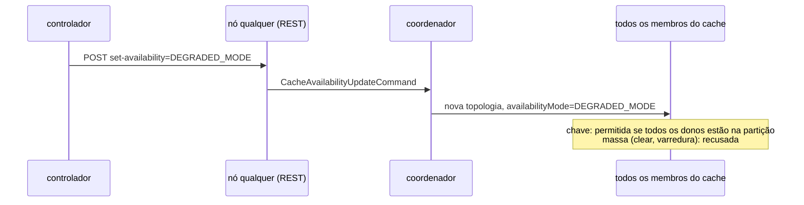

# B-44.1 — O que o Infinispan 15.0.21.Final deixa mudar em tempo de execução

Data: 2026-11-04. Branch `docs/b44-1-reconfiguracao-infinispan`, criada de `feature/controlador-integracao`
em `20805b0`. Pedido do Senior: Prompt 4 e seções 4.1 e 7.2 de
`docs/plano-alinhamento-objetivos-2026-11-04.md` (worktree `wt-plano-ctrl`). Este documento é verificação,
não atuador (o atuador é o B-44.2). Nada foi feito na VM; nada foi para `origin`.

> Nomes de saída. O Prompt 4 sugeria `docs/reconfiguracao-runtime-infinispan-<data>.md` e
> `runs/b44-1-reconfig/`. Segui a instrução do Senior desta tarefa: `docs/b44-1-reconfiguracao-infinispan.md`
> e `runs/b44-1/`. `cluster/infinispan-cluster.xml` não foi alterado; a cópia de trabalho está em
> `runs/b44-1/cluster/`.

## 1. Resposta curta

**Mutável em tempo de execução, sem reiniciar o cache nem rebalancear** (prova por leitura de volta nos três
nós e por log, seção 5):

| O quê | Comando REST (qualquer nó, Digest `admin`) | CLI |
|---|---|---|
| `clustering.remote-timeout` | `POST /rest/v2/caches/{c}?action=set-mutable-attribute&attribute-name=clustering.remote-timeout&attribute-value={ms}` | `alter cache {c} --attribute=clustering.remote-timeout --value={ms}` |
| `locking.acquire-timeout` | idem com `locking.acquire-timeout` | idem |
| `expiration.lifespan`, `expiration.max-idle`, `expiration.interval` | idem | idem |
| rebalanceamento por cache | `POST /rest/v2/caches/{c}?action=disable-rebalancing` / `enable-rebalancing` | `rebalance enable caches/{c}` |
| rebalanceamento global | `POST /rest/v2/container?action=disable-rebalancing` / `enable-rebalancing` | `rebalance enable` (testado); `rebalance disable` (não testado) |
| disponibilidade do cache | `POST /rest/v2/caches/{c}?action=set-availability&availability=DEGRADED_MODE` (ou `AVAILABLE`); leitura `GET ...?action=get-availability` | `availability --mode=DEGRADED_MODE {c}`; leitura `availability {c}` |

**Imutável** (o servidor recusa; confirmado no código e no cluster): `mode` (SYNC/ASYNC), `owners`,
`segments`, `when-split`, `merge-policy`, `state-transfer.timeout`, `locking.concurrency-level`.

**Mas** quatro achados mudam o que o B-44.2 pode fazer com isso (detalhe na seção 4):

1. **A disponibilidade não é por nó.** `set-availability` vai ao coordenador e vale para o cache no
   *cluster* inteiro. Pedida ao nó isolado antes da detecção, a chamada ficou presa 41,6 s e falhou com
   `ISPN000400` (coordenador suspeito). Forçada com os três nós presentes, `DEGRADED_MODE` não recusa
   leituras e escritas por chave (0 erros em 241 operações SYNC e 292 ASYNC), mas recusa operações em
   massa (`clear`, varredura). A varredura de `sessions` feita pelo `Block` passa a falhar com `ISPN000305`,
   e isso gerou 59 violações `I2_CASCATA_INCOMPLETA` numa execução. **A ação AC-1 do plano, como foi
   desenhada, não é viável com esta API.**
2. **O primeiro `set-mutable-attribute` num cache declarado no XML falha (HTTP 400, `ISPN000500`) e o
   segundo pode ser aplicado só em parte dos nós.** O valor fica divergente entre nós até nova escrita. Uma
   "escorva" (gravar o valor atual primeiro) evita isso e foi verificada nos quatro caches.
3. **Qualquer `set-mutable-attribute` impede o nó de reiniciar.** O servidor grava o cache em
   `data/caches.xml`; no `podman restart`/`podman start` seguinte o nó morre com `ISPN000438` (cache
   definido duas vezes, XML + `caches.xml`). Se o arquivo for esvaziado, o nó só volta se o valor do
   *cluster* for igual ao do XML (senão `ISPN000500`). Isso quebra a recuperação do F1
   (`scripts/inject-crash.sh` usa `podman start` no mesmo container).
4. **`remote-timeout` curto em SYNC não é só latência.** Com 3000 ms e um dono pausado, 4 de 8 escritas
   voltaram 500 (`ISPN000476`). Duas delas ficaram gravadas mesmo assim e duas ficaram só na réplica de
   *backup*, não no primário. As réplicas divergiram. Em ASYNC as escritas nem esperaram (8/8 em 204,
   até 195 ms).

## 2. Ambiente

- *Cluster* local de Podman (máquina WSL `podman-machine-default`, Podman 5.7.0, podman-compose 1.5.0).
  A máquina estava parada; foi iniciada para a tarefa e parada de novo no fim (`podman machine inspect` →
  `stopped`). `podman ps -a` e `podman network ls` antes e depois: idênticos (`diff` vazio).
- Projeto `podman-compose -p b441`, containers `b441-isn1..3`, portas 12441..12443, mesma imagem
  `quay.io/infinispan/server:15.0.21.Final`, `infinispan-cluster.xml` e `jgroups-tcp.xml` da base sem
  alteração (cópias em `runs/b44-1/cluster/`). O XML já tem as duas variantes do B-42.1: `sessions`/
  `counters` em DIST_SYNC e `sessions-async`/`counters-async` em DIST_ASYNC.
- Carga: `workload` construído na base (`mvn -f workload/pom.xml clean package -DskipTests`, JDK 22.0.2),
  `--scenario S3 --replication sync|async --reset-state on --rep 1`, 60 a 150 s, sementes 44101..44109.
- Duas encarnações do *cluster*: INC1 (E1..E4) foi derrubada e recriada porque o teste de
  `indexing.indexed-entities` deixou `counters` com configuração divergente e irreparável pela API (seção
  6). INC2 (P1..P8) começou limpa.
- Coordenador: INC1 `isn2`; INC2 `isn1` (`GET /rest/v2/container` → `coordinator`).
- Registro em DEBUG de `org.infinispan.CONFIG` e `org.infinispan.globalstate` ligado em cada nó por
  `PUT /rest/v2/logging/loggers/{categoria}?level=DEBUG`. Ele grava no `server.log` (o *appender* de console
  é INFO), e é dali que vêm as linhas `Updated attribute ...` citadas.

### 2.1 Como "não reiniciou nem rebalanceou" foi verificado

`runs/b44-1/scripts/analisar_logs.py` conta, por fase (`fases.tsv`) e por nó, no stdout de cada servidor:
`ISPN000599 Configuration for cache '<c>'` (emitido a cada *start* do cache), `ISPN100002 ... [Context=<c>]`
(início de rebalanceamento) e `ISPN000094` (nova visão). Resultado em `runs/b44-1/logs-por-fase.tsv`:
**nas fases E1, E2, E3, E4, P1, P2, P3 e P6 (todas as mudanças de atributo e de disponibilidade) não há
nenhuma dessas linhas, em nenhum nó.** Elas só aparecem onde a topologia mudou de propósito (P4/P5/P8
reinício ou parada de `isn3`, P7 partição) e no `enable-rebalancing` de P5, que é o rebalanceamento adiado
que se queria ver. O `time_since_start` da REST não serve para isso: é agregado do *cluster* (depois de
reiniciar `isn3`, o nó informou 654 s).

Ressalva sobre a carga de E1, E2 e E4: o *warm-up* padrão do S3 é de 60 s e as execuções tinham 60 s, então
os CSV ficaram com `registrados=0` (`descartados_warmup` de 1001 em E1). A carga existiu (operações reais,
saída 0, 0 violações), mas não há medição dessas três. A partir de P6b usei `--warmup-min-sec 5`.

## 3. Tabela principal

Escopo: *cluster* = aplicado em todos os nós por um pedido a qualquer nó. Persistência: o que acontece
depois de reiniciar um nó. Classe: plano de 22/10 §12.3 (a só temporal; b muda o momento da convergência;
c muda a semântica sob partição). Mecanismo: tabela 4.1 do plano de 04/11.

| Candidato | Mutável? | Escopo | Persistência | Efeito SYNC | Efeito ASYNC | Mecanismo (4.1) | Classe | Fonte (código 15.0.21.Final; doc 15.0) | Prova (`runs/b44-1/`) | Reversão |
|---|---|---|---|---|---|---|---|---|---|---|
| `DEGRADED_MODE` forçado e volta a `AVAILABLE` | sim (estado, não atributo) | *cluster* (vai ao coordenador); **não existe por nó** | não testada no reinício | chave: nenhum efeito com os 3 nós presentes (0 erros/241 ops); massa: `clear` recusado (`ISPN000307`), varredura recusada (`ISPN000305`) → `Block` incompleto, 59 `I2_CASCATA_INCOMPLETA` (P6a) | igual: 0 erros/292 ops (P6c) | M1 (AC-1) | **não serve como AC-1**; forçar `AVAILABLE` em partição é c (não testado) | `CacheResourceV2.java:210-211,998-1015`; `LocalTopologyManagerImpl.java:837-840`; `ClusterCacheStatus.java:1128-1138`; `PreferConsistencyStrategy.java:324-336`; `PartitionHandlingManagerImpl.java:253-305,310-335`; REST 2.1.31/2.1.32; CLI 9.4 | `chamadas.tsv` (P6a..P6d), `carga/P6*`, `efeito/P7-*`, `fases.tsv` | `set-availability&availability=AVAILABLE` ou `availability --mode=AVAILABLE {c}` (P6, 204 / ok) |
| Rebalanceamento por cache | sim | *cluster* | sobreviveu à volta de `isn3` (P5, `reb=False` nos 3) | `isn3` volta sem receber segmentos de `sessions` (só `isn1`/`isn2` na distribuição) enquanto `counters` rebalanceia; ao ligar, rebalanceia na hora | idem (estado é da topologia, não do modo) | rebalanceamento sob oscilação (AC-2) | b, mas com a saída de um nó deixa segmentos com 1 dono até religar | `CacheResourceV2.java:239-246,1144-1161`; `LocalTopologyManagerImpl.java:791-807`; `ClusterTopologyManagerImpl.java:703-731`; REST 2.1.29/2.1.30; CLI 3.6, 9.32 | `snapshots.tsv` (P5-*), `corpos/P5-dist-*`, `logs-por-fase.tsv` (P5) | `enable-rebalancing` (REST) ou `rebalance enable caches/{c}` (CLI) |
| Rebalanceamento global | sim | *cluster* | não testada | todos os caches passam a `rebalancing_enabled=false` | idem | AC-2 | b | `ContainerResource.java:147-163`; `ClusterTopologyManagerImpl.java:718-731`; `CacheResourceV2.java:336-351`; REST 2.4.11/2.4.12 | `snapshots.tsv` (P5-global-*), `corpos/P5-global-estado*` | `POST /rest/v2/container?action=enable-rebalancing` ou `rebalance enable` |
| `clustering.remote-timeout` | sim (≤ `state-transfer.timeout` = 60000, senão `ISPN000636`) | *cluster* | ver achado 3 (impede reinício) | com 3000 ms e dono pausado: 4/8 escritas em 500 após 3,0 a 3,2 s, réplicas divergentes; com 17500 ms: 8/8 em 204, 7 delas depois de 11,3 a 12,0 s (esperaram a volta do nó) | 8/8 em 204 em ≤ 195 ms com o nó pausado: a escrita não espera | latência (AC-3) | **não é só a**: o *timeout* deixa escrita indeterminada e réplicas divergentes (P-31) | `ClusteringConfiguration.java:21-22` (sem `.immutable()`); `RpcManagerImpl.java:190-194` (ouvinte aplica a mudança às RPCs); `StateTransferConfigurationBuilder.java:108-110`; REST 2.1.11/2.1.12; CLI 9.3 | `efeito/P2a-*`, `P2b-*`, `P2c-*`; `chamadas.tsv` | gravar o valor do XML (SYNC 17500 efetivo, ASYNC 15000) |
| `locking.acquire-timeout` | sim | *cluster* | idem | com 2000 ms e dono pausado: a 2ª escrita concorrente na mesma chave falha em 2,0 s com `ISPN000299` (3 de 6 chaves) | não exercido sob contenção | latência sob contenção | a (a operação falha antes de gravar; réplicas não conferidas) | `LockingConfiguration.java:20` (sem `.immutable()`); `AbstractLockingInterceptor.java:255-256` (lido a cada operação) | `efeito/P3-lock-a.tsv` | gravar 15000 |
| `when-split` | **não** | — | — | — | — | M1 no *merge* | fora | `PartitionHandlingConfiguration.java:20-21` (`.immutable()`); `Attribute.java:267-278` | GET → 400 `ISPN012035 ... is immutable`; PUT da configuração → 400 `ISPN000961 Incompatible attribute 'when-split'` | — |
| `merge-policy` | **não** | — | — | — | — | M1 no *merge* | fora | `PartitionHandlingConfiguration.java:22-23` | GET → `ISPN012035`; PUT → `ISPN000961` | — |
| modo SYNC/ASYNC | **não** | — | — | — | — | — | fora | `ClusteringConfiguration.java:20` (`CACHE_SYNC ... .immutable()`) | GET → `ISPN012035`; PUT → `ISPN000961 'mode' existing value='true', new value='false'` | — |
| `owners` | **não** | — | — | — | — | — | fora | `HashConfiguration.java:23` | set → 500 `ISPN000962 Cannot modify protected attribute 'owners'`; PUT → `ISPN000961` | — |
| `segments` | **não** | — | — | — | — | — | fora | `HashConfiguration.java:26` | set → 500 `ISPN000962`; PUT → `ISPN000961` | — |
| `expiration.lifespan` / `max-idle` / `interval` | sim | *cluster* | idem achado 3 | efeito não medido (vale para escritas novas) | idem | nenhum invariante | fora do espaço de ação | `ExpirationConfiguration.java:16-19` | `chamadas.tsv` (E1-set/get-lifespan, -maxidle, -interval); `servidores/inc1/*-server.log` (`Updated attribute 'lifespan'`) | gravar -1 / -1 / 60000 |

Fonte "REST x.y" = seção do guia *REST API* 15.0; "CLI x.y" = guia *CLI* 15.0 (URLs e SHA-256 na seção 8).

## 4. Achados que limitam o atuador (B-44.2)

### 4.1 Disponibilidade forçada não é por nó e não faz o que AC-1 pressupunha

- Caminho no código: `CacheResourceV2.setCacheAvailability` → `CacheImpl.setAvailability` →
  `LocalTopologyManagerImpl.setCacheAvailability` (envia ao coordenador, linhas 837-840) →
  `ClusterCacheStatus.forceAvailabilityMode` (1128-1138) → `PreferConsistencyStrategy.onManualAvailabilityChange`
  (324-336), que aplica o modo à topologia inteira. P6a: pedido feito a `isn3` (não coordenador), os três
  nós leram `DEGRADED_MODE`, `counters` ficou `AVAILABLE`.
- Por chave, com `DENY_READ_WRITES`, a operação passa se todos os donos estão em `actualMembers`
  (`PartitionHandlingManagerImpl.java:280-305`). Com os três nós presentes, sempre passa. P6b (SYNC, 241
  operações na janela) e P6c (ASYNC, 292): 0 erros, 0 `ISPN000305`. A documentação (REST 2.1.32) diz que
  `DEGRADED_MODE` "prevents read and write operations on caches when network partitions occur". Fora de
  partição, o código não faz isso.
- Em massa a operação é recusada (`isBulkOperationForbidden`, 310-335: escrita sempre; leitura em
  `DENY_READ_WRITES` sempre). P6d: `clear` → 500 `ISPN000307: Cannot clear when the cluster is partitioned`.
  P6a (que ficou ~65 s em `DEGRADED_MODE` porque o primeiro comando de CLI usou a sintaxe errada,
  `caches/sessions`): 9 `ISPN000305` no cliente Hot Rod e 59 `I2_CASCATA_INCOMPLETA` + 2 `I2_JANELA_CASCATA`.
  As duas `I2_JANELA` são de 21:27:15, antes do pedido (21:27:20,7), então não são do atuador. As 59 caem
  todas dentro da janela, coerentes com o `Block` que varre `sessions` (P-27: "apenas `block()` varre
  `sessions`"). Consequência prática: o `--reset-state` (que limpa os caches) e o `Block` falham enquanto
  o cache estiver forçado em `DEGRADED_MODE`.
- Antes da detecção (P7, `isn3` isolado por nftables às 21:33:40,712): `set-availability` pedido ao próprio
  `isn3` às 21:33:45,963 ficou 41,6 s pendente e voltou 500 `SuspectException: ISPN000400: Node isn1-38505
  was suspected`. Pedido à maioria, ele degradaria o cache da maioria também (mesmo caminho acima). Não
  executei esse pedido sob partição: o efeito vem do código, e executá-lo derrubaria a disponibilidade de
  todos.
- Janela de M1 medida (n = 1, *cluster* local, sonda REST a cada ~1,3 s por nó): corte → `isn1` com 2
  membros em **46,8 s**; corte → `isn3` em `DEGRADED_MODE` em **47,2 s**. Cura às 21:34:55,993 → 3 membros
  em 18,9 s e `isn3` `AVAILABLE` em 20,7 s (MERGE3 entre 10 e 30 s). Coerente com FD_ALL3 padrão (40 s) +
  VERIFY_SUSPECT2 (1 s) do `jgroups-tcp.xml`. Na carga P7: 63 `ERROR_TRANSPORT` nos três servidores de
  aplicação entre corte e detecção, 147 `ERROR_UNAVAILABLE` em `isn3` entre detecção e cura, 65 depois da
  cura até o *merge*, e 10 `I2_CASCATA_INCOMPLETA` depois da detecção. Essas violações são da partição,
  não de ação administrativa.

### 4.2 Primeira atualização falha; a segunda pode ficar só em parte dos nós (P-29)

`set-mutable-attribute` relê a configuração, troca o atributo e chama `getOrCreateCache` com
`AdminFlag.UPDATE` (`CacheResourceV2.java:1089-1107`), que grava no cache replicado de estado
`org.infinispan.CONFIG` (`GlobalConfigurationManagerImpl.java:286-293`). Cada nó aplica a mudança no seu
ouvinte, in-place (`VolatileLocalConfigurationStorage.java:112-121`, `Attribute.java:246-262`). Um cache
declarado no XML não tem entrada em `CONFIG`. Por isso a primeira gravação chega aos ouvintes como
**criação** (`Creating cache sessions from global state`), e a criação falha porque o cache já existe com
outra configuração (`ISPN000500 ... is incompatible with the existing configuration`). A resposta é 400.

- E1 (INC1, `sessions`): 1ª chamada (`remote-timeout`=10000) → 400, nenhum nó aplicou. 2ª (`lifespan`) → 400,
  mas `isn1` e `isn2` aplicaram (`Updated attribute 'lifespan' to value '3600000'`) e `isn3` falhou. Mesmo
  assim a leitura de volta deu 3600000 nos três, porque a 3ª chamada (`max-idle`, 200) levou o valor junto.
- E2 (`counters-async`, CLI): 1ª → erro, ninguém aplicou. 2ª → `isn1`=5000, `isn2`=15000, `isn3`=5000.
  **Configuração divergente entre nós**, até a reversão.
- **Escorva** (gravar o valor atual antes da primeira mudança real): `sessions-async` em E2 e os quatro
  caches em P1 (INC2) responderam 200 e leram igual nos três. Depois disso, todas as mudanças de E2 e de
  P2 a P4 foram uniformes.

### 4.3 Depois de qualquer mudança, o nó não reinicia (P-30)

A criação vinda do estado global entra em `persistentCaches` e é gravada em `data/caches.xml`
(`OverlayLocalConfigurationStorage.java:89-100`). No reinício, o servidor lê o XML e o `caches.xml`. O
nome repetido dispara `CacheParser.checkDuplicateCacheName` (linhas 900-911), e o nó morre:
`FATAL ISPN080028 ... ISPN000438: Cache with name 'sessions-async' is defined more than once!`.

| Passo (P4/P8, INC2) | Resultado |
|---|---|
| `remote-timeout` de `sessions`=12000; `podman restart b441-isn3` | `isn3` sai (`Exited (0)`), `ISPN000438` |
| `caches.xml` vazio copiado para `isn3` parado (`podman cp`); `podman start` | `isn3` sai, `ISPN000500` (cluster com 12000, XML com 17500) |
| `remote-timeout` volta a 17500 no *cluster* de 2 nós; `caches.xml` vazio; `podman start` | `HEALTHY 3` em 5 s, leitura 17500 nos três |
| `caches.xml` de `isn3` depois do *rejoin* | 4 caches de novo (o *rejoin* repovoa o arquivo) |
| `podman restart b441-isn3` (P8, valores iguais ao XML) | `isn3` sai de novo, `ISPN000438` |

Isso vale para a recuperação do F1 (`scripts/inject-crash.sh`: `podman kill` + `podman start` no mesmo
container) e para qualquer reinício de nó em execução da T-F/S3. O `down`/`up` do *cluster* (containers
novos, sem volume) apaga o estado e volta aos valores do XML.

### 4.4 `remote-timeout` curto em SYNC: escrita indeterminada e réplicas divergentes (P-31)

P2a: `sessions` com `remote-timeout`=3000, `isn3` pausado (`podman pause`) por 12 s, 8 `PUT` REST em
`isn1`. Resultado: 4 × 204 (chaves sem `isn3` como dono) e 4 × 500 `ISPN000476: Timed out waiting for
responses ... after 3 seconds`. Depois de retomar `isn3`, leitura nos três nós:

| chave | resposta ao cliente | `isn1` | `isn2` | `isn3` |
|---|---|---|---|---|
| `-3`, `-4` | 500 | v | v | v |
| `-2`, `-5` | 500 | 404 | 404 | v |

Para `-2`, `?action=distribution` pedido a `isn3` diz donos `isn2` (primário) e `isn3`: o primário não
tem o valor e o *backup* tem. Ou seja, uma escrita reportada como falha pode ter sido aplicada, inteira ou
só no *backup*. Com 17500 ms (P2b) as 8 voltaram 204, 7 delas depois de esperar a volta do nó (11,3 a 12,0 s). Em ASYNC (P2c) as
8 voltaram 204 em no máximo 195 ms, com o nó pausado. Não investiguei o caminho interno (*triangle*) que leva
à divergência; registro como observado (`efeito/P2a-*.txt`, `servidores/inc2/isn1-stdout.log` 21:15:30).

### 4.5 CLI devolve código de saída 0 mesmo quando o servidor recusa (P-32)

Em E2 (1ª tentativa em `counters-async`), E3 (`when-split`) e P6a (`Not Found` com `caches/sessions`), o
`cli.sh -f` imprimiu o erro e saiu com 0. O atuador deve usar REST e o código HTTP, e confirmar sempre pela
leitura de volta.

## 5. Detalhe da prova por candidato

Todas as chamadas, com instante, código HTTP e tempo, estão em `runs/b44-1/chamadas.tsv` (colunas: utc,
rótulo, método, URL ou comando, código, tempo em s, autenticação, corpo). Os corpos estão em `corpos/<rótulo>.txt`.

- **Atributos mutáveis listados pela API** (`GET ...?action=get-mutable-attributes&full=true`, idêntica
  para `sessions`, `counters`, `sessions-async`, `counters-async`): `aliases`, `clustering.remote-timeout`,
  `expiration.lifespan`, `expiration.max-idle`, `expiration.interval`, `indexing.indexed-entities`,
  `locking.acquire-timeout`, `memory.max-size`, `memory.max-count`, `persistence.connection-attempts`,
  `security.authorization.roles`, `jmx-statistics.statistics`, `tracing.enabled`, `tracing.categories`,
  `transaction.stop-timeout`, `transaction.single-phase-auto-commit` (16). A lista sai de
  `CacheResourceV2.mutableAttributes` (1050-1071), que percorre a árvore e inclui todo atributo sem
  `.immutable()`. Valores lidos: `remote-timeout` **17500 nos SYNC** e 15000 nos ASYNC (o XML não declara
  `remote-timeout`; o padrão do código é 15000, `ClusteringConfiguration.java:21-22`). Não achei no código
  de `core` quem põe 17500. Fica como pendência; não muda nada aqui, mas é o valor a usar na reversão.
- **E1/E2** (INC1, SYNC sob S3 sync 60 s; ASYNC sob S3 async 60 s): `remote-timeout`, `acquire-timeout`
  (REST e CLI), `lifespan`, `max-idle`, `interval`. Aplicação e leitura de volta nos três nós. Problemas da
  4.2 nas primeiras chamadas. Reversão completa conferida por `get-mutable-attributes&full=true` nos três
  nós (`corpos/E1-pos-full-*`, `E2-pos-full-*`).
- **E3** (imutáveis, sem carga): `get-mutable-attribute` → 400 `ISPN012035 ... is immutable` para `mode`,
  `owners`, `segments`, `when-split`, `merge-policy`, `state-transfer.timeout`, `concurrency-level`.
  `set-mutable-attribute` em `owners`/`segments` → 500 `ISPN000962 Cannot modify protected attribute`. Em
  `when-split`/`merge-policy`/`mode` o erro é de conversão do valor (`Cannot convert ...`, `'ASYNC' is not a
  valid boolean`), antes de chegar à imutabilidade. Por isso fiz a prova principal pelo `PUT
  /rest/v2/caches/sessions` com a configuração inteira (`AdminFlag.UPDATE`, `CacheResourceV2.java:755-766`):
  6 × 400 `ISPN000961 Incompatible attribute` (corpos em `corpos/E3-put/*.json`). O mesmo `PUT` mudando só
  `remote-timeout` → 200 e leitura 17000 nos três, o que mostra que a recusa é pelo atributo e não pelo
  caminho. `remote-timeout`=70000 → 400 `ISPN000636 State transfer timeout (60000) must be greater than or
  equal to the remote timeout (70000)`.
- **P2/P3** (efeito, sem carga do programa, PUT REST com chaves `b441-*`): seções 3 e 4.4.
- **P5** (rebalanceamento, sob S3 sync 150 s): `disable-rebalancing` em `sessions` via `isn2` → 204 em 21 ms;
  `rebalancing_enabled=False` nos três para `sessions`, `True` para os outros. `podman stop b441-isn3`:
  `counters`, `counters-async` e `sessions-async` rebalancearam (`ISPN100002`), `sessions` não. `isn3` de
  volta (com `caches.xml` vazio, ver 4.3): distribuição de `sessions` só em `isn1`/`isn2`; `counters` nos
  três. `rebalance enable caches/sessions` (CLI em `isn3`): `ISPN100002` de `sessions` nos três e distribuição
  nos três em 4 s. Global: `POST /rest/v2/container?action=disable-rebalancing` em `isn2` → os três nós com
  `rebalancing_enabled=False` e todos os caches `False`; `rebalance enable` (CLI em `isn1`) → `True`. Carga:
  saída 0, 0 violações, 1198 eventos medidos.
- **P6** (disponibilidade): seção 4.1.
- **E4** (demais atributos da lista, em `counters`, sob S3 sync 60 s): seção 6.

## 6. Demais atributos listados como mutáveis

| Atributo | Mudança | Resultado | Leitura de volta | Reversão |
|---|---|---|---|---|
| `jmx-statistics.statistics` | false | 200 | false ×3 | true ×3 |
| `tracing.enabled` | false | 200 | false ×3 | true ×3 |
| `tracing.categories` | container,cluster | 200 | ×3 | container ×3 |
| `transaction.stop-timeout` | 20000 | 200 | ×3 | 30000 ×3 |
| `persistence.connection-attempts` | 5 | 200 | ×3 | 10 ×3 |
| `aliases` | ctr-alias | 200 | ×3 | [] ×3 |
| `transaction.single-phase-auto-commit` | true | 500 após 15,0 s, `ISPN000476` de `isn3` | false ×3 (não aplicou) | idem, 500 em 15,0 s |
| `security.authorization.roles` | admin | 400 `ISPN000414` (autorização global desligada) | [] ×3 | — |
| `memory.max-count` | 1000000 | 400 `ISPN000961` (`when-full` NONE→REMOVE é imutável) | **1000000, 1000000, -1** (parcial) | -1 → 200, -1 ×3 |
| `indexing.indexed-entities` | x.Y | 400 `ISPN000961` (`indexing.enabled` imutável) | **[x.Y], [x.Y], []** (parcial) | **impossível pela API**: vazio → `ISPN000691`; qualquer outro atributo de `counters` passa a falhar com `ISPN000610` |
| `memory.max-size` | 512MB | inconclusivo: bloqueado pelo `ISPN000610` acima | null ×3 | — |

O caso `indexed-entities` foi o motivo de recriar o *cluster* (INC1 → INC2). Ele mostra o pior caso de P-29:
**uma mudança rejeitada pode ficar aplicada em parte dos nós e travar todas as mudanças seguintes do
cache.** Nenhum desses atributos tem relação com os invariantes, e todos ficam fora do espaço de ação.

## 7. Latência e autenticação

Medido com `curl -w %{time_total}` do *host* (`runs/b44-1/latencias.tsv`, gerado por
`scripts/resumo_latencias.py`). Valores locais; não são evidência de desempenho da VM.

| Chamada | n | mediana | mín–máx |
|---|---|---|---|
| `set-mutable-attribute` (200) | 37 | 23,6 ms | 16,1–99,9 ms |
| `set-mutable-attribute` (400) | 16 | 30,5 ms | 8,0–1247,8 ms |
| `set-mutable-attribute` (500) | 4 | — | 10,9 ms (`ISPN000962`) a 15,0 s (`ISPN000476`) |
| `get-mutable-attribute` | 145 | 11,7 ms | 7,1–23,1 ms |
| `get-mutable-attributes` | 21 | 13,3 ms | 9,2–523,1 ms |
| `set-availability` (204) | 7 | 10,1 ms | 6,8–15,9 ms |
| `set-availability` no nó isolado antes da detecção | 1 | 41,6 s (500, `ISPN000400`) | — |
| `get-availability` | 20 | 9,5 ms | 6,0–13,1 ms |
| `disable-rebalancing` (cache e global) | 2 | 17,3 ms | 14,1–20,5 ms |
| `PUT /rest/v2/caches/{c}` (configuração inteira) | 7 | 17,0 ms (200); 20,1 ms (400) | — |
| CLI (`cli.sh -f`, JVM nova a cada chamada) | 15 | ~2,2 s | 1,6–3,7 s |

- **Autenticação:** todas as rotas administrativas usadas exigem `AuthorizationPermission.ADMIN`
  (`CacheResourceV2.java:182-184,210-211,239-246`; `ContainerResource.java:147-163`). Sem credencial → 401
  (testado em `get-mutable-attributes` e `set-availability`). Com a autorização desligada no XML, o usuário
  Digest `admin` do *realm* de propriedades basta.
- **Nó específico:** não é preciso. Qualquer nó aceita o pedido. Disponibilidade e rebalanceamento são
  encaminhados ao coordenador; atributos se propagam pelo cache replicado `CONFIG`. Exceção prática: um nó
  isolado não consegue (4.1).
- **Documentação × código:** o guia REST 15.0, §2.1.12, escreve `action=set-mutable-attributes` (plural).
  O servidor registra `set-mutable-attribute` (singular, `CacheResourceV2.java:184`), que foi o usado. O
  plural não foi testado.

## 8. Fontes

- Código-fonte: `github.com/infinispan/infinispan`, *tag* `15.0.21.Final`, *commit*
  `5bdc4defbcd34db8b789c927282d25af38ad6ffb` (clone esparso no *scratchpad*, fora do git). Caminhos relativos a
  `core/src/main/java/org/infinispan/` salvo indicação: `configuration/cache/{ClusteringConfiguration,
  HashConfiguration,LockingConfiguration,PartitionHandlingConfiguration,StateTransferConfiguration,
  StateTransferConfigurationBuilder,ExpirationConfiguration,MemoryConfiguration}.java`,
  `remoting/rpc/RpcManagerImpl.java`, `interceptors/locking/AbstractLockingInterceptor.java`,
  `topology/{LocalTopologyManagerImpl,ClusterCacheStatus,ClusterTopologyManagerImpl}.java`,
  `partitionhandling/impl/{PreferConsistencyStrategy,PartitionHandlingManagerImpl}.java`,
  `globalstate/impl/{GlobalConfigurationManagerImpl,VolatileLocalConfigurationStorage,
  OverlayLocalConfigurationStorage}.java`, `configuration/parsing/CacheParser.java`;
  `commons/all/src/main/java/org/infinispan/commons/configuration/attributes/Attribute.java`;
  `server/rest/src/main/java/org/infinispan/rest/resources/{CacheResourceV2,ContainerResource}.java`;
  `cli/src/main/java/org/infinispan/cli/commands/rest/{Alter,Availability,Rebalance}.java`.
- Documentação oficial 15.0 (fora do `.bib`, D-11; páginas salvas fora do git, acesso em 2026-11-04):

| Guia | URL | SHA-256 da página |
|---|---|---|
| REST API | `https://infinispan.org/docs/15.0.x/titles/rest/rest.html` (§2.1.11, 2.1.12, 2.1.29–2.1.32, 2.4.11, 2.4.12) | `a0bfe173a9f10fa196fbcbfc9e9611fa445cf98238d38c2affb4226dbf9098de` |
| CLI | `https://infinispan.org/docs/15.0.x/titles/cli/cli.html` (§3.6, 9.3, 9.4, 9.32) | `899345f6cd923cd82b3198b855094e9d0f20fd9950f8804d293c6dbd6045e3a5` |
| Configuring caches (`infinispan_configuring_15`) | `https://infinispan.org/docs/15.0.x/titles/configuring/configuring.html` (§7.2, 7.2.2) | `e97575bfd419d614c484515c037bd11ec50a82f2a0c00eee9b2d3a48d6ca47ef` |
| Server | `https://infinispan.org/docs/15.0.x/titles/server/server.html` (baixado, sem trecho usado) | `1d95dca6a6229dc6fc7adc42c16d094c9acf67006c1eaaa241d889deb52d53d3` |

- `jgroups_manual_5`: não consultado. O tempo de detecção foi medido (4.1), e os valores de FD_ALL3 e
  VERIFY_SUSPECT2 vêm do `cluster/jgroups-tcp.xml`. `redhat_datagrid_admin`: não usado (N-5).

## 9. Brutos (`runs/b44-1/`)

| Caminho | Conteúdo |
|---|---|
| `cluster/` | cópias do XML, do JGroups e do `podman-compose.b441.yml` (portas 12441..12443) |
| `scripts/lib.sh` | funções das sondas (`rest`, `cli`, `setattr`, `getattr`, `snapshot`, `carga`, `puts`) |
| `scripts/particao-nft.sh` | isolamento por nftables no netns do container (a máquina WSL não tem `tc`; não substitui `scripts/inject-partition.sh`) |
| `scripts/analisar_logs.py`, `scripts/resumo_latencias.py` | geram `logs-por-fase.tsv` e `latencias.tsv` |
| `fases.tsv` | instante de cada fase (E1..E4, INC1/INC2, P1..P8) |
| `chamadas.tsv`, `corpos/` | todas as chamadas administrativas e as respostas |
| `snapshots.tsv` | disponibilidade e `rebalancing_enabled` por nó e cache em pontos fixos |
| `efeito/` | PUTs de P2/P3, sonda e transições de P7, regras nftables |
| `carga/<fase>/` | stdout, stderr, CSV de eventos e de violações de cada carga S3 |
| `servidores/inc1/`, `servidores/inc2/` | stdout (`podman logs`) e `server.log` (DEBUG de CONFIG/globalstate) de cada nó |
| `compose-up.txt`, `compose-down.txt`, `podman-*-antes/depois.txt` | estado do Podman |
| `MANIFEST.sha256` | SHA-256 de todos os arquivos, inclusive os `.csv`/`.log`/`.txt` que o `.gitignore` deixa fora do git |

## 10. Limitações

- Um *cluster* local, uma execução por condição. O tempo de detecção (n = 1) e as latências não valem para
  a VM.
- Não testados: `DEGRADED_MODE` forçado durante uma partição real na maioria (efeito deduzido do código);
  forçar `AVAILABLE` na minoria (classe c, fora); persistência de disponibilidade e de rebalanceamento depois
  de reiniciar o *cluster* inteiro; `rebalance disable` pela CLI (só pela REST); `acquire-timeout` em ASYNC
  sob contenção; o caminho interno que leva à divergência da 4.4.
- E1, E2 e E4 tiveram carga sem medição (warm-up de 60 s = duração).

## 11. Pontos para validação do Gestor

1. AC-1 (forçar `DEGRADED` no nó suspeito) cai: a API não é por nó, o nó isolado não alcança o coordenador
   e o modo forçado quebra o `Block`. Retirar do plano ou redesenhar.
2. AC-2 (suspender rebalanceamento) e AC-3 (`remote-timeout`) são executáveis, mas: (a) toda mudança de
   atributo exige escorva e leitura de volta nos três nós; (b) depois dela, nenhum nó reinicia sem limpar
   `data/caches.xml` e sem o valor do *cluster* igual ao XML (decisão de arquitetura: limpar o arquivo
   antes do `podman start` no F1, ou deixar de declarar os caches no XML e criá-los pela REST); (c)
   `remote-timeout` curto em SYNC produziu réplicas divergentes, então AC-3 não é classe a como o plano
   esperava.
3. Rebalanceamento desligado com saída de nó deixa segmentos com um dono só até religar. A política do
   atuador precisa de um teto de tempo.
