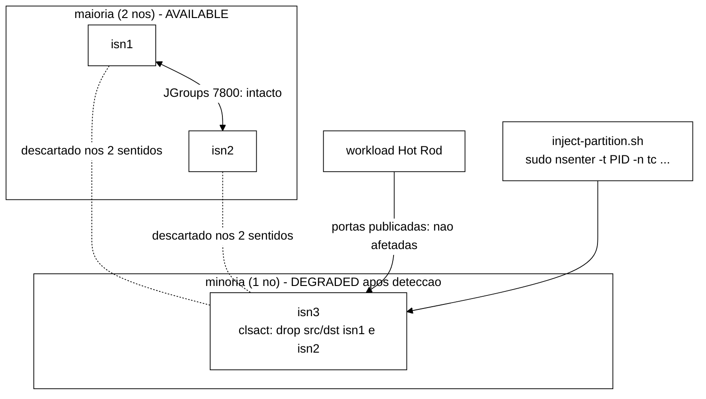

# Configuração do *cluster* Infinispan

> Documento técnico que descreve a configuração do *cluster* Infinispan empregada no protótipo do TCC. Mapeia cada decisão de configuração para a(s) linha(s) Tx da Tabela 1 do Cap. 3 §3.3.5 da monografia.

## Arquivos

| Arquivo | Função |
|---|---|
| `cluster/podman-compose.yml` | Orquestra três nós Infinispan em *containers* Podman, com rede *bridge* dedicada e *health check* via REST. |
| `cluster/infinispan-cluster.xml` | Define os *caches* `sessions`/`counters` (DIST_SYNC, controle) e os irmãos `sessions-async`/`counters-async` (DIST_ASYNC, alvo), com partição tratada por `DENY_READ_WRITES`; o *workload* escolhe o par por `--replication sync\|async`. |
| `cluster/caches/canario.json`, `canario-async.json` | W-4 (B-26.3): *caches* da sonda de defasagem S_lag, **criados pela REST** (`scripts/cria-caches.sh`), não pelo XML. Corpo sem o envoltório do nome; mesmos parâmetros dos irmãos `sessions`/`sessions-async`, com `remote-timeout` 17500 explícito no SYNC (valor efetivo do XML). Fora de todo invariante, auditor, varredura e reset. |
| `scripts/cria-caches.sh` | W-4: cria pela REST os *caches* de `cluster/caches/<nome>.json` e confere a leitura de volta `?action=config` em cada nó (exit 4 se divergir). Senha só por `CRIA_CACHES_SENHA`. Testes sem *cluster*: `scripts/cria-caches.test.sh`. |

A inicialização ocorre via `cd cluster && podman-compose up -d`. O *health check* é executado pelo Podman a cada 5 s; um nó é considerado saudável quando `GET /rest/v2/cache-managers/default/health/status` retorna 200 com credenciais `admin:infinispan`.

## Mapeamento Configuração ↔ Tabela 1

| Linha Tx | Onde realiza | Trecho relevante |
|---|---|---|
| **T1** Modo de replicação | `cluster/infinispan-cluster.xml` | `sessions`/`counters` em `mode="SYNC"` (controle) e os irmãos `sessions-async`/`counters-async` em `mode="ASYNC"` (alvo), implementado em B-42.1 (antigo B-03); o *workload* escolhe o par por `--replication sync\|async` (padrão `sync`), resolvido em `PerfilReplicacao.java` |
| **T2** Número de nós: 3 | `cluster/podman-compose.yml` | Serviços `isn1`, `isn2`, `isn3` |
| **T3** `numOwners` = 2 | `cluster/infinispan-cluster.xml` | `owners="2"` em ambos os *caches* |
| **T4** `numSegments` | `cluster/infinispan-cluster.xml` | `segments="64"` (valor herdado do esqueleto; T4 da tabela cita 256 como padrão Infinispan; o esqueleto adota 64 para reduzir tempo de *state transfer* em ambiente com três nós — desvio justificado a registrar em `docs/decisoes-tecnicas.md` em B-04 ou ajustar para 256 se o autor preferir aderência estrita à Tabela 1) |
| **T15** MTU | herdado da configuração de rede do Podman (*bridge* default 1500) | sem ajuste explícito; equivale ao parâmetro T15 |
| **T16** Detecção de falha FD\_ALL3 | herdada do *stack* JGroups padrão (`default-jgroups-tcp.xml`) | `<stack-file name="cluster-stack" path="default-jgroups-tcp.xml"/>` aplica os defaults (8000 ms / 40000 ms) |
| **T17** Falha F1 (*crash*) | `scripts/inject-crash.sh` (modo padrão `silencioso`, 2026-10-28): cala o `eth0` de `isn2` no *netns* dele e mata o *container* com SIGKILL logo em seguida; 60 s depois, `podman start`. A pilha (`cluster/jgroups-tcp.xml`) tem **FD\_SOCK2** além do FD\_ALL3: o FD\_SOCK2 suspeita do vizinho assim que a conexão TCP com ele fecha, e um processo morto por SIGKILL tem os *sockets* fechados pelo *kernel* (FIN/RST) enquanto o *netns* existe. Sem o isolamento prévio a queda seria detectada em ~1 s pelo FD\_SOCK2 (modo `kill`); com ele nenhum FIN sai e só o FD\_ALL3 (40 s + 1 s do VERIFY\_SUSPECT2) decide, como em T16. O F1 de junho (`podman stop`, saída ordenada com *leave*) continua disponível como `--modo stop` | *smoke* local de 2026-10-28: Δdet de 36,5 a 41,9 s no modo `silencioso` e de ~1 s nos modos `kill` e `stop` (`docs/relatorio-f1-silencioso-2026-10-27.md`); falta o ensaio da VM |
| **T19** Métricas coletadas | `cluster/infinispan-cluster.xml` | `statistics="true"` em `cache-container` e em cada *cache* |
| **T20** Endpoint OpenMetrics | nativo do Infinispan 15 | endpoint exposto por `endpoints socket-binding="default"` |

## Partition Handling

A configuração adota `<partition-handling when-split="DENY_READ_WRITES" merge-policy="PREFERRED_NON_NULL"/>` nos dois *caches* (`sessions` e `counters`). Sob partição, depois que o detector de falhas (`FD_ALL3`, até ~40 s, mais 1 s de `VERIFY_SUSPECT2`) muda a vista, a partição minoritária entra em modo DEGRADED e recusa leituras e escritas, enquanto a maioria segue AVAILABLE. Após a cura, o `MERGE3` (10 a 30 s) percebe a outra vista e a reconciliação segue `PREFERRED_NON_NULL` (regra posicional: vale o valor da partição preferida; só se for nulo, o primeiro não nulo das demais). Esses tempos são **estimativas derivadas dos parâmetros, não medições**; a medição é objeto dos gates reais G-3 e G-4.

Esta política deixou de ser uma "salvaguarda passiva": F2 (partição de rede) agora é **injetável** por `scripts/inject-partition.sh` (B-29), de modo que `DENY_READ_WRITES` e a fusão passam a ser exercitados deliberadamente. O XML não muda; a decisão registrada é manter `PREFERRED_NON_NULL` (configuração real do projeto) e não oferecer *flag* para simular `ALLOW_READ_WRITES` (fora de escopo).

### Falha F2 — partição de rede (`scripts/inject-partition.sh`)

Mecanismo (opção (a2) do plano de 2026-10-09): disciplina `clsact` do `tc` com um filtro `u32` por IP de par e ação `drop`, nos dois sentidos, aplicada **só no nó isolado** a partir do host via `sudo nsenter -t <pid> -n tc ...`. O tráfego Hot Rod do cliente não é afetado (origem no gateway da *bridge*, não em IP de par) e a fila raiz fica livre para o `netem` de F3. Plano B (só se o gate G-0 falhar): `iptables`/`nftables` via `nsenter`, sem implementar agora; `podman network disconnect` foi descartado (remove o nó também para o cliente e muda IP/interface).



| Opção | Semântica |
|---|---|
| `--minority <no[,no]>` | Nó(s) isolado(s); estritamente menos da metade de `--nodes` (3 nós: só 1), senão exit 2 |
| `--nodes` | padrão `isn1,isn2,isn3`; IPs dos pares resolvidos por `podman inspect`, nunca fixos |
| `--duration` | padrão 90 s; abaixo de 45 s avisa que é "atraso severo", não partição |
| `--marker` | acrescenta `fault=F2 node=<no> event=start` ou `event=end` com `t_epoch_ns=<n>` (formato de B-25) |
| `--heal` | só remove `clsact` remanescente (após `SIGKILL`); sem `--minority`, limpa todos os nós |
| `--dry-run` | imprime o plano; sem podman, sudo, nsenter ou tc |

Códigos de saída: 0 ok; 1 genérico (inclui lock ocupado e resíduo); 2 argumento; 3 dependência ausente; 4 nó ausente/parado; 5 kernel rejeitou `clsact`/`u32`/`drop`; **6 a partição não se efetivou** (conexão TCP ainda possível a um par, ou contadores de descarte zerados no fim da janela). Dependências no host da VM: `podman`, `nsenter`, `tc`, `sudo`, `flock`, `timeout` e os módulos `sch_clsact`, `cls_u32`, `act_gact`.

Os testes sem VM estão em `docs/testes.md`; o aceite real (G-0 a G-6) está **pendente** na VM.

### Falha F4 — degradação parcial de rede (`scripts/inject-netdegrade.sh`, B-29.2)

Perda (aleatória ou em rajada), atraso com jitter, duplicação, reordenação e corrupção **entre os nós do cluster**, simétricas ou assimétricas, sem derrubar o nó nem tocar o tráfego Hot Rod do cliente. Mecanismo: disciplina `prio` na **raiz** da interface do contêiner, `netem` na banda 3 e um filtro `u32` por IP de destino do par, sempre por `sudo nsenter -t <pid> -n tc ...` a partir do host (mesmo padrão de F2/F3). A direção de saída é aplicada no alvo; a de entrada, no egress de cada par com destino ao alvo (`--direction out|in|both`, `--loss` e `--loss-in`). Como a raiz fica ocupada, F4 e F3 (`netem` raiz sem filtro) são **mutuamente exclusivos no mesmo nó** (exit 7); F4 também recusa um nó com `clsact` ou com o lock de F2 ativo. Detalhes, diagramas, matriz de severidades N1 a N5 e limites de fidelidade em `docs/degradacao-de-rede.md`.

| Opção | Semântica |
|---|---|
| `--target`, `--nodes`, `--peers` | alvo, cluster (padrão `isn1,isn2,isn3`), pares afetados (padrão: todos menos o alvo) |
| `--direction out\|in\|both` | padrão `out`; `in` e `both` tocam também os **pares** |
| `--loss`, `--loss-in`, `--loss-corr`, `--loss-model random\|gemodel`, `--burst` | perda por sentido, correlação, modelo (Gilbert-Elliott) e rajada média |
| `--delay`, `--jitter`, `--duplicate`, `--reorder`, `--corrupt` | demais degradações (`--reorder` e `--jitter` exigem `--delay`) |
| `--severity N1..N5` | perda 1%, 5%, 20%, 50%, 99,9% |
| `--duration` | padrão 120 s; abaixo de 45 s avisa |
| `--marker` | `fault=F4 node=<alvo> event=start\|end t_epoch_ns=<n>` (formato de B-25) |
| `--heal` | remove a `prio 1:` do injetor em todos os nós; nunca toca raiz alheia |
| `--dry-run`, `--ping-count` | plano sem executar; pings por par para medir a perda no fio (0 desliga) |

Códigos de saída: 0 ok; 1 genérico (lock, resíduo); 2 argumento; 3 dependência ausente; 4 nó ausente/parado; 5 kernel rejeitou `prio`/`netem`/`u32`; **6 a degradação não se efetivou** (perda no fio fora de 3 σ binomiais, `Sent`+`dropped` zerados (nenhum pacote casou o filtro) ou perda sem descarte); **7 raiz ocupada** (F3, `clsact`/lock de F2). Dependências no host da VM: `podman`, `nsenter`, `tc`, `sudo`, `flock`, `ping` e os módulos `sch_prio`, `sch_netem`, `cls_u32`. Os testes sem VM estão em `docs/testes.md`; o aceite real (gate L-0 a L-6, T-C2) está **pendente** e nada foi executado na VM.

## Locking e *state transfer*

```
locking: concurrency-level=1000, acquire-timeout=15000, striping=false
state-transfer: enabled=true, timeout=60000
```

- `acquire-timeout=15000` ms está acima do RTT esperado dentro de uma rede *bridge* local e abaixo do *timeout* de detecção de falhas (T16), o que evita que a aquisição de *lock* seja abortada por evento de FD.
- `state-transfer.timeout=60000` ms está alinhado à duração mínima do cenário F1 (T17), que prevê 60 s de indisponibilidade de um nó.

## Variantes pendentes

| Variante | Quando | Branch sugerida |
|---|---|---|
| Perfil `DIST_ASYNC` | implementado em B-42.1 (antigo B-03): *caches* `sessions-async` e `counters-async` (`mode="ASYNC"`, mesmos `owners`, `segments`, `partition-handling` e `merge-policy` de `sessions`/`counters`, conferidos por `ClusterXmlIrmaosTest`); seleção por `--replication async`. Na VM só depois de S7 | `feature/b42-1-perfil-async` |
| Stack JGroups customizado (parâmetros explícitos de FD\_ALL3) | a decidir | — |
| Pacote `numSegments=256` alinhado ao default Infinispan | a decidir (vide T4) | — |

## Como subir o *cluster* localmente

```bash
cd cluster
podman-compose up -d
podman-compose ps
```

Para validar o estado:

```bash
curl -s -u admin:infinispan \
  http://localhost:11222/rest/v2/cache-managers/default/health/status
# esperado: HEALTHY
```

Com a sonda de defasagem (bloco `defasagem` no `controlador-*.json`, W-4), criar os *caches* `canario*` depois de
`HEALTHY` com 3 nós e antes da carga. O `podman-compose.yml` não monta volume de dados, então o `caches.xml` em que o
servidor guarda os *caches* criados pela REST vive no contêiner: um `podman start` os preserva (B-44.1b), um
`podman-compose down/up` os apaga, e a criação se repete a cada subida (um POST de *cache* que já existe é recusado e o
script sai com 3):

```bash
CRIA_CACHES_SENHA=infinispan scripts/cria-caches.sh --url http://127.0.0.1:11222 \
  --conferir http://127.0.0.1:11222,http://127.0.0.1:11223,http://127.0.0.1:11224 \
  canario canario-async
```

Por que pela REST e não no XML: no B-44.1b, *cache* criado pela REST não causou `ISPN000438` no reinício do nó (P-30),
e a decisão do Senior (`cc08644` §6) é tirar todos os *caches* do XML da VM; os `canario*` já nascem assim. O
`remote-timeout` vai explícito porque, criado pela REST sem ele, o SYNC fica com 15 000 ms, e não com os 17 500 ms do XML
(B-44.1 §3). O JSON é idêntico, sem o envoltório do nome, à leitura de volta dos irmãos criados pelo XML
(`wt-b44-1/runs/b44-1/corpos/config-sessions-isn1.txt` e `config-sessions-async-isn1.txt`).

Para encerrar:

```bash
podman-compose down
```

### *Cluster* sem *caches* no XML (calibração e avaliação S3; W-6, B-46)

Na calibração e na avaliação do controlador o XML não declara *cache* nenhum, e os seis (`sessions`, `counters`,
`sessions-async`, `counters-async`, `canario`, `canario-async`) são criados pela REST a partir de
`cluster/caches/<nome>.json` (decisão D-G de `docs/acoes-controlador-cluster-2026-11-05.md`, contorno b do P-30 do
B-44.1b). Os arquivos:

| Arquivo | O que é | Teste |
|---|---|---|
| `cluster/infinispan-sem-caches.xml` | o `infinispan-cluster.xml` sem os `distributed-cache` (promovido de `wt-b44-1/runs/b44-1b/cluster/`) | `ClusterSemCachesXmlTest`: nenhum elemento de *cache*; fora dos *caches*, igual ao XML versionado nó a nó |
| `cluster/podman-compose-sem-caches.yml` | o `podman-compose.yml` com o volume do XML trocado, o JAR do A1 e o log em `k8s-file` com teto (P-64); sem `restart:` (o AC-5 depende disso) | `ClusterSemCachesXmlTest`: só isso muda |
| `cluster/log/loggers-avaliacao.tsv` | categorias de log postas em `FATAL` pela REST depois dos caches (P-64) | `ajusta-log.test.sh` (L7) |
| `cluster/caches/{sessions,counters,sessions-async,counters-async}.json` | os quatro da carga, compactos, sem o envoltório do nome; `remote-timeout` 17500 explícito nos SYNC | `CachesCargaJsonTest`: iguais ao *cache* de mesmo nome do XML, salvo `remote-timeout`; o diretório tem exatamente os seis JSON |

O `infinispan-cluster.xml` com *caches* continua o do *rebaseline* e dos testes de irmãos (`ClusterXmlIrmaosTest`);
os JSON são conferidos contra ele. Subida local, à mão (o orquestrador `scripts/run-campanha-s3.sh` faz o mesmo antes
de cada execução, com a leitura de volta nos três nós e a camada 3):

```bash
cd cluster && podman-compose -f podman-compose-sem-caches.yml up -d && cd ..
# esperar HEALTHY com 3 nos, depois:
CRIA_CACHES_SENHA=infinispan scripts/cria-caches.sh --url http://127.0.0.1:11222 \
  --conferir http://127.0.0.1:11222,http://127.0.0.1:11223,http://127.0.0.1:11224 \
  sessions counters sessions-async counters-async canario canario-async
```

A leitura de volta `?action=config` dos quatro *caches* da carga criados pela REST ainda não foi conferida contra um
servidor real (só a dos `canario*` está prevista no *smoke* do W-4): a primeira subida local ou a validação X-17 mostra
se ela volta byte a byte igual ao JSON, como o `cria-caches.sh` exige.

### Log dos contêineres na avaliação (P-64)

Decisão do coordenador de 06/11 sobre a P-64, aplicada em `feature/p1ic-conferidor-analise`. O problema não era só o
journald: o alvo do AC-7 sob corte gravava ~268 MB de log numa execução, e os outros nós ~0,2 MB. Como o AC-7 só age
nos braços com o controlador ativo (PL e AL), isso era uma carga de disco **assimétrica entre os braços**, capaz de
mexer no p99 e de provocar travamentos h4 só neles. Duas mudanças, iguais nos quatro braços:

1. **Destino do log** (`cluster/podman-compose-sem-caches.yml`, os três serviços):

   ```yaml
       logging:
         driver: k8s-file
         options:
           max-size: "512mb"
   ```

   O log de cada nó vai para um arquivo do contêiner, sem passar pelo journald (nem pela cópia do rsyslog). Ao passar
   do teto, o `conmon` recomeça o arquivo (perde o começo, não o fim); o arquivo some com o contêiner no `down` da
   recriação seguinte. O `podman-compose.yml` do *rebaseline* fica como está (`ClusterSemCachesXmlTest`).
2. **Redução na origem**, pela REST de logging do Infinispan 15.0.21: depois de criar os seis caches, o orquestrador
   roda `scripts/ajusta-log.sh`, que põe em cada nó o nível das categorias de `cluster/log/loggers-avaliacao.tsv`
   (`PUT /rest/v2/logging/loggers/<categoria>?level=FATAL`, 204) e lê de volta (`GET /rest/v2/logging/loggers`):

   | Categoria | O que deixa de ir ao log | Onde aparece |
   |---|---|---|
   | `org.infinispan.server.hotrod.BaseRequestProcessor` | `ERROR ISPN005003` com ~50 linhas de pilha, uma por pedido ao cache ignorado (`CacheUnavailableException`) | alvo do AC-7: só PL e AL |
   | `org.infinispan.interceptors.impl.InvocationContextInterceptor` | `ERROR ISPN000136` com ~54 linhas de pilha (`AvailabilityException`, pela `PartitionHandlingManagerImpl`), uma por comando no nó em `DEGRADED_MODE` | nó isolado na F2: os quatro braços |

   Lido no cluster local (06/11): o nível vale **só no nó que recebe o pedido** (por isso um pedido por nó) e **não
   sobrevive ao reinício** do nó. A camada 3 confere os níveis nos três nós antes e depois de cada execução, e o nó do
   F1 os recebe de novo quando volta (`loggers-volta-f1.tsv` na execução). Um nó religado no fim da carga (AC-5 ou
   O8, fora da avaliação com o AC-7) fica sem eles até a recriação, e a camada 3 depois da execução o registra.
   O arquivo de categorias e o script entram no *bundle* da fase; o `--dry-run` mostra as categorias.

**O que não muda.** O servidor continua recusando e respondendo igual: o erro chega ao cliente e entra no CSV da carga
(`ERROR_UNAVAILABLE`, G-4), e a política de partição e a de fusão são as mesmas. Só a linha do log some. As mesmas
categorias também deixam de ir ao `server/log/server.log` dentro do contêiner (a raiz grava em `STDOUT` e `FILE`).
Nenhuma ferramenta do repositório lê `ISPN005003` ou `ISPN000136` (a checagem de fusão lê `ISPN000093`, do
`CLUSTER`, que fica como está).

**Medida** (`runs/p64-log/`, caso `corte` do smoke do P1-IC, mesma sonda de 25 ms no alvo, n = 1 depois contra os dois
de antes):

| Execução | Log do alvo | `ISPN005003` | `ISPN000136` | Sonda no alvo: cache ignorado / AvailabilityException |
|---|---|---|---|---|
| `corte-r1`, `corte-r2` (antes, sem o ajuste) | 268,3 e 263,7 MB | 20 647 e 20 423 | 18 131 e 17 895 | 2 515 / 13 878 e 2 488 / 13 759 |
| `corte-log-r1` (depois) | **0,09 MB** | 0 | 0 | 2 868 / 6 276 |

O controlador fez o mesmo (P1 em +14,5 s, efeito do AC-7 em 35 ms, desfazer quando o alvo se viu sozinho). Os outros
dois nós ficaram em 0,09 e 0,14 MB. O `podman-compose` 1.5.0 passou o `max-size` ao Podman (`k8s-file 512MB` no
`podman inspect`). Parte das recusas no alvo vem da sonda de 25 ms do *harness* (77 % das `ISPN000136` e 12 % das
`ISPN005003` no `corte-r1`), que a avaliação não tem; o volume sem o ajuste, na avaliação, seria menor que 268 MB, mas
continuaria só nos braços ativos.

**Na VM (não mexido):** Podman 4.9.3 e `podman-compose` 1.0.6. Antes da campanha, só leitura:
`podman-compose --dry-run -f podman-compose-sem-caches.yml up -d` deve mostrar `--log-driver=k8s-file
--log-opt=max-size=512mb` (não conferi se o 1.0.6 lê `logging.options`; o *smoke* local usou o 1.5.0).

#### Nota para o pré-registro (texto proposto)

> **Desvio de ambiente entre a recalibração e a avaliação (P-64).** A recalibração rodou com o log dos contêineres
> no journald (copiado pelo rsyslog) e com o nível de log padrão do servidor. Na avaliação, o log dos três nós vai
> para um arquivo do contêiner (`k8s-file`, teto de 512 MB) e, depois de criar os caches, o orquestrador põe em
> `FATAL`, pela REST de logging, as duas categorias que gravam uma pilha por pedido recusado: a da recusa do cache
> ignorado (`ISPN005003`, só no alvo do AC-7, isto é, só nos braços ativos) e a do nó em modo degradado
> (`ISPN000136`, nos quatro braços durante a F2). Num corte com o AC-7, o log do alvo caiu de ~266 MB para 0,09 MB
> por execução no *cluster* local. A mudança é igual nos quatro braços e não muda a semântica do *cluster*: o
> servidor recusa e responde do mesmo jeito, e o erro continua chegando ao cliente e ao CSV da carga; só deixa de ser
> escrito no log. Em relação à recalibração, o efeito esperado é menos escrita em disco nas falhas, logo menos
> travamentos h4a e, possivelmente, menos latência no servidor nas F2; a referência de p99 e os limiares calibrados
> foram medidos com o log antigo.

## Como verificar conectividade dos nós

```bash
for port in 11222 11223 11224; do
  echo "isn em $port:"
  curl -s -u admin:infinispan \
    http://localhost:$port/rest/v2/cluster/distribution \
    | head -c 200
  echo
done
```

## Decisões a registrar em `docs/decisoes-tecnicas.md`

- T4: aceitar `numSegments=64` do esqueleto ou ajustar para 256.
- Persistir credenciais `admin/infinispan` por enquanto; revisar para variável de ambiente em B-05.
