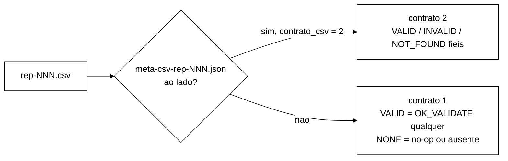

# Contrato v2 da coluna `return_code` do CSV de eventos (B-43.4, 2026-10-22)

> Quebra de contrato deliberada, aprovada pelo Gestor em 2026-10-22 (ponto 5 da V-B43.2 e decisão
> P2 = opção (a)). Implementada em `fix/b43-4-return-code-validate` (`2dca918`).

## 1. O que mudou

A coluna `return_code` do `rep-NNN.csv` é gerada por `OpResult.returnCode()`. Duas linhas da tabela
mudaram, e as outras ficaram como estavam.

| `OpResult.Code` | Contrato 1 (até `8ee2deb`) | Contrato 2 (B-43.4) |
|---|---|---|
| `OK_LOGIN` | `OK` | `OK` |
| `OK_VALIDATE`, sessão VALID | `VALID` | `VALID` |
| `OK_VALIDATE`, sessão INVALID | **`VALID`** | **`INVALID`** |
| `OK_STATUS` (IncrementFailure) | `COUNTED` | `COUNTED` |
| `OK_NOOP` (Logout de sessão já INVALID ou bem-sucedido, ResetFailures, Block, Unblock) | `NONE` | `NONE` |
| `NOT_FOUND` | **`NONE`** | **`NOT_FOUND`** |
| `BLOCKED` | `BLOCKED` | `BLOCKED` |
| `ERROR_TRANSPORT` | `ERROR_TRANSPORT` | `ERROR_TRANSPORT` |
| `ERROR_UNAVAILABLE` | `ERROR_UNAVAILABLE` | `ERROR_UNAVAILABLE` |

O mapeamento é **por código**. Por isso o `NOT_FOUND` vale para todas as operações que o devolvem:

| Operação | Quando devolve `NOT_FOUND` | Contrato 1 | Contrato 2 |
|---|---|---|---|
| Validate | sid ausente | `NONE` | `NOT_FOUND` |
| Logout | sid ausente | `NONE` | `NOT_FOUND` |
| ResetFailures | identidade ausente | `NONE` | `NOT_FOUND` |
| Unblock | identidade ausente | `NONE` | `NOT_FOUND` |

**Desvio deliberado.** O prompt da seção 9.2 da V-B43.2 dizia "ResetFailures `NONE`". O Gestor
decidiu (P2 = opção (a)) que ResetFailures e Unblock de **identidade ausente** também passam a
`NOT_FOUND`. O ResetFailures de identidade existente continua `NONE` (`OK_NOOP`). A alternativa (b), que
restringiria o `NOT_FOUND` a Validate e Logout, exigiria mudar `SessionOps`, que estava em edição
paralela no B-43.6. A alternativa (c), traduzir o código no `EventCsvWriter`, deixaria o `OpResult` e o
CSV discordando.

## 2. Por que mudou

No contrato 1, o C4 (`diagnostico-login-blocked-2026-10-22.md`) mascarava os desfechos:

- todo `OK_VALIDATE` saía como `VALID`, inclusive o de sessão já invalidada;
- chave ausente saía como `NONE`, a mesma grafia de um no-op.

Na mistura v2 o Logout isolado invalida as chaves Zipf quentes em segundos. No smoke de B-43.2, de
46 % a 54 % dos Validate leram sessão `INVALID` e o CSV gravou todos como `VALID` (V-B43.2, seção 6). O
contador `DesfechosValidate` (só no stdout) era a única fonte. No contrato 2 o CSV é fiel e coincide
com a linha `Desfechos Validate:` (valid = Validate `VALID`, invalid = Validate `INVALID`).

## 3. Como identificar a versão de um CSV

- `OpResult.VERSAO_CONTRATO_CSV = 2`.
- O stdout do workload imprime `Contrato CSV: v2` logo depois da linha `Mistura:`.
- `meta-csv-rep-NNN.json` com `{"contrato_csv": 2}` é gravado ao lado do `rep-NNN.csv`, logo depois
  do *flush*. O `estado-rep-NNN.json` (B-43.1) e o `carga-rep-NNN.json` (B-43.2) não mudaram.
- `analysis/percentis.py` tem `versao_contrato_csv(csv)`, que devolve 2 com o meta e 1 sem ele. O
  `main` imprime `Contrato CSV: v1|v2`. O `summary.json` não muda de formato.

## 4. Como ler CSV antigo (contrato 1)

- `percentis.py` lê os dois contratos com o mesmo `SUCESSOS`. `INVALID` e `NOT_FOUND` entraram como
  desfechos de negócio, e `VALID` e `NONE` continuam. Um CSV do contrato 1 dá exatamente o mesmo
  sumário de antes. Isso é travado por `analysis/test_contrato_csv_v2.py`
  (`Contrato1Regressao`, recortes de `runs/S1-F1/rep-001.csv` e `runs/b43-2-smoke/Q1/rep-001.csv`,
  com o esperado gerado pelo `percentis.py` de `8ee2deb`).
- No contrato 1, `Validate VALID` significa "a chave existia" e não "a sessão era válida". A fração
  real de INVALID desses CSV só existe no stdout (`Desfechos Validate:`, desde B-43.2). CSV anterior a
  B-43.2 não tem nenhuma das duas fontes.
- No contrato 1, `Validate NONE` é chave ausente. Em Logout, ResetFailures e Unblock, `NONE` mistura
  no-op e ausente.
- Comparar CSV de contratos diferentes exige normalizar: v2 → v1 com `INVALID`→`VALID` em Validate e
  `NOT_FOUND`→`NONE`. O caminho inverso é impossível.

## 5. Efeito no verificador de sanidade (B-43.3a, `a8f5549`)

- `VALIDATE_AUSENTE_ALTO` já soma `NONE` e `NOT_FOUND` em Validate (`Sanidade.java:238-239`) e
  continua correto nos dois contratos.
- `VALIDATE_VALID_ZERO` (`validate_valid`) passa a contar **só sessões VALID de fato**. No contrato 1
  contava todo `OK_VALIDATE`. Com os limiares provisórios atuais (`validate_valid_min_exclusivo = 0`),
  o veredito não muda nos smokes de v2. Se esse limiar for calibrado como fração, a calibração tem de
  usar CSV v2.
- O verificador olha `NONE`/`NOT_FOUND` só em Validate. O desvio de ResetFailures e Unblock não o afeta.
- Smoke de B-43.4 (`runs/b43-4-smoke/`), `a8f5549` sem ajuste: OK em S1 sync e S2 async.

## 6. Testes que fixam o contrato

| Teste | O que trava |
|---|---|
| `ContratoCsvV2Test.tabelaCompleta` (R1) | a tabela da seção 1, para todos os `Code` |
| `ContratoCsvV2Test.sessionOpsGravaEstadoReal`, `identidadeAusenteGravaNotFound` (R2) | as linhas do CSV via `SessionOps` sobre fakes |
| `ContratoCsvV2Test.contadorECsvConcordam`, `misturaV2ContadorIgualAoCsv` (R5) | contador = CSV, inclusive `ERROR_UNAVAILABLE` em `erro` |
| `MetaCsvTest` | versão 2, linha do stdout e `meta-csv-rep-NNN.json` |
| `OpResultTest`, `DesfechosValidateTest`, `SessionOpsBlockTest` | 6 linhas editadas com autorização do Gestor (ver relatório) |
| `analysis/test_contrato_csv.py` (sem edição) | todo literal de `returnCode()` é sucesso ou erro conhecido |
| `analysis/test_contrato_csv_v2.py` (R4) | `SUCESSOS`, regressão do contrato 1 e `versao_contrato_csv` |
| `GoldenS1S2Test` (sem edição) | o formato do `EventCsvWriter` (os códigos são literais no teste) |
