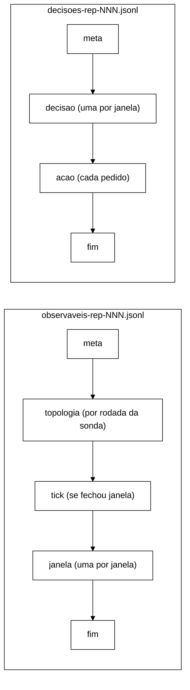

# Contrato dos JSONL do controlador, versão 1 (W-3, B-28.2, 2026-11-04)

Com `--controller shadow|active`, cada repetição grava dois arquivos em `--csv-dir`:

- `observaveis-rep-NNN.jsonl` (esquema `observaveis-controlador/1`): o que o laço viu.
- `decisoes-rep-NNN.jsonl` (esquema `decisoes-controlador/1`): o que o núcleo decidiu e o que o executor fez.

Com `--controller off` nenhum dos dois existe. Código: `workload/src/main/java/br/unipampa/tcc/controle/FormatoJsonl.java`
(formato), `TrilhaJsonl.java` (gravação), `LacoDeControle.java` (ordem das linhas). Teste de contrato:
`LacoDeControleTest.jsonlLinhaALinha`, `ControleArquivosTest.formatoDecisao` e `ControleArquivosTest.formatoAcao`.

## Regras gerais

1. Uma linha = um objeto JSON em UTF-8, terminado em `\n`, com *flush* a cada linha. Uma queda do processo
   perde no máximo a linha em curso.
2. Todo objeto tem `tipo`. A primeira linha dos dois arquivos é `meta`; a última, num encerramento normal, é `fim`.
   Um arquivo sem `fim` vem de execução interrompida.
3. Campos em `snake_case`. Ausência de valor é `null`; nenhum campo do esquema é omitido.
4. Instantes em ns no relógio dos `end_ns` do CSV de eventos (`EpochClock` da repetição).
5. O p99 por janela não vai ao JSONL (decisão de 2026-10-22); só contagens.
6. `analysis/` não conta esses arquivos como execuções (mesmo padrão de `violacoes-rep-*.csv`).

As linhas `topologia` (thread da sonda) e `acao` em `active` (thread do executor) se intercalam com as demais na
ordem em que acontecem; a ordem entre `tick`, `janela` e `decisao` é a do laço.

## `meta` (primeira linha dos dois arquivos)

| Campo | Tipo | Conteúdo |
|---|---|---|
| `esquema` | texto | `observaveis-controlador/1` ou `decisoes-controlador/1` |
| `versao_programa` | texto | `session-workload 0.1.0-SNAPSHOT` |
| `rep` | inteiro | número da repetição |
| `modo` | texto | `shadow` ou `active` |
| `cenario` | texto | `S1`, `S2` ou `S3` |
| `replicacao` | texto | `sync` ou `async` |
| `nos_esperados` | inteiro | itens de `--servers` (H6) |
| `param_versao`, `param_sha256` | texto | `versao` e SHA-256 do `--controller-config` |
| `parametros` | objeto | `w_ns`, `n_lat`, `n_err`, `theta_lat_in`, `theta_lat_out`, `theta_err_in`, `theta_err_out`, `k`, `m`, `cooldown_ns`, `estavel_ns`, `hold_viol_ns` |
| `referencia_arquivo`, `referencia_sha256` | texto ou `null` | `--controller-reference` (`null` em shadow sem referência: latência indeterminada) |
| `tolerancia_ns` | inteiro | L do agregador (100 ms) |
| `tick_ns` | inteiro | período do *tick* (W/5) |
| `origem_ns` | inteiro | início da primeira janela = início da medição |
| `atuador` | texto | `nulo` até o W-2 |
| `politica` | texto | `nenhuma` até o W-2 |
| `sonda_topologia`, `sonda_defasagem` | booleano | sondas ligadas (`sonda_defasagem` = `false` até o W-4) |

## `observaveis`

**`janela`**, uma por janela fechada, contígua (`t_ini_ns` = `t_fim_ns` da anterior):

| Campo | Conteúdo |
|---|---|
| `t_ini_ns`, `t_fim_ns` | limites `[ini, fim)` |
| `total`, `erros`, `unavailable` | eventos; `ERROR_TRANSPORT` + `ERROR_UNAVAILABLE`; só `ERROR_UNAVAILABLE` |
| `n_lat`, `exced` | eventos com p99 de referência; os que excederam |
| `atrasados` | eventos descartados por atraso desde a janela anterior (regra C+A) |
| `viol.seguranca` | I1 + I4 + I2 `REAL` (inclui as promovidas) |
| `viol.seguranca_promovidas` | violações de segurança atrasadas somadas nesta janela |
| `viol.i2_esperada` | I2 `ESPERADA-POR-DESENHO` |
| `viol.i2_fora_do_gatilho` | I2 incerta, inexplicada, sem login ou sem rastro |
| `viol.fora_do_gatilho` | I3, I5, I6, `I2_JANELA_CASCATA`, `I2_CASCATA_INCOMPLETA` (DT-002) |
| `viol.atrasadas_fora_do_gatilho` | violações fora do gatilho descartadas por atraso |
| `top` | `disponivel`, `amostras`, `anomalas`, `nos_min` (S_top da janela) |
| `lag` | `nivel` (`INDETERMINADA`, `CALMA`, `INTERMEDIARIA`, `ALTA`), `no_suspeito`, `lag_max_ms`, `amostras` (S_lag) |

**`tick`**: `seq` (registros do agregador até ali), `agora_ns`, `janelas` (quantas o *tick* fechou). Só sai quando
o *tick* fecha ao menos uma janela; serve ao *replay* do B-38.

**`topologia`**: uma por rodada da sonda: `t_ns`, `anomala`, `nos_min`, `por_no` (lista de `no`, `respondeu`,
`numero_de_nos`, `motivo`, `anomalo`). Motivos: `ok`, `timeout`, `falha:<Exceção>`, `nos:<n><<esperados>`,
`cache-ausente:<nome>`, `cache:<nome>=<status>`. Desde o W-3, `TimeoutException` da consulta vira `timeout` (H4).

**`fim`**: `janelas`, `ticks`, `erros_tick`, `eventos_antes_da_origem`, `violacoes_antes_da_origem`,
`eventos_apos_encerramento`, `atrasados_total`, `violacoes_atrasadas_total`, `promovidas_total`,
`descartados_no_encerramento`, `violacoes_descartadas_no_encerramento`, `eventos_fora_do_contrato`,
`sonda_rodadas`, `sonda_rodadas_puladas`, `sonda_amostras_atrasadas`, `sonda_erros_ouvinte`, `curl_lancados`
(os de sonda são `null` sem sonda).

Conservação: `soma(total) + atrasados_total + descartados_no_encerramento` = eventos registrados depois da origem
(`LacoDeControleTest.concorrenciaComTick`).

## `decisoes`

**`decisao`**, uma por janela, com o mesmo `t_fim_ns` da `janela` correspondente. Campos, nesta ordem:
`tipo`, `t_fim_ns`, `modo`, `perfil` (`NORMAL`/`CONSERVADOR`), `transicao`, `regra` (`R1`..`R4`, `NENHUMA`),
`motivos` (lista em ordem de severidade: `VIOLACAO`, `TOPOLOGIA`, `DEFASAGEM`, `ERRO`, `LATENCIA`; `[ESTAVEL]`
se nenhum), `severidade`, `sinais`, `param_sha256`.

`sinais`: `taxa_latencia`, `taxa_erro`, `fracao_indisponivel` (número ou `null` = indeterminado), `latencia_alta`,
`erro_alto`, `topologia_anomala`, `topologia_disponivel`, `topologia_amostras`, `topologia_anomalas`, `nos_minimo`,
`violacoes_seguranca`, `violacoes_i2_esperadas`, `persistencia_latencia`, `persistencia_erro`, `janelas_calmas`,
`cooldown_expirado`, `defasagem` (nível), `defasagem_alta`, `persistencia_defasagem`, `no_suspeito`, `lag_max_ms`,
`defasagem_amostras`.

**`acao`**, um pedido de aplicação ou de reversão. Campos, nesta ordem:

| Campo | Conteúdo |
|---|---|
| `operacao` | `APLICAR` ou `REVERTER` |
| `executada` | houve chamada ao *cluster*. Sempre `false` em shadow e com o atuador nulo |
| `modo`, `atuador` | `shadow`/`active`; nome do atuador |
| `acao` | `tipo` (`AC-1`, `AC-2`, `AC-3`), `caches` (lista), `alvo` (nó ou `null` = *cluster*), `valor` |
| `origem` | `POLITICA`, `R4` (saída para NORMAL desfaz tudo), `FALHA_NA_APLICACAO` (reversão automática), `ENCERRAMENTO` (fim da carga), `GANCHO_JVM` (desligamento sem encerramento normal) |
| `regra`, `t_fim_janela_ns` | regra e fim da janela da decisão que pediu; `null` no encerramento |
| `t_pedido_ns` | instante do pedido |
| `t_inicio_ns`, `duracao_ns` | início e duração da chamada; `null` sem chamada |
| `resultado` | `APLICADA`, `FALHOU`, `NAO_EXECUTADA` (atuador nulo), `PREVISTA` (shadow), `DESCARTADA` (na fila no encerramento) |
| `codigo_http`, `lido`, `erro` | código HTTP, leitura de volta (S_disp) e motivo da falha; `null` quando não se aplica |

Em shadow, a sequência de linhas `acao` é a que active produziria com um atuador que sempre aplica (mesma pilha
virtual, mesmas reversões em R4 e no encerramento).

**`fim`**: `decisoes`, `transicoes`, `perfil_final`, `erros_politica`, `acoes_pedidas`, `acoes_ignoradas`
(pedido repetido de ação já ativa), `acoes_executadas`, `acoes_falhas`, `reversoes`, `reversoes_falhas`,
`acoes_descartadas`, `executor_no_prazo` (o encerramento terminou dentro do prazo de 10 s).
