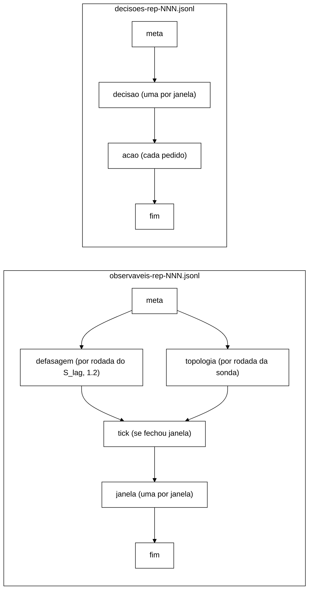

# Contrato dos JSONL do controlador, versão 1.2 (W-3, B-28.2, 2026-11-04; W-2a, B-44.2, 2026-11-05; W-4, B-26.3, 2026-11-05)

Com `--controller shadow|active`, cada repetição grava dois arquivos em `--csv-dir`:

- `observaveis-rep-NNN.jsonl` (esquema `observaveis-controlador/1.2`): o que o laço viu.
- `decisoes-rep-NNN.jsonl` (esquema `decisoes-controlador/1.2`): o que o núcleo decidiu e o que o executor fez.

**Histórico.** v1 (`b883397`): primeira versão. v1.1 (V-W3, `docs/validacao-w3-2026-11-04.md`, antes de qualquer
dado): `t_decisao_ns` na linha `decisao`; `linhas_perdidas` nas duas linhas `fim`; `acoes_ja_ativas`,
`prazo_chamada_ns` e `prazo_encerramento_ns` no `fim` de `decisoes`; resultado `JA_ATIVA`; prazo de encerramento
derivado; regra do *tick*. Todas as mudanças são aditivas. **v1.2** (W-2a, só `decisoes`; aprovação do
coordenador em 05/11, P-36/P-37/P-38): campo `reversao` em toda linha `acao` (`"orquestrador"` na ação não
reversível, AC-5; `null` na reversível, AC-2); linha nova `politica`; `parametros_politica` na `meta`; tipos de ação
só `AC-2` e `AC-5` (AC-1 e AC-3 retirados). `observaveis` continua 1.1: nada mudou nele. **observaveis 1.2** (W-4,
B-26.3, só `observaveis`, aditivo e antes de qualquer dado; validado na V-W4, `ff7ab3c`): `parametros_defasagem` na `meta`;
linha nova `defasagem` (uma por rodada da sonda S_lag); contadores `defasagem_*` no `fim`. `decisoes` continua 1.2.
**Correções da integração** (`fix/w2a-p41-p42`, 05/11, decisões do coordenador, aditivas na 1.2 e antes de qualquer
dado de campanha; os brutos do I-1..I-5 em `runs/b44-2/` são anteriores e não têm os campos novos): `p2_habilitada`
em `parametros_politica` e o motivo `p2-desabilitada` na linha `politica` (D-B); prazo do AC-5 de 5 s para 17 s e pior
caso do `T_enc` de 9 s para 21 s (P-42); leitura por réplica da carga S3 com prazo sem resposta (P-41, seção própria).
**W-2b** (`fix/p5-caminho-critico`, 05/11, P-5; nenhum campo novo, nenhum campo retirado, esquemas continuam
`observaveis-controlador/1.2` e `decisoes-controlador/1.2`): a gravação passa para uma *thread* gravadora por arquivo,
com fila em memória (regra 1); `linhas_perdidas` passa a contar também as linhas recusadas com a fila cheia e é
preenchido na hora em que a linha `fim` é gravada; a sonda de topologia deixa de criar processo e `curl_lancados`
vale 0 com ela (decisão 4 do coordenador: o campo fica no esquema); o fechamento espera a gravadora só pelo que
sobra do `T_enc` (decisão 5) e as linhas abandonadas vão a `linhas_jsonl_perdidas=` do stdout; as linhas
`Hot Rod ISPN004007:` e `Hot Rod ISPN004005:` no stdout (seção própria, decisão 6).

Com `--controller off` nenhum dos dois existe. Código: `workload/src/main/java/br/unipampa/tcc/controle/FormatoJsonl.java`
(formato), `TrilhaJsonl.java` (gravação), `LacoDeControle.java` (ordem das linhas). Teste de contrato:
`LacoDeControleTest.jsonlLinhaALinha`, `ControleArquivosTest.formatoDecisao` e `ControleArquivosTest.formatoAcao`.

## Regras gerais

1. Uma linha = um objeto JSON em UTF-8, terminado em `\n`, com *flush* a cada linha. **W-2b (P-5):** quem produz
   a linha (laço, executor, sondas) só a põe numa fila em memória e volta; uma *thread* gravadora por arquivo
   (`trilha-jsonl-<arquivo>`) grava na ordem da fila. Um travamento de disco atrasa a gravação, não o laço nem o
   atuador. A fila tem capacidade fixa, calculada na abertura: 4 × as linhas esperadas na execução de `--duration`
   (`observaveis`: 2 + 2·⌈D/W⌉ + ⌈D/P_sonda⌉ com a sonda de topologia + ⌈D/W⌉ com a S_lag; `decisoes`:
   2 + 3·⌈D/W⌉); com ela cheia, a linha é recusada e contada em `linhas_perdidas`. A linha `fim` entra fora da
   capacidade (nunca se perde por fila cheia) e nenhuma linha passa dela. **Fechamento** (decisão 5 do
   coordenador, 05/11): no fim da carga, as gravadoras têm só o que sobra do `T_enc` usado pelo executor, contado
   do início do encerramento dele (como o gancho da JVM; com o executor fora do prazo, sobra o mínimo do `join`,
   1 ms). Se não terminarem (disco travado), o que não foi gravado (a linha em curso, as da fila e o `fim`) é
   abandonado e contado em `linhas_jsonl_perdidas=` da linha `Controlador:` do stdout, porque o `fim` pode não ter
   saído; a linha em curso conta mesmo se o disco a completar depois (teto, no máximo uma linha a mais por
   arquivo). Uma queda do processo perde as linhas ainda na fila e a linha em curso.
2. Todo objeto tem `tipo`. A primeira linha dos dois arquivos é `meta`; a última, num encerramento normal, é `fim`.
   Um arquivo sem `fim` vem de execução interrompida.
3. Campos em `snake_case`. Ausência de valor é `null`; nenhum campo do esquema é omitido.
4. Instantes em ns no relógio dos `end_ns` do CSV de eventos (`EpochClock` da repetição).
5. O p99 por janela não vai ao JSONL (decisão de 2026-10-22); só contagens.
6. `analysis/` não conta esses arquivos como execuções (mesmo padrão de `violacoes-rep-*.csv`).

As linhas `topologia` (thread da sonda), `defasagem` (thread gravadora da sonda S_lag, W-4) e `acao` em `active`
(thread do executor) se intercalam com as demais na ordem em que acontecem; a ordem entre `tick`, `janela` e
`decisao` é a do laço. Desde o W-2b, "na ordem em que acontecem" é a ordem em que entram na fila do arquivo, que é a
mesma em que antes eram gravadas.

## `meta` (primeira linha dos dois arquivos)

| Campo | Tipo | Conteúdo |
|---|---|---|
| `esquema` | texto | `observaveis-controlador/1.2` ou `decisoes-controlador/1.2` |
| `versao_programa` | texto | `session-workload 0.1.0-SNAPSHOT` |
| `rep` | inteiro | número da repetição |
| `modo` | texto | `shadow` ou `active` |
| `cenario` | texto | `S1`, `S2` ou `S3` |
| `replicacao` | texto | `sync` ou `async` |
| `nos_esperados` | inteiro | itens de `--servers` (H6) |
| `param_versao`, `param_sha256` | texto | `versao` e SHA-256 do `--controller-config` |
| `parametros` | objeto | `w_ns`, `n_lat`, `n_err`, `theta_lat_in`, `theta_lat_out`, `theta_err_in`, `theta_err_out`, `k`, `m`, `cooldown_ns`, `estavel_ns`, `hold_viol_ns` |
| `referencia_arquivo`, `referencia_sha256` | texto ou `null` | `--controller-reference` (`null` em shadow sem referência: latência indeterminada) |
| `tolerancia_ns` | inteiro | L do agregador (100 ms) |
| `tick_ns` | inteiro | período Δ do *tick* (regra abaixo) |
| `origem_ns` | inteiro | início da primeira janela = início da medição |
| `atuador` | texto | `nulo` sem o bloco `politica` no `--controller-config`; com ele, `por-tipo(AC-2=rest-infinispan,AC-5=rest-infinispan)` (W-2a) |
| `politica` | texto | `nenhuma` sem o bloco; `por-assinatura` com ele (W-2a) |
| `parametros_politica` | objeto ou `null` | **só em `decisoes` (1.2).** `k_lag`, `teto_lag_ms`, `t_reb_ns`, `cota_ac5`, `p2_habilitada` (booleano, D-B) e `origem` (texto por parâmetro); `null` sem o bloco |
| `parametros_defasagem` | objeto ou `null` | **só em `observaveis` (1.2, W-4).** `lag_in_ms`, `lag_out_ms`, `passo_leitura_ms`, `periodo_ns` (= W) e `origem` (texto por parâmetro); `null` sem o bloco `defasagem`. O prazo de leitura (o "não viu") é o `--hotrod-timeout-ms` e vai em `teto_ms` de cada linha `defasagem` |
| `sonda_topologia`, `sonda_defasagem` | booleano | sondas ligadas (`sonda_defasagem` = `true` só com o bloco `defasagem`, W-4) |

## Regra do *tick* e prazos (v1.1)

**Tick.** `Δ = min(W/5, P_sonda/2)`, com `P_sonda` = 2 s (período da sonda de topologia, B-26.2).

- `W/5` é a decisão registrada em `docs/validacao-b26-1-2026-10-22.md` §5.9 (aprovada pelo Gestor em 22/10), que
  limita o atraso de fechamento a `W + L + Δ`.
- `P_sonda/2` vem da derivação da V-W3 (§4.2): o *tick* nunca é o termo dominante do atraso de leitura de S_top.
- Com W = 5 s, os dois dão 1 s. A regra só muda o valor se a calibração (N3) escolher W > 10 s.
- Medida na calibração: `D = t_decisao_ns − t_fim_ns` por janela, esperado em `[L, L + Δ]`.

**Prazo de cada chamada ao atuador.** `T_cham` = 2 s (o `curl -m` da sonda de saúde, B-26.2; plano 4.4.2). Ele limita
a chamada **inteira** do atuador: todos os pedidos HTTP da ação (todos os *caches*, todos os nós) e a leitura de volta.
O adaptador do W-2 não pode gastar `T_cham` por pedido.

**Prazo do encerramento** (v1.2, W-2a; V-W2a R1). Calculado pelo executor no próprio encerramento:

`T_enc = prazo da aplicação em curso + soma dos prazos de reversão da pilha + T_cham`

- o prazo de cada chamada é o do seu tipo: AC-2 = `T_cham` (2 s); AC-5 = `T_cham` + 15 s = **17 s** (P-42, decisão do
  coordenador de 05/11). Origem: no I-3 do B-44.2, sob corte, o servidor anuncia a parada 3 s depois do pedido
  (`Server.java:208`), mas a saúde do nó isolado só deixa de responder **13,1 s (SYNC) a 13,3 s (ASYNC)** depois dele
  (`docs/relatorio-b44-2-2026-11-05.md` §6.1 e §7); com `T_cham` + 3 s o atuador gravava `FALHOU`
  (`alvo-continua-respondendo`) com o nó parando. Sem corte, 3,06 a 3,24 s;
- a pilha só tem ações reversíveis (AC-2); o AC-5 nunca entra nela, mas se estiver em curso entra com os 17 s dele;
- o `+ T_cham` final é a folga da V-W3 para a chamada que chega junto com o encerramento;
- aplicações ainda na fila são descartadas (`DESCARTADA`) e não entram na conta;
- o valor usado vai a `prazo_encerramento_ns` no `fim` de `decisoes`.

Só com AC-2 isso é o `(A + 1) × T_cham` da v1.1. **Pior caso com a política do W-2a: 21 s** com a P2 habilitada (AC-2
na pilha, 2 s; AC-5 em curso, 17 s; `T_cham`, 2 s; uso exploratório) e **19 s** no braço B de avaliação, em que a P2 está
desabilitada (D-B) e o AC-2 nunca entra na pilha (17 + 2). A cota do AC-5 é 1 e só há uma chave de AC-2, então não há
pior caso maior. O `--dry-run` mostra o valor da configuração (`pior_caso_ns`). Até o P-42 eram 9 s (AC-5 em 5 s).

O mesmo prazo vale para o gancho de desligamento da JVM.

**Requisito para o orquestrador (W-6).** Para o gancho conseguir desfazer as ações, o processo precisa receber, entre o
SIGTERM e o SIGKILL, um intervalo maior que `T_enc` no pior caso: **`timeout -k <K>` com `K` > 21 s mais uma folga**
(o pior caso acima com a P2 habilitada, que cobre também os 19 s do braço B de avaliação; era 9 s antes do P-42, e a
v1.1 dizia 8 s com AC-1, AC-2 e AC-3, que não existem mais). O W-6 também confere que uma execução do braço B tem
`politica = por-assinatura` e `parametros_politica` não nulo na `meta` (V-W2a O10) e, numa fase de avaliação,
`parametros_politica.p2_habilitada = false` (D-B).

## `observaveis`

**`janela`**, uma por janela fechada, contígua (`t_ini_ns` = `t_fim_ns` da anterior):

| Campo | Conteúdo |
|---|---|
| `t_ini_ns`, `t_fim_ns` | limites `[ini, fim)` |
| `total`, `erros`, `unavailable` | eventos; `ERROR_TRANSPORT` + `ERROR_UNAVAILABLE`; só `ERROR_UNAVAILABLE` |
| `n_lat`, `exced` | eventos com p99 de referência; os que excederam |
| `atrasados` | eventos descartados por atraso desde a janela anterior (regra C+A) |
| `viol.seguranca` | I1 + I4 + I2 `REAL` (inclui as promovidas) |
| `viol.seguranca_promovidas` | violações de segurança atrasadas somadas nesta janela |
| `viol.i2_esperada` | I2 `ESPERADA-POR-DESENHO` |
| `viol.i2_fora_do_gatilho` | I2 incerta, inexplicada, sem login ou sem rastro |
| `viol.fora_do_gatilho` | I3, I5, I6, `I2_JANELA_CASCATA`, `I2_CASCATA_INCOMPLETA` (DT-002) |
| `viol.atrasadas_fora_do_gatilho` | violações fora do gatilho descartadas por atraso |
| `top` | `disponivel`, `amostras`, `anomalas`, `nos_min` (S_top da janela) |
| `lag` | `nivel` (`INDETERMINADA`, `CALMA`, `INTERMEDIARIA`, `ALTA`), `no_suspeito`, `lag_max_ms`, `amostras` (S_lag; W-4: `amostras` = rodadas consumidas na janela: as com início nela e as atrasadas de janelas anteriores, contadas também em `defasagem_rodadas_atrasadas`; `lag_max_ms` = maior lag de nó; `no_suspeito` = o nó que o atinge, se único, preenchido em toda janela com rodada; só é suspeito de fato com `lag_max_ms` = teto, e o P1 só o usa assim) |

**`tick`**: `seq` (registros do agregador até ali), `agora_ns`, `janelas` (quantas o *tick* fechou). Só sai quando
o *tick* fecha ao menos uma janela; serve ao *replay* do B-38.

**`topologia`**: uma por rodada da sonda: `t_ns`, `anomala`, `nos_min`, `por_no` (lista de `no`, `respondeu`,
`numero_de_nos`, `motivo`, `anomalo`). Motivos: `ok`, `timeout`, `falha:<Exceção>`, `nos:<n><<esperados>`,
`cache-ausente:<nome>`, `cache:<nome>=<status>`. Desde o W-3, `TimeoutException` da consulta vira `timeout` (H4).

**`fim`**: `janelas`, `ticks`, `erros_tick`, `eventos_antes_da_origem`, `violacoes_antes_da_origem`,
`eventos_apos_encerramento`, `atrasados_total`, `violacoes_atrasadas_total`, `promovidas_total`,
`descartados_no_encerramento`, `violacoes_descartadas_no_encerramento`, `eventos_fora_do_contrato`,
`sonda_rodadas`, `sonda_rodadas_puladas`, `sonda_amostras_atrasadas`, `sonda_erros_ouvinte`, `curl_lancados`
(os de sonda são `null` sem sonda; `curl_lancados` vale 0 com a sonda REST desde o W-2b, que trocou o `curl` por
HTTP em memória, e fica no esquema para não mudá-lo), `defasagem_rodadas`, `defasagem_rodadas_antes_da_origem`,
`defasagem_rodadas_puladas`, `defasagem_rodadas_atrasadas`, `defasagem_rodadas_nao_gravadas`, `defasagem_escritas`,
`defasagem_leituras`, `defasagem_erros_escrita`, `defasagem_erros_leitura`, `defasagem_erros_ouvinte` (1.2, W-4;
`null` sem a sonda de defasagem), `defasagem_chaves` (1.2, W-4, P-44: lista de `no`, `chave`, `primario`, `motivo`: a chave de
cada nó, se ela tinha o próprio nó como dono primário na abertura e o `motivo` da escolha; `primario` e `motivo` são `null` quando o canal não escolhe;
`null` sem a sonda), `linhas_perdidas` (v1.1).

**`defasagem`** (1.2, W-4), uma por rodada da sonda S_lag com início depois da origem, gravada por uma *thread*
própria da sonda (P-5: um travamento de disco atrasa a gravação, nunca a rodada seguinte), por isso intercalada com
as outras linhas. Campos, nesta ordem:

| Campo | Conteúdo |
|---|---|
| `rodada` | número da rodada na execução (a partir de 1; inclui as de aquecimento, antes da origem, que não são gravadas) |
| `t_inicio_ns`, `t_ns` | início (decide a janela) e fim da rodada |
| `teto_ms` | prazo de leitura = `--hotrod-timeout-ms` (= `politica.tetoLagMs`, R7): o lag de um par não visto |
| `lag_max_ms`, `no_suspeito` | maior lag de nó da rodada e o nó que o atinge, se único (`null` em empate). O `no_suspeito` sai preenchido em toda rodada, também nas calmas (máximo único entre valores pequenos): **só é suspeito com `lag_max_ms = teto_ms`**, e quem lê o JSONL tem de filtrar assim (o P1 só o usa com `lag_max_ms >= tetoLagMs`) |
| `lag_max_par_ms` | maior lag de par (só registro: um par alto sozinho não levanta o lag de nenhum nó) |
| `lag_por_no` | lista de `no`, `lag_ms`: o **menor** lag entre os pares em que o nó escreve ou lê |
| `pares` | lista de `escritor`, `leitor`, `visto`, `lag_ms` (do início da rodada até o fim da leitura que devolveu o valor novo; o teto se não visto), `leituras` (tentativas), `erros_leitura` |
| `escritas` | lista de `no`, `ok` (`true`, `false`, ou `null` se pendente no fim do prazo), `duracao_ms`, `erro` (nome da exceção) |
| `custo` | `escritas`, `leituras`, `erros_escrita`, `erros_leitura` da rodada (contados à parte da carga útil; nunca no CSV de eventos) |

Conservação: `defasagem_escritas` = 3 × `defasagem_rodadas` (três nós). A soma de `custo.leituras` das linhas é
`defasagem_leituras` menos as leituras das rodadas de aquecimento, das rodadas não gravadas
(`defasagem_rodadas_nao_gravadas`), das que o ouvinte recusou (`defasagem_erros_ouvinte`) e das linhas perdidas
(`linhas_perdidas`). `defasagem_rodadas_puladas` conta também instantes pulados antes da origem: as rodadas puladas
depois da origem se contam pelas janelas com `lag.amostras = 0`, e não pelo contador.

**Custo da sonda** (decisão do coordenador de 05/11): sem falha, 3 escritas e **no mínimo** 6 leituras por rodada (em ASYNC, de 6 a 9: o leitor que é cópia lê de novo um passo depois se a replicação ainda não chegou; uma rodada por
janela W). Sob falha, um par que não vê o valor é lido a cada `passoLeituraMs` até o prazo: no máximo
`prazo/passo` = 2000/20 = **100 leituras por par e por rodada**, até 600 por rodada com os seis pares no teto. O custo
é da sonda, está nos dois braços e é contado à parte da carga útil (`custo` e `defasagem_*`).

**Aquecimento** (decisão do coordenador de 05/11): a agenda começa na janela corrente da abertura, antes da origem,
para aquecer os clientes; essas rodadas põem tráfego da sonda no *warm-up* **dos dois braços**, de forma simétrica, e
não vão a janela nem ao JSONL (só a `defasagem_rodadas_antes_da_origem`). Nenhuma delas entra no CSV de eventos.

**Chaves** (P-44): a chave de cada nó X é escolhida na abertura para ter X como dono primário, pelo hash consistente
de um cliente *topology-aware* (`CanalCanarioHotRod`): candidatas `lag:<X>`, `lag:<X>#1`, `lag:<X>#2`..., até 10 000.
Sem topologia, com X fora da topologia anunciada ou sem achar, a **abertura falha** (V-W4 R1, decisão do coordenador em
nome do Gestor, 05/11): em toda execução com o bloco `defasagem`, nos dois braços, na calibração e na avaliação, a
execução vai como de infraestrutura (DT-014). `defasagem_chaves` fica como registro de auditoria. O uso de
`ChannelFactory` (pacote `impl` do cliente) é limitação declarada, nas condições da V-W4 §7.1: cliente fixo em 15.0.0,
uso só na abertura, falha nunca silenciosa e prova REST obrigatória no *smoke*.

`linhas_perdidas` conta as linhas que não chegaram ao arquivo até a linha `fim`: erros de escrita mais linhas
recebidas com a trilha já fechada e, desde o W-2b, linhas recusadas com a fila cheia. A *thread* gravadora preenche o
campo na hora de gravar o `fim`, quando já conhece o resultado de todas as linhas anteriores. As linhas que chegam **depois** do `fim` (executor fora do prazo,
`executor_no_prazo = false`) não podem estar nele. Elas aparecem em `linhas_jsonl_perdidas=` na linha `Controlador:`
do stdout, junto com as abandonadas no fechamento (regra 1); um arquivo sem `fim` com `linhas_jsonl_perdidas > 0` é
um fechamento que estourou o `T_enc`.

Conservação: `soma(total) + atrasados_total + descartados_no_encerramento` = eventos registrados depois da origem
(`LacoDeControleTest.concorrenciaComTick`).

## `decisoes`

**`decisao`**, uma por janela, com o mesmo `t_fim_ns` da `janela` correspondente. Campos, nesta ordem:
`tipo`, `t_fim_ns`, `t_decisao_ns` (v1.1: instante em que o laço processou a janela), `modo`, `perfil`
(`NORMAL`/`CONSERVADOR`), `transicao`, `regra` (`R1`..`R4`, `NENHUMA`),
`motivos` (lista em ordem de severidade: `VIOLACAO`, `TOPOLOGIA`, `DEFASAGEM`, `ERRO`, `LATENCIA`; `[ESTAVEL]`
se nenhum), `severidade`, `sinais`, `param_sha256`.

`sinais`: `taxa_latencia`, `taxa_erro`, `fracao_indisponivel` (número ou `null` = indeterminado), `latencia_alta`,
`erro_alto`, `topologia_anomala`, `topologia_disponivel`, `topologia_amostras`, `topologia_anomalas`, `nos_minimo`,
`violacoes_seguranca`, `violacoes_i2_esperadas`, `persistencia_latencia`, `persistencia_erro`, `janelas_calmas`,
`cooldown_expirado`, `defasagem` (nível), `defasagem_alta`, `persistencia_defasagem`, `no_suspeito`, `lag_max_ms`,
`defasagem_amostras`.

**`acao`**, um pedido de aplicação ou de reversão. Campos, nesta ordem:

| Campo | Conteúdo |
|---|---|
| `operacao` | `APLICAR` ou `REVERTER` |
| `executada` | houve chamada ao *cluster*. Sempre `false` em shadow e com o atuador nulo |
| `modo`, `atuador` | `shadow`/`active`; nome do atuador |
| `acao` | `tipo` (`AC-2`, `AC-5`; W-2a. `AC-1`/`AC-3` fora do braço B), `caches` (lista), `alvo` (nó ou `null` = *cluster*; obrigatório no AC-5, proibido no AC-2), `valor` |
| `origem` | `POLITICA`, `R4` (saída para NORMAL desfaz tudo), `FALHA_NA_APLICACAO` (reversão automática), `ENCERRAMENTO` (fim da carga), `GANCHO_JVM` (desligamento sem encerramento normal) |
| `regra`, `t_fim_janela_ns` | regra e fim da janela da decisão que pediu; `null` no encerramento |
| `t_pedido_ns` | instante do pedido |
| `t_inicio_ns`, `duracao_ns` | início e duração da chamada; `null` sem chamada |
| `resultado` | `APLICADA`, `FALHOU`, `NAO_EXECUTADA` (atuador nulo), `PREVISTA` (shadow), `DESCARTADA` (na fila no encerramento), `JA_ATIVA` (v1.1: pedido de ação que continua aplicada porque a reversão anterior falhou; sem chamada) |
| `codigo_http`, `lido`, `erro` | código HTTP, leitura de volta (S_disp) e motivo da falha; `null` quando não se aplica |

Em shadow, a sequência de linhas `acao` é a que active produziria com um atuador que sempre aplica (mesma pilha
virtual, mesmas reversões em R4 e no encerramento).

**W-2a (B-44.2), v1.2.** (1) Toda linha `acao` termina com `reversao`: `"orquestrador"` quando a ação não é
reversível (AC-5: não entra na pilha, nunca tem linha `REVERTER` e não é desfeita no R4, no encerramento nem pelo
gancho; o orquestrador recria o *cluster* depois da execução); `null` quando a reversão é a da pilha (AC-2).
(2) Linha nova **`politica`**,
gravada pelo laço quando a política registra a escolha (só `PoliticaPorAssinatura`): `tipo`, `t_fim_janela_ns`,
`t_decisao_ns`, `modo`, `perfil`, `regra`, `politica` (`P0`, `P1`, `P2`), `motivo` (`sem-assinatura`,
`isolar-suspeito`, `cota-p1-esgotada`, `adiar-rebalanceamento`, `ac2-mantida`, `treb-esgotado`,
`no-parado-pela-politica`, `vistas-divergentes`, `no-voltou`, `teto-treb`, `p2-desabilitada`), `no` (V-7: rótulo do
nó da escolha, o suspeito no P1 e em `cota-p1-esgotada`, o ausente no P2, em `p2-desabilitada`, em `treb-esgotado` e
em `no-parado-pela-politica`, o nó do
AC-2 revertido em `no-voltou`, `teto-treb` e `vistas-divergentes`; `null` em `sem-assinatura`), `reverter` e
`aplicar` (listas de rótulos de tipo). Em NORMAL sem reversão não há linha.

**Bloco `politica` do `--controller-config` (W-2a, P-38).** Opcional; sem ele o controlador usa o atuador nulo e
a política `nenhuma`. Com ele, `PoliticaPorAssinatura` e o atuador REST. Campos todos obrigatórios, sem valor
padrão no código, e cobertos pelo SHA-256 do arquivo (`param_sha256`):

| Campo | Valor | Origem (decisão do Gestor, 05/11) |
|---|---|---|
| `kLag` | calibração | janelas seguidas, consultadas pela política, com S_lag no teto e o mesmo `noSuspeito` para o AC-5; vem da calibração (D-12). Nos arquivos de teste, `"origem": "teste"`. **Não é o `k` do núcleo** (V-4): aquele conta janelas altas de latência, erro ou defasagem para a entrada em CONSERVADOR (R2); são números independentes. **Requisito da calibração (P-42):** viabilidade do AC-5, `kLag · W + t_parada < 39,8 s` (39,8 s = menor T_det da VM; `t_parada` sob corte = 13,3 s, I-3 do B-44.2); com W = 5 s, **`kLag` ≤ 5**. O arquivo da calibração é conferido por `ArquivoCalibracaoTest.kLagViavel` |
| `tetoLagMs` | `--hotrod-timeout-ms` | o que conta como "não viu" no S_lag. Tem de ser igual ao prazo de leitura da sonda, o `--hotrod-timeout-ms` da campanha, que o W-4 grava como `lagMaxMs` da leitura não vista: em S3, `LigacaoControlador.carregar` recusa o arquivo se os dois diferirem (V-W2a R7). O prazo vem da calibração (D-12); nos arquivos de teste, `"origem": "teste"` |
| `tRebNs` | 60 000 000 000 | `state-transfer.timeout` do XML (60 000 ms), acima da maior detecção medida (46,8 s no local, B-44.1 §4.1; 46,4 s na VM) |
| `cotaAc5` | 1 | desenho: uma vez por execução (com `owners=2`, o *cluster* de 3 nós tolera um nó fora) |
| `p2Habilitada` | **`false`** no braço B de avaliação e na calibração; `true` só em execução exploratória | D-B do coordenador (05/11), pela regra registrada antes do I-2: a P2 (AC-2) sai do braço B e fica exploratória (P-39: sob falha silenciosa o AC-2 oscila, só entra depois da exclusão e deixa o *cluster* sem rebalanceamento depois da fusão, 3 de 3; P-40: na queda não economiza rodada). Booleano obrigatório, sem padrão. Com `false`, a `PoliticaPorAssinatura` nunca pede o AC-2: a assinatura do P2 sai como `P0`/`p2-desabilitada` com o nó ausente. O código do AC-2 continua para o uso exploratório |
| `origem` | objeto | um texto não vazio para cada um dos cinco campos acima |

**Rótulo dos nós (requisito do W-4).** Toda peça do controlador identifica um nó pelo mesmo rótulo: `host:porta`
da URL normalizada de `--controller-admin` (`ConsultaSaudeRest.rotulo`, `AtuadorRestInfinispan.rotulo`). O
`noSuspeito` do S_lag (W-4) **tem de** usar esse rótulo; com outro, o AC-5 nunca acha o alvo (seguro, mas inútil).
Teste: `RotulosDosNosTest` (sonda × atuador × rótulo canônico). **W-4:** o `CanalCanarioHotRod` usa
`AtuadorRestInfinispan.rotulo` sobre as mesmas URLs (`CanalCanarioHotRodTest.rotuloCanonico` compara com
`RotulosDosNosTest.rotuloDoNo`), e o carregamento recusa, com o bloco `defasagem`, um nó `i` de `--servers` (Hot Rod)
que não seja o mesmo `host:porta` do nó `i` de `--controller-admin` (`CanalCanarioHotRod.conferirCorrespondencia`):
a sonda escreve pelo Hot Rod do nó `i` e o rotula pela REST do nó `i`.

**Bloco `defasagem` do `--controller-config` (W-4, B-26.3).** Opcional e **só com `--scenario S3`**; sem ele não há
sonda de defasagem e o S_lag é `INDETERMINADA`. Campos todos obrigatórios, sem valor padrão no código, cobertos pelo
SHA-256 do arquivo:

| Campo | Valor | Origem |
|---|---|---|
| `lagInMs` | calibração | quantil de 99 % do lag nas execuções sem falha da calibração (plano de alinhamento 4.2; mesma lógica do p99 de referência, B-39.1). Na própria calibração, valor provisório com `"origem": "provisorio-calibracao"` (2000 = o prazo, em `cluster/controlador/controlador-calibracao-s3.json`). Nos arquivos de teste, `"origem": "teste"` |
| `lagOutMs` | calibração | regra de histerese de θ_out (plano de alinhamento 3.6), com os mesmos dados. Na calibração, provisório com `"origem": "provisorio-calibracao"` (1000). Nos arquivos de teste, `"origem": "teste"` |
| `passoLeituraMs` | **20** | `wada_consistency_cloud_2011` §2: leitores a 50 leituras por segundo (decisão do coordenador de 05/11, a única opção com fonte na bibliografia). Intervalo entre leituras de um par enquanto o valor novo não aparece; fixa a resolução do lag e o custo sob falha (até 100 leituras por par e rodada, acima) |
| `origem` | objeto | um texto não vazio para cada um dos três campos acima |

**A calibração usa o lag bruto** (decisão do coordenador de 05/11). O `lagInMs` e o `lagOutMs` vêm das linhas
`defasagem` das execuções sem falha da calibração (`lag_max_ms` de cada rodada, com `lag_por_no` e `pares` para
diagnóstico), e não do `nivel` da linha `janela`. Os provisórios só mudam as decisões que o braço A (`shadow`) registra
na calibração. O lag medido não depende deles.

O prazo de leitura não é campo do bloco: é o `--hotrod-timeout-ms` (decisão do coordenador de 05/11), igual a
`politica.tetoLagMs` pela R7. O período da sonda é W. O carregamento recusa (exit 2): fora do S3; prazo de leitura
que não cabe em W; `passoLeituraMs` maior ou igual ao prazo; `lagInMs` acima do prazo; nós fora de correspondência.

**Requisito para o B-40 (V-W4 R4, decisão do coordenador de 05/11).** O carregamento exige `--hotrod-timeout-ms` < W, e a
agenda só começa a rodada de uma janela se o atraso de início não passar de W − prazo (`cabeNaJanela`). A regra
W = ⌈n_lat/λ₅⌉ do plano de alinhamento §3.5 não conhece isso. O B-40 fixa **W ≥ prazo + o maior atraso de início
medido na calibração**, com o atraso de início = `t_inicio_ns` − início da janela nas linhas `defasagem`.

**`fim`**: `decisoes`, `transicoes`, `perfil_final`, `erros_politica`, `acoes_pedidas`, `acoes_ignoradas`
(pedido repetido de ação já ativa, sem linha), `acoes_executadas`, `acoes_falhas`, `reversoes`, `reversoes_falhas`,
`acoes_descartadas`, `acoes_ja_ativas` (v1.1), `executor_no_prazo` (o encerramento terminou dentro de `T_enc`),
`prazo_chamada_ns`, `prazo_encerramento_ns` (v1.1: `T_cham` e o `T_enc` usado) e `linhas_perdidas` (v1.1).

Conservação (v1.1): `acoes_pedidas` = número de linhas `acao` com `operacao = APLICAR`. Isso vale também para a
repedida de ação cuja reversão falhou, que sai como `JA_ATIVA` (`ExecutorDeAcoesTest.repedidaComReversaoFalhaGravaLinha`).

## Leitura por réplica no S3 (P-41)

A rodada final do auditor (`InvariantAuditor.rodadaUnica`) e o laço de convergência leem cada réplica por um cliente
BASIC fixado no nó. Com um nó parado até o fim da execução (AC-5), essa leitura ficava presa sem prazo (I-3 do B-44.2,
`jstack-preso.txt`) e a carga não gravava os CSV. **Com `--scenario S3`**, a leitura de cada réplica tem um **prazo sem
resposta igual ao `--hotrod-timeout-ms`** (o mesmo prazo de leitura da sonda S_lag; decisão do coordenador de 05/11):
desiste quando passa esse prazo sem chegar nenhuma entrada nova nem o fim da iteração (o prazo recomeça a cada entrada,
para uma réplica lenta mas respondendo não ser descartada). A réplica sem resposta vira **não lida**: fica fora da
comparação de I5/I6 daquela rodada (como a leitura que lança, B-33) e conta em `leiturasFalhas`. Nada trava. Fora do S3
a leitura não mudou.

Saída (stdout), uma linha por repetição, depois da rodada final e antes de `Total de operacoes`, com a última leitura
de cada réplica na ordem de `--servers` (sessões e contadores de cada nó):

`Leitura por replica: prazo_sem_resposta_ms=<ms> sessoes@<host:porta>=<resultado> contadores@<host:porta>=<resultado> ...`

`<resultado>`: `lida`; `nao-lida:sem-resposta` (o prazo passou); `nao-lida:erro:<Excecao>` (a leitura lançou, por
exemplo DEGRADED); `nao-lida:interrompida`; `nao-chamada` (a réplica não foi lida, por exemplo num laço de convergência
cujas rodadas foram todas inválidas pela topologia). Código: `session/LeituraReplicaComPrazo.java` e
`WorkloadMain.leitorDaReplica`; teste `LeituraReplicaComPrazoTest`. Efeito no tempo de fim: até
`2 × --hotrod-timeout-ms` a mais na rodada final (sessões e contadores do nó parado).

## Contenção do `ISPN004007` e do `ISPN004005` do cliente Hot Rod (W-2b)

Vale com qualquer `--controller` (inclusive `off`): é da carga, não do controlador. Documentada para o W-6 e a
`analysis` lerem, se quiserem (decisão 6 do coordenador). O cliente Hot Rod grava um `ISPN004007` (ERROR, com a
pilha) por operação que esgotou as novas tentativas e um `ISPN004005` (WARN, uma linha) por erro devolvido pelo
servidor. Por repetição, por código e por (nó, motivo), a primeira ocorrência sai inteira no stderr, a segunda sai
como um aviso de uma linha sem pilha (`<código> [W-2b] as proximas ocorrencias de no=... motivo=... so sao
contadas ...`) e as demais só são contadas. Nenhuma outra mensagem do cliente muda. Saída (stdout), duas linhas por
repetição, nesta ordem, no fim dela (depois de fechados os clientes; também quando a repetição falha):

`Hot Rod ISPN004007: total=<n> inteiras=<n> contidas=<n> chaves=<k> | no=<host:porta> motivo=<motivo> n=<n> t_primeira_ns=<ns> t_ultima_ns=<ns> | ...`

`Hot Rod ISPN004005: total=<n> inteiras=<n> contidas=<n> chaves=<k> | no=<host:porta> motivo=<codigo> n=<n> t_primeira_ns=<ns> t_ultima_ns=<ns> | ...`

Uma parte por (nó, motivo), em ordem decrescente de `n` (empate: nó, motivo); `contidas = total - inteiras`; sem
ocorrência, só o cabeçalho com zeros. **`ISPN004007`:** `no` = endereço do servidor da `TransportException`, senão o
`connection=/h:p` da mensagem, senão o primeiro `host/ip:porta` da cadeia de causas, senão `desconhecido`; `motivo` =
classe da exceção mais o primeiro código `ISPN` da cadeia (por exemplo `TransportException:ISPN004071`) ou, sem
código, mais a classe da causa raiz (`AnnotatedConnectException:ConnectException`); `sem-excecao` sem exceção.
**`ISPN004005`:** `no` = o primeiro `host/ip:porta` do texto do servidor, senão `desconhecido` (o registro do cliente
não traz o endereço do servidor: no `Codec20` o endereço só vai à exceção; no I-3b sai sempre `desconhecido`);
`motivo` = o código do servidor (primeiro `ISPN` do texto, por exemplo `ISPN000306`, `ISPN000476`), senão a classe da
exceção do servidor, senão `sem-codigo`. Instantes em epoch-ns do relógio de parede do registro de log. Código:
`session/ContencaoLogHotRod.java` e `WorkloadMain.executarRepeticao`; teste `ContencaoLogHotRodTest`.

## Arquivo vizinho: `convergencia-resumo-rep-NNN.json`

`t_fim_carga_ns` (W-3) é o instante em que a carga parou. Desde a V-W3 (R1), ele é lido **antes** de o controlador
encerrar, porque em `active` o encerramento desfaz a pilha e pode levar até `T_enc`. `t_fim_controle_ns` (aditivo, ao fim)
é o instante em que o controlador terminou de encerrar (`null` com `--controller off`). Quando falta o marcador `end`, o
`t_fim` de reserva da convergência é `t_fim_carga_ns` nos dois braços.

**Religamento depois do AC-5 (W-6, B-46; P-6 da V-W5, achado A-1, opção a).** Com `--controller shadow|active`, logo
depois do encerramento do controlador, o programa imprime no stdout, com *flush*, uma linha que o orquestrador
(`scripts/run-campanha-s3.sh`) lê por um pipe:

`Fim da carga: rep=<n> t_fim_carga_ns=<n> ac5_alvo=<host:porta|->`

`ac5_alvo` é o rótulo canônico (`host:porta` de `--controller-admin`) do nó do primeiro AC-5 com resultado `APLICADA`
(`ExecutorDeAcoes.alvoDoAc5Aplicado`, a mesma regra de `ac5_aplicada` no `comparar_bracos.py`), ou `-`. Ao ler um alvo,
o orquestrador faz o `podman start` do nó. Com `--convergence` e AC-5 aplicado, o programa lê a sonda do laço de
convergência a cada 2 s (`P_sonda`, B-26.2) até ver os servidores esperados ou até `--rejoin-timeout-sec` (sem padrão;
obrigatório com `active` e `--convergence`), imprime `Religamento: …` e só então começa o laço. Com o controlador
ligado, o resumo ganha seis campos ao fim, depois de `t_fim_controle_ns` (com o controlador desligado, nenhum):

| Campo | Conteúdo |
|---|---|
| `t_sinal_fim_carga_ns` | instante logo depois da linha `Fim da carga:` |
| `religamento_ac5_alvo` | o `ac5_alvo` da linha; `null` sem AC-5 aplicado |
| `religamento_prazo_ns` | o prazo usado; `null` sem espera |
| `t_religamento_ns` | fim da leitura que viu os servidores esperados (sempre antes da primeira rodada do laço); `null` sem espera ou com o prazo esgotado. É o campo que `analysis/comparar_bracos.py` usa como origem do Δ_conv quando o AC-5 parou um nó |
| `religamento_esgotado` | houve espera e o prazo acabou sem a topologia completa |
| `religamento_leituras` | leituras feitas na espera (0 sem espera) |

Testes: `ReligamentoTest`, `ConvergenciaResumoReligamentoTest`, `CliReligamentoTest`, `ExecutorAc5AplicadoTest` e
`WorkloadMainReligamentoFonteTest`.

**`convergencia_estado` (W-6, decisão do coordenador de 05/11 depois do I-3b).** Em todo resumo, logo depois de
`t_fim_controle_ns` (antes dos campos do religamento, quando existem): `convergiu`; `divergente` (houve ao menos uma
rodada válida e a divergência ficou até o teto); ou `sem_rodada_valida` (nenhuma rodada válida até o teto, por exemplo
o nó parado pelo AC-5 não voltou e toda rodada saiu "topologia com 2 de 3"). `divergencia_persistente` continua com o
significado de antes (`true` nos dois últimos casos); a análise trata `sem_rodada_valida` como não avaliável. O
orquestrador registra o caso como aviso na checagem da execução. Teste: `ConvergenciaEstadoTest`.
