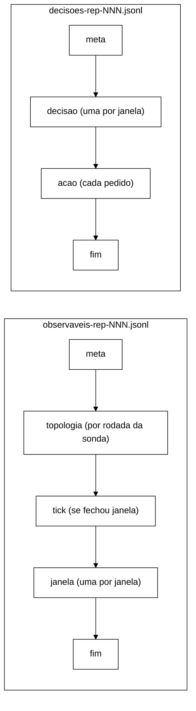

# Contrato dos JSONL do controlador, versão 1.1 (W-3, B-28.2, 2026-11-04)

Com `--controller shadow|active`, cada repetição grava dois arquivos em `--csv-dir`:

- `observaveis-rep-NNN.jsonl` (esquema `observaveis-controlador/1.1`): o que o laço viu.
- `decisoes-rep-NNN.jsonl` (esquema `decisoes-controlador/1.1`): o que o núcleo decidiu e o que o executor fez.

**Histórico.** v1 (`b883397`): primeira versão. v1.1 (V-W3, `docs/validacao-w3-2026-11-04.md`, antes de qualquer
dado): `t_decisao_ns` na linha `decisao`; `linhas_perdidas` nas duas linhas `fim`; `acoes_ja_ativas`,
`prazo_chamada_ns` e `prazo_encerramento_ns` no `fim` de `decisoes`; resultado `JA_ATIVA`; prazo de encerramento
derivado; regra do *tick*. Todas as mudanças são aditivas.

Com `--controller off` nenhum dos dois existe. Código: `workload/src/main/java/br/unipampa/tcc/controle/FormatoJsonl.java`
(formato), `TrilhaJsonl.java` (gravação), `LacoDeControle.java` (ordem das linhas). Teste de contrato:
`LacoDeControleTest.jsonlLinhaALinha`, `ControleArquivosTest.formatoDecisao` e `ControleArquivosTest.formatoAcao`.

## Regras gerais

1. Uma linha = um objeto JSON em UTF-8, terminado em `\n`, com *flush* a cada linha. Uma queda do processo
   perde no máximo a linha em curso.
2. Todo objeto tem `tipo`. A primeira linha dos dois arquivos é `meta`; a última, num encerramento normal, é `fim`.
   Um arquivo sem `fim` vem de execução interrompida.
3. Campos em `snake_case`. Ausência de valor é `null`; nenhum campo do esquema é omitido.
4. Instantes em ns no relógio dos `end_ns` do CSV de eventos (`EpochClock` da repetição).
5. O p99 por janela não vai ao JSONL (decisão de 2026-10-22); só contagens.
6. `analysis/` não conta esses arquivos como execuções (mesmo padrão de `violacoes-rep-*.csv`).

As linhas `topologia` (thread da sonda) e `acao` em `active` (thread do executor) se intercalam com as demais na
ordem em que acontecem; a ordem entre `tick`, `janela` e `decisao` é a do laço.

## `meta` (primeira linha dos dois arquivos)

| Campo | Tipo | Conteúdo |
|---|---|---|
| `esquema` | texto | `observaveis-controlador/1` ou `decisoes-controlador/1` |
| `versao_programa` | texto | `session-workload 0.1.0-SNAPSHOT` |
| `rep` | inteiro | número da repetição |
| `modo` | texto | `shadow` ou `active` |
| `cenario` | texto | `S1`, `S2` ou `S3` |
| `replicacao` | texto | `sync` ou `async` |
| `nos_esperados` | inteiro | itens de `--servers` (H6) |
| `param_versao`, `param_sha256` | texto | `versao` e SHA-256 do `--controller-config` |
| `parametros` | objeto | `w_ns`, `n_lat`, `n_err`, `theta_lat_in`, `theta_lat_out`, `theta_err_in`, `theta_err_out`, `k`, `m`, `cooldown_ns`, `estavel_ns`, `hold_viol_ns` |
| `referencia_arquivo`, `referencia_sha256` | texto ou `null` | `--controller-reference` (`null` em shadow sem referência: latência indeterminada) |
| `tolerancia_ns` | inteiro | L do agregador (100 ms) |
| `tick_ns` | inteiro | período Δ do *tick* (regra abaixo) |
| `origem_ns` | inteiro | início da primeira janela = início da medição |
| `atuador` | texto | `nulo` até o W-2 |
| `politica` | texto | `nenhuma` até o W-2 |
| `sonda_topologia`, `sonda_defasagem` | booleano | sondas ligadas (`sonda_defasagem` = `false` até o W-4) |

## Regra do *tick* e prazos (v1.1)

**Tick.** `Δ = min(W/5, P_sonda/2)`, com `P_sonda` = 2 s (período da sonda de topologia, B-26.2).

- `W/5` é a decisão registrada em `docs/validacao-b26-1-2026-10-22.md` §5.9 (aprovada pelo Gestor em 22/10), que
  limita o atraso de fechamento a `W + L + Δ`.
- `P_sonda/2` vem da derivação da V-W3 (§4.2): o *tick* nunca é o termo dominante do atraso de leitura de S_top.
- Com W = 5 s, os dois dão 1 s. A regra só muda o valor se a calibração (N3) escolher W > 10 s.
- Medida na calibração: `D = t_decisao_ns − t_fim_ns` por janela, esperado em `[L, L + Δ]`.

**Prazo de cada chamada ao atuador.** `T_cham` = 2 s (o `curl -m` da sonda de saúde, B-26.2; plano 4.4.2). Ele limita
a chamada **inteira** do atuador: todos os pedidos HTTP da ação (todos os *caches*, todos os nós) e a leitura de volta.
O adaptador do W-2 não pode gastar `T_cham` por pedido.

**Prazo do encerramento.** `T_enc = (A + 1) × T_cham`, calculado pelo executor no próprio encerramento:

- `A` é o tamanho da pilha de reversão naquele instante, contando a aplicação em curso;
- o `+ 1` cobre a chamada em curso quando o encerramento chega;
- aplicações ainda na fila são descartadas (`DESCARTADA`) e não entram na conta;
- o valor usado vai a `prazo_encerramento_ns` no `fim` de `decisoes`.

O mesmo prazo vale para o gancho de desligamento da JVM.

**Requisito para o orquestrador (W-6).** Para o gancho conseguir desfazer as ações, o processo precisa receber, entre o
SIGTERM e o SIGKILL, um intervalo maior que `T_enc` no pior caso. Por exemplo, `timeout -k <K>` com
`K > (A_max + 1) × 2 s` mais uma folga, onde `A_max` é o número de chaves distintas que a política do W-2 pode manter
ativas ao mesmo tempo, declarado pelo W-2. Com AC-1, AC-2 e AC-3 numa chave cada, `A_max` = 3 e `T_enc` ≤ 8 s.

## `observaveis`

**`janela`**, uma por janela fechada, contígua (`t_ini_ns` = `t_fim_ns` da anterior):

| Campo | Conteúdo |
|---|---|
| `t_ini_ns`, `t_fim_ns` | limites `[ini, fim)` |
| `total`, `erros`, `unavailable` | eventos; `ERROR_TRANSPORT` + `ERROR_UNAVAILABLE`; só `ERROR_UNAVAILABLE` |
| `n_lat`, `exced` | eventos com p99 de referência; os que excederam |
| `atrasados` | eventos descartados por atraso desde a janela anterior (regra C+A) |
| `viol.seguranca` | I1 + I4 + I2 `REAL` (inclui as promovidas) |
| `viol.seguranca_promovidas` | violações de segurança atrasadas somadas nesta janela |
| `viol.i2_esperada` | I2 `ESPERADA-POR-DESENHO` |
| `viol.i2_fora_do_gatilho` | I2 incerta, inexplicada, sem login ou sem rastro |
| `viol.fora_do_gatilho` | I3, I5, I6, `I2_JANELA_CASCATA`, `I2_CASCATA_INCOMPLETA` (DT-002) |
| `viol.atrasadas_fora_do_gatilho` | violações fora do gatilho descartadas por atraso |
| `top` | `disponivel`, `amostras`, `anomalas`, `nos_min` (S_top da janela) |
| `lag` | `nivel` (`INDETERMINADA`, `CALMA`, `INTERMEDIARIA`, `ALTA`), `no_suspeito`, `lag_max_ms`, `amostras` (S_lag) |

**`tick`**: `seq` (registros do agregador até ali), `agora_ns`, `janelas` (quantas o *tick* fechou). Só sai quando
o *tick* fecha ao menos uma janela; serve ao *replay* do B-38.

**`topologia`**: uma por rodada da sonda: `t_ns`, `anomala`, `nos_min`, `por_no` (lista de `no`, `respondeu`,
`numero_de_nos`, `motivo`, `anomalo`). Motivos: `ok`, `timeout`, `falha:<Exceção>`, `nos:<n><<esperados>`,
`cache-ausente:<nome>`, `cache:<nome>=<status>`. Desde o W-3, `TimeoutException` da consulta vira `timeout` (H4).

**`fim`**: `janelas`, `ticks`, `erros_tick`, `eventos_antes_da_origem`, `violacoes_antes_da_origem`,
`eventos_apos_encerramento`, `atrasados_total`, `violacoes_atrasadas_total`, `promovidas_total`,
`descartados_no_encerramento`, `violacoes_descartadas_no_encerramento`, `eventos_fora_do_contrato`,
`sonda_rodadas`, `sonda_rodadas_puladas`, `sonda_amostras_atrasadas`, `sonda_erros_ouvinte`, `curl_lancados`
(os de sonda são `null` sem sonda), `linhas_perdidas` (v1.1).

`linhas_perdidas` conta as linhas que não chegaram ao arquivo até a linha `fim`: erros de escrita mais linhas
recebidas com a trilha já fechada. As linhas que chegam **depois** do `fim` (executor fora do prazo,
`executor_no_prazo = false`) não podem estar nele. Elas aparecem em `linhas_jsonl_perdidas=` na linha `Controlador:`
do stdout.

Conservação: `soma(total) + atrasados_total + descartados_no_encerramento` = eventos registrados depois da origem
(`LacoDeControleTest.concorrenciaComTick`).

## `decisoes`

**`decisao`**, uma por janela, com o mesmo `t_fim_ns` da `janela` correspondente. Campos, nesta ordem:
`tipo`, `t_fim_ns`, `t_decisao_ns` (v1.1: instante em que o laço processou a janela), `modo`, `perfil`
(`NORMAL`/`CONSERVADOR`), `transicao`, `regra` (`R1`..`R4`, `NENHUMA`),
`motivos` (lista em ordem de severidade: `VIOLACAO`, `TOPOLOGIA`, `DEFASAGEM`, `ERRO`, `LATENCIA`; `[ESTAVEL]`
se nenhum), `severidade`, `sinais`, `param_sha256`.

`sinais`: `taxa_latencia`, `taxa_erro`, `fracao_indisponivel` (número ou `null` = indeterminado), `latencia_alta`,
`erro_alto`, `topologia_anomala`, `topologia_disponivel`, `topologia_amostras`, `topologia_anomalas`, `nos_minimo`,
`violacoes_seguranca`, `violacoes_i2_esperadas`, `persistencia_latencia`, `persistencia_erro`, `janelas_calmas`,
`cooldown_expirado`, `defasagem` (nível), `defasagem_alta`, `persistencia_defasagem`, `no_suspeito`, `lag_max_ms`,
`defasagem_amostras`.

**`acao`**, um pedido de aplicação ou de reversão. Campos, nesta ordem:

| Campo | Conteúdo |
|---|---|
| `operacao` | `APLICAR` ou `REVERTER` |
| `executada` | houve chamada ao *cluster*. Sempre `false` em shadow e com o atuador nulo |
| `modo`, `atuador` | `shadow`/`active`; nome do atuador |
| `acao` | `tipo` (`AC-2`, `AC-5`; W-2a. `AC-1`/`AC-3` fora do braço B), `caches` (lista), `alvo` (nó ou `null` = *cluster*; obrigatório no AC-5, proibido no AC-2), `valor` |
| `origem` | `POLITICA`, `R4` (saída para NORMAL desfaz tudo), `FALHA_NA_APLICACAO` (reversão automática), `ENCERRAMENTO` (fim da carga), `GANCHO_JVM` (desligamento sem encerramento normal) |
| `regra`, `t_fim_janela_ns` | regra e fim da janela da decisão que pediu; `null` no encerramento |
| `t_pedido_ns` | instante do pedido |
| `t_inicio_ns`, `duracao_ns` | início e duração da chamada; `null` sem chamada |
| `resultado` | `APLICADA`, `FALHOU`, `NAO_EXECUTADA` (atuador nulo), `PREVISTA` (shadow), `DESCARTADA` (na fila no encerramento), `JA_ATIVA` (v1.1: pedido de ação que continua aplicada porque a reversão anterior falhou; sem chamada) |
| `codigo_http`, `lido`, `erro` | código HTTP, leitura de volta (S_disp) e motivo da falha; `null` quando não se aplica |

Em shadow, a sequência de linhas `acao` é a que active produziria com um atuador que sempre aplica (mesma pilha
virtual, mesmas reversões em R4 e no encerramento).

**W-2a (B-44.2), pendente de versão do esquema.** (1) Linha `acao` de ação não reversível (AC-5) leva, no fim, o
campo `reversao` = `"orquestrador"`: a ação não entra na pilha, nunca tem linha `REVERTER` e não é desfeita no R4,
no encerramento nem pelo gancho. Por enquanto o campo só aparece nessas linhas, contra a regra "nunca campo
omitido", porque `ControleArquivosTest.formatoAcao` fixa a lista de campos (P-37). (2) Linha nova **`politica`**,
gravada pelo laço quando a política registra a escolha (só `PoliticaPorAssinatura`): `tipo`, `t_fim_janela_ns`,
`t_decisao_ns`, `modo`, `perfil`, `regra`, `politica` (`P0`, `P1`, `P2`), `motivo` (`sem-assinatura`,
`isolar-suspeito`, `cota-p1-esgotada`, `adiar-rebalanceamento`, `ac2-mantida`, `treb-esgotado`,
`no-parado-pela-politica`, `vistas-divergentes`, `no-voltou`, `teto-treb`), `reverter` e `aplicar` (listas de
rótulos de tipo). Em NORMAL sem reversão não há linha. O esquema continua `decisoes-controlador/1.1` até a versão
ser decidida (um teste fixa a cadeia).

**`fim`**: `decisoes`, `transicoes`, `perfil_final`, `erros_politica`, `acoes_pedidas`, `acoes_ignoradas`
(pedido repetido de ação já ativa, sem linha), `acoes_executadas`, `acoes_falhas`, `reversoes`, `reversoes_falhas`,
`acoes_descartadas`, `acoes_ja_ativas` (v1.1), `executor_no_prazo` (o encerramento terminou dentro de `T_enc`),
`prazo_chamada_ns`, `prazo_encerramento_ns` (v1.1: `T_cham` e o `T_enc` usado) e `linhas_perdidas` (v1.1).

Conservação (v1.1): `acoes_pedidas` = número de linhas `acao` com `operacao = APLICAR`. Isso vale também para a
repedida de ação cuja reversão falhou, que sai como `JA_ATIVA` (`ExecutorDeAcoesTest.repedidaComReversaoFalhaGravaLinha`).

## Arquivo vizinho: `convergencia-resumo-rep-NNN.json`

`t_fim_carga_ns` (W-3) é o instante em que a carga parou. Desde a V-W3 (R1), ele é lido **antes** de o controlador
encerrar, porque em `active` o encerramento desfaz a pilha e pode levar até `T_enc`. `t_fim_controle_ns` (aditivo, ao fim)
é o instante em que o controlador terminou de encerrar (`null` com `--controller off`). Quando falta o marcador `end`, o
`t_fim` de reserva da convergência é `t_fim_carga_ns` nos dois braços.
