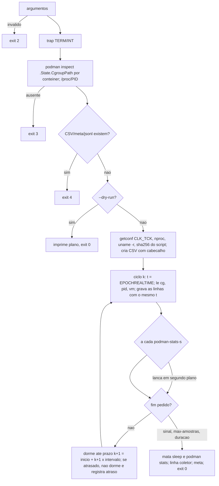

# Contrato `recursos/1`: coletor de recursos para o *proxy* de energia (B-37)

Produtor: `scripts/collect-resources.sh` (B-37). Consumidor: `analysis/energia_proxy.py` (B-39.2).
O texto da seção 1 é cópia literal do prompt do B-37
(`docs/prompt-b37-coletor-recursos-2026-10-27.md`, branch `docs/plano-implementacao-controlador`,
commit `afa33c8`) e é o mesmo resumido na seção 3 do prompt do B-39. Qualquer mudança de formato
exige um contrato novo (`recursos/2`), nunca a edição deste.

O coletor **não** é chamado por `run-rebaseline.sh`. O *rebaseline* não coleta CPU (DT-009) e o
*bundle* da VM está congelado. A integração com uma bateria é decisão do *runner* da T-F.

## 1. Contrato (texto literal do prompt)

```text
CONTRATO (copie literalmente para docs/contrato-recursos-v1.md; o B-39.2 usa o mesmo texto):
 runs/<celula>/recursos-rep-NNN.csv, UTF-8, LF, cabeçalho exato
   t_epoch_ns,fonte,cpu_usec_acum,mem_bytes,steal_usec_acum,estado
 - Uma linha por fonte por amostra; todas as fontes de uma amostra com o MESMO t_epoch_ns (o
   instante do início do ciclo).
 - fonte: "cg:<conteiner>" (cgroup v2 do contêiner), "pid:<rotulo>" (processo dado por
   --pid rotulo=PID), "vm" (a máquina inteira, /proc/stat) e "coletor" (só na última linha).
 - cpu_usec_acum (inteiro, acumulado desde o boot ou desde a criação do cgroup):
     cg:  usage_usec de <cgroup>/cpu.stat
     pid: (utime + stime) de /proc/<pid>/stat × 1 000 000 / CLK_TCK, em aritmética inteira
     vm:  (user + nice + system + irq + softirq) da linha "cpu " de /proc/stat × 1 000 000 / CLK_TCK
          (guest e guest_nice já estão dentro de user/nice e NÃO são somados de novo; idle e iowait
          fora; steal fora, na coluna própria)
     coletor: (utime + stime + cutime + cstime) do próprio coletor, × 1 000 000 / CLK_TCK
 - mem_bytes (inteiro): cg: memory.current; pid: VmRSS de /proc/<pid>/status × 1024;
   vm: (MemTotal − MemAvailable) de /proc/meminfo × 1024; coletor: VmRSS do coletor × 1024.
 - steal_usec_acum: só em "vm" (campo steal × 1 000 000 / CLK_TCK); vazio nas demais.
 - estado: "ok", ou "erro:<motivo>" (motivo sem vírgula nem espaço, ex.: erro:cgroup-ausente,
   erro:pid-ausente, erro:leitura). Com erro, as colunas numéricas daquela linha ficam VAZIAS
   (nunca 0).
 runs/<celula>/recursos-meta-rep-NNN.json: {"contrato":"recursos/1","versao_coletor","sha256_script",
   "uname_r","clk_tck","nproc","intervalo_ms","podman_stats_s","fontes":[{"fonte","cgroup"|"pid"}],
   "inicio_epoch_ns","fim_epoch_ns","amostras","motivo_fim":"sinal"|"max-amostras"|"duracao",
   "atraso_max_ns"} (atraso_max_ns = maior atraso de um ciclo em relação ao seu prazo).
 runs/<celula>/recursos-podman-rep-NNN.jsonl: a cada --podman-stats-s segundos uma linha
   {"t_epoch_ns":..,"ok":true,"stats":<saída crua de `$PODMAN stats --no-stream --format json`>} ou
   {"t_epoch_ns":..,"ok":false,"erro":"..."}; só verificação cruzada (o B-39.2 não depende dela).
```

## 2. Interface do script

```text
scripts/collect-resources.sh --saida DIR --rep N --containers "isn1 isn2 isn3"
    [--pid rotulo=PID]... [--intervalo-ms 1000] [--podman-stats-s 10]
    [--duracao-s S | --max-amostras N] [--dry-run] [--help]
```

| Código | Quando |
|---|---|
| 0 | fim por SIGTERM/SIGINT, `--duracao-s` ou `--max-amostras`; `--dry-run`; `--help` |
| 1 | erro genérico (bash < 5, `getconf CLK_TCK` inválido, diretório não gravável) |
| 2 | uso inválido (sem `--saida`, `--rep` não numérico, `--intervalo-ms 0`, `--duracao-s` com `--max-amostras`, `--pid` malformado, argumento desconhecido) |
| 3 | contêiner inexistente, cgroup ausente sob a raiz ou PID inexistente, **antes** da primeira amostra |
| 4 | saída já existente (nada é sobrescrito) |

Ambiente: `PODMAN` (padrão `podman`; na VM `PODMAN="sudo podman"`), `COLETOR_RAIZ_CGROUP`
(padrão `/sys/fs/cgroup`), `COLETOR_RAIZ_PROC` (padrão `/proc`). `COLETOR_AGORA_NS_CMD` e
`COLETOR_SLEEP_CMD` existem só para os testes.

## 3. Funcionamento



- **Caminho quente sem *fork*.** O bloco entre `# >>> caminho-quente` e `# <<< caminho-quente`
  (laço, ciclo, leitores, relógio, espera) só usa *builtins*: `read` com redirecionamento,
  `printf -v`, aritmética e `EPOCHREALTIME`. Os únicos processos criados por ciclo são o `sleep` e,
  a cada `--podman-stats-s`, o `podman stats`. O teste R12 inspeciona esse bloco.
- **Prazo absoluto.** `prazo_k = inicio + k × intervalo`. Um ciclo atrasado não dorme e o seguinte
  volta ao prazo original, sem acumular deriva.
- **Atraso.** No início de cada ciclo `k ≥ 1`, `atraso_k = t_k − prazo_k`, e `atraso_max_ns` é o
  maior deles. A medida cobre a leitura que estoura o prazo e também o `sleep` que acorda tarde.
  O *smoke* achou 330 ms de atraso que a primeira versão, que só media antes de dormir, registrava
  como 0.
- **Escrita.** O CSV é aberto em *append* e cada amostra é gravada com uma única escrita, sem
  temporário. Uma queda preserva tudo até a última amostra. O meta só é escrito no fim, e por isso a
  ausência dele indica coleta interrompida.
- **`podman stats`** roda em segundo plano para não bloquear a cadência. O stdout e o stderr vão
  para temporários ocultos separados (`.recursos-podman-rep-NNN.tmp` e `.err.tmp`), são recolhidos
  num ciclo seguinte e os dois temporários são removidos no fim. A linha leva o `t_epoch_ns` do ciclo
  em que o comando foi lançado. Com rc 0 e stdout JSON, a linha sai `ok:true`, mesmo que haja aviso
  no stderr. O Podman 5 com cgroup v1 escreve esse aviso, e a primeira versão, que juntava os dois
  fluxos, gravava `ok:false` em todas as linhas. Com rc diferente de 0, `erro` traz o rc e o
  começo do stderr. O comando que estiver rodando no encerramento é morto e registrado como
  `ok:false`.

## 4. Decisões de implementação que o texto do contrato não fixa

1. **`fontes` no meta** lista só `cg:` (com `cgroup`, o caminho relativo devolvido pelo
   `podman inspect`) e `pid:` (com `pid`). `vm` e `coletor` existem sempre e não são listados.
2. **Linha `coletor`.** Lê sempre `/proc/$$` real, mesmo com `COLETOR_RAIZ_PROC` injetado, porque é
   o processo coletor e não uma fonte medida. O `t_epoch_ns` dela é o instante do encerramento,
   **não** o de uma amostra, e `steal_usec_acum` fica vazio.
3. **Exit 4** vale para qualquer um dos três arquivos da repetição (CSV, meta, jsonl), não só para o
   CSV. Além disso, o CSV é criado com `noclobber`, o que fecha a corrida entre a verificação e a
   criação.
4. **Sinal antes do laço.** O `trap` é instalado logo depois do *parse*, antes de qualquer processo
   externo. Um SIGTERM durante a resolução dos cgroups não mata o coletor sem meta: ele faz uma
   amostra e encerra com `motivo_fim: "sinal"`.
5. **SIGINT em segundo plano.** Sem controle de *jobs*, o bash herda SIGINT ignorado num comando
   assíncrono (`cmd &`) e não pode capturá-lo. Um *runner* que lance o coletor com `&` deve
   encerrá-lo com **SIGTERM**. O SIGINT vale para o coletor em primeiro plano (Ctrl-C) ou lançado
   com `set -m`.
6. **`--duracao-s S`** produz as amostras de prazo `< inicio + S` (60 s a 1000 ms dá 60 amostras).
7. **Leitura parcial.** Basta faltar um dos dois contadores de uma fonte (por exemplo,
   `memory.current` sem o controlador de memória no cgroup v2) para a linha inteira virar
   `erro:leitura`, com os numéricos vazios. Nunca sai uma linha meio preenchida.

## 5. Ambientes

| Ambiente | cgroup | Formato de `.State.CgroupPath` | Situação |
|---|---|---|---|
| VM Hyper-V (Ubuntu 24.04, `sudo podman`) | v2 (`cgroup2fs`, esperado) | `/machine.slice/libpod-<id>.scope` (típico; a confirmar) | validação no *smoke* do B-40, em janela liberada pelo Gestor |
| `podman-machine-default` (WSL, Podman 5.7, *rootful*) | **híbrido v1** (`tmpfs` em `/sys/fs/cgroup`, v2 só em `/sys/fs/cgroup/unified`, sem `memory.current`) | `/libpod_parent/libpod-<id>` (`podman run`); `/libpod_parent/<id-do-pod>/libpod-<id>` (`podman-compose`) | com a raiz padrão, exit 3; com `COLETOR_RAIZ_CGROUP=/sys/fs/cgroup/unified`, `cg:` sai `erro:leitura` (ver `docs/relatorio-b37-2026-10-27.md`) |
| Git Bash (testes) | árvores falsas | os dois formatos acima, por *shim* | suíte `scripts/collect-resources.test.sh` |
