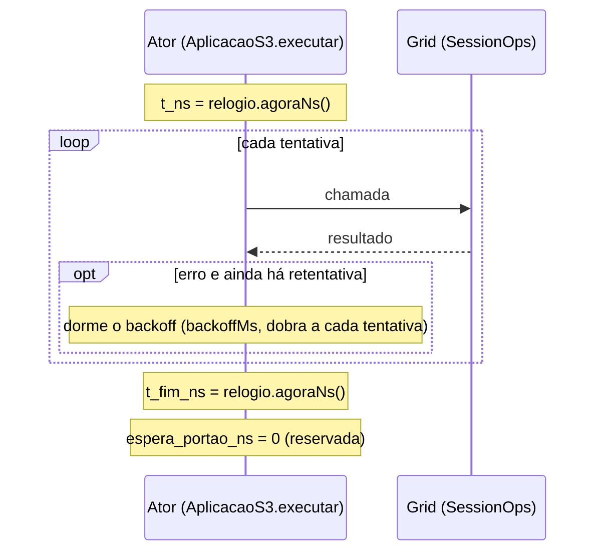
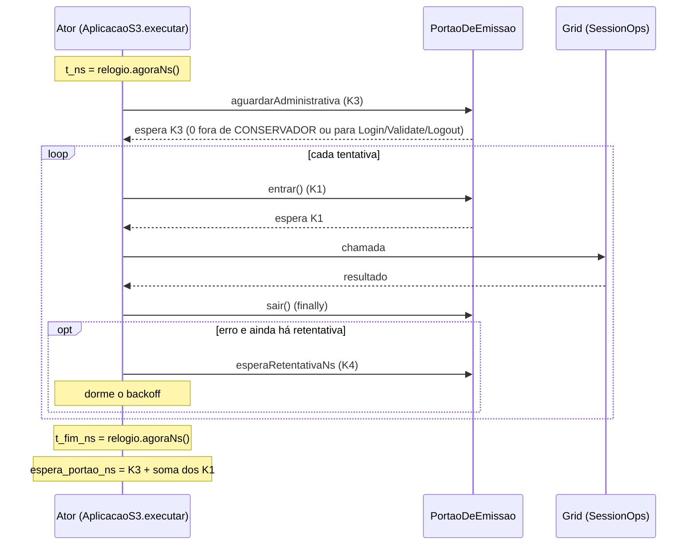

# Contrato v2 do CSV de ações do S3 (`s3-acoes-rep-NNN.csv`, B-27, 2026-10-27)

> Extensão compatível do contrato do B-33. Implementada em `feature/b27-portao-emissao`. Gerada por
> `S3Registro.escreverCsv` a partir de `AcaoS3` (`AcaoS3.HEADER`, `AcaoS3.paraCsv`). Teste de contrato:
> `analysis/test_contrato_s3_acoes.py`; fixture `analysis/fixtures/s3-acoes-v2-exemplo.csv` (recorte do
> smoke local do B-27).
>
> **B-27.3 (W-1, 2026-11-04):** o portão de emissão do cliente (K1..K4) foi retirado; o controlador do
> TCC age no *cluster*. O contrato continua com as mesmas 10 colunas. `espera_portao_ns` fica
> **reservada e vale sempre 0**; `t_fim_ns` passa a incluir só o *backoff* e a duração das tentativas.
> As menções a K1..K4 e ao `PortaoDeEmissao` abaixo descrevem o comportamento entre o B-27 e o
> B-27.3 e ficam como registro histórico.

## 1. O que mudou

Duas colunas novas **no fim**: `t_fim_ns` e `espera_portao_ns`. As 8 primeiras colunas não mudaram
de nome, ordem, unidade nem formatação. Um leitor do contrato 1 que lê as colunas pelo nome continua
funcionando. Um leitor que exige exatamente 8 colunas precisa aceitar as duas a mais.

Cabeçalho (uma linha, sem espaços):

```
t_ns,ator,operacao,alvo,resultado,tentativas,falha_percebida,nota,t_fim_ns,espera_portao_ns
```

## 2. Colunas

| # | Coluna | Tipo | Unidade e significado |
|---|---|---|---|
| 1 | `t_ns` | int64 | Início da ação (antes da espera do portão), em ns de época, **no relógio dos `end_ns`** do CSV de eventos (mesmo `EpochClock`). |
| 2 | `ator` | texto | Usuário (`s3-u-NNN`), conta de limite (`s3-l-NNN`), `admin` ou `suporte`. |
| 3 | `operacao` | texto | Nome canônico (`Login`, `Validate`, `Logout`, `IncrementFailure`, `ResetFailures`, `Block`, `Unblock`). |
| 4 | `alvo` | texto | Identidade ou sid. |
| 5 | `resultado` | texto | Resultado final (`OK_VALIDATE:VALID`, `BLOCKED`, `ERROR_TRANSPORT`, ...). |
| 6 | `tentativas` | inteiro | 1 + retentativas da aplicação. |
| 7 | `falha_percebida` | `true`/`false` | Todas as tentativas deram erro. |
| 8 | `nota` | texto | `tentativa-incerta` (Block/Unblock com erro) ou vazio. |
| 9 | `t_fim_ns` | int64 | **Novo.** Fim da ação, logo depois da última tentativa, no mesmo relógio de `t_ns`. Inclui as esperas do portão (K1, K3), as esperas de *backoff* entre tentativas (com o K4 quando em CONSERVADOR) e a duração de cada tentativa. |
| 10 | `espera_portao_ns` | int64 | **Reservada; 0 desde o B-27.3.** Entre o B-27 e o B-27.3: nanossegundos que a ação passou presa no portão de emissão: soma da espera do K3 (adiamento de administrativa) e das esperas do K1 (admissão) de todas as tentativas. Não inclui o *backoff*. |

Vírgulas e quebras de linha nos campos de texto viram `_` e espaço (como no contrato 1). Sem
`EpochClock` (só em testes), `t_ns` e `t_fim_ns` saem crus, na base do `RelogioS3`.

Invariantes, verificados no construtor de `AcaoS3` e no teste Python:

- `t_fim_ns >= t_ns`;
- `espera_portao_ns >= 0`;
- `t_fim_ns − t_ns − espera_portao_ns >= 0`;
- inteiros cabem em int64.

## 3. Latência percebida

| Leitura | Fórmula |
|---|---|
| Com a espera do portão (o que o usuário sentiu) | `t_fim_ns − t_ns` |
| Sem a espera do portão (o que o *grid* e o *backoff* custaram) | `t_fim_ns − t_ns − espera_portao_ns` |

Qual das duas é o desfecho primário da avaliação do controlador é fixado no pré-registro (B-40). O
CSV serve às duas. Com o portão livre (`--controller` ausente ou `off`, e todo o B-27, já que a CLI
só chega no B-28.2) `espera_portao_ns = 0` em todas as linhas, e as duas leituras coincidem.

`t_ns` e `t_fim_ns` vêm do `RelogioS3` (nanoTime em produção) convertidos pelo mesmo `EpochClock`.
`espera_portao_ns` é medida pela `FonteDeTempo` do portão. Como as duas avançam no ritmo do relógio
monotônico, a diferença de origem não importa para durações.

## 4. Linha do tempo de uma ação

Desde o B-27.3 (sem portão):



Entre o B-27 e o B-27.3 (histórico):



## 5. Compatibilidade

- Nenhum script de `analysis/` lia `s3-acoes-rep-NNN.csv` até o B-27 (conferido em `c055399`).
- O CSV de eventos (`rep-NNN.csv`, `docs/contrato-csv-v2.md`) não mudou.
- `s3-resumo-rep-NNN.json` não mudou.
