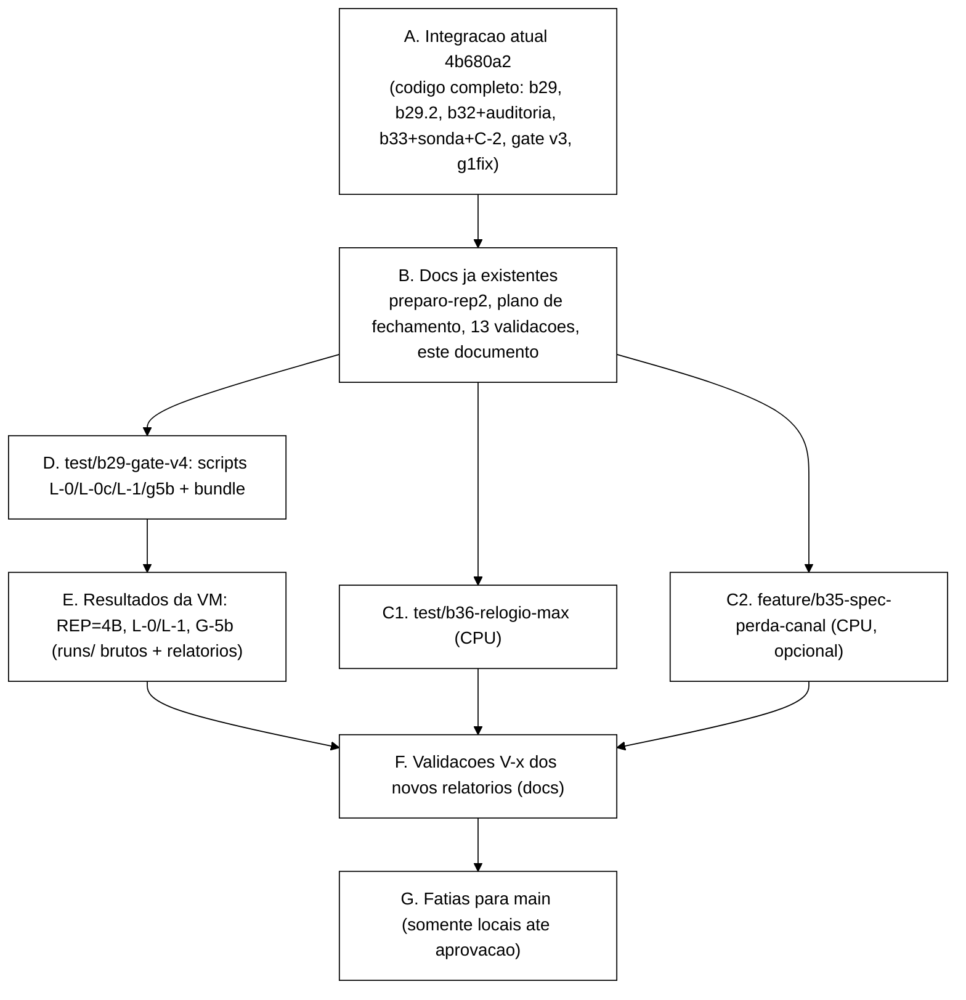
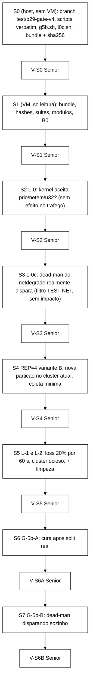

# Decisões do Senior, 2026-10-16: relógio (Q-5), modelo de perda (T-I/B-35), ordem de merge local e sequência de VM

> Branch `docs/decisoes-senior-2026-10-16`, worktree `wt-senior-decisoes`, criada a partir de `feature/etapa-formal-integracao` (`4b680a2`). Só documento: nenhum `.tla`, script, código ou `runs/` foi alterado, nenhuma VM foi tocada, **nenhum push**.
>
> O Gestor autorizou "faça tudo" e delegou ao Senior a decisão do relógio. Isso vale para as **decisões deste documento**. Não vale como `go` de injeção na VM (continua sendo dado pelo Gestor no terminal, nas janelas descritas na seção 5) nem como aprovação de push (seção 3.5).
>
> Fontes lidas nesta rodada: `spec/SessionStore.tla` (ações e `EntregaMensagem`), `spec/MCSession.tla`, `spec/run-tlc-propriedades.sh`, `docs/registro-de-problemas.md` (P-26, P-27), `docs/catalogo-operacao-falha-invariante.md` (seções 3 a 8), `docs/relatorio-tb-rep2-rep3-g5-g6-2026-10-16.md`, `docs/relatorio-tb-v3-execucao-2026-10-16.md`, `docs/relatorio-gate-v3-2026-10-16.md`, `docs/relatorio-g1fix-2026-10-16.md`, `docs/relatorio-b29-2-implementacao-2026-10-16.md`, `runs/gate-b29/{g5,g56-lib,g-lib}.sh`, `scripts/inject-netdegrade.sh`, plano de fechamento (`wt-plano-fechamento`, `7bb8fb9`) e a lista de branches/commits de `git cherry`.

## 0. Resumo das decisões

| # | Decisão | Em uma linha |
|---|---|---|
| Q-5 | **Variante separada, escopo mínimo** (opção 2). `SessionStore.tla` não muda. P-26 segue `ABERTO-ACEITO` até a variante rodar. | Custo de CPU de minutos, risco zero ao catálogo auditado, e transforma "defeito de modelagem" de leitura em evidência. |
| T-I / B-35 | **Fazer, mínimo, só no harness, em módulo novo `MCPerda.tla`**, prioridade abaixo da VM e da variante do relógio, com regra de corte. | Perda de mensagem **ligada à mudança de vista** é o único tipo de perda defensável diante de TCP + retransmissão; o resultado é ilustrativo e nunca entra no catálogo como evidência do sistema. |
| Merge | Todo o código já está na integração. Faltam **docs** (13 branches de validação, plano, preparo da REP=2) e o que a rodada de VM produzir. Para `main`, publicar **a partir da integração**, em fatias contíguas, não pelas branches originais. | Evita duplicar commits com SHAs diferentes. Nada sobe sem aprovação (seção 3.5). |
| VM | `L-0` -> `L-0c` (novo, sem impacto) -> **REP=4 variante B** -> `L-1/L-2` -> `G-5b` (A: cura após split real; B: dead-man disparando). Uma etapa por vez, parada e validação do Senior após cada. | REP=4B vem **antes** de L-1 e G-5b para que o histórico do cluster seja o mais parecido possível com o da REP=2. |

---

## 1. Q-5: o relógio (P-26)

### 1.1 O que está em jogo

`EntregaMensagem` (`spec/SessionStore.tla`, linhas 526 a 541) não atualiza `relogio`. Cada ação local calcula `novoTS = relogio[r] + 1` e só escreve se `novoTS > ts` do registro local. Uma réplica que recebeu um registro com `ts` alto e `relogio` baixo tem a escrita local seguinte **rejeitada pelo gate** (embora a mensagem seja transmitida). Traço mínimo (`I1P`, 4 estados, `runs/tlc/prop-livre-sem-w1/r3-I1P.out`): `Login(r1,s1)` ts 1; entrega a r2 (`relogio[r2]` continua 0); `Logout(r2,s1)` calcula ts 1, que não supera 1; o logout é aceito e perdido.

No código real, `SessionState.invalidar` usa `versao + 1` do registro lido. A propriedade que o código tem por construção é "o `ts` de uma escrita local supera o `ts` do registro que ela substitui". O modelo livre não tem essa propriedade. Isso já está registrado e classificado: `ARTEFATO-DO-MODELO`, fora da evidência do sistema (catálogo seção 5; ressalvas da V-A).

### 1.2 Alternativas e avaliação

| Critério | (1) Manter `ABERTO-ACEITO` | (2) Variante separada (`max` na entrega) | (3) Corrigir `SessionStore.tla` |
|---|---|---|---|
| Validade do TCC | Honesta, mas a classificação "defeito de modelagem" é **leitura**: um membro de banca pode dizer que o modelo tem um bug conhecido e não corrigido. | Transforma a leitura em evidência: se `I1P`/`I1F`/`I4F` livres deixam de ser violadas com `max`, o artefato está **demonstrado**. Se continuarem violadas, descobre-se um mecanismo que o artefato estava mascarando, o que também é achado. | Mesma evidência que (2), mas ao custo de invalidar a base auditada. |
| Custo de state space | Zero. | Pequeno. O `max` acopla os relógios e tende a **reduzir** estados distintos de `relogio`; ordem de grandeza igual à da base. Rodar `r2` com cotas reduzidas (segundos) e `r3` só sem falha, com timebox. | Igual a (2) **mais** a repetição de todo o catálogo para manter uma única base. |
| Risco ao catálogo já auditado | Nenhum. | **Nenhum**, se o módulo for novo e a saída for para diretórios novos (`runs/tlc/relogio-*`). | Alto: ~80 diretórios de `runs/tlc/` e todos os vereditos do catálogo (a V-A auditou ~100 execuções, uma delas com 19,2 M estados e 1001 s a 8 workers) passam a ser de outro modelo. Exigiria nova V-A. D-4 é decisão de modelagem registrada do Gestor. |
| Esforço do Worker | 0 | ~0,5 dia (1 módulo, 1 runner derivado, relatório) | ~3 a 5 dias com re-auditoria |

### 1.3 Decisão

**Opção (2), com escopo mínimo.** `SessionStore.tla` **não é alterado**; as linhas do modelo livre que dependem de D-4 permanecem `ARTEFATO-DO-MODELO` no catálogo, e P-26 permanece `ABERTO-ACEITO` até o relatório da variante ser validado. Depois dele, o Senior propõe o novo status (seção 1.6). A opção (3) fica rejeitada: o que ela compra a mais que a (2) é conveniência, e o preço é a base auditada.

Por que `max` na **entrega** (Lamport) e não "`ts` do registro lido + 1" nas seis ações locais, que seria a cópia mais fiel do código:
- o `max` na entrega muda uma ação (uma cópia de ~35 linhas); a versão "registro lido + 1" copiaria seis ações (~100 linhas) e aumentaria a chance de divergência silenciosa em relação ao módulo auditado;
- ambas restauram a mesma propriedade que o código tem: `RelogioDomina` (seção 1.4), "`relogio[r]` nunca é menor que o `ts` de qualquer registro de `r`", que implica que o gate local nunca rejeita uma escrita local. É essa propriedade, não a fórmula, que o TCC precisa mostrar.

### 1.4 Especificação da mudança (**não implementar aqui**; o Worker implementa depois do `go` do Senior)

Novo arquivo `spec/MCRelogio.tla`, `EXTENDS MCSession`. Nenhuma linha de `SessionStore.tla` ou `MCSession.tla` muda.

```tla
---- MODULE MCRelogio ----
EXTENDS MCSession

Max(a, b) == IF a > b THEN a ELSE b
\* ts da mensagem: o campo nao usado carrega o registro vazio (ts = 0), entao o max cobre todos os tipos
TsMsg(m) == Max(m.sessao.ts, m.ident.ts)

\* Copia LITERAL do corpo de EntregaMensagem(r) de SessionStore.tla, trocando apenas
\* a linha "UNCHANGED <<relogio, ...>>" por relogio' = [relogio EXCEPT ![r] = Max(@, TsMsg(m))]
\* e um UNCHANGED sem relogio.
EntregaMensagemMax(r) == ...

NextMax ==
  \/ \E r \in REPLICAS, id \in IDS, s \in SIDS: Login(r, id, s)
  \/ \E r \in REPLICAS, s \in SIDS:             Logout(r, s)
  \/ \E r \in REPLICAS, id \in IDS:             IncrementFailure(r, id)
  \/ \E r \in REPLICAS, id \in IDS:             ResetFailures(r, id)
  \/ \E r \in REPLICAS, id \in IDS:             Block(r, id)
  \/ \E r \in REPLICAS, id \in IDS:             Unblock(r, id)
  \/ \E r \in REPLICAS:                          EntregaMensagemMax(r)
  \/ \E r \in REPLICAS:                          Cair(r)
  \/ \E r \in REPLICAS:                          Reviver(r)
  \/ Particionar
  \/ Mesclar

SpecRelogio         == Init /\ [][NextMax]_vars          \* livre
SpecRelogioSemeada  == InitSemeado /\ [][NextMax]_vars   \* semeado

\* Invariante de sanidade da variante (a propriedade que o codigo tem por construcao):
RelogioDomina ==
  \A r \in REPLICAS :
    /\ \A s \in SIDS : relogio[r] >= sessoes[r][s].ts
    /\ \A id \in IDS : relogio[r] >= identidades[r][id].ts
====
```

`RelogioDomina` vale por indução (ações locais fazem `relogio' = relogio + 1 >= ts` escrito; a entrega aplica um `ts <= max` já absorvido; `Mesclar` copia `sessoes`, `identidades` e `relogio` de `rf` juntos; `Cair`/`Reviver`/`Particionar` não mexem). O TLC o confirma como invariante; ele é a prova mecânica de que a variante restaurou a propriedade do código.

Controles obrigatórios do Worker (sem eles a evidência não vale):
1. **Fidelidade da cópia:** `spec/check-variante-relogio.sh` extrai o corpo de `EntregaMensagem` de `SessionStore.tla` e o de `EntregaMensagemMax` de `MCRelogio.tla`, normaliza o nome e remove a linha de `relogio`, e exige `diff` vazio. Rodado antes de qualquer TLC.
2. **Controle negativo (mutação):** substituir `Max(@, TsMsg(m))` por `@` (relogio inalterado) tem de **reproduzir** a violação de 4 estados de `I1P`. Prova que a variante difere do original só por aquela linha.
3. **Controle de regressão:** com a mutação do item 2, a contagem de estados distintos nas cotas reduzidas tem de ser **idêntica** à do módulo original (`MCSession`), por exemplo 1.988 (r2 sem falha, semeado) e 1.627.731 (r3 sem falha, semeado, `MaxCanal=2`, `MaxRelogio=3`; `runs/tlc/audit-b32/cobertura-mesclar.tsv`).
4. **Invariante:** `RelogioDomina` sem violação em todas as execuções fechadas.

### 1.5 Execução da variante (cotas e custo)

Saídas em `runs/tlc/relogio-*` (nunca em `prop-*`). Runner novo `spec/run-tlc-relogio.sh`, **derivado** de `run-tlc-propriedades.sh` (cópia com cabeçalho "derivado de ... @sha", sem editar o script auditado).

| Nível | Configuração | Propriedades | Meta |
|---|---|---|---|
| 1 (obrigatório) | modelo livre, `r2`, `MaxCanal=2`, `MaxRelogio=3`, `MaxEventosFalha=2`, 3 colunas (sem, queda, partição), 1 worker e sem simetria (como o controle da V-A) | `I1P`, `I1F`, `I4F`, `I2Fb` e `RelogioDomina` | Fechar exaustivamente (segundos a minutos). Estimativa de ordem de grandeza: 10^4 a 10^5 estados; **estimativa, não medida**. |
| 1b | idem nas cotas do plano (`3/5/2`) em `r2` | idem | Tentar fechar com timebox de 10 min; se não fechar, registrar "não-fechado" (ressalva 3 da V-A: não promover). |
| 2 (obrigatório) | modelo livre, `r3`, **sem falha**, cotas reduzidas | `I1P`, `I1F`, `I4F` | Timebox 30 min, `WORKERS<=4`. Se fechar, é a linha que sustenta a reclassificação. |
| 3 (opcional) | semeado, `r2`, queda e partição | `I1F`, `I4F`, `I2Fa`, `I1M`, `I4M` | Veredito deve ser **idêntico** ao do semeado auditado (traços sem D-4). Diferença é achado. |
| fora de escopo | `r3` queda/partição | | 19 M estados só para a base; não repetir. |

### 1.6 Como ler o resultado (pré-registrado antes de rodar)

| Resultado da variante | Leitura | Efeito |
|---|---|---|
| `I1P`, `I1F`, `I4F` (sem falha e queda) **sem violação** com `RelogioDomina` verde | O artefato é demonstrado: as violações livres vinham de D-4. | Propor a P-26 como `FECHADO-POR-VARIANTE` (status novo só no registro de problemas; o vocabulário 4.2 do catálogo **não** muda) e anotar nas linhas do catálogo "confirmado por variante `MCRelogio`, cotas X". As linhas continuam fora da evidência do sistema. |
| Alguma delas **ainda violada** em traço sem passo de gate rejeitado | Mecanismo real do modelo que D-4 mascarava. | Abrir P-28; reclassificar a linha para `CONFIRMADO-NO-MODELO`; pergunta nova ao Gestor (existe no sistema real?). |
| Não fechou no timebox | Fica como está. | Registrar "não-fechado até aqui"; P-26 continua `ABERTO-ACEITO`. |

Edição do catálogo e do registro de problemas: **só** a tarefa que o plano designa (T-G para o catálogo; regra 4.4). O Worker desta variante entrega `docs/relatorio-b36-relogio-<data>.md` e propõe o texto.

### 1.7 Tarefas para o Worker (branch `test/b36-relogio-max` a partir da ponta da integração)

| Tarefa | Entrega | Validação do Senior antes da seguinte |
|---|---|---|
| R.1 | `spec/MCRelogio.tla` + `spec/check-variante-relogio.sh` + SANY limpo | `diff` vazio da cópia; ler o `.tla` inteiro; conferir que `SessionStore.tla` e `MCSession.tla` têm `git diff` vazio |
| R.2 | `spec/run-tlc-relogio.sh` + controles 2 e 3 (mutação reproduz `I1P` em 4 estados; contagens idênticas à base) | números conferidos contra `runs/tlc/audit-b32/cobertura-mesclar.tsv` e `prop-livre-sem-w1/r3-I1P.out` |
| R.3 | Níveis 1, 1b, 2 (e 3 se sobrar tempo), `.out` brutos em `runs/tlc/relogio-*` | Senior relê os `.out`: "No error has been found" ou o traço; `RelogioDomina`; coluna D-4 refeita pelo classificador (`scripts/audit_tracos.py`) |
| R.4 | `docs/relatorio-b36-relogio-<data>.md` com tabela pré-registrada (1.6) e proposta de texto para P-26 e catálogo | V-R: Senior aprova o status novo; só então T-G incorpora |

Regra de CPU (vale também para B-35): TLC com muitos workers disputa CPU com o Hyper-V. **Nenhum TLC nem `mvn test`/suíte pesada durante janelas de injeção na VM e nos 5 min antes e depois** (a detecção do `FD_ALL3` e o `t_split` são medidos em relógio de parede dentro da VM). Fora das janelas, `WORKERS<=4`.

---

## 2. T-I / B-35: modelo de perda de mensagens no canal, só no harness

### 2.1 Vale fazer?

**Sim, em versão mínima, e com regra de corte.** Razões:
- O custo é pequeno (CPU, sem VM, sem tocar `SessionStore.tla`) e o ganho é uma frase defensável no Cap. 3/5: quais propriedades dependem da suposição "canal confiável" e quais não.
- Há um resultado **não trivial** a testar, de segurança por réplica: perder mensagens só remove atualizações, então `I1F`, `I4F`, `I1P`, `I2Fa` do semeado em sem falha e queda **deveriam continuar preservadas** (a irreversibilidade local depende do gate de `ts`, não da entrega). Se for verdade, o TCC mostra que a segurança local não depende de entrega confiável, enquanto a convergência (`I5`/`I6`) depende. Se não for, é achado.
- A forma defensável da perda não é "perda aleatória de pacote" (TCP + `UNICAST3`/`NAKACK2` a escondem, ver 2.6), e sim **perda ligada à mudança de vista**: mensagem endereçada a membro que saiu da vista, ou originada em nó que caiu antes de enviar. O modelo atual é otimista nesse ponto: acumula `canal[r]` de réplica caída ou minoritária e entrega depois do `Reviver`/`Mesclar`, o que o sistema real não faz (ele usa transferência de estado e resolução de conflito na fusão). Um `Perder` restrito a essas condições aproxima isso.

Prioridade: **abaixo** de (a) a rodada de VM e (b) a variante do relógio. **Regra de corte:** se a tarefa B-35.3 não estiver validada quando T-G começar, descartar e manter só a limitação textual (plano 8.4). Timebox total: 1 dia de Worker.

### 2.2 Especificação (módulo novo; **nada** em `SessionStore.tla`, nada em `MCSession.tla`)

Módulo `spec/MCPerda.tla`, `EXTENDS MCSession`. Variável nova `perdas` declarada **no módulo novo** (permitido em módulo que estende), para limitar o orçamento sem alterar `vars` do módulo base.

```tla
---- MODULE MCPerda ----
EXTENDS MCSession
CONSTANT MaxPerdas
VARIABLE perdas
varsP == <<vars, perdas>>

\* Remove a i-esima mensagem do canal de r (mesmo SubSeq de EntregaMensagem)
RemoverMsg(r, i) ==
  canal' = [canal EXCEPT ![r] = SubSeq(@, 1, i-1) \o SubSeq(@, i+1, Len(@))]

\* P0 (limite superior, ilustrativo): qualquer mensagem, em qualquer momento
PerderQualquer ==
  /\ perdas < MaxPerdas
  /\ \E r \in REPLICAS, i \in 1..Len(canal[r]) : RemoverMsg(r, i)
  /\ perdas' = perdas + 1
  /\ UNCHANGED <<sessoes, identidades, relogio, vivo, quedas, particaoAtiva, ladoDe, particoes>>

\* P1 (defensavel): so perde mensagem destinada a replica que NAO pode agir
\* (caida ou do lado minoritario), isto e, ligada a mudanca de vista
PerderNaVista ==
  /\ perdas < MaxPerdas
  /\ \E r \in REPLICAS, i \in 1..Len(canal[r]) : ~PodeAgir(r) /\ RemoverMsg(r, i)
  /\ perdas' = perdas + 1
  /\ UNCHANGED <<sessoes, identidades, relogio, vivo, quedas, particaoAtiva, ladoDe, particoes>>

InitP        == Init /\ perdas = 0
InitSemeadoP == InitSemeado /\ perdas = 0
NextP0 == (Next /\ UNCHANGED perdas) \/ PerderQualquer
NextP1 == (Next /\ UNCHANGED perdas) \/ PerderNaVista
SpecPerda0Semeada == InitSemeadoP /\ [][NextP0]_varsP
SpecPerda1Semeada == InitSemeadoP /\ [][NextP1]_varsP
SpecPerda0Livre   == InitP        /\ [][NextP0]_varsP
SpecPerda1Livre   == InitP        /\ [][NextP1]_varsP
====
```

Observação de TLC: as propriedades de `MCSession.tla` são `[][...]_vars`; o passo `Perder*` altera `canal` (que está em `vars`), então não é *stuttering* e é avaliado normalmente. `MaxPerdas = 0` torna a especificação equivalente à base (controle).

Cotas e `.cfg`: `MaxPerdas` entra como constante; `SYMMETRY` e as restrições `LimiteCanal`, `LimiteRelogio`, `LimiteEventosFalha` são as mesmas; colunas de falha por `SemFalha`/`SoQueda`/`SoParticao`. Runner novo `spec/run-tlc-perda.sh` (derivado, como em 1.5).

### 2.3 Propriedades afetadas e expectativas (pré-registradas; **expectativas, não resultados**)

| Propriedade | P0 (qualquer perda) | P1 (perda ligada à vista) | Como é lida |
|---|---|---|---|
| `I5`, `I6` (convergência sob quiescência) | **Violadas**, traço curto (`Login`, `Perder`, entrega, quiescente com uma réplica em `NONE`, ~4 estados) | sem falha: **vácuo** (`Perder` nunca habilita); queda e partição: violadas | `VIOLADA-POR-CONSTRUCAO` (perda sem retransmissão). Mostra que a convergência depende da entrega ou de reparo. **Nada** sobre o sistema real, que repara por transferência de estado. |
| `I1P`, `I1F`, `I4F`, `I2Fa`, `I1M`, `I4M` (semeado) | **Hipótese:** o veredito da base não muda (perda só remove atualizações) | idem | Refuta-se por qualquer violação nova em coluna onde a base estava preservada. Resultado de interesse. |
| `I2Fb` | violada por construção (P-27), inalterada | idem | Sem informação nova. |
| `I1`, `I2` globais | já violadas por construção (atraso do canal) | idem | Sem informação nova. |
| Propriedades de modelo livre dependentes de D-4 | inalteradas | inalteradas | Não usar o livre aqui (D-4 contamina); rodar o **semeado**. |

### 2.4 State space, cotas, aceite

Estimativas de ordem de grandeza, a confirmar pela medição de B-35.1 (**não são medições**): cada unidade de `MaxPerdas` multiplica o espaço por um fator entre ~2 e ~6 (camadas de orçamento vezes as variações de canal), pior em P0 que em P1.

| Configuração | Base (medida, V-A) | Estimativa com `MaxPerdas=1` | Decisão |
|---|---|---|---|
| `r2`, semeado, sem falha / queda / partição (`MaxCanal=2`, `MaxRelogio=3`) | 1.988 / 15.690 / violada cedo | 10^4 a 10^5 | **Rodar** (segundos a minutos) |
| `r2`, `MaxPerdas=2` | | 10^5 a 10^6 | Rodar só sem falha e queda |
| `r3`, semeado, sem falha, P0 e P1 | 1.627.731 | 5 a 10 M (~9 min a 8 workers, usando os ~19 k estados/s medidos na V-A) | Rodar com timebox de 20 min |
| `r3`, queda e partição | 19,2 M (queda); partição não fecha | > 60 M | **Não rodar** |

Critério de aceite de B-35:
1. `SessionStore.tla` e `MCSession.tla` com `git diff` vazio.
2. **Controle de regressão:** `MaxPerdas=0` reproduz **exatamente** os distintos da base (1.988 / 15.690 / 1.627.731) e os mesmos vereditos.
3. **Controle positivo:** `I5` violada em P0 `r2` sem falha com traço que **contém** um passo `Perder*`.
4. **Vacuidade (`-coverage 1`):** em cada célula, `Perder*` com contagem `D:T` > 0 onde a expectativa diz que deve disparar; em P1 sem falha, `PerderNaVista` **0:0** e distintos iguais à base (vácuo demonstrado, não suposto). Mesma lição da seção 6 do catálogo.
5. Cada célula tem resultado de um tipo do vocabulário já existente (`VIOLADA`, `SEM_VIOLACAO` exaustivo com cotas, `SEM_VIOLACAO_ATE_AQUI` com a ressalva 3) e cotas explícitas.
6. Relatório `docs/relatorio-b35-<data>.md` com a ressalva da seção 2.6 no topo. Status `ILUSTRATIVO`. O catálogo é editado só por T-G.

### 2.5 Tarefas para o Worker (branch `feature/b35-spec-perda-canal`, a partir da ponta da integração)

| Tarefa | Entrega | Validação do Senior antes da seguinte |
|---|---|---|
| B-35.1 | `MCPerda.tla` (P0 e P1), SANY limpo, `run-tlc-perda.sh`; controle `MaxPerdas=0` | distintos idênticos à base (conferir contra `.out` da V-A); `git diff` vazio nos módulos base |
| B-35.2 | `r2` completo (3 colunas, P0 e P1, `MaxPerdas=1` e `2`), `-coverage 1`, controle positivo de `I5` | Senior relê `.out`: traço de `I5` contém `Perder*`; P1 sem falha 0:0; tabela de 2.3 preenchida com números |
| B-35.3 | `r3` sem falha (P0, P1) com timebox | medição de distintos/tempo; se estourar o timebox, registrar e parar |
| B-35.4 | `docs/relatorio-b35-<data>.md` | V-I: ressalva presente, nenhum "confirma que o sistema perde dados", cotas em todas as linhas |

### 2.6 O que a perda **não** cobre

- **Perda leve de pacote não vira perda de mensagem.** O transporte real é TCP e, acima dele, `UNICAST3`/`NAKACK2` retransmitem: perda de 20% no fio aparece como atraso, retransmissão (`TcpRetransSegs`) e, no extremo, suspeita do `FD_ALL3` e mudança de vista. O modelo de atraso/reordenação (canal assíncrono) e `Particionar`/`Mesclar` já cobrem esses dois desfechos. É por isso que P0 é só limite superior e P1 é a forma defensável.
- Não há **retransmissão, transferência de estado nem resolução de conflito** no modelo; é justamente o que o sistema real usa para reparar. Por isso uma violação de `I5`/`I6` com perda é **por construção** e não prova perda de dados no Infinispan.
- Não modela duplicação, corrupção, perda assimétrica nem partição não transitiva.
- Não mede nada de tempo (`FD_ALL3`, `MERGE3`); só o experimento real mede.
- Não substitui o tratamento empírico da degradação (N1 a N5 em T-F). Hipótese a testar lá: até ~N3 a degradação aparece como latência e `ERROR_TRANSPORT`, não como divergência.
- Nenhum resultado de B-35 entra no catálogo como evidência do sistema.

---

## 3. Ordem de merge local (seção 5.3 do plano) e procedimento

### 3.1 Estado verificado nesta rodada (`git cherry` e `git diff` contra `4b680a2`)

Todo o **código** já está na integração. Conferência por conteúdo (não por SHA, porque o `cherry-pick` muda o patch-id quando há conflito de `docs/testes.md`):

| Branch de origem | Pendente na integração? | Evidência |
|---|---|---|
| `feature/b29-inject-partition`, `fix/b29-contadores-por-sentido`, `fix/b29-guarda-netns-particao` | não | `git cherry`: 0 commits de código pendentes (os 3 "pendentes" de `fix/b29-guarda-netns-particao` são o mesmo conteúdo com patch-id alterado pelo conflito já resolvido na integração; conferir com `git range-diff`) |
| `feature/b29-2-inject-netdegrade` | não | `git diff --stat` dos 3 arquivos próprios contra `HEAD`: vazio |
| `feature/b32-tlc-propriedades-fortes`, `test/b32-auditoria-controle` | não | `git diff --stat` de `spec/`, `runs/tlc/`, `scripts/audit*`, catálogo e relatório contra `HEAD`: vazio para a auditoria; só `run-tlc-propriedades.sh` difere do tip de B-32 (as correções da V-A) |
| `feature/b33-instrumentacao-particao`, `feature/b33-2-sonda-hotrod`, `feature/b33-3-c2-fixtures` | não | `git cherry`: 0 pendentes; `HEAD` é superconjunto (fixtures reais de REP=2/REP=3) |
| `test/b29-gate-vm`, `test/b29-gate-vm-v3`, `test/b29-gate-v3-execucao`, `test/b29-gate-v3-g1fix`, `chore/gitattributes-eol-lf` | não | 8394843 entrou como `c0b48c9`; as demais são ancestrais; `6dc7cbe` entrou como `9e325a8` |
| `fix/cluster-formacao` (2 commits, TCPPING e Hot Rod externo) | **não é necessário** | `git diff HEAD fix/cluster-formacao -- cluster` vazio: o conteúdo já está em `cluster/jgroups-tcp.xml`. **Não** cherry-pickar (traria a base antiga de `main`). |
| `tmp/tb-vm-bundle`, `tmp/vm-bundle-2` | descartáveis | só artefatos de bundle; não publicar |

O que **falta** entrar na integração é documentação:
- `docs/preparo-rep2-2026-10-16` (`78b2e3f`, base `5448791`: não é descendente direto de `4b680a2`; conflito provável em `docs/integracao-etapa-formal-2026-10-16.md` e `docs/testes.md`);
- `docs/plano-fechamento-etapa-formal-2026-10-15` (3 commits: `ac2de98`, `548143d`, `7bb8fb9`);
- 13 documentos de validação, um por branch `docs/validacao-*` (commits únicos abaixo);
- este documento.

Commits únicos de validação (cherry-pick só destes; ignorar `906f5b0`, `8394843`, `48d1571`, `ac2de98`/`548143d` repetidos nas branches `te1`, que já estarão cobertos pelo plano):

| Ordem | Arquivo | Commit(s) | Branch |
|---|---|---|---|
| 1 | `validacao-ta-2026-10-15.md` (V-A) | `b44a080` `b3c2f67` `a646089` `fbe9235` `6558306` | `docs/validacao-ta-2026-10-15` |
| 2 | `validacao-te1-2026-10-15.md` (V-E1) | `0ed98b9` | `docs/validacao-te1-2026-10-15` |
| 3 | `validacao-te2-2026-10-15.md` (V-E2) | `ef5c500` | `docs/validacao-te2-2026-10-15` |
| 4 | `validacao-tb-2026-10-16.md` (V-B) | `25a3924` | `docs/validacao-tb-2026-10-16` |
| 5 | `validacao-fixes-b29-2026-10-16.md` | `bdd23cf` | `docs/validacao-fixes-b29-2026-10-16` |
| 6 | `validacao-tc1-2026-10-16.md` (V-C1) | `6b04333` | `docs/validacao-tc1-2026-10-16` |
| 7 | `validacao-tc1b-2026-10-16.md` (V-C1b) | `392458e` | `docs/validacao-tc1b-2026-10-16` |
| 8 | `validacao-tc1c-2026-10-16.md` (V-C1c) | `da82dde` | `docs/validacao-tc1c-2026-10-16` |
| 9 | `validacao-rep2-2026-10-16.md` (V-B2) | `0602fda` | `docs/validacao-rep2-2026-10-16` |
| 10 | `validacao-b3-2026-10-16.md` (V-B3) | `9a3bf3e` | `docs/validacao-b3-2026-10-16` |
| 11 | `validacao-b4-2026-10-16.md` (V-B4) | `6141503` | `docs/validacao-b4-2026-10-16` |
| 12 | `validacao-integracao-sonda-2026-10-16.md` (V-I) | `9b30bce` | `docs/validacao-integracao-sonda-2026-10-16` |
| 13 | `validacao-b5-c2-2026-10-16.md` (V-B5/C2) | `a0d661f` | `docs/validacao-b5-c2-2026-10-16` |

Um arquivo por commit, sem sobreposição: sem conflito esperado. `git merge-tree --write-tree HEAD main` já foi rodado e sai **sem conflito** (rc 0).

### 3.2 Ordem final



Regras:
- **B primeiro**, porque é só documentação sem conflito e deixa a ponta estável para todas as branches novas partirem do mesmo SHA.
- C1, C2 e D partem da ponta após B; tocam arquivos disjuntos (`spec/`+`runs/tlc/`, `spec/`+`runs/tlc/`, `runs/gate-*/`+`scripts/`). C1 e C2 compartilham `spec/`, mas arquivos novos distintos (`MCRelogio.tla`, `MCPerda.tla`, runners distintos). O único ponto comum é `docs/testes.md`: **cada um acrescenta uma seção própria no fim**; ao entrar na integração em sequência, o segundo faz `git rebase` e resolve mantendo as duas seções.
- Entrada na integração sempre por `git merge --ff-only` (a branch nova foi criada da ponta, então é fast-forward); se a ponta andou, `git rebase <integracao>` na branch nova e depois `ff-only`. Nenhum commit de merge.
- E (resultados da VM) entra **depois** de a validação do Senior dizer que os brutos conferem; brutos que o Senior reprovar não entram.

### 3.3 Procedimento (cada passo local; nenhum `push`)

1. **Congelar e marcar.** No `wt-integracao`: `git status` limpo; `git tag int/2026-10-16-4b680a2 4b680a2` (tag local, serve de ponto de volta). Confirmar `git rev-list --count 8e2e815..HEAD` = 76.
2. **Docs, em lote.** Em uma branch de trabalho (`docs/integracao-docs-2026-10-16`) criada de `feature/etapa-formal-integracao`: `git cherry-pick` na ordem de 3.1 (plano: `ac2de98 548143d 7bb8fb9`; depois `78b2e3f`, com conflito esperado em dois arquivos, resolvido **mantendo as duas versões** e anotando o mesmo cuidado de conflito das rodadas anteriores; depois as validações; por fim este documento). Cada cherry-pick com `-x` para deixar o SHA de origem no corpo.
3. **Verificar.** `git log --oneline --merges 8e2e815..HEAD` vazio; `git ls-files --eol` sem `i/crlf`; `git diff --stat feature/etapa-formal-integracao..HEAD` só em `docs/`; `git cherry feature/etapa-formal-integracao <branch-origem>` por origem listando só `-` ou o commit esperado; `git range-diff <origem>...HEAD` nas duas branches com conflito (`preparo-rep2`, `fix/b29-guarda-netns-particao`) para provar que o conteúdo é o mesmo.
4. **Avançar a integração.** `git switch feature/etapa-formal-integracao && git merge --ff-only docs/integracao-docs-2026-10-16`.
5. **Regressão.** Uma suíte por vez, na ordem que o relatório da integração já usa: `mvn test` (esperado 275/0/0), `g1` 61/0, `g1b` falhas=0, `g5` 50/0, `g6` 70/0, `inject-partition` 125/0/2 (Git Bash) e 127/0/1 (WSL), `inject-netdegrade` 298/0/1 e 306/0/0, `inject-jitter` 35/0, `python -m unittest` em `analysis/` 9 OK. Como só `docs/` mudou, qualquer diferença de contagem é investigada, não aceita.
6. **Novas branches** (C1, C2, D) criadas da ponta resultante; cada uma: TDD, suíte relevante, validação do Senior, `ff-only` na integração, nova tag `int/<data>-<sha>`.
7. **Reversão:** `git reset --hard int/<tag>` na integração (branch local, sem remoto), depois `git cherry-pick` do que for aprovado. Nunca `force-push` (não há push).

### 3.4 Fatias para `main` (somente preparar; nada sobe)

Como a integração foi montada por `cherry-pick`, as branches originais (`feature/b29-*`, `test/b32-*` etc.) têm **os mesmos patches com SHAs diferentes**. Publicar as originais **e** a integração duplicaria commits. Decisão: publicar **somente a partir da integração**, em fatias contíguas do histórico linear; as branches originais não sobem (viram referência local).

`main` tem 3 commits que a integração não tem (`906f5b0`, `42390ea`, `14de422`); `git merge-tree` indica que o merge é limpo. O histórico de `main` já usa commits de merge de PR do GitHub; as fatias entram como PR com commit de merge, e dentro de cada fatia o histórico é linear.

| Fatia | Conteúdo (posição na ordem de aplicação, de `8e2e815..4b680a2`, mais o prefixo `main..8e2e815`) | Pré-merge |
|---|---|---|
| S0 | `main..8e2e815`: B-21 a B-24, F1, F2, P-24/25 (65 commits) | `mvn test`, TLC rápido, `git diff --stat` coerente |
| S1 | commits 1 a 5: `.gitattributes`, B-29 injetor + suíte + docs | `inject-partition.test.sh` |
| S2 | 6 a 17: gate B-29 G-0/G-1 e correções A1 a A4 | idem |
| S3 | 18 a 29: B-29.2 e roteiro L-0..L-6 | `inject-netdegrade.test.sh` |
| S4 | 30 a 35: B-32, auditoria, P-26/P-27, catálogo | `audit-tlc-runs.sh`; tamanho de `runs/tlc/` |
| S5 | 36 a 52: B-33 E1/E2 e registro da integração | `mvn test` |
| S6 | 53 a 76: sonda, gate v3, g1fix, C-2, REP=2 | suítes `g1/g1b/g5/g6`, `mvn test` |
| S7 | B-36 (se aprovada), B-35 (se feita), scripts D | suítes TLC e de gate |
| S8 | resultados da VM + relatórios | verificação de brutos pelo Senior |
| S9 | documentos do Senior (plano, 14 validações, decisões) | `git diff --stat` só `docs/` |

Para cada fatia: `git branch pr/<NN>-<nome> <sha-final>` (branch local, cumulativa). Nenhum `git push`.

### 3.5 Lista do que o Gestor precisa aprovar **antes de qualquer push**

1. **Autorização de cada `git push`**, por comando (política de 2026-06-14). Este documento não autoriza nenhum.
2. **Estratégia de publicação:** fatias a partir da integração (recomendado) em vez das branches originais; confirmar que as originais **não** sobem.
3. **Forma de merge:** PRs empilhados com commit de merge (como `main` já faz) ou `rebase`/`ff-only` de `main`; e se as 9 fatias viram 9 PRs ou menos (agrupar S1+S2, S4+S5).
4. **Volume de `runs/`:** hoje 5,5 MB em `runs/`, maior arquivo versionado de ~364 KB; confirmar que não precisa de `git lfs`; e que `*.out` do TLC (até 252 KB) entram (Q-11).
5. **Varredura de segredos e dados internos antes de publicar:** `admin:infinispan` (credencial de laboratório) já está em `main` (`cluster/podman-compose.yml`) e em vários docs; o IP interno `192.168.137.150` e `go.log` aparecem em relatórios e brutos. Decidir se aceita publicar, ou se anonimiza (`<IP da VM>`) antes. Chave SSH e senha de `sudo` **não** podem estar em nenhum arquivo (conferir com `git grep -I` antes).
6. **Brutos reprovados ou ambíguos** (por exemplo REP=2, 188 s): confirmar que entram como evidência rotulada, não retirados.
7. **Descartes:** `tmp/*`, `fix/cluster-formacao` (equivalente), branches de validação já integradas (apagar só local e só depois do merge).
8. **Resultados novos** (REP=4B, L-0/L-1, G-5b, B-35, B-36): só entram nas fatias S7/S8 se o Senior os validar.
9. **README e `docs/planejamento-inicial.md`** atualizados com B-29..B-36 (T-H); texto a aprovar.

---

## 4. Precedência entre as frentes

| Frente | Recurso | Pode rodar junto com a VM? | Depende de |
|---|---|---|---|
| Docs para a integração (3.3, passos 1 a 5) | nenhum | sim | nada |
| B-36 (relógio) | CPU (TLC) | só fora das janelas de injeção (seção 1.7) | docs integrados (ponta estável) |
| B-35 (perda) | CPU (TLC) | idem; cortada se atrasar | R.2 validada |
| S0 (scripts e bundle de VM) | host, sem VM | sim | docs integrados |
| S1 a S7 (VM) | VM exclusiva (`flock`) | é a própria VM | V-S0 aprovada |
| Fatias para `main` (3.4) | nenhum | sim | resultados validados; **aprovação de push** |

## 5. Sequência segura dos experimentos de VM

### 5.1 Princípios

- **Um bloco por vez**, sem encadear. Ao fim de cada bloco o Worker **para**, entrega relatório e brutos, e o Senior valida lendo os **logs brutos** (não o resumo do Worker) antes de liberar o seguinte.
- `go` do Gestor, digitado no terminal pelo Worker **com o Gestor presente**, antes de qualquer injeção que toque `tc` num nó do cluster (REP=4B, L-1, G-5b). O Senior não concede `go`.
- Nada de TLC, `mvn test` ou carga pesada no host durante uma janela de injeção e nos 5 min antes e depois (seção 1.7).
- Salvaguardas de sempre: `nsenter` obrigatório com a guarda de netns, `tmux`, `flock /var/lock/tcc-vm.lock` envolvendo a sessão de injeção, dead-man armado **antes** de cada injeção, `REP=<n>` sempre explícito e conferido no prompt do GO.
- **Código na VM por bundle conferido por hash**, não por cópia da árvore: o Worker prepara `test/b29-gate-v4` (seção 5.2). Os scripts do roteiro L-0..L-6, que hoje existem só como blocos de texto em `docs/relatorio-b29-2-implementacao-2026-10-16.md`, são gravados **verbatim** (o Worker prova com um `diff` entre o bloco do documento e o arquivo) e versionados.
- Portão de estabilidade entre blocos: 3 portas `HEALTHY` com `number_of_nodes=3` por **>= 120 s** sem `HEALTHY_REBALANCING`, `sessions` e `counters` com tamanho 0, 0 timers `tcc-heal*`, `tc qdisc show` = `noqueue` e sem `clsact`/`prio`/`netem` nos 3 netns, lock livre, e nenhuma mudança de vista nos últimos 5 min de `podman logs`.

### 5.2 Sequência



Por que esta ordem:
1. **Risco crescente.** L-0 e L-0c não afetam tráfego; REP=4B repete uma injeção já provada três vezes (REP=1, 2, 3); L-1 é a primeira injeção real de `netem`; G-5b deixa o nó cortado de propósito.
2. **REP=4B antes de L-1 e G-5b** porque é a única medição **sensível ao histórico do cluster**. O que se quer separar (seção 5.5) é histórico do cluster contra coleta pesada. L-1 pode provocar mudança de vista e G-5b faz duas partições reais; se rodarem antes, o histórico da REP=4B fica contaminado e o contraste com a REP=2 perde sentido. Se o Gestor preferir L-1 antes, a condição é: **L-1 não pode ter produzido nenhuma mudança de vista** (conferida nos logs); caso produza, a REP=4B sai com a ressalva registrada.
3. **L-0c antes de qualquer injeção real de `netem`** porque o corpo do dead-man que toca `tc` nunca disparou de fato (a R3 de V-B3 só provou o corpo inerte, com container inexistente). Sem isso, L-1 confia numa salvaguarda não testada.

Custos e janelas: S0 ~0,5 dia no host; S1 a S3 ~1 h; S4 ~15 min de injeção mais espera; S5 ~10 min; S6 e S7 ~30 min cada. O Gestor precisa estar presente em S4, S5, S6 e S7.

### 5.3 S0 e S1: preparo (sem `go` de injeção)

**S0 (host).** Worker cria `test/b29-gate-v4` da ponta da integração (após o passo 4 de 3.3):
- `runs/gate-netdegrade/{l-lib,l0,l1}.sh` **verbatim** do roteiro; teste `l-gate.test.sh` com shims (padrão de `g1.test.sh`) cobrindo guarda de netns, abort com dead-man armado e `exigir_go`;
- `runs/gate-netdegrade/l0c.sh` (novo, 5.4);
- `runs/gate-b29/g5b.sh` (novo, 5.7) e seu `g5b.test.sh`;
- suítes uma por vez, hashes dos scripts, `bundle` + `sha256`, lista de 8+ hashes como no relatório do gate v3.
- Validação V-S0 do Senior: `diff` verbatim, leitura integral de `l0c.sh` e `g5b.sh`, `--dry-run` de cada, conferência dos hashes.

**S1 (VM, só leitura).** `scp` do bundle, `sha256sum`, `git fetch`, `checkout`; B0 do roteiro (`command -v nsenter tc flock sudo ping systemd-run curl awk tmux`, `tc -V`, `uname -r`, `modprobe sch_prio sch_netem cls_u32`, `/sys/module`); `bash scripts/inject-netdegrade.test.sh` **na VM com `flock` real** (contagem exata, 0 SKIP; é a suíte que o gate v3 deixou de rodar na VM); `inject-partition.test.sh`; estado do cluster (portão 5.1). Não toca rede.

### 5.4 S2 e S3: L-0 e L-0c

**S2, L-0** (`l0.sh` do roteiro, dead-man de 120 s). Cria e remove `prio`+`netem`+`u32` no `eth0` de isn3 com filtro para `192.0.2.1` (TEST-NET), sem alterar tráfego do cluster.

Critério de validade (todos): cada `tc` com rc 0 (inclui `netem ... gemodel`, `reorder`, `corrupt`, `distribution normal`, que são os pontos que o kernel poderia rejeitar); `tc qdisc show dev eth0` **antes e depois idênticos** (diff vazio); `ip -4 addr` e `ss -tn` dentro do netns sem IPv6 no TCP do JGroups (7800) — premissa do filtro `u32` IPv4; dead-man desarmado; 0 timers; `--dry-run` do injetor ok.
Parada e volta ao Senior: qualquer `tc` com erro (exit 5), IPv6 em uso, resíduo.
O Senior verifica nos brutos: saída literal de cada `tc` e seus rc; os dois `tc qdisc show`; `uname -r`, `tc -V`, lista de módulos; `systemctl list-timers | grep tcc-heal` vazio; `podman logs --since <início>` dos 3 nós sem `ISPN000094`/`ISPN000093` (nenhuma mudança de vista causada pelo L-0).

**S3, L-0c** (novo, sem impacto no cluster; **opcional por decisão do Gestor**, recomendado). Fecha a lacuna da R3.
- Passo a passo: guarda de netns; `prio`+`netem delay 1ms` em isn3 com `u32 match ip dst 192.0.2.1/32` (nada do cluster casa); `armar 20 10` (dispara em 30 s, **mesma função `armar`**, mesmo corpo; só o prazo muda); **não desarmar**; esperar 50 s; conferir.
- Validade: o `systemd-run` real executou o corpo que chama `scripts/inject-netdegrade.sh --heal` (journal da unit mostra execução e saída); `tc qdisc show dev eth0` de isn3 volta a `noqueue` **sem intervenção**; o disparo ocorreu entre 30 s e 40 s após armar; unit finalizada com sucesso, sem `failed`; nenhum outro nó tocado.
- O Senior verifica: `journalctl -u <unit>` (início e fim da execução, rc), carimbo de armar versus carimbo de limpeza, `tc qdisc show` antes/durante/depois, `systemctl list-timers` vazio ao fim, e que o corpo da unit é byte a byte o que `armar` gera na injeção real (`systemctl cat`).
- Limite honesto: prova o dead-man do **netdegrade**; o dead-man de `inject-partition.sh` é provado em S7.

### 5.5 S4: REP=4 variante B

**Pergunta que responde.** A REP=2 (188 s) e a REP=3 (46 s) diferem em **dois** fatores ao mesmo tempo: a REP=2 teve coleta pesada (`/caches`, `?action=stats`, `get-availability`, sonda completa) num cluster com histórico; a REP=3 teve coleta mínima num cluster novo. A REP=4B muda **um** fator em relação a cada uma.

| | cluster novo | cluster com histórico |
|---|---|---|
| coleta pesada | REP=1 usou só `/health`; não é par exato | REP=2: **188 s** |
| coleta mínima (`g1b COLETA=minima`, log de saúde 2 s) | REP=3: **46 s** | **REP=4B: ?** |

Leitura (um ponto por célula, **indício e não prova**): REP=4B próxima de 46 s sustenta a coleta pesada (ou evento raro) como causa de REP=2 e **não** sustenta o histórico; REP=4B próxima de 188 s sustenta histórico/envelhecimento do cluster; entre 60 e 150 s é ambígua.

**Configuração (idêntica à REP=3, exceto o cluster).** Cluster **atual**, sem recriar. `REP=4`, `g1b` com `COLETA=minima`, log de saúde a 2 s e `G1_LOG_POS_S=30` (correção do g1fix: o log segue 30 s depois de `HEALTHY` e grava a primeira amostra `HEALTHY` com 3 nós, o que a REP=3 não conseguiu). Janela de 90 s em isn3, `inject-partition.sh --minority isn3`, `g1.sh` sob `flock`, `g1b` fora do lock, `go` do Gestor com o rótulo `REP=4` conferido.

Pré-condições de validade (registrar antes do GO): portão 5.1; idade do cluster e `topologyId` atuais; número de partições anteriores (REP=3, G-6) lido do `go.log` e dos logs; ausência de qualquer execução de `netem` desde a última partição (por isso L-0/L-0c, que não afetam tráfego, podem vir antes, e L-1 vem depois); hash do bundle e do `inject-partition.sh` iguais aos de S0.

Critérios de validade da REP: `injetor rc=0`, sem abort, dead-man desarmado ao fim limpo, sem `clsact` residual; janela real 96,04 s ± 0,2 s (REP=1/2/3); `event=start`/`event=end` uma vez cada; split observado nos dois lados (isn1/isn2 `ISPN000094` com 2 membros; isn3 com 1 membro e `DEGRADED_MODE` em `sessions` e `counters`); `MergeView` de 3 membros nos 3 logs.

O Senior verifica nos brutos (e recalcula, não copia):
1. `marcadores.txt`: ns do start e do end; duração.
2. Logs de container (`log-completo-isn*`): instantes de `ISPN000094`, `DEGRADED_MODE`, `ISPN000093 MergeView`, `Finished rebalance` de **todos** os caches (incluindo os internos); t_split(maioria), t_split(isn3), t_merge(vista), t_merge(rebalance) em segundos desde `start`/`end`.
3. `saude-log.csv`: **há ao menos 3 amostras `HEALTHY` com `number_of_nodes=3` depois do `end`** (a correção), e `t_merge_saude_s` e `t_merge_saude_todas_s` batem com `MergeView`+rebalance dentro de ~4 s (2 amostras de 2 s). Se continuar ausente, o g1fix falhou na VM e isso é achado.
4. Ausência de `ISPN000524`, `ISPN100014`, `ISPN000638` (timeouts de resolução de conflito de 60 s).
5. Contadores por filtro nos dois sentidos > 0 em todas as amostras; `isn3 -> isn1:7800` com timeout e `isn1 -> isn2:7800` ok nas amostras de sonda.
6. REST de isn3 respondendo (HTTP 200) nas amostras durante a janela (a REP=2 teve 52/60 `000`); número de requisições REST feitas conferido com o mínimo previsto (sem `/caches`/`stats`/`get-availability`).
7. Sonda: classificação das exceções com os nomes reais já mapeados (`TransportException` por timeout; `AvailabilityException ISPN000306`/`ISPN000305` em DEGRADED); `maxRetries` 1 declarado; chaves `sonda-*` removidas ao fim (`size=0`).
8. Estado final: portão 5.1 e `go.log` com HEAD/sha de S0.
9. Hipótese colateral: se o `t_merge` for longo, onde o tempo foi gasto (início e fim do rebalance de `sessions` e `counters`, como nos 60 s exatos da REP=2).

Se der 188 s ou intermediário: **parar**, preservar logs, e o Senior decide com o Gestor sobre uma REP=5 em cluster novo e coleta mínima como contraprova (variante A). Não repetir sem novo `go`.

### 5.6 S5: L-1 e L-2

Go já concedido pelo Gestor para L-1. Pré: V-S2 e V-S3 aprovadas; portão 5.1; Gestor presente nos 60 s.

Execução: `l1.sh` (cluster **ocioso**, `inject-netdegrade.sh --target isn3 --loss 20 --duration 60 --ping-count 300 --marker ...`); em outro painel, durante a janela: `tc -s qdisc` e `tc -s filter` no netns de isn3; `curl` ao REST de isn3 com `time_total` comparado a uma linha de base **sem** F4 colhida antes; `ping` do host a isn3 sem degradação. L-2: `sem_prio`, `tc filter show` vazio, `esperar_locks`.

Critérios de validade e aceite:
- Exit 0 do injetor (o injetor já faz exit 6 se a taxa for incompatível); perda observada pelo `ping`, com n = 300 amostras: a contagem de perdas esperada é 60 (20%) com desvio ~6,9, então **39 a 81 perdas (13% a 27%)** dentro de 3 sigma; `--loss` sem correlação (com correlação a variância é maior e o critério muda);
- contadores `dropped` > 0 e razão `dropped/(Sent+dropped)` (fórmula corrigida em V-C1) próxima de 20%;
- Hot Rod do host a isn3 e SSH sem degradação mensurável (latência dentro da dispersão da linha de base);
- L-2: nenhuma qdisc `prio`/`netem` ou filtro `u32` residual nos 3 netns;
- cluster `size=3 HEALTHY` ao final. Se o loss de 20% **mudou a vista** ou gerou `DEGRADED`, isso é **resultado do experimento** (registrar o tempo e o `podman` de reforma), não falha do gate; mas muda a posição da REP=4B (5.2, item 2) e bloqueia S6 até o portão 5.1.
- Parada obrigatória: IPv6 no TCP do JGroups, filtro `u32` degradando Hot Rod/SSH, cluster que não reforma.

O Senior verifica nos brutos: contagem de perdas do `ping` (`transmitted/received`) e recálculo do intervalo binomial; `tc -s qdisc` de isn3 (Sent/dropped, mais de uma amostra durante a janela); `tc -s filter` mostrando só a banda do `u32` do JGroups; REST/SSH/Hot Rod com latência de linha de base e durante; `TcpRetransSegs` do netns antes/depois (a perda deve aparecer como retransmissão, hipótese H-L); logs de vista nos 3 nós; marcadores; estado final.

### 5.7 S6 e S7: G-5b

O G-5 de 2026-10-16 (`g5.sh`) provou os sinais com janela de 40 s, **menor que a detecção** (~40 a 46 s), e desarmou o dead-man em todas as fases. O que não provou: (a) a cura (`--heal`) **depois de um split real**, e (b) o dead-man **disparando de fato** com o caminho que toca `tc`. G-5b cobre os dois, em dois blocos, **A antes de B**, com cluster restabelecido pelo portão 5.1 entre eles. O novo script `runs/gate-b29/g5b.sh` reaproveita `g56-lib.sh`; TDD com shims e `--dry-run` antes de qualquer VM.

**Aviso de comparabilidade:** estas partições **não entram no conjunto do G-4**; os tempos são dado de segurança, rotulados como tal.

**G-5b-A, cura manual após split real.**
- `armar` com a duração da janela + margem de 90 s (dead-man real como rede de segurança). Injetar `--minority isn3 --duration 120` (maior que a detecção). Esperar o split **confirmado nos logs** (`ISPN000094` em isn1/isn2 com 2 membros; isn3 `DEGRADED_MODE`). Só então `kill -KILL` do injetor (aprox. +70 s). Verificar que o corte **persiste** por >= 15 s (sem marcador `end`, `clsact` presente, vistas continuam divididas). Então `inject-partition.sh --heal --minority isn3`.
- Validade: split observado nos logs **antes** do KILL (senão é uma repetição do G-5 original e não vale); `--heal` rc 0; sem `clsact` após o heal; `MergeView` de 3 membros em seguida; `HEALTHY` x3; dead-man desarmado só depois de o cluster estar saudável.
- O Senior verifica: ordem temporal no log (split -> KILL -> heal -> merge) com carimbos; `t_heal -> MergeView` (esperado da ordem de ~46 s, como nas REPs, mas **não** tratado como medida de t_merge); `tc qdisc show` antes do KILL (presente), depois do KILL (presente), depois do heal (ausente); `rc_injetor=137`; ausência de `end`; `systemctl list-timers` mostra o dead-man armado durante e **removido** ao fim; `ISPN000524/ISPN100014` ausentes.

**G-5b-B, dead-man disparando sozinho.**
- Mesma injeção e mesmo KILL após o split confirmado, mas **sem** `--heal` manual e **sem** desarmar. O dead-man é armado pela **mesma função `armar` com a margem real de produção**; para não esperar o prazo todo, o Worker usa `armar <dur> <margem curta>` (por exemplo, janela de 120 s e margem de 25 s, disparo ~145 s após armar), que muda só o prazo, não o corpo.
- Validade: o dead-man é o único agente de cura (nenhum `--heal` manual, nenhum trap, injetor morto por KILL); disparo entre `dur+margem` e `dur+margem+10 s`; `inject-partition.sh --heal --minority isn3` executado pelo `systemd-run` com a guarda de netns (journal da unit); depois `clsact` ausente, `MergeView`, `HEALTHY` x3.
- O Senior verifica: `journalctl -u <unit>` (execução, rc 0), `systemctl cat <unit>` (corpo idêntico ao de produção), carimbos armar/KILL/disparo/limpeza, `tc qdisc show` em cada instante, vistas nos 3 logs, que **nenhum** comando de cura apareceu em `history`/consoles do Worker (nenhuma intervenção manual), e o estado final pelo portão 5.1. Qualquer intervenção manual invalida o bloco e ele é refeito com novo `go`.
- Risco: o nó fica cortado até ~145 s; o Gestor presente, e o `--heal` manual disponível, porém **usá-lo encerra o bloco como falha de dead-man** (registrar como tal).

### 5.8 O que o conjunto da sequência NÃO prova

- REP=4B é **uma** janela: não estima variância nem separa, com n = 1, histórico de coleta de evento raro. Serve para decidir o próximo passo, não para afirmar causa.
- L-0 e L-1 validam o kernel e a efetividade da perda de 20% em **um nó, um sentido, cluster ocioso**; não cobrem N1 a N5 (L-4), sentidos (L-3), sinais do `inject-netdegrade` (L-5) nem a coexistência (L-6).
- L-0c prova o dead-man do netdegrade; G-5b-B, o de `inject-partition.sh`. Nenhum cobre a **queda da própria VM** nem a perda da sessão `tmux`.
- Nada aqui mede violações de invariantes com carga; isso é T-F.

---

## 6. Pontos que precisam de validação do Gestor

| # | Ponto | Recomendação do Senior |
|---|---|---|
| 1 | Q-5 fechada como variante separada (`MCRelogio`), sem tocar `SessionStore.tla` | aprovar |
| 2 | B-35 (perda no canal) em `MCPerda.tla`, versão mínima, com regra de corte, abaixo da VM | aprovar; ou dispensar, mantendo só a limitação textual |
| 3 | Merge: publicar a partir da integração em fatias; branches originais não sobem; lista de 9 aprovações da seção 3.5 | aprovar a estratégia; os pushes continuam um a um |
| 4 | L-0c (dead-man do netdegrade) como bloco extra | aprovar (custo ~15 min, sem impacto) |
| 5 | Ordem VM: L-0 -> L-0c -> REP=4B -> L-1/L-2 -> G-5b-A -> G-5b-B | aprovar; se preferir L-1 antes da REP=4B, aceitar a condição da 5.2 |
| 6 | `go` de injeção (REP=4B, L-1 já dado, G-5b-A, G-5b-B), com o Gestor presente | continua com o Gestor |
| 7 | REP=5 em cluster novo só se a REP=4B der 188 s ou intermediário | decidir depois do resultado |

## 7. Próxima tarefa sugerida para o Worker

1. **Em paralelo e sem VM:** (a) `test/b29-gate-v4` (S0, seção 5.3) com scripts do roteiro verbatim, `l0c.sh`, `g5b.sh`, testes com shims, bundle e hashes; (b) depois do passo 4 da seção 3.3, `test/b36-relogio-max` (R.1 e R.2).
2. Só depois da validação do Senior sobre S0: S1 (VM, só leitura) e então os blocos um a um, parando após cada.
3. B-35 só depois de R.2 validada e de a rodada de VM estar despachada; regra de corte da seção 2.1.
