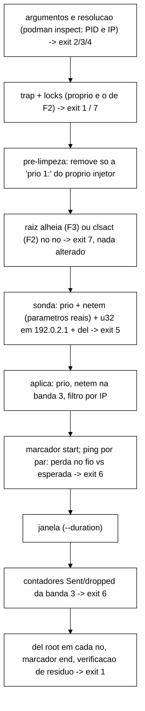

# Degradação parcial de rede (F4) — `scripts/inject-netdegrade.sh` (B-29.2)

Complementa a partição total de F2 (`inject-partition.sh`, B-29) e o jitter de F3 (`inject-jitter.sh`). Reproduz o que a rede real faz com mais frequência do que cair por inteiro: **perda**, **atraso com jitter**, **duplicação**, **reordenação** e **corrupção**, de forma simétrica ou **assimétrica**, **apenas entre os nós do cluster**. O tráfego Hot Rod do cliente (origem no gateway da *bridge*) e o SSH da VM não casam o filtro e passam intactos.

Estado desta entrega: script e suíte sem VM prontos (T-C1). **Nada foi executado na VM**; o gate L-0 a L-6 é a T-C2. Tudo o que se afirma abaixo sobre o comportamento do kernel, do TCP e do JGroups é **hipótese a testar**, não resultado.

## Mecanismo

Uma disciplina `prio` de 3 bandas na **raiz** da interface do container (o `priomap` zerado manda todo o tráfego para a banda 1, sem efeito), um `netem` pendurado na **banda 3** e um filtro `u32` por IP de destino que desvia para a banda 3 só o tráfego destinado a um par do cluster. Tudo via `sudo nsenter -t <pid> -n tc ...` a partir do host (a imagem Infinispan não tem `tc` nem `NET_ADMIN`); o PID vem de `podman inspect`, os IPs também.

```
tc qdisc  add dev eth0 root handle 1: prio bands 3 priomap 0 0 0 0 0 0 0 0 0 0 0 0 0 0 0 0
tc qdisc  add dev eth0 parent 1:3 handle 30: netem loss 20% [corr] delay 100ms 50ms distribution normal duplicate 1% reorder 25% 50% corrupt 1%
tc filter add dev eth0 parent 1: protocol ip prio 1 u32 match ip dst <ip-par>/32 flowid 1:3    # um por par
```

Só existe **egress**. A direção de **saída** do alvo é aplicada no próprio alvo (um filtro por par). A direção de **entrada** no alvo é obtida aplicando a mesma regra no egress de **cada par**, com destino ao alvo (um `nsenter` por par). É isso que permite valores diferentes por sentido (perda assimétrica) sem `ifb`.

```mermaid
%%{init: {'theme':'base','themeVariables':{'background':'#ffffff','primaryColor':'#ffffff','primaryTextColor':'#000000','primaryBorderColor':'#000000','lineColor':'#000000','secondaryColor':'#ffffff','tertiaryColor':'#ffffff','clusterBkg':'#ffffff','clusterBorder':'#000000','titleColor':'#000000','edgeLabelBackground':'#ffffff','fontFamily':'Arial'}}}%%
flowchart LR
    INJ["inject-netdegrade.sh<br/>sudo nsenter -t PID -n tc ..."]
    subgraph ALVO["isn3 (alvo)"]
        A3["eth0: prio 1:<br/>filtro u32 dst isn1, isn2<br/>banda 3: netem perda=--loss"]
    end
    subgraph P1["isn1 (par)"]
        A1["eth0: prio 1:<br/>filtro u32 dst isn3<br/>banda 3: netem perda=--loss-in"]
    end
    subgraph P2["isn2 (par)"]
        A2["eth0: prio 1:<br/>filtro u32 dst isn3<br/>banda 3: netem perda=--loss-in"]
    end
    A3 -->|"direction out / both"| A1
    A3 -->|"direction out / both"| A2
    A1 -->|"direction in / both"| A3
    A2 -->|"direction in / both"| A3
    WL["workload Hot Rod, SSH"] -. "nao casa o filtro: intacto" .-> A3
    INJ --> A3
    INJ -. "so em in / both" .-> A1
    INJ -. "so em in / both" .-> A2
```



Ciclo de uma execução (todo `tc` por `nsenter`):



## Interface (congelada para a T-D após o V-C1)

| Opção | Semântica |
|---|---|
| `--target <no>` | nó alvo (obrigatório, exceto com `--heal`) |
| `--nodes` | padrão `isn1,isn2,isn3` |
| `--peers` | pares afetados; padrão: todos os nós de `--nodes` menos o alvo |
| `--direction out\|in\|both` | padrão `out`. `in` aplica nos pares; `both` aplica nos dois sentidos |
| `--loss <pct>` | perda 0..100 (aceita fração); sentido de saída (e o de entrada, se `--loss-in` ausente) |
| `--loss-in <pct>` | perda do sentido de entrada (assimétrica); exige `--direction in\|both`; `--loss-in 0` em `both` deixa só a saída |
| `--loss-corr <pct>` | correlação da perda (modelo `random`) |
| `--loss-model random\|gemodel` | `gemodel` = Gilbert-Elliott, perda em rajada; `--loss` é a perda **média**, `--burst` a rajada média em pacotes (padrão 4) |
| `--delay`, `--jitter` | atraso e jitter (`ms`, `us`, `s`; sem sufixo = ms), distribuição normal; `--jitter` exige `--delay` |
| `--duplicate`, `--corrupt` | percentual 0..100 |
| `--reorder <pct[,corr]>` | percentual 0..100; exige `--delay` (o `netem` só reordena pacotes atrasados) |
| `--severity S1..S5` | atalho de perda; não combina com `--loss` |
| `--duration <seg>` | padrão 120; abaixo de 45 s avisa (menor que a detecção do `FD_ALL3`) |
| `--ping-count <n>` | pings por par para medir a perda no fio (padrão 200; 0 desliga) |
| `--marker <arq>` | acrescenta `fault=F4 node=<alvo> event=start\|end t_epoch_ns=<n>` (mesmo formato de B-25/F2) |
| `--heal` | remove a `prio 1:` do injetor em **todos** os nós de `--nodes`; nunca toca raiz alheia |
| `--dry-run` | imprime o plano (com `<pid>`, `<ip-par>`, `<ip-alvo>`) sem podman/sudo/nsenter/tc |

`gemodel`: com `1-h = 100%` e `1-k = 0%`, `r = 100/burst` e `p = r·X/(100−X)` dão perda média `X`. Combinações em que `p` passaria de 100% (p.ex. `--loss 90 --burst 4`) são recusadas (exit 2). `--loss 99,9` não é aceito com vírgula; use ponto.

### Severidades (hipótese de partida; a T-C2/L-4 ajusta onde está a transição)

| Perfil | Perda | Observação |
|---|---|---|
| S1 | 1% | |
| S2 | 5% | |
| S3 | 20% | |
| S4 | 50% | |
| S5 | 99,9% | aviso: "equivale a partição"; para comparação controlada com F2 |

### Códigos de saída

| Código | Significado |
|---|---|
| 0 | degradação aplicada, verificada, aguardada e removida |
| 1 | erro genérico: lock de F4 ocupado; resíduo de `prio 1:` após a limpeza |
| 2 | argumento inválido (inclui `--reorder` sem `--delay`, `--loss-in` com `--direction out`, gemodel inviável) |
| 3 | dependência ausente (`podman`, `nsenter`, `sudo`, `flock`, `ping` se houver verificação) |
| 4 | nó (alvo ou par) inexistente, parado, sem PID ou sem IP |
| 5 | kernel rejeitou `prio`/`netem`/`u32` ou um parâmetro (sonda com parâmetros reais, ou aplicação) |
| 6 | a degradação **não se efetivou**: perda observada fora de 3 σ binomiais da esperada; contador `Sent` zerado; perda configurada sem descarte (só quando se esperavam ≥ 10); contadores ilegíveis |
| 7 | raiz ocupada: qdisc raiz alheia (F3) ou `clsact`/lock de F2 em nó que seria tocado; **nada foi alterado** |
| 129/130/143 | `SIGHUP`/`SIGINT`/`SIGTERM`: o `trap` limpa e propaga |

`SIGKILL` não é capturável: `inject-netdegrade.sh --heal` é o remédio. Um *dead-man's switch* na T-C2 deve agendar `--heal` **antes** de cada injeção.

## Convivência com F2 e F3

| Combinação | Resultado |
|---|---|
| F4 e F3 no **mesmo** nó | **exit 7** (F3 ocupa a raiz com `netem` sem filtro) |
| F4 e F3 em nós **diferentes** | coexistem (F4 só toca os nós da sua direção) |
| F4 e F2 no mesmo nó | **exit 7**: o plano admite tecnicamente a convivência (`clsact` não ocupa a raiz), mas misturar partição total e perda parcial no mesmo nó invalida a leitura do experimento; o injetor toma também o lock de F2 do nó, de modo que o `inject-partition.sh` iniciado depois também é recusado (exit 1 dele) |
| duas execuções de F4 no mesmo nó | exit 1 (lock) |

Atenção com `--direction in|both`: os **pares** passam a ser nós tocados, e a checagem de raiz ocupada vale para eles também.

## Verificação de efetividade

1. **Taxa de perda no fio**: `ping -c 200 -i 0.2` de dentro do netns do alvo a cada par (em paralelo). A perda esperada de um ping é `1−(1−p_saída)(1−p_entrada)` (a requisição sai pela regra de saída do alvo, a resposta pela de entrada). A tolerância é `max(3σ, 2/n)` com `σ = √(e(1−e)/n)`. Só se aplica ao modelo `random`, sem `--corrupt` e com perda no caminho; nos demais casos o script avisa que a verificação não se aplica.
2. **Contadores** `Sent`/`dropped` da banda 3 em `tc -s qdisc` de cada nó tocado, lidos **antes** da remoção.

Estas verificações medem o **ICMP** e o contador do `netem`, **não** o TCP. Perda em TCP vira latência (retransmissões também sofrem perda), e a taxa efetiva no fio de uma conexão TCP difere da configurada.

## Hipóteses (pré-registradas no plano, seção 8.2)

H-L1 a H-L7 do plano (`docs/plano-fechamento-etapa-formal-2026-10-15.md`, seção 8.2) continuam sendo as hipóteses a testar na T-C2/T-F: p. ex., 1% e 5% sem mudança de vista; 20% sem divisão de vista mas com cauda alta; 50% com possível instabilidade de vista; ~100% equivalente a F2 depois de ≈ `FD_ALL3`, sem RST; perda assimétrica gerando vistas assimétricas transitórias; zero violações de I1/I2/I4. Nenhuma foi testada.

## Limites de fidelidade

- `netem` degrada pacotes que **saem** da interface do container: o atraso, a perda e a duplicação não passam pela pilha do kernel do **receptor**. Isto é fiel para a perda de caminho, mas não reproduz perda por *buffer overflow* no receptor.
- `delay` em `both` soma os dois sentidos (RTT = 2·delay).
- Só IPv4 (`protocol ip`). O cluster usa IPv4 na rede do `podman`.
- O `u32` casa por IP de **destino**. Tráfego entre pares é tudo que o JGroups (7800) e o *state transfer* trocam; qualquer outro destino (gateway, cliente) fica intacto.
- A taxa configurada vale por **pacote**; o JGroups sobre TCP vê efeitos de segmento/retransmissão, não da taxa.
- `netem reorder` exige atraso; sem `--delay` a reordenação é recusada (exit 2).
- `prio`/`netem`/`cls_u32` precisam estar no kernel do **host** da VM (módulos `sch_prio`, `sch_netem`, `cls_u32`); isto só é verificado em L-0.
- O kernel do WSL2 não traz `sch_netem`; a execução real é na VM Hyper-V/Ubuntu.

## O que os testes sem VM provam e o que não provam

`scripts/inject-netdegrade.test.sh` roda com *shims* de `podman`, `sudo`, `nsenter`, `tc`, `ping` e `flock` (detalhes em `docs/testes.md`). Provam a **lógica**: validação de argumentos, plano de `--dry-run`, ordem dos comandos, direção (quais PIDs são tocados), perda assimétrica com dois valores, parâmetros do `netem` chegando intactos, limpeza em sinal, `--heal` sem tocar raiz alheia, códigos 3 a 7 e exclusão mútua (com `flock` real onde houver).

**Não provam**: que o kernel aceita `prio`/`netem`/`u32`/`gemodel`/`reorder`/`corrupt`; que o filtro `u32` casa o tráfego JGroups e deixa Hot Rod e SSH intactos; que o `netem` produz a taxa configurada; o formato real das saídas de `tc -s qdisc` e `ping` (o *parser* foi escrito contra o formato documentado de iproute2 e iputils); a interação com o TCP, o JGroups e o Infinispan; o `nsenter` com `sudo` rootful e netavark. Tudo isso é objeto do gate L-0 a L-6 (T-C2).
