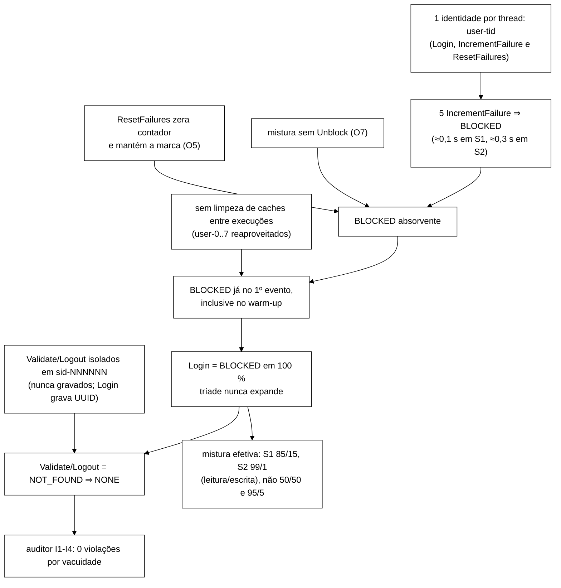
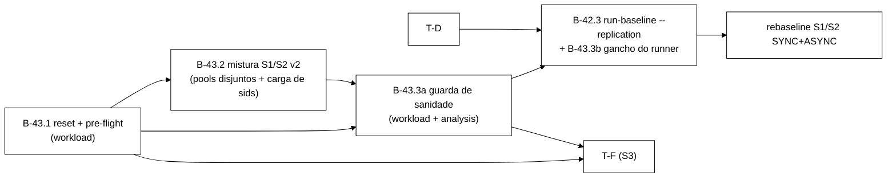

# Diagnóstico: baseline S1/S2 sem nenhuma sessão criada (Login 100 % `BLOCKED`)

> Senior, 2026-10-22. Diagnóstico **só por leitura**: nenhum arquivo de `workload/`, `scripts/`,
> `analysis/`, `cluster/`, `spec/` ou `tcc-escrita/` foi alterado, nenhum *cluster* nem `mvn` foi
> executado. Branch `docs/plano-implementacao-controlador` (worktree `../wt-plano-ctrl`), commit
> local, sem push. As worktrees `wt-b28-1` e `wt-b42-1` não foram tocadas; o código foi lido por
> `git show`.
>
> Referências `arquivo:linha` com prefixo de commit:
> - `51a31f0` = `feature/workload-csv-eventos`, commit que gerou `runs/S1-*` e `runs/S2-*` (22/06, host/WSL2);
> - `d1b82ae` = `origin/feature/f3-baseline`, bateria da VM (23/06), **fonte das Tabelas 5 e 6 da monografia e da tabela dos artigos**; brutos em `tcc/dados-vm/baseline-2026-06-23/runs/`;
> - `6ba7e28` = ponta de `feature/etapa-formal-integracao`.

---

## 1. Resumo

Em **todas** as execuções S1/S2 existentes (18 repetições publicadas da VM, 12 do host em junho e
6 *smokes*, incluindo os de outubro), **nenhum `Login` retornou `OK`** e **nenhum `Validate`
retornou `VALID`**. O *baseline* mediu três caminhos de leitura (recusa de login, leitura de chave
ausente, *logout* de chave ausente) e as escritas do contador, e não mediu o ciclo de vida de sessão.

A causa é composta. Dois defeitos de desenho da mistura bastam, cada um, para zerar `VALID`, e o
estado residual do *cluster* explica por que o bloqueio já existe no primeiro evento:

| # | Causa | Papel | Evidência principal |
|---|---|---|---|
| C1 | **Bloqueio absorvente na mistura S1/S2.** Cada *thread* usa uma única identidade `user-<tid>` para `Login`, `IncrementFailure` e `ResetFailures`; o limite é 5; `ResetFailures` zera o contador **sem tirar a marca** (correto pela especificação O5); a mistura **não tem `Unblock` (O7)** | Causa raiz. Mesmo com *cluster* limpo, cada identidade bloqueia em ≈ 131 operações (S1, ≈ 0,1 s) ou ≈ 500 (S2, ≈ 0,3 s), dentro do *warm-up* de 20 s, e nunca mais desbloqueia | `51a31f0:WorkloadMain.java:167,175,183-184`; `SessionOps.java:24,114-118`; `IdentityState.java:35,39-41`; `Scenario.java:24-25`; `Metodologia.tex:74` |
| C2 | **Chaves sintéticas em `Validate`/`Logout` isolados.** Usam `sid-NNNNNN` do gerador Zipf; o `Login` grava sessões com UUID; nada pré-carrega `sid-*` | Causa independente: mesmo com logins OK, 50 % (S1) e 95 % (S2) das operações seriam leituras de chave ausente. Só o `Validate` da tríade poderia dar `VALID` | `51a31f0:WorkloadMain.java:170,173,182`; `SessionOps.java:120,139-144` |
| C3 | **Estado residual entre execuções.** `run-baseline.sh` não limpa os *caches* nem recria o *cluster*; os nomes `user-0..7` são os mesmos em todas as execuções | Agravante: explica bloqueio desde o 1º evento (inclusive no *warm-up*), mas sozinho não causa o problema | `51a31f0:scripts/run-baseline.sh:117-129,165-177`; *caches* em memória sem expiração (`cluster/infinispan-cluster.xml:22,28`) |
| C4 | **Mascaramento na observabilidade.** `NOT_FOUND` e `OK_NOOP` viram `NONE`; `OK_VALIDATE` vira sempre `VALID` (mesmo com sessão `INVALID`); `percentis.py` conta `BLOCKED`/`NONE` como sucesso; não havia verificação de sanidade da mistura | Não causa, mas impediu a detecção por 4 meses | `6ba7e28:OpResult.java:77-84`; `analysis/percentis.py:57-58` |

Hipóteses descartadas: **ordem da mistura** (os sorteios são independentes por operação,
`Scenario.java:66-77`; a ordem não importa). **Limiar baixo** e **pool pequeno** não são causas
isoladas, são componentes de C1 (limite 5 com 10 %/1 % de `IncrementFailure` na *mesma* identidade
do `Login` e sem O7).

---

## 2. Evidência nos brutos

### 2.1 Desfechos por célula (todas as repetições)

Contagem direta nos CSVs (`operation` × `return_code`); erro = `ERROR_*`.

| Fonte | Célula | Reps | Login | Login `BLOCKED` | Login `OK` | Validate `VALID` | Erros |
|---|---|---|---|---|---|---|---|
| host (22/06) | `runs/smoke` | 1 | 135 092 | 135 092 (100 %) | 0 | 0 | 0 |
| host (22/06) | `runs/S1-none` | 3 | 569 825 | 569 825 (100 %) | 0 | 0 | 0 |
| host (22/06) | `runs/S1-F1` | 3 | 486 783 | 486 783 (100 %) | 0 | 0 | 0 |
| host (22/06) | `runs/S2-none` | 3 | 93 312 | 93 312 (100 %) | 0 | 0 | 0 |
| host (22/06) | `runs/S2-F1` | 3 | 83 318 | 83 318 (100 %) | 0 | 0 | 0 |
| host (02/10) | `runs/S1-none-b23b24-smoke` | 1 | 477 139 | 477 139 (100 %) | 0 | 0 | 0 |
| host (02/10) | `runs/S1-F1-b23b24-smoke` | 1 | 444 075 | 444 075 (100 %) | 0 | 0 | 0 |
| host (02/10) | `runs/S1-F1-b24fix-smoke{,2,3}` | 3 | 1 871 507 | 1 871 507 (100 %) | 0 | 0 | 0 |
| **VM (23/06)** | `S1-none` | 3 | 1 291 332 | 1 291 332 (100 %) | 0 | 0 | 0 |
| **VM (23/06)** | `S1-F1` | 3 | 1 133 741 | 1 133 741 (100 %) | 0 | 0 | 0 |
| **VM (23/06)** | `S1-F3` | 3 | 52 105 | 52 105 (100 %) | 0 | 0 | 0 |
| **VM (23/06)** | `S2-none` | 3 | 233 942 | 233 942 (100 %) | 0 | 0 | 0 |
| **VM (23/06)** | `S2-F1` | 3 | 205 899 | 205 899 (100 %) | 0 | 0 | 0 |
| **VM (23/06)** | `S2-F3` | 3 | 6 534 | 6 534 (100 %) | 0 | 0 | 0 |

Em todas as células `Validate`, `Logout` e `ResetFailures` só têm `NONE` e `IncrementFailure` só
`COUNTED`. As contagens de `Login` da VM coincidem com o `n` dos `summary.json` de `d1b82ae`, que
alimentam as tabelas publicadas. Os `violacoes-rep-001.csv` dos *smokes* de outubro têm só o
cabeçalho.

### 2.2 O bloqueio já existe no primeiro evento, inclusive no *warm-up*

O CSV só guarda a janela de medição (`EventCsvWriter.registrar`, `51a31f0:EventCsvWriter.java:86-90`),
então o primeiro evento do CSV não é o primeiro da execução. A prova vem de uma identidade aritmética:
a tríade `Login → Validate → Logout` conta **uma** operação em `totalOps`
(`51a31f0:WorkloadMain.java:174-187`), mas emite **três** eventos quando o login dá `OK_LOGIN` e um
só quando dá `BLOCKED`. Logo, *eventos emitidos* = *operações* + 2 × (logins OK).

- `rep-*.stdout.log` imprime `Total de operacoes` e `registrados + descartados_warmup` (= todos os
  eventos emitidos, dentro e fora da janela).
- **Nas 18 repetições da VM a diferença é 0** (ex.: `S1-none/rep-001`: 2 254 487 = 2 254 487).
  **Nas 12 do host também** (ex.: `runs/S1-F1/rep-001.stdout.log`: 906 674 = 642 629 + 264 045).
- Portanto houve **zero `OK_LOGIN` na execução inteira, warm-up incluído**.

Contraprova pelo histograma: em todas as repetições, a soma dos `descartados=` das cinco linhas
impressas (`reset_ok`, `login_blocked`, `inc_failure`, `validate`, `logout_noop`) é igual a
`descartados_warmup`. Não há `login_ok`/`logout_ok` no *warm-up*. Em `runs/S1-F1/rep-002` a soma
fica 1 abaixo (238 729 contra 238 730): um evento de *bucket* não impresso. Pela identidade acima,
não é `OK_LOGIN`; é compatível com um único erro de transporte na fronteira do *crash*. Não muda
nada.

No CSV, ordenando por `start_ns`, o **primeiro `Login` de cada uma das oito identidades já é
`BLOCKED`**, várias delas sem nenhum `IncrementFailure` antes (em `runs/S1-none/rep-001.csv`:
`user-0`, `user-3`, `user-4`, `user-7` com 0 incrementos antes; em `runs/smoke/rep-001.csv`: 5 das 8).
O bloqueio vem de execuções anteriores (C3).

### 2.3 Mesmo com *cluster* limpo o resultado seria praticamente o mesmo

Simulação da cadeia do contador por *thread* (incremento com probabilidade `p_inc`, *reset* com
`p_reset`, limite 5): **S1** (`p_inc = 0,10`, `p_reset = 0,05`) leva em média **≈ 131 operações** até
`BLOCKED`, ≈ 0,10 s ao ritmo medido de ≈ 1 260 op/s por *thread*. **S2** (`p_inc = 0,01`, sem *reset*)
leva **≈ 500 operações**, ≈ 0,28 s. Depois disso o estado é absorvente (C1). Com *warm-up* de 20 s,
uma limpeza do *cluster* só criaria algumas dezenas de sessões no primeiro segundo, todas
descartadas. **Só o *reset* entre execuções não corrige o problema.**

### 2.4 A razão entre operações confirma, sem abrir o CSV

Com a tríade sem expandir, os `n` por operação reproduzem exatamente os pesos nominais. Nos
`summary.json` da VM (`d1b82ae`), S1-none tem `Validate/IncrementFailure = 5,00`,
`Login/IncrementFailure = 2,50` e `Logout/IncrementFailure = 1,00`. Com logins OK seriam 7,5 e 3,5
(a tríade acrescenta 25 % de `Validate` e 25 % de `Logout`). O mesmo vale para todas as células da
VM e do host.

---

## 3. Leitura do código (por que acontece)

### 3.1 S1/S2 em `51a31f0`, o código que gerou os dados

- `WorkloadMain.java:167`: `String identidade = "user-" + tid;`. A identidade é **única por
  *thread*** e se repete em todas as execuções. Com 8 *threads*, o *pool* inteiro tem 8 nomes fixos.
- `WorkloadMain.java:175`, `:183`, `:184`: `login`, `incrementFailure` e `resetFailures` usam essa
  mesma identidade.
- `SessionOps.java:24`: `LIMITE_TENTATIVAS = 5`; `IdentityState.java:35`: `novo >= limite ⇒ BLOCKED`.
- `IdentityState.java:39-41`: `resetar` devolve `contadorFalhas = 0` **com o mesmo `status`**.
  Isso é o que `Metodologia.tex:74` prescreve para O5 ("sem alterar a marca de bloqueio"). Não é
  defeito da operação, é da mistura.
- `Scenario.java:24-25`: `S1(50, 25, 10, 10, 5)`, `S2(95, 3, 1, 1, 0)`. Não há O6/O7 na mistura,
  logo nada desbloqueia.
- `SessionOps.java:114-118`: identidade `BLOCKED` ⇒ `OpResult.blocked()`, sem criar sessão. A
  tríade só continua se `OK_LOGIN` (`WorkloadMain.java:176`).
- `WorkloadMain.java:170`, `:173`, `:182`: `Validate`/`Logout` isolados recebem
  `chaves.nextSessionKey()` = `sid-NNNNNN` (`KeyGenerator.java:103-105`); `SessionOps.java:120`
  grava sessões com `UUID.randomUUID()`. As chaves Zipf nunca existem no *cache* `sessions`
  ⇒ `NOT_FOUND` (`SessionOps.java:141-144`, `:168-172`) ⇒ `"NONE"` (`OpResult.java:74`).
- `scripts/run-baseline.sh:117-129` e o laço `:165-177`: não há limpeza de *cache*, *restart* nem
  verificação de estado entre repetições, falhas ou cenários. O *crash* F1 (`podman stop/start`)
  não limpa nada: o nó volta e recebe o estado por *state transfer*.

A mistura **efetivamente executada** foi, em S1, 50 % `Validate` ausente + 25 % `Login` recusado +
10 % `Logout` ausente (85 % leituras) + 15 % escritas de contador; em S2, 99 % leituras + 1 %
escritas. Não foram as misturas 50/50 e 95/5 declaradas em T7 (`Metodologia.tex:174`).

### 3.2 A ponta de integração (`6ba7e28`) tem o mesmo defeito em S1/S2

- `WorkloadMain.java:478`: `String identidade = "user-" + tid;` (inalterado);
  `:482`, `:485`, `:494`: chaves sintéticas em `Validate`/`Logout`; `:487`, `:495`, `:496`: mesma
  identidade para login e contador.
- `IdentityState.java:39-41`: `resetar` inalterado (correto por O5). `desbloquear` foi corrigido
  (`d13b06b`, zera o contador), mas S1/S2 não chamam O7.
- `Scenario.java:24-25`: pesos inalterados, e travados pelo `GoldenS1S2Test`
  (`sequenciaPorSementeIdenticaADaBase`), que exige a mesma sequência de operações e de chaves por
  semente.
- `scripts/run-baseline.sh`: continua sem nenhuma limpeza (nenhuma ocorrência de
  `clear`/`reset`/`restart`).
- O plano de 22/10 (`docs/plano-implementacao-controlador-2026-10-22.md`, §8.1) prevê
  **"Rebaseline S1/S2 ASYNC … para pôr ao lado da Tabela 5"**. Sem correção, esse *rebaseline*
  reproduz o defeito em ASYNC (18 execuções, ≈ 1 a 1,5 h de VM gastas em dados sem sessão).

### 3.3 S3 (B-33): não sofre C1/C2, mas sofre C3

O S3 foi desenhado com *pools* disjuntos (Q-10):

- Pool **U** (`UsuarioVirtual`, identidades `s3-u-NNN`, `ContextoS3.java:54-56`): nunca recebe
  `IncrementFailure`. `Login` OK cria sessão e as páginas validam o **sid devolvido** pelo login.
  C1 e C2 **não se aplicam**.
- Pool **L** (`ContaLimiteS3`, `s3-l-NNN`): o `BLOCKED` por limite é **esperado** e o `Unblock` de
  suporte vem 60 s depois (`ContaLimiteS3.java:80-91`). Com `desbloquear` já corrigido (`d13b06b`),
  o ciclo se fecha. C1 não se aplica.

**C3 se aplica ao S3**, e por três caminhos (nenhum S3 rodou ainda: não há `s3-resumo-rep-*.json`
em nenhuma branch nem em disco):

1. **U preso entre repetições.** O admin mantém um bloqueio por ≥ 20 s + exp(10 s) a cada
   ≈ exp(15 s) (`S3Parametros.java:75-85`). Fica segurando um bloqueio em cerca de 2/3 do tempo, então
   é provável que a repetição termine com uma identidade de U `BLOCKED`. Na repetição seguinte
   essa identidade fica `BLOCKED` **para sempre**: o admin só desbloqueia o que ele mesmo bloqueou
   nesta execução (`AtorAdministrativoS3.java:74-79`) e só escolhe alvos em `ctx.online`
   (`:53`), onde um usuário bloqueado nunca entra (`UsuarioVirtual.java:86-90`).
2. **L começando bloqueada.** Uma conta L que termina em `SUPORTE` começa a repetição seguinte
   `BLOCKED`. No caminho de *reset* (`lProbReset = 0,5`) ela continua `BLOCKED` (O5 mantém a marca)
   até cair num ciclo sem *reset*.
3. **Varredura final contaminada.** `executarVarredura` lê **todas** as chaves dos dois *caches*
   (`6ba7e28:WorkloadMain.java:319-320`). No mesmo *cluster* entram as sessões e identidades de
   repetições e cenários anteriores, incluindo `user-0..7` `BLOCKED` vindos de S1/S2. Os achados
   de I1/I2/"bloqueio perdido" passam a misturar estado alheio à repetição. A sequência de VM do
   plano (`S1..S7 (cluster atual, sem recriar)`) torna isso concreto.

---

## 4. Correção e guarda recomendadas

### 4.1 Onde entra no backlog

Nem B-42.x nem T-D: **bloco novo, B-43 "Higiene de estado e sanidade da carga"**. É pré-requisito
de B-42.3, do *rebaseline* ASYNC (§8.1 do plano do controlador), da T-F e de B-41. Os IDs B-43+ não
são usados em nenhuma branch.

- O B-42.x trata do perfil de replicação. Misturar a correção da carga ali acopla duas mudanças de
  semântica no mesmo *diff* e dificulta separar "efeito ASYNC" de "efeito carga corrigida".
- A T-D trata dos injetores F2/F4 no `run-baseline.sh`. Só o **gancho de *runner*** (B-43.3b) toca
  o mesmo arquivo; ele entra **dentro de B-42.3**, que já está sequenciado depois da T-D, para que
  o `run-baseline.sh` não tenha três branches concorrentes.

### 4.2 Itens

| ID | Branch sugerida | Conteúdo | Arquivos |
|---|---|---|---|
| **B-43.1** reset e *pre-flight* de estado | `fix/b43-1-reset-estado-entre-execucoes` | Flag `--reset-state` (padrão **ligado** para S1/S2/S3; `off` só explícito). Antes do *warm-up* de cada repetição: `clear()` dos dois *caches* do perfil (nomes resolvidos pelo perfil de B-42.1) e verificação `size()==0` em cada um; se não zerar, aborta com código de saída próprio (ex.: 5). Registra no *stdout* e no `meta`/resumo: `reset_state=on`, tamanhos antes/depois | `WorkloadMain`, `Cli`, testes com `FakeCaches` |
| **B-43.2** mistura S1/S2 v2 | `fix/b43-2-mistura-s1-s2-sessoes-reais` | (a) *Pools* disjuntos como no S3: `Login` em `user-<tid>-<k>` (nunca recebe O4/O5); O4/O5 em `lim-<tid>`. (b) Fase de carga antes do *warm-up*: grava `sid-000001..sid-100000` como sessões `VALID` (identidades do *pool* de login), para que `Validate`/`Logout` isolados leiam chaves existentes. (c) Versão de mistura `mix=v2` no `meta`/*stdout*. A sequência de operações e de chaves por semente fica **idêntica** (o `GoldenS1S2Test` continua verde sem edição); mudam só as identidades e o estado inicial | `WorkloadMain.rodarCliente`, novo `CargaInicial`, testes |
| **B-43.3a** guarda de sanidade | `fix/b43-3-guarda-sanidade-mistura` | Ao fim de cada repetição, contagem `operation × return_code` **na janela de medição** ⇒ `sanidade-rep-NNN.json` com os limiares usados e o veredito. Modo `--sanity strict` (padrão em baseline): veredito `FALHA` ⇒ código de saída 4. `analysis/percentis.py` **recusa** sumarizar diretório com `sanidade` ausente ou `FALHA` (exceto com `--aceitar-insano`, que carimba o `summary.json`) | `WorkloadMain`, novo `Sanidade`, `analysis/percentis.py`, testes Java e `unittest` |
| **B-43.3b** gancho do *runner* | dentro de `feature/b42-3-baseline-replicacao` | `run-baseline.sh` passa `--reset-state on --sanity strict`, trata o código 4/5 (marca a repetição como `INVALIDA` em `meta.json` e **interrompe a célula**), nunca chama `percentis.py` em célula com repetição inválida | `scripts/run-baseline.sh` |
| **B-43.4** fidelidade do `return_code` (opcional, decisão do Gestor) | `fix/b43-4-return-code-validate` | `OK_VALIDATE` grava `VALID` **ou** `INVALID` conforme o *payload* (hoje sempre `VALID`, `OpResult.java:78`); `NOT_FOUND` grava `NOT_FOUND` em vez de `NONE`. Muda o contrato do CSV: exige atualizar `SUCESSOS` em `percentis.py` e registrar a quebra de compatibilidade | `OpResult`, `analysis/percentis.py` |

### 4.3 Critérios de aceite

**B-43.1**
1. Teste com `FakeCaches` pré-populado (`user-0` `BLOCKED`, 10 sessões): com `--reset-state on`, ao
   início da medição os dois *caches* estão vazios e o primeiro `Login` de `user-0` dá `OK_LOGIN`.
2. Teste: um *cache* que não esvazia (fake que ignora `clear`) ⇒ processo termina com o código
   documentado, sem gravar `rep-NNN.csv`.
3. `--reset-state off` reproduz o comportamento atual (teste de regressão).
4. Os nomes dos *caches* limpos vêm da resolução por perfil (nenhum literal `"sessions"`/`"counters"`
   novo; o teste de B-42.1 que caça literais continua verde).
5. *Smoke* local: duas execuções S1 seguidas de 30 s no mesmo *cluster*; na segunda, o primeiro
   `Login` de cada `user-*` (ordenado por `start_ns`) é `OK`.

**B-43.2**
1. `GoldenS1S2Test` verde **sem alterar** os recursos `golden-8e2e815/`.
2. Teste: com a mistura v2 e um *fake* determinístico, em 10⁴ operações S1, nenhuma identidade de
   login fica `BLOCKED`; `Login OK / Login` = 1,0 sem falha injetada.
3. Teste: após a carga inicial, `Validate` de `sid-000001` devolve `OK_VALIDATE` com `VALID`.
4. *Smoke* local de 60 s em S1 e S2: `Validate VALID > 0`, `Login OK / Login ≥ 0,99`,
   `Validate NOT_FOUND / Validate ≤ 0,01`, e a razão `eventos / operações > 1` (a tríade expande).
5. Custo da carga inicial (10⁵ `put`) medido e registrado; ocorre **antes** do *warm-up* e fora do
   CSV.

**B-43.3a** (limiares provisórios, a confirmar pelo Gestor; ver seção 6)
1. S1/S2 sem falha: `FALHA` se `Login OK / (Login OK + BLOCKED) < 0,95`, ou se `Validate VALID = 0`,
   ou se `Validate NOT_FOUND / Validate > 0,05`, ou se a fração observada de cada operação desviar mais
   de 2 pontos percentuais do peso nominal (já contando a tríade).
2. Com falha injetada (F1..F4): mesmos testes calculados **fora** da janela de falha (marcadores de
   B-25.1), mais `Validate VALID > 0` dentro da janela, salvo `ERROR_*` = 100 % no período.
3. S3: *pre-flight* (todas as `s3-u-*`/`s3-l-*` ausentes ou `OPEN` com contador 0, `sessions`
   vazio); pós: cada identidade U com ≥ 1 `OK_LOGIN`, ≥ 1 ciclo `Block`/`Unblock` do admin
   concluído, ≥ 1 `BLOCKED` por limite em L e ≥ 1 `Unblock` de suporte.
4. **Teste de regressão com os brutos de junho**: rodar o verificador (modo *offline*, só leitura de
   CSV) sobre `runs/S1-F1/rep-001.csv` ⇒ veredito `FALHA` com o motivo "Login OK = 0 % e
   Validate VALID = 0". O mesmo sobre uma *fixture* sã ⇒ `OK`.
5. `percentis.py` sobre diretório com `sanidade` `FALHA` termina com código ≠ 0 e não grava
   `summary.json`; com `--aceitar-insano` grava e inclui `"sanidade": "FALHA"`.

**B-43.3b**: `--dry-run` mostra as *flags*; teste com *shim* do `java` que devolve 4 ⇒ repetição
marcada `INVALIDA`, célula interrompida, `percentis.py` não chamado.

**B-43.4** (se aprovado): teste de `returnCode()` para `INVALID` e `NOT_FOUND`; `percentis.py`
aceita os códigos novos; nota de quebra de contrato em `docs/`.

---

## 5. Números já escritos ou publicados que ficam comprometidos

Nada foi editado. "Comprometido" quer dizer que o número existe e foi medido, mas o **rótulo e a
interpretação** estão errados: `Login` é a latência de **recusa** (um `get` em `counters`);
`Validate` e `Logout` são a de **leitura de chave ausente** em `sessions`; não houve criação nem
invalidação de sessão, e a mistura efetiva foi 85/15 e 99/1. `IncrementFailure` e `ResetFailures`
são os únicos rótulos fiéis, mas foram medidos sobre 8 chaves "quentes" `BLOCKED`, sob contenção
artificial. As afirmações de "consistência/correção preservada" são **vacuamente verdadeiras**.

### 5.1 Monografia (`tcc-escrita/Desenvolvimento.tex`, dados da VM `d1b82ae`)

| Linha | Item |
|---|---|
| 43 | "perfil `DIST_ASYNC`": o XML da bateria era `SYNC` (`d1b82ae:cluster/infinispan-cluster.xml:22,28`). Já registrado como G5 no plano de 22/10; não é este defeito, mas afeta a mesma leitura |
| 43 | descrição "S1 (50/50) e S2 (95/5)": mistura efetiva 85/15 e 99/1 |
| 45 | "preservam a consistência do atendimento": vácuo (nenhuma sessão) |
| 47 | +0,66 ms (`IncrementFailure`), +0,56 ms (`ResetFailures`), "até 0,06 ms nas operações de sessão", +1,19 ms (S2), p = 0,75 e p = 0,25 |
| 50–68 | **Tabela 5** inteira (9 linhas × sem falha/F1/Δ): `Login` 0,52/0,57, 0,48/0,53; `Validate` 0,50/0,55, 0,42/0,47; `Logout` 0,50/0,56, 0,42/0,46; contador 1,64/2,30, 1,68/2,24, 1,81/3,00 |
| 71 | "+44 a +52 ms"; "`Validate` em S1 de ≈ 2,58 milhões para ≈ 104 mil amostras" (leituras de chave ausente) |
| 75–92 | **Tabela 6** inteira (F3): 44,91; 50,77; 51,24; 109,54; 107,66; 51,28; 51,52; 52,76; 1 277,76 e os Δ |
| 95 | 1 277,76 ms, 2 109 amostras, p95 = 99,8 ms; além disso "carga *write-heavy* de S2" (S2 é 95/5 de leitura; erro independente deste) |
| 97 | síntese "disponibilidade preservada, *failover* gracioso, impacto de cauda mínimo" para operações de sessão |
| 131 | limitação 1 (descreve o *baseline* como resultado real sem a ressalva) |
| `ConclusoesParciais.tex:8` | "F1 com *failover* gracioso e impacto de cauda mínimo, F3 com degradação graciosa porém custosa" |
| `Metodologia.tex:174` (T7) | os valores adotados não correspondem ao que foi executado (não é número publicado, mas sustenta as tabelas) |

### 5.2 Artigo UCC versão completa (`tcc/ucc26/paper/paper.tex`, 19/08) e cópia IEEE em `tcc/errc26/The_Problem_of_…/paper.tex` (mesmas linhas)

| Linha | Item |
|---|---|
| 43 (*abstract*) | "*failover* … *modest shift in tail latency*", "*jitter* … *inflate 99th-percentile latency by orders of magnitude and substantially reduce throughput*" |
| 241 | "`DIST_ASYNC` *under evaluation*" (era SYNC) e "S1 (50 % Login/Logout, 50 % Validate)" |
| 251–267 | `tab-results` inteira (mesmos números da Tabela 5 + Tabela 6 da monografia) |
| 274 | "*sub-millisecond to roughly one-millisecond*", "+44 to +52 ms", "2,58 million → 104 thousand samples", 2109 amostras, p95 99,8 ms |
| 276, 281 | leitura de tolerância e leitura energética ("*negligible extra work per completed request*"): o trabalho completado não incluiu nenhuma sessão |
| 295 (conclusão) | "*asynchronous replication tolerates a silent node crash gracefully, at near-zero latency cost*" (nem assíncrono, nem sessão) |

### 5.3 Artigo UCC submetido (`tcc/ucc26/workshop-paper/paper.tex`, dados do host `51a31f0`)

Esta versão **já declara o defeito** (l. 249, "*What the battery measured*") e se rotula como
controle SYNC. O que resta:

| Linha | Item |
|---|---|
| 81 (*abstract*) | "*a node stop raised the median per-run 99th-percentile latency by factors of 1.3 to 3.0 across operations*": os rótulos de operação não são de sessão |
| 245 | "*25 % Login followed by Validate and Logout of the new session*": a tríade nunca expandiu |
| 249 | "*reached the lockout threshold early in every run*": impreciso. Pela identidade da seção 2.2, as identidades **já estavam bloqueadas antes do primeiro evento** de cada execução (estado residual). Atingiriam o limite em < 0,3 s mesmo com *cluster* limpo |
| 253–270 | `tab-results` (p99 por execução: 2,54/3,25 … 5,44/16,22; razões 1,27–2,98) |
| 275 | "*medians moved by at most 0.14 ms*", "*completed operations fell by 15 % in S1 and 10 % in S2*", "8,591 to 9,711 events", 136,87 ms |

Recomendo que a Revisora confira estes números contra `runs/S*-*/rep-*.stdout.log` e os CSVs (este
diagnóstico não os reconferiu um a um).

### 5.4 Artigo ERRC SBC (`tcc/errc26/paper-sbc/paper.tex`, 16/09)

| Linha | Item |
|---|---|
| 31 e 35 (*abstract*/resumo) | "piloto preliminar … ilustra … a assimetria de custo que o desenho do controlador antecipa" |
| 109 | "modo `DIST_ASYNC`" e "S1 (50 % Login/Logout, 50 % Validate)" |
| 117–135 | `tab-results` inteira (mesmos números da VM) |
| 140 | "sub-milissegundo a 1 ms", "44 a 52 ms", "≈ 2,58 M → ≈ 104 k amostras", "*failover* gracioso e barato; F3 … cara" |

### 5.5 Repositório de desenvolvimento

- `runs/S1-*/summary.json`, `runs/S2-*/summary.json`, `comparacao.json` (host e VM): mesmo rótulo
  incorreto; `taxa_erro = 0` está certa, mas conta `BLOCKED`/`NONE` como sucesso.
- `docs/plano-implementacao-controlador-2026-10-22.md` §8.1: "pôr ao lado da Tabela 5". A Tabela 5
  não serve de âncora; a âncora SYNC precisa ser refeita com B-43.
- B-39.1 (`referencia_p99.py`): nenhuma referência `p99_ref` pode ser gerada dos brutos de junho.
- *Smokes* de 02/10 usados para validar B-23/B-24: "0 violações" é vácuo. A validação do auditor
  em S1/S2 não tem poder; vale apenas a dos testes unitários e das capturas.
- Não afetados: resultados TLC, gates F2 (`runs/gate-b29/`, sem *workload*), contagens de erro de
  transporte.

---

## 6. Pontos para decisão do Gestor

1. **Aprovar o bloco B-43** (seção 4) e a ordem: B-43.1 e B-43.3a já; B-43.2 antes de qualquer
   *rebaseline*; B-43.3b dentro de B-42.3.
2. **Desenho da mistura v2 (B-43.2).** (a) *pools* disjuntos + carga inicial de `sid-*`
   (recomendado: preserva o *golden* e o Zipf); ou (b) incluir O7 na mistura (muda os pesos e quebra
   o *golden*); ou (c) `Validate`/`Logout` isolados sobre um anel de sids criados pela própria
   *thread* (sem carga inicial, mas troca o Zipf por recência).
3. **Limiares da guarda** (0,95 / 0 / 0,05 / 2 p.p.) e o modo padrão (`strict` abortando ou só
   marcando).
4. **B-43.4** (`VALID`/`INVALID`/`NOT_FOUND` no CSV): quebra o contrato do CSV; recomendo aprovar,
   porque sem isso uma regressão futura de I1 em S1/S2 não aparece no `return_code`.
5. **Texto acadêmico**: as Tabelas 5 e 6, os parágrafos 43–97 do Cap. 5, a conclusão parcial e as
   três versões de artigo da seção 5 precisam de decisão (retirar, reescrever como "latência de
   caminhos de recusa/ausência em SYNC" ou substituir após o *rebaseline*). O Senior não edita
   `tcc-escrita/` nem os artigos. Depois da decisão, vai um resumo para `docs/resumos-para-tcc/`.
6. **S3/T-F**: exigir *cluster* recriado **ou** B-43.1 antes da primeira repetição da T-F, porque a
   varredura final lê o *cache* inteiro.
