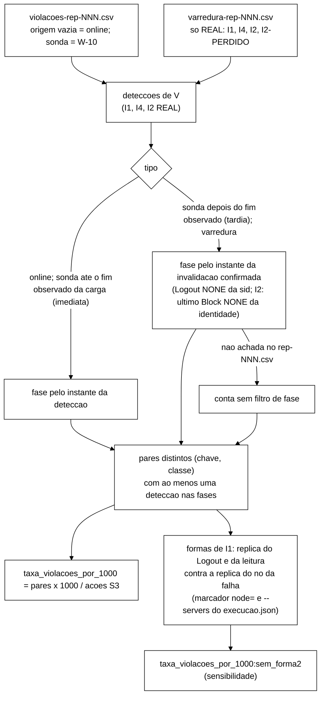
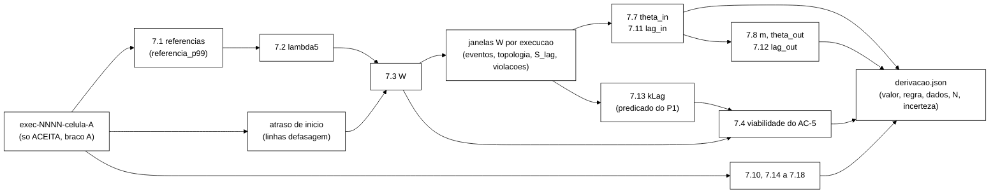
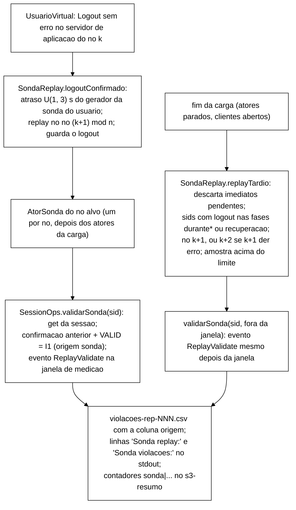
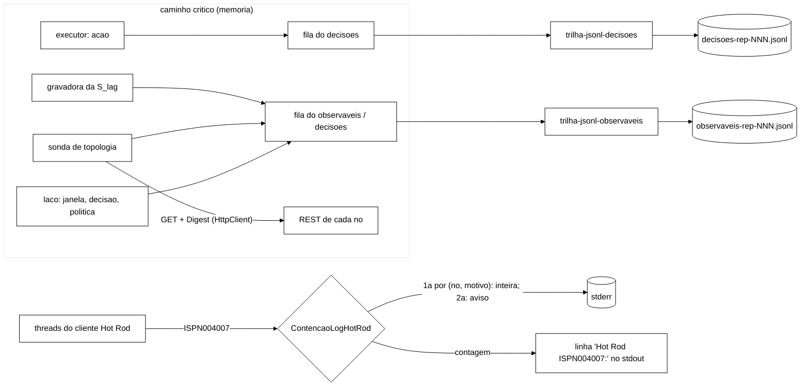
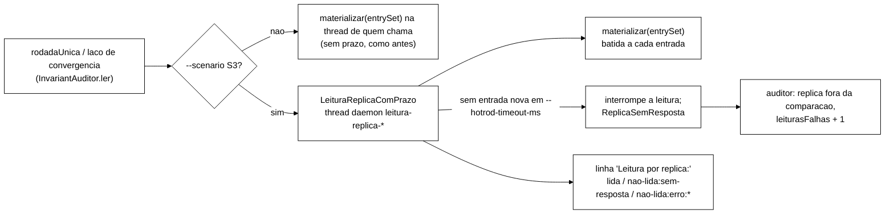
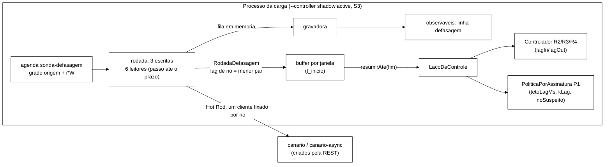
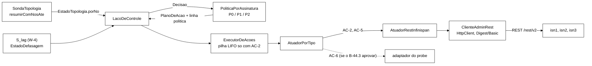
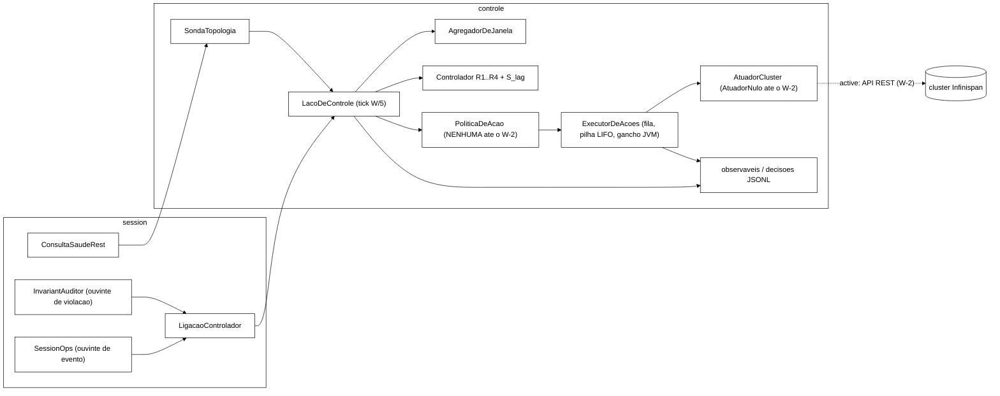
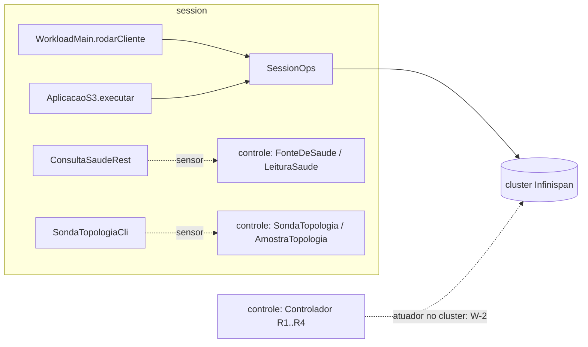

# Implementação — visão técnica

> Documento técnico que descreve a estrutura do código do protótipo e o estado de implementação de cada componente. Mantido pelo agente de desenvolvimento e atualizado a cada bloco do *backlog* fechado.

## Estrutura de pacotes

```
workload/
└── src/main/java/br/unipampa/tcc/session/
    ├── WorkloadMain.java          # ponto de entrada
    ├── Scenario.java              # mistura de operações (S1 50/50, S2 95/5)
    ├── KeyGenerator.java          # gerador Zipfian de chaves de sessão
    ├── WarmupPolicy.java          # política de warm-up e descarte (T11)
    ├── Cli.java                   # configuração de linha de comando (Picocli)
    ├── SessionOps.java            # operações O1-O7 via Hot Rod
    ├── SessionState.java          # modelo do estado de sessão
    ├── IdentityState.java         # modelo do estado de identidade
    ├── OpResult.java              # tipo único de retorno das O1-O7 + map return_code
    ├── LatencyRegistry.java       # registro de latência por operação (resumo stdout)
    ├── EpochClock.java            # âncora epoch-ns por repetição (T2 eventos)
    ├── EventCsvWriter.java        # trilha de eventos crus em CSV (T3/T4 eventos)
    └── InvariantAuditor.java      # detector de violações I1-I6

extensao-servidor/                 # A1 (2026-11-06): JAR para server/lib do Infinispan Server 15.0.21
└── src/main/java/br/unipampa/tcc/
    ├── servidor/
    │   ├── PoliticaFusaoSessoes.java  # EntryMergePolicy do sessions-async (ordem de conteúdo + saída de segurança)
    │   ├── OrdemSessao.java           # postos do modelo T2 (B-45) e comparador (estado, motivo, versão, instante)
    │   ├── LeitorSessao.java          # desserialização restrita do valor (WrappedByteArray do cliente)
    │   ├── Decisao.java, MotivoSaida.java, RegistroFusao.java  # decisão, motivos da saída, log
    └── session/SessionState.java      # cópia idêntica à do workload (mesmos bytes; teste confere o fonte)
```

## Trilha de eventos crus (CSV consumido por analysis/)

Além do resumo de latência por histograma (`LatencyRegistry`, impresso em
*stdout*), o *workload* grava uma **trilha de eventos crus** por repetição,
um evento por operação O1–O5, no formato exato esperado pelo pipeline:

```
op_id,operation,start_ns,end_ns,replica,return_code,key
```

- **`OpResult.returnCode()`** mapeia o `Code` interno para o código
  canônico: `OK_LOGIN→OK`, `OK_VALIDATE→VALID`, `OK_STATUS→COUNTED`,
  `OK_NOOP→NONE`, `NOT_FOUND→NONE`, `BLOCKED→BLOCKED`,
  `ERROR_TRANSPORT→ERROR_TRANSPORT`. Apenas `ERROR_TRANSPORT` fica fora do
  conjunto de sucessos de `analysis/percentis.py`, então `taxa_erro`
  reflete somente falhas de transporte.
- **`EpochClock`** captura, no início de cada repetição, o par
  (`epochBaseNanos = Instant.now()`, `monoBaseNanos = System.nanoTime()`)
  e converte cada instante monotônico das operações em epoch-ns,
  preservando durações.
- **`EventCsvWriter`** mantém um `op_id` global (`AtomicLong`), suprime
  eventos de warm-up/descarte (mesma `WarmupPolicy` do registry) e grava
  `<csv-dir>/rep-NNN.csv`.
- **`SessionOps`** emite, em O1–O5, o evento cru com nome canônico
  (`Login`, `Validate`, `Logout`, `IncrementFailure`, `ResetFailures`),
  `replica` = servidor de conexão (primeiro servidor Hot Rod; *fallback*
  aceito ao *owner* real) e `return_code`.

O *marshaller* do cliente Hot Rod é `JavaSerializationMarshaller` (os
valores `SessionState`/`IdentityState` são POJOs `Serializable`); sem isso
o ProtoStream padrão falha ao serializar e toda escrita vira
`ERROR_TRANSPORT`.

## Mapeamento operações ↔ Cap. 3 §3.3.1

| Operação (Cap. 3) | Método (Java) | Cache-alvo | Estado |
|---|---|---|---|
| O1 `Login` | `SessionOps.login(id, cred)` | `sessions` / `sessions-async` | esqueleto |
| O2 `Validate` | `SessionOps.validate(sid)` | leitura no mesmo *cache* | esqueleto |
| O3 `Logout` | `SessionOps.logout(sid)` | `sessions` / `sessions-async` | esqueleto |
| O4 `IncrementFailure` | `SessionOps.incrementFailure(id)` | `counters` | esqueleto |
| O5 `ResetFailures` | `SessionOps.resetFailures(id)` | `counters` | esqueleto |
| O6 `Block` | `SessionOps.block(id, motivo)` | `counters` + invalidação em `sessions*` | a implementar em B-05 |
| O7 `Unblock` | `SessionOps.unblock(id)` | `counters` | a implementar em B-05 |

## Mapeamento componente ↔ linha Tx da Tabela 1

| Componente | Tx coberta(s) | Estado |
|---|---|---|
| `cluster/podman-compose.yml` + `cluster/infinispan-cluster.xml` | T1, T2, T3, T4, T15, T16, T19, T20 | implementado (B-02, B-03) |
| `spec/SessionStore.tla` + `MC-*.cfg` + `run-tlc.sh` | T21 | implementado (B-14) |
| `workload/.../WorkloadMain.java` | T7, T9, T11, T14 | integração de `Scenario` + `KeyGenerator` (B-08); CLI completa em B-10 |
| `workload/.../SessionOps.java` | T5, T7 | implementado com Hot Rod e `OpResult` (B-05) |
| `workload/.../LatencyRegistry.java` | T13 | HdrHistogram + dump CSV (B-06) |
| `workload/.../InvariantAuditor.java` | M2 (Cap. 3 §3.3.4) | checagens I1-I4 imediato + auditoria I5/I6 periódica (B-07) |
| `workload/.../KeyGenerator.java` | T5, T6, T8 | Zipfian Rejection-Inversion, universo 100k, ρ=0,99 (B-08) |
| `workload/.../Scenario.java` | T7 | enum S1 50/50 e S2 95/5 (B-08) |
| `workload/.../WarmupPolicy.java` | T11 | warm-up max(60s, 10%) + descarte 5% restante (B-09) |
| `workload/.../Cli.java` | T7, T9, T10, T11, T14 | CLI Picocli com --scenario, --duration, --ops, --rep, --threads, --seed, --warmup-min-sec, --csv-dir, --dry-run (B-10) |
| `workload/.../EpochClock.java` | T2 (eventos) | âncora epoch-ns por repetição |
| `workload/.../EventCsvWriter.java` | T3/T4 (eventos) | CSV `op_id,operation,start_ns,end_ns,replica,return_code,key` |
| `scripts/inject-crash.sh` | T16, T17 | F1 como *crash* silencioso (2026-10-28, opção B de `docs/prompt-f1-kill-2026-10-27.md`): guarda de *netns*, `sudo nsenter -t <pid> -n ip link set dev eth0 down`, logo em seguida `podman kill <nó> --signal KILL` (ExitCode 137), 60 s com `sleep & wait`, `podman start`; *trap* por fase (isolado: `kill` + `start`; morto: `start`); carimbo por linha com ms. `--modo kill` (só SIGKILL) e `--modo stop` (o `podman stop`/`start` de junho, B-11) ficam para reprodução; o padrão é `silencioso`. Exit 1 isolamento não confirmado ou ExitCode != 137; 4 alvo/PID/iface/guarda; 5 kill que não termina ou `start` com erro |
| `scripts/inject-crash.test.sh` | T16, T17 | casos C1..C15 sem VM (*shims* de `podman`, `sudo`, `readlink`, `nsenter`, `ip`, `sleep`) |
| `scripts/run-baseline.sh` | bateria F1/F3 | S1/S2 × {none, F1, F3}, popula `runs/` e aciona `analysis/` |
| `scripts/inject-jitter.sh` | T18 | F3: netem aplicado **host-side via nsenter** no netns do container — `sudo nsenter -t <pid> -n tc qdisc ... netem delay 20ms 13ms distribution normal` (p99 ≈ +50 ms); `<pid>` resolvido por `podman inspect`; trap de cleanup garante remoção; exit 5 = netem rejeitado (B-12, mecanismo migrado de `podman exec` em F3) |
| `scripts/inject-jitter.test.sh` | T-jit-1..4,7 | suite shell sem-VM (31 asserts) de `inject-jitter.sh` (dry-run valida o plano `nsenter`) + dry-run F3 do `run-baseline.sh` (B-12) |
| `scripts/collect-metrics.sh` | T19 | a implementar em B-13 |
| `analysis/percentis.py` | T13 | a implementar em B-16 |
| `analysis/bootstrap_ic.py` | T22 | a implementar em B-17 |
| `analysis/compare_scenarios.py` | T22 | a implementar em B-18 |

## Decisões técnicas a registrar

### TD-020 — A1: política de fusão própria do `sessions-async`, com a remoção como saída de segurança (2026-11-06)

Numeração provisória (o próximo livre na tag `int/2026-11-06-bench`, `cc2b71c`); renumerar na integração se outro
bloco do mesmo dia entrar antes. Branch `feature/merge-policy-semirreticulado`, a partir da tag. Base da decisão:
`wt-plano-ctrl/docs/alternativas-tratamento-cluster-2026-11-06.md` (Senior, `d4b9c2a`), seções 2.1 (A1) e 2.2 (A2),
e a decisão do Gestor de 06/11 (A1 com a A2 como saída de segurança dentro da mesma política).

**Problema.** Numa partição que isola o isn3 (`ASYNC`, `DENY_READ_WRITES`, `PREFERRED_NON_NULL`), o isn3 confirma
logouts antes da detecção (~42 s) e grava a sessão `INVALID`. Na fusão, a resolução de conflitos (CR) do coordenador
chama a política com `preferredEntry` = cópia da maioria (`VALID`) e a do isn3 em `otherEntries`;
`PREFERRED_NON_NULL` devolve a da maioria e o logout se perde (I1 da varredura).

**O que entrou.**

| Peça | Decisão | Fonte |
|---|---|---|
| Onde | módulo Maven novo `extensao-servidor/` (JAR `tcc-extensao-servidor.jar`), Infinispan 15.0.21 `provided`; o mesmo JAR pode levar outras extensões de servidor depois (ex.: a tarefa da A5) | guia *Configuring Infinispan* 15.0, §7.6 "Configuring custom merge policies"; *Server* 15.0, §1.10.1 (`server/lib`) |
| Registro | `META-INF/services/org.infinispan.conflict.EntryMergePolicy` com `br.unipampa.tcc.servidor.PoliticaFusaoSessoes`; o parser instancia a classe pelo nome em `merge-policy` (`MergePolicy.fromString` → `CUSTOM`) | §7.6; `CacheParser.java:243-247` (15.0.21) |
| Regra | máximo na ordem (posto do estado, posto do motivo, versão, `atualizadaEm`), postos do T2: `VALID` 1 < `INVALID` 2; `NONE` 0 < `LOGOUT` 1 < `EXPIRADA` 2 < `ADMIN_BLOCK` 3. Conteúdo antes da versão (no programa de carga as duas ordens coincidem; assim a invalidação é absorvente). Chave ausente é o menor valor | `fix/b45-desempate-ts`, `spec/SessionStore.tla:233-235` |
| O que devolve | a **entrada original** escolhida (valor e metadados intactos, sem reserializar); com cópias iguais, a preferida; nada recebido → `null` sem saída de segurança | contrato `EntryMergePolicy.java:14-35`; `DefaultConflictManager.java:337-350` |
| Valor | `WrappedByteArray` com a serialização Java de `SessionState` (o cliente usa `JavaSerializationMarshaller`, um `ObjectOutputStream`; o *cache* não declara `encoding`, armazenamento `application/unknown`, aviso `ISPN000599` no log) | `S3Clientes.base`; `StorageConfigurationManager.java:85-110` |
| Leitura | `ObjectInputStream` restrito: `resolveClass` pelo carregador do JAR e só `SessionState`, `SessionState$Estado`, `SessionState$Motivo`, `java.lang.Enum` e `java.time.Ser` no fluxo; filtro da JVM com limites (16 KiB, profundidade 8, 100 referências, sem vetores) e `java.time.Instant` aceito só como resultado do `readResolve`; campos nulos conferidos (a desserialização não passa pelo construtor) | — |
| Cópia de `SessionState` | o JAR leva uma cópia **idêntica** de `br.unipampa.tcc.session.SessionState` (mesmo `serialVersionUID` 1L). `ValoresClienteTest` confere que o fonte é igual ao do *workload* e que serializa nos mesmos bytes; `ValoresServidorA1Test` (*workload*) confere o arquivo de valores com as classes e o *marshaller* reais do cliente | — |
| Saída de segurança (A2) | valor ilegível, tipo inesperado, empate que a ordem não resolve, sids diferentes sob a mesma chave ou erro interno → devolve `null` (a CR remove a chave nos donos: a sessão some, o usuário entra de novo, falha fechada) e registra `A1-SAIDA-SEGURANCA motivo=...` em WARN | decisão do Gestor 06/11 |
| Nunca lança | uma exceção na política interromperia a CR no coordenador; toda falha vira saída `ERRO_INTERNO`, e falhas do *log* são engolidas | `DefaultConflictManager.java:296-330` |
| *Log* | categoria `br.unipampa.tcc.servidor.PoliticaFusaoSessoes` (jboss-logging do servidor): `A1-POLITICA carregada` (por nó e criação), `A1-FORMATO` (classe e bytes do primeiro valor recebido), `A1-FUSAO` por chave em INFO (vencedora, escolhida, `igual_pnn` e o que `PREFERRED_NON_NULL` daria), `A1-SAIDA-SEGURANCA` em WARN | — |
| Configuração | `cluster/caches/sessions-async.json` com `"merge-policy":"br.unipampa.tcc.servidor.PoliticaFusaoSessoes"`; `cluster/podman-compose-sem-caches.yml` monta `../extensao-servidor/target/tcc-extensao-servidor.jar` em `/opt/infinispan/server/lib/` nos três nós (o JAR precisa estar nos três: os outros nós reanalisam a configuração do estado global) | `GlobalConfigurationManagerImpl.java:109`; `CoreConfigurationSerializer.java:654-665` |

**Escopo: só o `sessions-async`.** O `counters-async` fica com `PREFERRED_NON_NULL`: `desbloquear` e `resetar` tornam
o `IdentityState` não monótono, e escolher um registro inteiro pela ordem desfaria um desbloqueio legítimo ou faria o
contador descer (I5/I6). Uma fusão campo a campo é outra semântica (D-2 do documento do Senior, para decisão). O
`canario-async` também fica com `PREFERRED_NON_NULL` (guarda `String`; a política o removeria inteiro em toda fusão),
assim como os *caches* SYNC. O XML com *caches* (`infinispan-cluster.xml`) não muda, porque o `podman-compose.yml`
não monta o JAR.

**Impacto fora do repositório.** Quem sobe o `podman-compose-sem-caches.yml` (o orquestrador S3 na VM) precisa do JAR
construído antes (`mvn -f extensao-servidor/pom.xml package`); o *bundle* `git archive` não leva `target/`. O
orquestrador, os injetores, o h4 e o *runner* do *rebaseline* não foram tocados. A troca de política é condição nova
(D-1 do documento do Senior): a configuração muda e o *rebaseline* com `PREFERRED_NON_NULL` deixa de ser comparável.

**Testes.** `extensao-servidor`: 47 (ordem, leitura, política com 8 200 combinações, semirreticulado, saída de
segurança por motivo, entrada nula, parser e leitura de volta da REST). *Workload*: `ValoresServidorA1Test`,
`CachesCargaJsonTest` e `ClusterSemCachesXmlTest` ajustados; suíte completa 1177 (0 falhas, 1 ignorado). Medição no
*cluster* local (`docs/relatorio-a1-2026-11-06.md`): nos casos em que a CR recebeu `VALID` da maioria e `INVALID` do
isn3, a A1 ficou com o `INVALID` em 2 de 2 sob carga e 26 de 26 no teste dirigido; `PREFERRED_NON_NULL` desfez 3 de 3
e 23 de 23. Saída de segurança: 0 usos; `ISPN000466`: 0. A exposição na janela não muda.

### TD-019 — W-5c: V com a sonda de *replay* e a varredura no `comparar_bracos.py` (2026-11-06)

Numeração: TD-017 na branch `feature/w5c-v-com-sonda` (o próximo livre na base `daa18a2`). Na integração (06/11) o
W-9 (TD-017) e a carga S3 parametrizada (TD-018) entraram antes, e este passou a TD-019 (regra "depois do que existe").

Branch `feature/w5c-v-com-sonda`, a partir de `daa18a2` (`feature/controlador-integracao`, com W-10 e P-48). Motivo:
o rascunho do pré-registro do benchmark refeito (`docs/pre-registro-benchmark-refeito-2026-11-06.md`, branch
`docs/pre-registro-benchmark-refeito`, `a5ddac9`, seção 2) torna a sonda de *replay* do W-10 e a varredura final
parte do método de observação. V continua sendo (I1 + I4 + I2 `REAL`) por mil ações S3, agora com três origens e
contada por par distinto (chave, invariante). Só Python; o programa de carga, os injetores, o h4 e o *runner* não
mudam.



Decisões:

1. **Pares distintos.** O numerador é o número de pares (chave, classe) com ao menos uma detecção nas fases
   selecionadas, somando as três origens. As linhas, as linhas e os pares por origem e os pares vistos por mais de
   uma origem vão como descritivos (`violacoes_detalhe` por execução, `violacoes.detalhe` por célula). A classe da
   varredura segue a 2.2: I1 e I4 `REAL` pela sid; I2 `REAL` (administrativo) pela sid e I2-PERDIDO `REAL` pela
   identidade, os dois na classe `I2_REAL`; `INCERTA`, `ESPERADA-POR-DESENHO` e `INEXPLICADA` ficam fora e são
   contados. O `contar_violacoes` também passou a contar pares distintos.
2. **Imediata ou tardia.** A violação da sonda depois do fim observado da carga (a maior `end_ns` das ações S3 e dos
   eventos da carga, sem `ReplayValidate`) é do *replay* tardio; as outras são do imediato. O tardio roda depois de
   `rodarEmThreads`, com os atores parados (TD-016, decisão 5).
3. **Instante da invalidação confirmada.** I1 e I4: o `Logout` com `return_code = NONE` mais antigo da sid, desde que
   o motivo confirmado lido da mensagem seja `LOGOUT` ou ilegível; com `ADMIN_BLOCK` (cascata) não há evento com a
   chave da sid, e a detecção conta sem filtro de fase. I2 e I2-PERDIDO: o último `Block` `NONE` da identidade (a do
   detalhe "de identidade X BLOCKED", ou a própria chave). Usa-se o `end_ns`, o instante em que o cliente recebeu a
   confirmação, como no corte de candidatas do *replay* tardio.
4. **Formas de I1.** O nó da falha sai do `node=` do marcador `start`; a réplica dele, do `--servers` gravado no
   `execucao.json` pelo orquestrador (ordem `isn1`, `isn2`, `isn3`). Forma 1: o `Logout` da sid foi confirmado pela
   réplica do nó da falha. Forma 2: o `Logout` foi confirmado por outra réplica e a leitura que revelou a I1 (o
   `Validate`/`Logout` online ou o `ReplayValidate` imediato, casado ao instante da violação com tolerância de 1 s) foi
   servida pela réplica do nó da falha entre o `start` e o `end`. Outra: o resto. Sem marcador `start`, tudo é outra;
   com `start` e sem a réplica do nó, indeterminada. Um par é forma 2 só se todas as suas detecções contadas forem
   forma 2.
5. **Sensibilidade sem a forma 2.** `taxa_violacoes_por_1000:sem_forma2`, família sensibilidade, escala diferença,
   sem Holm. Só existe quando a execução tem a sonda (coluna `origem`) ou a varredura, para que as execuções sem os
   instrumentos deem exatamente o resultado da base (golden `analysis/fixtures/w5c/golden-sem-sonda-daa18a2.json`).
   Com formas indeterminadas e algum par de I1, fica ausente com motivo.
6. **`ReplayValidate`.** O `comparar_bracos.py` já herdava a exclusão do W-10 (`energia_proxy.ler_eventos_inicio`):
   fora do `evento_p99:*`, da `taxa_erro`, do Δ_rec e das fronteiras da execução; as ações S3 (latência, vazão útil,
   falhas percebidas e o denominador de V) nunca tiveram a sonda. O leitor novo do `rep-NNN.csv`
   (`ler_eventos_por_chave`) lê os `ReplayValidate` só para casar a leitura e para o custo da sonda (eventos,
   imediatos, tardios, sids no tardio) e o teto do tardio (`sonda_tardia_max` do `s3-resumo`).
7. **Varredura com erro (W-5d, V-W5c seção 5, aprovado pelo coordenador).** Com `varredura-rep-NNN.erro.txt`, a
   execução isolada (`desfechos_execucao`) continua com V e a sensibilidade ausentes. No `comparar`, em toda célula,
   o bloco em que a varredura falhou em algum braço usa nos **dois** braços os totais sem as detecções da varredura
   (`total_pares_sem_varredura` e `total_pares_sem_forma2_sem_varredura`, com a forma do par recalculada sem elas), e
   fica no teste: os dois braços do bloco são medidos com o mesmo instrumento, e excluir o bloco condicionaria a
   análise a uma variável posterior ao tratamento (o AC-5 pode ter parado o nó que derrubou a varredura). O custo é
   subestimar V nos dois braços desses blocos. `violacoes.detalhe.varredura_com_erro` traz o número de blocos (só A,
   só B, nos dois), cada bloco com o braço da falha e os dois V de cada braço, e uma sensibilidade descritiva sem
   esses blocos (estimativa, IC t e IC bootstrap; sem p e sem Holm; índice de semente `len(nomes) + 4`, livre).
8. **Instrumentos iguais nos dois braços.** Na célula de teste, um bloco com sonda ou varredura em um braço e não no
   outro é recusado (exit 2; pré-registro 2.1). Nas outras células, os blocos ficam listados em
   `instrumentos_divergentes`.

**Fonte única da apuração (na integração, 06/11; `0acfb44` test, `ade376e` refactor).** Depois do merge do W-9 em
`6d154c6`, que trouxe o `analysis/apuracao_v.py` como cópia sem numpy, o `comparar_bracos.py` passou a importar dele as
13 funções e as 26 constantes da apuração de V, e o `ErroUso` (o mesmo objeto, para o exit 2 por `ERROS_USO` continuar
igual), e apagou a própria cópia. `test_calibracao_s3.Paridade.test_apuracao_v_igual_a_do_comparar_bracos` confere
identidade de objeto e que o `comparar_bracos` não define nenhum desses nomes.

### TD-018 — Carga S3 parametrizada no orquestrador (2026-11-06)

Numeração: TD-017 na branch `feature/s3-carga-parametrizada`; na integração (06/11) o W-9 entrou antes com o TD-017,
e esta passou a TD-018 (regra "depois do que existe").

Branch `feature/s3-carga-parametrizada`, a partir de `daa18a2`. Motivo: o *benchmark* refeito precisa mudar a carga S3
(usuários, tempo de pensar, sessão, *logout*, admin) sem o *wrapper* `java-piloto.sh` do piloto, pelo mesmo caminho
conferido e registrado dos outros números da campanha.

**Formato.** Nos esquemas `campanha-s3/1` e `campanha-s3/2` (sem esquema novo), o bloco `parametros` aceita, **opcionais**,
os 22 campos de `PARAMETROS_CARGA` (`scripts/campanha_s3_conferir.py`): um por opção `--s3-*` de `S3Parametros`, menos
as `--s3-replay-*` da sonda do W-10. O nome é a opção sem `--` e com `_` no lugar de `-`. A forma é a dos outros
números, com origem obrigatória, por exemplo `"s3_users": {"valor": 30, "origem": "pre-registro do benchmark, secao X"}`.

| Campo | Opção do jar | Tipo e faixa (`S3Parametros.validar`) | Padrão do programa |
|---|---|---|---|
| `s3_users` | `--s3-users` | inteiro ≥ 0 | 20 |
| `s3_limit_accounts` | `--s3-limit-accounts` | inteiro ≥ 0 | 10 |
| `s3_think_ms` | `--s3-think-ms` | número > 0 | 1000 |
| `s3_session_median_sec` | `--s3-session-median-sec` | número > 0 | 20 |
| `s3_session_sigma` | `--s3-session-sigma` | número ≥ 0 | 0,6 |
| `s3_logout_prob` | `--s3-logout-prob` | número em [0, 1] | 0,7 |
| `s3_idle_timeout_sec` | `--s3-idle-timeout-sec` | número > 0 | 30 |
| `s3_back_window_sec` | `--s3-back-window-sec` | número ≥ 0 | 10 |
| `s3_back_min_sec` | `--s3-back-min-sec` | número > 0 | 1 |
| `s3_back_max_sec` | `--s3-back-max-sec` | número > 0 e ≥ `s3_back_min_sec` | 3 |
| `s3_visit_pause_sec` | `--s3-visit-pause-sec` | número > 0 | 5 |
| `s3_blocked_wait_sec` | `--s3-blocked-wait-sec` | número > 0 | 10 |
| `s3_admin_mean_sec` | `--s3-admin-mean-sec` | número > 0 | 15 |
| `s3_admin_hold_min_sec` | `--s3-admin-hold-min-sec` | número ≥ 0 | 20 |
| `s3_admin_hold_extra_sec` | `--s3-admin-hold-extra-sec` | número ≥ 0 | 10 |
| `s3_admin_block_retries` | `--s3-admin-block-retries` | inteiro ≥ 0 | 1 |
| `s3_l_spacing_ms` | `--s3-l-spacing-ms` | número > 0 | 1000 |
| `s3_l_reset_prob` | `--s3-l-reset-prob` | número em [0, 1] | 0,5 |
| `s3_l_support_delay_sec` | `--s3-l-support-delay-sec` | número ≥ 0 | 60 |
| `s3_l_pause_sec` | `--s3-l-pause-sec` | número > 0 | 10 |
| `s3_app_retries` | `--s3-app-retries` | inteiro ≥ 0 | 2 |
| `s3_backoff_ms` | `--s3-backoff-ms` | número ≥ 0 | 500 |

"Inteiro" recusa `true`/`false` e real (30.0); "número" aceita inteiro ou real finito (recusa `NaN`, `Infinity`,
texto e booleano). Coerência, com o padrão do programa no campo ausente: `s3_users + s3_limit_accounts > 0` e
`s3_back_max_sec >= s3_back_min_sec`. Nome `s3_*` fora da tabela é recusado como desconhecido, como antes.

**Caminho.** O conferidor imprime os presentes depois dos obrigatórios, na ordem da tabela. O `run-campanha-s3.sh`
(`ler_parametros`) guarda cada um em `P` e no vetor `CARGA_S3`, que vai à linha do jar como `--s3-<...> <valor>`, depois
de `--rejoin-timeout-sec` e antes das opções da sonda (`--sonda-replay`). Também grava `"carga_s3"` no `execucao.json`
(`{}` sem nenhum), uma linha `carga_s3:` no *bundle* (`-` sem nenhum; o arquivo de parâmetros já estava no *bundle*),
`carga_s3:` no `ambiente.md` e `DRY-RUN carga S3:` no `--dry-run`. O pré-voo 4 ainda roda o `--dry-run` do programa
com a linha completa, e o `S3Parametros.validar` confere de novo. **Sem nenhum `s3_*`, a linha do jar é a de antes**
(S31: a linha com os campos é a sem eles mais o sufixo). Decisão: sem `campanha-s3/3`, porque os campos são opcionais
e nenhum arquivo válido de hoje muda de sentido. Se o Gestor preferir um esquema novo, a troca fica no conferidor.

**Campos da sonda de *replay* (D-1 do roteiro da recalibração, na integração, 06/11; `9df4594` test, `acd079d` feat).**
`s3_replay_min_sec`, `s3_replay_max_sec` e `s3_replay_late_max` (`PARAMETROS_SONDA`, um por opção `--s3-replay-*` com
valor; o `--s3-replay-probe` continua sendo o `--sonda-replay` do orquestrador) entram na mesma forma, com origem e com
a faixa de `S3Parametros.validar`: mínimo > 0, máximo ≥ mínimo (o ausente vale o padrão do programa, 1 s e 3 s) e
late-max inteiro ≥ 0. **Só valem com `--sonda-replay`**: o orquestrador repassa a opção ao conferidor, que recusa o
campo presente sem ela (exit 4 no pré-voo e no `--dry-run`, com o nome e a opção no motivo), porque o programa só lê os
`--s3-replay-*` com `--s3-replay-probe` e o arquivo não pode registrar um valor que não valeu. Com a sonda, seguem o
caminho dos `s3_*` da carga: linha do jar (antes de `--s3-replay-probe --sweep`), `DRY-RUN carga S3:`, `carga_s3` do
`execucao.json` e linha `carga_s3:` do *bundle*. A DT-026 fixa o late-max em 268. Caso S32 e
`test_campanha_s3_conferir.ParametrosSondaReplay`.

### TD-017 — W-9: derivação da calibração S3 por *script* determinístico (2026-11-05)

Branch `feature/w9-calibracao-s3` (worktree `wt-w9`) sobre `17f2bd4` (`feature/controlador-integracao`). Numeração:
a ponta integrada já tem TD-014 (W-2b) e TD-015 (W-6), então este era o TD-016 na branch; na integração (06/11) o
W-10 entrou antes com o TD-016, e este passou a TD-017. Fonte das regras: seção 7 do
pré-registro da calibração (`docs/pre-registro-calibracao-s3-2026-11-05.md`, DT-020; a seção 7 é a mesma em `a98d597`
e na ponta `2c8b7b8`), com as decisões do Gestor de 05/11: critério C-8 (zero ocorrências, N e 3/N ao lado de cada
limiar), 7.13 com o predicado do P1 e a assinatura sem resposta à parte, e nenhuma regra olhando diferença entre
braços. Relatório: `docs/relatorio-w9-2026-11-05.md`.

- **`analysis/calibracao_s3.py`**, só biblioteca padrão, roda com `python3 -I`. Lê o diretório `--saida` do
  orquestrador S3 (um `exec-NNNN-<célula>-A` por execução) e o arquivo `campanha-s3/1`; usa só as execuções com
  veredito ACEITA e lista as outras (inclusive as abortadas do DT-014). Recusa (exit 2) braço B ou `active` em
  qualquer execução, célula fora da seção 3 (a F3 fica fora, C-1) e `teto_ms`/`teto_lag_ms` diferente de
  `hotrod_timeout_ms` (R7 da V-W2a).
- **Reaproveitamento.** `referencia_p99.gerar_referencia` (7.1, mesmos bytes do `gravar_json`) e `percentil` (posto
  mais próximo, 7.2 e 7.11); `energia_proxy.ler_eventos_inicio` e `ler_acoes_s3`; `fases.fase_de` (7.18). O
  `comparar_bracos.py` importa numpy e não roda em `-I`: do que ele faz, há cópias curtas (instante do CSV de
  violações, classe I1 + I4 + I2 REAL, Δ_conv do braço A, taxa por mil ações nas fases), presas por testes de
  paridade que rodam em `python -E -P`.
- **Sinais por janela recalculados dos brutos**, com a W da 7.3: eventos pela janela do `end_ns` (regra do
  `AgregadorDeJanela`), latência e erro indeterminados abaixo de 100 eventos, amostras de topologia e rodadas de
  defasagem pela regra de consumo do código (`SondaTopologia.resumirComNosAte`, `SondaDefasagem.resumirAte`), S_lag
  da janela como `SondaDefasagem.resumir` (maior lag de cada nó, suspeito só se o máximo for único). As decisões
  gravadas pelo braço A (valores provisórios) não entram; as linhas `acao` PREVISTA só aparecem como conferência.
- **Complemento 1 (DT-022, `744e6e8`), que prevalece sobre a seção 7.** Ordem: W e `kLag` → θ_in e `lag_in` → m →
  θ_out e `lag_out` → o resto. W = max(⌈n_lat/λ₅⌉, W_min), com W_min = ⌊tetoLag + atraso_max⌋ + 1 (estrito).
  **Reserva de W:** se `kLag_min(W)·W + 13,3 ≥ 39,8`, W passa ao maior W' viável entre W_min e W − 1, com a fração de
  janelas sem falha com latência indeterminada declarada; sem W' viável, o AC-5 é inviável (7.4). Todas as regras
  usam a grade do W final; janela sem rodada de defasagem é pulada no m, no `lag_out` e no `kLag`. m = 1 + o maior
  trecho máximo sem sinal alto (`algumAlto`) que começa em ou depois do `end` e termina numa janela alta (não usa
  θ_out). θ_out e `lag_out` = o **menor** valor sem trecho intermediário maior que m. As leituras A-1 a A-17 vão no JSON
  com a situação de cada uma no complemento (`leituras`).
- **W-9b (ajustes da V-W9, `8d6ebfc`, aprovados pelo coordenador; complemento 3, DT-024, em redação).** R-1: viável
  em W' = `max(k, kLag)·W' + 13,3 < 39,8` com k = 2 (`viavel_em`, na reserva de W e no limite da 7.13; o P1 só age em
  CONSERVADOR). R-2: latência ou erro sem nenhuma janela determinada nas ASYNC sem falha no W final fica "sem
  cobertura", com θ_in = 2,0 (acima de 1, inalcançável) e θ_out = 1, e m e `T_cooldown` derivam; os valores do B-40
  parte 2 trazem `carga`, a conferência contra os guardas de carga do `ParametrosControlador`, `ParametrosPolitica` e
  `ParametrosDefasagem` (`GUARDAS_JAVA`, cujo texto um teste procura no código Java). R-3: o trecho do m que atravessa
  o `end` é cortado ali. R-5: `viabilidade()` sem uso saiu.
- **W-9c (adendo da V-W9 e complemento 3a, `639966c`).** θ_in sem cobertura = o menor *double* acima de 1; sem
  cobertura sempre que a 7.7 tem N = 0 (`limiar_entrada_com_cobertura`), com a fração de janelas determinadas; com
  W final < 5 s, `W_s.dados.subestimacao_w_menor_que_5_s` declara a subestimação da R-4 (fator 5/W).
- **Sonda de replay do W-10.** Os leitores reaproveitados descartam o `ReplayValidate` (filtro do W-10, `6307230`,
  trazido igual); a violação com `origem = sonda` fica fora da janela de violação e do T_hold_viol (`viol_controle`),
  porque o laço de controle não a recebe; o q̂ a conta, como o `comparar_bracos`.
- **V por pares distintos (W-5c).** O q̂ e as taxas da 7.18 vêm de `analysis/apuracao_v.py`, cópia literal sem
  numpy da apuração do `comparar_bracos` do W-5c (`bc9cfdd`), com teste de identidade de fonte depois da integração.
- **7.18** calcula q̂ por célula de teste com Clopper-Pearson (bissecção exata sobre a binomial) e grava as taxas e o
  comando do `poder.py` (`python -E -P`, `--semente 20261105 --n-sim 10000 --m-celulas 2 --blocos 12`), que não roda
  em `-I` (A-13).



| Regra | Parâmetro no JSON | Células |
|---|---|---|
| 7.1 | `referencia_p99_async`, `referencia_p99_sync` | ASYNC sem falha; SYNC sem falha |
| 7.2, 7.3, 7.4 | `lambda5_por_s`, `W_s` (com a reserva de W), `viabilidade_ac5` (candidatos e cobertura da latência) | ASYNC sem falha; atraso de todas; `kLag` de ASYNC sem falha e F1 |
| 7.5 | `excedencia_por_janela` | todas (referência do perfil) |
| 7.6, 7.9 | `k`, `n_err` | fixos |
| 7.7, 7.8, 7.11, 7.12 | `theta_lat_in`, `theta_err_in`, `m`, `theta_lat_out`, `theta_err_out`, `T_cooldown_s`, `lag_in_ms`, `lag_out_ms` | ASYNC sem falha; m de ASYNC F1/F2/F4 |
| 7.10, 7.14 | `teto_convergencia_s`, `T_estavel_s` | F1, F2 (ASYNC e SYNC), F4 |
| 7.13 | `kLag` | ASYNC sem falha e ASYNC F1 |
| 7.15, 7.16, 7.17 | `T_hold_viol_s`, `n_blocos`, `volume_exec_mb`, `exec_teto_s` | todas |
| 7.18 | `q_hat`, `curva_de_poder` | ASYNC F2 e F4 |

Uso: `python3 -I analysis/calibracao_s3.py --campanha <saída> --parametros <campanha-s3-1.json> --saida
<derivacao.json> [--referencias-dir <dir>]`. Saída determinística (chaves ordenadas, sem relógio; os caminhos das
referências seguem o `referencia_p99`, relativos ao diretório corrente, então rodar da raiz do repositório). Nunca
sobrescreve.

### TD-016 — W-10: sonda de reuso de sessão depois do *logout* (*replay*) na carga S3 (2026-11-06)

Numeração: o W-10 entrou primeiro na integração (06/11), então fica com o TD-016. A branch do W-9
(`feature/w9-calibracao-s3`) também usava TD-016 e passou a TD-017 no merge seguinte (regra "depois do que existe").

Branch `feature/s3-sonda-replay`, a partir de `494ccce` (`feature/controlador-integracao`, merge do W-6c). Motivo: o
diagnóstico de 06/11 da calibração S3 (sem violação de V) mostrou que, na F2, o *logout* confirmado pelo nó isolado
antes da detecção (mecanismo M1) provavelmente se perde na fusão e vira I1 latente, e que a carga nunca o observa: o
"botão voltar" revalida a sid só por 10 s e sempre no mesmo servidor de aplicação, enquanto o backup `VALID` fica na
maioria. A sonda mede essa exposição, o ataque de reuso do *token* depois do *logout* que a I1 existe para impedir.

**Arquivos.** `session/SondaReplay.java` (novo); `S3Parametros` (opções), `ContextoS3` (sementes), `UsuarioVirtual`
(gancho no *logout* confirmado), `S3Simulacao` (atores da sonda), `SessionOps.validarSonda` e `OP_REPLAY_VALIDATE`,
`InvariantAuditor` (origem da violação), `EventCsvWriter` (registro fora da janela), `WorkloadMain.executarS3` (replay
tardio e linhas do *stdout*), `analysis/referencia_p99.py` e `analysis/energia_proxy.py` (descarte na leitura),
`scripts/run-campanha-s3.sh --sonda-replay`.



Decisões:

1. **Padrão desligada.** Sem `--s3-replay-probe` nenhum ator, gerador ou coluna novos são criados, e a saída é igual
   à da base (golden `golden-w10-494ccce/`, gerado com as classes da base antes de qualquer mudança).
2. **Semente.** O atraso de cada usuário `i` vem de `new Random(mix64(sementeAtor("U", i) ^ SAL_SONDA))`, com
   `SAL_SONDA = "SONDAREP"` em ASCII e o finalizador do SplitMix64, o esquema de `MisturaV3.sementeToken` e
   `WorkloadMain.sementeMistura` (Metodologia, seção da carga). `sementeAtor` é a fórmula de sempre de
   `ContextoS3.rng`, só extraída; o gerador do usuário não é consumido pela sonda. A amostra do tardio usa
   `mix64(semente ^ SAL_SONDA_TARDIA)` (`"SONDATAR"`), consumido só quando há mais candidatas que o limite.
3. **Um ator por nó alvo.** Um nó fora do ar (cada leitura esperando o *timeout* do cliente) só atrasa os replays
   dele. O ator acorda no máximo a cada 50 ms para ver um replay novo com prazo mais cedo. No laço sequencial dos
   testes, os atores da sonda vêm depois dos da carga e, sem custo de tempo no *grid*, não mudam a sequência dos
   outros (`S3SondaSimulacaoTest.ligadaNaoMudaAsSequenciasExistentes`).
4. **Só instrumenta.** `validarSonda` não lê a identidade (sem I2), não chama o ouvinte de eventos nem o de violações
   (o controlador não vê a sonda), não registra latência nem desfecho de Validate, não escreve no mapa de
   invalidações confirmadas (uma leitura `INVALID` sem confirmação anterior não vira confirmação) e não conta
   corrida do observador. A I1/I4 sai pelo mesmo ramo de `verificarI1I4` (`verificarContraConfirmado`), com a mesma
   mensagem e `origem = sonda`.
5. **Replay tardio no fim da carga.** Roda dentro de `executarS3`, com os atores parados e os clientes pinados ainda
   abertos, antes do sinal de fim da carga e do laço de convergência. Na campanha (300 s, F2 de +49 a +145 s, fusão
   por volta de +189 s) isso fica cerca de 110 s depois da fusão. Candidatas: *logouts* confirmados nas fases
   `durante*` e `recuperacao` dos marcadores (do `start` até `end + W_recovery`), porque o nó isolado continua sem
   fundir depois do `end` (44 s no F2 da calibração; 40 s de "zumbi" na pausa). Sem marcador `start`, não há tardio.
   O alvo é `k+1`; se der erro, `k+2` (nunca `k`), e o nó que deu erro é pulado no resto do tardio, o que limita a
   espera a um *timeout* por nó parado (o AC-5 pode ter parado um nó).
6. **Eventos.** Tipo `ReplayValidate` no `rep-NNN.csv` (contrato 2 sem mudança de colunas; ver
   `docs/contrato-csv-v2.md` seção 7). O imediato obedece à janela de medição; o tardio entra mesmo fora dela.
7. **Orquestrador.** `--sonda-replay` acrescenta `--s3-replay-probe --sweep` à linha do jar e `sonda_replay=sim|nao` às
   opções do *bundle*.

Limites conhecidos (no relatório): a mesma sid pode render I1 no imediato e no tardio (contagem por leitura, como a
carga); com `--stop-at-fault-end` o tardio cai no fim da falha, antes da fusão; no modo `topology` a sonda é recusada.

### TD-015 — W-6 (B-46): orquestrador das campanhas S3 e religamento depois do AC-5 (2026-11-05)

Numeração: TD-014 na branch do W-6, renumerado para TD-015 na integração (merge em `feature/controlador-integracao`,
05/11), depois do TD-014 do W-2b; os P-45..P-53 da branch são os P-47..P-55 do registro de problemas. O item 21 é o
I-1 da integração. Na integração do W-6c (06/11), os itens 21 a 24 da branch `feature/w6c-f3-memoria` viraram os
itens 22 a 25, e os P-54..P-57 dela, os P-57..P-60.

Especificação: plano de execução de 04/11, seção 9 (W-6) e seção 5; plano de execução contínua, seções 2 e 3 (X-17 a
X-25, H0/H1); `docs/acoes-controlador-cluster-2026-11-05.md` seção 6; requisitos acumulados das validações de 05/11
(P-30 do B-44.1b, R1 e O10 da V-W2a, A-1 e A-3 da V-W5 com a decisão P-6, P-35, C3 e DT-019, B-25.1). Modelo de
estrutura: `scripts/run-rebaseline.sh` (`d95305fe…`), que **não mudou**.

**Arquivos.** `scripts/run-campanha-s3.sh` (orquestrador), `scripts/campanha_s3_matriz.py` (matriz e reposições),
`scripts/campanha_s3_conferir.py` (parâmetros, controlador, `meta` do braço B, trilha do AC-5),
`scripts/campanha_s3_h4.py` (h4 sobre `analysis/h4.py`, sem editá-lo), `cluster/infinispan-sem-caches.xml`,
`cluster/podman-compose-sem-caches.yml`, `cluster/caches/{sessions,counters,sessions-async,counters-async}.json`;
no programa de carga, `session/Religamento.java`, a opção `--rejoin-timeout-sec`, a linha `Fim da carga:` e
`ExecutorDeAcoes.alvoDoAc5Aplicado()`; `scripts/inject-crash.sh --marker` (B-25.1).

```mermaid
%%{init: {'theme':'base','themeVariables':{'background':'#ffffff','primaryColor':'#ffffff','primaryTextColor':'#000000','primaryBorderColor':'#000000','lineColor':'#000000','secondaryColor':'#ffffff','tertiaryColor':'#ffffff','clusterBkg':'#ffffff','clusterBorder':'#000000','edgeLabelBackground':'#ffffff','fontFamily':'Arial'}}}%%
flowchart TD
    PV["pre-voo: flock, SHA-256 (matriz, parametros, controlador, jar),<br/>referencia de cada perfil da fila (cenario S3, perfil certo), boot_id,<br/>parametros com origem (F3 exige campanha-s3/2), bloco politica (braco B), timers tcc-heal-cs-* sobrando,<br/>meminfo legivel (com --swap-limite-kb), nenhum netem ou regra de rede nos nos de pe,<br/>unit do amostrador h4, bundle (com as opcoes) x progresso.json,<br/>--dry-run do programa em cada perfil e controller da fase"] --> GO["GO por tty: go &lt;fase&gt; &lt;data&gt;"]
    GO --> LAC{"para cada execucao da fase"}
    LAC --> CHK["PARAR? boot_id? unit h4 ativa? disco &gt;= 1,5 x volume?"]
    CHK --> DT["DT-014: ja checada, abortada ou interrompida;<br/>bloco ja perdido: PULADA"]
    DT --> GR["primeira F2/F3/F4: go rede &lt;i&gt;"]
    GR --> REC["podman-compose down/up (XML sem caches);<br/>3 HEALTHY; StartedAt &gt;= recriacao; cria-caches.sh (6 caches,<br/>leitura de volta nos 3 nos)"]
    REC --> C3A["camada 3 antes: rebalancing_enabled, AVAILABLE e config = JSON nos 3 nos"]
    C3A --> K1["portao K1: 60 s de 3 HEALTHY sem tc/iptables residual"]
    K1 --> SW{"W-6c: swap usado (meminfo) &gt;= --swap-limite-kb?"}
    SW -- "sim, 1a vez" --> REC
    SW -- "nao (ou ja recriado: aviso)" --> CAR["timeout -k (21 s + folga) teto java ... --controller shadow|active<br/>--controller-reference do perfil da linha<br/>stdout por FIFO: leitor em memoria, log por outro processo"]
    CAR -- "Warm-up ate +" --> META["janela h4 da linha; meta da trilha (braco certo; B atua)"]
    META --> INJ["+inj_offset: F1 inject-crash --marker | F2 dead-man + inject-partition | F4 dead-man + inject-netdegrade<br/>| F3 (W-6c): sem regra de rede, dead-man (tc del root), start, inject-jitter.sh; netem a +2 s"]
    INJ --> VOL["F1: volta pela REST (P-35); F2/F3/F4: resto de rede, --heal (F3: tc del root), desarme;<br/>exit 1/6 (F2/F4) ou 0 (F3) com o alvo parado: pendente (B1); F3: end"]
    CAR -- "Fim da carga: ac5_alvo=X" --> REL["podman start X (no parado pelo AC-5);<br/>o programa espera a topologia e grava t_religamento_ns"]
    REL --> POS["pos: sem linha de fim, religa os nos parados (S3);<br/>StartedAt explicado, 3 HEALTHY, sem resto, camada 3 depois,<br/>trilha x linha de fim (AC-5), trilha completa (W-6c), pendente do B1, h4 (campanha_s3_h4.py)"]
    VOL --> POS
    POS --> CHG["execucao.json, checagem.json (ACEITA, RECUSADA, DESCARTADA-INFRA, PULADA), MANIFEST"]
    CHG --> LAC
```



**Escolhas, com o porquê.**

1. **Cluster recriado antes de toda execução** (`down`/`up` com o XML sem *caches* e os seis criados pela REST), não
   só depois de execução com AC-5 (seção 6, item 5 do documento de ações). Motivos: os dois braços de um bloco partem
   do mesmo estado; resto de AC-2, de AC-5 ou de atributo mudado não passa de uma execução para a outra; o P-30 e o
   N-9 não se aplicam a *cache* criado pela REST num *cluster* novo; e a pré-checagem (a) vira o portão de uma
   recriação conhecida. Custo: a recriação (até 180 s, `recriar.sh`) mais o K1 (60 s) por execução, a medir na
   validação X-17.
2. **Sinal de fim da carga sem disco no caminho.** O stdout do programa vai a um FIFO; um leitor em segundo plano
   procura a âncora e a linha `Fim da carga:` e as passa por outro FIFO, aberto em leitura e escrita pelo laço
   principal, enquanto um `cat` separado grava o `stdout.log`. Um disco travado só atrasa o `cat`. O laço testa o FIFO
   com `read -t 0` (sem ler), lê só a linha já disponível e espera entre as voltas com `sleep & wait` (o `dormir` do
   runner do rebaseline), porque o bash do Git Bash caiu com SIGSEGV ao receber SIGTERM dentro de um `read -t 0,2`
   (P-52) e a leitura vencida no meio da linha perdia o evento (P-51). O
   alvo do AC-5 vem na própria linha, lido pelo programa do executor em memória (`alvoDoAc5Aplicado`, mesma regra
   de `ac5_aplicada` do `comparar_bracos.py`); a trilha no disco só é conferida depois (`campanha_s3_conferir.py
   trilha`).
3. **Religamento.** Ao ler a linha com alvo, o laço faz `podman start` do nó (rótulo `host:porta` ↦ `isn1..3` pela
   posição em `--admin`). Um nó parado **sem** AC-5 APLICADA (por exemplo, AC-5 FALHOU que parou o nó, O8 da V-W2a) é
   religado também, para o laço de convergência não ir aos 600 s, e a execução vira `DESCARTADA-INFRA`. O programa,
   com AC-5 aplicado, lê a mesma sonda do laço de convergência a cada `P_sonda` (2 s, B-26.2) até ver os servidores
   esperados ou até `--rejoin-timeout-sec`, e grava `t_religamento_ns` (fim da leitura que viu; sempre antes da
   primeira rodada do laço). Sem o campo, a execução fica ACEITA com aviso: o Δ_conv sai não avaliável na análise,
   e o desfecho V não é afetado.
4. **Encerramento** por `timeout -k K teto java …`, com `K = 21 s (T_enc no pior caso do contrato v1.2 depois do P-42:
   AC-5 com prazo de 17 s e a P2 habilitada; 19 s sem ela) + encerramento_folga_s` e o teto `exec_teto_s` do arquivo
   de parâmetros. Uma interrupção do orquestrador manda SIGTERM ao `timeout`, que o repassa à JVM e arma o SIGKILL K s
   depois; o orquestrador espera K + 2 s antes de um SIGKILL próprio. (Antes do rebase sobre `17f2bd4` eram 9 s.)
5. **Braço B que não atua** (atuador `nulo`, política `nenhuma`, `parametros_politica` nulo, modo errado ou
   `param_sha256` diferente do SHA-256 do `--controller-config`) é recusado assim que a âncora aparece (a `meta` já
   está escrita), antes da falha: a carga é parada e a fase sai com 6, porque o erro é de configuração e se repetiria.
   No pré-voo, o bloco `politica` é exigido no arquivo quando a fase tem braço B. O mesmo arquivo serve aos dois
   braços, então o `param_sha256` igual em A e B decorre de conferir os dois contra o arquivo. **P2 fora do braço B
   (D-B do coordenador, 05/11):** toda fase do orquestrador é de calibração ou avaliação, então o pré-voo exige
   `politica.p2Habilitada = false` (o que exige também o bloco), e a `meta` de cada execução, nos dois braços,
   `parametros_politica.p2_habilitada = false`; qualquer outro valor para a carga (exit 6).
6. **Volta do nó depois do F1 pela REST** (P-35): três `health` HEALTHY com 3 nós em até 180 s (PR §6 (e)); o exit do
   `inject-crash.sh` só decide recusa (1, 4) × infraestrutura (2, 3, 5), como no rebaseline.
7. **h4.** `analysis/h4.py`, `amostrador-infra.sh` e `vigia-h4.sh` não mudam (lista `e9c44819…` da DT-018). O
   orquestrador exige `--h4-id`, confere a unit antes da fase e de cada execução (C3 §4.3, regra 3) e, depois de cada
   execução, chama `campanha_s3_h4.py fase`, que reusa `h4.avaliar_execucao` e `h4.avaliar_parada` trocando só a janela
   (lida da linha `Warm-up ate +Xs; medicao a partir de +Ys; total Zs`) e o reinício padrão do F1 (`inj_offset + f1_dur`).
   A execução h4 vira `DESCARTADA-INFRA`; a parada do C3 §4.3 sai com 10. O vigia do rebaseline não é usado no S3.
8. **GO**: `go <fase> <AAAA-MM-DD>` no início e `go rede <i>` antes da primeira F2/F4 da invocação, antes do diretório
   e do K1 (C2 do runner). O segundo é o análogo do `go f3` do rebaseline (primeiro `tc` num nó); pode ser retirado se o
   Gestor achar que o primeiro basta.
9. **Bloco perdido.** Se um braço de um bloco não ficou ACEITA, o outro não roda (`PULADA`): o bloco é refeito inteiro
   pelo `campanha_s3_matriz.py repor` (plano 5.2), e rodar o outro braço só gastaria VM.
10. **Camada 3.** Antes da carga, qualquer divergência sai com 6 (o *cluster* acabou de ser recriado). Depois: atributo de
    *cache* diferente do JSON torna a execução `DESCARTADA-INFRA` (o braço B não muda atributo, R-ARQ-3);
    `rebalancing_enabled` falso ou disponibilidade diferente de `AVAILABLE` viram aviso, porque a próxima execução
    recria o *cluster*.
11. **Números da campanha** só pelo arquivo `campanha-s3/1` (`campanha_s3_conferir.py parametros`): 19 parâmetros,
    todos obrigatórios, cada um com `origem` não vazia, nenhum padrão, com duas coerências (a falha acaba antes do fim
    da carga; o teto cobre carga + `T_enc` + religamento + convergência + um período, item 18). As constantes do orquestrador têm a origem ao lado
    (K1, volta, recriação, âncora, prazo REST, margem e precisão do dead-man, `T_enc`, aviso de 8 s, fator 1,5).
12. **Religamento antes do teto da convergência** (coordenador, 05/11, depois do I-3b, em que o religamento 30 s depois do
    fim deu convergência em 35,3 s): o `podman start` sai na mesma volta do laço em que a linha de fim chega, e o
    programa só começa o laço de convergência depois de ver a topologia completa (ou de esgotar
    `--rejoin-timeout-sec`). O S5 da suíte exige o `start` dentro do prazo do religamento.
13. **`convergencia_estado`** no resumo (`convergiu` | `divergente` | `sem_rodada_valida`): com `sem_rodada_valida`, a
    execução fica ACEITA com aviso (o desfecho V não depende da convergência; Δ_conv e divergência ficam não avaliáveis
    na análise).
14. **Pareamento** conferido no pré-voo (também no `--dry-run`): em cada bloco, uma linha A e uma B, a mesma célula e a
    mesma semente (plano 5.2); senão exit 4. O gerador já garante isso; a conferência pega matriz ou `reposicoes.tsv`
    editados à mão.
15. **Arquivo `NUL`** (o `podman machine ssh` do Git Bash grava o `known_hosts` num arquivo `NUL` no diretório
    corrente): o orquestrador o remove da saída e dos diretórios das execuções, com registro no log, e o exclui dos
    manifestos.

**W-6b: ressalvas da V-W6 (`docs/validacao-w6-2026-11-05.md` §5 e §11), mesma branch.**

16. **B1, injetor que sai porque o AC-5 parou o nó da falha** (P-53). Com F2/F4, exit 1 ou 6 e o alvo fora de
    `running` (ou já religado na linha de fim, pelo AC-5 ou pelo O8), a recusa fica pendente até a pós-checagem. Lá, se
    a linha de fim e a trilha põem o AC-5 APLICADA nesse nó, e, na F2, o `injetor.log` tem
    `OK: <no> nao conecta a nenhum par` (o corte foi confirmado antes da parada), a execução segue com aviso; em
    qualquer outro caso, a recusa de antes. A janela da falha na análise continua a dos marcadores; o nó parado depois
    do AC-5 é efeito da ação. Os injetores não mudam (o `inject-netdegrade.sh` tem o *hash* validado no S5 do *gate*).

```mermaid
%%{init: {'theme':'base','themeVariables':{'background':'#ffffff','primaryColor':'#ffffff','primaryTextColor':'#000000','primaryBorderColor':'#000000','lineColor':'#000000','secondaryColor':'#ffffff','tertiaryColor':'#ffffff','fontFamily':'Arial'}}}%%
flowchart TD
    E["injetor F2/F4 saiu"] --> X{"exit"}
    X -- "0" --> OK["segue"]
    X -- "2, 3, 5 ou outro" --> INF["infra: fase sai com 6"]
    X -- "4" --> RC["RECUSADA"]
    X -- "1 ou 6" --> P{"alvo fora de running<br/>ou religado na linha de fim?"}
    P -- "nao" --> RC
    P -- "sim" --> PD["pendente (injetor_alvo_parado)"]
    PD --> Q{"linha de fim e trilha: AC-5 APLICADA no alvo?<br/>F2: linha OK do corte no injetor.log?"}
    Q -- "sim" --> AV["segue com aviso: falha efetiva ate a parada pelo AC-5"]
    Q -- "nao" --> RC
```

17. **S1 a S6.** O `--dry-run` roda o `campanha_s3_conferir.py controlador` (bloco `politica` com braço B,
    `p2Habilitada = false`, `tetoLagMs = hotrod_timeout_ms`) e imprime o resultado, para o *dry-run* do pré-registro
    pegar o erro sem VM (S1). O pré-voo recusa (exit 4) *timer* `tcc-heal-cs-*` de outra invocação, antes de gastar uma
    execução (S2). Sem a linha de fim, a pós-checagem religa os nós parados como no O8 e a execução vira
    `DESCARTADA-INFRA` sem parar a fase (S3). O `collect-resources.sh` entra no *bundle* (S4). O S7 da suíte exige o
    SIGKILL depois de 2300 ms reais (S5). O leitor do stdout espera o `cat` que grava o `stdout.log` antes de mandar o
    fim (S6), e o S4 da suíte confere o `MANIFEST` de cada execução com `sha256sum -c`.
18. **M1, coerência do teto.** `exec_teto_s ≥ duracao_s + T_enc + religamento_prazo_s + convergencia_teto_s +
    convergencia_periodo_s`, com `T_enc` = 21 s passado pelo orquestrador (`--t-enc-pior-s`). O período a mais cobre a
    volta do laço de convergência, que dorme antes de olhar o teto (`ConvergenciaLoop.executar`). O tempo do
    lançamento até a âncora (`t_pre` ≤ 2,4 s no I-3b) e o fechamento depois da convergência (`t_pos` = 13,5 s) são
    medidos, não constantes: o pré-registro os soma com folga (calibração §4.1: 300 + 21 + 60 + 600 + 1,5 × (2,4 + 13,5)
    → 1005 s; o mínimo do código com esses números é 986 s). A primeira versão do W-6b somava os 120 s do prazo da
    âncora e recusaria os 1005 s (mínimo 1106 s); foi trocada depois da adenda da V-W6.
19. **B2, uma referência de p99 por perfil** (P-54). `--referencia-async` e `--referencia-sync` (cada uma com o seu
    SHA-256) no lugar de `--referencia`; a de cada execução vem do modo da linha da matriz; a de cada perfil presente
    na fila é obrigatória e conferida (`campanha_s3_conferir.py referencia`: esquema `referencia-p99/1`, cenário S3,
    perfil); as duas entram no *bundle*; o pré-voo 4 roda o `--dry-run` do programa em cada perfil e *controller* da
    fase; o `execucao.json` registra o `referencia_sha256`.
20. **Veredito do O8** (P-55): os desvios de religamento entram nos motivos com o prefixo `infra: `, que é o que o
    veredito `DESCARTADA-INFRA` procura. Antes, um nó religado pelo O8 deixava a execução ACEITA com motivos. O O8 pula
    o nó de um F1 ainda em curso na linha de fim: quem o religa é o `inject-crash.sh`, que grava o `end` (S25).
21. **Releitura da `meta` da trilha** (P-56, achado I-1 da V-W6 §5.2; na integração, `cb13cd5` test, `70996e4` test,
    `fdcf0ae` fix). Desde o W-2b a `TrilhaJsonl` grava por uma *thread* com fila, e a `meta` pode chegar ao disco
    depois da âncora. Com exit 4 do `campanha_s3_conferir.py meta` (trilha ausente ou primeira linha ilegível), o
    orquestrador lê de novo a cada `META_PERIODO_S` = 0,2 s até `META_PRAZO_S` = 5 s contados da primeira leitura.
    Lida, a execução segue, e o log diz em que leitura a `meta` apareceu. Ainda 4: a carga é parada, a execução vira
    `DESCARTADA-INFRA` com o motivo "meta da trilha ausente ou ilegivel" e a fase segue, porque disco lento não é
    erro de configuração. O exit 6 da fase fica para a recusa (exit 5) e para o erro de uso (2). Numa carga que o
    orquestrador já parou não se dispara falha (`E_PAROU` na condição do disparo): a releitura bloqueia o laço por
    até 5 s e, sem `E_INFRA_STOP`, a falha podia sair depois da parada. Caso S29 da suíte
    (S26 até a integração do W-6c, que usa o S26 para o F3).
22. **W-6c, F3 na matriz** (B-40 seção 4.3; célula ASYNC F3 descritiva de 4 blocos). `campanha_s3_matriz.py` aceita
    `F3` (uma falha por linha, como antes). Os números vêm do esquema `campanha-s3/2` (o `/1` mais `f3_no`,
    `f3_delay_ms`, `f3_jitter_ms`, `f3_distribuicao`, `f3_dur_s`, cada um com origem); o `/1` continua aceito, porque a
    calibração não roda F3 (B-2 do B-40), e F3 na fila sem o `/2` sai com 4 no pré-voo e no `--dry-run`. O injetor é o
    `inject-jitter.sh` **real e sem mudança**, chamado como no *rebaseline* (`--node --iface eth0 --delay <n>ms
    --jitter <n>ms --distribution --duration`, `PODMAN` exportado). Como ele não grava marcadores, o orquestrador grava
    `fault=F3 node=<no> event=start|end t_epoch_ns=<date +%s%N>` (o formato do F1/F2/F4, que o `Marcadores.parse` lê)
    logo antes de lançá-lo e logo depois que ele sai; a janela marcada fica mais larga que a do `netem` pela sonda e
    pelas chamadas do injetor (menos de 1 s na VM: no *rebaseline*, PID, sonda e `add` no mesmo segundo do
    `injetor.log`). Antes do disparo: PID do nó, raiz do nó livre (sem `netem`, `clsact` nem o `prio 1:` do
    `inject-netdegrade.sh`; o *cleanup* do injetor apaga a raiz que houver, então F3 exclui F2 e F4 no nó; o K1 já
    conferiu os três nós, e uma leitura só do nó do F3 atrasa menos o disparo) e *dead-man* armado **antes** do `netem` (`systemd-run` de
    `f3_dur_s` + 90 s, `AccuracySec=1s`, `nsenter -t <PID> -n tc qdisc del dev eth0 root`, como
    `run-rebaseline.sh:786-790`). A +2 s do disparo, `tc qdisc show` no netns do nó: sem `netem` na raiz, RECUSADA
    (C5 do *rebaseline*, que ali era só relatório; o B-40 o torna recusa; as 9 F3 do *rebaseline* tinham `netem` a
    +2 s). Na saída: `end`, resto de rede (o `--heal` do F3 é o `tc qdisc del dev eth0 root` no PID atual), desarme.
    Exits que seguem: 0, 1 e 4 (C3/P2, os do *rebaseline*), 1 e 4 como recusa; 5 (netem rejeitado) e outros param a
    fase com 6, salvo o 5 com o nó já parado (recusa). B1 no F3: o AC-5 que para o nó sob o `netem` leva o netns
    junto e o injetor sai com **0** (a remoção falha em silêncio, `|| true`, e a conferência final cai no ramo "OK");
    com o nó parado ou religado, a execução fica pendente e a pós-checagem confere a linha de fim e a trilha, como no
    B1: AC-5 APLICADA no nó vira aviso "falha efetiva até a parada do nó pelo AC-5", e o resto, recusa (P-57). No
    *trap*, o filho do injetor (o `sleep` em primeiro plano) recebe o TERM antes dele, como o `matar` do runner
    (P-58). O GO de rede vale também para a primeira F3. O pré-voo recusa (exit 4) resto de rede nos nós de pé,
    inclusive `netem` na raiz.
23. **W-6c, swap no portão.** Depois do K1 de cada execução, `SwapTotal − SwapFree` de `/proc/meminfo` vai ao
    `execucao.json` como `swap_usado_kb_k1`, com `swap_portao` (`limite_kb`, `leituras_kb`, `recriado`, fonte). Com
    `--swap-limite-kb N` (sem padrão; o pré-registro dá 1048576) e swap ≥ N, o orquestrador guarda os brutos da
    primeira recriação em `antes-recriacao-swap/`, recria pelo mesmo caminho (`preparar_cluster`: `down`/`up`, seis
    *caches*, camada 3, K1) e lança a execução com o mesmo i e a mesma semente, sem recusa. Uma recriação por portão:
    se o swap continuar ≥ N depois dela, a fase para com **exit 11** (parada de memória) sem rodar a execução, com o
    motivo `parada swap: …` no fim do log e em `swap_portao.parada` do `execucao.json`; sem `checagem.json`, a retomada
    guarda o diretório como `.abortada-<UTC>` e roda o mesmo i (DT-014). Decisão do coordenador sobre o P-59, sob
    autorização do Gestor: nas 4 recriações medidas na noite 1 de 05/11 o swap caiu para 39 a 51 MB, então swap alto
    depois de recriar tem outra causa e não deve contaminar dados. Com o limite, o pré-voo exige o `/proc/meminfo` legível
    (exit 4). Motivo (medido em 05/11 na campanha em curso): a leitura final por réplica do programa sobe ~870 MB em
    20 s com os três servidores já em ~6,4 GB, a VM passa de 1 GiB de swap a cada 7 a 10 execuções, e foi esse estado
    que fez o `clear()` estourar o prazo numa execução da noite.
24. **W-6c, trilha completa** (B-7 do B-40). `campanha_s3_conferir.py trilha` imprime também `fim`,
    `linhas_perdidas` (o campo da linha `fim` de `decisoes`, contrato 1.1+), `trilha_incompleta` e o motivo: sem a
    linha `fim` no final (regra geral 2 do contrato), `fim` sem o campo, valor inválido ou maior que 0. O exit não
    muda. O orquestrador grava `trilha_incompleta` e `trilha` no `execucao.json`; sem opção, aviso; com
    `--exigir-trilha-completa`, motivo `infra: trilha de decisoes incompleta (…)`, `DESCARTADA-INFRA`, e a fase segue.
    Execução sem `decisoes-rep-001.jsonl` ou com a trilha ilegível conta como incompleta. As duas opções novas entram
    no *bundle* (linha `opcoes:` do `bundle.sha256`): retomar a fase com outras é recusado como *bundle* mudado.
25. **W-6c, acréscimos da V-W6b** (`docs/validacao-w6b-2026-11-05.md`, branch do W-6, `081e1c4`).
    *N1*: o `execucao.json` de toda falha injetada traz `fim_nominal_desde_ancora_s` (`inj_inicio_offset_s` +
    `f*_dur_s`) e `injetor_saida_desde_ancora_s` (o instante em que o orquestrador viu o injetor sair, no passo do laço,
    0,2 s). No F4 do braço B aceito pelo B1, o `inject-netdegrade.sh` sai no fim do *ping* (~40 s depois do `start`) e
    o `end` adianta ~50 s; o orquestrador não escreve `end` sintético (o arquivo é do injetor) e a regra da análise fica
    para o B-40 §9 e o W-5b. *R4*: o B1 só aceita com o marcador `start` da falha no nó (F2, F3, F4) e, no F4, com a
    linha `degradacao aplicada: alvo <no>` do injetor (`inject-netdegrade.sh:748`), além do que já exigia (linha de fim
    e trilha com o AC-5 APLICADA no nó; na F2, a linha OK do corte). *B1 no F3*: item 22. *R7*: `uso()` imprime o
    cabeçalho até a linha `set -euo pipefail`. *C-6*: o mínimo do teto com os números do pré-registro continua 986 s, e
    1010 s passa (teste). R3 e R8 são da suíte (`docs/testes.md`).

26. **P-48, topologia do `rcm` principal antes das leituras por réplica** (06/11, branch
    `fix/p48-topologia-convergencia`; mitigação da V-W6 §5.4). No S3 o principal só faz o *reset* e a carga inicial;
    depois de um nó reiniciar (F1, religamento do AC-5) ele fica com a topologia da abertura, e `segmentosDoServidor`
    escolhia por ela os segmentos de cada réplica (smoke de 06/11: 13 a 33 % das chaves de cada nó no lugar errado).
    `AtualizacaoTopologia` toca cada *cache* lido com `containsKeyAsync` de uma chave fora do modelo
    (`__p48-topologia__`), prazo de 5 s (`HealthRest.PRAZO_CONSULTA_NS`), e a resposta traz a topologia nova. Onde:
    na sonda de cada rodada do laço de convergência (antes da REST e das leituras; falha deixa a rodada inválida), e
    antes da rodada única e da varredura (falha vira aviso). A espera do religamento **não** atualiza: continua com a
    sonda de antes, em que a REST decide, para `t_religamento_ns` (origem do Δ_conv do braço B, A-16 do complemento 1)
    não mudar de significado; o laço, logo depois, fica inválido enquanto a topologia nova não tiver os três
    servidores. Uma linha `Topologia do principal: cache=<c> topology_id <a> -> <b> (P-48)` no stdout marca cada troca.
    Custo: uma ida e volta Hot Rod por *cache* e por rodada (a cada 5 s). `S3Clientes` e `SessionOps` não mudam.

### TD-014 — W-2b (P-5): caminho crítico do controlador sem disco e sem processo (2026-11-05)

Branch `fix/p5-caminho-critico` a partir de `17f2bd4` (`feature/controlador-integracao`), plano do Senior em
`docs/acoes-controlador-cluster-2026-11-05.md` §8 (W-2b, achados N-7 e N-8) e pendência do stderr deixada pelo W-4 e
pelo I-3b. TDD: cada `test:` vermelho (`test-compile` exit 1, erros só nos testes do item) antes do `fix:`.

- **Trilha JSONL assíncrona (N-8).** `TrilhaJsonl.escrever` serializa a linha e a põe numa fila em memória; nenhuma
  E/S sob trava. Uma *thread* gravadora por arquivo (`trilha-jsonl-<arquivo>`, daemon) grava na ordem da fila, com
  *flush* por linha. Capacidade fixa na abertura: `TrilhaJsonl.capacidadePara(linhas esperadas)` = 4 × linhas
  esperadas (fator do plano, item 1), com as linhas esperadas de `LigacaoControlador.linhasEsperadasObservaveis`
  (2 + 2·⌈D/W⌉ + ⌈D/P_sonda⌉ com sonda + ⌈D/W⌉ com S_lag) e `linhasEsperadasDecisoes` (2 + 3·⌈D/W⌉: decisão,
  política e, em média, uma ação por janela), D = `--duration`. Fila cheia: a linha é recusada e contada
  (`transbordadas`, dentro de `linhas_perdidas`). O `fim` vai por `escreverFim`: fora da capacidade, fecha a trilha
  para linhas novas, e a gravadora preenche `linhas_perdidas` na hora de gravar. A gravadora nunca morre por uma linha
  (`IOException` ou `RuntimeException` da saída contam como erro de escrita). No fim da carga, `fechar(prazo)` espera
  a gravadora pelo que sobra do `T_enc` (decisão 5, abaixo). O gancho de desligamento da JVM do executor vai envolto
  (`LigacaoControlador.ganchoComDreno`): depois de desfazer a pilha, espera a gravadora do `decisoes` pelo que sobra
  do `T_enc` usado; sem sobra, não espera, e o gancho nunca passa do `T_enc`.
- **Sonda de saúde sem `curl` (N-7).** `ConsultaSaudeRest.consultar` faz `GET /rest/v2/cache-managers/default/health`
  pelo `ClienteAdminRest` do W-2a (`HttpClient`, Digest com o desafio guardado por nó), com o prazo da sonda no pedido
  inteiro. Os motivos da amostra não mudam: rede e resposta fora de 2xx viram `IOException` exata
  (`falha:IOException`, o mesmo do `exit` do `curl --fail`), prazo vira `TimeoutException` (`timeout`), corpo inválido
  vira `IllegalArgumentException`. `curl_lancados` fica no `fim` e vale 0. A CLI de *smoke* (`SondaTopologiaCli`)
  recebe a fábrica do cliente e imprime `pedidos_http=` no custo.
- **Contenção do `ISPN004007` (stderr sob falha).** No cliente 15.0.0 o `ISPN004007` é gravado uma vez por operação
  que esgotou as novas tentativas (`RetryOnFailureOperation.logAndRetryOrFail` → `Log.HOTROD.exceptionAndNoRetriesLeft`,
  nível ERROR; a nova tentativa em si só sai em TRACE), no logger `org.infinispan.HOTROD`, compartilhado por todas as
  mensagens do cliente, pelo `java.util.logging` (JBoss Logging sem logback nem log4j). Baixar o nível não isola essa
  mensagem; por isso `ContencaoLogHotRod` é um `Filter` nesse logger: por repetição e por (nó, motivo), a primeira
  ocorrência sai inteira, a segunda vira um aviso de uma linha e as demais só são contadas, com o primeiro e o último
  instante. `WorkloadMain.executarRepeticao` instala e zera a contenção no início e imprime a linha
  `Hot Rod ISPN004007:` no `finally` do `try` do `rcm` (também quando a repetição falha). Limite novo:
  `IMPRESSAS_POR_CHAVE = 1`, origem no Javadoc (W-2b item 3 e I-3b).



| Peça | Onde |
|---|---|
| `TrilhaJsonl` (`abrir(Path, int)`, `capacidadePara`, `escreverFim`, `aguardarGravacao`, `transbordadas`) | `controle/TrilhaJsonl.java` |
| `LacoDeControle.encerrar` (as duas linhas `fim` por `escreverFim`) | `controle/LacoDeControle.java` |
| `linhasEsperadasObservaveis`, `linhasEsperadasDecisoes`, `ganchoComDreno`, capacidade na abertura | `session/LigacaoControlador.java` |
| `ConsultaSaudeRest` sobre `ClienteAdminRest`; `SondaTopologiaCli.FabricaCliente` | `session/` |
| `ContencaoLogHotRod`; `WorkloadMain.executarRepeticao` (instala, zera, imprime) | `session/` |

**Decisões do coordenador em nome do Gestor (05/11, depois do primeiro relatório):**

- **Fechamento com prazo (decisão 5).** `TrilhaJsonl.fechar(prazo)`; o `LacoDeControle.encerrar` dá às duas gravadoras
  o que sobra do `T_enc` usado pelo executor, contado do início do encerramento dele (como o gancho). Estourado, a fila
  é abandonada (`abandonadas`), as linhas não gravadas vão a `linhasPerdidas()` (linha `Controlador:` do stdout) e a
  gravadora fecha o arquivo quando o disco voltar. Com o executor fora do prazo, sobra o mínimo do `Thread.join`
  (1 ms): o `LacoDeControleTest.linhasPerdidas` (N3: o `fim` sai com o executor fora do prazo e o disco bom) passou em
  8 de 8 repetições. Sem limite novo.
- **`ISPN004005` (decisão 2, P-46).** A mesma contenção, com chave (nó, código do servidor) e uma segunda linha
  `Hot Rod ISPN004005:` no stdout. O registro do cliente não traz o endereço do servidor (no `Codec20` ele só vai à
  exceção), então o nó sai `desconhecido`, salvo se o texto do servidor trouxer um `host/ip:porta`.
- **Laço de convergência sem `curl` (decisão 3, P-45).** `HealthRest.consultar(ClienteAdminRest, baseUrl, prazo)`,
  prazo `PRAZO_CONSULTA_NS` = 5 s (o `--max-time 5` do curl antigo); falhas continuam `IOException` (rodada inválida com
  "sonda de cluster falhou: ...") e o resumo de convergência não muda. Saem o `ProcessBuilder` e o `configCurl`:
  nenhuma fonte de `main` cria processo (R-ARQ-6).
- **`curl_lancados` (decisão 4).** Fica no esquema, valendo 0.

**Limites, declarados:** (1) a linha em curso no estouro do fechamento conta como perdida mesmo se o disco a completar
depois (teto, no máximo uma linha a mais por arquivo); (2) a contenção supõe o JBoss Logging sobre o
`java.util.logging` (provado por `ContencaoLogHotRodTest.caminhoReal` e `caminhoReal4005` com o classpath do
projeto); com outro *backend* as linhas voltam a sair inteiras e a contagem fica em 0, sem esconder nada; (3) o nó do
`ISPN004005` é `desconhecido` quando o texto do servidor não traz endereço (o caso do I-3b).

### TD-013 — Correções do W-2a depois da integração: P-41, P-42 e D-B (2026-11-05)

Branch `fix/w2a-p41-p42` sobre a ponta integrada (`9b32695`, tag `int/2026-11-05-w5`: W-2a + W-4 + W-5), decisões do
coordenador de 05/11 a partir do relatório do B-44.2 (`docs/relatorio-b44-2-2026-11-05.md` §9). TDD: cada `test:`
vermelho antes do `fix:`/`feat:` (vermelhos em `runs/w2a-fix/vermelhos.txt`, fora do git).

- **P-42, prazo do AC-5.** `AcaoCluster.Tipo.AC_5` passa de `T_cham` + 3 s para `T_cham` + 15 s (17 s). Sob corte, a
  saúde do nó isolado só deixa de responder 13,1 a 13,3 s depois do pedido (I-3), e com 5 s o atuador gravava `FALHOU`
  com o nó parando. O pior caso do `T_enc` (`AtuadorPorTipo.piorCasoEncerramentoBracoBNs`) passa a depender da P2:
  21 s com ela (AC-2 na pilha + AC-5 em curso + `T_cham`) e 19 s sem ela. O W-6 precisa de `timeout -k` com K > 21 s
  mais a folga (hoje `T_ENC_PIOR_S=9` em `scripts/run-campanha-s3.sh` da `wt-w6`). Requisito da calibração: `kLag · W + 13,3 s < 39,8 s` (`kLag` ≤ 5 com W = 5 s), conferido no arquivo
  da calibração por `ArquivoCalibracaoTest.kLagViavel`.
- **D-B, P2/AC-2 fora do braço B.** Campo obrigatório `p2Habilitada` no bloco `politica` (`ParametrosPolitica`,
  booleano, com origem, sem padrão no arquivo nem no código: o construtor de 4 campos saiu). Com `false`, a
  `PoliticaPorAssinatura` devolve `P0`/`p2-desabilitada` com o nó ausente onde antes pedia o AC-2; a reversão e o P1
  não mudam. `cluster/controlador/controlador-calibracao-s3.json` fica com `false`. A meta de `decisoes` ganha
  `p2_habilitada` (aditivo na 1.2). O código do AC-2 continua, testado com `true` (uso exploratório).
- **P-41, leitura por réplica no S3.** `LeituraReplicaComPrazo` envolve a leitura de cada réplica (sessões e
  contadores de cada nó) quando `--scenario S3`; `WorkloadMain.leitorDaReplica` decide pelo cenário, e fora do S3 a
  leitura é a de antes. A leitura roda numa *thread* daemon; `materializar` avisa cada entrada, e quem chama desiste
  quando passa `--hotrod-timeout-ms` sem entrada nova nem fim, interrompendo a leitura. O auditor trata a exceção como
  a de um nó DEGRADED (B-33): réplica fora da comparação e contada em `leiturasFalhas`. A saída ganha a linha
  `Leitura por replica:` (contrato JSONL, seção própria).



| Peça | Onde |
|---|---|
| `AcaoCluster.Tipo.AC_5` (prazo), `AtuadorPorTipo.piorCasoEncerramentoBracoBNs(tCham, p2Habilitada)` | `controle/` |
| `ParametrosPolitica.p2Habilitada`, `PoliticaPorAssinatura.P2_DESABILITADA`, `FormatoJsonl` (`p2_habilitada`) | `controle/` |
| `LigacaoControlador.piorCasoEncerramentoNs(ParametrosPolitica)`, `textoPolitica` (`p2Habilitada=`) | `session/LigacaoControlador.java` |
| `LeituraReplicaComPrazo`, `WorkloadMain.leitorDaReplica`, `linhaLeituraPorReplica`, `materializar(..., batida)` | `session/` |

**Limites, a conferir no *smoke*:** a interrupção solta o iterador do cliente Hot Rod 15.0 (pelo `jstack`, o
`BlockingFlowableIterable.hasNext` cancela a assinatura quando interrompido); o `close` do `RemoteCacheManager` do nó
parado, no fim da repetição, não foi medido. Os brutos do I-1..I-5 (`runs/b44-2/integracao/controlador-integracao.json`)
não têm `p2Habilitada` e não carregam mais: são registro histórico, anteriores à D-B.

### TD-012 — W-4 (B-26.3): sonda de defasagem S_lag e *caches* `canario*` (2026-11-05)

Especificação: plano de execução de 04/11, seção 9 (W-4); plano de alinhamento, seção 4.2; documento de 05/11
(`cc08644`), seções 3.1 e 6; decisões do coordenador de 05/11 (base `9695511`, prazo de leitura = `--hotrod-timeout-ms`,
rótulo canônico). Branch `feature/w4-sonda-defasagem` sobre `9695511`. **Escrito sem execução** (H0 da noite 1):
Surefire, `cria-caches.test.sh` e o *smoke* local esperam a liberação.



- **Rodada.** Para cada nó X, `lag:<rótulo de X>` = `<nonce>:<rodada>` pelo cliente de X; cada outro nó Y lê pelo
  cliente dele, depois de a escrita voltar (no máximo um passo), e lê de novo a cada `passoLeituraMs` até ver o valor
  ou até o prazo `--hotrod-timeout-ms`. Lag do par = início da rodada → fim da leitura que viu (método de
  `wada_consistency_cloud_2011` §2); não visto = o prazo, que é o `politica.tetoLagMs` (R7). Sem falha: 3 escritas e no
  mínimo 6 leituras (em ASYNC, de 6 a 9).
- **Lag de nó = menor lag dos seus pares** (escritor ou leitor). Só um nó que não troca com ninguém (cortado,
  pausado) chega ao teto; um enlace lento, um corte parcial ou uma chave com dono primário do outro lado não bastam.
  `lagMaxMs` = maior lag de nó; `noSuspeito` = o nó que o atinge, se único (empate → `null`, e o P1 não dispara).
- **Janela.** Período = W, alinhado à grade das janelas; a rodada começa no início da janela e termina até o prazo
  (< W). Atraso maior que W − prazo, ou tarefa anterior presa: a rodada é pulada e a janela fica `INDETERMINADA`.
  Rodadas antes da origem aquecem os clientes e não entram.
- **P-5.** Só Hot Rod em memória no caminho da medida; o JSONL vai por uma *thread* gravadora com fila em memória.
- **Clientes próprios** (`CanalCanarioHotRod`), com `S3Clientes.configuracaoPinned`: o laço abre antes da carga, o
  modo `topology` do S3 não tem cliente por nó e a sonda não disputa a fila dos servidores de aplicação.
- **Caches** `canario` (SYNC) e `canario-async` (ASYNC) em `cluster/caches/*.json`, sem o envoltório do nome, com
  `remote-timeout` 17500 explícito no SYNC, iguais aos irmãos do XML (`CachesCanarioJsonTest`); criados por
  `scripts/cria-caches.sh` (POST e leitura de volta `?action=config` nos nós). Não estão no XML.
- **Chave com primário no próprio nó (P-44, decisão do coordenador de 05/11).** Na abertura, um cliente
  *topology-aware* recebe o hash consistente do cache canario, e para cada nó X a busca testa `lag:<X>`,
  `lag:<X>#1`, ... até `ChannelFactory.getHashAwareServer` devolver X (até 10 000 candidatas). Sob o corte de um nó C,
  o par entre os dois nós da maioria só falhava se o primário da chave do escritor fosse C; com o primário no próprio
  escritor, ele grava localmente e o outro nó lê dele, e o empate no teto some. O cliente fecha logo depois. O
  resultado (chave, primário, motivo) vai a `defasagem_chaves` no `fim`. **Sem primário em algum nó, a abertura falha**
  (`exigirPrimario`, V-W4 R1), em toda execução com o bloco `defasagem`. Limites no P-44 do registro; o `ChannelFactory`
  é limitação declarada nas condições da V-W4 §7.1 (cliente fixo em 15.0.0, só na abertura, falha nunca silenciosa,
  prova REST no *smoke*).
- **Parâmetros (decisões do coordenador de 05/11).** `passoLeituraMs` = 20 ms, origem `wada_consistency_cloud_2011`
  §2 (50 leituras por segundo); sob falha, até 100 leituras por par e rodada, custo da sonda nos dois braços. Para a
  calibração, `cluster/controlador/controlador-calibracao-s3.json`: núcleo = valores provisórios de 22/10;
  `tetoLagMs` = 2000 (`--hotrod-timeout-ms` padrão, R7); `kLag`, `lagInMs` (2000, o prazo) e `lagOutMs` (1000) com
  `"origem": "provisorio-calibracao"`. Esses provisórios só mudam as decisões que o braço A registra. O `lagIn` e o
  `lagOut` definitivos saem do **lag bruto** das linhas `defasagem` das execuções sem falha.
- **Escolhas aprovadas em 05/11:** clientes Hot Rod próprios, fixados por nó; recusa do carregamento quando
  `--servers` e `--controller-admin` não batem item a item; tráfego da sonda no *warm-up* dos dois braços (simétrico).

| Peça | Onde |
|---|---|
| `SondaDefasagem` (agenda, rodada, buffer, `resumir`), `RodadaDefasagem` (pares, lag de nó), `ParametrosDefasagem` (bloco `defasagem`), `CanalCanario` (porta) | `controle/` |
| `CanalCanarioHotRod` (adaptador, rótulos, correspondência `--servers` × `--controller-admin`), `PerfilReplicacao.cacheCanario()` | `session/` |
| `LigacaoControlador`: `conferirSondaDefasagem` (só S3, prazo em W, correspondência), `pecas(..., canal)`, `abrir` (sonda no laço), `close` (contadores `defasagem_*`) | `session/LigacaoControlador.java` |
| `FormatoJsonl`: observaveis 1.2 (`parametros_defasagem`, linha `defasagem`) | `controle/FormatoJsonl.java` |

### TD-011 — W-2a (B-44.2): atuador REST do *cluster* e política por assinatura (2026-11-05)

Especificação: `docs/acoes-controlador-cluster-2026-11-05.md` (`cc08644`), seções 3, 5, 5.1 e 8, com os ajustes de
`docs/opcoes-arquitetura-configuracao-2026-11-05.md` (`155aa95`) e as decisões do autor de 05/11 (P0 normal, P1
isolar o nó suspeito pelo AC-5, P2 adiar o rebalanceamento pelo AC-2 global com teto de 60 s; AC-6 e E-1 fora).
Branch `feature/b44-2-atuador-cluster` sobre `e869a31`. Testes unitários verdes (961/0/0/1 na primeira rodada, 971/0/0/1
depois da ligação, `docs/testes.md`) e tarefa zero feita no
*cluster* local `w2a` (portas 12501-12503) em 05/11, `runs/b44-2/verificacao/`: a REST aceita **só Digest** (Basic
dá 403); `POST /rest/v2/server/?action=stop` e a forma sem a barra dão 204 com a autorização padrão (LIFECYCLE
passou) e o nó para ~3,06 s depois; `rebalancing_enabled` de `GET /rest/v2/caches/{c}` acompanha a forma global nos
três nós, inclusive nos não coordenadores. O `AtuadorRestInfinispan` real aplicou e reverteu o AC-2 (SYNC e ASYNC,
18 a 182 ms) e parou o isn3 pelo AC-5 em 3,19 s (prazo 5 s). A integração I-1..I-5 não rodou (P-38).



| Peça | O que faz | Onde |
|---|---|---|
| `AcaoCluster.Tipo` | cada tipo diz se é reversível, a regra do alvo e o prazo (`T_cham` + acréscimo). Só `AC_2` (global, P-34) e `AC_5` (não reversível, um nó, `T_cham` + 15 s desde o P-42, TD-013; era `T_cham` + 3 s, `Server.java:208`); `AC_1`/`AC_3` retirados (P-36) | `controle/AcaoCluster.java` |
| `ExecutorDeAcoes` | ação não reversível fora da pilha e de `ativas()`, pedida uma vez por execução, nunca desfeita (R4, encerramento, gancho, falha); prazo por tipo; `T_enc` = prazos da pilha + prazo em curso + `T_cham` (com só AC-2, o `(A + 1) x T_cham` de antes; pior caso 21 s com a P2 e 19 s sem ela desde o P-42 e a D-B, TD-013; era 9 s) | `controle/ExecutorDeAcoes.java` |
| `EstadoTopologia.porNo` | por nó, resposta em `TODAS`/`ALGUMA`/`NENHUMA` as amostras e o menor e o maior `number_of_nodes`; `vistaCompleta()`, `noSemResposta()`, `vistasDivergentes()` (faixas disjuntas). Construtor antigo delega; `SondaTopologia.resumirAte` continua sem `porNo` | `controle/EstadoTopologia.java`, `SondaTopologia.java`, `FonteDeTopologia.java` |
| `PoliticaPorAssinatura` | tabela da seção 5, pura (tempo = `fimNs` da decisão). Parâmetros `k`, `tetoLagMs`, `tRebNs`, `cotaAc5` sem padrão (`ParametrosPolitica`). Grava `P0`/`P1`/`P2` e o motivo numa linha `politica` | `controle/PoliticaPorAssinatura.java`, `ParametrosPolitica.java`, `PlanoDeAcao.java` |
| `AtuadorPorTipo` | encaminha cada tipo ao seu atuador; a AC-6 entra como mais uma entrada | `controle/AtuadorPorTipo.java` |
| `ClienteAdminRest` | `java.net.http.HttpClient` HTTP/1.1; responde ao desafio Digest (RFC 7616, MD5/SHA-256, `qop=auth`, *nonce* reaproveitado por `host:porta`) ou Basic; prazo inteiro por pedido | `session/ClienteAdminRest.java` |
| `AtuadorRestInfinispan` | AC-2: `POST /rest/v2/container?action=disable-rebalancing` (reverter: `enable`) num nó que respondeu na última janela; leitura de volta de `rebalancing_enabled` (container e os caches do modo) nos 3 nós em paralelo; `APLICADA` com ≥ 2 nós e nenhum valor divergente. AC-5: `POST /rest/v2/server/?action=stop` ao próprio alvo, só se ele respondeu; `APLICADA` com 204, saúde do alvo parada e a dos outros dois respondendo | `session/AtuadorRestInfinispan.java` |

Escolhas que a tabela da seção 5 não fixa, a validar: (1) o AC-2 não é aplicado ao nó que a própria política parou
pelo AC-5 (ele não volta na execução; o AC-2 só estenderia a cópia única até o teto); (2) depois do teto `T_reb`, o
AC-2 não volta para o mesmo nó até ele responder de novo; (3) a persistência de `k` janelas zera quando a política
não foi consultada numa janela (R4); (4) "os outros respondendo" do P2 exige resposta em todas as amostras da janela;
(5) vistas divergentes = faixas de `number_of_nodes` disjuntas entre nós que responderam (a troca 3→2 vista em
instantes diferentes não conta); (6) o AC-5 conta como "parou" quando a saúde do alvo não responde (conexão recusada
ou prazo de 1 s).

**Ligação (P-38, aprovada em 05/11).** O `controlador-*.json` ganha o bloco opcional `"politica"` (`k`,
`tetoLagMs`, `tRebNs`, `cotaAc5` e a `origem` de cada um; contrato JSONL 1.2). Sem o bloco, `LigacaoControlador.pecas`
monta o atuador nulo e a política `nenhuma`, como no W-3. Com o bloco, monta `PoliticaPorAssinatura` (caches do
modo) e `AtuadorPorTipo.bracoB(AtuadorRestInfinispan)`; os "nós que responderam na última janela" saem de
`SondaTopologia.respondidosNaUltimaAmostra`, pendurado em `abrir`. Depois da V-W2a (05/11): `politica.k` virou
`kLag` (independente do `k` do núcleo, V-4); a linha `politica` traz o `no` da escolha (V-7); em S3, o carregamento
recusa `tetoLagMs` diferente de `--hotrod-timeout-ms` (R7); o `--dry-run` mostra o pior caso do `T_enc` (R1). O
rótulo de nó é `host:porta` em toda peça
(`RotulosDosNosTest`); o `noSuspeito` do W-4 tem de seguir o mesmo rótulo. O S_lag ainda é indeterminado
(`FonteDeDefasagem.INDETERMINADA`), então hoje só o P2 (AC-2) dispara ponta a ponta; o P1 (AC-5) espera o W-4.
**W-4 (TD-012):** com o bloco `defasagem`, a `SondaDefasagem` alimenta o laço e o P1 dispara ponta a ponta
(`LigacaoControladorDefasagemTest.pontaAPontaNoCortado`, ainda não executado).

### TD-010 — W-3 (B-28.2): laço de controle do *cluster* no processo da carga (2026-11-04)

Plano de execução de 2026-11-04, seções 4.1, 4.4.3, 4.5 e 9 (W-3). Com `--controller shadow|active`, uma *thread*
`controlador-laco` no processo da carga fecha as janelas do `AgregadorDeJanela` num *tick* de W/5 (decisão de
22/10), lê S_top (`SondaTopologia`, REST em `--controller-admin`) e S_lag (indeterminada até o W-4), chama
`Controlador.avaliar(janela, topologia, defasagem)` e grava `observaveis-rep-NNN.jsonl` e `decisoes-rep-NNN.jsonl`
(`docs/contrato-jsonl-controlador-v1.md`). As ações vão ao `ExecutorDeAcoes` sobre a interface `AtuadorCluster`.

- **Núcleo:** sinal novo de defasagem (`EstadoDefasagem`, `Motivo.DEFASAGEM` entre `TOPOLOGIA` e `ERRO`), que
  entra como a latência entra (R2 com k janelas altas, R3 zera as calmas, R4 exige defasagem calma ou
  indeterminada). A assinatura antiga delega com defasagem indeterminada.
- **Atuador:** `AtuadorCluster` só tem `nome()`, `aplicar(acao, prazoNs)` e `reverter(acao, prazoNs)`. Até o W-2,
  `AtuadorNulo` (resultado `NAO_EXECUTADA`) e `PoliticaDeAcao.NENHUMA`. O W-2 pluga `session.AtuadorRestInfinispan`
  e a política da tabela 4.5 em `LigacaoControlador.pecasPadrao`.
- **Reversão:** camada 1, pilha LIFO idempotente no executor (R4 desfaz tudo; aplicação que falha é revertida
  na hora; reversão que falha fica na pilha, e a repedida sai `JA_ATIVA`); camada 2, gancho de desligamento da
  JVM, registrado só em `active`; encerramento normal no fim da carga, antes da convergência, com prazo
  `T_enc = (A + 1) × T_cham` (V-W3 R2; `T_cham` = 2 s limita a chamada inteira do atuador). Camada 3 é do W-6,
  que precisa dar ao processo, entre SIGTERM e SIGKILL, mais que `T_enc`.
- **Fim da carga (V-W3 R1):** `WorkloadMain.executarCargaComControle` lê `t_fim_carga_ns` antes de encerrar o
  controlador e grava `t_fim_controle_ns` à parte, para que os dois braços meçam a convergência do mesmo instante.
- **Tick (contrato v1.1):** `Δ = min(W/5, P_sonda/2)`; a linha `decisao` traz `t_decisao_ns`.
- **Shadow:** o executor não cria *thread* nem gancho e nunca chama o atuador; as linhas `acao` saem
  `executada: false`, `resultado: PREVISTA`, com a mesma pilha virtual.
- **Origem das janelas:** início da medição. Eventos e violações do *warm-up* são descartados e contados
  (`eventos_antes_da_origem`, `violacoes_antes_da_origem`), para que uma violação do *warm-up* não vire R1 na janela 0.
- **Violações:** o `InvariantAuditor` avisa o laço com o rótulo do CSV; a classificação (`ClasseViolacao.de`, com o
  `RastroCliente` para I2) é feita na *thread* do laço, no *tick* seguinte, com o instante em que a violação foi vista.
- **`--controller off`:** `WorkloadMain.ligarControlador` devolve `null` sem ler arquivo; `SessionOps` e
  `InvariantAuditor` ficam sem ouvinte (fluxo idêntico; *golden* S1/S2 e `S3SimulacaoTest` inalterados).
- **`session`:** só `LigacaoControlador` usa os tipos do laço; R-C1 agora é por pares (classe, tipo).



### TD-009 — B-27.3: sem portão de emissão no cliente (2026-11-04)

Decisão do autor de 04/11: o controlador do TCC age **no *cluster***, não no cliente. O portão de emissão do B-27 (K1 admissão, K2 ritmo, K3 adiamento de administrativas, K4 espera entre retentativas) e seus tipos (`controle/PortaoDeEmissao`, `ParametrosKnobs`, `EventoK3`, `Dormidor`, `PerfilAtual`) foram apagados. `AplicacaoS3`, `ContextoS3`, `UsuarioVirtual` e `WorkloadMain.rodarCliente` voltaram ao comportamento de antes do B-27, que era também o do caminho com `PortaoDeEmissao.livre()` (sequência de chamadas por semente fixada em `src/test/resources/golden-20805b0/`). A coluna `espera_portao_ns` do contrato S3 v2 ficou reservada e vale sempre 0 (`docs/contrato-s3-acoes-v2.md`). O pacote `session` só usa, de `controle`, os tipos dos sensores do B-26 (`ArquiteturaSemAcaoNoClienteTest`). O núcleo `Controlador` (R1..R4, histerese) não mudou. Relatório: `docs/relatorio-w1-2026-11-04.md`.



### TD-008 — F2 (partição de rede) por `clsact` + `u32` + `drop` bidirecional, só no nó isolado

A falha F2 precisa cortar a comunicação entre subconjuntos de nós **sem** derrubar o nó isolado para o cliente (o observável principal é a minoria responder "indisponível" sob `DENY_READ_WRITES`). `netem loss 100%` na raiz foi descartado: age só na saída, descarta também as respostas Hot Rod, produz partição assimétrica e disputa a fila raiz com o `netem` de F3 (o `trap` de `inject-jitter.sh` faz `qdisc del root`). `podman network disconnect` também foi descartado (remove o nó para o cliente e muda IP/interface). Adotou-se `scripts/inject-partition.sh`: dentro do netns do nó isolado (`sudo nsenter -t <pid> -n tc`), `qdisc add dev eth0 clsact` e, para cada IP de par do lado oposto, um filtro `u32` de `ingress` (`match ip src <par>/32`) e um de `egress` (`match ip dst <par>/32`), ambos `action drop`. Os IPs vêm de `podman inspect`; o limite `2·|minoria| < |nós|` garante que o lado isolado é a minoria.

Robustez: `trap` registrado antes de qualquer alteração (sinais viram `exit` 130/143/129 para disparar a limpeza; a espera usa `sleep &` + `wait`, pois um `sleep` em primeiro plano adiaria o `trap`); pré-limpeza idempotente; `flock` por nó; sonda (`clsact` + filtros em `192.0.2.1`, TEST-NET-1) com exit 5; verificação de efetividade (conexão TCP a `par:7800` deve falhar e contadores de descarte > 0 ao fim da janela, senão exit 6); verificação final de resíduo; `--heal` para `SIGKILL`. O marcador `start` é gravado imediatamente após aplicar os filtros (antes da verificação) para não atrasar `fault_start_ns`. Testes sem VM com *shims* em `scripts/inject-partition.test.sh`.

### TD-007 — F3 (netem) aplicado host-side via `nsenter`, não `podman exec`

A injeção da falha F3 (jitter/atraso) precisa configurar uma disciplina `netem` do `tc` (iproute2) sobre o `eth0` do nó alvo. A implementação inicial (B-12) usava `podman exec <node> tc qdisc ...`, executando o `tc` **dentro** do container. Ao validar o baseline F3 na VM Ubuntu descobriu-se que esse caminho não funciona com a imagem oficial Infinispan (UBI minimal): a imagem não traz `tc` no `PATH` e o container não recebe a capability `NET_ADMIN`, então o `add` é rejeitado.

A correção aplica o `netem` **a partir do host da VM**, entrando no *namespace de rede* do container via `nsenter`. O fluxo é: (1) resolver o PID do container com `podman inspect -f '{{.State.Pid}}' <node>`; (2) `sudo nsenter -t <pid> -n tc qdisc add dev eth0 root netem delay 20ms 13ms distribution normal`; (3) ao fim da janela (ou em qualquer sinal/erro, via `trap`), `sudo nsenter -t <pid> -n tc qdisc del dev eth0 root`. O efeito sobre o tráfego do nó é idêntico — o `eth0` afetado é o do container —, mas as ferramentas (`tc`, módulo `sch_netem`) e o privilégio ficam no host, que é onde existem. Vantagem colateral: o container permanece sem `tc` nem `NET_ADMIN`, mantendo a imagem oficial intocada. Validado manualmente na VM (`qdisc netem ... delay 20ms 13ms` aplicado e removido limpo, exit 0).

Consequências operacionais: a execução real do F3 passa a exigir, **no host**, `podman`, `nsenter` (util-linux), `tc` (iproute2), `sudo` e o módulo `sch_netem` (o container não exige nada disso). Como cada célula da bateria invoca `inject-jitter.sh` e o cache de credencial do `sudo` expira (~15 min), recomenda-se configurar `sudo` sem senha para o usuário da bateria na VM. O `--dry-run` continua sem dependências (imprime o plano com os comandos `nsenter` e sai 0). Os exit codes preservam a semântica: `3` = dependência ausente (`podman`/`nsenter`/`sudo`), `4` = container não encontrado/não-running ou PID não resolvido, `5` = `netem` rejeitado pelo kernel (`sch_netem` ausente).

### TD-006 — Escolha de Picocli como framework de CLI

A camada de linha de comando do `WorkloadMain` foi migrada de parsing posicional para Picocli (`info.picocli:picocli:4.7.6`). A escolha contrasta com parsing manual e com a biblioteca `args4j`. Picocli é o padrão de fato em CLIs Java contemporâneas: suporta opções longas e curtas, gera mensagem de ajuda automaticamente conforme as anotações, valida tipos primitivos e enums sem código adicional, e tem ~250 KiB com zero dependências transitivas. O custo é uma dependência adicional, justificada pela manutenção que economiza em validação e documentação. A classe `Cli` é puramente um *value object* anotado, sem regra de negócio; a execução fica em `WorkloadMain.executar()`, o que permite testes diretos via `CommandLine.parseArgs()`.

### TD-005 — Implementação do descarte de 5% como tempo proporcional

T11 da Tabela 1 prescreve descarte das "primeiras 5\,\% das amostras" após o warm-up. Como o {@link LatencyRegistry} usa HdrHistogram, que não preserva ordem temporal das amostras, a implementação adotada em {@link WarmupPolicy} traduz a fração de amostras em fração de tempo: descarta 5\,\% do tempo nominal de medição posterior ao warm-up. A aproximação é exata se a taxa de operações for estacionária, hipótese válida porque o objetivo do descarte é justamente eliminar a região onde a taxa ainda não estabilizou. O contador {@code descartados} no {@link LatencyRegistry} permite auditar quantas amostras caíram nessa janela após a execução.

### TD-004 — Algoritmo de amostragem Zipfian

O `KeyGenerator` implementa o algoritmo **Rejection-Inversion** de Hörmann e Derflinger (1996), autocontido. A escolha contrasta com duas alternativas consideradas: (a) reusar a classe `ZipfianGenerator` do YCSB, que adiciona dependência pesada para uma única função; (b) usar `org.apache.commons:commons-math3:ZipfDistribution`, que adiciona dependência por uma feature isolada. A implementação atual tem cerca de 100 linhas de código, é determinística dada uma seed e tem custo O(1) por amostra. Validada por três critérios em `KeyGeneratorTest`: distribuição empírica nos primeiros 100 bins com erro relativo abaixo de 5\%, reprodutibilidade entre instâncias com mesma seed, e cobertura superior a 30\% do universo de 100 000 chaves em 1 000 000 amostras.

### TD-001 — `numSegments` = 64

A configuração herdada do esqueleto usa `segments="64"`, enquanto a Tabela 1 T4 cita 256 como padrão do Infinispan. A escolha de 64 está alinhada à recomendação do guia de tuning (REF-045) para *clusters* de até 20 nós, em que um número menor de segmentos reduz o custo de roteamento e o tempo de *state transfer*. **Pendência:** decisão do autor entre manter 64 ou ajustar para 256 (alinhamento estrito à Tabela 1).

### TD-002 — Credenciais `admin:infinispan` no XML

A configuração atual mantém credenciais fixas no XML e nas variáveis de ambiente do `podman-compose.yml`. **Pendência:** parametrizar via variável de ambiente em B-05, com valores fora de versionamento.

### TD-003 — Modo Hot Rod single-server vs. multi-server

`WorkloadMain` atualmente alimenta o `ConfigurationBuilder` com a lista completa de nós (`isn1:11222, isn2:11223, isn3:11224`). Isso permite ao cliente descobrir a topologia dinamicamente, mas pressupõe que pelo menos um nó está acessível. Documentado como hipótese implícita.

## Como contribuir com este código

O protocolo está descrito em [`CONTRIBUTING.md`](../CONTRIBUTING.md). Cada incremento corresponde a um item do *backlog* em `docs/planejamento-inicial.md`, com critérios de aceite explícitos. Os passos típicos:

1. Criar *branch* `feature/<nome>` a partir de `main` (ou da *branch* anterior, quando há dependência).
2. Implementar conforme critérios de aceite e tabela de cobertura T1-T22 acima.
3. Adicionar testes unitários em `workload/src/test/java/.../`.
4. Atualizar este documento com o componente que mudou de estado.
5. Reportar a entrega no formato definido (objetivo, *branch*, arquivos alterados, testes, problemas, próximo passo).
6. Aguardar validação do autor antes do *merge*.
