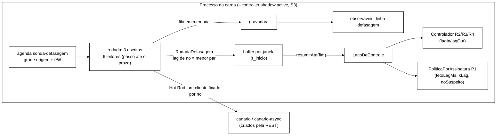
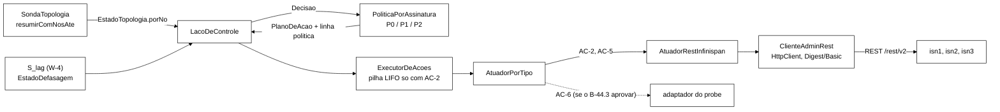
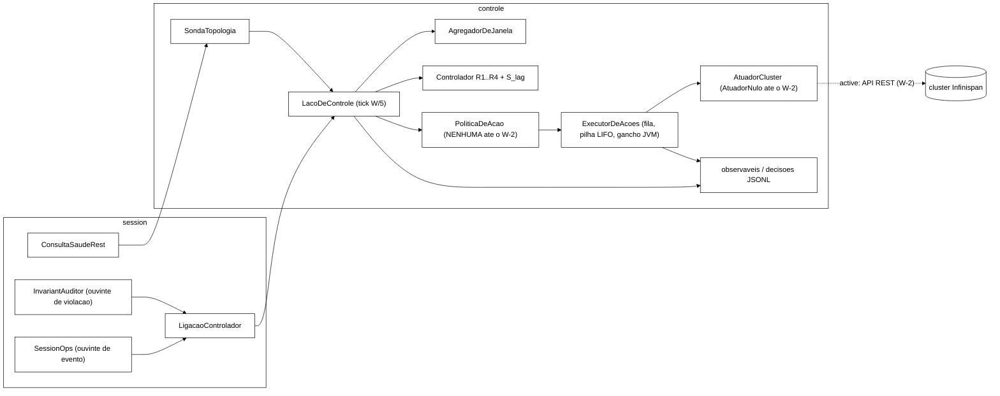
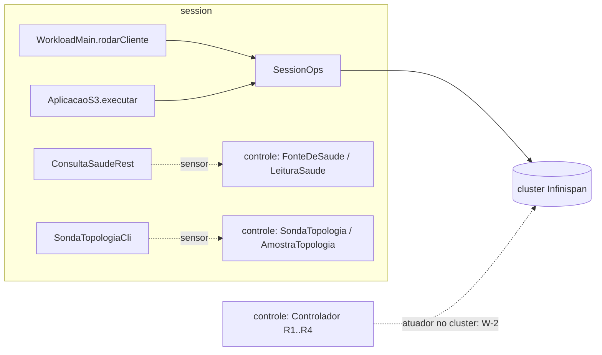

# Implementação — visão técnica

> Documento técnico que descreve a estrutura do código do protótipo e o estado de implementação de cada componente. Mantido pelo agente de desenvolvimento e atualizado a cada bloco do *backlog* fechado.

## Estrutura de pacotes

```
workload/
└── src/main/java/br/unipampa/tcc/session/
    ├── WorkloadMain.java          # ponto de entrada
    ├── Scenario.java              # mistura de operações (S1 50/50, S2 95/5)
    ├── KeyGenerator.java          # gerador Zipfian de chaves de sessão
    ├── WarmupPolicy.java          # política de warm-up e descarte (T11)
    ├── Cli.java                   # configuração de linha de comando (Picocli)
    ├── SessionOps.java            # operações O1-O7 via Hot Rod
    ├── SessionState.java          # modelo do estado de sessão
    ├── IdentityState.java         # modelo do estado de identidade
    ├── OpResult.java              # tipo único de retorno das O1-O7 + map return_code
    ├── LatencyRegistry.java       # registro de latência por operação (resumo stdout)
    ├── EpochClock.java            # âncora epoch-ns por repetição (T2 eventos)
    ├── EventCsvWriter.java        # trilha de eventos crus em CSV (T3/T4 eventos)
    └── InvariantAuditor.java      # detector de violações I1-I6
```

## Trilha de eventos crus (CSV consumido por analysis/)

Além do resumo de latência por histograma (`LatencyRegistry`, impresso em
*stdout*), o *workload* grava uma **trilha de eventos crus** por repetição,
um evento por operação O1–O5, no formato exato esperado pelo pipeline:

```
op_id,operation,start_ns,end_ns,replica,return_code,key
```

- **`OpResult.returnCode()`** mapeia o `Code` interno para o código
  canônico: `OK_LOGIN→OK`, `OK_VALIDATE→VALID`, `OK_STATUS→COUNTED`,
  `OK_NOOP→NONE`, `NOT_FOUND→NONE`, `BLOCKED→BLOCKED`,
  `ERROR_TRANSPORT→ERROR_TRANSPORT`. Apenas `ERROR_TRANSPORT` fica fora do
  conjunto de sucessos de `analysis/percentis.py`, então `taxa_erro`
  reflete somente falhas de transporte.
- **`EpochClock`** captura, no início de cada repetição, o par
  (`epochBaseNanos = Instant.now()`, `monoBaseNanos = System.nanoTime()`)
  e converte cada instante monotônico das operações em epoch-ns,
  preservando durações.
- **`EventCsvWriter`** mantém um `op_id` global (`AtomicLong`), suprime
  eventos de warm-up/descarte (mesma `WarmupPolicy` do registry) e grava
  `<csv-dir>/rep-NNN.csv`.
- **`SessionOps`** emite, em O1–O5, o evento cru com nome canônico
  (`Login`, `Validate`, `Logout`, `IncrementFailure`, `ResetFailures`),
  `replica` = servidor de conexão (primeiro servidor Hot Rod; *fallback*
  aceito ao *owner* real) e `return_code`.

O *marshaller* do cliente Hot Rod é `JavaSerializationMarshaller` (os
valores `SessionState`/`IdentityState` são POJOs `Serializable`); sem isso
o ProtoStream padrão falha ao serializar e toda escrita vira
`ERROR_TRANSPORT`.

## Mapeamento operações ↔ Cap. 3 §3.3.1

| Operação (Cap. 3) | Método (Java) | Cache-alvo | Estado |
|---|---|---|---|
| O1 `Login` | `SessionOps.login(id, cred)` | `sessions` / `sessions-async` | esqueleto |
| O2 `Validate` | `SessionOps.validate(sid)` | leitura no mesmo *cache* | esqueleto |
| O3 `Logout` | `SessionOps.logout(sid)` | `sessions` / `sessions-async` | esqueleto |
| O4 `IncrementFailure` | `SessionOps.incrementFailure(id)` | `counters` | esqueleto |
| O5 `ResetFailures` | `SessionOps.resetFailures(id)` | `counters` | esqueleto |
| O6 `Block` | `SessionOps.block(id, motivo)` | `counters` + invalidação em `sessions*` | a implementar em B-05 |
| O7 `Unblock` | `SessionOps.unblock(id)` | `counters` | a implementar em B-05 |

## Mapeamento componente ↔ linha Tx da Tabela 1

| Componente | Tx coberta(s) | Estado |
|---|---|---|
| `cluster/podman-compose.yml` + `cluster/infinispan-cluster.xml` | T1, T2, T3, T4, T15, T16, T19, T20 | implementado (B-02, B-03) |
| `spec/SessionStore.tla` + `MC-*.cfg` + `run-tlc.sh` | T21 | implementado (B-14) |
| `workload/.../WorkloadMain.java` | T7, T9, T11, T14 | integração de `Scenario` + `KeyGenerator` (B-08); CLI completa em B-10 |
| `workload/.../SessionOps.java` | T5, T7 | implementado com Hot Rod e `OpResult` (B-05) |
| `workload/.../LatencyRegistry.java` | T13 | HdrHistogram + dump CSV (B-06) |
| `workload/.../InvariantAuditor.java` | M2 (Cap. 3 §3.3.4) | checagens I1-I4 imediato + auditoria I5/I6 periódica (B-07) |
| `workload/.../KeyGenerator.java` | T5, T6, T8 | Zipfian Rejection-Inversion, universo 100k, ρ=0,99 (B-08) |
| `workload/.../Scenario.java` | T7 | enum S1 50/50 e S2 95/5 (B-08) |
| `workload/.../WarmupPolicy.java` | T11 | warm-up max(60s, 10%) + descarte 5% restante (B-09) |
| `workload/.../Cli.java` | T7, T9, T10, T11, T14 | CLI Picocli com --scenario, --duration, --ops, --rep, --threads, --seed, --warmup-min-sec, --csv-dir, --dry-run (B-10) |
| `workload/.../EpochClock.java` | T2 (eventos) | âncora epoch-ns por repetição |
| `workload/.../EventCsvWriter.java` | T3/T4 (eventos) | CSV `op_id,operation,start_ns,end_ns,replica,return_code,key` |
| `scripts/inject-crash.sh` | T16, T17 | F1 como *crash* silencioso (2026-10-28, opção B de `docs/prompt-f1-kill-2026-10-27.md`): guarda de *netns*, `sudo nsenter -t <pid> -n ip link set dev eth0 down`, logo em seguida `podman kill <nó> --signal KILL` (ExitCode 137), 60 s com `sleep & wait`, `podman start`; *trap* por fase (isolado: `kill` + `start`; morto: `start`); carimbo por linha com ms. `--modo kill` (só SIGKILL) e `--modo stop` (o `podman stop`/`start` de junho, B-11) ficam para reprodução; o padrão é `silencioso`. Exit 1 isolamento não confirmado ou ExitCode != 137; 4 alvo/PID/iface/guarda; 5 kill que não termina ou `start` com erro |
| `scripts/inject-crash.test.sh` | T16, T17 | casos C1..C15 sem VM (*shims* de `podman`, `sudo`, `readlink`, `nsenter`, `ip`, `sleep`) |
| `scripts/run-baseline.sh` | bateria F1/F3 | S1/S2 × {none, F1, F3}, popula `runs/` e aciona `analysis/` |
| `scripts/inject-jitter.sh` | T18 | F3: netem aplicado **host-side via nsenter** no netns do container — `sudo nsenter -t <pid> -n tc qdisc ... netem delay 20ms 13ms distribution normal` (p99 ≈ +50 ms); `<pid>` resolvido por `podman inspect`; trap de cleanup garante remoção; exit 5 = netem rejeitado (B-12, mecanismo migrado de `podman exec` em F3) |
| `scripts/inject-jitter.test.sh` | T-jit-1..4,7 | suite shell sem-VM (31 asserts) de `inject-jitter.sh` (dry-run valida o plano `nsenter`) + dry-run F3 do `run-baseline.sh` (B-12) |
| `scripts/collect-metrics.sh` | T19 | a implementar em B-13 |
| `analysis/percentis.py` | T13 | a implementar em B-16 |
| `analysis/bootstrap_ic.py` | T22 | a implementar em B-17 |
| `analysis/compare_scenarios.py` | T22 | a implementar em B-18 |

## Decisões técnicas a registrar

### TD-012 — W-4 (B-26.3): sonda de defasagem S_lag e *caches* `canario*` (2026-11-05)

Especificação: plano de execução de 04/11, seção 9 (W-4); plano de alinhamento, seção 4.2; documento de 05/11
(`cc08644`), seções 3.1 e 6; decisões do coordenador de 05/11 (base `9695511`, prazo de leitura = `--hotrod-timeout-ms`,
rótulo canônico). Branch `feature/w4-sonda-defasagem` sobre `9695511`. **Escrito sem execução** (H0 da noite 1):
Surefire, `cria-caches.test.sh` e o *smoke* local esperam a liberação.



- **Rodada.** Para cada nó X, `lag:<rótulo de X>` = `<nonce>:<rodada>` pelo cliente de X; cada outro nó Y lê pelo
  cliente dele, depois de a escrita voltar (no máximo um passo), e lê de novo a cada `passoLeituraMs` até ver o valor
  ou até o prazo `--hotrod-timeout-ms`. Lag do par = início da rodada → fim da leitura que viu (método de
  `wada_consistency_cloud_2011` §2); não visto = o prazo, que é o `politica.tetoLagMs` (R7). Sem falha: 3 escritas e
  6 leituras.
- **Lag de nó = menor lag dos seus pares** (escritor ou leitor). Só um nó que não troca com ninguém (cortado,
  pausado) chega ao teto; um enlace lento, um corte parcial ou uma chave com dono primário do outro lado não bastam.
  `lagMaxMs` = maior lag de nó; `noSuspeito` = o nó que o atinge, se único (empate → `null`, e o P1 não dispara).
- **Janela.** Período = W, alinhado à grade das janelas; a rodada começa no início da janela e termina até o prazo
  (< W). Atraso maior que W − prazo, ou tarefa anterior presa: a rodada é pulada e a janela fica `INDETERMINADA`.
  Rodadas antes da origem aquecem os clientes e não entram.
- **P-5.** Só Hot Rod em memória no caminho da medida; o JSONL vai por uma *thread* gravadora com fila em memória.
- **Clientes próprios** (`CanalCanarioHotRod`), com `S3Clientes.configuracaoPinned`: o laço abre antes da carga, o
  modo `topology` do S3 não tem cliente por nó e a sonda não disputa a fila dos servidores de aplicação.
- **Caches** `canario` (SYNC) e `canario-async` (ASYNC) em `cluster/caches/*.json`, sem o envoltório do nome, com
  `remote-timeout` 17500 explícito no SYNC, iguais aos irmãos do XML (`CachesCanarioJsonTest`); criados por
  `scripts/cria-caches.sh` (POST e leitura de volta `?action=config` nos nós). Não estão no XML.

| Peça | Onde |
|---|---|
| `SondaDefasagem` (agenda, rodada, buffer, `resumir`), `RodadaDefasagem` (pares, lag de nó), `ParametrosDefasagem` (bloco `defasagem`), `CanalCanario` (porta) | `controle/` |
| `CanalCanarioHotRod` (adaptador, rótulos, correspondência `--servers` × `--controller-admin`), `PerfilReplicacao.cacheCanario()` | `session/` |
| `LigacaoControlador`: `conferirSondaDefasagem` (só S3, prazo em W, correspondência), `pecas(..., canal)`, `abrir` (sonda no laço), `close` (contadores `defasagem_*`) | `session/LigacaoControlador.java` |
| `FormatoJsonl`: observaveis 1.2 (`parametros_defasagem`, linha `defasagem`) | `controle/FormatoJsonl.java` |

### TD-011 — W-2a (B-44.2): atuador REST do *cluster* e política por assinatura (2026-11-05)

Especificação: `docs/acoes-controlador-cluster-2026-11-05.md` (`cc08644`), seções 3, 5, 5.1 e 8, com os ajustes de
`docs/opcoes-arquitetura-configuracao-2026-11-05.md` (`155aa95`) e as decisões do autor de 05/11 (P0 normal, P1
isolar o nó suspeito pelo AC-5, P2 adiar o rebalanceamento pelo AC-2 global com teto de 60 s; AC-6 e E-1 fora).
Branch `feature/b44-2-atuador-cluster` sobre `e869a31`. Testes unitários verdes (961/0/0/1 na primeira rodada, 971/0/0/1
depois da ligação, `docs/testes.md`) e tarefa zero feita no
*cluster* local `w2a` (portas 12501-12503) em 05/11, `runs/b44-2/verificacao/`: a REST aceita **só Digest** (Basic
dá 403); `POST /rest/v2/server/?action=stop` e a forma sem a barra dão 204 com a autorização padrão (LIFECYCLE
passou) e o nó para ~3,06 s depois; `rebalancing_enabled` de `GET /rest/v2/caches/{c}` acompanha a forma global nos
três nós, inclusive nos não coordenadores. O `AtuadorRestInfinispan` real aplicou e reverteu o AC-2 (SYNC e ASYNC,
18 a 182 ms) e parou o isn3 pelo AC-5 em 3,19 s (prazo 5 s). A integração I-1..I-5 não rodou (P-38).



| Peça | O que faz | Onde |
|---|---|---|
| `AcaoCluster.Tipo` | cada tipo diz se é reversível, a regra do alvo e o prazo (`T_cham` + acréscimo). Só `AC_2` (global, P-34) e `AC_5` (não reversível, um nó, `T_cham` + 3 s, `Server.java:208`); `AC_1`/`AC_3` retirados (P-36) | `controle/AcaoCluster.java` |
| `ExecutorDeAcoes` | ação não reversível fora da pilha e de `ativas()`, pedida uma vez por execução, nunca desfeita (R4, encerramento, gancho, falha); prazo por tipo; `T_enc` = prazos da pilha + prazo em curso + `T_cham` (com só AC-2, o `(A + 1) x T_cham` de antes; pior caso 9 s, contrato 1.2) | `controle/ExecutorDeAcoes.java` |
| `EstadoTopologia.porNo` | por nó, resposta em `TODAS`/`ALGUMA`/`NENHUMA` as amostras e o menor e o maior `number_of_nodes`; `vistaCompleta()`, `noSemResposta()`, `vistasDivergentes()` (faixas disjuntas). Construtor antigo delega; `SondaTopologia.resumirAte` continua sem `porNo` | `controle/EstadoTopologia.java`, `SondaTopologia.java`, `FonteDeTopologia.java` |
| `PoliticaPorAssinatura` | tabela da seção 5, pura (tempo = `fimNs` da decisão). Parâmetros `k`, `tetoLagMs`, `tRebNs`, `cotaAc5` sem padrão (`ParametrosPolitica`). Grava `P0`/`P1`/`P2` e o motivo numa linha `politica` | `controle/PoliticaPorAssinatura.java`, `ParametrosPolitica.java`, `PlanoDeAcao.java` |
| `AtuadorPorTipo` | encaminha cada tipo ao seu atuador; a AC-6 entra como mais uma entrada | `controle/AtuadorPorTipo.java` |
| `ClienteAdminRest` | `java.net.http.HttpClient` HTTP/1.1; responde ao desafio Digest (RFC 7616, MD5/SHA-256, `qop=auth`, *nonce* reaproveitado por `host:porta`) ou Basic; prazo inteiro por pedido | `session/ClienteAdminRest.java` |
| `AtuadorRestInfinispan` | AC-2: `POST /rest/v2/container?action=disable-rebalancing` (reverter: `enable`) num nó que respondeu na última janela; leitura de volta de `rebalancing_enabled` (container e os caches do modo) nos 3 nós em paralelo; `APLICADA` com ≥ 2 nós e nenhum valor divergente. AC-5: `POST /rest/v2/server/?action=stop` ao próprio alvo, só se ele respondeu; `APLICADA` com 204, saúde do alvo parada e a dos outros dois respondendo | `session/AtuadorRestInfinispan.java` |

Escolhas que a tabela da seção 5 não fixa, a validar: (1) o AC-2 não é aplicado ao nó que a própria política parou
pelo AC-5 (ele não volta na execução; o AC-2 só estenderia a cópia única até o teto); (2) depois do teto `T_reb`, o
AC-2 não volta para o mesmo nó até ele responder de novo; (3) a persistência de `k` janelas zera quando a política
não foi consultada numa janela (R4); (4) "os outros respondendo" do P2 exige resposta em todas as amostras da janela;
(5) vistas divergentes = faixas de `number_of_nodes` disjuntas entre nós que responderam (a troca 3→2 vista em
instantes diferentes não conta); (6) o AC-5 conta como "parou" quando a saúde do alvo não responde (conexão recusada
ou prazo de 1 s).

**Ligação (P-38, aprovada em 05/11).** O `controlador-*.json` ganha o bloco opcional `"politica"` (`k`,
`tetoLagMs`, `tRebNs`, `cotaAc5` e a `origem` de cada um; contrato JSONL 1.2). Sem o bloco, `LigacaoControlador.pecas`
monta o atuador nulo e a política `nenhuma`, como no W-3. Com o bloco, monta `PoliticaPorAssinatura` (caches do
modo) e `AtuadorPorTipo.bracoB(AtuadorRestInfinispan)`; os "nós que responderam na última janela" saem de
`SondaTopologia.respondidosNaUltimaAmostra`, pendurado em `abrir`. Depois da V-W2a (05/11): `politica.k` virou
`kLag` (independente do `k` do núcleo, V-4); a linha `politica` traz o `no` da escolha (V-7); em S3, o carregamento
recusa `tetoLagMs` diferente de `--hotrod-timeout-ms` (R7); o `--dry-run` mostra o pior caso do `T_enc` (R1). O
rótulo de nó é `host:porta` em toda peça
(`RotulosDosNosTest`); o `noSuspeito` do W-4 tem de seguir o mesmo rótulo. O S_lag ainda é indeterminado
(`FonteDeDefasagem.INDETERMINADA`), então hoje só o P2 (AC-2) dispara ponta a ponta; o P1 (AC-5) espera o W-4.
**W-4 (TD-012):** com o bloco `defasagem`, a `SondaDefasagem` alimenta o laço e o P1 dispara ponta a ponta
(`LigacaoControladorDefasagemTest.pontaAPontaNoCortado`, ainda não executado).

### TD-010 — W-3 (B-28.2): laço de controle do *cluster* no processo da carga (2026-11-04)

Plano de execução de 2026-11-04, seções 4.1, 4.4.3, 4.5 e 9 (W-3). Com `--controller shadow|active`, uma *thread*
`controlador-laco` no processo da carga fecha as janelas do `AgregadorDeJanela` num *tick* de W/5 (decisão de
22/10), lê S_top (`SondaTopologia`, REST em `--controller-admin`) e S_lag (indeterminada até o W-4), chama
`Controlador.avaliar(janela, topologia, defasagem)` e grava `observaveis-rep-NNN.jsonl` e `decisoes-rep-NNN.jsonl`
(`docs/contrato-jsonl-controlador-v1.md`). As ações vão ao `ExecutorDeAcoes` sobre a interface `AtuadorCluster`.

- **Núcleo:** sinal novo de defasagem (`EstadoDefasagem`, `Motivo.DEFASAGEM` entre `TOPOLOGIA` e `ERRO`), que
  entra como a latência entra (R2 com k janelas altas, R3 zera as calmas, R4 exige defasagem calma ou
  indeterminada). A assinatura antiga delega com defasagem indeterminada.
- **Atuador:** `AtuadorCluster` só tem `nome()`, `aplicar(acao, prazoNs)` e `reverter(acao, prazoNs)`. Até o W-2,
  `AtuadorNulo` (resultado `NAO_EXECUTADA`) e `PoliticaDeAcao.NENHUMA`. O W-2 pluga `session.AtuadorRestInfinispan`
  e a política da tabela 4.5 em `LigacaoControlador.pecasPadrao`.
- **Reversão:** camada 1, pilha LIFO idempotente no executor (R4 desfaz tudo; aplicação que falha é revertida
  na hora; reversão que falha fica na pilha, e a repedida sai `JA_ATIVA`); camada 2, gancho de desligamento da
  JVM, registrado só em `active`; encerramento normal no fim da carga, antes da convergência, com prazo
  `T_enc = (A + 1) × T_cham` (V-W3 R2; `T_cham` = 2 s limita a chamada inteira do atuador). Camada 3 é do W-6,
  que precisa dar ao processo, entre SIGTERM e SIGKILL, mais que `T_enc`.
- **Fim da carga (V-W3 R1):** `WorkloadMain.executarCargaComControle` lê `t_fim_carga_ns` antes de encerrar o
  controlador e grava `t_fim_controle_ns` à parte, para que os dois braços meçam a convergência do mesmo instante.
- **Tick (contrato v1.1):** `Δ = min(W/5, P_sonda/2)`; a linha `decisao` traz `t_decisao_ns`.
- **Shadow:** o executor não cria *thread* nem gancho e nunca chama o atuador; as linhas `acao` saem
  `executada: false`, `resultado: PREVISTA`, com a mesma pilha virtual.
- **Origem das janelas:** início da medição. Eventos e violações do *warm-up* são descartados e contados
  (`eventos_antes_da_origem`, `violacoes_antes_da_origem`), para que uma violação do *warm-up* não vire R1 na janela 0.
- **Violações:** o `InvariantAuditor` avisa o laço com o rótulo do CSV; a classificação (`ClasseViolacao.de`, com o
  `RastroCliente` para I2) é feita na *thread* do laço, no *tick* seguinte, com o instante em que a violação foi vista.
- **`--controller off`:** `WorkloadMain.ligarControlador` devolve `null` sem ler arquivo; `SessionOps` e
  `InvariantAuditor` ficam sem ouvinte (fluxo idêntico; *golden* S1/S2 e `S3SimulacaoTest` inalterados).
- **`session`:** só `LigacaoControlador` usa os tipos do laço; R-C1 agora é por pares (classe, tipo).



### TD-009 — B-27.3: sem portão de emissão no cliente (2026-11-04)

Decisão do autor de 04/11: o controlador do TCC age **no *cluster***, não no cliente. O portão de emissão do B-27 (K1 admissão, K2 ritmo, K3 adiamento de administrativas, K4 espera entre retentativas) e seus tipos (`controle/PortaoDeEmissao`, `ParametrosKnobs`, `EventoK3`, `Dormidor`, `PerfilAtual`) foram apagados. `AplicacaoS3`, `ContextoS3`, `UsuarioVirtual` e `WorkloadMain.rodarCliente` voltaram ao comportamento de antes do B-27, que era também o do caminho com `PortaoDeEmissao.livre()` (sequência de chamadas por semente fixada em `src/test/resources/golden-20805b0/`). A coluna `espera_portao_ns` do contrato S3 v2 ficou reservada e vale sempre 0 (`docs/contrato-s3-acoes-v2.md`). O pacote `session` só usa, de `controle`, os tipos dos sensores do B-26 (`ArquiteturaSemAcaoNoClienteTest`). O núcleo `Controlador` (R1..R4, histerese) não mudou. Relatório: `docs/relatorio-w1-2026-11-04.md`.



### TD-008 — F2 (partição de rede) por `clsact` + `u32` + `drop` bidirecional, só no nó isolado

A falha F2 precisa cortar a comunicação entre subconjuntos de nós **sem** derrubar o nó isolado para o cliente (o observável principal é a minoria responder "indisponível" sob `DENY_READ_WRITES`). `netem loss 100%` na raiz foi descartado: age só na saída, descarta também as respostas Hot Rod, produz partição assimétrica e disputa a fila raiz com o `netem` de F3 (o `trap` de `inject-jitter.sh` faz `qdisc del root`). `podman network disconnect` também foi descartado (remove o nó para o cliente e muda IP/interface). Adotou-se `scripts/inject-partition.sh`: dentro do netns do nó isolado (`sudo nsenter -t <pid> -n tc`), `qdisc add dev eth0 clsact` e, para cada IP de par do lado oposto, um filtro `u32` de `ingress` (`match ip src <par>/32`) e um de `egress` (`match ip dst <par>/32`), ambos `action drop`. Os IPs vêm de `podman inspect`; o limite `2·|minoria| < |nós|` garante que o lado isolado é a minoria.

Robustez: `trap` registrado antes de qualquer alteração (sinais viram `exit` 130/143/129 para disparar a limpeza; a espera usa `sleep &` + `wait`, pois um `sleep` em primeiro plano adiaria o `trap`); pré-limpeza idempotente; `flock` por nó; sonda (`clsact` + filtros em `192.0.2.1`, TEST-NET-1) com exit 5; verificação de efetividade (conexão TCP a `par:7800` deve falhar e contadores de descarte > 0 ao fim da janela, senão exit 6); verificação final de resíduo; `--heal` para `SIGKILL`. O marcador `start` é gravado imediatamente após aplicar os filtros (antes da verificação) para não atrasar `fault_start_ns`. Testes sem VM com *shims* em `scripts/inject-partition.test.sh`.

### TD-007 — F3 (netem) aplicado host-side via `nsenter`, não `podman exec`

A injeção da falha F3 (jitter/atraso) precisa configurar uma disciplina `netem` do `tc` (iproute2) sobre o `eth0` do nó alvo. A implementação inicial (B-12) usava `podman exec <node> tc qdisc ...`, executando o `tc` **dentro** do container. Ao validar o baseline F3 na VM Ubuntu descobriu-se que esse caminho não funciona com a imagem oficial Infinispan (UBI minimal): a imagem não traz `tc` no `PATH` e o container não recebe a capability `NET_ADMIN`, então o `add` é rejeitado.

A correção aplica o `netem` **a partir do host da VM**, entrando no *namespace de rede* do container via `nsenter`. O fluxo é: (1) resolver o PID do container com `podman inspect -f '{{.State.Pid}}' <node>`; (2) `sudo nsenter -t <pid> -n tc qdisc add dev eth0 root netem delay 20ms 13ms distribution normal`; (3) ao fim da janela (ou em qualquer sinal/erro, via `trap`), `sudo nsenter -t <pid> -n tc qdisc del dev eth0 root`. O efeito sobre o tráfego do nó é idêntico — o `eth0` afetado é o do container —, mas as ferramentas (`tc`, módulo `sch_netem`) e o privilégio ficam no host, que é onde existem. Vantagem colateral: o container permanece sem `tc` nem `NET_ADMIN`, mantendo a imagem oficial intocada. Validado manualmente na VM (`qdisc netem ... delay 20ms 13ms` aplicado e removido limpo, exit 0).

Consequências operacionais: a execução real do F3 passa a exigir, **no host**, `podman`, `nsenter` (util-linux), `tc` (iproute2), `sudo` e o módulo `sch_netem` (o container não exige nada disso). Como cada célula da bateria invoca `inject-jitter.sh` e o cache de credencial do `sudo` expira (~15 min), recomenda-se configurar `sudo` sem senha para o usuário da bateria na VM. O `--dry-run` continua sem dependências (imprime o plano com os comandos `nsenter` e sai 0). Os exit codes preservam a semântica: `3` = dependência ausente (`podman`/`nsenter`/`sudo`), `4` = container não encontrado/não-running ou PID não resolvido, `5` = `netem` rejeitado pelo kernel (`sch_netem` ausente).

### TD-006 — Escolha de Picocli como framework de CLI

A camada de linha de comando do `WorkloadMain` foi migrada de parsing posicional para Picocli (`info.picocli:picocli:4.7.6`). A escolha contrasta com parsing manual e com a biblioteca `args4j`. Picocli é o padrão de fato em CLIs Java contemporâneas: suporta opções longas e curtas, gera mensagem de ajuda automaticamente conforme as anotações, valida tipos primitivos e enums sem código adicional, e tem ~250 KiB com zero dependências transitivas. O custo é uma dependência adicional, justificada pela manutenção que economiza em validação e documentação. A classe `Cli` é puramente um *value object* anotado, sem regra de negócio; a execução fica em `WorkloadMain.executar()`, o que permite testes diretos via `CommandLine.parseArgs()`.

### TD-005 — Implementação do descarte de 5% como tempo proporcional

T11 da Tabela 1 prescreve descarte das "primeiras 5\,\% das amostras" após o warm-up. Como o {@link LatencyRegistry} usa HdrHistogram, que não preserva ordem temporal das amostras, a implementação adotada em {@link WarmupPolicy} traduz a fração de amostras em fração de tempo: descarta 5\,\% do tempo nominal de medição posterior ao warm-up. A aproximação é exata se a taxa de operações for estacionária, hipótese válida porque o objetivo do descarte é justamente eliminar a região onde a taxa ainda não estabilizou. O contador {@code descartados} no {@link LatencyRegistry} permite auditar quantas amostras caíram nessa janela após a execução.

### TD-004 — Algoritmo de amostragem Zipfian

O `KeyGenerator` implementa o algoritmo **Rejection-Inversion** de Hörmann e Derflinger (1996), autocontido. A escolha contrasta com duas alternativas consideradas: (a) reusar a classe `ZipfianGenerator` do YCSB, que adiciona dependência pesada para uma única função; (b) usar `org.apache.commons:commons-math3:ZipfDistribution`, que adiciona dependência por uma feature isolada. A implementação atual tem cerca de 100 linhas de código, é determinística dada uma seed e tem custo O(1) por amostra. Validada por três critérios em `KeyGeneratorTest`: distribuição empírica nos primeiros 100 bins com erro relativo abaixo de 5\%, reprodutibilidade entre instâncias com mesma seed, e cobertura superior a 30\% do universo de 100 000 chaves em 1 000 000 amostras.

### TD-001 — `numSegments` = 64

A configuração herdada do esqueleto usa `segments="64"`, enquanto a Tabela 1 T4 cita 256 como padrão do Infinispan. A escolha de 64 está alinhada à recomendação do guia de tuning (REF-045) para *clusters* de até 20 nós, em que um número menor de segmentos reduz o custo de roteamento e o tempo de *state transfer*. **Pendência:** decisão do autor entre manter 64 ou ajustar para 256 (alinhamento estrito à Tabela 1).

### TD-002 — Credenciais `admin:infinispan` no XML

A configuração atual mantém credenciais fixas no XML e nas variáveis de ambiente do `podman-compose.yml`. **Pendência:** parametrizar via variável de ambiente em B-05, com valores fora de versionamento.

### TD-003 — Modo Hot Rod single-server vs. multi-server

`WorkloadMain` atualmente alimenta o `ConfigurationBuilder` com a lista completa de nós (`isn1:11222, isn2:11223, isn3:11224`). Isso permite ao cliente descobrir a topologia dinamicamente, mas pressupõe que pelo menos um nó está acessível. Documentado como hipótese implícita.

## Como contribuir com este código

O protocolo está descrito em [`CONTRIBUTING.md`](../CONTRIBUTING.md). Cada incremento corresponde a um item do *backlog* em `docs/planejamento-inicial.md`, com critérios de aceite explícitos. Os passos típicos:

1. Criar *branch* `feature/<nome>` a partir de `main` (ou da *branch* anterior, quando há dependência).
2. Implementar conforme critérios de aceite e tabela de cobertura T1-T22 acima.
3. Adicionar testes unitários em `workload/src/test/java/.../`.
4. Atualizar este documento com o componente que mudou de estado.
5. Reportar a entrega no formato definido (objetivo, *branch*, arquivos alterados, testes, problemas, próximo passo).
6. Aguardar validação do autor antes do *merge*.
