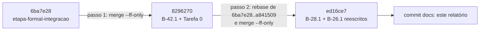

# Integração local do controlador (2026-10-22)

Branch `feature/controlador-integracao`, worktree `wt-ctrl-integ`, criada a partir de `6ba7e28`
(`feature/etapa-formal-integracao`). Montagem só local, sem push, na ordem da seção 7 de
`docs/validacao-b26-1-ressalvas-2026-10-22.md` (branch `docs/plano-implementacao-controlador`).
B-43.1 e B-43.3a ficaram de fora, porque entram depois de validados.

Ambiente: Maven 3.9.16, JDK 22.0.2, Windows 11. Comando de teste: `mvn -f workload/pom.xml clean test`,
com a soma de `tests/failures/errors/skipped` de todos os `workload/target/surefire-reports/TEST-*.xml`.
O cluster e a VM não foram usados.

## Passo 1. B-42.1 por `merge --ff-only 8296270`

Fast-forward `6ba7e28..8296270` (10 commits, 32 arquivos). Os SHAs de B-42.1 foram mantidos, e por isso
B-43.1 e B-43.3, que partem de `8296270`, podem entrar depois sem reescrever a base.

Surefire: **305/0/0/0** (tests/failures/errors/skipped), em 39 classes. Bate com o adendo B-42.1.

## Passo 2. Cadeia B-28.1 + B-26.1 (`6ba7e28..a841509`)

Procedimento:

1. branch temporária `tmp/ctrl-integ-rebase` criada em `a841509`, dentro da worktree de integração;
2. `git rebase --onto feature/controlador-integracao 6ba7e28 -x "mvn -q -f workload/pom.xml test-compile ..."`,
   que registrou o SHA novo e o código de saída de cada commit reescrito;
3. `git merge --ff-only tmp/ctrl-integ-rebase` em `feature/controlador-integracao` e remoção da branch temporária.

O histórico ficou linear. `git rev-list --merges 6ba7e28..HEAD` devolve 0 commits.

### Tabela SHA antigo → novo, com `test-compile` por commit

O `patch-id --stable` e o assunto de cada commit novo coincidem com os do commit antigo nos 20 pares.

| # | SHA antigo | SHA novo | Commit | `test-compile` |
|---|---|---|---|---|
| 1 | `748fc91` | `10971d9` | feat: tipos de valor do nucleo do controlador (B-28.1) | ok (rc=0) |
| 2 | `f4949fc` | `8c70c98` | feat: ParametrosControlador com padrao() e deJson (B-28.1) | ok (rc=0) |
| 3 | `22aec9a` | `0883e17` | feat: Controlador e Decisao, nucleo de decisao puro (B-28.1) | ok (rc=0) |
| 4 | `9fba6c5` | `c502375` | test: teste de arquitetura do pacote controle (B-28.1) | ok (rc=0) |
| 5 | `6f8341c` | `083a3fc` | test: lacunas S1 e S12 da validacao V-B28.1 no ControladorRegrasTest (B-28.1) | ok (rc=0) |
| 6 | `dfcdb67` | `5b4780d` | docs: relatorio B-28.1 (nucleo de decisao do controlador) | ok (rc=0) |
| 7 | `cf72d5e` | `b4d836d` | feat: Referencia, p99 de referencia por operacao (B-26.1) | ok (rc=0) |
| 8 | `e5409d5` | `a00ff8e` | feat: EventoOperacao e ClasseViolacao, classificacao pura de return_code e violacoes (B-26.1) | ok (rc=0) |
| 9 | `bc8b748` | `dbe7f47` | feat: AgregadorDeJanela, janelas tumbling por end_ns com tolerancia L e atrasados (B-26.1) | ok (rc=0) |
| 10 | `188ebfd` | `e6b34ba` | test: concorrencia do AgregadorDeJanela, N threads com total conservado (B-26.1) | ok (rc=0) |
| 11 | `b780c6d` | `e46577d` | feat: LeitorCsvEventos e fixture real de 200 linhas de S1-F1 rep-001 (B-26.1) | ok (rc=0) |
| 12 | `2068827` | `b5d6f7b` | test: integracao AgregadorDeJanela com Controlador.avaliar num roteiro curto (B-26.1) | ok (rc=0) |
| 13 | `b90a5bc` | `3604115` | test: teste de arquitetura cobre os tipos do agregador (B-26.1) | ok (rc=0) |
| 14 | `c2139f8` | `e86b4d2` | docs: relatorio B-26.1 (agregador e observador de janela) | ok (rc=0) |
| 15 | `917b9ec` | `cfb0cc7` | test: T1 a T5 da validacao V-B26.1, matam os mutantes S4, S5, S12, S13 e S15 (B-26.1) | ok (rc=0) |
| 16 | `92b64aa` | `f81dbcc` | refactor: comentario OpResult.returnCode() e acumulador vazio sem instancia estatica (V-B26.1 L3, L4) | ok (rc=0) |
| 17 | `8da8e91` | `bd39abb` | feat: violacao de seguranca atrasada promovida a proxima janela emitida (B-26.1, V-B26.1 5.5) | ok (rc=0) |
| 18 | `320aa58` | `5ac404a` | feat: tick de relogio no agregador, avancarRelogio, seqRegistro e FonteDeTempo (B-26.1, CA-T1 a CA-T3) | ok (rc=0) |
| 19 | `6134d82` | `6982796` | fix: tolerancia padrao L de 10 ms para 100 ms (B-26.1, V-B26.1 secao 6) | ok (rc=0) |
| 20 | `a841509` | `ed16ce7` | docs: relatorio B-26.1, fechamento das ressalvas V-B26.1 | ok (rc=0) |

Conferências adicionais:

- `git diff 6ba7e28 a841509` é byte a byte igual a `git diff 8296270 ed16ce7` (31 arquivos, +4373). A cadeia entrou sem alteração.
- `git diff a841509 ed16ce7` é exatamente o conteúdo de B-42.1 (32 arquivos, +1627 −48).

### Surefire depois do passo 2

**492/0/0/0**, em 52 classes. É o esperado: 305 + 187.

- As 39 classes do passo 1 têm contagens idênticas antes e depois.
- 13 classes novas, todas em `br.unipampa.tcc.controle`, somando 187 testes:
  - B-28.1 (112): `ArquiteturaControleTest` 2, `ControladorComportamentoTest` 19, `ControladorPropriedadeTest` 1,
    `ControladorRegrasTest` 47, `ParametrosControladorTest` 34, `TiposBasicosTest` 9;
  - B-26.1 (75): `AgregadorControladorIntegracaoTest` 4, `AgregadorDeJanelaConcorrenciaTest` 3,
    `AgregadorDeJanelaRelogioTest` 10, `AgregadorDeJanelaTest` 25, `ClassificacaoTest` 23,
    `LeitorCsvEventosTest` 6, `ReferenciaTest` 4.
- `ArquiteturaControleTest` 2/0/0/0 e `GoldenS1S2Test` 3/0/0/0.
- Golden: `git diff 6ba7e28 HEAD` não altera `GoldenS1S2Test.java` nem `src/test/resources/golden-8e2e815/`. A única
  mudança em `src/test/resources` é o acréscimo de `controle/amostra-s1-f1-rep001-200.csv` (B-26.1).

## Conflitos

Nenhum. O fast-forward do passo 1 e o rebase de 20 commits do passo 2 aplicaram sem conflito e sem
intervenção manual, como previsto, porque os conjuntos de arquivos são disjuntos (`controle/` e relatórios
B-26/B-28 de um lado, `session/`, `cluster/`, `docs/configuracao-infinispan.md` e `runs/b42-1-smoke/` do outro).

## SHAs das branches de origem, antes e depois

| Branch | Antes | Depois |
|---|---|---|
| `feature/etapa-formal-integracao` | `6ba7e28` | `6ba7e28` |
| `feature/b42-1-perfil-async` | `8296270` | `8296270` |
| `feature/b28-1-nucleo-controlador` | `dfcdb67` | `dfcdb67` |
| `feature/b26-1-observador-janela` | `a841509` | `a841509` |
| `fix/b43-1-reset-estado-entre-execucoes` | `65d237b` | `65d237b` |
| `fix/b43-3-guarda-sanidade-mistura` | `6ce301a` | `6ce301a` |

`git for-each-ref` foi tirado antes e depois sobre todas as refs do repositório. A única diferença é a ref nova
`refs/heads/feature/controlador-integracao`. A branch temporária foi criada e removida dentro da montagem, e
nenhuma outra worktree foi tocada. Nada foi enviado a `origin`.

## Próximo passo

Validação deste relatório pelo Senior (contagens 305 → 492, SHAs reescritos, compilação por commit). Depois,
B-43.1 e B-43.3, um de cada vez e só após as validações, por rebase sobre o topo e `merge --ff-only`, com Surefire e
golden S1/S2 conferidos a cada passo.

## Passo 3: B-43.3a parte i (verificador offline de sanidade)

Feito pelo orquestrador depois da V-B43.3a-i e da revalidação das ressalvas (APROVADA, `wt-plano-ctrl/docs/validacao-b43-3a-i-ressalvas-2026-10-22.md`, `66636ab`), dentro da aprovação do Gestor de integrar cada B-43.x validado.

- Método: `git rebase --onto feature/controlador-integracao 8296270` de uma branch temporária em `a8f5549`, seguido de `merge --ff-only`. Histórico linear, sem commit de merge. A branch de origem `fix/b43-3-guarda-sanidade-mistura` continua em `a8f5549`.
- 8 commits reescritos, sem conflito: `b568f2c`→`70d2fd0`, `728c85c`→`e2adba7`, `6e67807`→`27fb29d`, `6ce301a`→`2b9a69e`, `9e8eadc`→`f0b01e3`, `2b1b208`→`6778413`, `196ab17`→`b8fc136`, `a8f5549`→`c9295d8`.
- Surefire depois do passo (`mvn -f workload/pom.xml clean test`): **540/0/0/1 em 59 arquivos**. O único skip é o teste S2 opt-in (`-Dsanidade.csvJunho`). O valor bate com o ensaio `merge-tree` da revalidação.
- Fica de fora: B-43.1 entra junto com B-43.2, depois da V-B43.2 (o commit 1 de B-43.2 fecha as lacunas R1/R2 da V-B43.1).

## Passo 4: B-43.1 + B-43.2 (reset de estado e mistura v2)

Feito pelo orquestrador depois da V-B43.1 (`503278d`) e da V-B43.2 (`a6fc0e4`), ambas APROVADAS COM RESSALVAS, por decisão explícita do Gestor (22/10) de integrar antes das correções B-43.6 (auditor) e B-43.4 (return_code).

- Método: `git rebase --onto feature/controlador-integracao 8296270` de uma branch temporária em `8ee2deb`, seguido de `merge --ff-only`. São 15 commits (6 de B-43.1 e 9 de B-43.2), sem conflito e sem commit de merge. As branches de origem continuam em `65d237b` e `8ee2deb`.
- Surefire: **608/0/0/1 em 72 arquivos**, igual a 540 + 68 (o B-43.2 sai de 305 e chega a 373). O golden é idêntico a `6ba7e28`.
- Ressalvas abertas, que entram nos próximos blocos: N1 e N9 da V-B43.2; A1, falso positivo de I1 no auditor (B-43.6); A2, deriva da fração INVALID (B-43.7, mistura v3).

## Passo 5: B-43.6 (auditor I1/I4 sem corrida)

Feito pelo orquestrador depois da V-B43.6 (APROVADA, `wt-plano-ctrl` `6226e84`).

- Método: `git rebase --onto feature/controlador-integracao 8ee2deb` de uma branch temporária em `8734c13`, seguido de `merge --ff-only`. São 6 commits, sem conflito e sem commit de merge. A branch de origem continua em `8734c13`.
- Surefire: **629/0/0/1 em 77 arquivos**, igual a 608 + 21 (o B-43.6 sai de 373 e chega a 394).
- Falta integrar: B-43.4, cujo trabalho está em andamento.

## Passo 6: B-43.4 (contrato CSV v2), correção do leitor do controlador e smoke integrado

Feito pelo Worker depois da V-B43.4 (`wt-plano-ctrl` `acb37fb`), com a aprovação do Gestor (22/10) para a reaplicação, para a correção da seção 5.2 (A1) e para o smoke da seção 5.3.

### 6.1 Reaplicação do B-43.4

- Método: `git rebase --onto feature/controlador-integracao 8ee2deb` de uma branch temporária em `f729c97`, seguido de `merge --ff-only` e da remoção da temporária. São 7 commits, sem conflito e sem commit de merge. A árvore final, `87d6fc8`, é igual à do rebase simulado da V-B43.4 §5.1. A branch de origem `fix/b43-4-return-code-validate` continua em `f729c97`.

| antigo | novo |
|---|---|
| `1e51d1c` | `b7a5e23` |
| `673a491` | `87d7bec` |
| `ecc8e9a` | `66aadfc` |
| `5384879` | `62db2db` |
| `2dca918` | `03596fa` |
| `af71bc1` | `2a20ed1` |
| `f729c97` | `67f82a9` |

- Surefire em `67f82a9`: **638/0/0/1 em 79 arquivos**, igual a 629 + 9. Python (`python -m unittest discover -s analysis`): **15 OK**.

### 6.2 Correção do leitor do controlador (`d8d3e01`, `fix:`)

`EventoOperacao.CODIGOS` não tinha `INVALID` nem `NOT_FOUND`, e o `LeitorCsvEventos` parava na linha 2 de qualquer CSV v2 (V-B43.4 §5.2). Os dois códigos entraram como não erro, pela mesma regra do `SUCESSOS` de `percentis.py`.

- Teste novo, `EventoOperacaoContratoV2Test` (arquivo novo), com 3 testes:
  - paridade: percorre todos os `OpResult.Code`, com `switch` exaustivo e todos os payloads que mudam o literal, e exige que `returnCode()` esteja em `CODIGOS` e que `CODIGOS` seja exatamente o conjunto desses literais;
  - leitura de um recorte real v2;
  - leitura de `NOT_FOUND` por linha sintética, porque nenhum CSV real tem esse código.
- Fixture `controle/amostra-b43-4-q1-rep001-200-v2.csv`: cabeçalho mais as 200 primeiras linhas de `runs/b43-4-smoke/Q1/rep-001.csv`, cujo sha256 `3680771b…cf20` confere com o MANIFEST do B-43.4. Contém COUNTED 7, INVALID 33, NONE 59, OK 36 e VALID 65.
- Edições de testes existentes, todas autorizadas pelo Gestor (22/10):
  - `ClassificacaoTest` `:22-28`, com 2 linhas a mais no `@CsvSource`;
  - `ClassificacaoTest` `:41`, com a lista nova;
  - `AgregadorDeJanelaTest` `:263`, onde `8` virou `EventoOperacao.CODIGOS.size() + 1`. Esta terceira edição foi autorizada depois de uma parada: o primeiro Surefire completo deu 643/1/0/1, porque esse teste fixava à mão o tamanho antigo de `CODIGOS`.
- Vermelho antes da implementação (testes direcionados): 28 testes, 2 failures e 4 errors, todos por `return_code fora do contrato` ou pela lista antiga.
- **Mutante**, retirar `INVALID` de `CODIGOS`: **morto** por 5 testes (`paridadeComOpResult`, `leAmostraRealV2`, `leNotFound`, `conjuntoDeCodigos` e `codigos[INVALID]`) e revertido.
- Surefire em `d8d3e01`: **643/0/0/1 em 80 arquivos**, igual a 638 + 5. Python: **15 OK**.

### 6.3 Javadoc de `AcaoS3` (`43dfd1e`, `docs:`)

O Javadoc dizia que o `return_code` de um Validate bem-sucedido é sempre `VALID`, o que só vale no contrato 1 (V-B43.4 D4). O texto foi atualizado. O código não mudou, e o Surefire ficou em 643/0/0/1 (só compilação conferida).

### 6.4 Smoke integrado (`881287e`)

O ambiente foi o seguinte:
- Podman 5.7.0 com a máquina WSL `podman-machine-default`. Ela estava **parada** antes do smoke, foi iniciada para ele e **parada** de novo no fim.
- Imagem `quay.io/infinispan/server:15.0.21.Final`.
- Projeto `podman-compose -p b436i`, com containers `b436i-isn1..3` e portas Hot Rod **12332..12334** (`external-port` igual).
- `cluster/*.xml` desta branch, iguais byte a byte aos do B-43.4.
- JDK 22.0.2 por `$JAVA_HOME/bin/java`.
- Jar de `git archive 43dfd1e workload`, com SHA-256 `f868a783…4114` registrado em `jars.json`.
- Sem VM.

Parâmetros: `--mix v2 --reset-state on --duration 60 --ops 0 --rep 1 --threads 4 --warmup-min-sec 10`.

| Exec. | Cenário | exit | `Contrato CSV` / meta | `Auditor:` | I1 / I4 (CSV de violações) | linhas CSV = `registrados` = `LeitorCsvEventos` | Validate VALID (CSV) / `valid=` | Validate INVALID (CSV) / `invalid=` | dif. | Verificador |
|---|---|---|---|---|---|---|---|---|---|---|
| Q1 | S1 sync | 0 | v2 / `{"contrato_csv":2}` | `i1_concorrentes=0 i4_concorrentes=0` | 0 / 0 (total 0) | 413 394 = 413 394 = 413 394 | 111 628 / 111 628 | 94 733 / 94 733 | **0** | OK, exit 0 |
| Q2 | S2 async | 0 | v2 / `{"contrato_csv":2}` | `i1_concorrentes=0 i4_concorrentes=0` | 0 / 0 (total 0) | 400 719 = 400 719 = 400 719 | 178 580 / 178 580 | 192 161 / 192 161 | **0** | OK, exit 0 |

- **Todos os critérios foram atendidos** nas duas execuções (`criterios_ok: true` em `analise.json`, gerado por `analise.py`).
- `Validate NOT_FOUND` = 0 e `Validate ERROR_*` = 0 nas duas.
- O `LeitorCsvEventos` (`LerCsvV2.java` com o jar da integração, saída em `leitor-csv-eventos.json`) leu os dois CSV inteiros sem exceção, com `erros` = 0. É a primeira leitura de um CSV v2 real pelo leitor do controlador.
- Saúde antes e depois: `HEALTHY`, 3 nós, nas 3 portas.
- Logs dos servidores com **0** linhas ` ERROR `.
- `podman ps -a` antes e depois: **idênticos byte a byte** (11 containers). A rede `b436i_infinispan-net` foi removida.
- O histograma `validate` do stdout deu igual ao CSV em Q1 (206 361) e 1 acima em Q2 (370 742 contra 370 741). É a fronteira de relógio já documentada em B-43.2/B-43.4. O contador `Desfechos` segue o CSV.
- Brutos em `runs/integ-passo6-smoke/`, com `MANIFEST.sha256` de 40 arquivos (`sha256sum -c` sem falhas). Os CSV, `stdout.log`, logs dos servidores e `.txt` ficam fora do git pelo `.gitignore` e são conferidos pelo manifesto.

O smoke não prova ausência de I1 real. Prova que a combinação B-43.4 + B-43.6 não reintroduz a corrida A1, inclusive em S2 async, onde estava a única I1 observada (Q2 do B-43.4), e que o controlador lê o CSV v2.

### 6.5 Estado

- A ponta antes deste documento é `881287e`.
- As branches de origem não foram alteradas. Nada foi publicado.
- Desvio: os brutos do smoke foram num commit `test:` próprio (`881287e`), como nos blocos anteriores, e não no commit `docs:` desta seção.
