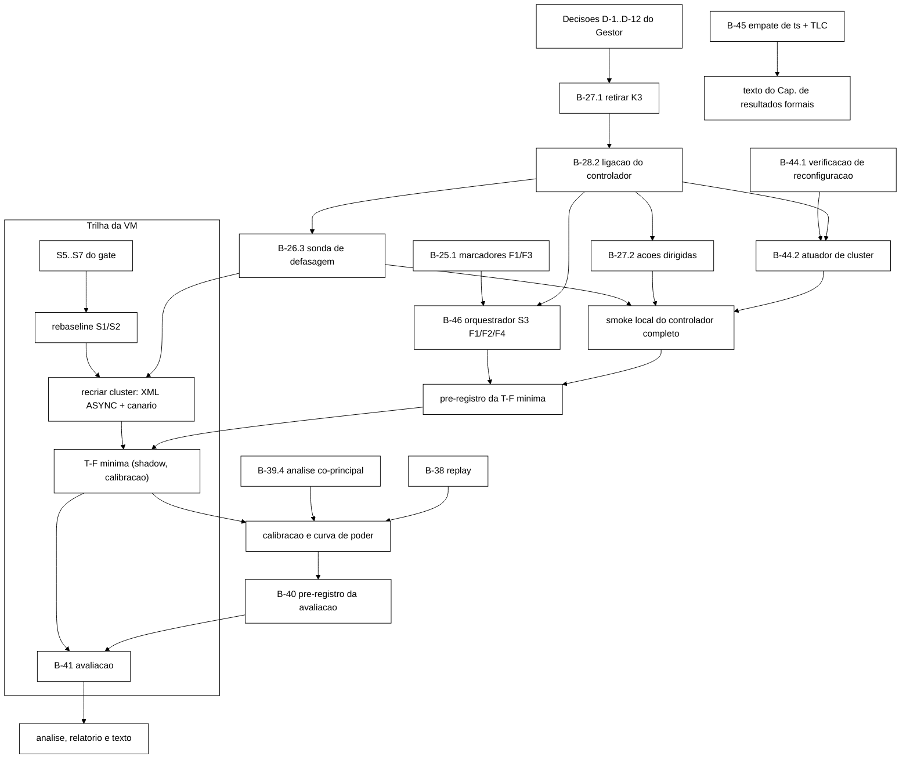

# Plano de alinhamento do trabalho prático aos objetivos do TCC (2026-11-04)

> Elaborado pelo Senior em 2026-11-04. **Só planejamento**: nenhum arquivo de `workload/`, `scripts/`,
> `analysis/`, `cluster/` ou `spec/` foi alterado. Branch `docs/plano-implementacao-controlador`
> (worktree `wt-plano-ctrl`, base `093af42`). Código de referência lido em `wt-ctrl-integ`, ponta
> `20805b0` (`feature/controlador-integracao`); toda referência `caminho:linha` sem prefixo é dessa
> árvore. Texto acadêmico lido em `monografia-atual/` (versão oficial desde 01/11), sem edição.
> Complementa `docs/plano-implementacao-controlador-2026-10-22.md` (o "plano de 22/10"); onde os dois
> divergem, vale este. Commit local, sem push.

---

## 0. Referências obrigatórias e decisões vinculantes

### 0.1 Objetivos do TCC (`monografia-atual/Introducao.tex:39-55`)

- **Geral:** especificar e verificar invariantes do estado de sessão sob replicação assíncrona e
  *failover*, e **avaliar um mecanismo heurístico que modifique políticas ou ações operacionais para
  reduzir a ocorrência de violações** desses invariantes e controlar a latência sob falhas.
- **(1)** modelo formal do estado de sessão e das operações, com atraso, reordenação, falha e recuperação;
- **(2)** invariantes de segurança, correção e convergência verificados por *model checking*, com
  contraexemplos registrados;
- **(3)** arquitetura experimental com Infinispan em *cluster*, alterações de topologia e cenários de
  replicação, programa de carga que detecta violações;
- **(4)** controlador heurístico que, com base em taxas e parâmetros observáveis, seleciona políticas e
  aplica ações de mitigação;
- **(5)** comparação do modelo estático com o modelo com controlador, sob falhas, **quantificando taxa de
  violações, tempo de recuperação e convergência, e estatísticas de latência**.
- Justificativa (`Introducao.tex:21`): o controlador deve reduzir violações e estabilizar p95/p99 "sem
  aumentar indevidamente o custo operacional"; a motivação de sustentabilidade sustenta a medição de
  energia.

### 0.2 Decisões do Gestor de 2026-11-04 (vinculantes)

| # | Decisão | Onde é aplicada |
|---|---|---|
| G-1 | **Opção A:** taxa de violações (I1 + I4 + I2 real, por mil ações S3) é desfecho **co-principal** com o p99 da ação S3; a violação é gatilho de primeira classe, igual a latência, erro e topologia | seções 3 e 4.1 |
| G-2 | **Retirar** a ação de adiar bloqueios/desbloqueios administrativos (até 30 s) do `PortaoDeEmissao` e do perfil CONSERVADOR | seção 5, prompt 1 |
| G-3 | **Manter** a medição de energia (proxy por CPU via cgroups/`podman stats` + modelo de potência declarado, decisão de 22/10) | seção 6 |
| G-4 | **Manter** o controlador mudando a configuração do *cluster* (B-44) **no caminho principal**; começar pelo B-44.1 | seções 7 e 8, prompt 4 |
| R-N | Todo limiar ou parâmetro novo tem origem rastreável (bibliografia do projeto, decisão pré-registrada, derivação ou medida nos brutos); sem base, dizer que é preciso medir e como | todas; tabela 3.6 |

Siglas usadas neste documento: **S1/S2/S3** cenários de carga (S3 = aplicação web simulada com
servidores de aplicação fixados a nós e console administrativo); **F1** queda silenciosa de nó, **F2**
partição, **F3** atraso com *jitter*, **F4** degradação parcial da rede; **K1/K2/K4** parâmetros do
cliente que o controlador altera (admissão, ritmo, espera entre retentativas); **K3** o adiamento
administrativo retirado por G-2; **T-D** inclusão de F2/F4 no orquestrador de campanhas; **T-F**
campanha com o cenário S3; **B-nn** itens do *backlog*; **TLC** verificador de modelos do TLA+;
**JSONL** arquivo com um objeto JSON por linha.

---

## 1. Diagnóstico conferido

### 1.1 Achados da auditoria de 04/11, conferidos nesta sessão

| # | Achado | Evidência conferida |
|---|---|---|
| A-1 | Controlador não ligado ao laço de carga | `grep -n "controller\|controlador"` em `workload/src/main/java/br/unipampa/tcc/session/Cli.java` não retorna nada; não existe `controle/LacoDeControle.java` (lista de `controle/` tem 24 classes, nenhuma de laço) |
| A-2 | `comparar_bracos.py` não calcula tempo de recuperação nem compara convergência | `analysis/comparar_bracos.py:351-423` (`desfechos_execucao`) produz `evento_p99:*`, `taxa_erro`, `acao_s3_p99_*`, `falhas_percebidas_por_1000`, `vazao_util`, `cpu_por_1000_uteis`; convergência só entra como fronteira de fase (`fases.py:10`, `:89-99`) |
| A-3 | Laço de convergência só depois da carga | `WorkloadMain.java:543-575` (`executarConvergencia`, chamado após a carga); `ConvergenciaLoop.java:20` ("Depois de `t_fim` a carga de escrita para") |
| A-4 | Desfecho principal = p99; violações secundárias com Holm | `Metodologia.tex:342`; `comparar_bracos.py:541-554` (família `primario` única; violações em `_violacoes_celula`, `:440-481`, só com razão de taxas agregadas ou regra de três, **sem teste pareado**) |
| A-5 | Nenhuma ação mira mecanismo de violação; K3 pode reduzir I2 artificialmente | `PortaoDeEmissao.java:34` (`ADIAVEIS`), `:194-220`; I2 conta *login*/validação aceitos para identidade **já bloqueada**: adiar o `Block` encolhe o intervalo em que a identidade está bloqueada e, com ele, o número de I2 contáveis, sem melhorar a segurança (piora: o bloqueio chega mais tarde) |
| A-6 | Empate de `ts` sem correção | `registro-de-problemas.md` P-16 ("não corrigido nesta rodada"); `spec/SessionStore.tla:131-135` ("P-16 ... NÃO é resolvido aqui"); `Desenvolvimento.tex:60` ("cinco dos oito traços mínimos") |
| A-7 | Sem orquestrador nem pré-registro da T-F; F2/F4 fora do orquestrador | `scripts/run-rebaseline.sh:51-60` só define F1 e F3; não há `run-campanha-s3*` em `scripts/` |

### 1.2 Achados novos desta sessão

- **N-1. O núcleo já trata violação como gatilho de primeira classe.** `Controlador.java:101-104`: em
  NORMAL, violação leva a CONSERVADOR na mesma janela, inclusive em *cooldown* (regra R1); em
  CONSERVADOR, violação renova a retenção (`:113-114`, `:120`). "Secundário" existe só no texto
  (`Desenvolvimento.tex:160`, `:199`) e no plano de 22/10 (§3.2). A decisão G-1 **não exige mudar o
  núcleo**; exige mudar a análise (seção 3), os rótulos e o texto. Ver D-2 na seção 12.
- **N-2. Retirado o K3, o controlador fica sem nenhuma ação dirigida a mecanismo de violação.** K1, K2
  e K4 agem sobre carga e retentativas; nada no catálogo (`docs/catalogo-operacao-falha-invariante.md`)
  liga um deles a um mecanismo. Com o desfecho de violação co-principal, um resultado nulo seria
  esperado **por construção**, e o objetivo geral ("reduzir a ocorrência de violações") ficaria sem
  teste real. A seção 4 propõe as ações que faltam.
- **N-3. Em ASYNC o principal mecanismo de violação sob partição é invisível aos sinais atuais.**
  Pela documentação do Infinispan 15 (`infinispan_configuring_15`, §2.4, lida pelo Senior em 22/10,
  plano de 22/10 §2.2), em ASYNC o nó de origem não recebe confirmação dos outros nós e os erros
  remotos não chegam ao chamador. A escrita feita na futura minoria entre o corte e a detecção é perdida
  no *merge* (§7.1.1). Nesse intervalo não há latência alta, nem erro, nem topologia anômala: o
  controlador só reage **depois** que a violação já foi observada (R1 reativa). Para reduzir violações
  é preciso um observável antecipado (S_lag, seção 4.2).
- **N-4. "Canal com entrega em ordem" provavelmente não corrige o empate.** O traço mínimo de 5 estados
  (`wt-senior-decisoes/docs/validacao-b35-2-2026-10-16.md:21`) é `Logout(s1)` em r1 e `Block` em r2,
  concorrentes, ambos com `ts = 2`, e duas entregas. As duas escritas nascem em réplicas diferentes;
  ordem FIFO por canal não muda o resultado do teste `m.ts > ts local` (`2 > 2` é falso nos dois
  sentidos). É **inferência de leitura**; o prompt 3 manda verificar com uma variante FIFO de controle.
  Se confirmada, as frases de `Desenvolvimento.tex:60` e `ApPlanoTCC2.tex:66` que oferecem essa
  correção estão erradas (seção 11).
- **N-5. `redhat_datagrid_admin` não serve para o Infinispan 15.** A entrada do `.bib`
  (`monografia-atual/bibliografia.bib:928-935`) é o guia do Red Hat JBoss Data Grid **7.0 (2016)**, de
  uma geração anterior do Infinispan. Não sustenta afirmação sobre atributos mutáveis no 15.0.21. A
  fonte de versão certa no `.bib` é `infinispan_configuring_15`; o guia de REST/CLI do 15.0 não está no
  `.bib` e vai ao Bibliotecário (seção 12, D-11).
- **N-6. F1 ainda não grava marcador.** `grep "fault=F"` em `scripts/inject-crash.sh` não retorna nada;
  B-25.1 continua pendente. Sem marcador `end` de F1, o tempo de recuperação da célula F1 não tem
  `t_fim-falha` (seção 3.4). B-25.1 entra no caminho crítico.
- **N-7. O tempo de recuperação de `Metodologia.tex:223` tem dois parâmetros sem valor nem origem**
  (margem ε e janela W). E o tempo de convergência de `:224` é medido a partir do fim da falha, mas
  o laço só começa depois da carga (A-3); o valor medido tem um piso igual a `fim da carga − fim da
  falha`, o mesmo nos dois braços. Seção 3.4.
- **N-8. Com 8 blocos e contagens baixas, a correção de Holm sobre 6 hipóteses torna o desfecho de
  violação inviável.** Seção 3.3.
- **N-9. A classificação I2 `REAL` em linha só existe com `RastroCliente`, criado só com `--marker` ou
  `--sweep`** (plano de 22/10 §1.1, achado A3). No S3 com controlador, sem marcador não há I2 real no
  gatilho nem no desfecho. B-28.2 deve recusar `shadow`/`active` em S3 sem `--marker` (prompt 1).
- **N-10. Parâmetros provisórios do controlador sem origem.** A tabela 3.6 lista cada um com a origem
  existente ou o modo de medir. (Os limiares do *gate* S5-S7 estão sendo rastreados por outro Senior em
  `wt-gate-v4`; não são tratados aqui.)

---

## 2. Mapa objetivo → tarefa → evidência de aceite

Nenhum objetivo fica descoberto. "Feito" quer dizer entregue e validado antes desta data.

| Objetivo | Parte | Tarefa(s) | Estado | Evidência de aceite |
|---|---|---|---|---|
| Geral, "especificar e verificar" | — | (1) e (2) abaixo | — | — |
| Geral, "avaliar mecanismo que reduza violações e controle latência" | ações que miram violação | B-26.3 (S_lag), B-27.2 (ações dirigidas), B-44.1/B-44.2 (ações de *cluster*) | novo | cada ação ligada a um mecanismo do catálogo (seção 4.1) e ao traço TLA+ correspondente; testes de unidade; *smoke* local mostra a ação disparando no cenário do mecanismo |
| | avaliação | B-40 (pré-registro), B-41 (campanha), B-39.4 (análise co-principal) | novo/revisto | relatório B-41 com os dois desfechos co-principais e a regra de sucesso pré-registrada (seção 3) |
| (1) modelo formal | estado, operações O1..O7, atraso, reordenação, falha e recuperação | feito (`spec/SessionStore.tla`); B-45 (correção do empate de `ts`) | parcial | nova rodada TLC com o modelo corrigido, sem regressão nas propriedades já publicadas (seção 9, prompt 3) |
| | "renovação" | fora do recorte desde o TCC I (decisão de 30/10, `decisoes-tecnicas.md`, último bloco) | revisão registrada | frase de `Desenvolvimento.tex:187` (DES-52) mantida; nada no código |
| (2) invariantes e *model checking* | I1..I6 com contraexemplos | feito para I1..I4; I5/I6 com 5 de 8 traços dependentes do empate | parcial | B-45: I5/I6 reverificados; os 3 traços de fusão continuam violando (`Desenvolvimento.tex:60`); catálogo atualizado |
| (3) arquitetura experimental | *cluster*, SYNC e ASYNC, F1..F4, carga que detecta violações | feito no *host*; VM: S5-S7 pendentes; T-D (F2/F4 no orquestrador) e orquestrador S3 inexistentes | parcial | B-46 (orquestrador S3 com F1/F2/F4, retomável); *gate* da VM aprovado; T-F mínima executada |
| (4) controlador | observáveis, decisão, ações | B-28.1, B-26.1, B-26.2, B-27 feitos; K3 retirado (B-27.1); B-28.2; B-26.3; B-27.2; B-44.1/B-44.2 | parcial | `--controller off/shadow/active` no `Cli`; JSONL de decisões e ações; *smoke* local; testes |
| (5) comparação estático × controlador | taxa de violações | B-39.4 | novo | diferença pareada de taxas por bloco, teste exato por troca de sinal, regra de sucesso (3.2) |
| | tempo de recuperação | B-39.4 + B-25.1 | novo | Δ_rec por execução (3.4), diferença pareada |
| | convergência | B-39.4 + campo `t_fim_carga_ns` (prompt 1) | novo | Δ_conv após quiescência e divergência persistente por execução, testes pareados (3.4) |
| | latência | B-39.3 (feito) + B-39.4 | revisto | p99 da ação S3 como co-principal (não inferioridade, 3.2) |
| Justificativa, custo e sustentabilidade | energia | B-37, B-39.2 feitos; `fix/b39-guarda-parametros-energia` (G4 de 28/10); coleta no B-41 | parcial | CPU-s por mil ações úteis e energia estimada por braço, com limitações (seção 6) |

---

## 3. Redesenho da análise (decisão G-1)

### 3.1 Desfechos

| Família | Desfecho | Unidade | Definição | Estatística por bloco |
|---|---|---|---|---|
| **Co-principal V** | taxa de violações | por execução | `(I1 + I4 + I2_REAL) × 1000 / nº de ações S3`, fases `durante` + `recuperacao`; regras de contagem de `contar_violacoes` (`comparar_bracos.py:306-334`, DT-001/DT-002/H7) | **diferença** `d_b = r_B − r_A` (decisão G3 de 28/10: com zeros, diferença como principal); razão com exclusão como sensibilidade |
| **Co-principal L** | p99 da ação S3 com espera | por execução | `acao_s3_p99_com_espera` (`:399`), mesmas fases, n ≥ 1000 | `d_b = ln(p99_B / p99_A)` (inalterado) |
| Não inferioridade | vazão útil | por execução | `vazao_util` (`:402-404`) | inalterado, δ = 10 % |
| Secundário | tempo de recuperação Δ_rec | por execução | 3.4 | diferença em segundos (Δ pode ser 0) |
| Secundário | tempo de convergência Δ_conv | por execução | 3.4 | diferença em segundos |
| Secundário | divergência persistente I5/I6 | por execução | `divergencia_persistente` do resumo de convergência | diferença 0/1 (o teste por troca de sinal vira o teste exato do sinal sobre pares discordantes) |
| Secundário | p99 por operação, taxa de erro, falhas percebidas, CPU-s por mil úteis, energia estimada, cada invariante separado (I1, I4, I2_REAL) | por execução | existentes | existentes |
| Descritivo | comportamento do controlador | por execução | transições, tempo em CONSERVADOR, ações aplicadas por tipo, atraso de entrada relativo ao marcador | sem teste |

### 3.2 Regra de sucesso e controle do erro tipo I

O critério original da Proposta (`Metodologia.tex:229`) já é conjuntivo: (i) redução significativa da
taxa de violação, (ii) p95/p99 dentro de degradação máxima de 10 % com IC 95 %, (iii)
rastreabilidade. Isso é, em termos estatísticos, um **teste de interseção-união**: a conclusão
"melhoria" exige rejeitar as duas hipóteses nulas, e nesse caso o erro tipo I conjunto não passa do
α de cada teste, sem correção (Berger, 1982, *Technometrics* 24(4); **não está no `.bib`**, vai ao
Bibliotecário, D-11).

**Recomendação (opção IU):** por célula com falha,

- **H_V** (superioridade): `média(d_b) < 0` para a taxa de violações; teste exato por troca de sinal,
  bilateral, α = 0,05 (`permutacao_exata`, `:126-140`);
- **H_L** (não inferioridade): limite superior do IC 95 % t de `exp(média ln(p99_B/p99_A))` ≤ 1,10
  (δ = 10 % da Proposta, `Metodologia.tex:229`); a superioridade do p99 é **reportada** com o mesmo
  teste de permutação, sem entrar na regra;
- **célula "melhoria"** se H_V e H_L forem rejeitadas, vazão útil não inferior e rastreabilidade
  integral (cada ação no JSONL com regra e sinais);
- **conclusão global** sobre as três células com falha: Holm sobre os três valores-p de interseção-união
  (`p_IU = max(p_V, p_L)`), FWER 0,05 (`holm_sequential_1979`, já no `.bib`);
- secundários: Holm dentro da célula, como hoje.

**Alternativa (opção H2):** as duas co-principais como superioridade, Holm sobre 2 por célula
(α efetivo 0,025 para o menor p). Mais exigente para a latência; com contagens baixas, a violação fica
mais difícil de rejeitar (3.3).

A escolha é D-1. As duas são implementadas no prompt 2 (opção `--regra iu|holm2`); o pré-registro fixa
uma antes de qualquer execução.

### 3.3 Poder com 8 blocos e contagens baixas (derivação)

Com o teste exato por troca de sinal, blocos com `d_b = 0` (as duas execuções sem violação) não mudam
nenhum arranjo. Se k blocos têm `d_b ≠ 0`, todos com o mesmo sinal, o menor valor-p bilateral é
`2/2^k`:

| k (blocos com d_b ≠ 0) | 8 | 7 | 6 | 5 |
|---|---|---|---|---|
| p mínimo | 0,0078 | 0,0156 | 0,0313 | 0,0625 |
| rejeita a α = 0,05 (opção IU, por célula) | sim | sim | sim | **nunca** |
| rejeita a 0,025 (Holm sobre 2, menor p) | sim | sim | **nunca** | nunca |
| rejeita a 0,0167 (Holm sobre 3 células, menor p) | sim | sim | nunca | nunca |
| rejeita a 0,0083 (Holm sobre 6 = 2 × 3) | **só no limite** (0,0078) | nunca | nunca | nunca |

Consequência: Holm sobre as 6 hipóteses (2 desfechos × 3 células) só rejeita se os 8 blocos tiverem
violação e todos apontarem para o mesmo lado; fica descartado. Na opção IU, a célula precisa de **pelo
menos 6 blocos com violação em algum braço**. Se o controlador eliminasse toda violação, k seria o
número de blocos em que o braço A (sem atuação) viola, `k ~ Binomial(8, q)`, com q = fração de
execuções do braço A com ao menos uma violação. Ilustração (conta, não expectativa): P(k ≥ 6) = 0,96
para q = 0,9; 0,55 para q = 0,7; 0,14 para q = 0,5.

**q não é conhecido: precisa ser medido.** Regra a pré-registrar no B-40:

1. A T-F mínima (seção 8) roda as mesmas células da avaliação em `shadow`. Por célula, estima-se q̂ e a
   distribuição por execução da taxa de violações (dados de calibração, que não entram na avaliação).
2. O prompt 2 entrega `poder_troca_de_sinal(taxas_A, efeito, n_blocos, n_sim, semente)`: simula
   blocos reamostrando execuções observadas do braço A e aplicando a redução hipotética ao braço B, e
   devolve a fração de rejeições. Como não há base para fixar um efeito mínimo de interesse, o relatório
   da T-F mostra a **curva de poder** (redução de 0 a 100 %, passo de 10 %) para 8, 10 e 12 blocos, e o
   Gestor decide o número de blocos com o custo à vista (cada bloco a mais por célula = 2 execuções de
   12 a 20 min, estimativa de §8.1 do plano de fechamento de 15/10). Se o Gestor quiser um alvo
   convencional (por exemplo 80 % de poder), a fonte (Cohen, 1988) precisa entrar no `.bib` antes.
3. Célula em que o braço A não tem nenhuma violação em nenhuma das 8 execuções: H_V é declarada **não
   avaliável** nessa célula (não "sem efeito"); reporta-se "não observado em N ações por braço, limite
   superior unilateral de 95 % de 3/N" (`hanley_lippmanhand_zero_1983`, já no `.bib`;
   `regra_de_tres`, `:173-177`).

Sensibilidades pré-registradas: (a) razão de taxas com exclusão dos blocos com zero no braço A
(G3 de 28/10); (b) teste exato condicional de duas taxas de Poisson sobre as contagens somadas
(rotulado como anticonservador: uma fusão produz várias violações de uma vez, então eventos da mesma
execução não são independentes; a unidade continua sendo a execução); (c) IC por *bootstrap* de blocos
da diferença de taxas. Para descrever a taxa de cada braço isoladamente, intervalo binomial
recomendado por `brown_cai_dasgupta_binomial_2001` (já no `.bib`), com a mesma ressalva de
independência.

### 3.4 Tempo de recuperação e convergência (operacionalização)

**Δ_rec, definição principal (sem parâmetro livre).** Evento anômalo = evento do CSV com
`ERROR_TRANSPORT` ou `ERROR_UNAVAILABLE`, ou ação S3 com `falha_percebida`. Com `t_fim-falha` do
marcador `end`:

- `Δ_rec = t(último evento anômalo com t > t_fim-falha) − t_fim-falha`; `Δ_rec = 0` se não houver
  evento anômalo depois do fim da falha;
- censura: se houver evento anômalo nos últimos `W_c` segundos da medição, a execução é marcada
  `censurada` e Δ_rec recebe o valor máximo observável (fim da medição − t_fim-falha). O teste pareado
  sobre valores censurados é conservador quando a censura é mais frequente no braço com Δ maior; a
  contagem de censuras por braço é reportada. `W_c` = a mesma janela de 3.5 (derivada, não escolhida).
- O fim da medição é fixado pelo protocolo e é igual nos dois braços.

**Δ_rec, definição da `Metodologia.tex:223` (sensibilidade).** Primeiro instante depois de
`t_fim-falha` em que a taxa de erro de uma janela de W s volta à linha de base. Para não escolher ε:
uma janela está "na linha de base" se sua contagem de erros não excede o quantil de 95 % de
Binomial(n_j, p_ref⁺), com p_ref⁺ = limite superior de 95 % da taxa de erro das execuções sem falha
da mesma célula (regra de três se a contagem for zero). W: seção 3.5.

**Δ_conv.** O laço de convergência roda só em quiescência (A-3, e a definição de I5/I6 exige
quiescência, `Metodologia.tex:198-204`), então Δ_conv é medido **a partir do início da quiescência**:
`Δ_conv = t_convergencia_abs_ns − t_fim_carga_ns`. O campo `t_fim_carga_ns` não existe no resumo
(`ConvergenciaLoop.java:186-200` grava `t_fim_ns`, que é o marcador `end` quando há marcador,
`WorkloadMain.java:554`); o prompt 1 acrescenta o campo, aditivo. Execução com
`divergencia_persistente` (não convergiu até o teto) não tem Δ_conv; entra no desfecho binário. O
texto precisa dizer que o tempo é contado do fim da carga, não do fim da falha (seção 11).

**Teto do laço de convergência (600 s, `Cli.java:83`, `:187`).** Origem não encontrada nesta sessão
fora do próprio código; o B-33 o introduziu. Antes do B-40, conferir em `docs/` (relatório do B-33) se
há justificativa; se não houver, derivar: o teto deve ser maior que o maior Δ_conv observado nas
execuções da T-F mínima que convergiram, e o pré-registro registra esse máximo.

### 3.5 Janela de análise derivada da vazão medida

O sinal de latência do controlador exige `n_lat ≥ 100` eventos por janela; esse mínimo tem derivação
binomial no plano de 22/10 (§3.2). A janela W hoje é 5 s, valor herdado do plano de 24/09 **sem
base**. Proposta: `W = ⌈n_lat / λ_5⌉`, com λ_5 = quantil de 5 % da vazão de eventos por segundo nas
janelas das execuções sem falha da T-F mínima. Referência local (não da VM): o *smoke* S3 do B-43.9
(`runs/b43-9-smoke/Q1/s3-resumo-rep-001.json`, SYNC, *host*) teve 4055 ações em 300 s (≈ 13,5 ações/s,
incluindo aquecimento); a vazão de **eventos** é maior, porque uma ação tem uma ou mais operações. O
valor da VM precisa ser medido. A mesma W serve ao Δ_rec de sensibilidade e a `W_c`.

### 3.6 Origem de cada parâmetro do controlador e da análise

| Parâmetro | Valor atual | Origem hoje | Situação | Como fixar |
|---|---|---|---|---|
| `n_lat`, `n_err` | 100, 50 | `n_lat`: derivação binomial (plano de 22/10 §3.2); `n_err`: nenhuma | `n_err` sem base | derivar como `n_lat`: menor n com P(falso alto) ≤ alvo, sob a taxa de erro sem falha medida |
| W | 5 s | plano de 24/09 | sem base | 3.5 |
| θ_lat_in / θ_lat_out | 0,05 / 0,02 | "5× e 2× a excedência esperada" | multiplicadores sem base | regra abaixo |
| θ_err_in / θ_err_out | 0,02 / 0,005 | nenhuma (plano de 22/10 diz "sem dado") | sem base | idem |
| Grade de calibração {0,03 … 0,20} e "atraso mediano ≤ 15 s" | — | plano de 22/10 §3.5 | sem base | substituir pela regra abaixo |
| k (persistência), m (janelas calmas) | 2, 6 | nenhuma | sem base | k: derivado junto com θ (a probabilidade de falso alarme é calculada para k janelas); m: medir na T-F mínima a duração das oscilações dos sinais depois do fim da falha; m = menor valor que não produziria reentrada em nenhuma execução de calibração |
| `T_cooldown`, `T_estavel`, `T_hold_viol` | 30 s, 30 s, 120 s | plano de 24/09 / nenhuma | sem base | `T_estavel`: a partir do intervalo medido entre o fim da falha e o retorno a HEALTHY com 3 nós (saúde REST da T-F mínima); `T_hold_viol`: a partir do intervalo máximo entre violações sucessivas na mesma execução de calibração; `T_cooldown`: igual a `m × W` (derivação: impede transição antes de a saída ser possível) |
| Período da sonda de topologia | 2 s | mesmo do log de saúde do *gate* | convenção | aceitável como convenção declarada; custo medido (≤ 3 processos `curl` a cada 2 s, B-26.2) |
| K1 (fração da concorrência em CONSERVADOR) | 50 % | nenhuma | sem base | **proposta derivada:** `K1 = nós saudáveis / nós esperados` (sob F1, 2/3), lida da sonda; capacidade proporcional aos nós que servem (D-5) |
| K2 (pausa 5 ms; pensar × 1,5) | — | nenhuma | sem base | redundante com K1 se K1 for derivado; proposta: retirar (D-5) |
| K4 (base × 2, *jitter* ±50 %) | — | nenhuma | sem base | precisa de fonte (por exemplo, a análise de *backoff* com *jitter* de Brooker, AWS, 2015, fora do `.bib`) ou retirar (D-5) |
| Teto da convergência | 600 s | código (B-33) | a conferir | 3.4 |
| δ da não inferioridade (latência) | 10 % | Proposta (`Metodologia.tex:229`) | rastreável | — |
| δ da vazão útil | 10 % | decisão do Gestor de 22/10 | rastreável como decisão | — |
| α, IC | 0,05, 95 % | `Metodologia.tex:229`, `:326` | rastreável | — |
| Exclusão por `steal` | > 5 % | plano de 22/10 §5.3 | sem base | medir o `steal` nas execuções da T-F mínima e fixar acima do máximo observado sem disputa, ou declarar como convenção |

**Regra de calibração dos θ (derivação, a pré-registrar no B-40).** Seja D a duração da medição e W
a janela; há cerca de D/W pares de janelas por execução. Exigindo probabilidade de ao menos uma entrada
indevida por execução sem falha ≤ 0,05 (o α do projeto), a desigualdade de Bonferroni dá um alvo por
par de janelas ≤ 0,05·W/D. θ_in = menor valor tal que a frequência empírica de "k janelas seguidas
≥ θ_in" nas execuções sem falha da T-F mínima não passa desse alvo; com poucas janelas, usar o
limite superior de 95 % da frequência (regra de três se zero). θ_out = maior valor tal que, nas mesmas
execuções, nenhuma janela fique entre θ_out e θ_in por mais de m janelas seguidas. Nenhum dado de
calibração entra na avaliação.

---

## 4. Ações dirigidas aos mecanismos de violação (exigência do objetivo geral)

### 4.1 Mecanismos conhecidos e ações candidatas

| Mecanismo | Fonte | Invariantes | Observável que o antecipa | Ação candidata | Lado | Dentro dos traços do modelo? |
|---|---|---|---|---|---|---|
| M1. Escrita na futura minoria entre o corte e a detecção, perdida no *merge* | `infinispan_configuring_15` §7.1.1; traços TLA+ de 4 estados `I1F`, `I2Fa`, `I1M` (catálogo §4.1, §4.2, §4.4) | I1, I2, I4 | S_lag (4.2); depois da detecção, S_top | **AV-1** desviar o servidor de aplicação fixado no nó suspeito para um nó da maioria (o antigo K5, recusado em 22/10) | cliente | sim: só muda **onde** a operação é emitida |
| | | | | **AC-1** forçar `DEGRADED` no nó suspeito antes da detecção do JGroups, se o Infinispan permitir (B-44.1) | *cluster* | recusar mais operações gera um subconjunto dos traços (equivale a passos que não ocorrem); a verificar |
| M1/M5. Escrita de segurança confirmada e revertida pela fusão; *merge* com origem atrasada (P-23) | catálogo §4.1; `registro-de-problemas.md` P-23 | I1, I2, I4, I5, I6 | S_top volta a HEALTHY depois de anomalia | **AV-3** reafirmar, depois da volta a HEALTHY, os `Logout`/`Block` confirmados durante a anomalia (escrita condicional por versão, idempotente) | cliente | sim: `Logout`/`Block` são ações de `Next`; **cria operações**, o que a restrição da etapa cliente (plano de 22/10 §4) proibia |
| M2. Leitura defasada em ASYNC logo depois da escrita | `infinispan_configuring_15` §2.2 | I1, I4 (aparente) | S_lag | **AV-2** barreira de leitura depois de `Logout`/`Block` em CONSERVADOR: o servidor de aplicação só conclui a ação quando o estado novo for lido pelos nós dos outros servidores de aplicação, até o *timeout* Hot Rod já configurado (`hotrod_timeout_ms`, 2000 ms no *smoke*) | cliente | sim: leituras não mudam estado |
| M3. Atualização perdida em ASYNC sob perda de pacotes | §2.2 ("can lose updates"); hipótese H-A2 (plano de 22/10 §2.3) | I5, I6 | S_lag | AV-3 cobre as escritas de segurança; nada cobre contadores | cliente | idem AV-3 |
| M4. `Logout` × `Block` concorrentes trocam o motivo | catálogo §4.3 (`I4Fp`, 5 estados) | I4 | — | já mitigado no código por escrita condicional por versão (B-43.8, DT-003) | — | — |
| Rebalanceamento durante oscilação de topologia | `Desenvolvimento.tex:197` (DES-55) | I5/I6 (momento) | S_top oscilando | **AC-2** suspender o rebalanceamento enquanto a topologia oscila, se for operação de tempo de execução (B-44.1) | *cluster* | altera só o momento da convergência (classe b do plano de 22/10 §12.3) |
| Latência sob degradação (não é violação) | — | — | S_lat, S_err | K1 (derivado, 3.6); **AC-3** `remote-timeout`, se mutável (B-44.1; em ASYNC a escrita não espera, então só vale para SYNC e leituras) | ambos | classe a |

AV-1, AV-2 e AV-3 só agem em CONSERVADOR e cada aplicação gera uma linha `{"tipo":"acao",...}` no
JSONL de decisões (regra, sinais, alvo, resultado). **Todas exigem aprovação do Gestor (D-3, D-4)**:
AV-1 reabre a decisão de 22/10 sobre K5; AV-3 relaxa a regra "nenhuma operação é criada". A
filosofia do S3 (`Metodologia.tex:311`, "o programa não repara estado") continua valendo para o braço
A; no braço B, o reparo é a mitigação do controlador, e o texto precisa dizer isso (seção 11).

### 4.2 Observável antecipado S_lag (B-26.3)

Sonda ativa de defasagem de replicação: a cada período, o controlador escreve num *cache* próprio
(`canario` e `canario-async`, fora de `sessions`/`counters` e fora de todo invariante) uma chave com
o instante, via o nó de um servidor de aplicação, e lê a mesma chave pelos nós dos outros dois.
`lag` = tempo até a leitura devolver o valor novo, com teto no *timeout* Hot Rod. Sob M1 (corte ainda
não detectado) e M2/M3, a leitura cruzada não vê o valor: é o único sinal que existe **antes** da
violação em ASYNC (N-3).

Parâmetros e origem: período da sonda = W (3.5); limiar `lag_in` = quantil de 99 % do `lag` nas
execuções sem falha da T-F mínima, mesma lógica do p99 de referência (B-39.1); persistência k e
Bonferroni de 3.6. Custo: 1 escrita + 2 leituras por período, medido pelo coletor de recursos e
contado separado da carga útil. Exige acrescentar os *caches* `canario*` ao XML, o que obriga a recriar o
*cluster* da VM; deve entrar no mesmo XML que o B-42.1 levou à VM (seção 8, regra de ordem). Decisão
D-4.

---

## 5. Retirada do adiamento administrativo K3 (decisão G-2)

Branch `refactor/b27-1-remover-k3`, a partir de `feature/controlador-integracao` (`20805b0`); entra
antes do B-28.2.

### 5.1 Código

| Arquivo | Mudança |
|---|---|
| `controle/PortaoDeEmissao.java` | remover `ADIAVEIS` (`:34`), `aguardarAdministrativa` (`:194-220`), `adiamentos`/`adiamentosK3()` (`:56`, `:280-282`), o campo e o parâmetro `ouvinteK3` (`:47`, `:75`, `:79-81`, `:92`); `encerrar()` continua liberando o K1; Javadoc da classe (`:9-30`) sem K3. `dormidor`: remover se ficar sem uso no pacote `main` (conferir com `grep`; hoje só o K3 o usa) |
| `controle/EventoK3.java` | apagar |
| `controle/ParametrosKnobs.java` | remover `k3AdiaMaxNs` e `k3SondagemNs` do registro, das validações (`:64-69`), de `CAMPOS` (`:45-47`), de `padrao()` (`:82`) e de `deJson`; `VERSAO_PADRAO` passa a `provisorio-2026-11-04`; um arquivo JSON com os campos antigos passa a ser **recusado** como campo desconhecido (comportamento já existente, `:108-112`) |
| `session/AplicacaoS3.java` | remover a chamada `portao.aguardarAdministrativa` (`:69-74`); `esperaPortaoNs` passa a somar só o K1; Javadoc (`:53-63`) |
| `session/AcaoS3.java` | Javadoc de `esperaPortaoNs` (`:21`): "K1". **Coluna `espera_portao_ns` mantida** (contrato S3 v2 de 10 colunas inalterado, `analysis/test_contrato_s3_acoes.py`) |
| `session/ContextoS3.java`, `S3Simulacao.java` | só se houver referência a K3 (conferir) |

### 5.2 Testes

Testes de uma funcionalidade retirada não são "enfraquecidos": são apagados com a funcionalidade. Mesmo
assim, a lista abaixo precisa da autorização do Gestor (D-6), como nas edições autorizadas anteriores.

| Teste | Mudança |
|---|---|
| `controle/PortaoDeEmissaoK3Test.java` (202 linhas, K3a, K3b, K3e, K3f, interrupção) | apagar |
| `controle/ParametrosKnobsTest.java:32-33`, `:67-68`, `:110-111`, `:131-133`, `:148` | retirar os campos K3 das entradas e asserções |
| `controle/PortaoDeEmissaoK1Test.java:31`, `:208`, `:210` | retirar argumentos K3 do construtor e as duas asserções de K3 do portão livre |
| `controle/ArquiteturaPortaoTest.java:22-26` | retirar `EventoK3` da lista de tipos |
| `controle/PerfilAtualTest.java:37` | construtor sem `ouvinteK3` |
| `session/PortaoS3AplicacaoTest.java:4`, `:25-27`, `:44-45`, `:97-122` (K3c), `:129-137` (K3d), `:145-154` (K3e), `:167-174`, `:189-202` (F1 com K3) | K3c, K3d, K3e: apagar; o teste F1 (`tFimNs`) é reescrito sem K3 (`esperaPortaoNs` = espera do K1, mesma asserção de `tFimNs` com K1 e *backoff*) |
| `session/PortaoS3SimulacaoTest.java:3`, `:25`, `:31`, `:69`, `:104`, `:116`, `:164-182`, `:186-207` | P3 passa a afirmar: em CONSERVADOR as operações por ator são as **mesmas e na mesma ordem** de NORMAL e nenhuma administrativa espera; o teste de "cada administrativa teve um EventoK3" é apagado |

Testes novos obrigatórios (vermelhos antes da mudança onde fizer sentido):

- **R-K3a:** em CONSERVADOR, `Block`, `Unblock`, `IncrementFailure` e `ResetFailures` chegam ao
  armazenamento com espera do portão = espera do K1 (zero com K1 livre), relógio falso;
- **R-K3b (arquitetura):** `PortaoDeEmissao` não tem nenhum método público que receba o nome da
  operação (por reflexão), o que impede a volta de um adiamento por tipo de operação;
- **R-K3c:** `ParametrosKnobs.deJson` recusa um arquivo com `k3AdiaMaxNs`, citando o campo.

Aceite: Surefire = contagem de `20805b0` (863/0/0/1 em 122 arquivos, medida pelo coordenador em 28/10)
− testes apagados + novos, 0 falha; `unittest discover -s analysis` inalterado (187 OK, 1 *skip*);
S1/S2 *golden* idênticos; `grep -rn "K3\|k3Adia\|EventoK3\|aguardarAdministrativa" workload/src`
vazio, salvo comentário histórico explícito.

---

## 6. Energia (decisão G-3)

Mantida como no plano de 22/10 §5, com três ajustes de rastreabilidade:

1. **Modelo de potência linear em utilização:** a fonte já está no `.bib` (`fan_power_provisioning_2007`;
   também `barroso_holzle_energy_proportional_2007`, `kansal_vm_power_2010`). O Bibliotecário confere a
   página antes do uso no texto.
2. **Faixa de sensibilidade `P_ocioso/P_max ∈ {0,3; 0,5; 0,7}`:** sem base no plano de 22/10. Proposta:
   centro no valor reportado por `barroso_holzle_energy_proportional_2007` para a potência em ociosidade
   relativa ao pico (conferir número e página com o Bibliotecário) e extremos dados por valores
   publicados nas mesmas fontes; se não houver, declarar a faixa como convenção.
3. **`P_max`:** da especificação do processador do *host* (Intel Core i5-14600KF, informado pelo Gestor
   em 22/10); a ficha do fabricante entra no `.bib` como fonte técnica (Bibliotecário).

Pendências de código: `fix/b39-guarda-parametros-energia` (G4 de 28/10) antes do B-40; coleta
(`scripts/collect-resources.sh`) ligada no orquestrador S3 (B-46). A métrica principal continua sendo
CPU-s por mil ações úteis (medida); a energia é estimada e só comparada entre braços.

---

## 7. B-44 no caminho principal (decisão G-4)

### 7.1 O que muda em relação à errata de 30/10

A errata de 30/10 (plano de 22/10 §12) punha B-44.2..B-44.4 depois do B-41. Com G-4, a recomendação é
**um só braço B com o controlador completo** (ações de cliente e de *cluster* aprovadas), contra o braço
A (`shadow`), numa só campanha. Motivos: o objetivo (5) compara "modelo estático" com "modelo acrescido
do controlador", não etapas entre si; uma campanha a mais custaria de 2 a 3 noites de VM (seção 8.3);
e o *cluster* é reiniciado entre execuções (plano de 22/10 §8.2), então a mudança de configuração feita
pelo controlador não contamina a execução seguinte. A separação cliente × *cluster* vira análise
exploratória, possível só se houver tempo (um terceiro braço). Decisão D-7.

Condição que continua valendo: a configuração do servidor é variável do experimento no *rebaseline* e
na T-F; o controlador só a muda no braço B da avaliação, e cada mudança é revertida ao sair de
CONSERVADOR e no encerramento (B-44.2), com registro no JSONL.

### 7.2 B-44.1: o que verificar e como

Para cada candidato: (a) fonte documental da versão 15.0 (seção e data de acesso) ou código-fonte
15.0.21.Final (arquivo:linha; no Infinispan os atributos de configuração são declarados como
`AttributeDefinition`, com marca explícita de imutabilidade, o que é verificável no código); (b) prova
empírica no *cluster* local (consultar os atributos mutáveis do *cache*, alterar, ler de volta, conferir
no log do servidor que o *cache* não reiniciou nem rebalanceou, sob carga leve); (c) efeito em ASYNC e em
SYNC; (d) mecanismo da tabela 4.1 que a ação mira; (e) classe do plano de 22/10 §12.3 (a só temporal,
b muda o momento da convergência, c muda a semântica sob partição).

| Candidato (hipótese de partida, nada verificado) | Mecanismo mirado | Classe esperada |
|---|---|---|
| disponibilidade forçada da partição (`DEGRADED` antecipado num nó) | M1 | a verificar: recusar mais operações é subconjunto dos traços; forçar `AVAILABLE` é classe c, fora |
| rebalanceamento suspenso/retomado (por *cache* e global) | momento da convergência | b |
| `remote-timeout` | latência em SYNC e em leituras | a |
| tempo-limite de aquisição de trava | latência sob contenção | a, se mutável |
| `when-split` e `merge-policy` | M1 no *merge* | se mutável, c ou nova ação TLA+; se imutável, fora |
| modo SYNC/ASYNC, `owners`, `segments` | — | esperado imutável sem recriar o *cache* (plano de 22/10 §12.2); confirmar e registrar |
| expiração (`lifespan`, `max-idle`) | nenhum invariante | registrar só se mutável; fora do espaço de ação |

Fontes: `infinispan_configuring_15` (no `.bib`); guia de servidor/REST/CLI do Infinispan 15.0 (**fora
do `.bib`**, D-11); código-fonte 15.0.21.Final; `jgroups_manual_5` para o tempo de detecção que define a
janela de M1 (FD_ALL3, T16, `Metodologia.tex:320`). `redhat_datagrid_admin` não serve (N-5).

---

## 8. *Backlog* revisado, caminho crítico e estimativas

### 8.1 Itens, em ordem de dependência

Horas de *host* = estimativa do Senior para Worker + validação, **sem base medida** (servem para
planejar; revisar com o tempo real dos primeiros itens). "Noite" = até 10 h de VM, o ritmo do
pré-registro do *rebaseline* aprovado em 23/10 (120 execuções em 2 noites mais piloto).

| Ordem | ID | Branch | Depende de | VM? | Horas de *host* | Noites de VM |
|---|---|---|---|---|---|---|
| 0 | Decisões D-1..D-12 | — | — | não | — | — |
| 1 | B-27.1 retirar K3 | `refactor/b27-1-remover-k3` | D-6 | não | 4 a 6 | — |
| 2 | B-28.2 ligação do controlador | `feature/b28-2-integracao-controlador` | 1 | não | 16 a 24 | — |
| 2 | B-39.4 desfechos co-principais, recuperação, convergência, poder | `feature/b39-4-desfechos-coprincipais` (depois de `fix/b39-guarda-parametros-energia`) | D-1 | não | 14 a 20 (+3 da guarda) | — |
| 2 | B-45 correção do empate de `ts` + TLC | `fix/b45-desempate-ts` | D-8 | não | 6 a 8 de Worker + 15 a 30 de CPU de TLC (estimativa: a retirada da simetria de réplicas multiplicou os estados por 3,7 a 10,6 nos controles do catálogo §4.1) | — |
| 2 | B-44.1 verificação de reconfiguração | `docs/b44-1-reconfiguracao-infinispan` | — (a dependência do B-28.2 da errata de 30/10 cai: é verificação, não atuador) | não (*cluster* local) | 10 a 14 | — |
| 2 | B-25.1 marcadores F1/F3 | `fix/b25-1-marcadores-f1-f3` | — | não | 4 a 6 | — |
| 3 | B-26.3 sonda de defasagem S_lag | `feature/b26-3-sonda-defasagem` | 2 (B-28.2), D-4 | não | 10 a 14 | — |
| 3 | B-27.2 ações AV-1..AV-3 aprovadas | `feature/b27-2-acoes-dirigidas` | 2, D-3 | não | 12 a 18 | — |
| 3 | B-44.2 atuador de *cluster* | `feature/b44-2-atuador-cluster` | B-44.1, B-28.2, D-9 | não | 10 a 14 | — |
| 3 | B-46 orquestrador S3 com F1/F2/F4, retomável (inclui T-D) | `feature/b46-orquestrador-s3` | B-25.1, B-28.2 | não; validação curta na VM | 14 a 20 | 0,5 (validação) |
| 4 | B-38 *replay* (calibração offline sobre os JSONL da T-F) | `feature/b38-replay-controlador` | B-28.2, B-26.3 | não | 8 a 12 | — |
| 4 | *Smoke* local do controlador completo | `test/b40-0-smoke-local` | 3 | não | 4 a 6 | — |
| VM | S5..S7 do *gate* (outro Senior) | — | — | sim | — | conforme `wt-gate-v4` |
| VM | *Rebaseline* S1/S2 (pré-registrado) | — | S7 | sim | — | 2 + piloto |
| VM | Recriar o *cluster* com o XML de B-42.1 + `canario*` | — | *rebaseline*, B-26.3 | sim | — | 0,2 |
| 5 | Pré-registro da T-F mínima | `docs/` | 4, B-46 | não | 4 a 6 | — |
| VM | **T-F mínima** (calibração, `shadow`, ASYNC): 4 células × 5 execuções + SYNC F2/F4 × 3 = 26 execuções (proposta, D-10) | — | pré-registro | sim | — | 1 (26 × 12 a 20 min ≈ 5 a 9 h) |
| 6 | Calibração (3.6) e curva de poder (3.3) | `docs/` + `analysis/` | T-F mínima, B-38, B-39.4 | não | 8 a 12 | — |
| 7 | B-40 pré-registro da avaliação | `docs/` | 6, D-1, D-7 | não | 6 a 8 | — |
| VM | **B-41** avaliação: 4 células ASYNC × 8 blocos × 2 + SYNC 2 × 4 × 2 = 80 execuções | — | B-40 | sim | — | 2 a 3 (16 a 27 h; plano de 22/10 §8.2) |
| 8 | Análise e relatório B-41; resumo para os agentes acadêmicos | `docs/` | B-41 | não | 10 a 14 | — |
| opc. | T-F completa (caracterização, 27 células ASYNC + âncoras SYNC, 120 execuções) | — | T-F mínima | sim | — | 3 a 4 (21 a 35 h; plano de 22/10 §8.1) |

Totais do caminho principal (sem a T-F completa): **≈ 165 a 235 h de *host*** (inclui 15 a 30 h de
CPU de TLC, que roda sem acompanhamento) e **≈ 6 a 7 noites de VM** depois do S7 (*rebaseline* 2 +
piloto, recriação, T-F mínima 1, B-41 2 a 3, validação do orquestrador 0,5), mais a reserva de 8.4.

### 8.2 Caminho crítico

**Caminho crítico:** decisões do Gestor → B-27.1 → B-28.2 → {B-26.3, B-27.2, B-44.2} → *smoke* local
→ pré-registro da T-F mínima → T-F mínima (VM) → calibração → B-40 → B-41 (VM) → análise e texto.
A trilha da VM (S5..S7 → *rebaseline* → recriação do *cluster*) corre em paralelo e se junta antes da
T-F mínima; se ela atrasar, ela vira o caminho crítico. B-45 (TLA+), B-39.4 e B-44.1 estão fora do
caminho crítico, mas B-39.4 tem de estar pronto antes da calibração e B-44.1 antes do B-44.2.

### 8.3 Por que a T-F mínima e não a T-F completa no caminho principal

A T-F completa (27 células) caracteriza severidades de F2/F4 e serve ao objetivo (3), mas nenhum
objetivo exige as 27 células: o (3) pede a arquitetura com alterações de topologia e cenários de
replicação, e o (5) pede a comparação nas células da avaliação. A T-F mínima dá exatamente o que a
avaliação precisa (q̂ e taxas por execução para o poder, distribuições sem falha para os limiares,
vazão para W), em uma noite em vez de três ou quatro. Se o prazo permitir, a T-F completa roda depois
do B-41. Decisão D-10.

### 8.4 Quedas de energia: risco e retomada

Taxa observada: 17 desligamentos `Kernel-Power 41` de 01/09 a 28/10 (`decisoes-tecnicas.md`,
"Decisões do Gestor de 2026-10-28 (tarde)"), ≈ 0,30 por dia. Supondo eventos independentes (Poisson,
hipótese declarada), a chance de uma noite de 10 h ser atingida é `1 − e^(−0,30 × 10/24)` ≈ 12 %.
Reserva: **+1 noite de VM a cada 8 planejadas** e retomada obrigatória em tudo que for longo:

- **Campanhas na VM (B-46):** unidade atômica = execução, nas regras de DT-014 (interrompida antes da
  carga: descarta e repete; depois: recusada e reposta) e de parada por `boot_id` e `StartedAt` (decisão
  de 28/10). No B-41 a unidade estatística é o **bloco** (A e B): um bloco com uma execução perdida é
  refeito inteiro, na mesma ordem sorteada, com o próximo índice livre; o estado da campanha fica num
  arquivo de progresso escrito por troca atômica (`mv`), relido no reinício; o orquestrador recusa
  retomar se o *hash* do *bundle* mudou.
- **TLC no *host*:** `-checkpoint` a cada 10 min e `-recover <diretório>` no reinício; o roteiro de
  execução grava, por configuração, o estado (`pendente`, `rodando`, `ok`) e retoma a partir dele. Sem
  TLC durante janela de injeção na VM nem 5 min antes e depois (regra de 16/10, §5.1).
- **Trabalho de *host*:** commit local a cada passo verde (o padrão "test vermelho → feat" já usado),
  para que uma queda perca no máximo o passo corrente.

---

## 9. Prompts para o Worker (tarefas de *host*, sem VM)

Regras comuns a todos: commits locais em branch própria, `feat:|fix:|docs:|test:|refactor:|chore:`,
terminando com `Co-Authored-By: Claude Opus 5.5 <noreply@anthropic.com>`; **nada vai para `origin`**;
histórico linear; nenhum teste existente enfraquecido além das edições listadas e autorizadas; registrar
a contagem do Surefire antes e depois; nada de `mvn test`, TLC ou *replay* pesado durante janela de
injeção na VM (o coordenador avisa); diagramas em Mermaid; relatório final em `docs/` com comandos e
números conferidos contra os brutos.

### Prompt 1: retirar K3 e ligar o controlador ao laço de carga (B-27.1 e B-28.2)

> **Pré-condição:** D-6 aprovada (lista de testes da seção 5.2). Base: `feature/controlador-integracao`
> em `20805b0`, worktree nova `wt-b28-2`.
>
> **Parte A, branch `refactor/b27-1-remover-k3`.** Execute exatamente a seção 5 de
> `docs/plano-alinhamento-objetivos-2026-11-04.md` (código 5.1, testes 5.2, testes novos R-K3a..R-K3c,
> aceite). Ordem: `test:` com R-K3a..R-K3c vermelhos; `refactor:` com a retirada; `docs:` com Javadoc.
> Pare e reporte se aparecer referência a K3 fora da lista.
>
> **Parte B, branch `feature/b28-2-integracao-controlador`, a partir da ponta da Parte A.**
> 1. `Cli.java`: `--controller off|shadow|active` (padrão `off`), `--controller-config` (obrigatório em
>    `shadow`/`active`, decisão de 22/10), `--controller-knobs`, `--controller-reference` (obrigatório em
>    `active`). Validação: `shadow`/`active` com `--scenario S3` exige `--marker` (sem marcador não há
>    classificação de I2 real; recusa com código 2 e mensagem que cita o motivo). `--dry-run` imprime os
>    parâmetros e os SHA-256 dos arquivos.
> 2. `controle/LacoDeControle.java`: *thread* que fecha a janela do `AgregadorDeJanela` no *tick*
>    injetável (decisão de 22/10), chama `Controlador.avaliar` com o `EstadoTopologia` da
>    `SondaTopologia` e, em `active`, publica o perfil em `PerfilAtual`; em `shadow` decide e grava, sem
>    publicar. O tempo do núcleo é sempre o fim da janela.
> 3. Gravação: `observaveis-rep-NNN.jsonl` e `decisoes-rep-NNN.jsonl` no `--csv-dir`, primeira linha de
>    metadados com versão, SHA-256 dos parâmetros, `nosEsperados` = número de itens de `--servers` (H6)
>    e modo. p99 por janela **não** vai ao JSONL ao vivo (decisão de 22/10).
> 4. Requisitos herdados, cada um com teste: H4 (a sonda normaliza `falha:TimeoutException` para
>    `timeout`, sem reabrir o B-26.2); H6; H7 ("I1 = I4 = 0" conta como zero violações; `*_concorrentes`
>    fora do gatilho, DT-001); `I2_JANELA_CASCATA` e `I2_CASCATA_INCOMPLETA` fora do gatilho (DT-002,
>    decisão de 23/10); H8 (cópia do `mix64` amarrada por `formulaMix64`).
> 5. Violação como gatilho de primeira classe (G-1): **não mude o núcleo** (`Controlador.java`); confira
>    por teste ponta a ponta que uma violação I1 forçada leva a CONSERVADOR na janela em que é observada,
>    mesmo em *cooldown*, no modo `active`, e que em `shadow` a decisão é gravada e o perfil não muda.
>    Troque nos Javadocs qualquer menção a violação como gatilho "secundário".
> 6. `ConvergenciaLoop.escreverResumo`: acrescente `t_fim_carga_ns` (aditivo; os campos existentes não
>    mudam), passado por `executarConvergencia` (`WorkloadMain.java:543-575`). Teste de contrato.
> 7. `--controller off`: nenhum objeto do pacote `controle` além de `PortaoDeEmissao.livre()` é criado
>    (teste por contagem de instâncias ou injeção), S1/S2 *golden* e `S3SimulacaoTest` inalterados.
> 8. Teste ponta a ponta com `FakeCaches`: erro forçado ⇒ transição R2 registrada; volta à calma ⇒ R4
>    depois de m janelas; JSONL válido linha a linha.
>
> **Aceite:** Surefire 0 falha, contagem registrada; `unittest` de `analysis` inalterado; *smoke* local
> (S3 ASYNC, 120 s, `shadow` e `active`, sem falha) com JSONL gravado e zero transições em `shadow`
> sem falha; relatório `docs/relatorio-b28-2-<data>.md`. **Não** implemente S_lag, AV-1..AV-3 nem
> atuador de *cluster* (dependem de decisão).

### Prompt 2: desfechos co-principais, recuperação e convergência no `comparar_bracos.py` (B-39.4)

> **Pré-condição:** D-1 decidida (as duas regras são implementadas; o padrão fica sem valor e o
> argumento é obrigatório). Base: `feature/controlador-integracao` em `20805b0`. Antes, na mesma
> worktree, `fix/b39-guarda-parametros-energia` (G4 de 28/10: B39-R1 exit 2 quando `w_recovery_s` ou
> `marcadores` divergirem; B39-R2 marca `sem-amostra-valida`). Rodar sempre com `python -E -P` (G2).
>
> Branch `feature/b39-4-desfechos-coprincipais`. Seções 3.1 a 3.5 do plano de 04/11 são a
> especificação.
> 1. `desfechos_execucao`: acrescentar `taxa_violacoes_por_1000` (I1 + I4 + I2_REAL nas fases
>    selecionadas, regra de `contar_violacoes`, denominador = ações S3 nas fases); `delta_rec_s` (definição
>    principal de 3.4, com marca `censurada` e janela `W_c` recebida por argumento obrigatório
>    `--w-analise-s`, sem padrão); `delta_rec_metodologia_s` (sensibilidade, com `p_ref_sup` lido de um
>    arquivo de referência gerado das execuções sem falha); `delta_conv_s` (usa `t_fim_carga_ns`; sem o
>    campo, desfecho ausente com motivo, nunca o `t_fim_ns`); `divergencia_persistente` (0/1).
> 2. Estatística por bloco: diferença `d_b = y_B − y_A` para taxa de violações, Δ_rec, Δ_conv e
>    divergência; log da razão para os demais (inalterado). Permutação exata sobre as diferenças
>    (`permutacao_exata` já aceita qualquer vetor). IC: t e *bootstrap* de blocos da diferença.
> 3. Famílias: `co-principal-V`, `co-principal-L`, `nao-inferioridade`, `secundario`. Argumento
>    `--regra iu|holm2`. Em `iu`: H_V por permutação a 0,05; H_L por limite superior do IC t da razão
>    ≤ 1 + δ_L (`--delta-latencia`, obrigatório; o pré-registro passa 0,10); `p_IU = max`; "melhoria"
>    só com H_V, H_L e vazão não inferior. Em `holm2`: Holm sobre as duas superioridades. Holm entre as
>    células com falha (lista `--celulas-falha`) sobre `p_IU`. Secundários: Holm dentro da célula.
> 4. Regras de 3.3: H_V "não avaliável" quando o braço A não tem violação em nenhum bloco; contagem de
>    blocos com `d_b ≠ 0` e o p mínimo atingível `2/2^k` gravados; sensibilidades (a), (b), (c).
> 5. `analysis/poder.py` (novo): `poder_troca_de_sinal(taxas_A, reducao, n_blocos, n_sim, semente)` e a
>    curva de 3.3; gerador `numpy.random.default_rng(SeedSequence([semente, ...]))` como no restante.
> 6. Esquema de saída `comparar-bracos/2`; o script grava só o `/2`. Antes de editar qualquer teste
>    existente de `analysis/test_comparar_bracos.py`, liste os que dependem do `/1` (nome do esquema,
>    família única `primario`, número de famílias) e **pare para autorização**; os que conferem chaves
>    inalteradas não podem mudar.
>
> **Testes (unittest, dados sintéticos com efeito conhecido):** Δ_rec com último erro conhecido,
> sem erro (0), censurado; Δ_conv com e sem `t_fim_carga_ns`; taxa com zeros nos dois braços (d_b = 0);
> p mínimo `2/2^k` conferido por enumeração para k = 5..8; regra IU com os quatro casos (H_V e H_L
> rejeitadas ou não); Holm entre células; não avaliável; poder ≈ 0 com redução 0 e ≈ 1 com redução 100 %
> e q = 1; mutantes: trocar diferença por razão, esquecer a censura, usar `t_fim_ns` no Δ_conv.
>
> **Aceite:** `unittest discover -s analysis` verde (contagem registrada); tabela Markdown com as
> famílias novas; relatório `docs/relatorio-b39-4-<data>.md`. Sem VM.

### Prompt 3: correção do empate de `ts` no TLA+ e nova rodada TLC (B-45)

> **Pré-condição:** D-8 (variante de desempate). Base: `feature/controlador-integracao` em `20805b0`.
> Branch `fix/b45-desempate-ts`. **O TLC não roda durante janela de injeção na VM.**
>
> 1. **Leitura (Tarefa 0, sem execução):** em `spec/SessionStore.tla`, localizar o teste `m.ts > ts`
>    de `EntregaMensagem` e o cálculo de `novoTS` das 6 ações locais; reproduzir no relatório o traço
>    mínimo de 5 estados (`runs/tlc/perda-base-controle/semeado-sem/r2-I5.out`, se presente; senão o de
>    `runs/tlc/inv-small/`) e apontar a linha em que o empate descarta a mensagem.
> 2. **Variante escolhida pelo Gestor** (D-8; recomendação do Senior: **T2**):
>    - **T2, desempate pelo conteúdo do registro:** com `ts` igual, a mensagem vence se o registro
>      recebido é maior que o local numa ordem total fixa sobre os campos do registro, declarada no
>      comentário; não usa identidade de réplica e preserva a simetria sobre `REPLICAS`.
>    - **T1, desempate por réplica de origem (Lamport):** a marca vira o par (`ts`, origem), com ordem
>      lexicográfica (`lamport_time_clocks_1978`); exige tirar `Permutations(REPLICAS)` da simetria em
>      `MCSession.tla` e custa mais estados.
>    A variante entra em `SessionStore.tla` (a versão anterior fica no histórico do git), com comentário
>    que cita P-16, este plano e a decisão.
> 3. **Controle FIFO (refuta ou confirma N-4):** módulo separado `spec/MCFifo.tla` (cópia mínima com canal
>    FIFO por par de réplicas e **sem** desempate), rodando só I5/I6 em `tiny` e `small`. Se continuar
>    violando com o traço de 5 estados, a frase "canal com entrega em ordem" do texto está errada.
> 4. **Rodada TLC, com `-checkpoint 10` e `-recover`** e roteiro retomável (`spec/run-tlc-b45.sh`, que
>    grava o estado por configuração): (a) I1..I6 em `tiny`, `small`, `medium` e `full`, como em
>    `runs/tlc/inv-*`; (b) as propriedades de ação do catálogo (`I1F`, `I2Fa`, `I2Fb`, `I4F`, `I4Fp`,
>    `I1M`, `I4M`, `I4Mp`, `I1P`, `MesclarPerdeChave`) nas colunas sem falha, queda e partição do
>    semeado, nas cotas do catálogo §3 e §4.1; (c) sem simetria, 1 *worker*, para todo traço novo de
>    violação (protocolo de autenticidade do plano de fechamento de 15/10 §4.1). Brutos em
>    `runs/tlc/b45/`; `scripts/audit_tlc_runs.py` sobre eles.
> 5. **Expectativas pré-registradas (escrever no relatório antes de rodar):** I5/I6 deixam de violar nos
>    5 traços de empate; os 3 traços de fusão (I5 em `tiny`, I6 em `small` e `full`) continuam
>    violando (`Desenvolvimento.tex:60`); `I4Fp` sem falha continua violado (é corrida de motivos, não
>    empate de convergência; se deixar de violar, explicar); nenhuma propriedade antes preservada passa a
>    violar. Qualquer divergência é resultado, não erro a corrigir.
>
> **Aceite:** relatório `docs/relatorio-b45-<data>.md` com tabela antes × depois por propriedade e
> configuração (estados distintos, gerados, tempo, veredito), traços novos anotados, catálogo
> `docs/catalogo-operacao-falha-invariante.md` atualizado numa seção nova (sem reescrever as antigas),
> entrada nova no `registro-de-problemas.md` fechando P-16. Sem mudança em `workload/`.

### Prompt 4: B-44.1, o que o Infinispan 15.0.21 deixa mudar em tempo de execução

> Base: `feature/controlador-integracao` em `20805b0`. Branch `docs/b44-1-reconfiguracao-infinispan`.
> *Cluster* local (o mesmo dos *smokes* do B-43, `podman` *rootless* no *host*), **com as duas
> variantes do XML** (SYNC e ASYNC, B-42.1). Nada na VM.
>
> 1. **Fontes, nesta ordem:** (a) documentação 15.0.x: "Configuring Infinispan caches"
>    (`infinispan_configuring_15`, já no `.bib`) e os guias de servidor, REST API e CLI da 15.0 (fora
>    do `.bib`: registrar URL, data de acesso e SHA-256 da página salva fora do git, para o
>    Bibliotecário); (b) código-fonte 15.0.21.Final (`infinispan-core`, `infinispan-server-*`),
>    citando arquivo:linha de cada `AttributeDefinition` usado e se é imutável; (c) `jgroups_manual_5`
>    só para o tempo de detecção. **Não** use `redhat_datagrid_admin` (é o Data Grid 7.0, de 2016).
> 2. **Para cada candidato da tabela 7.2 do plano de 04/11**, e para qualquer outro atributo que a
>    consulta de atributos mutáveis do servidor listar para `sessions`, `counters` e os irmãos ASYNC:
>    fonte documental; fonte no código; prova empírica (consultar, alterar, ler de volta pela REST e pelo
>    CLI, conferir no log do servidor que não houve reinício do *cache* nem rebalanceamento, sob carga
>    S3 leve de 60 s); se a mudança vale em todos os nós ou só no que recebeu o pedido; se persiste
>    depois de reiniciar o nó; reversão.
> 3. **Disponibilidade forçada:** verificar se é possível pôr um *cache* em `DEGRADED` num nó saudável
>    e se isso faz as escritas nesse nó serem recusadas com `ERROR_UNAVAILABLE` (que o cliente já
>    distingue); repetir com o nó isolado por `scripts/inject-partition.sh` **antes** da detecção
>    (dentro do tempo do FD_ALL3). Medir o tempo entre o corte e o `DEGRADED` natural, para dimensionar
>    a janela de M1.
> 4. **Saída:** `docs/reconfiguracao-runtime-infinispan-<data>.md` com a tabela candidato × mutável ×
>    escopo (nó ou *cluster*) × persistência × efeito em SYNC × efeito em ASYNC × mecanismo mirado
>    (tabela 4.1) × classe a/b/c (plano de 22/10 §12.3) × fontes; brutos em `runs/b44-1-reconfig/` com
>    `MANIFEST.sha256`. Nenhuma afirmação "mutável" sem leitura de volta e log do servidor.
> 5. Não escreva atuador (é o B-44.2). Não mude `cluster/infinispan-cluster.xml` na branch; cópias de
>    trabalho do XML ficam em `runs/b44-1-reconfig/`.

---

## 10. Critérios de aceite deste plano

1. Cada objetivo da `Introducao.tex:39-55` tem tarefa e evidência (seção 2), inclusive a renovação
   (revisão registrada).
2. Cada decisão G-1..G-4 tem consequência concreta em código, análise ou *backlog* (seções 3, 5, 6, 7).
3. Cada número novo tem origem ou método de medida (3.3, 3.5, 3.6, 4.2, 8.4); os sem base estão
   marcados como tais.
4. *Backlog* em ordem de dependência, com caminho crítico, horas de *host*, noites de VM, reserva e
   regra de retomada (seção 8).
5. Quatro prompts de *host*, sem VM, com aceite verificável (seção 9).
6. Lista de frases do texto para o Escritor (seção 11).

---

## 11. Frases do texto que precisam mudar (para o Escritor, depois das decisões)

Linhas de `monografia-atual/` em 04/11. O Senior não edita o texto; esta lista vai ao Escritor pelo
coordenador, e cada mudança só entra depois que a decisão correspondente for tomada e o resultado
existir.

| Arquivo:linha | Trecho atual (resumo) | O que muda | Depende de |
|---|---|---|---|
| `Desenvolvimento.tex:160` | linha da tabela de sinais: violação "secundário; severidade máxima" | "primário; leva ao perfil conservador na própria janela, mesmo durante o *cooldown*" | G-1 |
| `Desenvolvimento.tex:166` | valores provisórios (0,05/0,02, 0,02/0,005, 30 s, 30 s, 120 s) e "regra fixada antes de ver os dados" | descrever a regra de calibração derivada (3.6) e dizer que os valores atuais não têm base; números finais só depois do B-40 | D-12 |
| `Desenvolvimento.tex:168` | o terceiro parâmetro "adia as escritas administrativas de S3 ... até 30 s"; "nenhuma operação é criada ou suprimida"; "a configuração do servidor não muda"; "modo de replicação e tempo-limite ... fora desta primeira etapa" | retirar o adiamento; se AV-3 for aprovada, "nenhuma operação é criada" deixa de valer; com G-4, a configuração do servidor pode mudar no braço com controlador; K1/K2/K4 conforme D-5 | G-2, D-3, D-5, G-4 |
| `Desenvolvimento.tex:170` | "Falta ligar o controlador ao laço de carga ... a interface de linha de comando ainda não tem a opção" | atualizar quando o B-28.2 for integrado | B-28.2 |
| `Desenvolvimento.tex:173` | B-44 como "segunda etapa planejada, posterior à ligação ... e à avaliação da atuação no cliente", com três razões | atuação no *cluster* faz parte do controlador avaliado (7.1); manter só a razão de que a configuração é fixa no *rebaseline* e na T-F | G-4, D-7 |
| `Desenvolvimento.tex:175` | candidatos "hipótese de partida ainda não verificada"; "devem exigir a recriação do *cache*" | substituir pela tabela do B-44.1 | B-44.1 |
| `Desenvolvimento.tex:179` | "O controlador está projetado e implementado em parte, ainda sem ligação ao laço de carga" (DES-28) | atualizar | B-28.2 |
| `Desenvolvimento.tex:187` | "O objetivo (4) foi dividido em duas etapas: a primeira atua apenas sobre parâmetros do cliente ..." | o objetivo (4) volta a prever cliente e *cluster* juntos | G-4, D-7 |
| `Desenvolvimento.tex:199` | "as violações ficaram como gatilho secundário, por três motivos ..." e "A atuação sobre a configuração do *cluster* ... ficou para a segunda etapa" | violações são gatilho primário (I1, I4, I2 real); I5/I6 continuam fora do gatilho pelo motivo da quiescência (o primeiro motivo continua válido; o segundo vira "I2 por limite fica fora do gatilho"); a terceira frase sobre F1 sem erros fica como histórico; retirar a "segunda etapa" | G-1, G-4 |
| `Desenvolvimento.tex:201` | troca do Mann-Whitney pelo desenho em blocos | acrescentar que a taxa de violações é co-principal e testada por diferença pareada | G-1, D-1 |
| `Desenvolvimento.tex:60` | correção do empate "por reintrodução de um desempate ou por canal com entrega em ordem, está pendente" | retirar "canal com entrega em ordem" se o controle FIFO do B-45 confirmar N-4; depois do B-45, descrever a correção feita e o resultado novo | B-45 |
| `ApPlanoTCC2.tex:66` | "por desempate entre réplicas ou por canal com entrega em ordem" | idem | B-45 |
| `Metodologia.tex:223` | Δ_rec com "margem ε" e "janela de W segundos", sem valores | definição principal sem parâmetro livre (último evento anômalo, com censura) e a da Metodologia como sensibilidade, com ε e W derivados (3.4, 3.5) | B-39.4, B-40 |
| `Metodologia.tex:224` | Δ_conv "entre o fim da falha e o desaparecimento de divergências" | medido a partir do início da quiescência (fim da carga), porque I5/I6 só são verificáveis sob quiescência; divergência persistente como desfecho binário | B-39.4 |
| `Metodologia.tex:229` | critério 1: "redução estatisticamente significativa da taxa de violação, avaliada pelo teste não paramétrico de Mann-Whitney sobre as amostras de cada cenário" | teste exato por troca de sinal sobre a diferença pareada de taxas por bloco; os três critérios formam um teste de interseção-união (3.2), se D-1 = IU | D-1 |
| `Metodologia.tex:340` | desenho da avaliação: braço B "aplica as decisões"; 80 execuções; dados de calibração da "campanha com o cenário S3" | braço B com ações de cliente e de *cluster*; número de blocos pela curva de poder; calibração na T-F mínima | D-7, D-10, 3.3 |
| `Metodologia.tex:342` | "O desfecho primário de cada célula é o p99 ..."; violações listadas entre os secundários com Holm | dois desfechos co-principais (violações e p99), regra de sucesso e controle do erro tipo I conforme D-1; retirar violações e convergência/divergência da lista de secundários correspondente (convergência e recuperação continuam secundárias, mas com a nova definição) | G-1, D-1 |
| `Metodologia.tex:344` | "Os limiares ... calibrados com dados da campanha com o cenário S3, por regra fixada antes" | T-F mínima e regra de 3.6 | D-10, D-12 |
| `Metodologia.tex:359` | TailX "fundamenta a adoção da cauda, percentis p95 e p99, como métrica primária deste trabalho" | a cauda passa a ser uma das duas métricas principais, ao lado da taxa de violações; a frase final ("atua sobre políticas e parâmetros de configuração em tempo de execução") só fica correta com G-4 executado | G-1, G-4 |
| `Metodologia.tex:311` | S3 "não repara estado, não reconcilia réplicas" | acrescentar que isso vale para a carga; a reafirmação (AV-3), se aprovada, é ação do controlador no braço B | D-3 |

---

## 12. Decisões que dependem do Gestor

| # | Pergunta | Recomendação do Senior |
|---|---|---|
| D-1 | Regra de sucesso: interseção-união (violação por superioridade, p99 por não inferioridade de 10 %, Holm entre células) ou Holm sobre 2 superioridades por célula | interseção-união: é o critério conjuntivo que a Proposta já escreveu (`Metodologia.tex:229`) e o único viável com 8 blocos (3.3) |
| D-2 | Manter R1 como está (violação entra na hora, mesmo em *cooldown*), que já é "igual ou mais forte" que os outros sinais | manter; a mudança de G-1 é na análise e no texto |
| D-3 | Ações de cliente dirigidas a violação: AV-1 (desviar o servidor de aplicação do nó suspeito, reabre a recusa do K5 de 22/10), AV-2 (barreira de leitura), AV-3 (reafirmação pós-fusão, cria operações) | aprovar as três; sem elas o desfecho de violação é nulo por construção (N-2) |
| D-4 | Sonda de defasagem S_lag com *caches* `canario*` no XML da VM | aprovar; é o único sinal antecipado em ASYNC (N-3); entrar no XML antes da recriação pós-*rebaseline* |
| D-5 | K1 derivado da topologia (nós saudáveis / esperados); retirar K2; K4 com fonte ou retirado | aprovar K1 derivado; retirar K2; manter K4 só se o Bibliotecário trouxer fonte |
| D-6 | Autorizar as edições e remoções de testes da seção 5.2 | autorizar |
| D-7 | Braço B único com cliente + *cluster* (ablação só se sobrar tempo) | aprovar |
| D-8 | Variante do desempate de `ts`: T2 (pelo conteúdo do registro, preserva simetria) ou T1 (Lamport, por réplica de origem) | T2; T1 se o Gestor preferir a fonte clássica (`lamport_time_clocks_1978`) ao custo de mais estados |
| D-9 | Classes admitidas no atuador de *cluster*: só (a) e "recusar mais" (DEGRADED antecipado), ou também (b) (rebalanceamento) | (a) + DEGRADED antecipado + (b), com a ressalva de (b) no texto; (c) fora |
| D-10 | T-F mínima (1 noite) no caminho principal e T-F completa opcional depois do B-41 | aprovar |
| D-11 | Pedidos ao Bibliotecário: Berger (1982) para interseção-união; guias de servidor/REST/CLI do Infinispan 15.0; ficha do i5-14600KF; página de Barroso e Hölzle (2007) para potência ociosa; Cohen (1988) só se quiser alvo de poder; Brooker (2015) só se K4 ficar | aprovar o pedido |
| D-12 | Regra de calibração derivada (3.6) no lugar da grade {0,03 … 0,20} e do "atraso ≤ 15 s" do plano de 22/10 | aprovar |
| D-13 | Prazo de entrega final do TCC II (não encontrado no texto; necessário para saber se a reserva de noites cabe) | informar |

---

## 13. Próxima tarefa sugerida para o Worker

Com D-6 aprovada: **Prompt 1, Parte A** (retirar K3). Em paralelo e sem dependência de decisão:
**Prompt 4** (B-44.1) e B-25.1 (marcadores de F1/F3, prompt do plano de 22/10). Prompt 2 depois de D-1;
Prompt 3 depois de D-8.
