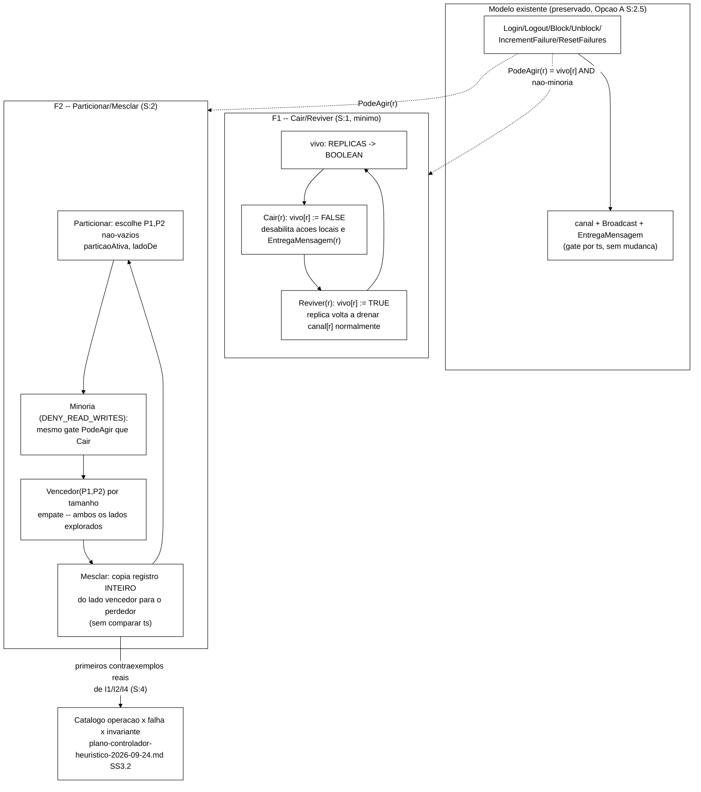

# Plano técnico de B-22 — falhas explícitas (F1/F2) em `spec/SessionStore.tla`

> Elaborado pelo Senior em 2026-10-03, após aprovação do Gestor de priorizar B-22
> antes do controlador heurístico (`docs/validacao-b23-b24-final-2026-10-02.md` §5).
> Continua `docs/revisao-mecanismo-conflito-infinispan-2026-10-02.md` §C.2/§C.3 (Fases
> 4-5, aqui detalhadas) e `docs/plano-controlador-heuristico-2026-09-24.md` §3.2
> (catálogo operação×falha×invariante, hoje `PENDENTE`). **Só planejamento — nenhum
> arquivo de `spec/*.tla`, código ou script foi alterado para produzi-lo.** O Worker
> implementa numa rodada seguinte, com aprovação do Gestor nos pontos marcados em §7.

### Visão geral — as duas famílias de ação novas e como se encaixam no modelo existente



---

## 1. Resolução da hipótese de F1 (§C.3 do documento de 02/10)

### 1.1 A hipótese, completa (o texto estava cortado quando chegou ao Gestor)

> "Pela A.3: F1 (1 nó cai, 2 de 3 sobrevivem) **nunca ativa** modo degradado nem
> *merge-policy* neste cluster de 3 réplicas — é só *rebalance*/`state-transfer`.
> **Hipótese a confirmar, não decidida aqui:** talvez F1 não precise de nenhuma ação
> dedicada de "*crash*" no TLA+ — bastaria modelar que uma réplica fica temporariamente
> sem receber `EntregaMensagem` (atraso, não ausência de dados) até o *state-transfer*
> reconvergir. Isso é **mais simples** do que o B-22 original presumia, mas também é
> uma leitura nova que o Gestor precisa validar antes de entrar no desenho de B-22 de
> fato."

### 1.2 Decisão: F1 **precisa**, sim, de uma ação dedicada — mas mínima, e por um motivo diferente do que a hipótese original presumia

A hipótese original cometia um pequeno deslize ao dizer "bastaria... atraso, não
ausência de dados": o modelo atual **já não tem** nenhum conceito de "dado ausente" por
réplica (desde a revisão do Achado E, `sessoes[r][s]`/`identidades[r][id]` sempre têm um
valor, nunca `null`) — então "atraso" por si só já é exatamente o que
`canal`/`EntregaMensagem` fazem hoje, sem precisar de nada novo. Se a pergunta fosse só
"o modelo *consegue representar* um atraso de entrega", a resposta seria trivialmente
sim, sem mudança nenhuma. **Mas essa não é a pergunta certa.** A pergunta certa é: *o
modelo hoje consegue sequer **explorar** o cenário "uma réplica fica temporariamente
incapaz de agir e depois volta"?* E a resposta é **não** — não existe, hoje, nenhuma
ação que torne uma réplica indisponível por um tempo. Sem isso, "F1 nunca produz
violação" não é um resultado **verificado**, é uma lacuna de cobertura: o TLC nunca é
sequer convidado a explorar essa região do espaço de comportamentos.

**Decisão: adicionar uma ação `Cair(r)`/`Reviver(r)` mínima — não para capturar um
risco que se espera encontrar (não se espera; ver §1.3), mas para transformar "F1 nunca
viola, pela ausência de evidência em contrário" em "F1 nunca viola, confirmado pelo TLC
contra um modelo que de fato tenta".** Isso é consistente com o próprio princípio de
falsificabilidade que orienta este projeto desde o plano de 24/09 (Wieringa, CAND-019):
não presumir um resultado que nunca foi de fato verificado, mesmo que a predição teórica
(Achado E) seja forte.

### 1.3 Desenho da ação (mínima, sem mecanismo de *merge*)

Nova variável: `vivo: [REPLICAS -> BOOLEAN]` (todas `TRUE` em `Init`).

```tla
Cair(r) ==
  /\ vivo[r] = TRUE
  /\ vivo' = [vivo EXCEPT ![r] = FALSE]
  /\ UNCHANGED <<sessoes, identidades, canal, relogio>>

Reviver(r) ==
  /\ vivo[r] = FALSE
  /\ vivo' = [vivo EXCEPT ![r] = TRUE]
  /\ UNCHANGED <<sessoes, identidades, canal, relogio>>
```

- Todas as 6 ações locais (`Login`, `Logout`, `IncrementFailure`, `ResetFailures`,
  `Block`, `Unblock`) e `EntregaMensagem(r)` passam a exigir `vivo[r] = TRUE` como
  pré-condição adicional — uma réplica "caída" não processa nada, nem localmente nem
  mensagens que chegam para ela (fidelidade: um processo parado não roda nenhum código,
  nem o que trataria uma mensagena recebida).
- **Por que não há "estado-transferência" explícita aqui:** enquanto `r` está caída,
  `canal[r']` (de qualquer outra réplica `r'`) continua acumulando normalmente as
  mensagens que seriam endereçadas a `r` (`Broadcast` já enfileira para todo `r2 \in
  REPLICAS \ {origem}`, sem checar se `r2` está viva — isso é deliberado, não um
  descuido: mensagens "em trânsito" para um nó caído são exatamente o que, na
  implementação real, seria perdido/nunca entregue a um processo morto, mas aqui
  modelamos como "esperando na fila até a réplica revivir e começar a processá-la via
  `EntregaMensagem`"). Quando `Reviver(r)` acontece, `r` simplesmente volta a poder
  escolher `EntregaMensagem(r)` e processar seu acúmulo de mensagens, uma a uma, pela
  mesma lógica de *gate* (`m.ts > ts local`) que já existe — **convergindo para o mesmo
  estado final que uma cópia bruta (*state transfer*) produziria**, porque o *gate*
  baseado em `ts` já garante que o valor mais recente vence independentemente de ordem
  de entrega. A diferença entre "retransmissão da fila" (o que o modelo faz) e "cópia
  de snapshot" (o que o Infinispan real faz) não afeta os invariantes verificados, que
  são sobre o estado final, não sobre o caminho até lá.
- **Por que isso não quebra a Simetria:** `Cair`/`Reviver` tratam toda réplica
  igualmente (`\E r \in REPLICAS: Cair(r)`), sem nenhum termo dependente de qual réplica
  é qual — `Simetria == Permutations(IDS) \cup Permutations(SIDS) \cup
  Permutations(REPLICAS)` em `MCSession.tla` continua válida sem alteração.

### 1.4 Resultado esperado — e por que isso ainda tem valor mesmo "não achando nada"

Com `vivo` restrito a nunca cair mais de 1 réplica por vez (ver limite de
cardinalidade em §4) e sem nenhum mecanismo de *merge*/conflito associado a
`Cair`/`Reviver`, a expectativa teórica (consistente com o Achado E) é que **I1-I6
continuem fechando exatamente como antes** — nenhuma violação nova. Isso não é um
exercício vazio: é a primeira vez que essa expectativa é **testada**, não só
**presumida**. Se o TLC encontrar uma violação aqui, seria um achado real e importante
(contradiria o Achado E ou revelaria uma interação não prevista entre `Cair`/`Reviver` e
o *gate* de `ts`) — a reportar antes de prosseguir para F2, não a descartar.

---

## 2. Desenho da ação de partição F2

### 2.1 `Particionar(P1, P2)` — o não-determinismo do particionamento

```tla
Particionar ==
  /\ ~particaoAtiva
  /\ \A r \in REPLICAS: vivo[r] = TRUE   \* F1 e F2 mutuamente exclusivos nesta rodada, ver S:2.5
  /\ \E P1 \in SUBSET REPLICAS \ {{}, REPLICAS} :
       LET P2 == REPLICAS \ P1 IN
       /\ particaoAtiva' = TRUE
       /\ ladoDe' = [r \in REPLICAS |-> IF r \in P1 THEN 1 ELSE 2]
       /\ UNCHANGED <<sessoes, identidades, canal, relogio, vivo>>
```

`P1`/`P2` são escolhidos não-deterministicamente entre **todos** os particionamentos
possíveis em dois subconjuntos não-vazios e disjuntos de `REPLICAS` — o TLC explora
**todas** as formas de dividir o cluster, não uma única hipotética. Novas variáveis:
`particaoAtiva: BOOLEAN` (inicialmente `FALSE`), `ladoDe: [REPLICAS -> {1,2}]` (valor
irrelevante enquanto `~particaoAtiva`).

### 2.2 Maioria/minoria — sem precisar modelar `topologyId`

Regra real (Achado E, item A.1): "a partição com mais réplicas vence; em empate, a de
maior `topologyId`". Como o cluster real deste projeto tem **3** réplicas, qualquer
particionamento em dois subconjuntos não-vazios é **1 contra 2** — nunca há empate, e
`topologyId` nunca precisa ser desempatado. Para as cardinalidades de **2** réplicas
(`tiny`/`small`/`medium`, usadas para verificação exaustiva rápida — ver
`spec/run-tlc-invariantes.sh`), um particionamento em dois subconjuntos não-vazios é
sempre **1 contra 1** — um empate **toda vez**.

**Decisão de desenho:** em vez de inventar um desempate determinístico fixo (que
reintroduziria exatamente o tipo de mecanismo sem correspondência real que o Achado E já
rejeitou, e quebraria a `Simetria` de `REPLICAS` outra vez, como `RepIndex` fazia antes),
**generalizar a regra para permitir ambos os lados vencerem não-deterministicamente em
caso de empate**:

```tla
Vencedor(P1, P2) ==
  IF Cardinality(P1) > Cardinality(P2) THEN {P1}
  ELSE IF Cardinality(P2) > Cardinality(P1) THEN {P2}
  ELSE {P1, P2}   \* empate -- ambas as possibilidades exploradas, nao uma fixa
```

Isso preserva `Simetria` (nenhuma réplica específica é favorecida, só o **tamanho** do
lado importa) e é honesto sobre o que o modelo sabe e não sabe: o desempate real por
`topologyId` é um detalhe de implementação não documentado em `Metodologia.tex` nem
relevante para o cluster real de 3 nós deste projeto — em vez de inventar um valor,
o modelo explora **as duas** resoluções possíveis sob empate. **Consequência prática:**
o catálogo de contraexemplos de F2 (§4) deve ser obtido preferencialmente na
cardinalidade `full` (3 réplicas, sem empate, a que de fato corresponde ao cluster
real) — as cardinalidades de 2 réplicas continuam úteis para iteração rápida durante o
desenvolvimento do modelo, mas o veredito que importa para o Cap. 5 é o de `full`.

### 2.3 Enquanto particionada — minoria congela (DENY_READ_WRITES), maioria opera normalmente

A configuração real do projeto é `when-split="DENY_READ_WRITES"` (confirmado,
`cluster/infinispan-cluster.xml`) — a minoria **não aceita leitura nem escrita** (modo
`DEGRADED`). Reaproveitando o mecanismo de `vivo` de §1 (mesma semântica de "não pode
agir", por motivo diferente): as 6 ações locais e `EntregaMensagem(r)` passam a exigir
adicionalmente:

```tla
PodeAgir(r) == vivo[r] /\ (~particaoAtiva \/ ladoDe[r] \in Vencedor(ladoMaioria))
```

(onde `ladoMaioria`/`ladoMinoria` são derivados de `ladoDe` e `Vencedor` — a réplica só
age se não há partição, ou se está do lado que `Vencedor` inclui). A réplica minoritária
fica, na prática, no mesmo estado de "não pode agir" que `Cair` já modela — mas **sem**
chamar `Cair`/`Reviver` (são eventos logicamente distintos: F1 é o PROCESSO parar; F2 é
a REDE cortar — o processo da réplica minoritária continua rodando, só não pode
satisfazer `DENY_READ_WRITES`).

**`Broadcast` durante partição:** mensagens de uma réplica do lado perdedor
(minoritário) para o lado vencedor nunca chegam a ser um problema prático, porque a
minoria não pode mais agir (não gera novas mensagens) — mas mensagens **já enfileiradas
antes da partição começar** continuam exatamente como estão (não removidas
retroativamente), e podem ser entregues normalmente enquanto a réplica destino ainda
está do lado que as recebe. Isso já captura, de graça, a janela real que a documentação
oficial do Infinispan descreve ("entre o *split* e a detecção, uma escrita que acontece
no nó que está prestes a ficar isolado pode ser perdida") — a interação de
não-determinismo entre "quando a réplica escreve localmente" e "quando `Particionar` é
escolhido" já é inerente à forma como `Next` oferece todas as ações habilitadas em
qualquer ordem, sem necessidade de nenhum mecanismo extra de "janela de graça".

### 2.4 `Mesclar` — maioria vence, registro inteiro, sem *timestamp*

```tla
Mesclar ==
  /\ particaoAtiva
  /\ \E ladoVencedor \in Vencedor({r \in REPLICAS : ladoDe[r] = 1},
                                   {r \in REPLICAS : ladoDe[r] = 2}) :
     \E rf \in ladoVencedor :      \* "o coordenador do merge" -- qualquer membro do lado vencedor
       LET perdedores == REPLICAS \ ladoVencedor IN
       /\ sessoes'     = [r \in REPLICAS |-> IF r \in perdedores THEN sessoes[rf]     ELSE sessoes[r]]
       /\ identidades' = [r \in REPLICAS |-> IF r \in perdedores THEN identidades[rf] ELSE identidades[r]]
       /\ relogio'      = [r \in REPLICAS |-> IF r \in perdedores THEN relogio[rf]     ELSE relogio[r]]
       /\ particaoAtiva' = FALSE
       /\ UNCHANGED <<canal, vivo>>
```

Pontos de desenho deliberados, cada um rastreável a um achado real do Infinispan
(Achado E, §a):

- **Cópia do registro inteiro, nunca comparação por `timestamp`:** `sessoes[rf]`
  substitui **tudo** em cada réplica perdedora — não há comparação `m.ts > ts local`
  aqui (esse *gate* é exclusivo de `EntregaMensagem`, não de `Mesclar`). Isso é
  literalmente `PREFERRED_NON_NULL`/`PREFERRED_ALWAYS` real: "o valor da partição com
  mais réplicas vence", sem noção de qual lado escreveu mais recentemente — inclusive
  podendo descartar uma escrita genuinamente mais nova que aconteceu no lado
  minoritário antes da partição ser detectada (a documentação oficial avisa
  exatamente isso: "could use stale values").
- **`relogio` também é copiado** (não só `sessoes`/`identidades`): sem isso, a réplica
  perdedora, ao voltar a poder escrever depois do `Mesclar`, poderia calcular um
  `ts` novo menor que o já presente nos registros que acabou de receber por cópia,
  fazendo sua própria escrita subsequente perder o *gate* contra si mesma — um
  artefato de modelagem, não um comportamento real a preservar.
- **`rf` é escolhido não-deterministicamente dentro do lado vencedor** (não um
  "representante" fixo) — modela o fato de que, do ponto de vista de fora, qualquer
  membro do lado vencedor é uma fonte igualmente válida (assumindo que o lado vencedor,
  se tiver mais de 1 réplica, já convergiu internamente pela via normal de
  `EntregaMensagem` — se **não** tiver convergido ainda no momento do `Mesclar`, o TLC
  vai explorar os dois resultados possíveis, o que é o comportamento certo: expõe a
  pergunta "o `Mesclar` deveria esperar quiescência intra-partição antes de rodar?"
  como uma pergunta aberta pelo próprio não-determinismo, em vez de decidida a priori).

### 2.5 O que fica fora desta rodada (limitações explícitas)

- **F1 e F2 são mutuamente exclusivos** (`Particionar` exige `\A r: vivo[r]`; a
  interação "um nó cai **durante** uma partição" não é modelada). Justificativa: manter
  o escopo desta rodada tratável — a combinação dos dois é um refinamento de rodada
  futura, não bloqueia o catálogo real de F1/F2 isolados.
- **O achado P-16 (empate de `ts` entre escritas locais concorrentes no regime
  nominal, `docs/validacao-fases1-3-achado-e-2026-10-02.md` §2) não é resolvido por
  este plano.** Adicionar F2 não torna o regime **nominal** (sem partição) síncrono —
  duas réplicas não-particionadas ainda podem, em teoria, escrever concorrentemente na
  mesma chave e empatar em `ts`, exatamente como P-16 descreveu. Duas opções, **a
  decidir pelo Gestor, não implementadas aqui**:
  - **Opção A (mínima):** manter `canal`/`Broadcast`/`EntregaMensagem` exatamente como
    estão para o regime nominal; aceitar P-16 como limitação documentada; F2 é
    adicionado por cima, sem alterar a semântica de propagação nominal.
  - **Opção B (mais fiel, maior mudança estrutural):** tornar a propagação
    **síncrona** no regime nominal (e intra-lado, durante partição) — cada escrita
    local atualiza **todas** as réplicas do mesmo lado na mesma transição, sem passar
    pelo canal assíncrono; `canal`/`EntregaMensagem` passam a ser usados só para o
    cenário específico de mensagem "em trânsito" no instante exato da partição (§2.3).
    Isso fecha P-16 por construção (nenhuma escrita concorrente na mesma chave é
    alcançável fora de partição), mas é uma mudança de arquitetura além do que F2
    estritamente precisa.
  - **Recomendação do Senior: Opção A para esta rodada** (não bloquear a entrega do
    catálogo real de F2 com uma mudança estrutural maior); Opção B como refinamento de
    rodada seguinte, depois de F2 estar validado. Mas se o Gestor preferir fechar P-16
    e F2 juntos, Opção B deve ser adotada já aqui — **decisão do Gestor, §7**.

---

## 3. Esboço de `scripts/inject-partition.sh` (B-29 — referência para o Worker, não implementação completa)

Interface proposta (mesmo estilo de `inject-crash.sh`/`inject-jitter.sh`):

```
Uso: inject-partition.sh --minority <no> [--duration <segundos>] [--dry-run] [--help]

Isola <no> da rede do cluster (split-brain real, nao crash de processo --
o container continua rodando). Com 3 nos, a particao e sempre 1-contra-2
(o cluster real forma TCPPING sobre uma rede bridge Podman unica, size=3).

  --minority <no>      obrigatorio -- nome do servico isn1/isn2/isn3
  --duration <seg>      default 60 (>= T16 FD_ALL3 timeout, 40s, para
                        garantir deteccao real -- diferente de
                        inject-crash.sh, aqui a desconexao e limpa mas o
                        processo continua respondendo localmente, FD_ALL3
                        ainda precisa expirar para o resto do cluster
                        declarar DEGRADED)
  --dry-run             so imprime o plano, nao executa
  --help

Mecanismo: `podman network disconnect <rede> <no>` isola o container da
rede bridge (equivalente a desconectar o cabo -- mais fiel que regras de
firewall, e nao precisa de NET_ADMIN dentro do container, diferente do
netem de inject-jitter.sh). `podman network connect <rede> <no>` religa
ao final. Exit codes no mesmo padrao: 0 sucesso, 2 argumento invalido,
3 dependencia ausente (podman), 4 no nao encontrado/ja desconectado.

Semantica de split-brain: a config real e DENY_READ_WRITES (nao
ALLOW_READ_WRITES) -- o lado minoritario (1 no) entra em DEGRADED e
nega leitura/escrita assim que detecta a particao (nao e preciso o
script fazer nada alem de isolar a rede; o proprio Infinispan aplica
DENY_READ_WRITES). Nao ha flag para simular ALLOW_READ_WRITES (fora de
escopo -- nao e a configuracao real do projeto).
```

**Nota para o Worker:** confirmar, antes de implementar de fato (B-29, rodada
separada), se `podman network disconnect` exige privilégio *rootful* como o `netem` de
`inject-jitter.sh` precisou (`docs/registro-de-problemas.md`, correção P-18) — não
verificado nesta rodada de planejamento.

---

## 4. Plano de reverificação TLC

### 4.1 O que esperar que mude

| Invariante | Veredito hoje (sem F1/F2) | Veredito esperado com F1 (`Cair`/`Reviver`) | Veredito esperado com F2 (`Particionar`/`Mesclar`) |
|---|---|---|---|
| `TypeOK` | Fecha exaustivo | Fecha exaustivo (esperado, não presumido) | A confirmar — `particaoAtiva`/`ladoDe` entram em `TypeOK` |
| I1, I2 | Violado "por construção" (propriedade *cross-réplica* sem condição de quiescência — achado conhecido, não ligado a F1/F2) | Sem mudança esperada | **Deve produzir contraexemplo real** ligado à janela de partição (§2.3) — primeiro contraexemplo genuíno do catálogo |
| I3, I4 | Fecham exaustivo (I3), I4 fecha | Sem mudança esperada para I3; **I4 deve produzir contraexemplo real sob F2**, mesmo mecanismo de I1 |
| I5, I6 | Fecham exaustivo | Sem mudança esperada — convergência via `EntregaMensagem` após `Reviver` | **Devem continuar fechando** após `Mesclar` + passos suficientes de `EntregaMensagem` para convergência intra-lado — **não presumir**, checar |

### 4.2 Risco de explosão de espaço de estados

O *backlog* original (`docs/planejamento-inicial.md`, R-04) já sinalizava "Médio-alto".
**Reavaliação, com o desenho concreto acima: Médio**, não Médio-alto — motivos:

- `Cair`/`Reviver` adicionam só `2^|REPLICAS|` ao espaço (pequeno: ×4 para 2 réplicas,
  ×8 para 3).
- `Particionar` tem, no máximo, `2^|REPLICAS| - 2` escolhas de `P1` por estado onde é
  habilitada (1 para 2 réplicas, 6 para 3 réplicas — ou 3 descontando simetria
  `P1`/`P2`) — pequeno para as cardinalidades deste projeto.
- **Mas** o produto combinado (`vivo` × `particaoAtiva` × `ladoDe`) com o espaço já
  existente (`canal`, `relogio`) pode multiplicar o tempo de verificação
  significativamente, mesmo sem explosão combinatória "grande" em termos absolutos —
  consistente com a experiência já registrada no projeto (Mudança 2, redução de
  `MaxRelogio` de 4 para 3, foi necessária só para acomodar o colapso em registro
  único; aqui o acréscimo é outra dimensão de estado inteira).

**Redução de cardinalidade adicional, provavelmente necessária:** sim — recomendo uma
nova *state constraint* em `MCSession.tla`, limitando o número **total** de eventos de
falha (`Cair`+`Particionar`+`Mesclar`+`Reviver`) por comportamento, análoga a
`LimiteCanal`/`LimiteRelogio`:

```tla
LimiteEventosFalha == quedas + particoes =< MaxEventosFalha   \* novo contador, incrementado por Cair e Particionar
```

(precisa de uma variável contadora nova, incrementada por `Cair`/`Particionar`,
análoga em espírito a `relogio`). Sem isso, o TLC pode explorar sequências arbitrárias
de queda→recuperação→partição→*merge*→queda... sem nunca terminar de explorar o
espaço relevante perto da origem. Valor inicial proposto: `MaxEventosFalha = 1` (um
único evento de falha por comportamento) para a primeira rodada de verificação —
suficiente para obter os primeiros contraexemplos de I1/I2/I4 sem multiplicar ainda
mais o espaço já maior; valor a aumentar depois se o catálogo precisar de cenários com
múltiplos eventos.

### 4.3 Ordem recomendada de execução

1. `Cair`/`Reviver` isoladamente (sem `Particionar`/`Mesclar` ainda) — TLC em
   `tiny`/`small`/`medium`/`full`, confirmar I1-I6 sem regressão (§1.4).
2. `Particionar`/`Mesclar` isoladamente (com `Cair`/`Reviver` existindo no código mas
   nunca disparando — ou removê-los temporariamente do `Next` para isolar a variável) —
   TLC primeiro em `full` (sem empate, veredito mais direto para o catálogo real),
   depois `tiny`/`small`/`medium` se útil para iteração.
3. Reportar os contraexemplos reais de I1/I2/I4 encontrados — estes alimentam o
   catálogo (`docs/plano-controlador-heuristico-2026-09-24.md` §3.2) e devem ser
   documentados com o mesmo rigor dos relatórios de TLC anteriores
   (`docs/relatorio-tlc-*.md`).
4. Só depois, se o Gestor aprovar, `Cair` e `Particionar` juntos no mesmo `Next` (ainda
   mutuamente exclusivos, por precondição, §2.5) para a bateria de aceite final.

---

## 5. Critérios de aceite deste plano

1. Decisão sobre F1 (`Cair`/`Reviver`, §1) confirmada pelo Gestor — incluindo a
   justificativa de "testar, não presumir" em vez de só aceitar a previsão do Achado E.
2. Desenho de `Particionar`/`Mesclar` (§2) confirmado, incluindo a decisão sobre
   desempate por tamanho (`Vencedor`, sem `topologyId`) e o escopo de verificação
   primário em `full` (3 réplicas).
3. Decisão sobre Opção A vs. B para P-16 (§2.5) — explicitamente não resolvida aqui,
   precisa confirmação antes do Worker tocar `EntregaMensagem`/`Broadcast`.
4. `MaxEventosFalha` (§4.2) e seu valor inicial (1) aceitos ou substituídos.
5. Esboço de `scripts/inject-partition.sh` (§3) aceito como referência para uma B-29
   futura — não é uma aprovação para implementar B-29 nesta rodada.
6. F1 e F2 mutuamente exclusivos nesta rodada (§2.5) aceito como escopo, com a
   combinação ficando para trabalho futuro.

---

## 6. Rastreabilidade — decisão de desenho ↔ achado/princípio

| # | Decisão | Fonte/achado |
|---|---|---|
| D1 | `Cair`/`Reviver` mínimo, sem *merge*, para F1 | Achado E A.3 (F1 nunca ativa DEGRADED) + princípio de falsificabilidade (Wieringa, CAND-019 — testar, não presumir) |
| D2 | Convergência de `Cair`/`Reviver` via `EntregaMensagem` normal, sem cópia de *snapshot* | O *gate* por `ts` já garante convergência ao valor mais recente independente de ordem — propriedade já estabelecida na revisão do Achado E |
| D3 | `Vencedor` por tamanho, sem `topologyId`, não-determinístico em empate | Achado E A.1 (regra real é posicional/por tamanho, não por *timestamp*); preserva `Simetria` de `REPLICAS` |
| D4 | `Mesclar` copia registro inteiro, nunca compara `ts` | Achado E A.1-A.2 (`PREFERRED_NON_NULL` degenera em `PREFERRED_ALWAYS` para este protocolo — "primeiro valor não-nulo" nunca é exercitado porque nunca há remoção) |
| D5 | Opção A (P-16 não resolvido nesta rodada) recomendada sobre Opção B | Escopo — evitar acumular duas mudanças estruturais grandes (F2 + sincronismo nominal) na mesma rodada |

---

## 7. Pontos que precisam de validação do Gestor

1. **F1 — `Cair`/`Reviver` mínimo (§1).** Confirmar a decisão e a justificativa
   ("testar, não presumir"), não só aceitar a previsão teórica do Achado E.
2. **F2 — desenho de `Particionar`/`Mesclar` (§2).** Confirmar `Vencedor` por tamanho
   sem `topologyId`, e que `full` (3 réplicas) é o cardinal de referência para o
   catálogo real.
3. **P-16 — Opção A vs. B (§2.5).** Decisão explícita necessária antes do Worker tocar
   `EntregaMensagem`/`Broadcast`. Recomendação do Senior: Opção A agora, Opção B depois.
4. **`MaxEventosFalha=1` (§4.2)** como ponto de partida, a confirmar ou substituir.
5. **Esboço de `inject-partition.sh` (§3)** como referência, sem aprovar B-29 completo
   nesta rodada.
6. **F1/F2 mutuamente exclusivos (§2.5)** como escopo desta rodada — combinação fica
   para depois.
7. Como sempre: nada vai a `origin/*` sem aprovação explícita.

---

## 8. Próxima tarefa sugerida para o Worker

Não antes da validação do Gestor sobre os pontos 1-4 de §7 (5-6 são menos urgentes,
podem ser confirmados em paralelo). Se aprovado, nesta ordem:

1. Implementar `Cair`/`Reviver` + `vivo` em `spec/SessionStore.tla`; rodar TLC
   (`tiny`/`small`/`medium`/`full`) e reportar o veredito real antes de prosseguir —
   não presumir que vai bater com §1.4.
2. Implementar `Particionar`/`Mesclar` + `particaoAtiva`/`ladoDe`/`Vencedor`
   (decisão da Opção A/B de §2.5 já confirmada pelo Gestor antes de começar); rodar TLC
   primeiro em `full`, depois nas demais cardinalidades.
3. Documentar os primeiros contraexemplos reais de I1/I2/I4 (formato
   `docs/relatorio-tlc-*.md`, mesmo padrão já estabelecido) e atualizar o catálogo
   operação×falha×invariante do plano de 24/09 §3.2, trocando `PENDENTE` pelo veredito
   real.
4. Esboçar `scripts/inject-partition.sh` (B-29) usando §3 como ponto de partida, se o
   Gestor quiser avançar isso na mesma rodada — senão, registrar como *backlog*
   separado.
5. Reportar tudo ao Gestor e ao Senior antes de qualquer *push* para `origin/*`.
