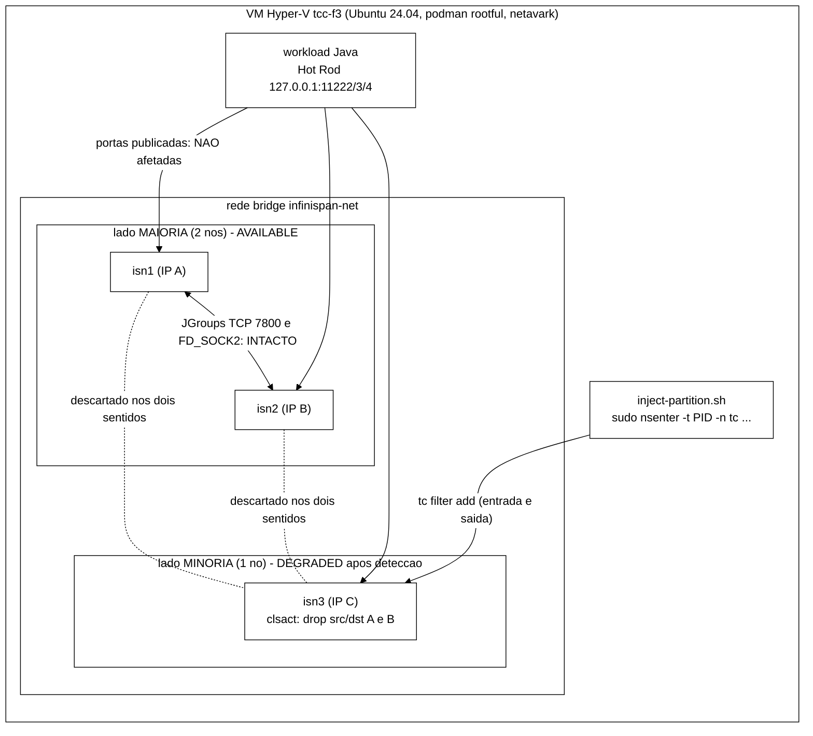
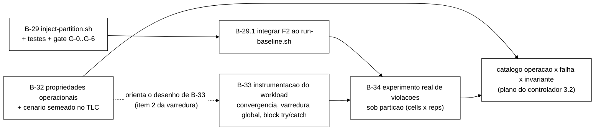

# Plano técnico de B-29 (partição de rede real) e dos contraexemplos de I1, I2 e I4

> Elaborado pelo Senior em 2026-10-09, a pedido do Gestor, depois de `docs/fechamento-b22-2026-10-03.md`
> recomendar `scripts/inject-partition.sh` (B-29) antes do controlador heurístico. **Só planejamento:
> nenhum `spec/*.tla`, script ou código do `workload/` foi alterado.** O Worker implementa em rodada
> posterior, nos pontos aprovados pelo Gestor (seção 8).
>
> Fontes lidas (por `git show`, sem alterar nenhuma branch): `ba6dd23` (fechamento de B-22),
> `docs/validacao-b22-f2-2026-10-03.md` (`81d2071`), `docs/plano-b22-falhas-explicitas-2026-10-03.md`
> (`f664cbd`, seção 3: esboço de `inject-partition.sh`), `docs/plano-controlador-heuristico-2026-09-24.md`
> (`5450cd7`, seção 3.2: catálogo operação × falha × invariante), `docs/revisao-mecanismo-conflito-infinispan-2026-10-02.md`
> (Achado E) e, em `feature/b22-f2-particao` (`8e2e815`): `spec/SessionStore.tla`, `spec/MCSession.tla`,
> `spec/run-tlc-invariantes.sh`, `scripts/inject-crash.sh`, `scripts/inject-jitter.sh`,
> `scripts/inject-jitter.test.sh`, `scripts/run-baseline.sh`, `cluster/*`, `workload/.../SessionOps.java`,
> `InvariantAuditor.java`, `WorkloadMain.java`.
>
> **Base da branch deste documento:** `ba6dd23`, como pedido. Ela só adiciona este arquivo e não toca nada
> que `feature/b22-f2-particao` altere, então integra sem conflito com qualquer ponta. Atenção: **o
> código vive em `feature/b22-f2-particao` (`8e2e815`)**, que não contém os documentos do Senior (eles
> estão em branches `docs/*` de um commit cada, a partir de `main`). Por isso as referências a scripts e
> à especificação abaixo apontam para essa branch, e a branch de implementação do Worker deve partir
> dela (seção 6).

Nomenclatura usada neste texto, sem siglas soltas: **queda de nó** (F1, o processo para), **partição de
rede** (F2, o cabo é cortado entre subconjuntos de nós, os processos continuam rodando) e **atraso de
rede** (F3, jitter de latência).

---

## 1. Resumo das decisões propostas

1. **Mecanismo de injeção: `tc` (como o Gestor sugeriu), mas não como `netem loss 100%` solto.** A
   recomendação é a disciplina `clsact` com filtros `u32` por IP de destino e de origem e ação `drop`, nos
   dois sentidos, aplicada dentro do espaço de rede do nó isolado via `sudo nsenter -t <pid> -n tc ...`.
   Isso reaproveita o padrão de `inject-jitter.sh` (mesma resolução de PID, mesmo `sudo nsenter`, mesmo
   `trap` de limpeza e mesmo código de saída 5 para "o kernel não tem o módulo"), isola o nó só dos pares
   do cluster (o tráfego Hot Rod do cliente continua passando), é simétrico com uma única operação e
   convive com o atraso de rede (F3), que usa a fila raiz. Detalhes e comparação na seção 3.
2. **O XML do cluster não precisa de mudança.** `cluster/infinispan-cluster.xml` já declara
   `partition-handling when-split="DENY_READ_WRITES" merge-policy="PREFERRED_NON_NULL"` nos dois caches
   (`sessions` e `counters`). O que precisa mudar é o texto de `docs/configuracao-infinispan.md`, que ainda
   chama isso de "salvaguarda passiva".
3. **O observável real de convergência é medido por sondagem repetida** dos leitores multi-réplica de B-24,
   depois da cura, com a carga de escrita parada. Hoje o código faz uma única rodada ao fim da repetição
   (`auditor.rodadaUnica`); a medição de tempo até convergir exige um laço novo (B-33).
4. **Os invariantes I1, I2 e I4, como estão escritos no TLA+, não podem produzir um contraexemplo
   informativo por mais fundo que se busque.** I1 e I2 já são violados sem nenhuma falha (propriedade
   entre réplicas sem condição de quiescência, atraso de propagação basta) e I4 é vazio (afirma só que o
   motivo pertence ao conjunto de motivos, o que o tipo já garante). O plano da parte B troca "buscar mais
   fundo" por **propriedades operacionais por transição** (o que o auditor real de B-23 de fato checa),
   **cenário semeado** e **matriz de execução** que isola o efeito de cada falha (seção 5).
5. **Previsão a ser falseada pelo TLC:** a regra de logout irreversível (I1) e a de bloqueio (I2) são
   preservadas sob queda de nó e sob atraso de rede, e quebradas sob partição, por um caminho de quatro
   passos pela ação `Mesclar`. Para a partição, a ausência de contraexemplo seria o resultado surpreendente.
6. **Uma divergência modelo × real merece verificação antes do experimento real:** o Achado E (A.2)
   concluiu que `PREFERRED_NON_NULL` equivale a `PREFERRED_ALWAYS` porque o protocolo "nunca remove".
   Mas uma chave criada só do lado isolado, antes da detecção, **está ausente** (não removida) do lado
   vencedor; pela regra citada no próprio A.1, a entrada do lado isolado seria restaurada. Isso não está
   no modelo (`Mesclar` copia o registro do vencedor mesmo quando vazio) e é uma causa plausível de
   violação real de I2 (seção 5.6).
7. **Numeração.** B-30 e B-31 já existem no plano do controlador (desenho estatístico bloqueado por
   bibliografia, e formalização do controlador). Para não colidir, este plano usa **B-29** (injetor, com
   sub-itens) e **B-32, B-33, B-34** (propriedades no TLC, instrumentação do workload, experimento real).
   Se o Gestor preferir outra numeração, é só renomear.

---

## 2. Contexto do TCC e lacuna que este plano fecha

- O TLC já confirmou o primeiro mecanismo real de F2: partição seguida de `Mesclar` com escolha de
  representante (`rf`) ainda não convergido gera **divergência permanente** de contador e de estado lógico
  (I5 e I6; `runs/tlc/inv-full/full-I6.out`, reconstrução em `docs/validacao-b22-f2-2026-10-03.md` 1.1).
- A linha do catálogo para I1, I2 e I4 sob partição continua **PENDENTE**: os contraexemplos de I1/I2
  obtidos naquela rodada não contêm nenhuma ação de falha (confirmado em 1 do mesmo documento).
- Não existe contraparte experimental: nenhum `inject-partition.sh` em nenhuma branch. Sem ela, não se
  sabe se o mecanismo do TLC aparece no Infinispan real ou é artefato da abstração (por exemplo, o
  Infinispan real pode esperar a convergência dentro do lado vencedor antes de fundir, o que o modelo
  não assume). É exatamente a pergunta de `docs/fechamento-b22-2026-10-03.md` seção 3.
- Cluster real: 3 nós (`isn1`, `isn2`, `isn3`), `owners=2`, JGroups sobre TCP com descoberta estática
  `TCPPING` na porta 7800, detector de falhas `FD_ALL3` (8 s de intervalo, 40 s de limite, parâmetro T16),
  `VERIFY_SUSPECT2` de 1 s e `MERGE3` entre 10 s e 30 s (`cluster/jgroups-tcp.xml`). Podman **rootful** com
  netavark dentro da VM Hyper-V `tcc-f3` (Ubuntu 24.04, usuário `server1`, IP 172.20.90.6), onde existe o
  módulo `sch_netem` (o WSL2 não tem).

---

## 3. Parte A. Como reproduzir a partição de rede no Infinispan real

### 3.1 O que o Infinispan real faz (e o que isso exige do experimento)

Resumo do Achado E (A.1 a A.3), conferido contra o XML atual:

- Os dois caches têm `DENY_READ_WRITES`. Num corte 2 × 1, o nó isolado fica sozinho: perdeu a maioria e
  segmentos cujo outro dono está do outro lado, então entra no modo **DEGRADED** e **nega leitura e
  escrita**. O lado de dois nós mantém a maioria e continua **AVAILABLE**. Com `owners=2` e um nó isolado,
  nenhum segmento perde os dois donos no lado vencedor.
- Isso só acontece **depois da detecção**: a vista do cluster só muda quando o `FD_ALL3` expira (até
  40 s sem heartbeat) mais 1 s de `VERIFY_SUSPECT2`. Antes disso o nó isolado ainda se considera
  disponível. **Esta janela de cerca de 40 s é onde o mecanismo de perda do TLC (escrita local descartada
  pelo `Mesclar`) teria um análogo real.** Por isso o `--duration` mínimo faz sentido acima de 40 s, e
  uma duração menor do que isso deve ser tratada como "atraso severo", não como partição (aviso no
  script, como já faz `inject-crash.sh`).
- Depois da cura, a fusão depende do `MERGE3` (10 a 30 s para perceber) e da resolução de conflito do
  Infinispan (`PREFERRED_NON_NULL`, regra posicional: o valor da partição preferida vence; só se ele for
  nulo, vale o primeiro valor não nulo das demais). Os valores de tempo acima são **estimativas
  derivadas dos parâmetros, não medições**; a medição é objeto do gate real (seção 3.7).
- Cada cache entra e sai de DEGRADED por conta própria; o experimento deve observar `sessions` **e**
  `counters`.

Nenhuma mudança de XML é necessária. Decisão a registrar: manter `merge-policy="PREFERRED_NON_NULL"`
(configuração real do projeto); não oferecer flag para simular `ALLOW_READ_WRITES` (fora de escopo, já
dito no esboço original).

### 3.2 Por que uma única operação de `tc` precisa cobrir os dois sentidos

`tc qdisc add dev eth0 root netem loss 100%` age só na **saída** (egress) do container. Consequências,
em ordem de gravidade:

1. **Sem filtro, descarta tudo que sai**, inclusive as respostas Hot Rod ao cliente e as consultas ao DNS
   da rede (aardvark). O nó não responderia mais "DEGRADED" ao cliente; simplesmente pararia de
   responder (tempo esgotado). Isso destrói o observável principal do experimento (o erro de
   indisponibilidade da minoria) e deixa de ser uma partição entre pares: é uma queda de nó disfarçada.
2. **Só no nó isolado, descarta um sentido apenas.** As mensagens do nó isolado nunca chegam aos outros,
   mas as dos outros chegam. Como o JGroups detecta falha por heartbeat, a maioria deixa de ouvir o nó
   isolado e o suspeita, enquanto o nó isolado ainda ouve os dois pares até o fim das conexões TCP, e
   fica com a vista errada por mais tempo. A partição fica **assimétrica**, que não é o que o modelo F2
   representa (corte simétrico entre subconjuntos).
3. **Para ser simétrico com `netem` seria preciso aplicar nos três nós**, cada um com filtro para os
   pares do outro lado, ou usar `ifb` para redirecionar o tráfego de entrada (`netem` não funciona na
   entrada). Mais peças, mais pontos de falha na limpeza.
4. **A fila raiz é a mesma que `inject-jitter.sh` usa** e o `trap` de limpeza dele faz
   `tc qdisc del dev eth0 root`: combinar atraso de rede com partição (cenário que o controlador
   adaptativo vai querer) faria uma limpeza apagar a disciplina da outra.

A forma de manter o `tc` e resolver os quatro pontos é usar o gancho **`clsact`** (entrada e saída, sem
ocupar a fila raiz) com filtros `u32` que casam o IP do par e a ação `drop`:

```bash
# dentro do netns do nó isolado (PID do container), para cada IP de par fora do lado isolado
sudo nsenter -t "$PID" -n tc qdisc add dev eth0 clsact
sudo nsenter -t "$PID" -n tc filter add dev eth0 ingress protocol ip prio 1 \
     u32 match ip src "$IP_PAR"/32 action drop
sudo nsenter -t "$PID" -n tc filter add dev eth0 egress  protocol ip prio 1 \
     u32 match ip dst "$IP_PAR"/32 action drop
# limpeza (remove a disciplina e todos os filtros de uma vez; idempotente com "|| true")
sudo nsenter -t "$PID" -n tc qdisc del dev eth0 clsact
```

Pontos de fidelidade: o pacote some "no fio" (nenhum erro volta ao processo, as conexões TCP
retransmitem com recuo exponencial, como num cabo cortado); ARP não é afetado (`protocol ip`), o que
é irrelevante porque nenhum IP de par passa; o tráfego do cliente (host para container, com origem no
gateway da bridge, e não num IP de par) não é tocado. Só opera sobre IPv4 (a rede do compose é IPv4 e o
JGroups liga em `SITE_LOCAL`); isso é conferido no gate.

### 3.3 Comparação das alternativas

Critérios: os cinco pedidos pelo Gestor, mais os que decidiram a escolha.

| Critério | (a1) `netem loss 100%` na raiz, só no nó isolado | (a2) **`tc` com `clsact` + `u32` + `drop` nos dois sentidos (recomendada)** | (b) `iptables`/`nftables` `DROP` entre IPs, via `nsenter` | (c) `podman network disconnect` / `connect` |
|---|---|---|---|---|
| Simetria entre subconjuntos | Não (só a saída do nó isolado) | **Sim**, com a operação só no nó isolado (entrada e saída) | **Sim**, mesma lógica | Sim, mas por remover o nó inteiro, não por par |
| Seletividade (preserva Hot Rod do cliente) | Não, derruba tudo | **Sim**, casa só IPs de par | **Sim** | **Não**: o nó some também para o cliente (porta publicada depende da rede) |
| Reversibilidade e limpeza idempotente | `qdisc del root` | **`qdisc del clsact`** (um comando, tolerante) | Cadeia própria + `-D`/`-X` (3 a 4 comandos) | `connect`, mas pode voltar com outro IP |
| Reuso do padrão de `inject-jitter.sh` | Total | **Total** (mesmo `nsenter`, mesma sonda e mesmo código 5) | Parcial (outra ferramenta, outro código de saída) | Pouco (outro mecanismo) |
| Convive com o atraso de rede (F3) na mesma execução | Não (disputa a raiz) | **Sim** (`clsact` não ocupa a raiz) | Sim | Sim |
| Fidelidade ao "cabo cortado" | Boa, mas aplicada à saída inteira | **Boa** (descarta antes da pilha, sem erro ao processo) | Média: o `DROP` na saída pode devolver erro de permissão ao `connect` de alguns protocolos; TCP geralmente só retransmite (a confirmar no gate) | Alta no L2, mas muda o endereço e as sockets do JGroups ficam presas ao IP antigo |
| Observabilidade da efetividade | `tc -s qdisc` | **`tc -s filter show ... ingress/egress`** (contador de pacotes descartados por direção) | `iptables -nvL` (contadores) | Só por ausência de resposta |
| Dependências na VM | `sch_netem` | `sch_clsact`, `cls_u32`, `act_gact` (todos no kernel padrão do Ubuntu; sonda no script) | `iptables` ou `nft` | `podman` |
| Risco principal | Resultado sem sentido para o experimento | Módulos ausentes (mitigado pela sonda, exit 5) | Detalhe de `DROP` na saída; mais um binário a validar | **IP e interface mudam**: `bind_addr=SITE_LOCAL` foi resolvido na partida; a porta publicada some; esboço original do Senior (plano de 03/10, seção 3) **superado por esta análise** |
| Esforço de teste | Baixo | **Baixo** (mesmo harness de `inject-jitter.test.sh`) | Médio | Alto (comportamento do netavark sob reconexão) |

**Recomendação: (a2).** Mantém o `tc` pedido pelo Gestor, resolve a assimetria e a falta de
seletividade que tornam (a1) inadequada, reaproveita integralmente o padrão do injetor de atraso de
rede, não conflita com ele e produz contador de pacotes descartados, que serve de prova de que a
partição de fato "mordeu". A opção (b) fica como **plano B documentado** (se o gate mostrar que
`cls_u32` ou `act_gact` faltam no kernel da VM), sem implementar agora. A opção (c) é descartada; vale
registrar que ela era a sugestão do esboço de 03/10 (seção 3 do plano de B-22) e que esta análise a
substitui, com a ressalva de que a premissa "não precisa de NET_ADMIN" continua verdadeira para o `tc`
via `nsenter`, que não exige capability dentro do container.

### 3.4 Topologia e sequência de injeção



```mermaid
%%{init: {'theme':'base','themeVariables':{'background':'#ffffff','primaryColor':'#ffffff','primaryTextColor':'#000000','primaryBorderColor':'#000000','lineColor':'#000000','secondaryColor':'#ffffff','tertiaryColor':'#ffffff','actorBkg':'#ffffff','actorBorder':'#000000','actorTextColor':'#000000','signalColor':'#000000','signalTextColor':'#000000','noteBkgColor':'#ffffff','noteTextColor':'#000000','noteBorderColor':'#000000','fontFamily':'Arial'}}}%%
sequenceDiagram
    autonumber
    participant S as inject-partition.sh
    participant H as host (podman, nsenter, tc)
    participant M as isn3 (minoria)
    participant J as isn1 e isn2 (maioria)
    participant W as workload
    S->>H: resolve PID de isn3 e IPs de isn1 e isn2 (podman inspect)
    S->>H: pre-limpeza idempotente (tc qdisc del clsact || true) e flock
    S->>H: registra trap de limpeza (EXIT INT TERM HUP)
    S->>H: sonda: add clsact + filtro e del (exit 5 se rejeitado)
    S->>H: add clsact; para cada par: filter ingress src e filter egress dst (drop)
    S->>H: verifica: tc -s filter show e teste de conexao a IP:7800 deve falhar
    S->>S: marcador t_inicio (epoch ns) no arquivo de marcadores
    H-->>M: pacotes de/para isn1 e isn2 descartados
    Note over M,J: heartbeats do FD_ALL3 param de chegar nos dois lados
    J->>J: cerca de 40 s depois: vista {isn1,isn2}, cache AVAILABLE
    M->>M: cerca de 40 s depois: vista {isn3}, cache DEGRADED
    W->>M: operacao em isn3 recebe erro de indisponibilidade
    W->>J: operacoes em isn1 e isn2 seguem normais
    S->>S: dorme --duration segundos
    S->>H: tc qdisc del clsact (limpeza) e verifica ausencia de residuo
    S->>S: marcador t_fim = t_cura (epoch ns)
    Note over M,J: MERGE3 percebe a outra vista (10 a 30 s); fusao e resolucao de conflito
    S-->>W: fase de convergencia: carga de escrita para, sondagem de I5/I6 comeca
```

### 3.5 Interface proposta do script (referência, não implementação)

`scripts/inject-partition.sh`, mesmo estilo de `inject-crash.sh` e `inject-jitter.sh` (`set -euo pipefail`,
`--dry-run` sem dependência, `PODMAN` sobrescrevível para `sudo podman`):

```
Uso: inject-partition.sh --minority <no> [--nodes isn1,isn2,isn3] [--iface eth0]
                         [--duration <seg>] [--marker <arquivo>] [--dry-run] [--heal] [--help]
```

| Opção | Semântica |
|---|---|
| `--minority <no>` | Obrigatório (exceto com `--heal`). Nó isolado dos demais. Validação: o conjunto isolado deve ser **estritamente menor que a metade** de `--nodes`; com três nós, só um nó. Isolar a maioria é erro de argumento (exit 2). |
| `--nodes` | Lista do cluster (default `isn1,isn2,isn3`). Os IPs dos pares são resolvidos por `podman inspect -f '{{range .NetworkSettings.Networks}}{{.IPAddress}}{{end}}'`, **nunca fixos no código**. |
| `--duration` | Default 90 s (acima dos 40 s do `FD_ALL3`, com folga). Menos de 45 s: aviso de que é "atraso severo, não partição". |
| `--marker` | Arquivo de marcadores (`fault=F2 node=<no> event=start\|end t_epoch_ns=<n>`), no formato que B-25 espera para `fault_start_ns`/`fault_end_ns`. |
| `--heal` | Só remove regras remanescentes de uma execução anterior (para o caso de `SIGKILL`, que nenhum `trap` captura) e sai. |
| `--dry-run` | Imprime o plano e sai 0, sem podman, sudo, nsenter ou tc. |

Códigos de saída iguais aos do injetor de atraso de rede (0 sucesso, 1 genérico, 2 argumento inválido,
3 dependência ausente, 4 nó não encontrado ou não rodando, 5 kernel rejeitou a disciplina, com `clsact`,
`cls_u32` ou `act_gact` ausentes), mais **6: a partição não se efetivou** (a verificação pós-aplicação
mostrou conexão ainda possível a um par, ou contadores zerados após o tempo de teste).

Robustez (requisitos de aceite, seção 3.8): `trap` registrado **antes** de qualquer alteração, pré-limpeza
no início (cobre sobra de execução morta), `flock` para impedir duas injeções simultâneas no mesmo nó,
limpeza tolerante a container que reiniciou (o netns some e a regra some junto), verificação final de
ausência de resíduo, e `--heal` documentado no runbook.

### 3.6 Observáveis reais (o que medir e como)

| Observável | O que significa | Fonte | Quando |
|---|---|---|---|
| O-1 efetividade | O corte realmente descartou pacotes nos dois sentidos | `tc -s filter show dev eth0 ingress` e `... egress` (contador de descartes por filtro); falha de conexão TCP de dentro do netns a `IP_PAR:7800` | logo após aplicar; de novo antes de remover |
| O-2 divisão de vistas | Cada lado enxerga só o seu subconjunto | log do servidor (mudança de vista do cluster em cada nó) e endpoint REST de saúde (`/rest/v2/cache-managers/default/health`); nomes exatos de campos e mensagens **a mapear no gate G-3** | `t_split`: em torno de 40 s |
| O-3 comportamento da minoria | `DENY_READ_WRITES` visto pelo cliente | CSV de eventos: operações com `replica = 127.0.0.1:11224` (isn3) passam a `ERROR_TRANSPORT`; as de isn1 e isn2 não. Hoje a indisponibilidade e a falha de transporte caem no mesmo código; ver B-33 (opcional) | do `t_split` ao fim |
| O-4 cura e fusão | Quando o cluster volta a uma vista só e os dois caches a AVAILABLE | marcador `t_fim`, log de vista fundida, saúde HEALTHY nos dois caches | `t_merge`, `t_disponivel` |
| O-5 convergência | Em quanto tempo (ou se) as réplicas voltam a concordar | **sondagem dos leitores multi-réplica de B-24** (I5 e I6), com a carga parada | de `t_fim` até estabilidade |
| O-6 violações pontuais | I1, I2 e I4 durante e depois da partição | `InvariantAuditor.registrarViolacao` (B-23) com instante; classificar cada violação pela fase | em toda a execução |

**Definição operacional de convergência (O-5).** Depois de `t_fim`, o workload **para de escrever** (para
dar sentido a "quiescência", aproximação já admitida no plano do controlador seção 3.1) e roda, a cada
5 s, uma rodada de I5/I6. Uma rodada só **vale** se, antes dela, a topologia vista pelo cliente lista os
três servidores e a saúde dos dois caches é HEALTHY; rodada inválida não conta (um leitor de nó em
DEGRADED lança exceção ou devolve conjunto vazio, e isso **não** pode ser lido como "convergiu").
`t_convergencia` é o instante da primeira de três rodadas válidas consecutivas sem divergência, menos
`t_fim`. Se nenhuma sequência dessas ocorrer em 600 s, registra-se **divergência persistente** (o
análogo experimental do contraexemplo de `full-I6`). Saída: `convergencia.csv` com instante, rodada
válida ou não, número de chaves divergentes em I5 e em I6.

**Limitação que precisa ser dita no TCC.** O leitor por segmento de B-24 devolve o estado de cada
servidor para os segmentos que ele possui (P-19, P-21); durante e logo depois da partição a posse dos
segmentos muda. Por isso a convergência só é lida depois de a topologia estabilizar (regra de rodada
válida acima).

### 3.7 Critérios de aceite do gate real na VM (G-0 a G-6)

Executados pelo Worker com o Gestor presente na primeira vez; nenhum depende de TLC.

| Gate | Verificação | Passa quando |
|---|---|---|
| G-0 | `sudo tc qdisc add dev eth0 clsact` e um filtro `u32` ... `action drop` no netns de um container; `del` em seguida | aceito sem erro (senão exit 5 e plano B de iptables) |
| G-1 | Injeção de 90 s em isn3 com a bateria parada | contadores de ingress e egress > 0 em isn3; conexão de isn3 a `IP_isn1:7800` falha; conexão isn1 a isn2 continua; **Hot Rod do host a isn3 continua respondendo** (com erro de indisponibilidade, não timeout) |
| G-2 | Fim da janela | `tc qdisc show` sem `clsact`; nenhuma regra residual; script retorna 0 |
| G-3 | Observar a divisão de vistas | log e REST mostram vista de 2 e de 1 membros; isn3 DEGRADED em `sessions` e `counters`; mapear os nomes reais de mensagens e campos para o script de análise |
| G-4 | Observar a fusão | vista única de 3 membros e HEALTHY em até um tempo máximo medido (registrar; hipótese: 15 a 90 s) |
| G-5 | Limpeza sob sinal | `kill -TERM` no script durante a janela: regra removida; `kill -KILL` seguido de `--heal`: regra removida |
| G-6 | Coexistência | injeção de atraso de rede em isn2 (F3) e partição de isn3 ao mesmo tempo: cada limpeza remove só a sua disciplina |

### 3.8 Critérios de aceite de B-29 (resumo)

1. `scripts/inject-partition.sh` implementa a seção 3.5 com o mecanismo (a2), reaproveitando o padrão de
   `inject-jitter.sh` (resolução de PID, `sudo nsenter`, sonda, `trap`, códigos de saída).
2. `--dry-run` roda em qualquer máquina, sem dependências, e imprime os comandos previstos
   (incluindo os dois filtros por par, com o placeholder `<pid>` e `<ip-par>`).
3. Limpeza idempotente demonstrada nos testes de sinal (seção 3.9) e no gate G-5.
4. Gate real G-0 a G-6 aprovado na VM e registrado em `docs/testes.md` (resultado, não suposição).
5. Integração com `run-baseline.sh` como falha `F2` (`--faults "none F1 F2 F3"`), com os parâmetros
   `--partition-node`, `--partition-duration` e o arquivo de marcadores; `--dry-run` do baseline descreve o
   ramo F2.
6. `docs/configuracao-infinispan.md` atualizado (F2 deixa de ser "reservada") e `docs/runbook-vm-hyperv.md`
   ganha a seção de `--heal`.

### 3.9 Plano de testes

**Sem VM (rodam em qualquer host), `scripts/inject-partition.test.sh`**, no estilo de `inject-jitter.test.sh`:

| ID | Teste | Esperado |
|---|---|---|
| T-par-1 | `--help` | exit 0, documenta todas as flags |
| T-par-2 | `--dry-run` com `PATH` sem podman | exit 0, plano com `nsenter`, `clsact`, filtros ingress e egress por par, `qdisc del clsact`, sem `podman exec` |
| T-par-3 | `--dry-run` com `--minority isn1`, `--nodes` de 5 nós, `--duration` | plano reflete os valores e gera filtros para todos os pares |
| T-par-4 | Argumentos inválidos: sem `--minority`; nó fora de `--nodes`; isolar a maioria (2 de 3); `--duration 0`; flag desconhecida; flag sem valor | exit 2 |
| T-par-5 | `--duration 20` | aviso de "atraso severo" e plano normal |
| T-par-6 | `run-baseline.sh --faults "none F2" --dry-run` | descreve o ramo F2, exit 0 |
| T-par-7 | **Com shims de `podman`, `sudo`, `nsenter` e `tc` no `PATH`** (scripts que só registram a chamada): execução completa com `--duration 1` | sequência observada: resolve, pré-limpeza, sonda, add clsact, filtros, show, del; exit 0 |
| T-par-8 | Mesmos shims, `tc` falhando na sonda | exit 5 e limpeza chamada |
| T-par-9 | Mesmos shims, `SIGTERM` durante a janela | `qdisc del clsact` chamado antes de sair |
| T-par-10 | Mesmos shims, `--heal` | só a limpeza é chamada |

O T-par-7 a T-par-10 dão cobertura da lógica de limpeza sem VM, o que `inject-jitter.test.sh` deixou
para o gate (T-jit-5 e T-jit-6). **Com VM**: os gates G-0 a G-6 da seção 3.7.

---

## 4. Riscos da parte A

| Risco | Prob. | Impacto | Mitigação |
|---|---|---|---|
| `cls_u32`/`act_gact` ausentes no kernel da VM | Baixa | Médio | Sonda no script (exit 5); G-0 antes de tudo; plano B iptables via `nsenter` |
| Container reinicia com a regra ativa | Média | Baixo | Limpeza com `\|\| true`; regra morre com o netns; `--heal` |
| Script morto por `SIGKILL` deixa o nó isolado | Baixa | Alto (cluster fica cortado e contamina a bateria) | `--heal` no runbook; verificação de resíduo no início de toda célula de `run-baseline.sh`; `flock` |
| Tempo de detecção e de fusão maior que o esperado (`FD_ALL3`, `MERGE3`, recuo do TCP) | Média | Médio | Medir em G-3 e G-4 antes de fixar durações; janela de convergência de 600 s |
| `block()` em `SessionOps` não tem `try/catch` | Alta (fato do código) | Médio | Em partição a chamada pode lançar exceção e derrubar a thread. Corrigir em B-33 antes do experimento |
| Indisponibilidade e falha de transporte indistinguíveis no CSV (`ERROR_TRANSPORT`) | Alta | Médio | B-33 opcional: código `ERROR_UNAVAILABLE` quando a mensagem de exceção indicar chave indisponível |
| Nós isolados ficam com topologia do cliente desatualizada na leitura de I5/I6 | Média | Médio | Regra de rodada válida (seção 3.6) |
| A premissa "TCP só retransmite" para o `drop` do `tc` depende da pilha | Baixa | Baixo | O `drop` ocorre abaixo da pilha, igual a perda de pacote; confirmar em G-1 |
| Rede do compose com IPv6 ativo | Baixa | Médio | Conferir em G-1; se houver, duplicar filtros `protocol ipv6` |

---

## 5. Parte B. Contraexemplos para I1, I2 e I4 sob partição, queda de nó e atraso de rede

### 5.1 Diagnóstico: por que "buscar mais fundo" não basta

Leitura de `spec/SessionStore.tla` (`8e2e815`):

| Invariante | Definição no modelo | Situação | Consequência |
|---|---|---|---|
| I1 | Se alguma réplica tem a sessão `INVALID/LOGOUT`, nenhuma réplica a tem `VALID`. | Violada **sem nenhuma falha**: basta `Logout` numa réplica e a mensagem ainda não entregue na outra (atraso de propagação do canal assíncrono). | O menor traço é sempre `Login`, `Logout`; aprofundar a busca só devolve o mesmo traço. |
| I2 | Se a identidade está `BLOCKED` numa réplica, nenhuma tem sessão `VALID` dela. | Idem: `Block` numa réplica, mensagem pendente na outra. | Mesma conclusão. |
| I4 | `sessoes[r][s].motivo \in MotivosT`. | **Vazia**: o tipo já garante isso (`TypeOK`). Nenhuma execução a viola. | Não existe contraexemplo possível; "motivo único" na prática é coberto, em parte, por I5 (convergência do motivo) e pelo auditor real. |

Em outras palavras, I1 e I2 são violados **por construção** (como o próprio cabeçalho do módulo
declara) e I4 não restringe nada. As regras de negócio que o texto do TCC enuncia são outras e são
**por transição ou por observador**: o auditor real de B-23 checa, por observador, "invalidação
confirmada que volta a `VALID`" (I1) e "motivo lido diferente do confirmado" (I4). O plano
traduz isso para o modelo.

### 5.2 Propriedades operacionais propostas (definidas em `MCSession.tla`, sem alterar `SessionStore.tla`)

Propriedades de ação, checadas como `PROPERTY` no TLC (formato `[][...]_vars`, segurança pura, sem
grafo de vivacidade):

```tla
\* I1F: irreversibilidade por réplica (o que o auditor real checa). Uma réplica que
\* tem a sessão INVALID nunca volta a tê-la VALID.
I1F == [][ \A r \in REPLICAS, s \in SIDS :
             sessoes[r][s].estado = "INVALID" => sessoes'[r][s].estado = "INVALID" ]_vars

\* I4F: motivo único por réplica. Fixado o motivo de uma sessão INVALID, ele não muda.
I4F == [][ \A r \in REPLICAS, s \in SIDS :
             sessoes[r][s].estado = "INVALID" => sessoes'[r][s].motivo = sessoes[r][s].motivo ]_vars

\* I2F-a: bloqueio não se perde sem Unblock. BLOCKED só deixa de ser BLOCKED por Unblock
\* local ou por entrega de ID_DESBLOQUEIA; a fusão nunca deve desfazê-lo.
I2Fa == [][ Mesclar =>
             \A r \in REPLICAS, id \in IDS :
               identidades[r][id].status = "BLOCKED" => identidades'[r][id].status = "BLOCKED" ]_vars

\* I2F-b: consistência local do bloqueio (versão por réplica, sem quiescência).
I2Fb == \A r \in REPLICAS, id \in IDS :
          identidades[r][id].status = "BLOCKED" =>
            \A s \in SIDS : sessoes[r][s].identidade = id => sessoes[r][s].estado # "VALID"
```

E variantes que **atribuem a violação à fusão**, para o caso em que a versão geral já viole sem falha
(por artefato do canal assíncrono, ver 5.4):

- `I1M`, `I4M`: as mesmas fórmulas, mas só nos passos em que a ação é `Mesclar` (`Mesclar => ...`).

### 5.3 Cenário semeado e restrições (busca direcionada)

- **`InitSemeado`**: todas as réplicas começam com a sessão `s1` (e `s2`) `VALID` da identidade `u1`, a
  identidade `OPEN`, `ts = 1` nos registros, `relogio = 1` em todas e canais vazios. Equivale a um
  mundo em que `Login` já ocorreu e já foi totalmente propagado. Com `SIDS = {s1, s2}` e `IDS = {u1}`
  a ação `Login` fica desabilitada (a precondição exige `estado = "NONE"` local, que nunca volta a
  valer), e o espaço de estados encolhe o suficiente para **elevar os limites que importam**: dois
  eventos de falha (`MaxEventosFalha = 2`, permitindo partição, fusão e nova partição), canal de até 3
  mensagens e relógio de até 5.
- **`SpecSemeada == InitSemeado /\ [][Next]_vars`** e arquivos `.cfg` dedicados por propriedade e por
  tipo de falha, gerados por uma variante de `spec/run-tlc-invariantes.sh` (nome sugerido
  `run-tlc-propriedades.sh`), com saída em `runs/tlc/prop-<falha>/`.
- **Isolamento do efeito de cada falha** por restrições de estado nos `.cfg` (sem tocar o módulo
  principal): `SemFalha == quedas + particoes = 0`, `SoQueda == particoes = 0`, `SoParticao == quedas = 0`.
- **Atraso de rede** não tem ação dedicada no modelo (a reordenação e o adiamento das entregas já são
  não determinísticos). O experimento correspondente é **`SemFalha` com canal maior**
  (`MaxCanal = 3`), que explora entregas adiadas ao máximo; dizer isso explicitamente no relatório.
- **Complemento para o modelo não semeado**: `-simulate num=<N> -depth 80` do TLC, com `Login`
  habilitado, para sondar sequências longas que a busca exaustiva não alcança. Serve para **achar**
  traços, nunca para afirmar ausência.
- **Execução por cardinalidade**: `full` (três réplicas, a que corresponde ao cluster real; um corte
  é sempre 1 contra 2, sem empate) como referência; `small` só para iteração.

### 5.4 Ressalvas do modelo que o Worker precisa conhecer (achados desta leitura)

1. **Relógio local sem fusão na recepção** (`EntregaMensagem` não atualiza `relogio`; decisão D-4
   registrada no módulo). No código real, a nova `versao` é a do registro lido mais 1. No modelo,
   `Logout` numa réplica de relógio baixo sobre uma sessão cujo `ts` já é maior **não grava
   localmente** (a guarda `novoTS > ts local` falha), mas **ainda transmite** a mensagem, que as outras
   descartam pela mesma guarda: o logout é aceito e perdido, sem nenhuma falha. Isso é por leitura do
   código, **a confirmar por TLC no cenário não semeado**; no cenário semeado (todos os relógios e `ts`
   iguais a 1) não ocorre. Se confirmado, registrar como problema novo (próximo número livre em
   `docs/registro-de-problemas.md`) e, se o Gestor quiser, adicionar a propriedade
   `I1P` (logout aceito que não efetiva) à bateria.
2. **Sid reutilizada**: no modelo, duas réplicas podem executar `Login` para o mesmo `s` ao mesmo
   tempo (precondição só olha o estado local). No código real a sid é um UUID gerado a cada login. Em
   qualquer cenário não semeado, qualquer violação de I1F/I4F que dependa de dois `Login` da mesma `s`
   é **artefato**; o cenário semeado elimina isso por construção. Alternativa sem semear: restrição de
   ação que só aceita `Login` quando todas as réplicas têm `s` vazia e não há mensagem em trânsito sobre `s`.
3. **Divergência de `Mesclar` × `PREFERRED_NON_NULL`**: ver 5.6.

### 5.5 Previsões (hipóteses falseáveis, não resultados)

| Propriedade | Sem falha (atraso de rede) | Queda de nó | Partição de rede |
|---|---|---|---|
| I1F (logout irreversível) | Preservada no semeado (não há mensagem que recrie `VALID`); sem semear, depende do artefato 5.4 (2) | Preservada | **Violada**, traço curto |
| I2Fa (bloqueio não se perde) | Preservada | Preservada | **Violada**, traço curto |
| I2Fb (consistência local do bloqueio) | Preservada no semeado (a mensagem `ID_BLOQUEIA` aplica identidade e sessões juntas) | Preservada | Preservada (o registro copiado vem de uma só réplica) |
| I4F (motivo único) | Pode ser violada por corrida `Logout` × `Block` entre réplicas (precisa de relógios diferentes; é efeito do canal assíncrono, não de falha) | Idem | Violada com ou sem partição; usar `I4M` para atribuir à fusão |
| I1M, I4M | não se aplica | não se aplica | **Violadas**, traço curto |

Traço previsto para I1F sob partição (a confirmar, em quatro passos a partir do estado semeado):
`Logout(r1, s1)` (r1 passa a `INVALID/LOGOUT`, mensagens em fila para r2 e r3); `Particionar` com
`P1 = {r1}`; `Mesclar` com `rf = r2` (r2 ainda não recebeu o logout e tem a sessão `VALID`): r1 recebe o
registro `VALID` de r2 e o logout confirmado é revertido. Depois as entregas levam `INVALID` a r2 e r3,
mas r1 nunca recebe de volta (a mensagem dele já foi consumida pelos outros): fica `VALID` para sempre,
o que também produz divergência em I5. É o mesmo mecanismo do contraexemplo de `full-I6`, aplicado a
sessão em vez de contador. Traço análogo para I2Fa: `Block(r1, u1)`, `Particionar`, `Mesclar` com
`rf = r2` devolve `OPEN` a r1.

**Se o TLC não encontrar o traço de I1F ou I2Fa sob partição**, a leitura acima do `Mesclar` está errada
ou o modelo tem uma guarda que não vi; nesse caso a primeira ação é investigar, não aceitar.

### 5.6 Por que é plausível que não existam traços sob queda de nó e atraso de rede, e o que isso não prova

**Argumento.** No cenário semeado, as únicas ações que produzem um registro `VALID` são `Login` (desabilitada)
e a ação `Mesclar` (que apenas copia registros já existentes). Logo nenhuma mensagem `SESSAO_VALIDA`
existe em qualquer canal. As demais mensagens carregam sempre registros `INVALID`, e `EntregaMensagem`
só sobrescreve um registro quando o `ts` da mensagem é estritamente maior. Assim, sem `Mesclar`, o
estado de cada sessão em cada réplica só passa de `VALID` a `INVALID` e nunca volta, para qualquer
atraso, reordenação, queda e revivência (que apenas suspendem ações). Este é o argumento de que a regra é
preservada pelo mecanismo de "o `ts` maior vence" (gate de última escrita vence). Para I2Fa, analogamente,
o único caminho de `BLOCKED` para `OPEN` sem `Unblock` é `Mesclar`.

**O que isto não prova.** O argumento vale para o cenário semeado, onde a ausência de `Login`
simplifica tudo. Fora dele, a preservação depende da suposição de sid única (5.4, ponto 2) e do relógio
(5.4, ponto 1). Portanto, o resultado a registrar é "preservada até as cotas X do cenário semeado, com o
argumento Y", nunca "preservada em geral". A diferença de comportamento entre queda de nó e partição
tem uma causa estrutural, a mesma que o relatório de F2 já apontou: só `Mesclar` descarta valor por
tamanho de partição, e não por `ts`.

**Divergência a verificar antes do experimento real (fidelidade de `Mesclar`).** O Achado E (A.2)
concluiu que `PREFERRED_NON_NULL` se comporta como `PREFERRED_ALWAYS` porque o protocolo nunca chama
`remove()`. Mas a regra citada em A.1 (`if (preferredEntry != null || otherEntries.isEmpty()) return
preferredEntry; return otherEntries.get(0)`) devolve a entrada de outro lado quando a preferida é
**nula**, e uma chave criada só do lado isolado, antes da detecção, é nula (ausente, não removida) no lado
vencedor. Ou seja, nesse caso o Infinispan real **restauraria** a entrada do lado isolado, enquanto o
`Mesclar` do modelo a descarta (copia o registro vazio do vencedor). Duas consequências:

1. Real: um `Login` atendido pelo nó isolado dentro da janela de detecção pode deixar uma sessão `VALID`
   que o cliente nunca viu confirmada (erro de tempo esgotado), mas que a fusão preserva. Se a identidade
   for bloqueada do lado vencedor nesse meio-tempo (o `Block` só varre as sessões que existem lá), após
   a fusão haverá sessão `VALID` de identidade `BLOCKED`: violação de I2 que **o auditor atual não
   enxerga**, porque nenhum cliente conhece essa sid. Detectável por varredura global pós-cura
   (5.7, ponto 3).
2. Modelo: variante opcional `MesclarNaoNulo` (se o registro do vencedor é vazio e o do perdedor não, vale o
   do perdedor), a incluir **se e só se** o gate real confirmar o comportamento. Mudança em
   `SessionStore.tla`, portanto **decisão do Gestor** (seção 8).

A confirmação é do experimento real (B-34), com o log de resolução de conflito do servidor, e não do TLC.

### 5.7 Experimento no sistema real (B-34), medindo violações durante e depois da partição

**Pergunta.** Durante e depois de uma partição real com `DENY_READ_WRITES`, ocorrem violações de I1, I2
e I4 observáveis pelo cliente? E as réplicas convergem?

**Fatores e condições** (cada célula é uma execução de `run-baseline.sh` com falha F2):

| Fator | Níveis | Motivo |
|---|---|---|
| Nó isolado | `isn3` (não coordenador); `isn1` (provável coordenador) | A perda do coordenador exercita eleição e fusão de forma diferente |
| Duração da partição | 20 s (abaixo da detecção, equivale a atraso severo); 90 s (padrão); 180 s | Separa "atraso" de "partição de fato" e mede custo de ficar isolado mais tempo |
| Cenário de carga | S1 e S2 (os mesmos do baseline) | Comparabilidade com `runs/` já existentes |
| Referências | célula sem falha, com queda de nó (F1) e com atraso de rede (F3), **já existentes** | Atribuição: só vale como efeito de F2 o que não aparece nas referências |

**Instrumentação adicional (B-33), pré-requisito do experimento:**

1. **Laço de convergência** (O-5, seção 3.6): substitui a rodada única por sondagem com rodada válida/
   inválida e arquivo `convergencia.csv`.
2. **Varredura final global** depois da convergência: percorre todas as sessões e identidades e
   registra (a) I1 em todas as sids com invalidação confirmada, (b) I4 comparando motivo lido ao
   confirmado, (c) **I2 global** (sessão `VALID` cuja identidade está `BLOCKED`, independentemente de
   o cliente conhecer a sid) e (d) **I2 bloqueio perdido** (identidade com bloqueio confirmado e
   status `OPEN` sem `Unblock` emitido). Os itens (c) e (d) não existem hoje em `SessionOps`.
3. **Tolerância dos leitores** a nó em DEGRADED e `try/catch` em `block()`.
4. **Opcional**: código `ERROR_UNAVAILABLE` no CSV para distinguir indisponibilidade de falha de
   transporte (muda o esquema do CSV; decisão do Gestor, seção 8).
5. **Marcadores** `fault_start_ns` e `fault_end_ns` (B-25) para classificar cada violação por fase:
   antes, durante (separando antes e depois do `t_split`), janela de recuperação (de `t_fim` a `t_fim`
   mais `W_recovery`) e depois da convergência.

**Hipóteses (baseadas no mecanismo real de `DENY_READ_WRITES`, e deliberadamente mais conservadoras do que as previsões do TLC para partição, porque a escrita confirmada no cluster real é síncrona entre os dois donos)**:

| ID | Hipótese | Raciocínio | Refuta-se por |
|---|---|---|---|
| H-R1 | 0 violações de I1 | Escrita confirmada exige o outro dono (o corte impede) e a minoria nega leitura após a detecção | Uma única violação com `invalidacao confirmada` e leitura `VALID` |
| H-R2 | 0 violações de I2 pelo auditor atual; **possível violação pela varredura global** (5.6, ponto 1) | Ver 5.6 | Varredura global com sessão `VALID` de identidade `BLOCKED` |
| H-R3 | 0 violações de I4 além da linha de base | Sem escrita confirmada divergente | Contagem acima do baseline sem falha |
| H-R4 | Convergência, com `t_convergencia` da ordem de dezenas de segundos após `t_fim` | `MERGE3` + fusão + redistribuição | Divergência persistente por 600 s |
| H-R5 | Erros concentrados no nó isolado durante a janela, sem erros nos outros | `DENY_READ_WRITES` | Erros nos nós da maioria |

**Análise.** Para cada célula, contagem de violações por invariante e por fase; comparar com as
referências sem falha, queda de nó e atraso de rede. Como violações reais são eventos raros, resultados
"zero" devem vir com limite superior (regra do três: com `n` repetições sem ocorrência, o limite
superior de 95% da taxa por repetição é cerca de `3/n`) e a conclusão do texto deve ser "não observado em
`n` repetições", jamais "não ocorre". Reaproveitar `analysis/bootstrap_ic.py` para intervalos quando houver
contagens positivas. Número de repetições por célula: piloto de 3 (como no baseline curto), decisão de
aumento depois de ver a variabilidade (decisão do Gestor, seção 8).

**Alinhamento formal-experimental.** Os resultados alimentam a coluna "Status do contraexemplo" do
catálogo (`docs/plano-controlador-heuristico-2026-09-24.md` seção 3.2): um traço do TLC sem observação
real vira "mecanismo do modelo sem contraparte observada", e uma observação real sem traço (por exemplo,
o item 1 de 5.6) vira "achado experimental fora do modelo", com a variante `MesclarNaoNulo` como ação
de acompanhamento.

---

## 6. Backlog numerado



| ID | Item | Branch sugerida (partir de `feature/b22-f2-particao`) | Depende de | Critérios de aceite |
|---|---|---|---|---|
| **B-29** | `scripts/inject-partition.sh` com `clsact` + `u32` + `drop` bidirecional, `--heal`, marcadores, `--dry-run`; `scripts/inject-partition.test.sh` (T-par-1 a T-par-10) | `feature/b29-inject-partition` | Aprovação do Gestor (8.1) | Seção 3.8, itens 1 a 4; gates G-0 a G-6 aprovados na VM |
| **B-29.1** | Falha `F2` em `run-baseline.sh` (`--partition-node`, `--partition-duration`, marcadores), `docs/configuracao-infinispan.md`, `docs/testes.md`, `docs/runbook-vm-hyperv.md` | `feature/b29-1-baseline-f2` | B-29 | `--dry-run` do baseline descreve F2; documentação atualizada; seção 3.8 itens 5 e 6 |
| **B-32** | Em `spec/MCSession.tla`: `I1F`, `I4F`, `I2Fa`, `I2Fb`, `I1M`, `I4M`, `InitSemeado`, `SpecSemeada`, restrições `SemFalha`/`SoQueda`/`SoParticao`; `spec/run-tlc-propriedades.sh`; execução da matriz da seção 5.3; relatório `docs/relatorio-tlc-<data>-propriedades-fortes.md` | `feature/b32-tlc-propriedades-fortes` | Aprovação do Gestor (8.4) | (1) `SessionStore.tla` **inalterado**, a menos de aprovação expressa; (2) cada célula da matriz com veredito real e contraexemplo ou cota de exaustão; (3) previsões da 5.5 confrontadas uma a uma (confirmada, refutada, inconclusiva); (4) catálogo 3.2 atualizado com o veredito real; (5) argumento 5.6 registrado com suas ressalvas |
| **B-33** | Instrumentação do `workload/`: laço de convergência e `convergencia.csv`, varredura final global (I1, I4, I2 global, I2 bloqueio perdido), tolerância dos leitores a DEGRADED, `try/catch` em `block()`, marcadores; opcional `ERROR_UNAVAILABLE` | `feature/b33-instrumentacao-particao` | Aprovação do Gestor (8.5); B-32 só para orientar | Testes unitários novos (rodada válida/inválida, varredura com mapas em memória que contenham sessão `VALID` de identidade `BLOCKED` e bloqueio perdido), `mvn test` verde sem regressão nos 49 testes anteriores |
| **B-34** | Experimento real: células da seção 5.7, resultados em `runs/`, relatório `docs/relatorio-f2-experimento-<data>.md` com a tabela hipótese × resultado | `feature/b34-experimento-particao` (dados e relatório) | B-29, B-29.1, B-33 | Cada célula executada com marcadores e `convergencia.csv`; H-R1 a H-R5 respondidas com número e limite superior; resultado "zero" jamais escrito como "não ocorre"; catálogo atualizado; push só com aprovação |

B-32 e B-29 tocam conjuntos de arquivos disjuntos (`spec/` contra `scripts/` e `docs/`) e podem ser
feitos em qualquer ordem. B-33 toca só `workload/`.

---

## 7. Sequência de tarefas para o Worker

1. **Preparar a base.** Criar cada branch a partir de `feature/b22-f2-particao` (`8e2e815`). Conferir
   `git status` limpo e os 49 testes Java verdes antes de começar. Um item por branch, histórico linear,
   commits `feat:`/`test:`/`docs:`, sem push.
2. **B-29 (primeiro).** Escrever `inject-partition.test.sh` com T-par-1 a T-par-6 e os shims de
   T-par-7 a T-par-10 (falhando antes de existir o script), depois o script, até verde. Reportar. **Parar
   para o Gestor** antes do gate real.
3. **Gate G-0 a G-6 na VM**, com o Gestor presente na primeira execução. Registrar o resultado real
   (saídas de `tc -s filter show`, logs de vista, tempos de `t_split` e de `t_merge`) em `docs/testes.md`.
   Se G-0 falhar, voltar ao Senior antes do plano B.
4. **B-29.1.** Integração no `run-baseline.sh` e documentação. Reportar.
5. **B-32 em paralelo lógico** (só `spec/`): propriedades, cenário semeado, script, matriz. Rodar
   **primeiro** `SemFalha` nas quatro propriedades (o que valida as definições e mede o ruído do canal
   assíncrono), depois `SoQueda`, depois `SoParticao`. Relatório com cada previsão da 5.5 marcada como
   confirmada, refutada ou inconclusiva. Se aparecer o artefato 5.4 (1), parar e reportar ao Senior.
6. **B-33.** Instrumentação do workload com testes unitários; primeiro o `try/catch` de `block()` e a
   tolerância dos leitores (correções), depois o laço de convergência e a varredura global.
7. **B-34.** Piloto de 3 repetições na célula `isn3`, 90 s, S1; avaliar variabilidade e custo antes de
   propor o número final de repetições ao Gestor.
8. **Fechamento.** Atualizar o catálogo operação × falha × invariante e abrir `docs/resumos-para-tcc/`
   com o resumo técnico para os agentes acadêmicos. Relatar ao Gestor e ao Senior antes de qualquer push.

**Próxima tarefa imediata para o Worker (após a aprovação da seção 8.1 a 8.3):** B-29 até o `--dry-run`
e os testes sem VM verdes (passo 2).

---

## 8. Pontos que precisam de validação do Gestor

1. **Mecanismo.** Aprovar (a2), `tc` com `clsact` + `u32` + `drop` nos dois sentidos, no lugar de `netem
   loss 100%` na raiz; iptables como plano B documentado, sem implementar agora; `podman network
   disconnect` descartado.
2. **Interface.** Aprovar `--minority` limitado a menos da metade dos nós, duração padrão de 90 s com
   aviso abaixo de 45 s, `--heal` e `flock`, e o código de saída 6 (partição não efetivada).
3. **Numeração.** B-29 com sub-item B-29.1 e B-32 a B-34 (B-30 e B-31 já são de outros itens).
4. **Propriedades novas no TLC.** Aprovar a troca de "buscar mais fundo" por propriedades operacionais,
   cenário semeado e matriz (5.2 a 5.3), sem alterar `SessionStore.tla`. Decidir também se o Gestor quer
   que o Worker avalie a variante `MesclarNaoNulo` (alteração do módulo principal, só depois de o
   gate real confirmar o comportamento de 5.6).
5. **Instrumentação do workload (B-33).** Aprovar o escopo, em especial a varredura global de I2 e de
   bloqueio perdido (novas checagens) e a opção de `ERROR_UNAVAILABLE`, que muda o esquema do CSV que
   o `analysis/` consome.
6. **Número de repetições e durações** de B-34 (piloto de 3; decidir o final depois da variabilidade) e
   se o nó isolado deve incluir `isn1` (provável coordenador) já no primeiro experimento.
7. **Frase para o TCC.** Concordar que resultados "zero" serão relatados com limite superior e como "não
   observado", e que a ressalva do relógio local (5.4, ponto 1) será registrada como problema novo se
   confirmada.
8. **Política.** Nada vai para `origin/*` sem aprovação explícita; a branch deste documento é local.
