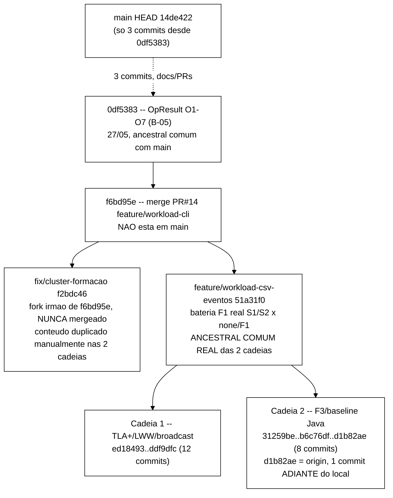

# Plano — Consolidação B-21 (base única) e implementação B-23/B-24

> Elaborado pelo Senior em 2026-10-02, a partir de decisão já tomada pelo Gestor
> (consolidar as duas cadeias antes de abrir código novo para as Etapas 7-8; depois
> implementar B-23 e B-24, nessa ordem, antes de qualquer trabalho no controlador
> heurístico). **Este documento é só planejamento** — nenhum merge foi executado,
> nenhum arquivo de `spec/*.tla`, código Java ou script foi alterado para produzi-lo;
> todo comando abaixo é proposta para o Worker executar numa rodada futura, com
> aprovação do Gestor. Continua `docs/plano-controlador-heuristico-2026-09-24.md` (daqui
> em diante "o plano de 24/09"), cujo Achado A e item B-21 do backlog são o ponto de
> partida desta rodada — mas corrige, com dados reais extraídos do próprio `git` nesta
> sessão, a caracterização que havia sido passada a este plano sobre como as duas
> cadeias se relacionam entre si (§1).

---

## 1. Correção de achados — a topologia real é mais favorável do que a descrição recebida

### 1.1 As duas cadeias não são divergências independentes de `main` — uma contém a outra até um ponto recente

A tarefa descreveu as duas cadeias como partindo "de pontos diferentes da história" e
"não convergindo entre si". Investigação direta do `git` nesta sessão (`git merge-base`,
`git log --graph`, `git diff --stat` entre os pontos relevantes) mostra algo
estruturalmente melhor:

- `git merge-base fix/broadcast-fantasma-contador-inc feature/f3-baseline` resolve para
  **`51a31f0`** (`feat(baseline): bateria F1 real S1/S2 x {none,F1} + artefatos de
  análise`, 2026-06-23) — **não** para `0df5383` (27/05), que é só o ancestral comum de
  cada cadeia com `main`.
- A partir de `51a31f0`, as duas cadeias **se bifurcam uma da outra diretamente**: a
  Cadeia 1 (TLA+/LWW) segue por `ed18493 → 3994779 → bb38ddc → c84cbbe → 7ce78ca → ...
  → ddf9dfc`; a Cadeia 2 (F3/baseline) segue por `31259be → 7263c7c → 34f525c → ... →
  b6c76df`. Cada commit de cada cadeia tem exatamente um pai dentro da própria cadeia —
  não há commits "soltos" nem histórico desconectado.
- `main` (HEAD `14de422`) está mais atrás ainda do que o plano de 24/09 registrou: **não
  contém nem `f6bd95e`**, o merge do PR #14 (`feature/workload-cli`) que é o próprio
  ancestral comum de `fix/cluster-formacao`, de `feature/workload-csv-eventos` e,
  por decorrência, de **ambas** as cadeias. `git merge-base f6bd95e main` cai de volta em
  `0df5383` — ou seja, todo o trabalho de CLI Picocli, trilha de eventos CSV, bateria F1
  real e as duas cadeias de correção TLA+/F3 vivem inteiramente fora de `main`.



**Consequência prática:** o ponto de partida certo para a consolidação não é `main`
(que exigiria recriar todo esse trabalho) nem um merge "arqueológico" de três históricos
distantes — é um **merge de duas pontas que já compartilham 90%+ do caminho**, com
divergência real concentrada nos últimos commits de cada lado. Isso muda a avaliação de
risco da B-21 de "alto, histórico complexo" para "baixo-médio, divergência recente e
estreita" — ver inventário file-a-file em §1.2.

### 1.2 Inventário file-a-file dos pontos de conflito reais (não hipotéticos)

`git diff --name-only 51a31f0 ddf9dfc` vs. `git diff --name-only 51a31f0 b6c76df` e a
interseção dos dois conjuntos dão a lista **exaustiva** de arquivos tocados por mais de
uma cadeia desde o ancestral comum — não uma lista especulativa:

| Arquivo | Cadeia 1 mudou? | Cadeia 2 mudou? | Conflito real? | Motivo / resolução |
|---|---|---|---|---|
| `cluster/infinispan-cluster.xml`, `cluster/jgroups-tcp.xml`, `cluster/podman-compose.yml` | Sim (commit `3994779`) | Sim (commit `34f525c`) | **Não** | `git diff ddf9dfc b6c76df -- cluster/` é vazio — os dois lados copiaram manualmente o mesmo conteúdo de `fix/cluster-formacao` (ver §1.3), resultando em árvores byte-idênticas. Merge automático sem intervenção. |
| `docs/registro-de-problemas.md` | Sim (+176 linhas, seções P-08 a P-15) | Sim (+8 linhas, uma seção P-08) | **Sim — único conflito real, textual e trivial** | Ambos os lados inseriram uma seção nova logo após a mesma linha-âncora (parágrafo do `--warmup-min-sec`). **Colisão de numeração:** os dois usaram "P-08" para o primeiro item novo. Resolução proposta em §2.3. |
| **Todos os outros arquivos** (`spec/*.tla`, `spec/run-tlc-invariantes.sh`, `runs/tlc/*`, `docs/plano-fix-*.md`, `docs/relatorio-tlc-*.md`, `docs/runbook-vm-hyperv.md`, `docs/plano-f3-vm-netem.md`, `runs/smoke/*` do lado 1; `docs/implementacao.md`, `docs/testes.md`, `scripts/inject-crash.sh`, `scripts/inject-jitter.sh`, `scripts/inject-jitter.test.sh`, `scripts/run-baseline.sh` do lado 2) | — | — | **Não** | Tocados por **apenas um** dos dois lados desde `51a31f0` — confirmado por `comm -12` entre as duas listas de arquivos alterados. Merge automático. |
| `workload/pom.xml` | **Não** | **Não** | — | Verificado (`git diff 51a31f0 ddf9dfc -- workload/pom.xml` e o equivalente para `b6c76df` — ambos vazios). **Corrige** a hipótese de risco "pom.xml pode ter sido tocado por ambas" levantada na tarefa: não foi. |
| Qualquer arquivo em `workload/src/` (código ou testes) | **Não** | **Não** | — | Nenhuma das duas cadeias toca `workload/src/` desde `51a31f0` — `Cli.java`, `WorkloadMain.java`, `SessionOps.java`, `InvariantAuditor.java`, `EventCsvWriter.java` etc. já são idênticos nas duas pontas, herdados do ancestral comum. Os 9 arquivos de teste (49 `@Test`, contagem confirmada por `git grep -c "@Test"` nesta sessão em `ddf9dfc`) também são idênticos nas duas pontas. |

Conclusão objetiva: **um único conflito real em todo o merge, e é textual/trivial** —
nada que afete `spec/*.tla`, código Java, scripts shell ou configuração de cluster.

### 1.3 Nota sobre `fix/cluster-formacao` (f2bdc46) — não é ancestral de nenhuma cadeia, mas seu conteúdo já está em ambas

`git merge-base --is-ancestor f2bdc46 ddf9dfc` e o mesmo contra `b6c76df` retornam
**NÃO** nos dois casos — `fix/cluster-formacao` é, na verdade, um terceiro fork-irmão de
`f6bd95e`, nunca mergeado formalmente em nenhuma das duas cadeias. O que aconteceu (
confirmado pela mensagem do commit `34f525c`: *"Traz os arquivos cluster/ de
fix/cluster-formacao ... para o tree de feature/falha-f3-jitter"*) é que o conteúdo foi
**copiado manualmente** para dentro de cada cadeia, em commits distintos (`3994779` na
Cadeia 1, `34f525c` na Cadeia 2) — por isso o diff de `cluster/` entre as duas pontas é
vazio apesar de nenhuma ancestralidade `git` ligar `f2bdc46` a nenhuma delas. **Não há
necessidade de mergear `fix/cluster-formacao` separadamente** — seu conteúdo já está
presente (e, no caso da Cadeia 2, estendido com a imagem pinada `15.0.21.Final`) nas
duas pontas. Recomendação: marcar `fix/cluster-formacao` como obsoleta no backlog (item
B-21a, baixa prioridade) e não tocá-la no merge.

### 1.4 `origin/feature/f3-baseline` (`d1b82ae`) está 1 commit adiante do local `feature/f3-baseline` (`b6c76df`) — e é esse commit que tem os dados reais de F3

`git branch -vv` mostra `feature/f3-baseline [origin/feature/f3-baseline: behind 1]`.
`git diff --stat b6c76df d1b82ae` confirma que a diferença é **só dados**:
`runs/S1-F3/`, `runs/S2-F3/` (novos) e atualização de `runs/S1-F1/`, `runs/S2-F1/`,
`runs/S1-none/`, `runs/S2-none/` (re-sumarizados, provavelmente na mesma sessão em que a
bateria F3 rodou na VM). **A consolidação deve usar `origin/feature/f3-baseline`, não o
`feature/f3-baseline` local**, para não perder a bateria F3 real — único dado empírico
de F3 hoje disponível no repositório.

### 1.5 Achado E (novo) — o mecanismo LWW do modelo TLA+ não corresponde ao mecanismo de resolução de conflito do Infinispan real

Lendo `cluster/infinispan-cluster.xml` (idêntico nas duas cadeias): as caches `sessions`
e `counters` são `DIST_SYNC`, `owners="2"`, com
`partition-handling merge-policy="PREFERRED_NON_NULL"`. Isso é a resolução de conflito
do **Infinispan**, não uma implementação do LWW por relógio de Lamport por campo que a
Cadeia 1 passou 6 commits corrigindo em `spec/SessionStore.tla`. `SessionOps.java` (lido
nesta sessão, ponta `ddf9dfc`) não implementa nenhuma lógica de *merge* própria —
`sessions.put(sid, atual)` delega inteiramente à replicação síncrona do Infinispan.
**Isso é relevante e não trivial para a Atividade 1 do plano de 24/09 (alinhamento
formal-experimental, §3.1/§3.2):** o modelo formal verifica um mecanismo de resolução de
conflito (LWW por campo via relógio lógico) que **não é o mecanismo real** em
`cluster/infinispan-cluster.xml`. Isso não invalida o trabalho da Cadeia 1 — o LWW por
relógio lógico é uma abstração razoável de *algum* mecanismo de ordenação causal, e
`DENY_READ_WRITES`/`PREFERRED_NON_NULL` é a política real do sistema sob teste — mas
significa que o catálogo operação×falha×invariante (§3.2 do plano de 24/09) precisa, ao
cruzar contraexemplo do TLC com evento real, **registrar explicitamente que está
comparando um mecanismo abstrato com um mecanismo concreto distinto**, não dois modelos
do mesmo mecanismo. Registrado aqui para o Gestor decidir se isso entra no Cap. 5 como
limitação adicional (ao lado do Achado C, F3 acima do alvo) ou se é matéria para revisar
`spec/SessionStore.tla` nas Etapas 3-4 (modelar a política real do Infinispan em vez do
LWW por campo). **Não resolvido nesta rodada — só levantado.**

### 1.6 Achados do plano de 24/09 revalidados nesta sessão

- **Achado C (F3 acima do alvo) — re-verificado contra o dado bruto, confirmado
  exato.** `runs/S1-F3/comparacao.json` em `d1b82ae` (lido nesta sessão): `IncrementFailure`
  tem `delta_p99_ms: 107.899438` e `delta_p95_ms: 80.558779` — bate com "+107,9 ms" e
  "+80,6 ms" citados no plano de 24/09, dentro do arredondamento. Confirma a política do
  projeto de cruzar número contra log bruto antes de repassar.
- **Caminho do script de TLC corrigido:** a tarefa desta rodada citou
  `scripts/run-tlc-invariantes.sh`; o caminho real (confirmado em `ddf9dfc`) é
  `spec/run-tlc-invariantes.sh` (há também `spec/run-tlc.sh`, script irmão). Ajustar
  qualquer referência futura.
- **Terminologia F1-F5 (`ApPlanoTCC2.tex`) vs. F1-F3 (`Metodologia.tex`):** não
  reinvestigada nesta rodada — continua como pendência para o Gestor, fora do escopo do
  Senior (que só lê `tcc-escrita/`, não resolve inconsistência textual lá).

---

## 2. Parte I — Plano de consolidação (B-21)

### 2.1 Branch de partida e branch de integração resultante

- **Ponto de partida:** `fix/broadcast-fantasma-contador-inc` (`ddf9dfc`) — a ponta mais
  recentemente validada (checkpoint TLC tiny/small/medium/full pós-Mudança 4, I6 fecha
  sem regressão) e a que já contém, por ancestralidade direta, todo o trabalho
  compartilhado até `51a31f0`.
- **Branch de integração proposta:** `feature/b21-consolidacao-base`, criada a partir de
  `ddf9dfc`.
- **Segundo lado do merge:** `origin/feature/f3-baseline` (`d1b82ae`), não o
  `feature/f3-baseline` local (§1.4).

### 2.2 Ordem exata dos passos e por que `merge`, não `rebase` nem `cherry-pick`

```bash
git fetch origin
git checkout -b feature/b21-consolidacao-base fix/broadcast-fantasma-contador-inc
git merge origin/feature/f3-baseline
# resolver o unico conflito real (docs/registro-de-problemas.md, ver S:2.3)
git add docs/registro-de-problemas.md
git commit   # finaliza o merge
```

**Por que `git merge` (um commit de merge com 2 pais), e não `rebase` ou
`cherry-pick`:**

1. **Hashes de commit já são citados por número dentro da própria documentação do
   projeto.** `docs/plano-fix-broadcast-fantasma-2026-09-16.md`,
   `docs/relatorio-tlc-2026-09-16-mudanca3.md`/`-mudanca4.md` e o próprio
   `docs/plano-controlador-heuristico-2026-09-24.md` citam SHAs específicos (`ddf9dfc`,
   `cc18d51`, `aefe391`, `b9c46e2`, `e846282` etc.) como referência rastreável de qual
   commit resolveu qual problema. `rebase`/`cherry-pick` reescrevem esses hashes,
   quebrando toda citação já publicada. `merge` preserva os commits originais
   intactos — só adiciona um commit novo (o merge) no topo.
2. **O conflito real é único e trivial** (§1.2) — não há cadeia longa de conflitos que
   justificasse achatar a história para simplificar resolução, o argumento mais comum a
   favor de rebase/squash aqui não se aplica.
3. **As duas cadeias não compartilham nenhum arquivo de código ou `spec/*.tla`
   alterado por ambas** — um merge de 2 pais é uma operação de baixo risco estrutural
   quando os *diffs* são quase inteiramente disjuntos, que é exatamente o caso aqui.
4. **Preserva a propriedade de refinamento já usada para justificar o desenho do
   controlador no plano de 24/09 (§4/§8, D4/D5):** como nenhum arquivo de `spec/*.tla`
   é tocado pela Cadeia 2, o merge não pode, por construção, invalidar nenhum resultado
   do TLC já obtido pela Cadeia 1 — não há necessidade de reverificar do zero, só de
   confirmar que o merge não corrompeu os arquivos (checagem mecânica, não lógica, ver
   §2.4).

### 2.3 Resolução do único conflito real — `docs/registro-de-problemas.md`

A Cadeia 1 introduz as seções `### P-08` a `### P-15` (mais duas atualizações
pontuais, `P-13 (atualização)` e `P-15 (resolução)`); a Cadeia 2 introduz uma única
seção, também chamada `### P-08` (sobre a falha de `tc`/`NET_ADMIN` no `netem`,
resolvida por `nsenter` host-side). Verificação cruzada nesta sessão (`git grep -n
"P-08"` sobre os dois conjuntos de documentos) confirma que **a seção P-08 da Cadeia 2
não é citada por número em nenhum outro documento**, enquanto as seções P-08 a P-15 da
Cadeia 1 **são** citadas por número em `docs/plano-fix-broadcast-fantasma-2026-09-16.md`
e nos dois relatórios de Mudança 3/4. Logo:

- **Manter intacta a numeração P-08 a P-15 da Cadeia 1** (preserva as citações
  cruzadas já publicadas).
- **Renumerar a seção P-08 da Cadeia 2 para P-16**, reposicionando-a ao final do bloco
  de seções novas, imediatamente antes de `## Observação de modelagem` (que já é comum
  às duas cadeias e não precisa mudar).
- Resultado: um único arquivo com `P-01`...`P-16` em ordem, sem duplicidade de número
  e sem quebrar nenhuma referência cruzada existente.

### 2.4 Plano de validação pós-merge

| # | Validação | Comando/ação | Critério de sucesso |
|---|---|---|---|
| 1 | Nenhum arquivo perdido no merge | `git diff --stat feature/b21-consolidacao-base ddf9dfc` e o equivalente contra `d1b82ae` | Cada um mostra só os arquivos que o **outro** lado adicionou/mudou — nenhum arquivo que deveria existir em ambos os lados aparece como removido |
| 2 | Suíte JUnit completa | `cd workload && ./mvnw test` (ou `mvn test`) | `Tests run: 49, Failures: 0, Errors: 0, Skipped: 0` — contagem de 49 confirmada nesta sessão via `git grep -c "@Test"` nos 9 arquivos de teste, idênticos nas duas cadeias; qualquer divergência desse número é regressão introduzida pelo merge, não esperada |
| 3 | TLC — não-regressão (checagem mecânica, não re-verificação científica) | `cd spec && ./run-tlc-invariantes.sh tiny && ./run-tlc-invariantes.sh small && ./run-tlc-invariantes.sh medium` | Veredito idêntico ao já registrado em `docs/relatorio-tlc-2026-09-16-mudanca4.md` (I6 fecha, sem regressão em I1-I5) — como a Cadeia 2 não toca `spec/*.tla`, qualquer divergência indica corrupção do merge, não um resultado novo |
| 4 | Suíte de testes do `inject-jitter.sh` (sem VM/netem) | `bash scripts/inject-jitter.test.sh` | Exit 0 (T-jit-1..4 e T-jit-7, conforme o cabeçalho do próprio script) |
| 5 | Sintaxe/validade do cluster consolidado | `podman-compose -f cluster/podman-compose.yml config` e, se ambiente disponível, `up`/health-check/`down` | Sem erro de parsing; cluster forma `size=3` se executado — checagem de baixo risco já que `cluster/` é idêntico nas duas pontas (§1.2), mas vale confirmar que o merge não introduziu *whitespace*/EOL quebrado |
| 6 | Smoke curto de `run-baseline.sh` (opcional, não a bateria completa) | `run-baseline.sh` com duração curta (ex.: 30s, 1 rep, cenário `none`) | Execução completa sem erro — **não** repetir a bateria real de 3×90s agora; isso será refeito depois de B-23/B-24 mudarem o que o auditor produz, repetir agora seria descartável |
| 7 | Checar double-booking de `P-08` resolvido | Abrir `docs/registro-de-problemas.md` pós-merge | Sequência `P-01`...`P-16` sem duplicidade, cross-refs de `P-08`-`P-15` originais intactas |

**Sucesso da B-21 = itens 1-5 e 7 passam; item 6 é recomendado mas não bloqueante.**
Se qualquer um dos itens 1-3 falhar, não prosseguir para B-23/B-24 — a causa precisa ser
diagnosticada antes (a expectativa, dado o inventário de §1.2, é que **nenhum** deles
falhe).

### 2.5 O que fica fora desta rodada de consolidação

- Reconciliar `feature/b21-consolidacao-base` com `main` — decisão maior, separada,
  que o Gestor já indicou não precisar resolver agora (`main` continua "parado" até uma
  decisão explícita futura sobre abrir um PR grande). Registrado como pendência,
  **não** bloqueia B-23/B-24, que podem prosseguir sobre `feature/b21-consolidacao-base`
  sem `main` estar atualizado.
- Deletar/arquivar `fix/cluster-formacao` (obsoleta, §1.3) — cosmético, baixa prioridade.
- Qualquer coisa do backlog B-22 em diante (modelagem de F1/F2 explícita no TLA+) —
  fora de escopo, como já definido no plano de 24/09.

---

## 3. Parte II — Plano de implementação B-23/B-24 sobre a base consolidada

Pré-requisito: §2 concluído e validado. Todo código abaixo é **proposta de desenho**
para o Worker avaliar e ajustar durante a implementação — não uma prescrição rígida de
diff. Baseado na leitura do código real em `ddf9dfc` (não da versão de `main`, que está
desatualizada e tem assinaturas diferentes — ver nota em §3.1).

### 3.1 Nota — o código real em `SessionOps`/`InvariantAuditor` já avançou desde o que `main` mostra

Leitura desta sessão de `SessionOps.java`/`InvariantAuditor.java` em `ddf9dfc`: o
construtor de `SessionOps` já tem uma variante de 5 argumentos (`rcm, latency, auditor,
eventos, relogio`) que alimenta a trilha de eventos CSV por operação (campo `replica`
resolvido do primeiro servidor configurado); `InvariantAuditor` já implementa
`AutoCloseable`, `iniciarAuditoriaPeriodica(periodoMs, leitoresSessao,
leitoresIdentidade)`, `rodadaUnica(...)` (útil para teste determinístico) e `dumpCsv(...)`
— mas **nenhum desses dois últimos métodos é chamado por `WorkloadMain`** (confirma o
Achado B do plano de 24/09, agora com os nomes exatos de método/linha). A versão em
`main` não tem nada disso — qualquer leitura futura deve usar `ddf9dfc`/a branch de
integração, nunca `main`, como referência de código real.

### 3.2 B-23 — Conectar I1/I4 em `SessionOps`; persistir `dumpCsv`

**Arquivos a tocar:**
`workload/src/main/java/br/unipampa/tcc/session/SessionOps.java` (principal),
`workload/src/main/java/br/unipampa/tcc/session/WorkloadMain.java` (persistência).
`InvariantAuditor.java` provavelmente não precisa mudar — `registrarViolacao` já é
genérico o suficiente para I1/I4.

**Abordagem técnica proposta para I1 (irreversibilidade do logout) e I4 (motivo
único):**

`SessionOps` hoje não mantém nenhuma memória local de invalidações já confirmadas —
`validate()` só lê o estado corrente da cache e nunca compara com uma leitura anterior.
Proposta: um mapa local *thread-safe*, compartilhado pelas *threads* da mesma repetição
(o `SessionOps ops` é uma única instância compartilhada por todas as *threads* do
`ExecutorService` em `WorkloadMain.executarRepeticao` — confirmado na leitura do
código):

```java
private final java.util.concurrent.ConcurrentHashMap<String, SessionState.Motivo>
        invalidacoesConfirmadas = new java.util.concurrent.ConcurrentHashMap<>();
```

- Em `logout()`: no ramo de *no-op* (sessão já `INVALID`), registrar
  `invalidacoesConfirmadas.put(sid, s.motivo())` (preserva o motivo original — `invalidar()`
  já é idempotente e não sobrescreve); no ramo que efetivamente invalida, registrar
  `invalidacoesConfirmadas.put(sid, atual.motivo())` (= `LOGOUT`).
- Em `block()`: para cada sessão cascateada para `ADMIN_BLOCK`, registrar também
  `invalidacoesConfirmadas.put(chave, SessionState.Motivo.ADMIN_BLOCK)` — necessário
  tanto para I1 (uma sessão bloqueada administrativamente também não deveria
  "ressuscitar") quanto para I4 (evita falso-positivo se a mesma sessão for depois lida
  com motivo `ADMIN_BLOCK`, que é o motivo correto, não uma inconsistência).
- Em `validate()`, após ler `s`:
  - Se `sid` já está em `invalidacoesConfirmadas` e `s.estado() == VALID` →
    `auditor.registrarViolacao("I1", sid, "invalidação confirmada revertida para VALID")`.
  - Se `sid` já está em `invalidacoesConfirmadas` com um motivo diferente do que
    `s.motivo()` reporta agora (e `s.estado() == INVALID`) →
    `auditor.registrarViolacao("I4", sid, "motivo inconsistente: confirmado " + X + ", lido " + Y)`.
  - Se `sid` **não** está no mapa e `s.estado() == INVALID` → inicializar
    `invalidacoesConfirmadas.put(sid, s.motivo())` (primeira observação local da
    invalidação, mesmo que originada por outra *thread*/réplica) — amplia a cobertura
    para detectar reversão mesmo quando a invalidação não foi originada pela própria
    chamada de `logout()`/`block()` desta instância.

**Limitação a documentar explicitamente (não é defeito da proposta, é escopo):** a
detecção de I1/I4 por este mecanismo só vale **dentro de uma repetição** (`rep`) — cada
repetição cria um `SessionOps`/`InvariantAuditor` novos (`WorkloadMain.executarRepeticao`),
então o mapa de rastreamento começa vazio a cada repetição. Isso é consistente com o
desenho atual de isolamento entre repetições e não precisa mudar para B-23.

**Persistência (`dumpCsv`):** em `WorkloadMain.executarRepeticao`, dentro do bloco que já
grava `eventos.flush(destino)` quando `cli.csvDir` está definido, adicionar:

```java
Path violacoesDestino = Path.of(cli.csvDir, String.format("violacoes-rep-%03d.csv", rep));
auditor.dumpCsv(violacoesDestino);
```

**Critério de aceite B-23:**
1. `validate()` detecta I1 e I4 nos cenários descritos acima; `registrarViolacao` é
   chamado com os mesmos identificadores `"I1"`/`"I4"` usados em `spec/SessionStore.tla`.
2. `WorkloadMain` grava `violacoes-rep-NNN.csv` por repetição quando `--csv-dir` é
   passado, com o mesmo formato (`instante,invariante,chave,mensagem`) já implementado
   em `InvariantAuditor.dumpCsv`.
3. Suíte de 49 testes JUnit continua verde (nenhum dos testes existentes exercita
   `SessionOps` diretamente contra um `RemoteCache` real — **não há `SessionOpsTest.java`
   hoje**, achado desta sessão; testar a lógica de I1/I4 isoladamente exigiria um
   `RemoteCache` falso/mock ou adiar a validação para um *rodada* real de baseline — o
   Worker decide qual caminho seguir, registrando a decisão).
4. Uma execução curta real (ex.: 1 repetição, F1, 60-90s) após B-23 produz
   `violacoes-rep-001.csv` com zero ou mais linhas — **ambos os resultados são válidos**;
   o objetivo de B-23 é que o dado passe a existir, não que ele mostre um número
   específico (coerente com o princípio de falsificabilidade já usado no plano de 24/09).

### 3.3 B-24 — Conectar `iniciarAuditoriaPeriodica` com leitores reais multi-réplica

**Arquivos a tocar:** `WorkloadMain.java` (principal), possivelmente `Cli.java` (se o
Worker decidir expor um parâmetro novo para a lista de servidores por nó — hoje
`cli.servidores` já é uma lista `host:port` separada por vírgula, reutilizável).

**Ponto técnico ainda em aberto, herdado do plano de 24/09 (§3.4 item 3), agora com um
candidato concreto de solução:** o `RemoteCacheManager` padrão do Hot Rod faz
balanceamento/roteamento por topologia de cluster (direciona a leitura ao *owner* real
da chave, não ao servidor configurado) — inadequado para "ler o que a réplica X enxerga
agora", que é o que I5/I6 precisam comparar. **Candidato a confirmar pelo Worker contra
a biblioteca Infinispan 15 Hot Rod client real:** construir um `RemoteCacheManager`
**por nó**, com `ConfigurationBuilder.clientIntelligence(ClientIntelligence.BASIC)` (desliga
o roteamento consciente de topologia, fixando o cliente ao(s) servidor(es)
explicitamente configurado(s)) e um único servidor por `ConfigurationBuilder`. Para cada
um dos nós em `cli.servidores.split(",")`, abrir esse `RemoteCacheManager` dedicado,
obter `sessions`/`counters` e expor como `Supplier<Map<String,SessionState>>>` /
`Supplier<Map<String,IdentityState>>` que materializa `remoteCache.entrySet()` num
`HashMap` simples a cada chamada.

**Proposta de ajuste ao desenho do plano de 24/09 — quando disparar a checagem:**
`iniciarAuditoriaPeriodica(periodoMs, ...)` roda em *scheduler* de fundo, em período
fixo, **independente de haver escrita recente** — ou seja, não operacionaliza por si só
a noção de "sob quiescência" (§3.1 do plano de 24/09 já identificava essa lacuna entre
`Quiescent` do TLA+ e sua aproximação em *runtime*). Para o escopo limitado de B-24
(produzir o primeiro dado real de I5/I6 por repetição, sem ainda implementar
`W_quiesc` como janela deslizante contínua — isso fica para B-26/o controlador),
proposta mais simples e mais fiel à definição: **não usar o agendador periódico agora**;
em vez disso, chamar `auditor.rodadaUnica(leitoresSessao, leitoresIdentidade)` **uma
única vez**, logo após `pool.awaitTermination(...)` retornar em
`WorkloadMain.executarRepeticao` — esse é o ponto exato em que as *threads* geradoras de
carga da repetição já pararam de emitir operações, a aproximação mais direta de
"quiescência" disponível sem inventar um valor de janela ainda não calibrado. O
`iniciarAuditoriaPeriodica` com *scheduler* contínuo fica reservado para B-26 (emissor de
observáveis do controlador), onde checagem contínua durante um processo de longa duração
é de fato necessária. **Esta é uma proposta de ajuste ao plano de 24/09, não uma decisão
tomada — precisa confirmação do Gestor** (ver §5, item 3).

Se a chamada for única (`rodadaUnica`), **não é necessário** `auditor.close()` (não há
*scheduler* a encerrar); se o Worker preferir manter o agendador periódico mesmo assim,
`InvariantAuditor auditor = new InvariantAuditor()` precisa passar a um bloco
*try-with-resources* (`AutoCloseable` já implementado) para não deixar uma *thread*
*daemon* de verificação órfã rodando contra um `RemoteCacheManager` já fechado ao final
de cada repetição.

**Critério de aceite B-24:**
1. Leitores reais por réplica implementados e validados contra o cluster real de 3 nós
   (`cluster/podman-compose.yml`, já consolidado em §2) — confirmar que cada
   `Supplier` de fato reflete o estado local daquele nó, não um valor já convergido via
   roteamento de topologia (teste manual: parar um nó, escrever, comparar os 3
   `Supplier`s antes do *state transfer* completar).
2. I5/I6 passam a gerar `Violacao` reais (via `rodadaUnica` ou o agendador, conforme
   decisão do Gestor) e aparecem em `violacoes-rep-NNN.csv` (reaproveitando a
   persistência de B-23).
3. Suíte de 49 testes JUnit continua verde.
4. Execução real pós-B-24 reporta se I5/I6 fecham sob F1/F3 reais dentro de um tempo
   mensurável após o fim da falha — primeiro dado empírico para a tabela de I5/I6 do
   plano de 24/09 (§3.2, nota sobre I5/I6).

---

## 4. Branches sugeridas (resumo)

| Branch | Tipo | A partir de | Conteúdo |
|---|---|---|---|
| `feature/b21-consolidacao-base` | `feature/` | `fix/broadcast-fantasma-contador-inc` (+ merge de `origin/feature/f3-baseline`) | B-21 — base única, sem código novo |
| `feature/b23-auditoria-i1-i4` | `feature/` | `feature/b21-consolidacao-base` | B-23 |
| `feature/b24-auditoria-multireplica` | `feature/` | `feature/b23-auditoria-i1-i4` | B-24 |
| `docs/plano-consolidacao-b21-b23-b24` | `docs/` | `main` | Este documento (branch atual, commit local, sem push) |

---

## 5. Pontos que precisam de validação do Gestor

1. **Estratégia de consolidação (§2):** confirmar `feature/b21-consolidacao-base` a
   partir de `fix/broadcast-fantasma-contador-inc` + merge de
   `origin/feature/f3-baseline` (não o local `b6c76df` — §1.4), com `git merge` (não
   `rebase`/`cherry-pick`, justificativa em §2.2).
2. **Resolução da colisão de numeração em `docs/registro-de-problemas.md` (§2.3):**
   confirmar renumerar a seção da Cadeia 2 para `P-16`, preservando `P-08`-`P-15` da
   Cadeia 1 intactos (citados por outros documentos).
3. **Ajuste proposto a B-24 (§3.3):** usar `rodadaUnica(...)` uma vez por repetição
   (após `pool.awaitTermination`) em vez do agendador periódico `iniciarAuditoriaPeriodica`
   — o agendador fica para B-26 (controlador). Isso é uma mudança pequena mas real em
   relação ao texto literal do item B-24 do plano de 24/09 ("conectar
   `iniciarAuditoriaPeriodica`"); precisa confirmação explícita antes do Worker
   implementar.
4. **Achado E (§1.5):** o LWW por relógio lógico do TLA+ não corresponde ao mecanismo
   real de resolução de conflito do Infinispan (`DIST_SYNC` + `PREFERRED_NON_NULL`).
   Decidir se isso entra no Cap. 5 como limitação adicional agora, ou se motiva revisão
   do modelo formal nas Etapas 3-4 (B-22) — nenhuma das duas é urgente para B-23/B-24
   prosseguirem, mas afeta a credibilidade do catálogo §3.2 do plano de 24/09 ao cruzar
   contraexemplo formal com evento real.
5. **`fix/cluster-formacao` obsoleta (§1.3, §2.5):** confirmar que pode ser deletada/
   arquivada sem mais verificação (conteúdo já duplicado nas duas cadeias consolidadas).
6. **Reconciliação com `main` (§2.5):** reconfirmar que continua fora de escopo desta
   rodada — `main` permanece parado até decisão futura explícita.
7. Como sempre: nada vai a `origin/*` sem aprovação explícita a cada *push* — este
   documento e seu commit local não presumem aprovação alguma.

---

## 6. Próxima tarefa sugerida para o Worker

**Não antes da validação do Gestor sobre os pontos do §5**, particularmente 1 e 3. Se
aprovado, nesta ordem:

1. Executar o merge descrito em §2.2, resolver o conflito único conforme §2.3.
2. Rodar toda a validação de §2.4 (itens 1-5 e 7 obrigatórios; item 6 recomendado) e
   reportar os números reais (contagem de testes JUnit, veredito do TLC por
   invariante/tamanho, exit code do `inject-jitter.test.sh`) — não presumir que vão
   bater com o esperado, confirmar.
3. Só com a B-21 validada, implementar B-23 (§3.2) sobre
   `feature/b23-auditoria-i1-i4`, incluindo a decisão de como testar a lógica de I1/I4
   sem `SessionOpsTest.java` hoje existente (criar um, ou validar via execução real —
   reportar a escolha).
4. Implementar B-24 (§3.3) sobre `feature/b24-auditoria-multireplica`, confirmando
   primeiro que `ClientIntelligence.BASIC` (ou alternativa) de fato pina a leitura ao nó
   configurado antes de prosseguir com o resto da implementação.
5. Rodar uma bateria real curta (F1, 1-3 repetições) após B-23+B-24 e reportar se
   `taxa_violacao` (I1/I2/I3/I4) e divergência (I5/I6) deixam de ser zero sob falha —
   primeiro dado real para o catálogo §3.2 do plano de 24/09.
6. Reportar tudo ao Gestor e ao Senior antes de qualquer *push* para `origin/*`.
