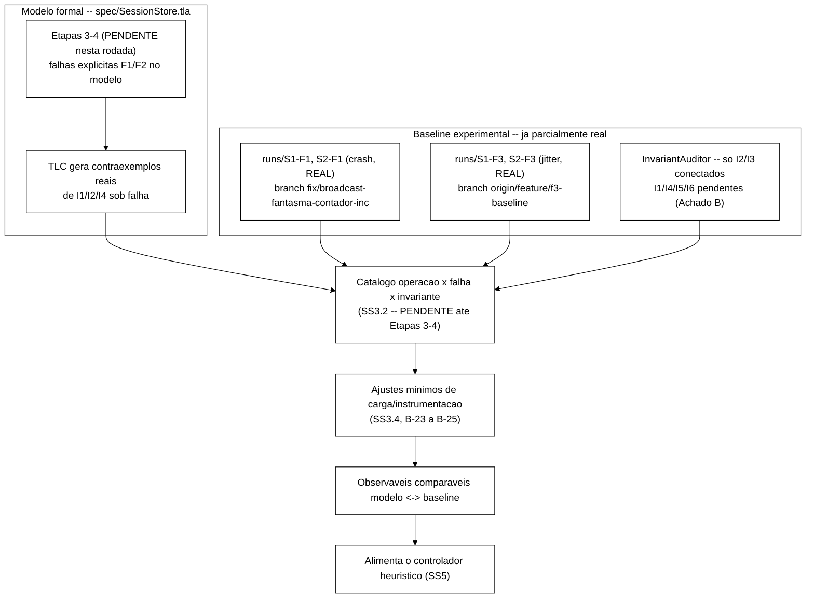
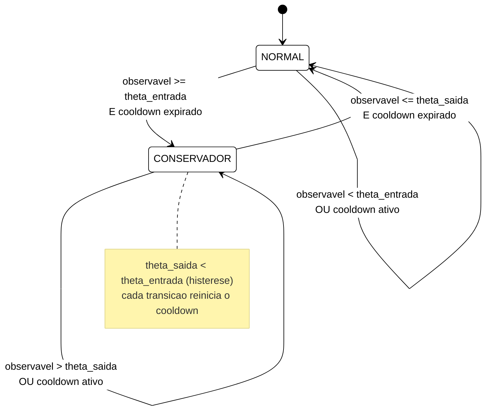
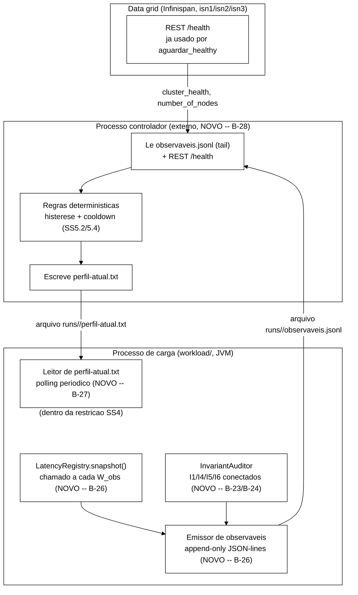

# Plano — Alinhamento formal-experimental e controlador heurístico (Etapas 7-8)

> Elaborado pelo Senior em 2026-09-24, para validação do Gestor antes de acionar o
> Worker. **Este documento é só planejamento** — nenhum arquivo de `spec/*.tla`, código
> Java ou script foi alterado para produzi-lo. Cobre as duas atividades descritas em
> `tcc-escrita/ApPlanoTCC2.tex` §"Etapas 7 e 8: alinhamento formal-experimental e
> controlador heurístico" (linha 24), a continuação natural de
> `docs/spec-formal.md` (linhas 80-88, "Evolução prevista para TCC-II") e do estado real
> do modelo formal e do *baseline* experimental tal como encontrados nesta sessão (§1.2).
> Segue o estilo de `docs/plano-fix-broadcast-fantasma-2026-09-16.md` e
> `docs/plano-fix-cascata-bloqueio-2026-09-16.md` (diagramas Mermaid tema branco,
> decisões justificadas, critérios de aceite explícitos).

---

## 1. Contexto

### 1.1 O que o cronograma já define (texto acadêmico aprovado)

`tcc-escrita/ApPlanoTCC2.tex`, Etapas 7-8:

> "A primeira atividade das semanas 7 e 8 alinha o modelo formal e o experimento. Os
> contraexemplos identificados nas etapas anteriores são mapeados para padrões
> observáveis no *baseline*, com ajustes mínimos no programa de carga e na
> instrumentação para garantir comparabilidade. A segunda atividade implementa o
> controlador heurístico. O controlador é externo ao *data grid*, lê observáveis em
> janelas temporais e decide ações conforme regras determinísticas com histerese e
> intervalo mínimo entre acionamentos. Dois perfis pré-definidos coexistem: um perfil
> normal, otimizado para latência, e um perfil conservador, ativado quando a taxa de
> violação aumenta acima de um limiar."

Esse texto pressupõe duas coisas que **ainda não existem** nesta rodada, conforme
`docs/spec-formal.md` linha 88 já registrava como plano (não como fato consumado):

- Falhas explícitas (*crash* silencioso F1, recuperação, partição F2, atraso/*jitter*
  F3) no modelo TLA+ — isso é trabalho das **Etapas 3-4** (`ApPlanoTCC2.tex` §"Etapas 3
  e 4"), que **não foi executado** nesta rodada nem em nenhuma rodada anterior
  registrada. `spec/SessionStore.tla` cobre hoje só o fluxo nominal (O1, O3-O7) sob
  canal assíncrono não-determinístico, sem transição de falha dedicada.
- Contraexemplos reais de I1, I2, I4 sob falha — por decorrência do ponto anterior,
  **não existem ainda**. O que existe é a *previsão textual* de que eles vão aparecer
  (`spec-formal.md` linha 88: "tende a produzir"), não um catálogo de contraexemplos
  já obtidos pelo TLC.

Este plano, portanto, **não inventa contraexemplos**. Ele define a metodologia de
catalogação (o que conta como "padrão observável", como cada futuro contraexemplo será
mapeado) e o desenho do controlador, deixando explícito onde o catálogo está vazio por
enquanto — coerente com o princípio de falibilidade de Wieringa (CAND-019, ver §8): a
validação de um desenho de pesquisa checa se a configuração *vai sustentar* as
inferências pretendidas antes de executá-la, não presume o resultado.

### 1.2 Achado crítico — estado real do repositório vs. `main`

Antes de planejar, esta sessão leu o estado efetivo do repositório (branch
`fix/broadcast-fantasma-contador-inc`, ponta em `ddf9dfc`, mencionada no enunciado desta
tarefa) e comparou com `main`. O resultado é relevante o bastante para registrar aqui,
não só na seção de validação:

**`main` (local, sincronizado com `origin/main`, HEAD `14de422`) está muito atrás do
estado prático real do projeto.** As duas branches têm, sim, um ancestral comum real —
`git merge-base main fix/broadcast-fantasma-contador-inc` resolve para `0df5383`
("feat: padroniza códigos de retorno O1-O7 com OpResult (B-05)", 2026-05-27) — não é um
caso de históricos não relacionados. O que aconteceu é divergência simples e comum: a
partir desse ponto, `main` recebeu só 3 commits (documentação/merges de PR), enquanto
`fix/broadcast-fantasma-contador-inc` acumulou **37 commits** de trabalho real (toda a
série de especificação TLA+, LWW, *broadcast*, P-15) nunca mergeados de volta. Ou seja:
é um backlog grande de integração pendente, corrigível com um merge/rebase normal —
não uma corrupção de histórico. Concretamente, `main` **não contém**:

- A especificação TLA+ pós-LWW/pós-P-15 (`main` tem a versão de `9ce2f15`, anterior a
  toda a série de correções de *broadcast*/LWW de 2026-09-16 documentada em
  `docs/relatorio-tlc-2026-09-16*.md` e `docs/registro-de-problemas.md`).
- Nenhum artefato do *baseline* F1 real (`runs/S1-F1/`, `runs/S2-F1/`, `runs/S1-none/`,
  `scripts/run-baseline.sh`, `scripts/inject-crash.sh`) — tudo isso vive em
  `fix/broadcast-fantasma-contador-inc` (que herdou o trabalho de
  `feature/pipeline-baseline`/`feature/falha-f1-crash`, nunca mergeados em `main`).
- Os componentes de instrumentação mais recentes do *workload*
  (`EventCsvWriter`, `EpochClock`, `Cli`, `Scenario`, `KeyGenerator`, `WarmupPolicy`) —
  presentes em `fix/broadcast-fantasma-contador-inc`, ausentes em `main`.
- Nenhum dos `docs/plano-fix-*.md` ou `docs/relatorio-tlc-2026-09-16*.md` usados como
  referência de estilo para este próprio documento.

Adicionalmente, existe **um terceiro histórico**, também não reconciliado com os dois
anteriores: `origin/feature/f3-baseline` (e `falha-f3-jitter`/`docs/vm-hyperv-netem`)
contém uma bateria F3 (*jitter*) real já executada na VM Hyper-V (`runs/S1-F3/`,
`runs/S2-F3/`, `scripts/inject-jitter.sh`) e o coletor `collect-metrics.sh` (B-13,
nunca chegou a `fix/broadcast-fantasma-contador-inc` nem a `main`).

**Consequência prática para este documento:** a instrução da tarefa era criar a branch
de planejamento a partir de `main` (não de `fix/broadcast-fantasma-contador-inc`, por
ser branch de outra tarefa ainda não mergeada) — e é isso que foi feito (§ ver
metadados do commit). Mas isso significa que **este arquivo, na árvore da própria
branch `docs/plano-controlador-heuristico`, referencia caminhos que não existem nessa
árvore** (ex.: `docs/relatorio-tlc-2026-09-16-mudanca4.md`, `runs/S1-F1/summary.json`,
`workload/src/main/java/.../EventCsvWriter.java`) — eles existem em
`fix/broadcast-fantasma-contador-inc` e/ou `origin/feature/f3-baseline`, não em
`main`/nesta branch. Cada citação abaixo indica a branch de origem quando o arquivo não
está em `main`. Isso não é um erro de execução deste plano — é o retrato fiel de um
problema de integração real do repositório, registrado como **Achado A e item B-21 do
backlog (§6)**, e levantado explicitamente em §9 para decisão do Gestor.

### 1.3 O que já existe e pode ser reaproveitado (inventário, branch de origem indicada)

| Artefato | Branch onde existe | Relevância para este plano |
|---|---|---|
| `spec/SessionStore.tla` com I1-I6, LWW por relógio lógico, P-15 corrigido | `fix/broadcast-fantasma-contador-inc` | Base formal — I6 fecha exaustivo em tiny/small/medium (`docs/relatorio-tlc-2026-09-16-mudanca4.md`); I1/I2 seguem sem falha explícita modelada |
| `runs/S1-F1/`, `runs/S2-F1/`, `runs/S1-none/`, `runs/S2-none/` — bateria F1 real (crash 60s, 3 réplicas, 3 repetições × 90s) | `fix/broadcast-fantasma-contador-inc` | Dados reais de latência sob F1 (`comparacao.json`: delta de p99 estatisticamente significativo em todas as 5 operações, `taxa_erro=0` em todos os cenários) |
| `runs/S1-F3/`, `runs/S2-F3/` — bateria F3 real (*jitter* via `tc-netem` na VM) | `origin/feature/f3-baseline` | Dados reais sob F3 (delta de p99 de até +108 ms em `IncrementFailure`, ordem de grandeza maior que o alvo T18 de +50 ms — ver Achado C) |
| `scripts/run-baseline.sh`, `scripts/inject-crash.sh` | `fix/broadcast-fantasma-contador-inc` | Orquestração S1/S2 × {none,F1}; gate de saúde do *cluster* via REST já usado (relevante para §5.5) |
| `scripts/inject-jitter.sh`, `scripts/collect-metrics.sh` (B-13) | `origin/feature/f3-baseline` | Injeção F3; coletor OpenMetrics nunca integrado ao *pipeline* de F1 |
| `workload/.../InvariantAuditor.java` — checagem de I1-I6 nomeada igual ao TLA+ | `fix/broadcast-fantasma-contador-inc` | Ver Achado B — só I2/I3 estão de fato conectados; I1/I4/I5/I6 existem como código morto |
| `workload/.../LatencyRegistry.java` (HdrHistogram, `snapshot()` drena intervalo) | `fix/broadcast-fantasma-contador-inc` | Já suporta leitura em janela, só nunca é chamado periodicamente — ver §5.2 |
| `workload/.../Cli.java` | `fix/broadcast-fantasma-contador-inc` | Todos os parâmetros são fixados na inicialização da JVM; não há nenhum canal de reconfiguração em tempo de execução — ver Achado D |
| `cluster/infinispan-cluster.xml` (comentário: "Statistics habilitado para captura por OpenMetrics") | `fix/broadcast-fantasma-contador-inc` | Métricas de infraestrutura (nível *cluster*) já ligadas no servidor; métricas de aplicação (nível protocolo) não |

### 1.4 Achados que moldam este plano (resumo)

- **Achado A** (§1.2): `main` divergente do estado prático — risco de integração,
  não deste plano especificamente.
- **Achado B**: `InvariantAuditor` já usa os mesmos identificadores I1-I6 do modelo
  TLA+, mas só I2 e I3 são de fato chamados a partir de `SessionOps`. I1 e I4 nunca são
  verificados em tempo de execução; I5/I6 têm o método
  `iniciarAuditoriaPeriodica(...)` implementado e **testado isoladamente**
  (`InvariantAuditorTest.java`), mas **nunca invocado** a partir de
  `WorkloadMain.executarRepeticao`. Confirmado empiricamente: todo `rep-*.stdout.log`
  da bateria F1 real (`runs/S1-F1/`, `runs/S1-none/`) imprime
  `Violacoes detectadas: 0` — o que não significa "zero violações observadas sob
  falha", significa "o auditor mal foi exercitado". Isso é o *gap* central que a
  Atividade 1 precisa fechar antes que qualquer taxa de violação real possa alimentar o
  controlador da Atividade 2.
- **Achado C**: a bateria F3 real já mostra delta de p99 de até **+107,9 ms**
  (`IncrementFailure`) e **+80,6 ms** (mesma operação, p95) — acima do alvo normativo de
  T18 (`Metodologia.tex` linha 185: "+50 ms p99"). Isso não é um bug deste plano, é um
  dado real que pode indicar necessidade de recalibração do `tc-netem` (ver
  `docs/plano-f3-vm-netem.md` §1.2, P-3) — fora do escopo desta rodada, mas registrado
  porque afeta a credibilidade de qualquer futuro catálogo operação×falha×invariante
  que use F3 como referência de magnitude.
- **Achado D**: `Cli`/`WorkloadMain` não têm **nenhum** canal de reconfiguração em
  tempo de execução — todo parâmetro é lido uma vez, na inicialização do processo. Isso
  é decisivo para a arquitetura do controlador (§5.5): "perfil normal/conservador" não
  pode, hoje, mudar nada em um processo de carga já em execução sem um mecanismo novo.

---

## 2. Requisitos práticos identificados

1. Definir, de forma operacional e não ambígua, o que conta como "observável" para
   cada invariante I1-I6 — um evento pontual, uma transição de estado ou uma taxa numa
   janela temporal (pedido explícito do Gestor).
2. Especificar como cada futura combinação (operação × falha × invariante) do modelo
   formal se traduz num observável concreto no *baseline*, preenchendo o catálogo à
   medida que os contraexemplos existirem (Etapas 3-4) — não antes.
3. Especificar os ajustes mínimos de carga/instrumentação necessários para que o
   *baseline* já existente (F1 real, F3 real) fique comparável ao catálogo.
4. Definir a arquitetura do controlador heurístico: observáveis de entrada, regras com
   histerese e *cooldown*, os dois perfis, e onde ele se encaixa (externo ao *data
   grid*, como observa).
5. Ancorar cada decisão de desenho relevante num princípio explícito de um dos 5
   resumos de metodologia lidos (exigência do Gestor, não「enfeite」).
6. Não implementar nada — registrar todo item de código/`spec/*.tla` como *backlog*
   futuro, fora desta rodada.

---

## 3. Atividade 1 — Alinhamento formal-experimental

### 3.1 O que conta como "observável" — definição operacional

`spec/SessionStore.tla` distingue dois tipos de invariante (`docs/spec-formal.md`
linhas 36-46), e essa distinção **determina** a forma do observável correspondente —
não é uma escolha livre, é uma tradução direta da definição formal (Baier & Katoen,
CAND-053, §3.3.1: um invariante é uma condição que vale em *todo estado alcançável*; a
checagem por DFS do TLC é exatamente o que gera o contraexemplo quando algum estado
visitado viola a condição — ver §8, linha D1):

| Classe formal | Invariantes | Forma do observável em runtime | Fonte de dado hoje |
|---|---|---|---|
| Segurança pontual (vale em *todo* estado, checável estado-a-estado) | I1, I2, I3, I4 | **Evento pontual com timestamp**: a operação que violaria a condição é interceptada no momento em que ocorre, gravada como `{instante, invariante, chave, mensagem}` | `InvariantAuditor.registrarViolacao(...)` — parcialmente conectado (Achado B) |
| Convergência sob quiescência (só exigível quando `Quiescent` = canal TLA+ vazio) | I5, I6 | **Comparação periódica entre réplicas**, condicionada a uma janela sem escrita — não um evento pontual, porque a condição só é exigível *depois* de um período de inatividade | `InvariantAuditor.iniciarAuditoriaPeriodica(...)` — implementado, nunca invocado (Achado B) |

Uma terceira forma de observável, que o catálogo do §3.2 usa mas que **não é** um
observável de invariante e sim de **contexto experimental**, é a **taxa numa janela
deslizante**: para qualquer um dos dois tipos acima, a métrica que alimenta o
controlador (§5) não é o evento cru, é `violações(Ik) / operações` numa janela `W_obs`
— o evento pontual/periódico é o dado primário, a taxa é a agregação que o controlador
efetivamente consome.

**Tradução obrigatória e sua lacuna:** `Quiescent` no TLA+ é `Len(canal) = 0` — uma
propriedade do modelo, não observável de fora do sistema real (o *workload* não tem
visibilidade da fila interna de replicação do JGroups). A quiescência em runtime
precisa ser **operacionalizada por aproximação**: "nenhuma operação de escrita emitida
pelo *workload* nos últimos `W_quiesc` segundos" (ver proposta de valor em §3.4). Essa é
uma aproximação, não uma equivalência — o canal pode estar não-vazio mesmo sem novas
escritas do cliente (mensagens já em trânsito). Isso é exatamente o tipo de lacuna que
Baier & Katoen (CAND-053 §1.2.2) e Abrial (CAND-052, distinção *problem*/*solution
validation*) preveem como inerente a qualquer verificação de modelo: o TLC verifica o
modelo, não valida que a operacionalização de `Quiescent` em runtime é fiel — essa
validação é justamente o que a Atividade 1 se propõe a fazer, não algo que se possa
assumir de graça.

### 3.2 Catálogo operação × falha × invariante

Escopo: falhas F1 (*crash*) e F3 (*jitter*) — cobertas experimentalmente no TCC-I e já
com dados reais parciais (Achados citados em §1.3); F2 (partição) está normativamente
em escopo do TCC-II (`Metodologia.tex` linha 89: "reservada para o TCC-II") mas **ainda
sem injetor** (nenhum `inject-partition.sh` existe em nenhuma branch) e **ainda sem
modelagem formal** — incluída na tabela como PENDENTE em dobro.

Cada linha cruza uma falha com um invariante de segurança pontual (I1/I2/I4 — os três
que `spec-formal.md` linha 88 prevê como afetados; I3 fica de fora porque é uma
invariante de tipo — `contador \in 0..LIMITE` — que nenhuma falha considerada altera
estruturalmente) e lista as operações candidatas mais prováveis de expor o problema,
não o produto cartesiano completo com as 6 operações (decisão deliberada de escopo —
ver justificativa em §8, linha D3: cobrir o catálogo por decomposição incremental em
vez de enumerar exaustivamente combinações sem evidência prévia de que sejam
relevantes, no espírito dos 3 eixos de Abrial — refinamento/decomposição/genérico,
CAND-052 §4).

| Falha | Invariante | Operações candidatas | Mecanismo hipotético (a confirmar pelo TLC nas Etapas 3-4) | Observável concreto proposto | Status do contraexemplo |
|---|---|---|---|---|---|
| F1 (*crash*) | I1 (irreversibilidade do logout) | O3 (Logout) seguido de O1 (Login) ou leitura em réplica que não recebeu `SESSAO_INVALIDA` antes do *crash* | Réplica cai após aplicar `Logout` localmente mas antes de propagar `SESSAO_INVALIDA`; na recuperação, *state transfer* pode não reconciliar corretamente se uma escrita concorrente de prioridade LWW inferior "resgatar" o estado antigo | Evento pontual: `Validate`/`Login` retorna `VALID`/`OK` para uma `sid` com `Logout` previamente confirmado (`return_code=OK` num evento anterior no CSV, mesma `key`), dentro da janela `[crash_start, crash_end + W_recovery]` | **PENDENTE** — Etapas 3-4 não executadas |
| F1 (*crash*) | I2 (bloqueio consistente) | O6 (Block) concorrente com O1/O2 em réplica que cai antes de aplicar `ID_BLOQUEIA` | Réplica que caiu detém `status=OPEN` obsoleto; nós sobreviventes já aplicaram o bloqueio; leitura servida pela réplica em recuperação, antes do *state transfer* concluir, pode aceitar sessão de identidade já bloqueada | Evento pontual: `Login`/`Validate` retorna sucesso para uma identidade com `Block` confirmado em outra réplica na mesma janela de *crash* | **PENDENTE** |
| F1 (*crash*) | I4 (motivo único) | O3/O6 concorrentes (Logout vs. Block na mesma sessão) atravessando o *crash* | Corrida entre dois motivos de invalidação (`LOGOUT` vs. `ADMIN_BLOCK`) resolvida de forma diferente pré/pós-recuperação | Evento pontual: mesma `sid` reporta `motivo` diferente em leituras antes/depois da janela de recuperação | **PENDENTE** |
| F2 (partição) | I1/I2/I4 | mesmas operações acima, mas com **ambos** os subconjuntos aceitando escritas (risco de *split-brain*, distinto de F1 onde um nó simplesmente para de responder) | Divergência sustentada durante `[part_start, part_end]`, sem garantia de que o lado minoritário pare de aceitar escrita | Mesmo formato de evento pontual, mas com `partition_side` como dimensão adicional do observável | **PENDENTE (dobrado: sem modelo formal e sem injetor experimental — ver B-22/B-29)** |
| F3 (*jitter*) | I1/I2/I4 | qualquer operação cuja mensagem de propagação sofra atraso suficiente para inverter a ordem de entrega em relação a uma operação concorrente | Já parcialmente coberto pela abstração de `EntregaMensagem` não-determinística no TLA+ (reordenação já é modelada sem F3 precisar ser uma ação dedicada) — o papel de F3 no modelo é **aumentar a probabilidade**, não introduzir um novo tipo de comportamento | Correlação entre janela de p99 elevado (já mensurável — `runs/S1-F3/comparacao.json` real, delta de até +108 ms) e qualquer evento pontual de violação na mesma janela | **PENDENTE quanto a violação; a correlação de latência já é computável hoje com dados reais (Achado C)** |

**Nota sobre I5/I6 (convergência):** não entram na tabela acima porque sua forma de
falha é diferente — sob F1/F2/F3, a pergunta relevante não é "ocorre uma violação
pontual" e sim "quanto tempo depois do fim da falha (`falha_end`) a divergência entre
réplicas some". O observável correspondente é um **tempo até convergência**
(`t_convergencia - falha_end`), não uma contagem de eventos. Como I6 já fecha
exaustivamente em `tiny`/`small`/`medium` no fluxo nominal (sem falha —
`docs/relatorio-tlc-2026-09-16-mudanca4.md`), a expectativa é que, sob falha, a
convergência ainda ocorra, só que depois de um atraso mensurável — essa é uma hipótese
a testar, não um resultado.

### 3.3 Por que o catálogo fica com status PENDENTE, e por que isso é a decisão correta

A alternativa seria popular a tabela com contraexemplos "plausíveis" escritos à mão
para adiantar a Atividade 2. Isso foi deliberadamente rejeitado: o texto do TCC diz que
o controlador é **heurístico**, não sintetizado formalmente (`ApPlanoTCC2.tex` já
qualifica as regras como "determinísticas", não como "derivadas do modelo") — mas as
combinações do catálogo servem de **evidência de desenho**, e evidência fabricada
compromete a rastreabilidade que este mesmo documento pede em outros pontos. Bowen &
Hinchey (CAND-054, Mandamento IX) é explícito: prova formal nunca é garantia absoluta, e
os dois motivos que eles dão — especificação pode não capturar a intenção real, e o
refinamento até execução admite erro humano residual — são exatamente por que este
catálogo não pode ser preenchido por suposição informada, precisa vir do TLC de fato
(Etapas 3-4, fora desta rodada) cruzado com o *baseline* real (Etapas 5-6, parcialmente
já feito — Achados em §1.3).

### 3.4 Ajustes mínimos de carga e instrumentação no baseline

Estes são os ajustes que o texto do cronograma pede ("ajustes mínimos... para garantir
comparabilidade"), decompostos em itens concretos. **Nenhum foi implementado nesta
rodada** — todos viram itens de *backlog* (§6, B-23 a B-25).

1. **Conectar I1 e I4 em `SessionOps`** (hoje só I2/I3 chamam
   `auditor.registrarViolacao`). Sem isso, a tabela do §3.2 nunca vai poder trocar
   PENDENTE por um veredito real, porque o dado nunca é produzido.
2. **Persistir as violações do `InvariantAuditor`** — hoje `dumpCsv(...)` existe mas
   nunca é chamado a partir de `WorkloadMain`; o total é só impresso em
   `stdout` (`"Violacoes detectadas: N"`), sem detalhe recuperável depois da execução.
3. **Conectar `iniciarAuditoriaPeriodica`** com leitores reais por réplica (hoje o
   `RemoteCacheManager` do *workload* faz *round-robin* entre os 3 servidores — leitura
   dirigida a uma réplica específica, necessária para I5/I6, exige confirmar se a API
   Hot Rod do Infinispan 15 suporta endereçamento por nó sem um `RemoteCache` dedicado
   por servidor; ponto técnico a validar antes de implementar, não durante).
4. **Definir `W_quiesc`** (janela sem escrita que operacionaliza `Quiescent`) —
   proposta inicial: `2 × timeout(FD_ALL3) = 80s`, ancorada num valor já normativo do
   próprio TCC (`Metodologia.tex` linha 183, T16: *heartbeat* 8000 ms / *timeout*
   40000 ms) em vez de um número arbitrário. Calibrável, como o próprio T18 já trata o
   parâmetro de F3 como "calibrável" — valor a confirmar com o Gestor antes de uso
   (Critério de aceite §7, item 7).
5. **Marcar a janela de falha em cada evento** (`fault_id`, `fault_start_ns`,
   `fault_end_ns`) tanto no CSV de eventos quanto nas violações — hoje a granularidade
   de correlação falha↔evento é só o diretório (`runs/S1-F1/` inteiro), e
   `inject-crash.sh`/`inject-jitter.sh` já registram os instantes exatos em
   `inject-crash-rep*.log` (não aproveitados pelo `analysis/`). Sem essa marcação por
   evento, nenhuma linha do catálogo do §3.2 pode ser cruzada com precisão temporal
   contra o *baseline* real.
6. **F2 (partição) não tem injetor.** `scripts/inject-crash.sh` (F1) e
   `scripts/inject-jitter.sh` (F3, em `origin/feature/f3-baseline`) existem;
   `inject-partition.sh` não existe em nenhuma branch. Bloqueado adicionalmente pela
   ausência de modelagem formal de F2 (Etapas 3-4).

### 3.5 Diagrama — pipeline de alinhamento

---

## 4. Restrição fundamental que une as duas atividades

Antes de descrever a arquitetura do controlador, uma decisão de desenho precisa ficar
explícita porque ela decide *todo* o espaço de ações possíveis do controlador (§5.4): o
controlador **só pode agir restringindo ou atrasando a emissão de operações do lado
cliente** (uma decisão de *escalonamento* do *workload*) — ele **nunca** fabrica
mensagem de protocolo nova, nunca muta diretamente `sessoes`/`status`/`contador`
replicados, e nunca reconfigura o modo de replicação do servidor Infinispan em tempo
real.

Essa restrição não é arbitrária — é exigida pela mesma noção de refinamento que já
disciplina a evolução de `spec/SessionStore.tla` desde a Mudança 3/4 (P-15): Woodcock &
Davies (CAND-051, Cap. 16) definem refinamento como `R ⊆ S` — um refinamento só pode
**remover** não-determinismo/comportamento que a especificação original já permitia,
nunca **adicionar** um comportamento novo que ela não previa. Se o controlador é
pensado, desde já, como algo que só decide **quais operações do cliente são
emitidas e quando** (um subconjunto do que o `Next` do TLA+ já permite, nunca uma ação
nova), então — no dia em que alguém quiser formalizar essa camada como uma extensão do
modelo (fora do escopo desta rodada, item de *backlog* B-31) — o Teorema 3.28 de Baier &
Katoen (CAND-053, §3.3.2: refinamento por inclusão de traços preserva *safety
properties*) garante que I1-I6 continuam valendo **sem precisar reverificar tudo do
zero**, porque o novo comportamento é literalmente um subconjunto de traços já cobertos
pela verificação existente. O padrão "*anticipated event*" de Abrial (CAND-052 §4.7) —
declarar hoje, sem efeito, os pontos onde uma ação futura vai se encaixar, para não
introduzir variável fantasma — é o vocabulário exato para tratar essa restrição como
uma decisão tomada *agora*, mesmo que a formalização do controlador em si fique para
depois.

Essa restrição resolve, de forma principiada (não arbitrária), a pergunta em aberto "o
que os dois perfis podem realmente mudar" (§5.4): qualquer *knob* candidato a perfil
precisa ser algo que já pertence ao espaço de decisão do **cliente de carga**
(`workload/`), nunca uma mudança de protocolo ou de configuração do servidor.

---

## 5. Atividade 2 — Arquitetura do controlador heurístico

### 5.1 Observáveis concretos consumidos pelo controlador

Derivados diretamente do catálogo (§3.2) e do inventário de instrumentação (§1.3),
**não são métricas novas inventadas para o controlador** — são as mesmas quantidades
que a Atividade 1 já precisa produzir para preencher o catálogo:

| Observável | Fonte (após B-23/B-24, §6) | Janela | Uso pelo controlador |
|---|---|---|---|
| `taxa_violacao_seguranca` = violações(I1∪I2∪I4) / operações | `InvariantAuditor` (pontual) | `W_obs` deslizante | Gatilho primário de transição de perfil (§5.3) |
| `divergente_I5I6` (booleano) | `InvariantAuditor.iniciarAuditoriaPeriodica` | por janela de quiescência (`W_quiesc`) | Gatilho secundário — divergência persistente após quiescência é mais grave que uma violação pontual isolada |
| `p99_operacao` por tipo de operação | `LatencyRegistry.snapshot()` chamado a cada `W_obs` em vez de só ao final | `W_obs` deslizante | Gatilho **provisório** enquanto I1/I4/I5/I6 não estão conectados (ver proposta-ponte abaixo) — já computável hoje com dados reais (`comparacao.json`) |
| `cluster_health.number_of_nodes` | REST `/rest/v2/cache-managers/default/health` (já usado por `aguardar_healthy` em `run-baseline.sh`) | consulta direta, sem *workload* precisar mudar | Detecção de F1 em curso — sinal de contexto, não de violação |

**Proposta-ponte (precisa validação do Gestor, §9):** como o gatilho primário previsto
pelo texto do cronograma ("taxa de violação aumenta acima de um limiar") depende de
B-23/B-24 (ainda não feitos — Achado B), o controlador **não tem hoje** nenhum dado real
de taxa de violação para reagir. Uma ponte pragmática, só enquanto isso não for
resolvido, é usar o `p99_operacao` relativo ao *baseline* sem falha como gatilho
substituto provisório (dado real já disponível, `comparacao.json`) — mas isso muda o
que "perfil conservador" significa (de "reage a incorreção" para "reage a degradação de
latência") e **não deve ser adotado sem confirmação explícita do Gestor**, porque altera
a semântica do que o texto do TCC promete.

### 5.2 Regras determinísticas — histerese e *cooldown*

Dois mecanismos distintos, ambos exigidos pelo texto do cronograma, com papéis
diferentes — distinção que vale deixar explícita porque são facilmente confundidos:

- **Histerese** (dois limiares, não um): `theta_entrada` (mais alto) para trocar de
  NORMAL → CONSERVADOR, `theta_saida` (mais baixo) para voltar de CONSERVADOR → NORMAL,
  com `theta_saida < theta_entrada`. Evita oscilação **ao redor de um único limiar**
  quando o observável flutua com ruído de amostragem perto da fronteira — sem
  histerese, um observável que oscila entre 4,9% e 5,1% ao redor de um limiar único de
  5% trocaria de perfil a cada janela.
- ***Cooldown*** (intervalo mínimo entre acionamentos): depois de qualquer transição de
  perfil, ignora novas transições por `T_cooldown` segundos, **independentemente** do
  valor do observável nesse intervalo. Resolve um problema diferente da histerese: um
  observável pode estar bem longe da fronteira dos dois limiares e ainda assim ter
  rajadas curtas de ruído (ex.: uma janela isolada com poucas operações, alta
  variância) que a histerese sozinha não filtra, porque histerese só limita
  oscilação *perto da fronteira*, não a frequência de transições em geral.

Nenhum dos dois mecanismos é fundamentado por nenhum dos 5 resumos lidos — é prática
padrão de engenharia de sistemas de controle por limiar, não coberta pela lista de
leitura desta tarefa. Isso é registrado explicitamente como lacuna de fundamentação
bibliográfica específica na tabela de rastreabilidade (§8, linhas D9/D10), em vez de
forçar uma citação que não se sustenta.

Valores propostos (provisórios, calibráveis — mesmo espírito de T18 tratar seu próprio
parâmetro como "calibrável"):

| Parâmetro | Proposta inicial | Fundamento da proposta |
|---|---|---|
| `W_obs` (janela de observação) | 5 s | Ecoa a cadência já prevista para B-13 (`planejamento-inicial.md` linha 133: "Coletor de métricas OpenMetrics, snapshot a cada 5 s"), nunca de fato integrada ao *pipeline* de F1 |
| `W_quiesc` | 80 s (2× T16) | Ancorado no *timeout* de detecção de falha já normativo (`Metodologia.tex` linha 183) |
| `T_cooldown` | 30 s | Ordem de grandeza abaixo da duração padrão de F1 (`Δcrash=60s`, T17), para não trocar de perfil mais de uma vez dentro de uma única janela de falha nominal — proposta a validar |
| `theta_entrada` / `theta_saida` (taxa de violação) | **sem valor proposto** | Não há dado real de taxa de violação hoje (Achado B) — propor um número antes de ter dado real violaria o princípio de falibilidade de Wieringa (CAND-019 §3): a validação do desenho de pesquisa não pode presumir um resultado que ainda não foi observado |

### 5.3 Dois perfis — o que cada um concretamente muda

Restrito pela regra de §4 (só decisão do lado cliente). *Knobs* candidatos, cada um já
existente no espaço de configuração do *workload* (`Cli.java`) ou plausível de se
tornar reconfigurável sem violar a restrição de §4:

| Perfil | *Knob* candidato | Direção |
|---|---|---|
| Normal (otimizado para latência) | `threads` / concorrência alvo | valor pleno configurado |
| Normal | mistura de operações (`Scenario`) | inalterada |
| Conservador | `threads` / concorrência alvo | reduzida (menos contenção, tende a reduzir cauda de latência e a chance de corrida entre operações concorrentes que o catálogo do §3.2 associa a violação) |
| Conservador | taxa de emissão de operações "arriscadas" (O6/Block, que tem efeito cascata sobre outras sessões — `docs/plano-fix-cascata-bloqueio-2026-09-16.md`) | atrasada/limitada, não suprimida — o controlador atrasa, não cancela, para não distorcer a distribuição do cenário S1/S2 além do necessário |

Nenhum desses *knobs* está implementado como reconfigurável em tempo de execução hoje
(Achado D) — a tabela é uma proposta de **para onde** apontar o mecanismo de controle
descrito em §5.5, não uma implementação.

### 5.4 Diagrama de estados — NORMAL ⇄ CONSERVADOR

### 5.5 Onde o controlador se encaixa — arquitetura de componentes

O controlador é **externo ao *data grid*** (exigência do texto do cronograma) e,
adicionalmente, **externo ao processo JVM do *workload*** — um processo separado do
sistema operacional, coerente com uma responsabilidade por componente. Como hoje não
existe nenhum canal de telemetria ao vivo (Achado D: tudo é *flush* em lote ao final da
execução; `LatencyRegistry`/`InvariantAuditor` são objetos Java in-process, sem
exposição de rede), a arquitetura proposta usa o mesmo estilo já estabelecido no
repositório — orquestração por arquivo/processo (`scripts/run-baseline.sh` já segue
esse padrão, sem nenhum *framework* HTTP em uso hoje) — em vez de introduzir um
componente de rede novo sem necessidade:

O mecanismo concreto de emissão/leitura (arquivo *append-only* vs. outra via — *socket*
local, por exemplo) é uma decisão que precisa confirmação do Gestor antes de
implementação (Critério de aceite §7, item 2) — a proposta acima é a opção de menor
custo de engenharia dado o estilo já estabelecido no repositório, não a única opção
tecnicamente viável.

---

## 6. Backlog ordenado (fora de escopo desta rodada)

Todo item abaixo é **só listado** — nenhum foi implementado nesta rodada nem deve ser
implementado sem um plano específico e aprovação do Gestor. Numeração continua a de
`docs/planejamento-inicial.md` (último item registrado ali: B-20).

| ID | Item | Depende de | Risco |
|---|---|---|---|
| B-21 | Consolidar as linhas divergentes de histórico (`main`, `fix/broadcast-fantasma-contador-inc`, `origin/feature/f3-baseline`) numa base única antes de abrir código novo para as Etapas 7-8 (Achado A, §1.2) | Decisão do Gestor (§9, item 1) | **Alto** — bloqueia qualquer outro item deste backlog que toque código, porque a base de trabalho ainda não está definida |
| B-22 | Estender `spec/SessionStore.tla` com transições explícitas de F1 (*crash*+recuperação) e F2 (partição), per Etapas 3-4 do Apêndice B | B-21 | Médio-alto — histórico do projeto já mostrou explosão de espaço de estados como risco real (R-04, `docs/planejamento-inicial.md`); pode exigir nova redução de cardinalidade como a Mudança 2 exigiu |
| B-23 | Conectar I1 e I4 em `SessionOps.registrarViolacao`; persistir `InvariantAuditor.dumpCsv(...)` por repetição (Achado B, §3.4 item 1-2) | B-21 | Baixo — mudança localizada, sem alterar protocolo nem `spec/*.tla` |
| B-24 | Conectar `InvariantAuditor.iniciarAuditoriaPeriodica(...)` com leitores reais multi-réplica (I5/I6, §3.4 item 3) | B-21 | Médio — depende de confirmar se a API Hot Rod do Infinispan 15 permite endereçar uma réplica específica sem um `RemoteCache` dedicado por servidor; não verificado nesta rodada |
| B-25 | Marcar `fault_id`/`fault_start_ns`/`fault_end_ns` por evento no CSV e nas violações (§3.4 item 5) | B-23 | Baixo — dado já existe em `inject-crash-rep*.log`/`inject-jitter.sh`, falta propagar |
| B-26 | Implementar o emissor de observáveis em janela (`observaveis.jsonl` ou mecanismo alternativo, §5.5) no processo de carga | B-23, B-24 | Médio — novo componente; mecanismo concreto (arquivo vs. *socket*) pendente de decisão do Gestor (§9, item 4) |
| B-27 | Implementar o *control-plane hook* em `WorkloadMain` (leitor de `perfil-atual.txt`, *polling* periódico, troca atômica de perfil) | Tecnicamente nenhuma, mas sem utilidade isolada de B-28 | Médio — Achado D: hoje não existe nenhum canal de reconfiguração em tempo de execução; é a primeira vez que esse tipo de componente entraria no `workload/` |
| B-28 | Implementar o processo controlador externo (regras determinísticas, histerese, *cooldown*, dois perfis, §5.2-5.4) | B-26, B-27, critérios de aceite §7 confirmados | Alto — linguagem/mecanismo de implementação ainda em aberto; gatilho primário (taxa de violação) só é significativo depois de B-23/B-24 gerarem dado real |
| B-29 | `scripts/inject-partition.sh` (F2) — não existe em nenhuma branch hoje | B-21, B-22 | Médio — precisa decidir semântica de *split-brain* (ambos os lados aceitam escrita?) antes de implementar |
| B-30 | Desenho estatístico do experimento comparativo *baseline*-vs-controlador (Etapas 9-10) | B-28; obtenção do PDF de CAND-020 (Wohlin et al.) | **Bloqueado** por lacuna bibliográfica registrada (§8, linha D11) — não deve ser desenhado sem essa referência ou uma equivalente aprovada pelo Gestor |
| B-31 | Formalizar o controlador como refinamento explícito do modelo TLA+ (transformar o "*anticipated event*" de §4 numa ação real do `Next`, preservando I1-I6 via Teorema 3.28) | B-22, B-28 | Baixo prioridade — só faz sentido se o Gestor decidir elevar o nível de rigor formal do controlador além do heurístico (decisão de escopo, Mandamento II, CAND-054); pode nunca ser necessário |

---

## 7. Critérios de aceite deste PLANO

Estes critérios avaliam **o plano**, não uma implementação futura — o que precisa estar
decidido para que a implementação possa começar sem ambiguidade:

1. Definição operacional de observável (§3.1) confirmada para cada Ik — evento pontual
   vs. checagem periódica vs. taxa agregada.
2. Mecanismo de emissão de observáveis do *workload* (arquivo JSON-lines proposto em
   §5.5, ou alternativa) e sua cadência `W_obs` decididos pelo Gestor.
3. Operacionalização de `W_quiesc` (§3.4, item 4) confirmada, com o valor inicial
   (80 s) aceito ou substituído.
4. Restrição do espaço de ações do controlador a decisões de escalonamento do lado
   cliente (§4) confirmada como vinculante — nenhum *knob* de perfil pode mutar estado
   replicado ou reconfigurar o servidor em tempo real.
5. Mecanismo de leitura de perfil pelo *workload* (§5.5: `perfil-atual.txt`, *polling*)
   e sua cadência confirmados, incluindo garantia de que a troca de perfil não corrompe
   uma operação em andamento (atomicidade da leitura do arquivo).
6. Ao menos um *knob* concreto por perfil (§5.3) confirmado — "otimizado para latência"
   e "conservador" não podem ficar só qualitativos.
7. Valores numéricos iniciais de `W_obs`, `W_quiesc`, `T_cooldown` (§5.2) confirmados
   ou substituídos; `theta_entrada`/`theta_saida` explicitamente adiados até haver dado
   real de taxa de violação (item 8) — não é uma omissão, é uma decisão deste plano.
8. Dependência de sequenciamento reconhecida: o gatilho primário do controlador (taxa
   de violação) depende de B-23/B-24 (§6 do *backlog*) estarem feitos; se o Gestor
   quiser adiantar a Atividade 2 mesmo assim, a proposta-ponte de §5.1 (gatilho
   provisório por `p99_operacao`) precisa aprovação explícita, separada da aprovação
   deste plano em geral.
9. Decisão do Gestor sobre o Achado A (§1.2, divergência de `main`) registrada — mesmo
   que a decisão seja "seguir mesmo assim, resolver depois" — antes de abrir qualquer
   branch de implementação de código para as Etapas 7-8.

---

## 8. Rastreabilidade — decisão de desenho ↔ princípio da literatura

| # | Decisão de desenho neste plano | Princípio | Fonte |
|---|---|---|---|
| D1 | Observável deriva diretamente da definição formal de cada Ik (evento pontual vs. periódico conforme a classe do invariante); nomes idênticos entre TLA+ e `InvariantAuditor` são tratados como propositais, não coincidência | Invariante = condição válida em todo estado alcançável; checagem por DFS é o que gera o contraexemplo quando um estado visitado viola a condição | CAND-053 Baier & Katoen, §3.3.1 |
| D2 | A etapa de alinhamento existe porque o TLC (verificação) e o *baseline* (validação) não se substituem | Distinção formal verificação ("o modelo é internamente correto?") vs. validação ("o modelo representa a coisa certa?"); "verifica o modelo, não o sistema real" | CAND-053 §1.2.1/§1.2.2; CAND-052 Abrial, distinção *problem*/*solution validation* |
| D3 | Catálogo (§3.2) preenchido com status PENDENTE em vez de contraexemplos hipotéticos inventados; cobertura por combinações mais prováveis, não produto cartesiano exaustivo | Validação de um desenho de pesquisa checa se a configuração vai sustentar as inferências pretendidas *antes* de executar — não presume o resultado; gerenciar complexidade por decomposição incremental | CAND-019 Wieringa §3/§4; CAND-052 Abrial §1.8 (3 eixos: refinamento/decomposição/genérico) |
| D4 | Espaço de ações do controlador restrito a decisões de escalonamento do cliente — nunca mutação de estado replicado nem reconfiguração de protocolo/servidor | Refinamento = R ⊆ S: só remove não-determinismo já permitido pela especificação original, nunca introduz comportamento novo | CAND-051 Woodcock & Davies, Cap. 16 |
| D5 | Essa restrição é o que permitiria, no futuro, tratar o controlador como refinamento do modelo já verificado sem reverificar I1-I6 do zero (item de *backlog* B-31, não desta rodada) | Refinamento por inclusão de traços preserva *safety properties* (Teorema 3.28) | CAND-053 §3.3.2, Teor. 3.28 |
| D6 | O ponto de encaixe do controlador é declarado desde já (§4/§5.5), mesmo sem formalização — para não precisar retrabalhar o modelo depois | Padrão *anticipated event*: declarar hoje, sem efeito, pontos onde uma ação futura vai se encaixar, evitando variável fantasma | CAND-052 Abrial §4.7 |
| D7 | Controlador é heurístico, não sintetizado formalmente; catálogo PENDENTE não é preenchido por suposição informada | Mandamento II (3 níveis de rigor — este TCC opera no nível especificação+verificação de propriedades-chave, não prova mecanicamente checada); Mandamento IX (testar sempre, prova formal não é garantia absoluta) | CAND-054 Bowen & Hinchey |
| D8 | Este documento separa "desenho/especificação" (este plano) de "implementação" (Worker, rodada futura), com critérios de aceite (§7) encerrando esta etapa antes de acionar o Worker | Ciclo de design distingue *Design and Specification* de *Implementation*, com validação encerrando o ciclo | CAND-019 Wieringa, Cap. 3 |
| D9 | Histerese entre os dois perfis (limiar de entrada > limiar de saída) | Prática padrão de engenharia de sistemas de controle por limiar — **não fundamentada em nenhum dos 5 resumos lidos** | *(lacuna — nenhuma fonte da lista atual cobre desenho de sistemas de controle por limiar)* |
| D10 | *Cooldown* como mecanismo distinto da histerese | Mesma observação de D9 | *(mesma lacuna)* |
| D11 | Desenho estatístico do experimento comparativo *baseline*-vs-controlador (Etapas 9-10, fora desta rodada) ainda sem metodologia de referência citada neste plano | Não coberto por nenhum dos 5 resumos (nenhum deles trata desenho experimental estatístico em Engenharia de Software) | *(lacuna — CAND-020 Wohlin et al., "Experimentation in Software Engineering", ainda sem PDF obtido)* |

---

## 9. Pontos que precisam de validação do Gestor

1. **Achado A (§1.2) — `main` divergente do estado prático real do projeto.**
   `main` não contém a especificação TLA+ pós-P-15, nenhum artefato do *baseline* F1/F3
   real, nem a instrumentação mais recente do *workload*. Este documento foi commitado
   numa branch a partir de `main` (conforme instrução da tarefa), mas referencia
   caminhos que só existem em `fix/broadcast-fantasma-contador-inc` e
   `origin/feature/f3-baseline`. Antes de abrir qualquer branch de **implementação**
   para as Etapas 7-8, é preciso decidir: consolidar essas linhas divergentes em uma
   branch/estado único (item de *backlog* B-21), ou aceitar explicitamente trabalhar a
   partir de uma delas (qual?) mesmo com o risco de conflito de merge futuro contra
   `main`. Esta é a decisão mais impactante de todo o documento — recomendo tratá-la
   antes das demais.
2. **Achado B — `InvariantAuditor` parcialmente conectado.** Confirmar que B-23/B-24
   (§6) são pré-requisito do gatilho primário do controlador (taxa de violação), e não
   algo que pode ser adiado indefinidamente enquanto a Atividade 2 avança com a
   proposta-ponte de latência (§5.1) — ou o inverso, se o Gestor preferir adiantar a
   Atividade 2 com a ponte.
3. **Escopo do catálogo (§3.2).** Confirmar a decisão de cobrir combinações mais
   prováveis por operação em vez do produto cartesiano completo (6 operações × 3
   falhas × 6 invariantes) — ou pedir cobertura exaustiva, com o custo de tempo que
   isso implica quando os contraexemplos reais existirem (Etapas 3-4).
4. **Mecanismo de emissão/leitura de observáveis (§5.5).** Confirmar arquivo
   *append-only* + *polling* como abordagem, ou preferir outra via (ex.: *socket* local,
   integração com `collect-metrics.sh`/B-13 já existente em
   `origin/feature/f3-baseline` mas nunca usado para métricas de aplicação).
5. **Valores numéricos provisórios (§5.2)** — `W_obs=5s`, `W_quiesc=80s`,
   `T_cooldown=30s`: aceitar como ponto de partida calibrável, ou revisar antes mesmo
   da implementação começar.
6. **Achado C — F3 real acima do alvo normativo T18** (+107,9 ms observado vs. +50 ms
   alvo). Não é escopo deste plano corrigir, mas decidir se isso deve ser registrado
   como limitação no Cap. 5 antes ou depois da Etapa 7-8, e se afeta a confiabilidade do
   catálogo (§3.2) nas linhas de F3.
7. **Terminologia F1-F5 vs. F1-F3.** `ApPlanoTCC2.tex` (Etapas 5-6) menciona "quatro
   cenários (F1 a F4)... e, quando aplicável, F5 de *cross-site*", mas
   `Metodologia.tex` só define F1/F2/F3 normativamente. Não resolvido neste plano —
   sinalizado para o Gestor decidir se é inconsistência textual a corrigir (fora do
   escopo do Senior, que só lê `tcc-escrita/`) ou se há um F4/F5 ainda não documentado
   em `spec-formal.md`.
8. **Lacuna CAND-020 (Wohlin et al.).** O desenho estatístico do experimento
   comparativo *baseline*-vs-controlador (Etapas 9-10) fica sem fundamentação
   bibliográfica específica de metodologia experimental em Engenharia de Software —
   registrado, não inventado. Se o Gestor obtiver o PDF antes das Etapas 9-10, esse
   plano (ou um específico para aquela etapa) deve ser revisado.
9. Como sempre: nada vai a `origin/*` sem aprovação explícita, a cada *push* — este
   documento e seu commit local não presumem aprovação alguma.

---

## 10. Próxima tarefa sugerida para o Worker

**Não antes da validação do Gestor sobre os pontos do §9**, particularmente o Achado A.
Nesta ordem, se aprovado:

1. Resolver o Achado A (decisão do Gestor: qual branch/estado vira a base real de
   trabalho para código da Etapa 7-8 — não necessariamente `main` como está hoje).
2. A partir da base decidida, implementar B-23 (conectar I1/I4 em `SessionOps`,
   persistir `InvariantAuditor.dumpCsv`) e B-24 (conectar `iniciarAuditoriaPeriodica`
   com leitores reais por réplica) — menor item do *backlog*, sem dependência de nada
   além da base de código, e pré-requisito de tudo o mais.
3. Rodar a bateria F1 real novamente após B-23/B-24 e reportar se `taxa_violacao`
   passa a ser diferente de zero sob falha — esse é o primeiro dado real que o
   catálogo do §3.2 poderia usar, mesmo antes de qualquer contraexemplo do TLC.
4. Só depois disso, com validação do Gestor, avançar para B-25/B-26/B-27/B-28 (emissor
   de observáveis, controlador em si).
5. Reportar tudo ao Gestor e ao Senior antes de qualquer *push* para `origin/*`.
