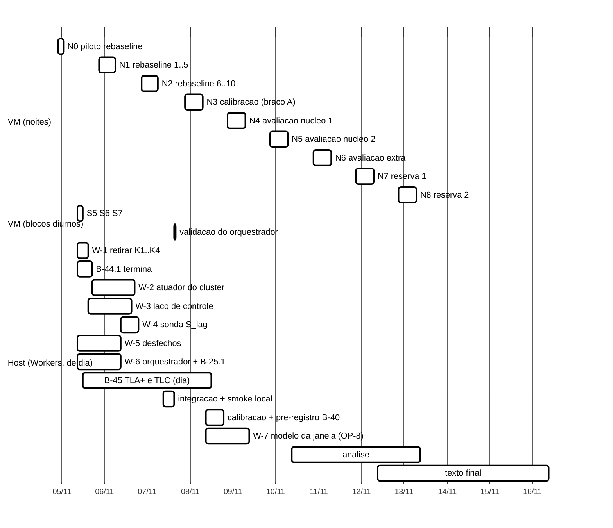
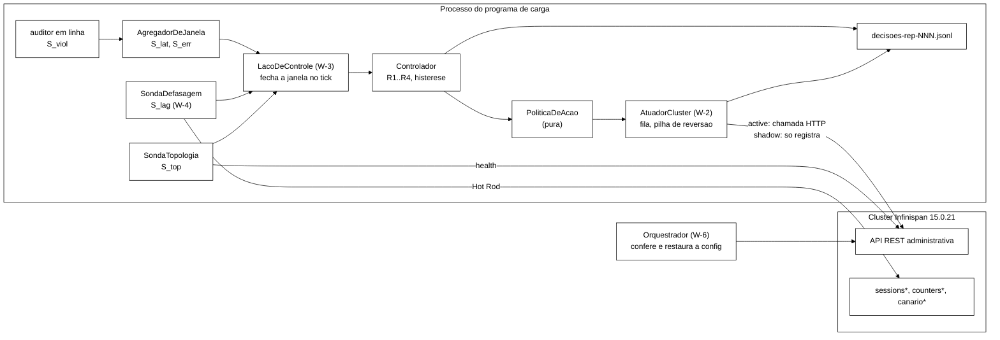

# Plano de execução para fechar o TCC, com o controlador do *cluster* (2026-11-04)

> Elaborado pelo Senior em 2026-11-04, à noite. **Só planejamento**: nenhum arquivo de `workload/`,
> `scripts/`, `analysis/`, `cluster/` ou `spec/` foi alterado, nenhuma VM foi tocada. Branch
> `docs/plano-implementacao-controlador` (worktree `wt-plano-ctrl`, base `f0ee52a`). Código de referência
> lido em `wt-ctrl-integ`, ponta `20805b0`; toda referência `caminho:linha` sem prefixo é dessa árvore.
> Texto lido em `monografia-atual/` (versão oficial), sem edição. Estado da VM e do *gate* lido em
> `wt-gate-v4` (ponta `e855c35`, `docs/roteiro-vm-2026-11-04.md`). Commit local, sem push.
>
> **Relação com os planos anteriores.** Este plano substitui o cronograma e o *backlog* da seção 8 de
> `docs/plano-alinhamento-objetivos-2026-11-04.md` (o "plano de alinhamento") e as seções 4, 5 e 7 dele,
> que tratavam de ações de cliente. Continuam valendo, como especificação, as seções 3.1 a 3.6 (desfechos,
> regra de interseção-união, poder, recuperação, convergência, janela e origem dos parâmetros) e o prompt 3
> (desempate de `ts`). Onde os dois divergem, vale este.
>
> **Mudança de instrução do autor (04/11, depois do pedido original).** O prazo de 8 dias não é rígido.
> Por isso nada é cortado aqui de forma definitiva: cada item que o Senior cortaria aparece como **opção**
> (seção 2), com objetivo coberto, perda sem ele, custo e risco, e há três cenários de cronograma (seção 3),
> com data final estimada e recomendação.

## Glossário (siglas usadas)

| Sigla | Significado |
|---|---|
| S1, S2 | cenários de carga sintética (pesos fixos, 50/50 e 95/5 de validação) |
| S3 | cenário de aplicação web simulada: 3 servidores de aplicação fixados a nós, console administrativo |
| F1, F2, F3, F4 | queda silenciosa de nó; partição de rede; atraso com *jitter*; degradação parcial (perda de 20 %) |
| I1..I6 | invariantes: irreversibilidade do *logout*, consistência de bloqueio (I2), motivo único (I4), convergência (I5/I6) |
| *rebaseline* | nova medição de referência S1/S2, pré-registrada em 23/10 (120 execuções) |
| calibração | campanha S3 mínima com o controlador só observando (o "T-F mínima" do plano de alinhamento) |
| braço A / braço B | controlador observando sem atuar (`shadow`) / controlador atuando (`active`) |
| bloco | par de execuções A e B com a mesma semente, ordem sorteada |
| S5, S6, S7 | blocos do *gate* da VM: S5 testa o injetor de F4; S6 testa a cura da partição depois de matar o injetor; S7 testa a cura automática pelo temporizador de segurança (o "*dead-man*") |
| GO | autorização digitada no início de um bloco de VM |
| TLC | verificador de modelos do TLA+ |
| JSONL | arquivo com um objeto JSON por linha |
| B-nn | item do *backlog* |
| IU | regra de interseção-união: "melhoria" exige rejeitar as duas hipóteses nulas (violação e latência) |
| N0..N8 | noites de VM numeradas a partir de hoje (N0 = 04/11) |

---

## 0. Decisões vinculantes de 04/11 e como este plano as aplica

| Decisão | Aplicação neste plano |
|---|---|
| Controlador age **no servidor**; ações de cliente (K1 admissão, K2 ritmo, K3 adiamento, K4 espera, AV-1 desvio, AV-2 barreira, AV-3 reafirmação) saem | seção 4 (desenho); prompt W-1 retira K1..K4 e o portão de emissão |
| Sensores: programa de carga (violações), *cluster* (saúde, topologia, métricas), sonda de defasagem S_lag | seção 4.2 |
| Processo do controlador: o mais rápido de entregar | *thread* no processo da carga (seção 4.1, com o porquê) |
| Atuadores: API administrativa do Infinispan, confirmados pelo B-44.1 | seção 4.4; prompt W-2 depende do relatório do B-44.1 |
| D-1 interseção-união; R1 mantida; D-12 calibração derivada; D-7 braço único completo × só observando; D-10 campanha S3 mínima; D-6 retirada de K3 com edições de teste; D-8 desempate T2; D-9 classes (a), DEGRADED antecipado e (b), (c) fora | seções 4 e 5; prompts W-1..W-7 |
| Regra dos números: todo limiar novo com fonte do projeto, senão medido | tabela 4.6; cada número novo deste plano tem origem escrita ao lado |
| Dúvida técnica com fonte rastreável: Senior ou coordenador decidem | seção 7 lista o que o Senior decidiu; seção 8 traz só o que é do autor |

---

## 1. Ponto de partida conferido (04/11, ~18:00 local)

| Item | Estado | Evidência |
|---|---|---|
| *Gate* da VM | S1..S4 aprovados; **S5, S6, S7 ainda não rodaram** (só os *scripts* e as revisões V-s5sh e V-s6s7sh existem) | `wt-gate-v4/runs/vm-s5-2026-10-28/` e `vm-s6-2026-11-04/` sem diretório `vm-<UTC>/` |
| VM | queda de energia 04/11 07:36; IP novo `172.27.127.98`; *cluster* recriado 19:14Z com o XML do *gate* (2 *caches* SYNC, **sem** os ASYNC) | `roteiro-vm-2026-11-04.md` §1 |
| Disco | VM 3,3 GB livres de 19 GB; *host* `C:` **19 GB livres** (medido agora, `df -h /c`); VHDX dinâmico | `roteiro-vm-2026-11-04.md` §7 |
| Controlador | núcleo `Controlador.java` (R1..R4, histerese) pronto e testado; sonda de topologia pronta; **não ligado ao laço de carga**; portão de emissão com K1..K4 implementado | plano de alinhamento §1.1 (A-1) |
| B-44.1 | Worker começou agora em `wt-b44-1` (`docs/b44-1-reconfiguracao-infinispan`); só cópias do XML em `runs/b44-1/` | `git status` em `wt-b44-1` |
| B-45 | worktree `wt-b45` criada (`fix/b45-desempate-ts`), sem commits | idem |
| Quedas de energia | 18 desde 01/09 (17 até 28/10 mais a de hoje) em 65 dias, ≈ 0,28 por dia | `decisoes-tecnicas.md`, 28/10 (tarde); roteiro de 04/11 §1 |

---

## 2. Opções: o que o Senior cortaria, e o que se perde

Critério: "cobre um objetivo de `monografia-atual/Introducao.tex:36-58`?". Objetivos: **(1)** modelo
formal; **(2)** invariantes verificados por *model checking*; **(3)** arquitetura experimental com
Infinispan em *cluster*, alterações de topologia, cenários de replicação, carga que detecta violações;
**(4)** controlador heurístico; **(5)** comparação do modelo estático com o modelo com controlador sob
falhas (violações, recuperação e convergência, latência). Custos de *host* são estimativas do Senior **sem
base medida**; custos de VM usam 12 a 20 min por execução S3 (`plano-fechamento-etapa-formal-2026-10-15.md`
§8.1) e 6,5 a 8 h por noite de 60 execuções do *rebaseline* (pré-registro aprovado §3 e §8).

### 2.1 Itens obrigatórios (sem eles um objetivo fica descoberto)

| Item | Objetivo | Custo *host* | Noites VM |
|---|---|---|---|
| W-1 retirar K1..K4 e o portão | (4) | 4 a 6 h | — |
| B-44.1 (em curso) e W-2 atuador do *cluster* | (4), geral | 10 a 14 h + 10 a 14 h | — |
| W-3 laço de controle, `--controller off|shadow|active`, JSONL | (4), (5) | 14 a 20 h | — |
| W-4 sonda S_lag e *caches* `canario*` | (4) | 8 a 12 h | — |
| W-5 desfechos no `comparar_bracos.py` (com a guarda G4) | (5) | 12 a 16 h (+3) | — |
| W-6 orquestrador S3 com F1/F2, retomável (com B-25.1, marcadores de F1) | (3), (5) | 12 a 16 h (+3 a 4) | validação curta de dia (~1 h) |
| B-45 desempate de `ts` (T2) e TLC nas configurações `tiny`, `small`, `medium` e propriedades de ação | (1), (2) | 6 a 8 h de Worker + 8 a 15 h de CPU, só de dia | — |
| Calibração (S3, braço A, ASYNC sem falha/F1/F2, SYNC F2) | (5) via D-12 | 8 a 12 h de análise | 1 |
| Avaliação núcleo (seção 5.2) | (5), geral | 10 a 14 h de análise | 2 |

### 2.2 Itens opcionais

Cada linha: (a) objetivo e perda sem o item; (b) custo; (c) risco. "Mín./Int./Comp." diz em qual cenário
da seção 3 o item entra.

| # | Item | (a) Objetivo coberto e perda sem ele | (b) Custo | (c) Risco | Mín. | Int. | Comp. |
|---|---|---|---|---|---|---|---|
| OP-1 | ***Rebaseline* S1/S2 completo** (piloto + 2 noites, 120 execuções, 10 por célula) | (3): única medição de S1/S2 nos dois modos sob F1 e F3; substitui as tabelas de junho retiradas (`Desenvolvimento.tex:79`). **Não** é exigido pelo (5): o braço A da avaliação já é o modelo estático sob falhas. Sem ele, SYNC × ASYNC só aparece em S3 (células SYNC de referência), e o texto precisa explicar a retirada de um protocolo que ele cita como pré-registrado em vários pontos (`Metodologia.tex:318`, `Desenvolvimento.tex:79, 83, 182`, `ConclusoesParciais.tex:11, 109`) | piloto 0,5 noite + 2 noites; ~2 h de validação do piloto, 6 a 8 h de análise (`analysis/rebaseline.py` já existe) | disco (seção 6.3); queda de energia numa noite. **Custo de calendário quase nulo**: as noites N0..N2 não teriam outro uso, porque o controlador só fica pronto para a VM em 07/11 | 5 a 10 rodadas (regra 7.2) | sim | sim |
| OP-2 | *Rebaseline* reduzido (5 rodadas, 60 execuções, 5 por célula) | (3) com metade das repetições; Mann-Whitney secundário ainda possível (menor p bilateral com 5 × 5 = 2/252 ≈ 0,008) | piloto + 1 noite | o mesmo, menor | **é o piso** se o piloto não sair hoje | — | — |
| OP-3 | **S5** (injetor de F4 sob a regra L-1/L-2) | (3): F4 verificada com efeito no tráfego. Só é necessário se F4 entrar sob carga (OP-5). Sem ele, o texto mantém "F4 passou só pelas verificações sem efeito no tráfego" (`ConclusoesParciais.tex:11`) | ~11 min de bloco + 30 a 45 min de validação, de dia; exige GO | problemas conhecidos Q-01..Q-10 do roteiro de 04/11 | não | sim | sim |
| OP-4 | **S6 e S7** (cura da partição depois de matar o injetor; cura pelo *dead-man*) | (3), indireto: segurança para rodar F2 sem ninguém presente. **Não são estritamente necessários**: o orquestrador (W-6) confere, antes de cada execução, ausência de `tc`/`iptables` residual nos três *netns*, *cluster* `HEALTHY` com 3 membros e disponibilidade `AVAILABLE`; se achar resto de partição, chama `inject-partition.sh --heal`, confere e, se falhar, para a noite. Uma queda do *host* reinicia a VM e limpa o `tc` de qualquer forma, então o *dead-man* só protege contra a morte do injetor com a VM viva. Sem S6/S7: uma noite com injetor morto perde o resto da noite (para), mas não contamina dados | ~1 h 30 min de dia (dois blocos + validações), *scripts* já prontos e revisados (V-s6s7sh); exige GO | baixo; atrasam a manhã de 05/11 | não | sim | sim |
| OP-5 | **F4 na avaliação** (ASYNC F4 8 blocos; SYNC F4 4 blocos) e na calibração (5 + 3 execuções) | (5): mais uma classe de falha; único cenário que exercita a perda de atualização em ASYNC sob perda de pacotes (mecanismo M3, seção 4.3), que **nenhuma ação de *cluster* mira**. Sem F4, (5) continua coberto por F1 e F2, que são as alterações de topologia que o (3) pede | 24 + 8 execuções ≈ 6,4 a 10,7 h ≈ 1 noite; depende de OP-3 | se o S5 reprovar, as células F4 saem (regra pré-registrada) | não | sim | sim |
| OP-6 | Célula SYNC F1 (4 blocos) além da SYNC F2 | (3) e tema: SYNC × ASYNC sob as duas falhas de topologia; referência sem teste (`Metodologia.tex:340`) | 8 execuções ≈ 1,6 a 2,7 h | baixo | não | sim | sim |
| OP-7 | Ensaio separado do F1 silencioso na VM (Q-17 do roteiro, aprovado em 28/10) | (3): confirma o F1 novo na VM antes do piloto. **Substituível**: o piloto do *rebaseline* tem 4 execuções com F1 e o critério K6 de F1 já está em `analysis/rebaseline.py` (`1ac38a6`); o pré-registro diz que o piloto existe para isso (§8). Sem o ensaio, uma falha de F1 aparece no piloto, que não entra em resultado | ~3 h de Worker + 1,5 a 2 h de VM com GO | um F1 defeituoso descoberto no piloto faz repetir o piloto (0,5 noite) | não | não | sim |
| OP-8 | Modelo TLA+ da janela entre corte e detecção, com a ação de congelamento (seção 4.5, nível 2) | (1)/(2) ligados ao (4): mostra no modelo que o DEGRADED antecipado elimina os traços do mecanismo M1 que nascem na janela. Sem ele, fica o argumento de refinamento (nível 1, obrigatório e barato): a ação só remove passos, logo nenhuma violação nova é possível | 8 a 12 h de Worker + 4 a 10 h de TLC de dia | estado explode (mais uma fase por partição); mitigado por cotas `tiny`/`small` | não | sim | sim |
| OP-9 | TLC na configuração `full` para o B-45 | (2): mesma cobertura das rodadas publicadas | +10 a 20 h de CPU de dia | ocupa os dias; quedas (com `-checkpoint`/`-recover`) | não | se houver dias livres | sim |
| OP-10 | Campanha S3 completa (27 células, caracterização de severidades de F2/F4) | (3): caracterização; nenhum objetivo a exige (plano de alinhamento §8.3) | 3 a 4 noites | calendário | não | não | sim |
| OP-11 | Terceiro braço de ablação (só DEGRADED antecipado × controlador completo) | (4)/(5): separa o efeito de cada ação; exploratório | ~1,5 noite | calendário | não | não | sim |
| OP-12 | Atuador de tempo-limite (`remote-timeout`, AC-3) | (5) latência em SYNC; só se o B-44.1 o confirmar mutável **e** a calibração der valor (4.6) | 2 a 4 h | valor sem fonte vira "medir"; pode sair | condicional | condicional | sim |
| OP-13 | Energia estimada (G-3, mantida) | justificativa de custo (`Introducao.tex:21`) | coleta já pronta (B-37); ligar no W-6 (~1 h) | nenhum relevante | sim | sim | sim |

---

## 3. Cenários de cronograma

### 3.1 Hipóteses comuns

- **Até 4 Workers em paralelo de dia**; com só 2, somar ~1,5 dia a cada cenário.
- **Host em silêncio nos blocos de VM** (noites e blocos diurnos curtos): nada de `mvn test`, TLC, *replay*
  ou suíte pesada nesses blocos nem 5 min antes e depois (regra de 16/10, §1.7). **TLC só de dia**, fora
  dos blocos diurnos de VM, com `-checkpoint 10` e `-recover`.
- **Noite** = até 10 h de VM; 30 a 50 execuções S3 (12 a 20 min cada) ou 60 do *rebaseline*.
- **Quedas de energia**: 0,28 por dia (seção 1). Supondo eventos independentes (Poisson, hipótese
  declarada como no plano de alinhamento §8.4), a chance de uma noite de 10 h ser atingida é
  `1 − e^(−0,28 × 10/24)` ≈ **11 %**. Uma noite atingida perde o resto da noite (ninguém reinicia de
  madrugada); a campanha retoma na noite seguinte pelo arquivo de progresso (W-6).
- O controlador fica pronto para a VM em **07/11 à tarde** em todos os cenários: W-1 (05), W-2/W-3/W-4
  (05-06), integração e *smoke* local (07). Antes disso a VM só serve ao *rebaseline* e ao *gate*.

### 3.2 Cenário mínimo (8 dias, fim em 12/11)

| Noite | Data | VM |
|---|---|---|
| N0 | 04/11 | piloto do *rebaseline* (se o preparo terminar até ~22:00; senão vai para N1) |
| N1 | 05/11 | *rebaseline* rodadas 1..5 |
| N2 | 06/11 | *rebaseline* rodadas 6..10 (ou 1..5, se o piloto escorregou) |
| N3 | 07/11 | calibração (21 execuções, braço A) |
| N4 | 08/11 | avaliação núcleo, noite 1 |
| N5 | 09/11 | avaliação núcleo, noite 2 |
| N6 | 10/11 | **reserva** (reposição de blocos) |
| — | 11/11 | análise |
| — | 12/11 | texto final |

Sem S5, S6, S7, F4, SYNC F1, ensaio do F1, OP-8, OP-9. Probabilidade de 2 ou mais quedas nas 6 noites
críticas (N0..N5), com uma só reserva: `1 − 0,89^6 − 6·0,11·0,89^5` ≈ **13 %**. Nesse caso o fim passa
de 12/11. A escrita final cabe em um dia e meio só se o Escritor tiver adiantado tudo o que a seção 6 marca
como "já".

### 3.3 Cenário intermediário (fim estimado em 15/11) — **recomendado**

Mínimo **mais** OP-3 (S5), OP-4 (S6/S7), OP-5 (F4), OP-6 (SYNC F1), OP-8 (modelo da janela) e OP-9 se houver
dia livre. Construído como **superconjunto do mínimo, com o mínimo primeiro**: as células do núcleo rodam
nas noites N4 e N5 em blocos completos; as células extras (F4, SYNC F1) rodam em N6. Se o autor precisar
parar em 12/11, o núcleo já estará completo em 10/11 de manhã.

| Noite | Data | VM | Dia seguinte, no *host* |
|---|---|---|---|
| N0 | 04/11 | piloto do *rebaseline* | validação do piloto; S5, S6, S7 de manhã (bloco diurno); recriação do *cluster* do *rebaseline* depois do S7 |
| N1 | 05/11 | *rebaseline* 1..5 | cópia comprimida (O-3); W-2/W-3/W-4; TLC do B-45 |
| N2 | 06/11 | *rebaseline* 6..10 + reposições | análise do *rebaseline*; integração; *smoke* local; recriar o *cluster* com XML + `canario*`; validação curta do orquestrador na VM (bloco diurno ~1 h) |
| N3 | 07/11 | calibração (29 execuções: núcleo + F4 + SYNC F1) | calibração dos limiares, curva de poder, pré-registro B-40; modelo da janela (OP-8) |
| N4 | 08/11 | avaliação núcleo 1 | análise parcial; *smoke* do braço B na VM só se N3 revelou problema |
| N5 | 09/11 | avaliação núcleo 2 | análise do núcleo |
| N6 | 10/11 | avaliação extra (F4, SYNC F1) | análise completa |
| N7 | 11/11 | reserva 1 | relatório; resumos para o TCC |
| N8 | 12/11 | reserva 2 | texto |
| — | 13 a 15/11 | — | texto e revisão |

Probabilidade de 3 ou mais quedas nas 7 noites críticas (N0..N6), com duas reservas:
`1 − 0,89^7 − 7·0,11·0,89^6 − 21·0,11²·0,89^5` ≈ **3 %**.

### 3.4 Cenário completo (fim estimado em 21-22/11)

Intermediário **mais** OP-7 (ensaio do F1, de dia em 05/11), OP-10 (campanha S3 completa, 3 a 4 noites
depois da avaliação), OP-11 (ablação, ~1,5 noite) e OP-9 obrigatório. Noites N7..N12 para OP-10 e OP-11,
N13 de reserva; análise em 19-20/11; texto até 21-22/11.

### 3.5 Recomendação

**Intermediário.** Motivos: (i) fecha os cinco objetivos com as duas falhas de topologia e as três classes
de falha sob carga, nos dois modos; (ii) as opções que ele acrescenta ao mínimo custam ~1 noite e ~1,5 h
de manhã, e o calendário as absorve porque usam a janela em que o controlador ainda não está pronto;
(iii) tem duas noites de reserva, o que leva o risco de estourar de ~13 % para ~3 %; (iv) por ser
superconjunto do mínimo com o núcleo primeiro, preserva a saída de 12/11. O completo acrescenta
caracterização e ablação, que nenhum objetivo exige, por mais uma semana.

### 3.6 Cronograma do cenário recomendado

**O que roda no *host* em paralelo, dia a dia (intermediário):**

| Dia | Manhã | Tarde | Restrição |
|---|---|---|---|
| 04/11 (hoje) | — | preparo do piloto: disco (O-1, O-4 +10 GB), *bundle* do *rebaseline* (`git archive 20805b0` + jar `5eced136…`), *cluster* recriado com o XML do B-42.1, checklist 10.6 | Workers: B-44.1 segue até ~21:30; depois, silêncio |
| 05/11 | validação do piloto (Senior); S5, S6, S7 (bloco diurno; Workers só leem/escrevem código, sem testes pesados nesses ~3 h) | W-1 → W-3; B-44.1 → W-2; W-5; W-6; B-45 edição + TLC `tiny`/`small` | recriar *cluster* depois do S7, antes de N1; silêncio a partir de ~20:45 |
| 06/11 | O-3 da N1; W-3, W-2, W-4, W-6 terminam | TLC `medium` e propriedades de ação; Senior valida W-1, W-5, W-6 | silêncio a partir de ~20:45 |
| 07/11 | análise do *rebaseline* (Worker + Senior); integração linear das branches pelo coordenador | *smoke* local (S3 ASYNC, F2 local, `shadow` e `active`); recriar *cluster* da VM com XML + `canario*`; validação do orquestrador na VM (1 F2 `shadow` + 1 F2 `active`) | sem TLC durante o bloco de VM |
| 08/11 | calibração (regras 3.4-3.6 do plano de alinhamento e 4.6 deste), curva de poder | pré-registro B-40 commitado antes de N4; W-7 (OP-8) e TLC dele | — |
| 09/11 a 11/11 | análise das noites; resumos para o TCC; TLC `full` se sobrar dia (OP-9) | idem | — |
| 12/11 a 15/11 | texto (Escritor), revisão (Revisor) | — | — |

---

## 4. Desenho do controlador do *cluster*

### 4.1 Onde roda: *thread* no processo da carga

Escolha do Senior: o controlador continua como *thread* no processo do programa de carga (o
`LacoDeControle` do plano de 22/10). É o mais rápido de entregar porque:

1. **As violações nascem no processo da carga** (auditor em linha e `RastroCliente`, que só existe com
   `--marker`, plano de alinhamento N-9). Um processo à parte precisaria de um canal novo (arquivo em
   *tail* ou *socket*), com descarga, ordenação e falha próprias. O `AgregadorDeJanela` já consome os
   eventos em memória.
2. **O desenho já especificado e testado** (`AgregadorDeJanela`, `SondaTopologia`, `Controlador`,
   decisão de 22/10 sobre o *tick* injetável) supõe o mesmo processo; nada disso é refeito.
3. **O custo de observação é igual nos dois braços** e já está declarado no texto: o tempo de CPU do
   processo da carga "inclui o controlador" (`Metodologia.tex:333`).
4. O atuador fala com o *cluster* por HTTP (API REST administrativa do Infinispan), o que não exige
   processo à parte; usa `java.net.http.HttpClient` com prazo curto, numa *thread* própria, para que uma
   chamada lenta nunca bloqueie a carga.

Custo dessa escolha: uma falha do atuador poderia afetar a carga. Mitigação: fila de ações com uma única
*thread* executora, prazos em toda chamada, e reversão em três camadas (4.4.3).

### 4.2 Sensores

| Sensor | Origem | O que dá ao controlador | Estado |
|---|---|---|---|
| S_viol | programa de carga (auditor em linha; I2 real só com `--marker`) | I1, I4, I2_REAL por janela; I2 por limite e `*_concorrentes` fora do gatilho (DT-001, DT-002) | pronto (B-28.1) |
| S_lat, S_err | programa de carga (`AgregadorDeJanela`) | taxa de excedência do p99 de referência e taxa de erro por janela | pronto |
| S_top | *cluster*: `/rest/v2/cache-managers/default/health` por nó a cada 2 s (`SondaTopologia`) | nós saudáveis, membros da vista, anomalia | pronto (B-26.2) |
| S_lag | sonda ativa: escreve em `canario`/`canario-async` por um nó e lê pelos outros dois | defasagem por nó; único sinal **antes** da detecção da partição em ASYNC (plano de alinhamento N-3) | W-4 |
| S_disp | *cluster*: disponibilidade de cada *cache* do modo ativo (leitura REST) | confirma a ação e a reversão; não é gatilho | W-2 |

### 4.3 Mecanismos de violação e o que o controlador faz com cada um

Mecanismos do catálogo (`docs/catalogo-operacao-falha-invariante.md` §4) e do plano de alinhamento §4.1,
numerados aqui de M1 a M5:

| Mec. | Descrição | Invariantes | Fonte | Ação de *cluster* | Classe (D-9) |
|---|---|---|---|---|---|
| M1 | escrita aceita entre o corte da rede e a detecção (≈ 40 s do FD_ALL3), perdida na fusão; em ASYNC, também escrita feita na maioria cujo dono primário está no lado cortado | I1, I2, I4 | `infinispan_configuring_15` §7.1.1; traços `I1F`, `I2Fa`, `I1M` | **AC-1 DEGRADED antecipado** | "recusar mais" (aprovado) |
| M2 | leitura defasada em ASYNC logo depois da escrita | I1, I4 aparentes | `infinispan_configuring_15` §2.2 | **nenhuma** (as ações que miravam M2 eram de cliente e saíram) | — |
| M3 | atualização perdida em ASYNC sob perda de pacotes | I5, I6 | idem §2.2 | **nenhuma** | — |
| M4 | `Logout` × `Block` concorrentes trocam o motivo | I4 | catálogo §4.3 | já mitigado no código (escrita condicional por versão, DT-003) | — |
| M5 | fusão a partir de réplica atrasada do lado vencedor (P-23); rebalanceamento durante oscilação de topologia | I5, I6 | `registro-de-problemas.md` P-23; `Desenvolvimento.tex:197` | **AC-2 suspender o rebalanceamento** enquanto a topologia oscila | (b) |
| — | latência sob falha (não é violação) | — | — | **AC-3 tempo-limite remoto** (OP-12), só SYNC e leituras | (a) |

M2 e M3 ficam sem ação: o texto precisa dizer isso como limitação, não como resultado.

### 4.4 Atuadores candidatos (dependem do B-44.1)

Os nomes de chamada abaixo são **hipóteses de partida** que o B-44.1 confirma ou derruba, com fonte da
versão 15.0 e prova empírica (leitura de volta e log do servidor). Nenhum é usado sem a linha
correspondente da tabela do B-44.1.

| Ação | Chamada candidata | Mecanismo | Reversão |
|---|---|---|---|
| AC-1 DEGRADED antecipado | disponibilidade do *cache* (`set-availability` para `DEGRADED_MODE`) nos dois *caches* do modo ativo | M1 | `AVAILABLE` quando: (i) a vista mudou (detecção natural) e o lado majoritário tem 2 nós saudáveis, ou (ii) a suspeita era falsa (S_lag calmo e topologia completa `HEALTHY` por `T_estavel`), ou (iii) o teto `T_cong` estourou |
| AC-2 rebalanceamento suspenso | `disable-rebalancing` por *cache* ou global | M5 | `enable-rebalancing` na saída de CONSERVADOR (R4), no teto e no encerramento |
| AC-3 tempo-limite remoto | atributo mutável `remote-timeout`, se existir | latência (SYNC) | valor do XML |
| AC-5 (só se AC-1 não servir) | parar o servidor suspeito pela API | M1 | `podman start` pelo orquestrador; equivale a `Cair`/`Reviver` do modelo. **Não** implementar sem nova análise do Senior |

#### 4.4.1 O ponto em aberto do AC-1: alcance da ação

Pelo que o Senior sabe do Infinispan (a confirmar no B-44.1), a disponibilidade é decidida pelo coordenador
e vale para toda a partição corrente, não para um nó. Durante a janela não detectada a vista ainda tem 3
membros, então pôr o *cache* em DEGRADED **congela as escritas no *cluster* inteiro**, não só no nó
suspeito. Duas leituras:

- Isso cobre mais do M1 do que congelar um nó, porque em ASYNC a escrita feita na maioria com dono
  primário no lado cortado também se perde. É a escolha explícita de consistência sobre disponibilidade sob
  suspeita de partição, nos termos de `gilbert_lynch_cap_2002` (já no `.bib`).
- Custa vazão: no máximo `T_cong` segundos de recusa por falha. Com teto de ~46 s numa execução de 300 s,
  o critério de não inferioridade da vazão útil (δ = 10 %, decisão de 22/10) **pode falhar por
  construção** nas células F2 e F1. Isso vai como expectativa no pré-registro B-40, e o resultado é
  relatado como troca entre violações e vazão, não escondido.

Se o B-44.1 mostrar que a ação vale por nó, o AC-1 age só no nó suspeito (o de maior S_lag). Se mostrar que
a chamada feita no nó cortado não chega ao coordenador, o pedido vai sempre a um nó do lado com 2 membros.

#### 4.4.2 Números do atuador e de onde vêm

| Número | Valor | Origem |
|---|---|---|
| `T_cong` (teto do congelamento) | maior tempo de detecção medido: 46,4 s (REP=3, `relatorio-tb-v3-execucao-2026-10-16.md:36-37`); 43,5 s (REP=4R, V-S4 item 2); substituído pelo máximo medido no B-44.1 se for maior | medida |
| atraso de entrada do AC-1 | `k × W` (persistência do núcleo vezes a janela) | derivação; com W e k da calibração (plano de alinhamento 3.5-3.6). Fração da janela de M1 coberta ≈ `1 − kW / T_det` |
| prazo de cada chamada REST | 2 s, o mesmo `curl -m` da sonda de saúde | decisão já validada (B-26.2) |
| `remote-timeout` alvo (AC-3) | p99 medido da operação remota correspondente na calibração SYNC sem falha | medida; sem ela, AC-3 sai |

#### 4.4.3 Reversão em três camadas

1. **Na decisão**: cada ação empilha a sua reversão (pilha LIFO, idempotente); R4 desempilha tudo.
2. **No encerramento do processo**: gancho de desligamento da JVM chama `reverterTudo()` com prazo.
3. **No orquestrador**: antes e depois de cada execução, lê disponibilidade, estado do rebalanceamento e
   atributos mutáveis de cada *cache* e compara com o XML; se divergir, restaura e confere; se não
   conseguir, recria o *cluster* e marca a execução como de infraestrutura (DT-014). Isso cobre o caso, a
   verificar no B-44.1, em que a mudança feita pela API **persiste** depois do reinício do nó.

Toda ação e toda reversão gravam uma linha `{"tipo":"acao",...}` no JSONL de decisões: regra, sinais,
alvo, pedido, código HTTP, leitura de volta, duração. No braço A a mesma linha sai com `"executada":false`
(`acao_prevista`), sem chamada HTTP.

### 4.5 Regras (núcleo aproveitado)

O núcleo `Controlador.java` (R1..R4, histerese entre θ_in e θ_out, persistência k, m janelas calmas,
*cooldown*, `T_estavel`, `T_hold_viol`) **fica**. Mudança mínima, com testes: um terceiro sinal, a
defasagem, entra como a latência entra hoje.

- **R1** (inalterada): violação ⇒ CONSERVADOR na mesma janela, mesmo em *cooldown*.
- **R2** (acrescenta S_lag): em NORMAL com *cooldown* expirado, topologia anômala, ou latência alta em k
  janelas, ou erro alto em k janelas, **ou defasagem alta em k janelas** ⇒ CONSERVADOR.
- **R3** (idem): em CONSERVADOR, sinal alto (inclusive defasagem) zera as janelas calmas.
- **R4** (idem): janela calma exige também defasagem calma ou indeterminada.
- Nova assinatura `avaliar(janela, topologia, defasagem)`; a antiga delega com defasagem indeterminada,
  para que os testes atuais do núcleo não mudem. Novo `Motivo.DEFASAGEM`.

Uma **política de ação** pura (`PoliticaDeAcao`, sem E/S) traduz a decisão em ações:

| Situação na janela | Ações |
|---|---|
| entra em CONSERVADOR com motivo DEFASAGEM ou TOPOLOGIA, vista ainda com 3 membros | AC-1 (se não ativa) e AC-2 |
| entra em CONSERVADOR com motivo VIOLACAO | AC-1 se houver também defasagem alta; AC-2 se a topologia oscilou |
| entra em CONSERVADOR só por LATENCIA ou ERRO | AC-3 em SYNC, se existir; senão nenhuma (registrado) |
| vista mudou (detecção natural) com AC-1 ativa | reversão (i) do AC-1 no lado majoritário |
| R4 ou teto | reversão de tudo |

### 4.6 Origem dos parâmetros

Os parâmetros do núcleo (W, n_lat, n_err, θ, k, m, `T_cooldown`, `T_estavel`, `T_hold_viol`) seguem a
tabela 3.6 e a regra de calibração derivada do plano de alinhamento (D-12), com dados da calibração (N3),
que não entram na avaliação. Novos neste plano:

| Parâmetro | Regra | Origem |
|---|---|---|
| período da sonda S_lag | = W | derivação (plano de alinhamento 4.2) |
| `lag_in` | quantil de 99 % do `lag` nas execuções sem falha da calibração | medida, mesma lógica do p99 de referência (B-39.1) |
| `lag_out` | como θ_out (regra de histerese da 3.6) | derivação |
| `T_cong` | 4.4.2 | medida |
| número de blocos por célula com falha | mínimo 8 (`Metodologia.tex:340`); aumenta até 12 se a duração medida por execução na calibração deixar as células do núcleo caberem em 2 noites; **nunca** pelo efeito observado | decisão registrada + medida de tempo |
| blocos na célula sem falha | 4 | mesmo número das células de referência sem teste de `Metodologia.tex:340`; a célula sem falha é descritiva (H_V não avaliável sem violação, plano de alinhamento 3.3) |

### 4.7 O que muda no TLA+

**Nível 1 (obrigatório, barato): argumento de refinamento.** No modelo, `PodeAgir(r)`
(`spec/SessionStore.tla:268-272`) já é a guarda de toda ação local. O DEGRADED antecipado vira uma variável
`congelado` (por *cache* ou por réplica, conforme o B-44.1) e duas ações, `Congelar` e `Descongelar`, sem
outro efeito; `PodeAgir(r)` ganha `/\ ~congelado`. A ação **só remove passos habilitados**; todo
comportamento do modelo com controlador, projetado nas variáveis antigas, é comportamento do modelo antigo
(com passos de gagueira). Logo nenhuma invariante de segurança que valia deixa de valer, e nenhum traço novo
de violação aparece. Verificação: TLC em `tiny` e `small` com a propriedade de refinamento
(`INSTANCE SessionStore` com as mesmas variáveis) e I1..I4. Entra na branch do B-45, depois do desempate
T2. O rebalanceamento suspenso (AC-2, classe b) só muda o momento da convergência e não tem ação própria
no modelo; isso é dito no texto.

**Nível 2 (OP-8): janela entre corte e detecção.** Hoje `Particionar` (`:478-485`) corta e detecta no mesmo
passo: o lado minoritário para na hora, e o M1 só aparece por mensagens em trânsito. O modelo da janela
divide o passo em `Cortar` (as entregas entre lados param, os dois lados continuam agindo) e `Detectar`
(a semântica atual). Com isso, (a) os traços do M1 que nascem na janela aparecem sem controlador; (b) com
`Congelar` habilitado entre `Cortar` e `Detectar`, conferir que os traços de janela deixam de ser
alcançáveis quando o congelamento vem antes de qualquer escrita no corte, e que os traços de mensagens em
trânsito continuam (o controlador não os evita). Módulo separado `spec/MCJanelaDeteccao.tla`; não altera os
resultados publicados.

---

## 5. Avaliação: núcleo e extras

### 5.1 Calibração (N3; pré-registro curto escrito em 06-07/11)

Braço A apenas (`--controller shadow`), mesmo jar, mesmo XML da avaliação. Núcleo: ASYNC sem falha × 5,
F1 × 5, F2 × 5; SYNC F2 × 3 (18 execuções); intermediário acrescenta ASYNC F4 × 5 e SYNC F1 × 3 (26; com
reposições, ~29). Serve a: q̂ e taxas por execução (poder), distribuições sem falha (θ, `lag_in`), vazão
(W), duração das oscilações (m), retorno a `HEALTHY` (`T_estavel`), intervalo entre violações
(`T_hold_viol`), duração real por execução (número de blocos), maior Δ_conv (teto da convergência).

### 5.2 Avaliação (N4..N6; pré-registro B-40 commitado em 08/11, antes de N4)

| Célula | Blocos | Papel | Cenário |
|---|---|---|---|
| ASYNC F1 (`isn2`) | 8 a 12 | teste (IU) | todos |
| ASYNC F2 (`isn3` isolado 90 s) | 8 a 12 | teste (IU) | todos |
| ASYNC sem falha | 4 | descritiva: sobrecarga, acionamentos indevidos | todos |
| SYNC F2 | 4 | referência sem teste | todos |
| ASYNC F4 (perda 20 %, N3) | 8 | teste (IU) | intermediário, completo |
| SYNC F1, SYNC F4 | 4 cada | referência sem teste | intermediário, completo |

Regra de sucesso: interseção-união por célula (D-1, plano de alinhamento 3.2); Holm entre as células com
teste sobre `p_IU`. Com 2 células (mínimo), o menor p de uma célula precisa ficar abaixo de 0,025, o que
exige ao menos 7 blocos com diferença não nula (`2/2^7 = 0,0156`); com 3 células (intermediário), abaixo
de 0,0167, também 7 blocos. Isso vai explícito no B-40.

Ordem: as células do núcleo rodam primeiro, em blocos completos sorteados (N4 e N5); as extras em N6. Um
bloco com execução perdida é refeito inteiro, com o próximo índice livre (plano de alinhamento 8.4).

---

## 6. O que o Escritor reescreve

### 6.1 Pode ser escrito já (sem dados)

| Onde (`monografia-atual/`) | O que |
|---|---|
| `Desenvolvimento.tex:160-179` (seção do controlador) | controlador do *cluster*: sensores (4.2), núcleo R1..R4 com S_lag, política de ação, atuadores AC-1/AC-2 (AC-3 condicional), reversão em três camadas, JSONL; retirada de K1..K4 com o motivo (ação só de cliente não atua no sistema medido nem em mecanismo de violação); a frase "a configuração do servidor não muda" (`:168`) e a "segunda etapa" (`:173`) saem |
| `Desenvolvimento.tex:187, 199` | objetivo (4) volta a ser um só, atuando no *cluster*; violação como gatilho primário (G-1); M2 e M3 sem ação, como limitação |
| `Desenvolvimento.tex:175` | candidatos de atuador: substituir pela tabela do B-44.1 (assim que o relatório sair, 05-06/11) |
| `Metodologia.tex:223-224` | Δ_rec e Δ_conv com as definições do plano de alinhamento 3.4 |
| `Metodologia.tex:229` | critério 1: troca de sinal sobre a diferença pareada de taxas; os três critérios como interseção-união |
| `Metodologia.tex:336-344` | desenho da avaliação: braço B com ações de *cluster*, células e blocos da 5.2, calibração na campanha S3 mínima, regra de calibração derivada, expectativa sobre a vazão (4.4.1) |
| `Metodologia.tex:311, 313` | S3 continua sem reparar estado; o controlador muda o *cluster*, não a carga |
| `Metodologia.tex:318` e `Desenvolvimento.tex:79, 83, 182` | registro das mudanças do pré-registro do *rebaseline* (seção 7.2), com data anterior a qualquer dado |
| `Metodologia.tex:359` | TailX e a cauda como uma das duas métricas principais |
| Fundamentação (partição) | modos de disponibilidade do Infinispan sob partição e o argumento CAP do AC-1 (fontes: `infinispan_configuring_15`, guia REST do 15.0 a trazer, `gilbert_lynch_cap_2002`) |
| Desenvolvimento, seção formal | argumento de refinamento (4.7, nível 1); depois do B-45, o desempate T2 e a retirada de "canal com entrega em ordem" (`Desenvolvimento.tex:60`, `ApPlanoTCC2.tex:66`) se o controle FIFO confirmar |

### 6.2 Depende de dados

| Quando | O que |
|---|---|
| 07/11 (depois de N2) | resultados do *rebaseline*: tabelas de p99 por operação, SYNC × ASYNC, F1 e F3 (substituem as retiradas) |
| 08-09/11 | rodada TLC do B-45 (tabela antes × depois); nível 1 do TLA+; OP-8 se executado |
| 08/11 | parâmetros calibrados (valores finais da tabela do controlador) |
| 10-11/11 | resultados da avaliação: taxas de violação e p99 por braço, IU por célula, Δ_rec, Δ_conv, divergência, vazão, CPU e energia estimada, comportamento do controlador |
| 12-15/11 | conclusões, limitações, `ConclusoesParciais.tex` vira conclusão final; `ApPlanoTCC2.tex` sai ou vira histórico |

---

## 7. Decisões técnicas tomadas pelo Senior neste plano (com fonte)

### 7.1 Escolhas

| # | Decisão | Fonte |
|---|---|---|
| ST-1 | controlador como *thread* no processo da carga | 4.1 |
| ST-2 | sem ensaio separado do F1 nos cenários mínimo e intermediário; o piloto faz esse papel (K6) | pré-registro aprovado §8; `1ac38a6` |
| ST-3 | S6/S7 não bloqueiam a campanha no mínimo; o orquestrador confere e cura antes de cada execução | 2.2 OP-4 |
| ST-4 | célula sem falha com 4 blocos | `Metodologia.tex:340` (células de referência) |
| ST-5 | número de blocos por tempo medido, nunca por efeito | 4.6 |
| ST-6 | `T_cong` = maior tempo de detecção medido | 4.4.2 |
| ST-7 | O-1 (apagar CSV de junho na VM depois do sha256), O-3 (cópia comprimida de dia) e O-4 (+10 GB no LV) do roteiro de 04/11 | `roteiro-vm-2026-11-04.md` §7.4-7.5 |

### 7.2 Mudanças de pré-registro, todas antes de qualquer dado (a registrar em `decisoes-tecnicas.md`)

1. ***Rebaseline*, ordem**: o *cluster* da campanha é criado depois do último bloco do *gate* que o
   cenário executa (S7 no intermediário; dispensado no mínimo), em vez de "depois do S7".
2. ***Rebaseline*, tamanho**: 10 rodadas, das quais 6..10 condicionais ao calendário: se uma das noites
   N0..N2 for perdida ou o piloto escorregar, a campanha fecha com as rodadas completas feitas até a noite
   de 06/11 (mínimo 5). A regra depende só do calendário, não de dado observado; as rodadas são blocos
   completos sorteados (pré-registro §3), então o corte não desequilibra células.
3. ***Rebaseline*, ensaio do F1** substituído pelo piloto (ST-2).
4. **GO** delegado ao coordenador, se o autor aprovar A-1.
5. **Avaliação**: o B-40 ainda não existe; ele nasce com o desenho da seção 5.2 e a regra IU. O texto
   (`Metodologia.tex:340-344`) é atualizado como desenho revisto, não como desvio.

---

## 8. Decisões que ainda são do autor

| # | Pergunta | Recomendação |
|---|---|---|
| **A-1** | Autoriza o coordenador a dar o GO de todos os blocos de VM (piloto, noites, S5, S6, S7, calibração, avaliação), no lugar da presença do senhor no início e na primeira F3 de cada noite (R6 de 23/10, P-6 de 28/10)? Condições: as checagens automáticas de cada *script*, o orquestrador conferindo `tc`, vista, disponibilidade e configuração antes de cada execução, e o senhor deixando o computador ligado na tomada, sem suspensão nem atualização | **Autorizar.** Sem isso, cada noite e cada bloco do *gate* exige o senhor presente, o que contradiz "só execução" |
| **A-2** | Qual cenário: mínimo (fim 12/11), intermediário (fim ~15/11) ou completo (fim ~21-22/11)? Escolher o cenário aprova junto as mudanças de pré-registro da 7.2 que ele implica | **Intermediário**, com o mínimo primeiro (3.5) |
| **A-3** | Ação única, não decisão: liberar pelo menos 20 GB no `C:` fora de `tcc/` (hoje 19 GB livres; em `tcc/` os *bundles* e *zips* somam menos de 30 MB), antes da noite de 05/11. O VHDX da VM cresce no `C:` com cada noite (até 8 a 14 GB por noite de *rebaseline* sem compressão) | **Fazer até 05/11 à tarde.** Se não for possível, o Senior aplica a O-6 do roteiro (3 rodadas por noite), e o *rebaseline* fecha com 5 rodadas (7.2, item 2) |

---

## 9. Prompts para o Worker

Regras comuns: base `feature/controlador-integracao` em `20805b0` (salvo indicação); commits locais em
branch própria, `feat:|fix:|docs:|test:|refactor:|chore:`, terminando com
`Co-Authored-By: Claude Opus 5.5 <noreply@anthropic.com>`; **nada vai para `origin`**; histórico linear;
TDD (commit `test:` vermelho antes do `feat:`/`refactor:`); registrar a contagem do Surefire e do
`unittest discover -s analysis` antes e depois; **nada de `mvn test`, TLC ou suíte pesada durante bloco de
VM** (o coordenador avisa; à noite, nunca); relatório final em `docs/relatorio-<id>-<data>.md` com comandos e
números conferidos contra os brutos; diagramas em Mermaid. Pare e reporte se algo fora da lista precisar
mudar.

### W-1: retirar K1..K4 e o portão de emissão (B-27.3)

> Branch `refactor/b27-3-remover-acoes-cliente`. Worktree nova `wt-b27-3`.
>
> **Contexto.** Decisão do autor de 04/11: o controlador age só no *cluster*; admissão (K1), ritmo (K2),
> adiamento administrativo (K3) e espera entre retentativas (K4) saem. A retirada de K3 e as edições de
> teste da seção 5.2 do plano de alinhamento estão autorizadas (D-6); a retirada de K1, K2 e K4 decorre da
> mesma decisão, e os testes dessas funções são apagados com elas.
>
> 1. **Tarefa 0 (leitura, sem editar):** `grep -rn "PortaoDeEmissao\|ParametrosKnobs\|EventoK3\|PerfilAtual\|Dormidor\|esperaPortao\|aguardarAdministrativa" workload/src`;
>    liste cada ocorrência e diga o destino (apagar, simplificar, manter). Conferir que o caminho com
>    `PortaoDeEmissao.livre()` é numericamente o de antes do B-27 (Javadoc de `AplicacaoS3.java:58-60` e
>    `WorkloadMain.java:778-779` dizem que sim).
> 2. **Código:** apagar `controle/PortaoDeEmissao.java`, `ParametrosKnobs.java`, `EventoK3.java` e
>    `Dormidor.java` se ficar sem uso; `PerfilAtual.java` só se nenhum código restante o usar (o W-3 decide
>    se volta). `AplicacaoS3`, `ContextoS3`, `WorkloadMain.rodarCliente` sem portão: o laço e as
>    retentativas voltam ao comportamento com portão livre, sem nenhum parâmetro de controle.
>    **A coluna `espera_portao_ns` fica** (contrato S3 v2 de 10 colunas, `analysis/test_contrato_s3_acoes.py`)
>    e passa a valer sempre 0, com Javadoc "reservada; 0 desde o B-27.3".
> 3. **Testes apagados (listar no relatório, com contagem):** `PortaoDeEmissaoK1Test`,
>    `PortaoDeEmissaoK2K4Test`, `PortaoDeEmissaoK3Test`, `ParametrosKnobsTest`, `ArquiteturaPortaoTest`,
>    `PortaoS1S2Test`, `PortaoS3AplicacaoTest`, `PortaoS3SimulacaoTest`; `PerfilAtualTest` ajustado ou
>    apagado com a classe. Qualquer outro teste que precise mudar: **parar e reportar**.
> 4. **Testes novos (vermelhos antes):**
>    - R-C1 (arquitetura, por reflexão ou varredura de *imports*): nenhuma classe de `session` importa
>      `controle`, salvo as que o W-3 criar para o laço (lista vazia nesta branch);
>    - R-C2: em S3 com relógio falso, toda ação grava `espera_portao_ns = 0`;
>    - R-C3: S1/S2 *golden* idênticos byte a byte aos de `20805b0`; `S3SimulacaoTest` inalterado.
> 5. **Aceite:** Surefire 0 falha, contagem = 863 − apagados + novos (registrar as três parcelas); `unittest`
>    de `analysis` 187 OK, 1 *skip*; `grep -rn "K1\|K2\|K3\|K4\|Knobs\|PortaoDeEmissao" workload/src`
>    vazio, salvo comentário histórico explícito.

### W-2: atuador do *cluster* pela API administrativa (B-44.2)

> **Pré-condição:** relatório do B-44.1 (`docs/reconfiguracao-runtime-infinispan-<data>.md`) entregue e
> validado pelo Senior. Branch `feature/b44-2-atuador-cluster`, sobre a ponta do W-1.
>
> 1. **Só o que o B-44.1 marcou como verificado** (fonte da versão 15.0, leitura de volta, log sem
>    reinício do *cache*). Para cada ação usada, citar a linha da tabela do B-44.1 no Javadoc.
> 2. `controle/AcaoCluster` (registro: tipo AC-1/AC-2/AC-3, *caches*, nó de destino, valor, motivo) e
>    `controle/PoliticaDeAcao` (pura): entrada `Decisao` + `EstadoTopologia` + `EstadoDefasagem` + modo de
>    replicação + ações ativas; saída lista de ações e de reversões, conforme a tabela da seção 4.5 do
>    `docs/plano-execucao-2026-11-04.md`. Sem E/S, sem relógio.
> 3. `controle/AtuadorCluster` (interface) e `session/AtuadorRestInfinispan` (adaptador com
>    `java.net.http.HttpClient`, autenticação com as credenciais já passadas ao programa, prazo de 2 s por
>    chamada): `aplicar(acao)`, `reverter(acao)`, `reverterTudo()`, `lerConfiguracao()`. Cada chamada faz
>    leitura de volta (S_disp) e devolve resultado com código HTTP e valor lido. Fila com uma única
>    *thread* executora; nunca bloqueia a carga.
> 4. Pilha de reversão LIFO, idempotente; teto `T_cong` para o AC-1 (parâmetro obrigatório, sem padrão);
>    gancho de desligamento da JVM chama `reverterTudo()`. Se o B-44.1 disser que a disponibilidade vale para
>    a partição inteira, o destino do AC-1 é um nó do lado com mais membros; se valer por nó, o nó de maior
>    defasagem.
> 5. Modo `shadow`: a política roda, a linha `{"tipo":"acao","executada":false,...}` é gravada, **nenhuma**
>    chamada HTTP (teste com servidor falso que falha se receber qualquer pedido).
> 6. **Testes (TDD):** política com as cinco situações da tabela 4.5 e as três reversões do AC-1; teto;
>    idempotência; servidor HTTP falso (`com.sun.net.httpserver` nos testes) para sucesso, 4xx, 5xx, prazo
>    estourado e leitura de volta divergente (ação marcada como falha, reversão tentada); gancho de
>    desligamento; mutantes: inverter a ordem da pilha, esquecer o teto, executar em `shadow`.
> 7. **Aceite:** Surefire 0 falha (contagem); teste de integração contra o *cluster* local do B-44.1 (AC-1 e
>    AC-2 aplicados e revertidos, leitura de volta e log do servidor nos brutos `runs/b44-2/` com
>    `MANIFEST.sha256`); relatório.

### W-3: laço de controle e ligação à carga (B-28.2)

> Branch `feature/b28-2-laco-controlador`, sobre a ponta do W-1 (o W-2 é rebaseado depois, ou vice-versa,
> pelo coordenador). Especificação: Prompt 1, Parte B, do plano de alinhamento, **com estas mudanças**:
>
> 1. `Cli.java`: `--controller off|shadow|active` (padrão `off`), `--controller-config` (obrigatório em
>    `shadow`/`active`), `--controller-reference` (obrigatório em `active`), `--controller-admin`
>    (URLs REST dos nós; obrigatório em `shadow`/`active`); **sem** `--controller-knobs`. `shadow`/`active`
>    com `--scenario S3` exigem `--marker` (recusa com código 2 citando o motivo). `--dry-run` imprime
>    parâmetros e SHA-256 dos arquivos.
> 2. `controle/LacoDeControle`: *tick* injetável; fecha a janela, lê `SondaTopologia` e, quando existir,
>    a sonda de defasagem; chama `Controlador.avaliar`; passa a decisão à `PoliticaDeAcao` e ao atuador
>    (W-2). Até o W-2 entrar, um atuador nulo que só grava. Tempo do núcleo = fim da janela.
> 3. Núcleo: acrescentar o sinal de defasagem como na seção 4.5 (nova assinatura, a antiga delega; novo
>    `Motivo.DEFASAGEM`); **todos os testes atuais do núcleo passam sem edição**; testes novos para R2, R3 e
>    R4 com defasagem, inclusive indeterminada.
> 4. Gravação: `observaveis-rep-NNN.jsonl` e `decisoes-rep-NNN.jsonl` no `--csv-dir`, primeira linha de
>    metadados (versão, SHA-256 dos parâmetros, `nosEsperados` = itens de `--servers`, modo, modo de
>    replicação). Linhas `decisao` e `acao`.
> 5. Requisitos herdados com teste: H4, H6, H7, DT-001, DT-002, H8 (lista no plano de alinhamento, Prompt
>    1 B item 4); violação I1 forçada leva a CONSERVADOR na janela em que é vista, mesmo em *cooldown*.
> 6. `ConvergenciaLoop.escreverResumo`: campo `t_fim_carga_ns` (aditivo), com teste de contrato.
> 7. `--controller off`: nenhum objeto de `controle` é criado; *golden* S1/S2 e `S3SimulacaoTest`
>    inalterados.
> 8. **Aceite:** Surefire 0 falha; *smoke* local S3 ASYNC 120 s em `shadow` e `active` sem falha, zero
>    transições em `shadow`; com uma partição local forçada, transição registrada e, em `active`, ação e
>    reversão no JSONL; relatório.

### W-4: sonda de defasagem S_lag e *caches* `canario*` (B-26.3)

> Branch `feature/b26-3-sonda-defasagem`, sobre a ponta do W-3.
>
> 1. `cluster/infinispan-cluster.xml`: `canario` (SYNC) e `canario-async` (ASYNC), mesmos parâmetros dos
>    irmãos (`owners=2`, `segments=64`, `partition-handling` iguais); estender `ClusterXmlIrmaosTest`. Os
>    *caches* `canario*` não entram em nenhum invariante, auditor ou varredura.
> 2. `controle/SondaDefasagem` (lógica pura) e adaptador Hot Rod que usa os três clientes fixados a nós do
>    S3 (`S3Clientes`): a cada período, para cada nó X, escreve `lag:X` com o instante pelo cliente de X e lê
>    pelos clientes dos outros dois até ver o valor novo ou até o prazo (o `hotrod_timeout_ms` já
>    configurado). Produz `EstadoDefasagem(alta, noSuspeito, lagMaxMs, amostras)` por janela, com
>    `lag_in`/`lag_out` e k do arquivo de parâmetros (sem padrão numérico no código).
> 3. Custo: 3 escritas e 6 leituras por período, contadas à parte da carga útil (colunas próprias no
>    `observaveis`); nunca no CSV de eventos.
> 4. **Testes:** clientes falsos com atraso conhecido; nó cortado (leitura nunca vê o valor) ⇒
>    `noSuspeito` correto; prazo; indeterminado com amostra insuficiente; arquitetura (a sonda não toca
>    `sessions*`/`counters*`).
> 5. **Aceite:** Surefire 0 falha; *smoke* local S3 ASYNC com e sem partição local: `lag` baixo sem falha,
>    `noSuspeito = isn3` com `isn3` isolado, antes da mudança de vista (registrar os dois instantes);
>    relatório. Não instalar na VM (o coordenador recria o *cluster* em 07/11).

### W-5: desfechos no `comparar_bracos.py` (B-39.4)

> Primeiro `fix/b39-guarda-parametros-energia` (G4 de 28/10). Depois `feature/b39-4-desfechos`.
> Especificação: Prompt 2 do plano de alinhamento, **com a regra IU fixa** (D-1 decidida): sem
> `--regra holm2`; `--delta-latencia` obrigatório. Acrescentar:
>
> 1. desfechos descritivos do controlador a partir do JSONL: transições, tempo em CONSERVADOR, ações
>    executadas e previstas por tipo, tempo total com AC-1 ativa, reversões com sucesso/falha, atraso entre
>    o marcador `start` da falha e a primeira ação;
> 2. célula "descritiva" (sem teste) e "referência" (sem teste) como tipos de célula na entrada, para a
>    tabela 5.2;
> 3. contagem `k` de blocos com diferença não nula e o p mínimo atingível `2/2^k`, por célula;
> 4. Holm entre as células de teste sobre `p_IU`.
>
> Rodar com `python -E -P`. Antes de editar teste existente que dependa do esquema `/1`, listar e **parar
> para autorização do coordenador**. **Aceite:** como no Prompt 2 do plano de alinhamento.

### W-6: orquestrador das campanhas S3 (B-46), com os marcadores de F1 (B-25.1)

> Primeiro `fix/b25-1-marcadores-f1-f3` (prompt do plano de 22/10): `inject-crash.sh` grava
> `fault=F1 phase=start|end` no mesmo formato dos outros injetores; teste em `inject-crash.test.sh`. Depois
> `feature/b46-orquestrador-s3`.
>
> 1. `scripts/campanha_s3_matriz.py`: gera a matriz (célula, bloco, braço, ordem sorteada dentro do bloco,
>    semente) para dois modos: `calibracao` (só braço A) e `avaliacao` (blocos A/B). Semente de ordem e S0
>    por argumento obrigatório (o pré-registro fixa). Núcleo antes das extras (seção 5.2). TSV com SHA-256.
> 2. `scripts/run-campanha-s3.sh`: por execução, (a) pré-checagem: `boot_id` e `StartedAt` (decisão de
>    28/10), nenhum `tc`/`iptables` residual nos 3 *netns* (se houver, `inject-partition.sh --heal`,
>    conferir; se falhar, parar a noite), vista de 3 membros e `HEALTHY`, disponibilidade `AVAILABLE`,
>    rebalanceamento ligado e atributos mutáveis iguais ao XML (restaurar e conferir, senão recriar e marcar
>    como infraestrutura); (b) reinício limpo do *cluster*; (c) carga S3 com `--marker`, `--convergence`,
>    `--controller shadow|active`; (d) injeção F1 (`inject-crash.sh`), F2 (`inject-partition.sh`) ou F4
>    (`inject-netdegrade.sh`, só se o S5 aprovou); (e) coleta de recursos (`collect-resources.sh`); (f)
>    pós-checagem igual à (a); (g) `sha256sum` dos brutos.
> 3. Retomada: arquivo de progresso por troca atômica (`mv`); recusa retomar se o *hash* do *bundle* mudou;
>    DT-014 (interrompida antes da carga: descarta e repete; depois: recusada e reposta); na avaliação, bloco
>    com execução perdida é refeito inteiro com o próximo índice livre.
> 4. GO: arquivo de GO assinado pelo coordenador (se A-1 aprovada) ou digitado no *prompt*; parada por
>    arquivo `PARAR` lido entre execuções; limite de disco (não começa execução com livre < 1,5 × volume
>    estimado de uma execução, medido na calibração).
> 5. **Testes:** `run-campanha-s3.test.sh` com *shims* (padrão de `run-rebaseline.test.sh`): ordem, retomada
>    depois de queda simulada em cada passo, recusa de *bundle* alterado, resto de partição curado e não
>    curado, configuração divergente; `test_campanha_s3_matriz.py`: sorteio reprodutível, núcleo primeiro,
>    sementes únicas.
> 6. **Aceite:** testes verdes; `--dry-run` imprime o plano da calibração e da avaliação; validação curta
>    na VM em 07/11 (o coordenador roda, não o Worker).

### W-7 (OP-8, cenário intermediário): modelo da janela entre corte e detecção

> Branch `feature/b47-janela-deteccao`, sobre a ponta do B-45. Módulo separado `spec/MCJanelaDeteccao.tla`;
> `SessionStore.tla` não muda nesta branch. Seção 4.7, nível 2, do plano de execução. Expectativas
> pré-registradas no relatório antes de rodar; TLC só de dia, com `-checkpoint 10`/`-recover`; brutos em
> `runs/tlc/b47/`; `scripts/audit_tlc_runs.py` sobre eles.

### Prompt 3 do plano de alinhamento (B-45), sem mudança

Desempate de `ts` pelo conteúdo do registro (**T2**, D-8), controle FIFO, rodada TLC retomável, conforme
`docs/plano-alinhamento-objetivos-2026-11-04.md` §9, Prompt 3. Acréscimo: depois do T2, o **nível 1** da
seção 4.7 (variável `congelado`, ações `Congelar`/`Descongelar`, refinamento em `tiny` e `small`). No cenário
mínimo, as configurações `full` ficam fora (OP-9).

---

## 10. Pedidos ao Bibliotecário (já em busca, segundo o coordenador)

Guia REST e CLI do Infinispan 15.0 (disponibilidade, rebalanceamento, atributos mutáveis); Berger (1982),
interseção-união; página de Barroso e Hölzle (2007) para potência ociosa; ficha do i5-14600KF. Não usar
`redhat_datagrid_admin` (Data Grid 7.0, de 2016) para o Infinispan 15.

## 11. Próxima tarefa sugerida para o Worker

Agora, sem esperar decisão: **W-1** (retirar K1..K4) e **W-6 parte B-25.1**, em paralelo ao B-44.1 já em
curso; **W-5** (com a guarda G4) e **B-45** em outros Workers. W-2 começa quando o relatório do B-44.1 for
validado; W-3 quando o W-1 terminar.
