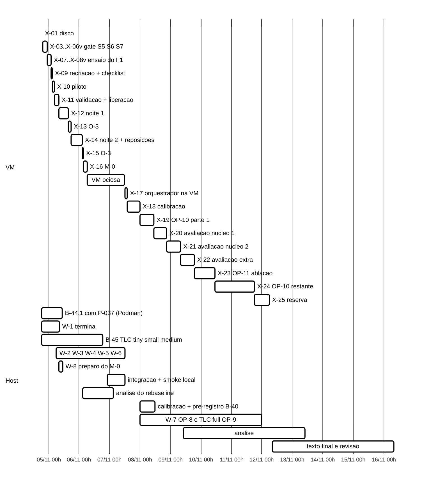

# Plano de execução contínua, cenário completo (2026-11-04, noite)

> Senior, 2026-11-04, ~18:30 local (21:30Z). **Só planejamento**: nenhum código, *script*, VM ou *cluster*
> foi tocado para escrever este documento; leituras feitas sem escrita em `wt-gate-v4` (`f6483c5`),
> `wt-ctrl-integ` (`20805b0`), `wt-ensaio-f1` (`01c9712`), `wt-b44-1`, `wt-b45`, `wt-w1` e no *host*
> (`df`, contadores de CPU e memória, `Get-NetNeighbor`, tamanho do VHDX). Branch
> `docs/plano-implementacao-controlador`, sobre `4e43602`. Commit local, sem push.
>
> **Relação com o plano de execução** (`docs/plano-execucao-2026-11-04.md`, o "plano de execução").
> O autor escolheu em 04/11 à noite o **cenário completo** (seção 3.4 de lá): nada é cortado, OP-1 a
> OP-13 entram. Este documento substitui, daquele plano, a seção 3 (cenários e cronograma), a hipótese
> "host em silêncio nos blocos de VM" da 3.1 e a seção 8 nas perguntas já respondidas (A-1, A-2, A-3).
> Desenho do controlador (seção 4), avaliação (5), Escritor (6), decisões (7) e *prompts* (9) continuam
> valendo, com os acréscimos da seção 7 abaixo.

## Glossário (siglas novas)

| Sigla | Significado |
|---|---|
| H0, H1, H2 | perfis de carga do *host* (seção 2.1): silêncio, carga limitada, livre |
| M-0 | medição curta de interferência: a VM mede com e sem a carga H1 no *host* (seção 2.4) |
| X-nn | bloco da fila de execução (seção 3) |
| O-1, O-3, O-4 | opções de disco do `roteiro-vm-2026-11-04.md` §7.4: apagar CSVs de junho na VM; comprimir e copiar de dia; +10 GB no LV |
| h1, h2, h3 | paradas por reinício (complemento 1 do pré-registro, §1.2) |
| AVHDX | disco de diferenciação do Hyper-V (existe quando a VM tem *checkpoint*) |

As demais siglas (S1..S7, F1..F4, OP-n, W-n, GO, TLC, IU) são as do plano de execução.

---

## 1. Primeira tarefa da fila: X-01, disco da VM (pode rodar agora)

**Por que primeiro.** Não depende do *bundle* `gate-v4h`, não toca no *cluster* nem nos contêineres e não é
medição, então admite qualquer carga no *host* (perfil H2). Tira o disco da VM do caminho do piloto e das
noites. Autorizada: O-4 com +10 GB e `fstrim` (pedido do autor). A O-1 (apagar os CSVs de junho) **não**
está autorizada e fica fora (A-8). Pré-condições da 7.5 do roteiro: `ext4`, nenhum injetor rodando, *lock*
livre, *host* com ≥ 12,5 GB livres (hoje 64,5 GB).

**Quem.** Coordenador, sem GO (não há injeção). **Duração:** 15 a 20 min. **Host em paralelo:** tudo
(B-44.1, B-45, W-1 e os testes do `wt-gate-v4` seguem).

```bash
# --- no host (Git Bash) ---
powershell -NoProfile -Command "Get-NetNeighbor -LinkLayerAddress 00-15-5D-03-AC-00 | Select IPAddress,State"
VMIP=172.27.127.98            # trocar se o comando acima der outro IP
SSH="ssh -o HostKeyAlias=172.18.251.140 -i $HOME/.ssh/id_ed25519_tccf3 server1@$VMIP"
df -h /c                                                            # esperado >= 12,5 GB livres
$SSH 'cat /proc/sys/kernel/random/boot_id; pgrep -fa "inject-(partition|netdegrade|crash|jitter)" || echo sem-injetor;
      systemctl list-timers --all --no-legend "tcc-heal*" | wc -l; flock -n /var/lock/tcc-vm.lock true && echo lock-livre'
# esperado: boot_id b088606d-5d07-4424-b308-0a58fedf0546, "sem-injetor", 0, "lock-livre"

# --- na VM (uma sessao ssh) ---
$SSH
mkdir -p ~/brutos/disco-2026-11-04 && cd ~/brutos/disco-2026-11-04
flock -n /var/lock/tcc-vm.lock bash -c '
  set -x
  date -Is; cat /proc/sys/kernel/random/boot_id
  [ "$(findmnt -no FSTYPE /)" = ext4 ] || { echo "ABORTA: / nao e ext4"; exit 1; }
  df -hT / ; findmnt -no SOURCE,FSTYPE / ; sudo -n vgs ; sudo -n lvs ; lsblk -f
  sudo -n tune2fs -l /dev/mapper/ubuntu--vg-ubuntu--lv | grep -E "Block count|Block size|Filesystem features"
  ls -l /etc/lvm/archive/ | tail -3
  sudo -n lvextend -r -L +10G /dev/ubuntu-vg/ubuntu-lv
  df -hT / ; sudo -n vgs ; sudo -n lvs ; sudo -n dmesg | tail -5
  sudo -n fstrim -v /
  date -Is
' 2>&1 | tee x01-disco.log
sha256sum x01-disco.log > x01-disco.log.sha256
exit

# --- de volta no host: copia dos brutos ---
mkdir -p /c/Users/Francesco/Development/tcc/wt-gate-v4/runs/disco-2026-11-04
scp -o HostKeyAlias=172.18.251.140 -i $HOME/.ssh/id_ed25519_tccf3 \
    "server1@$VMIP:brutos/disco-2026-11-04/*" /c/Users/Francesco/Development/tcc/wt-gate-v4/runs/disco-2026-11-04/
cd /c/Users/Francesco/Development/tcc/wt-gate-v4/runs/disco-2026-11-04 && sha256sum -c x01-disco.log.sha256
```

Esperado no fim: LV ~28,47 GB, VG ~8,47 GB livres, `/` com ~13,3 GB livres. Os brutos ficam **fora** de
`~/tcc-gate` de propósito: o passo 0 do S5, do S6 e do ensaio confere o estado do *git* daquela árvore.
Reversão: a da 7.5 do roteiro (só se o `lvextend` falhar antes do `resize2fs`). Se qualquer leitura de
pré-condição divergir, não estender e avisar o Senior.

---

## 2. Política de carga do *host* durante os blocos de VM

### 2.1 Perfis

| Perfil | O que pode rodar no *host* | O que não pode |
|---|---|---|
| **H0** silêncio | edição de arquivos, `git` (sem `gc`), leitura, `ssh`/`scp` do coordenador, os agentes | TLC, `mvn` (qualquer meta), suítes de *shell* (`*.test.sh`), `unittest`, contêineres Podman locais **ligados** (parar com `podman stop`; a máquina Podman pode ficar), compressão grande |
| **H1** carga limitada | H0, mais: **um** TLC com `-workers 4`; **um** `mvn -T1` (Surefire com `forkCount=1`); `python -I -m unittest` de `analysis`; os dois primeiros com prioridade `BelowNormal` | Podman local ligado; segundo TLC ou segundo `mvn`; `mvn -T` > 1; TLC > 4 *workers*; suítes de *shell* longas (`s5.test.sh` leva 730 s, `ensaio-f1.test.sh` 1 919 s); qualquer coisa fora do envelope medido no M-0 (2.4.4) |
| **H2** livre | qualquer coisa | — |

O host tem 20 *threads* lógicas (i5-14600KF: 6 núcleos P com SMT e 8 núcleos E) e 32 GB; a VM tem 4 vCPU e
8 GB fixos (`runbook-vm-hyperv.md:7,59-62`). H1 ocupa no máximo ~5 *threads* (4 do TLC e 1 do Surefire), o
que deixa ~15 para as 4 vCPU da VM e o sistema. Esse raciocínio de folga é do Senior e **não é evidência**:
com o escalonador do Windows num processador híbrido, as vCPU podem ir para núcleos E quando o *host* está
ocupado. Por isso o H1 só vale para medição depois do M-0.

### 2.2 Regra por tipo de bloco

| Tipo de bloco | Blocos | Perfil | Justificativa rastreável |
|---|---|---|---|
| Operação de VM sem medição | X-01 disco, envio de *bundle*, recriação do *cluster*, O-3, cópias, leitura de brutos | **H2** | nada é medido; a única restrição é não haver injeção em curso (roteiro §7.5) |
| Teste de ferramenta com critério de latência | **S5** | **H0** do início do passo 0 ao fim do portão pós, mais 5 min antes e depois | a regra "mediana da janela ≤ p95 da base" (`ROTEIRO-S5.md:83`, decisão do Gestor de 04/11) compara amostras colhidas com 3 a 4 min de distância; uma mudança de carga no *host* entre base e janela desloca a mediana e dá INVÁLIDO (`rastreabilidade-limiares-s5-s7-2026-11-04.md` §3.2). O roteiro aprovado manda silêncio (`ROTEIRO-S5.md:16`) |
| Teste de ferramenta só com critérios de tempo | **S6, S7** | **H0**, como no roteiro aprovado (`ROTEIRO-S6.md:20`) | **Admitiriam *host* ocupado em princípio**: não medem latência de carga; o que invalida é o intervalo do saúde-log > 2 × 2 s (V-S4 P-2), os prazos do *dead-man* e a persistência do corte. A folga medida com o *host* quieto é de ~2 s (máximo de 2,029 s na REP=4R e 2,036 s na REP=3, `rastreabilidade…` item 17). Mas a única medida existente com carga no *host* é ruim: um laço de 2 s do próprio teste do S6 passou para 4,926 s com "outra carga no host" (`V-s6s7sh.md:71`, R-6). O ganho de liberar seria ~30 min de *host*; não vale reabrir roteiros aprovados |
| Ensaio do F1 (OP-7) | X-08 | **H0** | `ROTEIRO-ENSAIO-F1.md:12` (aprovado com ressalvas); mede Δdet, sensível a tempo |
| Medição de referência | piloto, noite 1, noite 2, reposições do *rebaseline* | **H0** a fase inteira | **pré-registrado**: "Silêncio no host (sem TLC, `mvn test` nem carga) durante a noite inteira, porque F1 e F3 estão espalhados por todas as rodadas" (`pre-registro-rebaseline-aprovado-2026-10-23.md:145`); checklist 10.6 passo 7. Mudar isso seria DT nova antes do piloto; o Senior **não** recomenda (2.3) |
| Medição de interferência | M-0 (X-16) | metade **H0**, metade **H1** exato | é o próprio experimento (2.4) |
| Medição S3 | validação do orquestrador, calibração, avaliação, OP-10, OP-11, reposições e reserva | **H1 se o M-0 aprovar** (registrado em DT antes da calibração e no B-40), senão **H0** | M-0 (2.4); exclusão por `steal` > 5 % já pré-registrada (`plano-implementacao-controlador-2026-10-22.md:436-437`, `analysis/energia_proxy.py:46`); intervalo do saúde-log ≤ 2× o nominal. **O perfil máximo é o mesmo na calibração e na avaliação**, porque os limiares (θ, `lag_in`, p99 de referência) saem das distribuições da calibração |

### 2.3 Por que o *rebaseline* fica em H0 e o S3 pode ir para H1

- O *rebaseline* produz **valores absolutos** (p99 por operação) que substituem as tabelas retiradas da
  monografia, e as células F1, F3 e `none` se alternam ao longo de toda a noite. Uma carga de *host* que
  muda durante a noite (fases do TLC, início e fim de `mvn`) entra como ruído e, se coincidir com a ordem
  sorteada, como viés. O M-0 só consegue descartar efeitos da ordem da dispersão entre execuções (2.4.3);
  um efeito menor continuaria possível e não declarado no pré-registro.
- No S3 a comparação é **pareada**: braço A e braço B no mesmo bloco, em ordem sorteada, com ~30 a 40 min
  entre eles. Uma carga de *host* que varia na escala de horas afeta os dois braços quase igual; aumenta a
  variância, não desloca a diferença em média. Os valores absolutos do S3 não são comparados com nada de
  fora.
- **Custo do H0 no *rebaseline***: ~17,5 h sem TLC nem testes no *host* (piloto 1,5 h, noite 1 até 8 h,
  noite 2 até 9 h). O plano de execução já supunha isso (noites N1 e N2 em silêncio, *Workers* só de dia).
  No regime contínuo os *Workers* ganham as horas que antes eram de noite, então o controlador não atrasa
  por causa disso (3.3). A alternativa, *rebaseline* em H1 com DT nova, ganharia talvez 4 a 8 h de teste
  e TLC e exigiria o M-0 **antes** do piloto (fica como opção R-b, ponto A-6).

### 2.4 M-0: medição curta de interferência

#### 2.4.1 O que existe hoje (e o que falta)

| Medida | O que mostra | Serve para decidir H1? |
|---|---|---|
| Saúde-log da VM com *host* quieto: máx. 2,029 s e 2,036 s com nominal de 2 s (n = 86 e 71 por porta) | folga de ~2 s até o limite de 4 s | não: não houve carga no *host* |
| R-6 da `V-s6s7sh.md:71`: laço de 2 s **no host** chegou a 4,926 s com outra carga | carga no *host* atrasa laços de 2 s do próprio *host* | não: é processo do *host*, não a VM |
| `steal` = 0 no *smoke* do B-37 (`relatorio-b37-2026-10-27.md:139`) | contador funciona | não: *smoke* fora da VM; não se sabe se a VM Hyper-V reporta `steal` |

**Não há nenhuma medida da VM com e sem carga no *host*.** Daí o M-0.

#### 2.4.2 Desenho

- **Onde e quando.** Na VM, no *cluster* que sobra do fim da noite 2 (XML do *rebaseline*, com os *caches*
  ASYNC), antes da recriação para o S3 (X-16). Nessa posição o M-0 não atrasa nada: a VM fica ociosa até o
  controlador ficar pronto (3.3).
- **Carga da VM.** O *runner* congelado e o jar congelado (`5eced136…`), sem nenhuma mudança: S1 `none`,
  4 *threads*, 300 s, mistura v3, nos dois modos. 16 execuções em 4 segmentos de 4 (2 SYNC e 2 ASYNC,
  ordem sorteada dentro do segmento), na ordem **Q H H Q** (Q = *host* H0, H = *host* H1). Índices
  i = 3000..3015 e semente 50 000 + 100·i, fora da campanha (0..119 e reposições), do piloto (1000..1011)
  e do ensaio (2000..2003). Cada segmento é uma invocação do *runner* com matriz própria (`--fase piloto`,
  `--saida runs/m0-interferencia-<data>/seg-N`). Se o `--dry-run` mostrar que o *runner* recusa a matriz,
  o *fallback* é a linha de comando do *workload* que o *runner* imprime no plano (`relatorio-rebaseline-runner-2026-10-23.md:218`),
  mais o `VerificadorSanidade`, sem mudar o *runner*.
- **Carga H1 de referência** nos segmentos H: um TLC com `-workers 4` (a configuração do B-45 que estiver
  rodando; se não houver, a `small` do B-45 num metadir de rascunho) e um laço
  `mvn -T1 -o -q test -DforkCount=1` em cópia de trabalho sem alterações, os dois em `BelowNormal`.
- **Registros.** Na VM, em painel separado do `tmux`: saúde-log a 2 s nas 3 portas (o `saude_loop` do
  `s5.sh`); `head -1 /proc/stat` no início e no fim de cada segmento (coluna `steal`). No *host*:
  `typeperf "\Processor(_Total)\% Processor Time" "\Memory\Available MBytes" -si 10 -f CSV -o host-carga.csv`.

#### 2.4.3 Regra de decisão (fixada aqui, antes de qualquer dado)

O H1 é **admitido** para os blocos de medição S3 se valerem as quatro condições:

1. **Sanidade:** as 16 execuções aceitas por K1..K5 (PR §6, limiares de K3 da DT-015), sem K8 nem K9.
2. **Latência.** Para cada execução *e*, o índice
   `L_e = média, sobre as operações com n ≥ 1000, de ln(p99_e,op / mediana_Q(p99_op,modo))`.
   Regra: a **mediana inferior dos 8 `L_e` dos segmentos H** (4.º menor, posto mais próximo como no PR §7)
   **≤ máximo dos 8 `L_e` dos segmentos Q**. É a regra do S5, "mediana da janela ≤ p95 da base", com o p95
   por posto mais próximo, que para n < 20 é o máximo (`ROTEIRO-S5.md:83`). Probabilidade de reprovar sem
   efeito nenhum (H e Q da mesma distribuição): as 5 maiores de 16 serem todas H,
   `C(8,5)/C(16,5) = 56/4368 ≈ 1,3 %`.
3. **Vazão:** mesma regra, espelhada: mediana superior das vazões (eventos válidos/s) de H ≥ mínimo das de Q.
4. **Tempo e disputa:** intervalo máximo do saúde-log ≤ 2 × 2 s em todos os segmentos (V-S4 P-2) e `steal`
   ≤ 5 % em cada segmento H (critério pré-registrado do plano de 22/10). Se o `steal` der 0 também nos
   segmentos H, a condição é declarada **não informativa** (a VM Hyper-V pode não expor o contador).

Alcance declarado: a regra detecta efeitos da ordem da dispersão entre execuções ou maiores; efeitos
menores não ficam excluídos. Isso vai escrito na DT e no B-40.

Se reprovar: S3 em H0, e o TLC `full` (OP-9) e o do W-7 passam a disputar janelas sem VM (3.4).

#### 2.4.4 Envelope e registro

O H1 aprovado vale como **envelope**: nos blocos S3, a CPU total do *host* não passa do máximo medido no
`host-carga.csv` dos segmentos H do M-0 e a memória disponível não cai abaixo do mínimo medido ali. O
coordenador grava `host-carga.csv` em todo bloco de medição (covariável por execução) e, se o envelope
estourar, para o processo H1 que sobrou, não a VM. Início e fim de TLC longo, de preferência, entre blocos.

#### 2.4.5 Custo

~2 h de VM (16 × ~7 min, como os 420 s por execução do `--dry-run` do *runner*, mais 4 pré-voos); ~2 a 3 h
de *Worker* (gerador das 4 matrizes, `analysis/m0_interferencia.py` com testes, `--dry-run`; prompt W-8 na
seção 8); ~45 min de leitura do Senior. Metade do tempo de VM o *host* fica em H0 (~1 h).

### 2.5 Como o coordenador aplica

- Arquivo `C:\Users\Francesco\Development\tcc\HOST-PERFIL.txt` com uma linha `H0|H1|H2 até <hora UTC> (<bloco>)`,
  escrito pelo coordenador **5 min antes** de cada bloco e de volta a H2 no fim; histórico em
  `HOST-PERFIL.log`. Todo *prompt* de *Worker* passa a dizer: "antes de TLC, `mvn`, suíte de *shell* ou
  Podman, ler `HOST-PERFIL.txt` e esperar se o perfil não admitir".
- O B-45 é parado **entre configurações** pelo próprio roteiro (retoma por `runs/tlc/b45-estado.tsv`); o
  B-44.1 faz `podman stop` dos três nós locais antes de um H0/H1 e os religa depois.
- **Disco do *host*.** A VM tem *checkpoint*: as escritas vão para
  `C:\Hyper-V\tcc-f3\tcc-f3_8824F456-…avhdx` (6,34 GB às 18:29, crescendo; base `tcc-f3.vhdx` de 11,75 GB
  parada desde 23/06). O AVHDX pode crescer até o tamanho virtual do disco (40 GB). Regra antes de cada
  bloco de VM: livre em `C:` ≥ (42,9 GB − tamanho atual do AVHDX) + volume das cópias do bloco + 3 GB.
  Hoje: 36,6 + 2 + 3 ≈ 42 GB, contra 64,5 GB livres, sobrando ~23 GB para TLC e *Workers*. O metadir de TLC
  conta nessa sobra. Não apagar nem mesclar o *checkpoint* durante a campanha (A-9).

---

## 3. Fila de execução encadeada

### 3.0 Fila da VM atualizada em 2026-11-05 ~01:50Z (Senior)

O *gate* fechou: S5, S6 e S7 válidos, o S7 na terceira tentativa (`wt-gate-v4/runs/vm-s7-2026-11-04/V-S7t.md`). X-03 a
X-06v estão feitos. O que mudou desde a 3.1: o critério h4 (complemento 3 do pré-registro, DT-018) entra antes do piloto
e pede um amostrador novo na VM (W-h4); o portão de estado final dos blocos novos usa a leitura literal do §5.1 (≥ 120 s
seguidos bons, `wt-gate-v4/docs/roteiro-vm-2026-11-04.md` §0); e o H0 passa a incluir cópia, `scp` e `git` no host. Esta
tabela substitui as linhas X-07 a X-15 da 3.1. Daí em diante (X-16 e seguintes), vale a 3.1.

| # | Bloco | Pré-condições | Duração | Dispara | *Host* |
|---|---|---|---|---|---|
| G-1 | **Decisões do Gestor**: V-S7t P-1..P-4; complemento 3, C3-1..C3-4; X-02 (leituras elevadas do complemento 1 §5: `AutomaticStopAction`, suspensão, Windows Update) | — | 15-20 min | **Gestor** | — |
| W-h4 | **Worker**: amostrador, vigia e `analysis/h4.py` (`docs/prompt-worker-h4-amostrador-2026-11-04.md`), na worktree `wt-h4`, só no host | complemento 3 commitado | 3-4 h | Worker | H2 (suítes fora das janelas H0, pela 2.5) |
| W-h4v | Validação do Senior, integração pelo coordenador, `tar` dos 3 arquivos com SHA-256, adenda da DT-018 | W-h4 | 1-1,5 h | Senior + coord. | H2 |
| X-07a | ***Bundle* do *rebaseline* à VM** (`git archive 20805b0` + jar `5eced136…`, lista `003814e9…`, comandos da 3.1) e `ensaio-f1.sh` (`01c9712`, `b83e8223…`), cada um com `sha256sum -c` | G-1 não bloqueia (Q-02 já autoriza) | 15-20 min | Coord. | H2, mas sem bloco de medição rodando na VM |
| X-07b | **Recriação do cluster com o XML do *rebaseline*** (`6d52413b…`, E-2), *size*=3 HEALTHY, brutos da recriação | X-07a; E-1..E-7 (A-5) | 30 min | Coord. | H2 |
| X-08 | **Ensaio do F1 silencioso** (`ROTEIRO-ENSAIO-F1.md`, 4 GOs). Diagnóstico de I/O na VM (amostrador *ad hoc* em `/run/tccdiag/` como root, ou o do W-h4 se já estiver na VM) e `typeperf` no host. Ao fim, `portao51.sh 180` como portão de estado final (roteiro da VM §0, item 1) | X-07b | 1,5-2 h | Coord. | **H0 estrito** (com disco) |
| X-08v | Cópia + leitura do Senior: F-1..F-10, portão final pelos 120 s, io do `podman start` dentro do segmento do F1 (C3 §4.2, só informativo), episódios por hora | X-08 | 45-60 min | Senior | H2 |
| X-09 | **Recriação** do cluster (XML `6d52413b…`) com o instante UTC anotado (`--cluster-criado-apos`), checklist 10.6 passos 4-6, bloco de abertura do complemento 1 §1.3 com as covariáveis do host (C3 §7), `tar` do h4 conferido, `amostrador-infra.sh iniciar --id piloto-<UTC>` e vigia na janela 2 | X-08v; W-h4v; G-1 | 45-60 min | Coord. | H2 até o `iniciar`, depois H0 |
| X-10 | **Piloto** (rodada 0, 12 execuções), com amostrador e vigia. Ao fim, bloco de fim de fase, `amostrador-infra.sh parar`, `h4.py fase` | X-09 | ~1,5 h | Coord. | **H0 estrito** |
| X-11 | Validação do piloto: K1..K10, n, tempos, tamanho por execução, **h4** (tabela da fase, conferência do 1,1 s do C3 §3.4, episódios por hora contra o limite de 3,5 do C3 §6); liberação da noite 1 | X-10 | 1,5-2 h | Senior; liberação: Gestor (A-7) | H2 |
| X-12 | **Noite 1** (rodadas 1..5), com amostrador e vigia. Parada h4 pelo C3 §4.3 (Ctrl-C do coordenador no portão K1 seguinte) | X-11 liberado; `boot_id` = o do fim do piloto | 6,5-8 h | Coord. | **H0 estrito** |
| X-13 | O-3 da noite 1 e parecer da fase (h1/h2/h3 e **h4**) | X-12 | 1,5-2 h | Coord. + Senior | H2 |
| X-14 | **Noite 2** (rodadas 6..10), depois `--fase reposicoes` (recusas), `h4.py repor` e `--fase reposicoes` de novo (C3 §5) | X-13 | 6,5-9 h + 1-2 h de reposições h4 | Coord. | **H0 estrito** |
| X-14b | Reposições que não couberem na X-14, se houver (~8 a 16 h4 previstas na campanha, teto 30) | X-14 | 1-2,5 h | Coord. | **H0 estrito** |
| X-15 | O-3 da noite 2, parecer, `h4.py visao` e a análise do *rebaseline* sobre a visão | X-14/X-14b | 1-1,5 h | Coord. + Senior | H2 |

Caminho crítico até o piloto: X-07a → X-07b → X-08 → X-08v (~3 a 3,5 h) corre em paralelo com W-h4 → W-h4v (~4 a
5,5 h). O piloto começa quando os dois terminarem e o G-1 estiver feito. Com início às ~02:00Z, isso é **~07:00 a
08:00Z de 05/11**. Noite 1 a partir de ~11:00 a 12:00Z, depois da validação do piloto. O regime contínuo da seção 4
continua valendo, então "noite" quer dizer bloco longo em H0, não horário.

Reposições a prever: ~9 por h4 (de 8 a 16 na faixa de 6 a 12 %), mais as até 6 de recusa do PR. Com uma taxa de h4
acima de ~25 % no ensaio e no piloto, a noite 1 não começa sem decisão do Gestor (C3 §6).

### 3.1 A fila

Horários locais (BRT), estimados; cada bloco começa quando o anterior e as pré-condições fecham, não
num horário. "Coord." = coordenador, por *script* e GO digitado no `tmux` da VM (A-1). Em todo bloco de
VM vale o pré-voo do 3.2.

| # | Bloco | Pré-condições | Duração | Dispara | *Host* em paralelo |
|---|---|---|---|---|---|
| **X-01** | Disco: O-4 +10 GB, `fstrim` (seção 1) | nenhuma | 15-20 min | Coord. | H2 |
| X-02 | Condições do Gestor, uma vez, em PowerShell **elevado**: `Get-VM tcc-f3 \| Select AutomaticStopAction,AutomaticStartAction` (esperado `ShutDown` e `StartIfRunning` ou `Start`), suspensão e hibernação desligadas, Windows Update pausado (complemento 1 §5). O coordenador não tem permissão no Hyper-V (`Get-VM` negado, conferido agora) | — | 5-10 min | **Gestor** (A-4) | H2. Bloqueia só o X-10 |
| X-03 | *Bundle* `gate-v4h` à VM: `scp`, `sha256sum -c`, `git bundle verify`, `fetch`, `checkout` da ponta; `sha256sum` de `s5.sh` = `28766575…addac`, `s6.sh` = `33b8fcc5…2b27`, `s7.sh` = o do `ROTEIRO-S7.md` | *bundle* entregue pelo *Worker* em `wt-gate-v4` | 15 min | Coord. | H2 |
| X-04 | **S5** (`ROTEIRO-S5.md`), `--boot-esperado` = `boot_id` lido na hora | X-03 | ~11 min + GO (prompt em ~3,5 min) | Coord. | **H0** (início −5 min até portão pós +5 min) |
| X-04v | Cópia + V-S5 (Senior) | X-04 | 35-50 min | Senior | H2 |
| X-05 | **S6** (`ROTEIRO-S6.md`), `--bloco-anterior` = `vm-<UTC>/` do S5 | V-S5 aprovada | ~13 min + GO | Coord. | **H0** |
| X-05v | Cópia + V-S6A | X-05 | 35-50 min | Senior | H2 |
| X-06 | **S7** (`ROTEIRO-S7.md`), `--bloco-anterior` = o do S6 | V-S6A aprovada | ~14 min + GO | Coord. | **H0** |
| X-06v | Cópia + V-S6B | X-06 | 35-50 min | Senior | H2 |
| X-07 | Preparo do ensaio: *bundle* do *rebaseline* (abaixo) e do `ensaio-f1.sh` (`test/ensaio-f1-silencioso`, ponta `01c9712`, `sha256` do *script* `b83e8223…8d8c`); recriar o *cluster* com o XML do *rebaseline* `6d52413b…` (E-2) | V-S6B aprovada; E-1..E-7 (A-5) | 30-40 min | Coord. | H2 |
| X-08 | **Ensaio do F1 silencioso** (OP-7, `ROTEIRO-ENSAIO-F1.md`), 4 GOs (E-1) | X-07 | 1,5-2 h | Coord. | **H0** |
| X-08v | Cópia + leitura do Senior | X-08 | 45 min | Senior | H2 |
| X-09 | Recriar o *cluster* (XML `6d52413b…`), anotar o instante UTC (checklist 10.6 passo 3, adenda da DT-009 parte 2), passos 4 a 6 da checklist (`--dry-run`, ensaio de pré-voo com exit 5), bloco de abertura do complemento 1 §1.3, `df` da VM e do *host* | X-08v; X-02 feito | 45-60 min | Coord. | H2 |
| X-10 | **Piloto** do *rebaseline* (rodada 0, 12 execuções, `go piloto <data>`, `go f3 1005`) | X-09 | ~1,5 h | Coord. | **H0** |
| X-11 | Validação do piloto: K1..K10, n por operação, tempos, **tamanho real por execução** (decide O-6 pela 7.5 do roteiro); liberação da campanha | X-10 | 1,5-2 h | Senior; liberação: A-7 | H2 |
| X-12 | **Noite 1** (rodadas 1..5, i = 0..59). Pré: `boot_id` = o do fim do piloto (h1); VM livre ≥ 1,5 × volume medido no X-11; regra de disco do *host* (2.5) | X-11 liberado | 6,5-8 h | Coord. | **H0** |
| X-13 | O-3 da noite 1 (`gzip -1` na VM, `scp`, `sha256sum -c` do original e do `.gz`, apagar na VM, `fstrim`); parecer da fase (h1/h2/h3) | X-12 | 1,5-2 h | Coord. + Senior | H2 (janela longa para Podman e testes) |
| X-14 | **Noite 2** (rodadas 6..10) e, na sequência, **reposições** (≤ 6) | X-13; `boot_id` igual | 6,5-9 h | Coord. | **H0** |
| X-15 | O-3 da noite 2 + parecer; análise do *rebaseline* começa no *host* | X-14 | 1-1,5 h | Coord. + Senior | H2 |
| X-16 | **M-0** (2.4), no *cluster* do fim da noite 2 | X-15; W-8 entregue | ~2 h + 45 min de leitura | Coord. | Q: **H0**; H: **H1** de referência |
| — | VM ociosa: o *host* fica todo para W-2..W-6, integração e *smoke* local (Podman, H2) | — | ~1 dia (3.3) | — | H2 |
| X-17 | Recriar o *cluster* com o XML do W-4 (com `canario*`); validação curta do orquestrador (1 F2 `shadow` + 1 F2 `active`) | jar integrado, W-6, *smoke* local aprovado | 1,5-2 h | Coord. | H1 se M-0 aprovou, senão H0 |
| X-18 | **Calibração** (braço A, 26 a 29 execuções) | X-17 aprovado | 6-10 h | Coord. | idem |
| X-19 | **OP-10, parte 1** (campanha S3 completa, braço A, mesmo jar e XML) enquanto o *host* calibra e escreve o B-40 | X-18 | ~10 h | Coord. | idem |
| X-20 | **Avaliação núcleo 1** | B-40 commitado | ~10 h | Coord. | idem |
| X-21 | **Avaliação núcleo 2** | X-20 + 1 h de cópia | ~10 h | Coord. | idem |
| X-22 | **Avaliação extra** (ASYNC F4, SYNC F1, SYNC F4) | X-21; S5 aprovado | ~10 h | Coord. | idem |
| X-23 | **OP-11** (terceiro braço, ablação) | X-22; braço pré-registrado no B-40 | ~15 h | Coord. | idem |
| X-24 | **OP-10, restante** (2 a 3 unidades de ~10 h) | X-23 | 20-30 h | Coord. | idem |
| X-25 | **Reserva** (blocos repostos, quedas) | — | 12 h | Coord. | idem |

Comandos do *bundle* do *rebaseline* (X-07), com os *hashes* da adenda da DT-009 parte 2:

```bash
# host
cd /c/Users/Francesco/Development/tcc/wt-ctrl-integ
git archive --format=tar --prefix=rb-20805b0/ 20805b0 -o /c/Users/Francesco/Development/tcc/rb-20805b0.tar
JAR=/c/Users/Francesco/Development/tcc/dados-vm/rebaseline-2026-10/jar/session-workload-0.1.0-SNAPSHOT.jar
(cd "$(dirname "$JAR")" && sha256sum -c session-workload-0.1.0-SNAPSHOT.jar.sha256)
scp -o HostKeyAlias=172.18.251.140 -i $HOME/.ssh/id_ed25519_tccf3 /c/Users/Francesco/Development/tcc/rb-20805b0.tar "$JAR" server1@$VMIP:
# VM
mkdir -p ~/rb && tar -xf ~/rb-20805b0.tar -C ~/rb && RB=~/rb/rb-20805b0
mkdir -p $RB/workload/target && cp ~/session-workload-0.1.0-SNAPSHOT.jar $RB/workload/target/
cd $RB && cat > ~/rb/lista-003814e9.txt <<'EOF'
3005f49ae5696dcd9ace324b08295187100fcde39c111115a89c517bc4e3c7cd *analysis/rebaseline.py
8654900cd23b9b46e65163a5d106bd6f86113632d2ce621ff962f637cd645c35 *runs/rebaseline/matriz.tsv
5b4d571986256d96c73405ac887eca55c783787ad0bc0a0c5dec558856ddc0cf *scripts/inject-crash.sh
7e68962b1b7f508ee84ca7561a20c0bba36c43ea4597d7390e7c8091cd24e529 *scripts/inject-jitter.sh
3531916a863832fd5aea050910111c69f0c9130c0bd325c3ad3f238e44a3533a *scripts/rebaseline_matriz.py
d95305fee402b1f882d387a40e81d4f83df72d7fe4b6daf810516e0627267366 *scripts/run-rebaseline.sh
5eced1363f1b318f533174e967be6a81080bcc95961d0f72a118dc0184dcefaf *workload/target/session-workload-0.1.0-SNAPSHOT.jar
EOF
sha256sum ~/rb/lista-003814e9.txt     # esperado 003814e93929ea7360f7eba35933907f954201ddf6faca2ce0ae9d3c8c2133a4 (conferido pelo Senior agora)
sha256sum -c ~/rb/lista-003814e9.txt  # 7 OK
```

### 3.2 Pré-voo de todo bloco de VM (coordenador)

1. IP da VM por `Get-NetNeighbor -LinkLayerAddress 00-15-5D-03-AC-00`; `boot_id` comparado com o do fim do
   bloco anterior.
2. `HOST-PERFIL.txt` no perfil do bloco há ≥ 5 min; B-45 parado entre configurações se o perfil for H0;
   `podman ps` local vazio se H0 ou H1; `typeperf` ligado se o bloco for de medição.
3. Disco: VM com livre ≥ 1,5 × volume estimado do bloco (roteiro §7.5); *host* pela regra do 2.5.
4. *Lock* `/var/lock/tcc-vm.lock` livre, nenhum injetor, 0 *timers* `tcc-heal*`, sem `tc`/`iptables` residual.
5. Arquivo `PARAR` ausente (W-6) e nenhum bloco anterior com parecer pendente que o bloco exija.

### 3.3 Cronograma



Leitura do cronograma:

- **Até 06/11 de manhã a VM não está no caminho crítico**; o *host* está (controlador). Por isso a ordem
  do *rebaseline* não foi comprimida em nome da VM, e o M-0 fica depois da noite 2, sem atrasar nada.
- Horas H0 entre agora e o fim do M-0: ~22 h de ~36 h. As janelas H2 (validações, O-3, M-0 lido, VM ociosa
  a partir de 06/11 ~06:30) somam ~40 h até 07/11 12:00, mais que as horas de dia que o plano de execução
  dava aos *Workers*. A estimativa de controlador pronto passa de "07/11 à tarde" para **07/11 ~12:00**.
- **Conflito real hoje à noite: B-44.1 × S5..ensaio.** O B-44.1 usa o *cluster* Podman local, que é H2. Ele
  precisa parar os nós locais durante S5, S6, S7 e o ensaio (~2,5 h de H0 espalhadas em ~6 h) e usar as
  janelas de validação. Como o W-2 depende dele, o coordenador dá prioridade ao B-44.1 nas janelas H2 de
  hoje, inclusive o teste da P-037 (seção 7.2).

### 3.4 Sem H1 (M-0 reprovado)

As células S3 rodam em H0; TLC `full` (OP-9, 10 a 20 h de CPU) e o TLC do W-7 só rodam nas janelas entre
blocos (~1 h cada) ou com a VM parada. O Senior pararia a VM por ~1 dia para eles, depois do X-22: **+1 dia**
no fim.

---

## 4. Regras de retomada depois de queda de energia (o coordenador segue sozinho)

Frequência de referência: 0,28 queda por dia (18 em 65 dias até 04/11). No regime contínuo a perda por queda
deixa de ser "o resto da noite" e passa a ser a execução em curso mais a volta (~1 a 2 h), **desde que** a VM
volte sozinha e as retomadas abaixo não precisem do Gestor (A-5, A-7).

### 4.1 Sempre, logo depois que o *host* volta

1. Anotar em `retomada-<UTC>.md` (no `wt-gate-v4/runs/` do dia): hora da volta, `systeminfo | findstr Boot`,
   `df -h /c`, memória livre, tamanho do AVHDX.
2. **Não** religar nada pesado: `HOST-PERFIL.txt` = H0 até o item 6.
3. VM: IP por `Get-NetNeighbor -LinkLayerAddress 00-15-5D-03-AC-00`. Se a VM não responder em 10 min, ela
   provavelmente não ligou sozinha; o coordenador **não** tem permissão para `Start-VM` (conferido); avisar
   o Gestor e esperar. Em 04/11 a VM voltou sozinha (IP novo depois da queda das 07:36).
4. Na VM, só leitura: `boot_id`, `uptime -s`, `uname -r` (tem de ser `6.8.0-147-generic`), `apt-mark showhold`,
   `sudo podman ps -a` (contêineres em `created` são o esperado, complemento 1 §1.4), `tc qdisc show` nos
   3 *netns* se os contêineres estiverem de pé, *timers* `tcc-heal*`, *locks*. Kernel diferente: parar e
   chamar o Senior.
5. *Git* no *host*: em cada *worktree* ativa, se houver `index.lock` e nenhum processo `git` rodando,
   apagar o *lock* e rodar `git status`; registrar.
6. Religar o *host* na ordem: B-45 pelo roteiro (retoma do `b45-estado.tsv`, TLC com `-recover`), máquina
   Podman (`podman machine start`) só se o próximo bloco de VM permitir H2, *Workers* com o último
   relatório lido. `HOST-PERFIL.txt` volta ao perfil do bloco seguinte.

### 4.2 Por bloco interrompido

| Bloco em curso ou seguinte | Regra |
|---|---|
| X-01, X-03, X-07, X-09, X-13, X-15 (sem medição) | refazer do começo; o `lvextend` é idempotente pelo tamanho (ler `lvs` antes; se já tiver 28,47 GB, só o `fstrim`) |
| **S5, S6, S7 e ensaio** (cadeia presa ao `boot_id`: o S6 exige o `boot_id` e os IDs/`StartedAt` do S5, o S7 os do S6, o ensaio o `boot_id` do S7) | uma queda em **qualquer** ponto da cadeia, ou entre dois elos, faz **recomeçar do S5**, com o *cluster* do *gate* recriado por `runs/gate-b29/recriar.sh` (XML `8792dea3…`) e `--boot-esperado` novo. Os blocos já aprovados ficam nos brutos como histórico. É a leitura do Senior para o "chamar o Senior" dos roteiros; custo ~3 h |
| Piloto, noites, reposições | complemento 1 §1.2: execução em curso `descartada-infra (h1)`; com `stdout.log` vai para reposição com o próximo i livre, sem `stdout.log` repete com o mesmo i (DT-014). **Retomada**: recriar o *cluster* com o XML `6d52413b…`, registrar o novo instante e retomar a fase pelo *runner* (que pula os `exec-*` existentes). Isso exige "decisão do Gestor registrada" (§1.2 item 3); o Senior pede que o Gestor a dê **agora, por antecipação** (A-5), para que o coordenador não espere de madrugada |
| M-0 | segmento interrompido refeito inteiro; os demais ficam. Se os segmentos Q e H ficarem com mais de 24 h entre si, refazer o M-0 inteiro |
| Validação do orquestrador, calibração, avaliação, OP-10, OP-11 | o orquestrador (W-6) retoma pelo arquivo de progresso; DT-014; na avaliação, bloco com execução perdida é refeito inteiro com o próximo índice livre (plano de execução 5.2). O pré-voo do W-6 confere `boot_id`, `StartedAt`, `tc`/`iptables` e configuração antes de cada execução |
| TLC (B-45, W-7, OP-9) | `-recover` do último *checkpoint* (`-checkpoint 10`); o roteiro do B-45 já retoma pelo subdiretório |
| *Worker* no meio de um `mvn` ou suíte | refazer a suíte; nenhum resultado parcial vale |

### 4.3 O que faz parar e chamar o Senior (e o Gestor, se for decisão dele)

Kernel ou versão do Podman diferentes; VM sem voltar em 10 min; AVHDX ou `C:` fora da regra do 2.5; duas
quedas no mesmo bloco; parada automática (a)..(g) do PR que não seja só por `descartada-infra`; qualquer
divergência de *hash* de *bundle*.

---

## 5. Datas estimadas no regime contínuo

| Marco | Plano de execução (completo) | Agora |
|---|---|---|
| *Gate* S5..S7 e ensaio do F1 | 05/11 de dia | 04/11 ~19:30 a 05/11 ~02:00 |
| *Rebaseline* (piloto, noites, reposições) | N0..N2, até 07/11 de manhã | 05/11 ~03:00 a 06/11 ~03:30 |
| M-0 | — | 06/11 ~03:30 a ~06:30 |
| Controlador pronto para a VM | 07/11 à tarde | 07/11 ~12:00 |
| Calibração | N3 (07/11 à noite) | 07/11 ~14:00 a 08/11 ~00:00 |
| Avaliação (núcleo e extras) | N4..N6 | 08/11 ~11:00 a 09/11 ~19:00 |
| OP-11 e OP-10 | N7..N12 | 08/11 (parte 1) e 09/11 ~19:00 a 11/11 ~18:00 |
| Fim da VM (com 12 h de reserva) | ~18/11 | **12/11 ~06:00** (faixa 11/11 à noite a 13/11) |
| Análise final | 19-20/11 | 12-13/11 (a do núcleo começa em 09/11) |
| **Texto final e revisão** | **21-22/11** | **15/11** (faixa 14 a 17/11) |

- Se o M-0 reprovar: +1 dia (3.4), fim em **16/11**.
- Quedas: com 0,28 por dia, o esperado de 04/11 a 12/11 é ~2,2 quedas; com as retomadas automáticas cada
  uma custa ~1 a 2 h (até ~3 h na cadeia do *gate*), o que a reserva de 12 h cobre. Se A-5 não for dada,
  uma queda numa noite do *rebaseline* custa até o Gestor acordar (até ~8 h).
- O maior fator de incerteza não é a VM: é o controlador ficar pronto em 07/11 ~12:00. Cada dia de atraso
  do W-2..W-6 empurra o fim um dia (a VM fica ociosa esperando).

---

## 6. Potência no modelo de energia (decisão do Senior)

- **P_max = 181 W**, a "Maximum Turbo Power" da ficha da Intel (`intel_i5_14600kf`, no `.bib`). Motivo: no
  modelo `P(u) = P_ocioso + (P_max − P_ocioso)·u` (`analysis/energia_proxy.py:53`), P_max é a potência com
  utilização plena. A "Processor Base Power" (125 W) é a potência média na frequência base sob carga de
  validação da Intel, não o teto: com a CPU ocupada, o processador roda acima da frequência base, até o
  limite de potência de turbo. A redação exata das duas definições está na ficha; o Escritor cita a ficha,
  não este parágrafo.
- **P_ocioso = r·P_max com r = 0,5 como valor central e 0,3 e 0,7 como sensibilidade**, que já são os
  padrões do código (`RAZOES_OCIOSO_PADRAO`, `energia_proxy.py:47`). O 0,5 vem de Barroso e Hölzle (2007,
  `barroso_holzle_energy_proportional_2007`): servidores ociosos consomem cerca de metade da potência de
  pico. A página exata dentro de pp. 33-37 fica com o Bibliotecário (pedido da seção 10 do plano de
  execução). Limitação declarada: a razão é de servidores inteiros de 2007, não de um pacote de CPU de
  *desktop*; daí a faixa.
- **A escolha não muda nenhuma conclusão.** Com `P_ocioso = r·P_max`, a energia total é
  `P_max·[r·Δt + (1 − r)·cpu_s/nproc]` e a dinâmica é `P_max·(1 − r)·cpu_s/nproc`. P_max cancela em qualquer
  razão entre braços, e o plano só tira conclusões relativas (plano de 22/10 §5.2). P_max só escala os
  joules absolutos: com 125 W eles ficariam × 0,69. O texto diz isso numa frase.
- Execução: `--p-max-w 181` em toda chamada do `energia_proxy.py` (W-6 e análise). Vai para
  `Metodologia.tex:335` pelo Escritor (P-037, item do Escritor).

---

## 7. O que os fatos novos mudam no desenho

### 7.1 Tabela

| Fato | Efeito |
|---|---|
| `C:` com 64,5 GB livres | A-3 do plano de execução fechada. A regra de disco passa a ser a do 2.5 (por causa do AVHDX), não "livre ≥ noite + 3 GB" |
| VM com *checkpoint* (AVHDX de 6,34 GB crescendo) | achado do Senior agora; o `fstrim` libera blocos dentro do arquivo, mas o arquivo não encolhe sem `Optimize-VHD` com a VM desligada; A-9 |
| 20 *threads* no *host* | base do H1 (2.1), sem substituir o M-0 |
| A-1 fechada (GO pelo coordenador) | todos os blocos da fila são disparados pelo coordenador; ficam do Gestor: X-02, A-5 e, se ele quiser, a liberação do piloto (A-7) |
| `.bib` com 100 entradas (Decisão 021) | sem efeito na fila; fontes para o texto: S_lag em `wada_consistency_cloud_2011`, `bailis_pbs_2012`, `huang_gray_failure_2017`; suspeita graduada antes da detecção em `hayashibara_phi_accrual_2004`; o teto `T_cong` como autorização com prazo em `gray_cheriton_leases_1989`; neutralização do lado isolado em `alfatafta_partial_partitioning_2020` |
| P-037 (disponibilidade por *cache*, não por nó) | 7.2 |

### 7.2 P-037 e o AC-1

A ressalva do Bibliotecário confirma por fonte o que a 4.4.1 do plano de execução já supunha: o AC-1
(DEGRADED antecipado) congela o *cache* no *cluster* inteiro, não o nó suspeito. Consequências:

1. **Teste obrigatório no B-44.1, antes do W-2** (Podman local, H2; o Worker do `wt-b44-1` acrescenta uma
   fase, com brutos em `runs/b44-1/`): com os 3 nós em vista, `set-availability=DEGRADED_MODE` em
   `sessions-async` por isn3 (REST §2.1.32) e, numa segunda rodada, pela CLI (§9.4); ler a disponibilidade
   pelos 3 nós; tentar escrita por isn1 e por isn3; reverter para `AVAILABLE` por isn1; repetir com o
   pedido feito a isn1 e lido em isn3. Registrar se a mudança persiste depois de `podman restart` de um nó
   (4.4.3 do plano de execução). Ainda não está entre as fases já rodadas (`runs/b44-1/fases.tsv`, até P4).
2. Se o teste confirmar "por *cache*": o W-2 segue a 4.4.1 como está (destino = nó do lado com mais membros;
   custo de vazão declarado no B-40).
3. **"Restrição em degraus do nó suspeito"** não existe no desenho da seção 4.5, e a disponibilidade, sendo
   por *cache*, não serve para restringir um nó. Restringir só o suspeito exigiria outro atuador (o AC-5,
   parar o servidor, que o plano de execução já marcou como "não implementar sem nova análise"). Se o autor
   quiser degraus, é mudança de desenho e entra como ponto A-10, não na fila.

---

## 8. Prompt W-8: preparo do M-0 (pequeno, entra entre os W atuais)

> Branch `test/m0-interferencia-host`, base `feature/controlador-integracao` em `20805b0`. Worktree nova
> `wt-m0`. Nada de push. Respeitar `HOST-PERFIL.txt`.
>
> 1. `scripts/m0_matrizes.py`: gera 4 TSV no formato da `runs/rebaseline/matriz.tsv` (mesmas 10 colunas),
>    `fase=piloto`, i = 3000..3015, semente 50 000 + 100·i, células `S1-sync-none` e `S1-async-none`, 2 de
>    cada por segmento, ordem sorteada com semente fixa por argumento; imprime o SHA-256 de cada.
>    `test_m0_matrizes.py` (formato, i únicos, sementes, sorteio reprodutível).
> 2. Conferir no *host* com `run-rebaseline.sh --dry-run --matriz <seg-N.tsv> --matriz-sha256 <sha> --fase piloto`
>    que o *runner* congelado aceita cada matriz e imprime 4 linhas `PLANO`. Se recusar, **parar e reportar**
>    (não editar o *runner*).
> 3. `analysis/m0_interferencia.py`: lê os 4 `--saida`, calcula p99 por execução e operação **importando** as
>    funções de `analysis/rebaseline.py` (nada de reimplementar percentil), o índice `L_e`, as vazões, o
>    intervalo máximo do saúde-log, o `steal` por segmento a partir de dois `head -1 /proc/stat` e a decisão
>    da seção 2.4.3 do `docs/plano-execucao-continua-2026-11-04.md`, com cada condição numa linha `OK:` ou
>    `FALHA:`. Testes com dados sintéticos: sem efeito (deve aprovar), deslocamento de 3 desvios (deve
>    reprovar), `steal` zero em tudo (condição "não informativa"), execução com n < 1000 numa operação.
> 4. `runs/m0-interferencia/ROTEIRO-M0.md`: comandos do coordenador (4 invocações, painel do saúde-log,
>    leituras de `/proc/stat`, carga H1 de referência no *host* com `start /belownormal` ou
>    `PriorityClass`, `typeperf`).
> 5. Aceite: `unittest` verde (contagem antes e depois), `--dry-run` das 4 matrizes, relatório
>    `docs/relatorio-w8-<data>.md`. Duração estimada: 2 a 3 h.

---

## 9. Decisões técnicas do Senior neste documento

| # | Decisão | Fonte |
|---|---|---|
| ST-8 | Perfis H0/H1/H2 e a regra por tipo de bloco | 2.1, 2.2 |
| ST-9 | *Rebaseline* em H0 como pré-registrado; M-0 depois da noite 2, antes do S3 | 2.3; PR linha 145 |
| ST-10 | Regra de decisão do M-0 (índice `L_e`, mediana inferior × máximo, vazão espelhada, saúde-log, `steal`) | 2.4.3; `ROTEIRO-S5.md:83`; V-S4 P-2; plano de 22/10 §5.3 item 5 |
| ST-11 | Regra de disco do *host* pelo tamanho virtual do AVHDX | 2.5; medido agora |
| ST-12 | Cadeia S5→S6→S7→ensaio recomeça do S5 depois de qualquer queda | 4.2; `ROTEIRO-S6.md:46` |
| ST-13 | P_max = 181 W, r = 0,5 (0,3; 0,7) | 6 |
| ST-14 | OP-10 parte 1 no intervalo da calibração | 3.1 X-19; mesmo jar e XML da avaliação |

---

## 10. Pontos que precisam de validação do Gestor

| # | Pergunta | Recomendação |
|---|---|---|
| **A-4** | Rodar uma vez, em PowerShell elevado, as leituras do X-02 (e corrigir `AutomaticStopAction` para `ShutDown` se não estiver) | **Sim**, antes do piloto (5 a 10 min) |
| **A-5** | Aprovar **agora**, como decisão registrada antes de qualquer dado, a retomada automática do *rebaseline* depois de uma parada (h): recriar o *cluster* com o XML `6d52413b…`, registrar o novo instante e retomar a fase (complemento 1 §1.2 item 3); e as respostas recomendadas às perguntas E-1..E-7 do ensaio | **Aprovar.** Sem isso, uma queda de madrugada para a campanha até o senhor acordar |
| **A-6** | *Rebaseline* em H0 (R-a, pré-registrado) ou em H1 depois de um M-0 antes do piloto (R-b, DT nova) | **R-a**. R-b ganha 4 a 8 h de *host* e enfraquece a comparação com as tabelas que o *rebaseline* substitui |
| **A-7** | A liberação da campanha depois do piloto (PR §8, "o Gestor libera") pode ser do coordenador quando o parecer do Senior for "aprovado sem ressalvas"? Com ressalvas, continua do senhor | **Sim**; ganha ~1,5 h na madrugada de 05/11 |
| **A-8** | O-1 (apagar na VM os CSVs de junho, ~2,1 GB, depois do `sha256sum -c` da cópia em `dados-vm/baseline-2026-06-23/sha256-vm.txt`, 18 arquivos) | **Opcional.** Com +10 GB a VM cobre a noite central; a O-1 só é necessária se o piloto der o cenário alto |
| **A-9** | O *checkpoint* da VM (AVHDX) fica até o fim da campanha? Mesclar exige a VM desligada | **Fica**; revisitar depois de 12/11 |
| **A-10** | "Restrição em degraus do nó suspeito" entra no desenho? | **Não nesta campanha**: a disponibilidade é por *cache* (P-037) e o único atuador por nó é o AC-5. Se entrar, o Senior refaz a 4.4 e o cronograma |

## 11. Próxima tarefa sugerida para o Worker

Agora: o Worker do `wt-b44-1` acrescenta a fase P-037 (7.2, item 1) e usa as janelas H2 de hoje; o do
`wt-gate-v4` entrega o `gate-v4h`; o do `wt-w1` termina o W-1 respeitando `HOST-PERFIL.txt`. O W-8 (preparo
do M-0) entra em 05/11 numa janela H2 e tem de estar pronto antes de 06/11 ~03:00. W-2 começa quando o
relatório do B-44.1, com a P-037, for validado.
