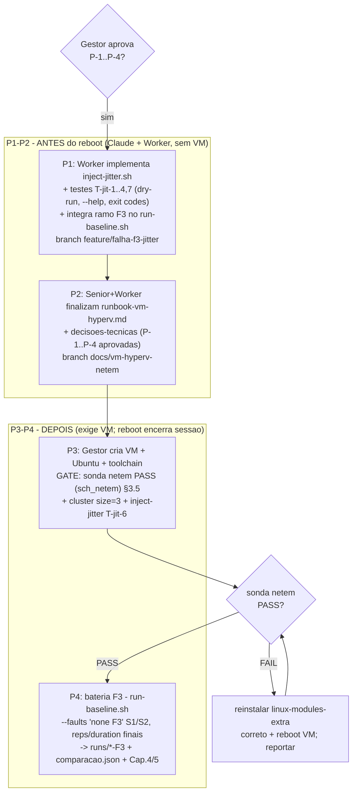

# Plano F3 — jitter/latência via tc-netem em VM Hyper-V

Frente prática TCC. Senior (planejamento) — Worker implementa depois. Push só com aprovação do Gestor.

Rastreabilidade: F3 = `Metodologia.tex` §3.3.2 (modelo de falhas) + parâmetro **T18** da Tabela 1 (§3.3.5). Backlog: **B-12** (`inject-jitter.sh`). Branches previstas: `feature/falha-f3-jitter` (código), `docs/vm-hyperv-netem` (este doc + runbook).

---

## 1. Parâmetros do F3 (jitter lognormal)

### 1.1 O que a Metodologia FIXA

Do texto (§3.3.2, F3) e da Tabela 1 (T18):

| Item | Valor na Metodologia | Origem |
|---|---|---|
| Mecanismo | `tc-netem` no *network namespace* de cada container | §3.3.2 F3 |
| Distribuição padrão | **lognormal** (cauda longa empírica); exponencial/uniforme como sensibilidade | §3.3.2 F3 + T18 |
| Alvo de cauda | **+50 ms no p99** | T18 |
| Ordem de magnitude | centenas de ms inter-AZ; +50 ms escolhido como ordem esperada | T18 (`benmokhtar_taming_tail_2021`) |
| Caráter | "calibrável" — valor não rígido | T18 |
| Nó alvo | não fixado explicitamente para F3 | — (ver pendência P-1) |
| Duração da janela | T14: **30 min com falha** (cenário completo); F3 herda isso | T14 |
| Interface | não fixada (é a interface do container na rede da VM) | — (ver P-2) |

### 1.2 O que a Metodologia NÃO fixa (decisões necessárias)

O T18 dá o **alvo observável** (`+50 ms no p99`), não os **parâmetros do comando netem** (`delay` médio, `jitter`/desvio, tabela de distribuição). É preciso mapear "p99 ≈ +50 ms" para `tc qdisc ... netem delay MEAN JITTER distribution normal`. Pontos a decidir com o Gestor:

- **P-1 — nó alvo do jitter.** Em F1 o alvo é `isn2` (T17/`inject-crash.sh`). Proponho **um único nó (`isn2`)** para F3, para isolar o efeito de degradação de um nó e manter simetria com F1. Alternativa: aplicar em todos os 3 nós (degradação global). *Proposta do Senior: `isn2`, espelhando F1.*
- **P-2 — interface.** Dentro do container Infinispan a interface da rede bridge/NAT costuma ser `eth0`. Proposta: **`--iface eth0` como padrão**, configurável. Confirmar após subir o cluster na VM (`podman exec isn2 ip -o link`).
- **P-3 — mapeamento p99→netem (o número que falta).** O `netem` aplica atraso `delay = MEAN ± JITTER` segundo uma tabela de distribuição. Para lognormal, o que a literatura/`tc` chamam "distribution" é uma *tabela de distribuição* (`/usr/lib/tc/*.dist`); o netem **não** traz `lognormal.dist` por padrão — traz `normal`, `pareto`, `paretonormal`, `experimental`. Há dois caminhos:
  - **(3a) Aproximação pragmática com `distribution normal`** (disponível out-of-the-box): escolher `MEAN` e `JITTER` tais que o p99 do atraso adicionado fique ≈ +50 ms. Para uma normal, p99 ≈ MEAN + 2,326·JITTER. Resolvendo para alvo +50 ms com, p.ex., `MEAN=20ms`: `JITTER = (50-20)/2,326 ≈ 12,9 ms` → **`delay 20ms 13ms distribution normal`**. Isso entrega cauda ~+50 ms no p99 com média controlada. Simples, reprodutível, sem gerar tabela.
  - **(3b) Lognormal "de verdade"** via tabela custom gerada por `maketable`/`tcsim` (pacote `iproute2` traz `maketable` em alguns builds) e instalada em `/usr/lib/tc/lognormal.dist`. Mais fiel ao texto ("distribuição padrão adotada é lognormal"), porém: requer gerar a tabela, instalá-la no container (imagem é read-only/pinada), e calibrar μ/σ da lognormal para p99 ≈ +50 ms. Maior risco operacional dentro do prazo (ponto-sem-retorno F3 = 01/07).

> **Recomendação do Senior:** adotar **(3a) `distribution normal` calibrado para p99≈+50 ms** como configuração executável do TCC-I, e **registrar em `decisoes-tecnicas.md`** que a lognormal estrita fica como sensibilidade (coerente com T18 "calibrável" e com o texto que já trata exponencial/uniforme como alternativas configuráveis). O `inject-jitter.sh` deve aceitar `--distribution` (normal|pareto|paretonormal|experimental) para deixar a porta aberta à sensibilidade sem reescrever o script. **Decisão final é do Gestor (P-3).**

### 1.3 Comando netem de referência (proposta 3a)

Aplicado **dentro do namespace do container** (egress da interface do nó alvo):

```bash
# aplicar (no host, via podman exec no container alvo):
podman exec isn2 tc qdisc add dev eth0 root netem delay 20ms 13ms distribution normal
# remover (cleanup):
podman exec isn2 tc qdisc del dev eth0 root
```

Parâmetros default propostos do `inject-jitter.sh`: `--node isn2 --iface eth0 --delay 20ms --jitter 13ms --distribution normal --duration 1800` (30 min, T14). Todos sobrescrevíveis para calibração/sensibilidade.

> Observação técnica: `netem` no `root qdisc` afeta **apenas o tráfego de saída (egress)** da interface. Isso degrada as respostas que o nó alvo envia ao cluster e ao cliente — suficiente para introduzir jitter no canal de replicação e nas respostas Hot Rod, que é o efeito visado por F3. Não é necessário ifb/ingress para o recorte TCC-I.

---

## 2. Spec de B-12 — `scripts/inject-jitter.sh`

Espelha o estilo de `inject-crash.sh` (bash robusto, `set -euo pipefail`, `--help`, `--dry-run`, exit codes, logging com timestamp). Diferença central: F1 só para/inicia o container; **F3 aplica um qdisc e PRECISA garantir cleanup** (remover o netem ao fim ou em qualquer erro/sinal), senão o nó fica degradado para sempre.

### 2.1 Assinatura de CLI

```
Uso: inject-jitter.sh [--node <nome>] [--iface <if>] [--delay <Nms>] \
                      [--jitter <Nms>] [--distribution <dist>] \
                      [--duration <segundos>] [--dry-run] [--help]
```

Defaults: `--node isn2 --iface eth0 --delay 20ms --jitter 13ms --distribution normal --duration 1800`.

### 2.2 Exit codes (alinhados a inject-crash.sh)

| Código | Significado |
|---|---|
| 0 | sucesso (netem aplicado, aguardado, removido) |
| 1 | erro genérico |
| 2 | argumento inválido / `--help` |
| 3 | dependência ausente (`podman`, ou `tc`/`sch_netem` indisponível dentro do container) |
| 4 | container não encontrado / não `running` |
| 5 | falha ao aplicar o qdisc (netem rejeitado) |

### 2.3 Comportamento

1. Parse + validação: `--delay`/`--jitter` casam `^[0-9]+(\.[0-9]+)?ms$` (ou aceitar `us`/`s`); `--distribution` ∈ {normal,pareto,paretonormal,experimental}; `--duration` inteiro ≥ 1.
2. `--dry-run`: imprime os comandos `tc qdisc add ...`, `sleep`, `tc qdisc del ...` previstos e sai 0. **Não exige `podman`, `tc` nem `sch_netem`** (igual ao dry-run do inject-crash).
3. Checagem de dependências (modo real): `podman` no PATH; container existe e `running`; **sonda netem**: `podman exec <node> sh -c 'tc qdisc add dev <iface> root netem delay 1ms && tc qdisc del dev <iface> root'` — se falhar, exit 3 com mensagem clara apontando para o runbook (sch_netem ausente, como no WSL2).
4. **Registrar trap de cleanup ANTES de aplicar**: `trap cleanup EXIT INT TERM`. `cleanup()` faz `podman exec <node> tc qdisc del dev <iface> root 2>/dev/null || true` — idempotente, nunca falha o cleanup.
5. Aplicar: `podman exec <node> tc qdisc add dev <iface> root netem delay <delay> <jitter> distribution <dist>`. Se retornar ≠0, exit 5 (o trap remove qualquer qdisc parcial).
6. Logar o qdisc efetivo: `podman exec <node> tc qdisc show dev <iface>`.
7. `sleep <duration>`.
8. Remover qdisc (o trap também cobre, mas remover explicitamente e logar OK).
9. Verificar remoção (`tc qdisc show` não deve listar netem) e log final.

> O `cleanup` no trap é o requisito de robustez número um: se o operador der Ctrl-C no meio dos 30 min, o nó NÃO pode ficar com +50 ms permanente. Teste explícito disso no plano (T-jit-5).

### 2.4 Integração com `run-baseline.sh`

Hoje o `run-baseline.sh` agenda `inject-crash.sh` em background `+(warmup+5)s` para `fault==F1`. Para F3 a estrutura é análoga, mas com diferenças que o Worker deve tratar:

- Adicionar `INJECT_JITTER="${SCRIPT_DIR}/inject-jitter.sh"` e um ramo `elif [[ "${fault}" == "F3" ]]`.
- A janela: T14 manda **30 min com falha**. O `inject-jitter.sh` deve cobrir a janela de medição (não os 5 s de folga). Proposta: disparar em `+(warmup+5)s` com `--duration` = `DURATION - warmup - margem`, ou simplesmente cobrir grande parte da janela. Parametrizar via novas flags `--jitter-delay/--jitter-stddev/--jitter-node/--jitter-iface` no run-baseline (defaults da §1.3).
- `FAULTS` passa a aceitar `F3`; `runs/<cenario>-F3/` é o destino; o pipeline `compare_scenarios.py none x F3` espelha o que já existe para F1 (adicionar o bloco de comparação `none x F3`).
- **Sem `aguardar_healthy` pós-F3 do mesmo modo que F1**: F3 não derruba o nó, então o cluster permanece size=3; basta garantir que o qdisc foi removido (o próprio script faz). Pode-se adicionar uma verificação leve "nenhum netem residual" entre reps.
- **Atenção ao endereçamento (P-4):** hoje `SERVERS=127.0.0.1:1122x` porque tudo roda no mesmo host (WSL2). Na VM, o workload roda **dentro da VM** apontando para os containers locais — `127.0.0.1:1122x` continua válido SE o workload rodar na própria VM (modelo aprovado: `git clone` dentro da VM, cluster sobe na VM). Confirmar no runbook que o mapeamento de portas Hot Rod externas (11222/11223/11224) é idêntico ao atual. Se sim, **`run-baseline.sh` não muda o `SERVERS`**.

### 2.5 Critérios de aceite (B-12)

- CA-1: `inject-jitter.sh --help` retorna 0 e documenta todas as flags.
- CA-2: `inject-jitter.sh --dry-run` retorna 0, imprime os 3 comandos (add/sleep/del) e **não invoca podman/tc** (roda em qualquer máquina, inclusive Windows/WSL).
- CA-3: argumento inválido → exit 2; dependência/sonda netem ausente → exit 3; container ausente/parado → exit 4; netem rejeitado → exit 5.
- CA-4: em execução real bem-sucedida, ao fim **não há qdisc netem** na interface (`tc qdisc show` limpo).
- CA-5: interrupção por sinal (INT/TERM) durante o `sleep` remove o qdisc (cleanup garantido).
- CA-6: integrado ao `run-baseline.sh`, `--faults "none F3"` gera `runs/<cen>-F3/rep-NNN.csv` + `comparacao.json` (none×F3) por cenário.

### 2.6 Plano de teste (B-12)

| ID | Teste | Ambiente | Esperado |
|---|---|---|---|
| T-jit-1 | `--help` | qualquer | exit 0, uso impresso |
| T-jit-2 | `--dry-run` (defaults) | qualquer (sem podman) | exit 0, comandos add/sleep/del impressos |
| T-jit-3 | `--duration abc` | qualquer | exit 2 |
| T-jit-4 | sem `sch_netem` (sonda falha) | WSL2 / container sem módulo | exit 3, mensagem apontando runbook |
| T-jit-5 | Ctrl-C durante `sleep` | VM com cluster | qdisc removido (cleanup), exit ≠0 mas sem resíduo |
| T-jit-6 | execução curta `--duration 5` real | VM com cluster | exit 0; durante: `tc qdisc show` lista netem; depois: limpo |
| T-jit-7 | bateria `run-baseline.sh --faults "none F3" --scenarios S1 --reps 1 --duration 60 --dry-run` | qualquer | dry-run descreve plano F3 |

Os testes T-jit-1..4 e T-jit-7 rodam **antes do reboot** (não exigem netem). T-jit-5/6 exigem a VM.

---

## 3. Runbook da VM Hyper-V

Passos executados pelo **Gestor/usuário** (exigem PowerShell **elevado**; o reboot, se necessário, encerra a sessão do Claude). Detalhe em `docs/runbook-vm-hyperv.md` (a criar pelo Worker); aqui o essencial.

### 3.0 Config aprovada
Ubuntu Server 24.04 LTS · 4 vCPU · 8 GB RAM · 40 GB disco dinâmico · rede **Default Switch (NAT)** · repo por `git clone` dentro da VM · ISO manual · engine **Podman** (fallback Docker).

### 3.1 Verificar se Hyper-V já está ativo (e se reboot é necessário)

```powershell
# (PowerShell ELEVADO)
Get-WindowsOptionalFeature -Online -FeatureName Microsoft-Hyper-V-All | Select State
Get-Service vmms | Select Status        # vmms = Hyper-V Virtual Machine Management
Get-VM                                    # se listar (mesmo vazio) => módulo de gestão OK
```
- Se `vmms` está `Running` e `Get-VM` responde elevado → **Hyper-V já ativo; NÃO precisa reboot.** O `Get-VM` que falhou antes foi por shell não-elevado.
- Se `Get-WindowsOptionalFeature` reporta `Disabled` → habilitar e **reiniciar**:
  ```powershell
  Enable-WindowsOptionalFeature -Online -FeatureName Microsoft-Hyper-V -All
  # reinicia a máquina (encerra a sessão do Claude)
  ```

### 3.2 Criar a VM (PowerShell elevado)

```powershell
$iso = "C:\caminho\ubuntu-24.04-live-server-amd64.iso"
New-VM -Name "tcc-f3" -Generation 2 -MemoryStartupBytes 8GB `
       -NewVHDPath "C:\Hyper-V\tcc-f3\tcc-f3.vhdx" -NewVHDSizeBytes 40GB `
       -SwitchName "Default Switch"
Set-VM   -Name "tcc-f3" -ProcessorCount 4 -DynamicMemory:$false
Add-VMDvdDrive -VMName "tcc-f3" -Path $iso
# Gen2 = Secure Boot ON por padrão; Ubuntu boota com MS UEFI CA:
Set-VMFirmware -VMName "tcc-f3" -EnableSecureBoot On `
               -SecureBootTemplate "MicrosoftUEFICertificateAuthority"
# DVD antes do HD para o 1o boot:
Set-VMFirmware -VMName "tcc-f3" -FirstBootDevice (Get-VMDvdDrive -VMName "tcc-f3")
Start-VM -Name "tcc-f3"
vmconnect.exe localhost "tcc-f3"
```

### 3.3 Instalar Ubuntu 24.04 (no console vmconnect)
Instalação padrão Server, habilitar OpenSSH, criar usuário. Após instalar, remover o DVD do boot (`Set-VMDvdDrive -VMName tcc-f3 -Path $null` ou ajustar ordem de boot) e reiniciar a VM.

### 3.4 Toolchain dentro da VM (SSH/console)

```bash
sudo apt update && sudo apt -y upgrade
sudo apt -y install git podman openjdk-17-jdk maven python3 python3-pip python3-venv \
                    iproute2 linux-modules-extra-$(uname -r)
# linux-modules-extra-* traz sch_netem (ausente no kernel WSL2 — esse é o motivo da VM)
```
Fallback Docker: `sudo apt -y install docker.io docker-compose-v2` se o Podman der problema na imagem pinada.

### 3.5 GATE — revalidar a sonda netem (critério de prosseguir)

```bash
sudo modprobe sch_netem
lsmod | grep sch_netem                      # deve aparecer
# sonda no host da VM:
sudo tc qdisc add dev eth0 root netem delay 10ms && \
sudo tc qdisc show dev eth0 && \
sudo tc qdisc del dev eth0 root
```
**Esperado: PASS** (ao contrário do WSL2, onde `sch_netem` não existe). Se PASS → F3 é viável; prosseguir. Se FAIL → parar e reportar ao Gestor (provável `linux-modules-extra` não corresponde ao `uname -r`; reinstalar o pacote certo e reboot da VM).

> A sonda definitiva é **dentro do container** (onde o netem realmente roda): após subir o cluster (§3.6), rodar `inject-jitter.sh --node isn2 --duration 5` (T-jit-6) — se aplicar/remover sem erro, o gate F3 está plenamente validado.

### 3.6 Clonar o repo e subir o cluster (na VM)

```bash
git clone https://github.com/franpgn/tcc-desenvolvimento.git
cd tcc-desenvolvimento/cluster
podman-compose -f podman-compose.yml up -d   # imagem pinada 15.0.21.Final
# aguardar size=3 HEALTHY (mesmo health endpoint do run-baseline.sh):
curl -s --digest -u admin:infinispan \
  http://localhost:11222/rest/v2/cache-managers/default/health | grep number_of_nodes
mvn -f ../workload/pom.xml package           # gera o jar do workload
```

### 3.7 Gate consolidado F3
- `lsmod` mostra `sch_netem` **E** `inject-jitter.sh --node isn2 --duration 5` aplica/remove sem erro dentro do container `isn2` **E** cluster size=3 HEALTHY.

---

## 4. Sequência P1→P4 (gates)



| Fase | Pode rodar | Bloqueio |
|---|---|---|
| **P1** autoria `inject-jitter.sh` + testes dry-run + integração run-baseline | ANTES do reboot | aprovação P-1..P-4 |
| **P2** runbook + decisoes-tecnicas | ANTES do reboot | — |
| **P3** VM + Ubuntu + toolchain + GATE sonda netem | DEPOIS (VM) | reboot/elevação |
| **P4** bateria F3 + análise + Cap.4/5 | DEPOIS (VM) | GATE netem PASS |

**Insight de prazo:** ~70% do trabalho de código/doc (P1+P2) **não exige a VM nem reboot** e pode ser feito já. A VM só é obrigatória para P3/P4. Isso protege o ponto-sem-retorno de 01/07.

---

## 5. Pendências para validação do Gestor

- **P-1** nó alvo do jitter (proposta: `isn2`, espelha F1).
- **P-2** interface (proposta: `eth0`, confirmar pós-cluster).
- **P-3** distribuição: `distribution normal` calibrado p99≈+50 ms (delay 20ms / jitter 13ms) como execução TCC-I, lognormal estrita como sensibilidade — **OU** lognormal estrita via tabela custom desde já. Senior recomenda a primeira.
- **P-4** confirmar que `SERVERS=127.0.0.1:1122x` permanece (workload roda dentro da VM).
- **P-5** duração da janela F3 no run-baseline (T14 = 30 min) e parâmetros finais reps/duration da bateria.

---

*Documento de planejamento. Nenhum código implementado aqui. Nada commitado/pushado.*
