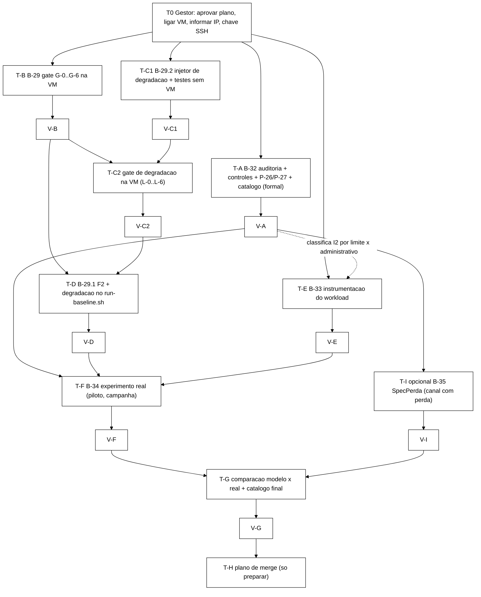

# Plano de fechamento da etapa formal-experimental (antes do controlador heurístico)

> Elaborado pelo Senior em 2026-10-15, por decisão do Gestor de fechar a etapa formal-experimental **antes** de
> iniciar o controlador (B-25 a B-28 **não começam** até esta etapa terminar). **Só planejamento:** nenhum
> `spec/*.tla`, script ou código foi alterado, nenhum push foi feito.
>
> **Base desta branch:** `8e2e815` (ponta de `feature/b22-f2-particao`, ancestral comum de `feature/b29-inject-partition`
> e `feature/b32-tlc-propriedades-fortes`; contém `registro-de-problemas.md`, `runbook-vm-hyperv.md` e `runs/`).
> A branch `docs/plano-b29-b30-2026-10-09` parte de `ba6dd23`/`main` (que não tem o código nem os relatórios), então
> não serve de base; os documentos que ela e `docs/plano-controlador-heuristico` carregam foram lidos por `git show`.
>
> Fontes lidas: `docs/plano-b29-particao-real-e-contraexemplos-2026-10-09.md` (branch `docs/plano-b29-b30-2026-10-09`),
> `docs/relatorio-b32-tlc-propriedades-2026-10-09.md` (`feature/b32-tlc-propriedades-fortes`, `48d1571`),
> `docs/relatorio-b29-implementacao-2026-10-09.md` (`feature/b29-inject-partition`, `b56c6ea`),
> `docs/plano-controlador-heuristico-2026-09-24.md` §3.2 e §6 (branch `docs/plano-controlador-heuristico`),
> `docs/runbook-vm-hyperv.md`, `cluster/*.xml`, `scripts/run-baseline.sh`, `workload/.../{SessionOps,Scenario,IdentityState,InvariantAuditor,WorkloadMain}.java`.

---

## 1. Resumo executivo

A etapa se fecha com **oito tarefas** (T0 a TH, mais uma opcional) que transformam o que hoje é "relatório do Worker" em
**evidência validada**: (1) auditar B-32 e só então alimentar o catálogo; (2) executar de fato o gate real de B-29 na VM;
(3) criar um injetor de **perda de pacotes e degradação parcial** (a rede real raramente cai por inteiro); (4) integrar F2 e a
degradação ao `run-baseline.sh`; (5) instrumentar o workload (B-33); (6) rodar o experimento real (B-34) com uma matriz de
partição **e** de degradação; (7) comparar modelo × sistema real e fechar o catálogo; (8) preparar (sem executar) a integração em `main`.

Três achados desta leitura mudam o plano original e estão incorporados abaixo:

1. **O workload atual não exercita `Block` (O6).** `Scenario.java` só tem Validate, Login, Logout, IncrementFailure e Reset;
   `block()` não está no mix. Sem uma carga que emita bloqueios administrativos, I2 sob partição **não tem como** ser observado
   no sistema real. B-33 precisa de uma sonda/cenário de invalidação (seção T-E).
2. **I2 global tem um falso positivo por desenho.** O auto-bloqueio por limite (`IdentityState.incrementar`) deixa sessões `VALID`
   de uma identidade `BLOCKED`, e `IdentityState` não guarda o motivo do bloqueio. Uma varredura global ingênua de I2 acusará
   violação em **toda** execução, com ou sem falha. A varredura de B-33 precisa separar bloqueio por limite de bloqueio
   administrativo (decisão 1 do Gestor, ver 2.1).
3. **A VM `tcc-f3` não estava acessível hoje** (seção 3), e o IP registrado (172.20.90.6) provavelmente mudou: a Default Switch
   está agora em 192.168.128.1. Há uma ação do Gestor antes de qualquer tarefa que use a VM.

---

## 2. Decisões do Gestor (2026-10-15) e onde entram

| # | Decisão | Onde está incorporada |
|---|---|---|
| D1 | I2Fb aceita como "violada por construção": (a) auto-bloqueio por limite sem cascata (o código real faz o mesmo); (b) cascata `sessoesAfetadas` calculada na origem aplicada a réplica que ainda vê a sessão `VALID` (artefato do modelo). I2Fa passa a ser a propriedade que isola a partição. | T-A (catálogo e registro: P-27), T-E (varredura global de I2), T-G |
| D2 | Catálogo só recebe vereditos do B-32 se os testes forem válidos. **Regra permanente** de autenticidade. Incluir `ERRO rc=150`, ressalva da simetria (rodada de controle sem `SYMMETRY`), decisão sobre `I4Fp`/`I4Mp`, e se o artefato do relógio vira P-26. | seção 4 (protocolo), T-A |
| D3 | Falha de rede testada na **VM Hyper-V real** com `tc`/`netem`/`nsenter`; além da partição total, **perda de pacotes e degradação parcial** com matriz de severidades; hipóteses sobre JGroups/Infinispan; observáveis; relação com o modelo (cobre/não cobre). | T-B, T-C, T-D, T-F, seção 8 |
| D4 | Toda tarefa termina com **validação independente** do Senior; sem validação aprovada a seguinte não começa. | seção 4.3, passos V-x de cada tarefa |
| D5 | Vários Workers; paralelismo, worktrees, dono, entregáveis, aceite, riscos, prompt. O agente principal orquestra. | seções 5 a 7 |

### 2.1 Interpretação de D1 que o plano adota (para o Gestor confirmar)

- **P-27 (novo)**: "I2Fb violada por construção". Classificação: `comportamento do código` para o mecanismo (a) e `artefato do
  modelo` para o mecanismo (b). O mecanismo (a) é **real** (`SessionOps.incrementFailure` não invalida sessões; só `block()` varre `sessions`),
  então ele é também uma **propriedade do sistema** que o auditor real precisa conhecer. Pergunta aberta Q-3: isso é intencional no domínio?
- **P-26 (novo)**: artefato do relógio (`EntregaMensagem` não atualiza `relogio`, decisão D-4 do módulo). Ver T-A.5 para a recomendação.
- Linha do catálogo para I2: o veredito do TLC passa a ser dado por **I2Fa** (escopo `Mesclar`); I2Fb entra com status `VIOLADA-POR-CONSTRUCAO`
  e **não** discrimina a coluna de falha.

---

## 3. Fatos verificados em disco e git (2026-10-15)

| Fato | Evidência (comando/arquivo) |
|---|---|
| Worktrees existentes: `wt-b29` (`b56c6ea`, `feature/b29-inject-partition`), `wt-b32` (`48d1571`, `feature/b32-tlc-propriedades-fortes`) | `git worktree list` |
| `main` (`14de422`) está **65 commits atrás** da linha de trabalho; `8e2e815` não é descendente de `main` (3 commits de `main` não estão nele), mas `git merge-tree main 8e2e815` não acusa conflito | `git rev-list`, `git merge-tree --write-tree` |
| B-29 e B-32 divergem ambos de `8e2e815`; arquivos em comum **apenas `docs/testes.md`** (B-29 também toca `docs/configuracao-infinispan.md`, `docs/implementacao.md`; B-32 toca `spec/MCSession.tla`, `spec/run-tlc-propriedades.sh`, `runs/tlc/prop-*`) | `git diff --name-only 8e2e815 <branch>` |
| `docs/plano-b29-...` e `docs/plano-controlador-...` **só existem** em branches `docs/*` baseadas em `main`/`ba6dd23`; nenhuma ponta de código as contém | varredura de `git ls-tree` em todas as branches |
| Último problema registrado é **P-25**; P-26 e P-27 estão livres | `docs/registro-de-problemas.md` |
| B-32: 32 diretórios em `runs/tlc/` (`prop-*`), um único `ERRO` entre todos os `resumo-*.tsv` (`prop-queda`, `I4M`, `rc=150`, 0 s), repetido em seguida | `grep ERRO runs/tlc/prop-*/resumo-*.tsv` |
| Os `.cfg` do B-32 usam `SYMMETRY Simetria` (`Permutations(IDS) ∪ Permutations(SIDS) ∪ Permutations(REPLICAS)`); `PROPERTY` para propriedades de ação, `INVARIANTS` para `I2Fb` | `runs/tlc/prop-particao-w1/r3-I1F.cfg`, `spec/run-tlc-propriedades.sh` |
| Amostras brutas conferidas por mim hoje (leitura, **sem reexecutar TLC**): `prop-particao-w1/r3-I1F.out` termina em `468 states generated, 162 distinct`, "complete state graph search" depth 4; `prop-queda/r3-I1F.out` termina num `Progress(14)` (22.377.840 distintos, 16 M na fila) sem linha de término, coerente com `limite_de_tempo_600s`; `prop-queda-c2r3-ev2-longo/r3-I1F.out` termina em `394154264 states generated, 19229901 distinct, 0 states left on queue`, `Finished in 10min 23s` | `tail` dos `.out` |
| TLC 2.19 (rev 5a47802), Java 17.0.2; `tla2tools.jar` **não está no repositório** (foi baixado para um `scratchpad` temporário de outra sessão) | cabeçalho dos `.out`; relatório B-32 §1 |
| `cluster/infinispan-cluster.xml`: `mode="SYNC"`, `owners="2"`, `segments="64"`, `partition-handling when-split="DENY_READ_WRITES" merge-policy="PREFERRED_NON_NULL"` nos caches `sessions` e `counters` | arquivo |
| `cluster/jgroups-tcp.xml`: TCPPING estático, `MERGE3 10000..30000`, `FD_SOCK2`, `FD_ALL3` (padrões), `VERIFY_SUSPECT2 timeout=1000`, `NAKACK2`, `UNICAST3`, `pbcast.GMS`. **Transporte é TCP**: perda de pacote vira retransmissão do TCP (latência), não perda de mensagem do JGroups | arquivo |
| `Scenario.java`: operações VALIDATE, LOGIN_VALIDATE_LOGOUT, LOGOUT, INCREMENT_FAILURE, RESET_FAILURES. **Sem Block (O6)** | arquivo |
| `WorkloadMain` faz **uma** `auditor.rodadaUnica(...)` após a carga; não existe laço de convergência; `ERROR_TRANSPORT` é o único código de falha de rede em `OpResult` | arquivo |
| `SessionOps` tem `try/catch(RuntimeException)` nas operações; o plano de B-29 afirma que `block()` não tem (a conferir em T-E: o `catch` do `block()` pode estar apenas no `forEach` interno) | `grep` de `try`/`catch`; **a conferir** |
| Testes Java: `@Test` somam 58 por `grep`; a memória e os planos falam em **49** testes verdes. A contagem oficial deve vir do Surefire (`mvn test`), não de `grep` | `grep -c "@Test"`; **a conferir em T-E** |
| `run-baseline.sh` conhece `none F1 F3`; F2 e perda não existem; flags de jitter são `--jitter-*` | `scripts/run-baseline.sh` |
| **VM `tcc-f3`: não acessível hoje.** `ping 172.20.90.6` e `ssh server1@172.20.90.6` expiram; `172.20.90.136` (outro IP antigo no `known_hosts`) também; `vEthernet (Default Switch)` do host está em **192.168.128.1** (sub-rede diferente das 172.20.90.x); sem vizinhos ARP na Default Switch; `tcc-f3.mshome.net` não resolve. Hyper-V (`vmms`) está `Running`, mas `Get-VM` exige shell elevado (não disponível ao agente). Disco `C:\Hyper-V\tcc-f3\tcc-f3.vhdx` existe | `ping`, `ssh`, `Get-NetIPAddress`, `arp -a` |
| Estado do cluster e do repositório **dentro** da VM são desconhecidos (última evidência: gate netem PASS e push de `feature/f3-baseline` em 2026-06-23) | memória do projeto |

Conclusão: a VM está **provavelmente desligada** (ou com outro IP depois de reinício do host). Ligar e informar o IP é a ação T0.1 do Gestor.

---

## 4. Regras que valem para todas as tarefas

### 4.1 Protocolo permanente de autenticidade e validade (D2)

Nenhum número, veredito ou traço entra em catálogo, relatório, `docs/resumos-para-tcc/` ou texto do TCC sem passar por este
protocolo. O Senior o aplica na validação (V-x); o Worker o aplica antes de entregar.

| Item | Verificação obrigatória |
|---|---|
| P-1 Origem | Cada número cita o arquivo bruto (`runs/.../*.out`, `*.tsv`, CSV, log) e a linha. Número sem arquivo = inválido. Texto que cita texto não vale. |
| P-2 Recontagem | Os números do relatório são **recalculados por script** a partir dos brutos; diferença é registrada, nunca "arredondada". |
| P-3 Linhas finais do TLC | Para cada execução: `N states generated, M distinct states found`, `states left on queue`, `Finished in`, e **uma** de: `Model checking completed. No error has been found.` (fechou), `Error: ... is violated` + traço, ou ausência de ambas (timeout/abortada). |
| P-4 Fechamento × timeout | `SEM_VIOLACAO` só com `No error has been found` **e** `0 states left on queue`. Timeout (`rc=124`) é `SEM-VIOLACAO-ATE-AQUI` e **nunca** é escrito como "preservada". |
| P-5 Vacuidade estrutural × verificação | "Vale por construção porque `Mesclar` é inalcançável" é argumento, não verificação. Só vira dado com prova empírica: `-coverage` mostrando `Mesclar` com 0 execuções, em configuração que fecha (ver T-A.4). |
| P-6 Reprodução independente | Amostra reexecutada com **1 worker** (BFS determinístico, traço mínimo) e, para propriedades afetadas pela redução de simetria, **sem `SYMMETRY`**. Tamanho do traço igual ao relatado; se diferir, investigar antes de aceitar. |
| P-7 Leitura do traço | O Senior lê cada traço citado e confere cada passo com `Next` (ação, guarda, variáveis). Traço não lido por humano não entra. |
| P-8 Configuração | `.cfg` do bruto == configuração alegada (`REPLICAS`, `MaxCanal`, `MaxRelogio`, `MaxEventosFalha`, `LIMITE`, restrição de falha, `PROPERTY` vs `INVARIANTS`). Hash do `spec/MCSession.tla` do commit == o usado. |
| P-9 Cotas | Todo "preservada" leva suas cotas (cardinalidade, canal, relógio, eventos de falha, simetria usada) **na mesma frase**. |
| P-10 Zero experimental | Resultado "zero violações" no sistema real sai como "não observado em n repetições, limite superior de 95% ≈ 3/n", **nunca** "não ocorre". |
| P-11 Segredos e ambiente | Sem senha nem IP privado de rede pessoal em docs; versão de TLC/Java/Infinispan/kernel/`tc` registrada. |

### 4.2 Vocabulário de status do catálogo (fechado)

`CONFIRMADO-NO-MODELO` (traço reproduzido sem simetria, lido pelo Senior) · `PRESERVADA-ATE-COTAS` (fechou exaustivo, cotas citadas) ·
`SEM-VIOLACAO-ATE-AQUI` (timeout; **não** vale como preservada) · `VACUA` (vacuidade verificada por cobertura) · `VIOLADA-POR-CONSTRUCAO` (viola sem falha; não discrimina a falha) ·
`ARTEFATO-DO-MODELO` · `OBSERVADO-NO-REAL` / `NAO-OBSERVADO-EM-n` · `PENDENTE` · `INVALIDADO`.

### 4.3 Passo de validação (V-x) e portão entre tarefas

Toda tarefa T-x termina em **V-x**, executado pelo Senior em branch `docs/validacao-<tarefa>-<data>` (relatório próprio, não toca o código do Worker):

1. escopo: `git diff --stat` contra a base só contém os arquivos permitidos da tarefa (tabela da seção 5);
2. aceite: cada critério objetivo da tarefa marcado com evidência bruta (caminho + linha);
3. reprodutibilidade: o Senior reexecuta **uma amostra** dos comandos do relatório a partir de um clone limpo (`git worktree add` do commit entregue);
4. regressão: `bash scripts/*.test.sh` e `mvn -f workload/pom.xml test` conforme a tarefa; protocolo 4.1 aplicado;
5. veredito: `APROVADA`, `APROVADA COM RESSALVAS` (lista fechada, não bloqueantes) ou `REPROVADA` (lista de correções, volta ao Worker).

**Portão:** a tarefa dependente só é liberada por mensagem do Senior com o veredito `APROVADA*`. O Gestor pode exigir também a sua assinatura (Q-12).
Cada Worker entrega **um** commit final `docs:` com o relatório e para; **sem push**.

### 4.4 Regras de convivência entre Workers

- Uma branch e uma worktree por tarefa, base indicada; histórico linear (`git rebase`, sem merge commit, sem force-push).
- **Arquivos compartilhados** (`docs/testes.md`, `docs/implementacao.md`, `docs/configuracao-infinispan.md`, `docs/registro-de-problemas.md`) só são editados pela tarefa dona
  indicada (seção 5.2). As demais escrevem **relatório próprio** em `docs/relatorio-<tarefa>-<data>.md` e a consolidação nos compartilhados acontece em T-H.
- **Recurso exclusivo: a VM.** Apenas um Worker usa a VM por vez. Convenção: `flock /var/lock/tcc-vm.lock` na VM e arquivo `~/vm-dono.txt` (tarefa, branch, hora).
- `tla2tools.jar`: baixar uma vez para fora do repositório, registrar SHA-256 no relatório; scripts leem `TLA_TOOLS`.

---

## 5. Mapa de tarefas

### 5.1 Dependências



### 5.2 Paralelismo, worktrees e donos

| Tarefa | Branch (base) | Worktree | Arquivos que **só ela** toca | Paralela com | Recurso exclusivo | Dono | Estimativa |
|---|---|---|---|---|---|---|---|
| **T-A** | `test/b32-auditoria-controle` (`48d1571`) | `wt-ta` | `runs/tlc/audit-*/`, `scripts/audit-tlc-runs.sh` (novo), `spec/run-tlc-propriedades.sh` (flags `SEM_SIMETRIA`, `TMPDIR` por execução), `docs/relatorio-b32-auditoria-<data>.md`, `docs/registro-de-problemas.md` (P-26, P-27), `docs/catalogo-operacao-falha-invariante.md` (novo, ver Q-6) | T-B, T-C1, T-E | CPU (TLC); **não** a VM | Worker-1 (formal) | 2 a 3 dias |
| **T-B** | `test/b29-gate-vm` (`b56c6ea`) | `wt-b29` (reaproveitar) | `runs/gate-b29/**`, `docs/relatorio-b29-gate-<data>.md`, `docs/testes.md` (seção do gate) | T-A, T-C1, T-E | **VM** | Worker-2 (infra) | 1 dia (+ espera do Gestor) |
| **T-C1** | `feature/b29-2-inject-netdegrade` (`b56c6ea`) | `wt-tc` | `scripts/inject-netdegrade.sh`, `scripts/inject-netdegrade.test.sh`, `docs/degradacao-de-rede.md` (novo) | T-A, T-B, T-E | nenhum | Worker-3 (infra) | 2 dias |
| **T-C2** | mesma branch de T-C1 (continua) | `wt-tc` | `runs/gate-netdegrade/**`, `docs/relatorio-netdegrade-gate-<data>.md` | T-A, T-E | **VM** (depois de T-B) | Worker-3 | 1 a 1,5 dia |
| **T-D** | `feature/b29-1-baseline-f2-degradacao` (ponta integrada de T-B/T-C, ver 5.3) | `wt-td` | `scripts/run-baseline.sh`, `scripts/run-baseline.test.sh` (se existir; senão novo), `docs/runbook-vm-hyperv.md` (seção `--heal`/degradação) | T-A, T-E | **VM** só no smoke final | Worker-2 | 1 a 1,5 dia |
| **T-E** | `feature/b33-instrumentacao-particao` (`8e2e815`) | `wt-te` | `workload/**`, e `analysis/**` **somente** se `ERROR_UNAVAILABLE` for aprovado (Q-9) | T-A, T-B, T-C, T-D | nenhum (mocks) ; smoke na VM só em T-F | Worker-4 (workload) | 3 a 4 dias |
| **T-F** | `feature/b34-experimento-real` (integra tudo) | `wt-tf` | `runs/f2-*`, `runs/degrada-*`, `docs/relatorio-b34-<data>.md` | nenhuma | **VM (exclusiva)** | Worker-2 (execução) + Worker-5 (análise, em paralelo, só `analysis/`) | 4 a 5 dias, ~20 h de máquina |
| **T-G** | `docs/catalogo-modelo-vs-real` | `wt-tg` | `docs/catalogo-operacao-falha-invariante.md`, `docs/comparacao-modelo-real-<data>.md`, `docs/resumos-para-tcc/*` | T-H (parte) | nenhum | Worker-1 | 1,5 dia |
| **T-H** | `docs/plano-merge-etapa-formal` | `wt-th` | `docs/plano-merge-etapa-formal-<data>.md` | T-G | nenhum | Senior (com Worker-2 para dry-run) | 0,5 dia |
| **T-I** (opcional) | `feature/b35-spec-perda-canal` (`48d1571`, depois de V-A) | `wt-ti` | `spec/MCSession.tla` (somente bloco novo `SpecPerda`), `runs/tlc/perda-*/`, `docs/relatorio-b35-<data>.md` | T-B..T-F | CPU | Worker-1 | 1 dia |

**Observação sobre o paralelismo:** T-A, T-B, T-C1 e T-E começam **juntas** (arquivos disjuntos; só T-B e T-C2 disputam a VM, e T-C2 espera V-B).
T-A e T-I tocam `spec/` e o script do TLC, então T-I só parte depois de V-A.

### 5.3 Base de integração local

Criada pelo Senior (sem push) quando V-B, V-C1 e V-E estiverem aprovadas: `feature/etapa-formal-integracao`, a partir de `feature/b22-f2-particao`,
com `git merge --ff-only`/`rebase` na ordem **b29 (+gate) → b29.2 → b32 (+auditoria) → b33**. T-D parte dela (precisa dos dois injetores) e T-F também. Conflito esperado conhecido:
`docs/testes.md` (B-29 e B-32 editam); resolver mantendo as duas seções.

---

## 6. Tarefas em detalhe

### T0. Ações do Gestor (antes de despachar Workers)

| # | Ação | Por quê |
|---|---|---|
| T0.1 | Em PowerShell **elevado**: `Start-VM tcc-f3`; `Get-VMNetworkAdapter -VMName tcc-f3 \| Select IPAddresses`; informar o IP | VM inacessível hoje; Default Switch mudou de sub-rede |
| T0.2 | Instalar chave SSH (uma vez): `ssh-copy-id server1@<ip>` (ou colar a chave pública em `~/.ssh/authorized_keys` da VM) e conferir `sudo -n true` (sudo sem senha para `tc`, `nsenter`, `podman`) | o Worker não deve usar senha em texto; BatchMode |
| T0.3 | Decidir Q-1 a Q-12 (seção 10) | portões |
| T0.4 | Liberar ao agente principal a permissão de `ssh`/`scp` para a VM | pode exigir aprovação do sistema de permissões |

Sugestão: reservar IP fixo (ou rodar `ip -br addr` ao ligar e anotar no `docs/runbook-vm-hyperv.md`), porque a Default Switch (NAT) pode mudar o IP a cada reinício do host.

---

### T-A. Auditoria de autenticidade de B-32, controles, P-26/P-27 e catálogo formal

**Objetivo.** Verificar se os vereditos do relatório B-32 são válidos (protocolo 4.1) e só então entregar o catálogo atualizado.

**Passos do Worker (ordem obrigatória).**

- **A.1 Reconciliação numérica.** `scripts/audit-tlc-runs.sh` percorre `runs/tlc/prop-*/*.out` e `resumo-*.tsv` e produz `runs/tlc/audit-b32/tabela-recalculada.tsv`
  (diretório, propriedade, resultado derivado só do `.out`: `FECHOU`/`VIOLADA`/`TIMEOUT`/`ABORTADA`, gerados, distintos, fila, duração, nº de estados do traço, cfg). Compara com o relatório §3.1, §3.3 e §3.5 e lista **toda** divergência. Casos já conhecidos a explicar (não são erros): traços de 4 workers diferem dos de 1 worker em 1 a 2 estados (ex.: `prop-queda I4Fp` 6 estados com 4 workers contra 5 do relatório com 1 worker).
- **A.2 Classificar cada linha** com o vocabulário 4.2. Confirmar que cada `SEM-VIOLACAO-ATE-AQUI` não tem `No error` nem `0 states left` e que o `Progress` final bate com o `.tsv`.
- **A.3 Rodada de controle sem `SYMMETRY`.** Adicionar `SEM_SIMETRIA=1` ao script (remove a linha `SYMMETRY`), e rodar com `WORKERS=1`: (a) as 8 propriedades violadas sob partição (`I1F I4F I2Fa I2Fb I1M I4M I4Fp I4Mp`) com os limites do plano; (b) `I2Fb`, `I4F`, `I4Fp` em sem falha e queda; (c) fechamentos exaustivos reprodutíveis sem simetria: `prop-queda-c2r3 r2-I1F` (15.690 distintos), `prop-sem r2-I1F` (2.968.799; esperar ≈ 2×), `prop-sem-c2r3 r3-I1P` e `r3-I1F` (≈ 6× os 1.627.731, ver orçamento). Os fechamentos que não couberem em memória/tempo sem simetria (`ev1`, `ev2-longo`) ficam marcados `PRESERVADA-ATE-COTAS (sob simetria; sem controle sem simetria)` e a razão é escrita.
  Aceite: tamanho de traço igual ao de 1 worker com simetria; resultado de fechamento igual (violada/sem violação). Se diferir, parar e reportar ao Senior. Verificar também no `MCSession.tla` que nenhuma fórmula distingue réplicas/sids/identidades (a revisão procura `CHOOSE`, ordem, constantes específicas); `IdSemente == CHOOSE id \in IDS : TRUE` é o único caso já visto e é inofensivo com `IDS = {u1}`.
- **A.4 Vacuidade verificada.** Em configuração reduzida que fecha (`r2`, `MaxCanal=2`, `MaxRelogio=3`) rodar `I2Fa`, `I1M`, `I4M`, `I4Mp` sob `SemFalha` e `SoQueda` com `-coverage 1` e registrar a contagem da ação `Mesclar` (esperado 0), e sob `SoParticao` (esperado > 0). Resultado vira status `VACUA` só com essa prova; em cardinalidade cheia continua "por argumento estrutural + prova na configuração reduzida".
- **A.5 `ERRO rc=150`.** Reproduzir (3 execuções simultâneas do mesmo módulo, sem correção) e corrigir no script (`-Djava.io.tmpdir` por execução, além do `-metadir` já existente). Aceite: 6 execuções simultâneas sem `rc≠{0,12,124}`; reexecutar a célula `queda I4M` e anexar. Classificar `rc` válidos: 0 (sem erro), 12 (violação), 124 (timeout), outros = ERRO.
- **A.6 Classificação de cada traço quanto ao artefato do relógio (P-26).** Para cada traço de violação do relatório, anexar `traco-<prop>.md` com os estados anotados e a coluna "depende do artefato D-4? sim/não" (critério: algum passo `Logout`/`Block`/`Unblock` com `novoTS ≤ ts` local por `relogio` defasado, a mesma assinatura de `I1P`). Tabela final: quais vereditos são independentes de P-26.
- **A.7 Decisões a recomendar ao Gestor** (texto no relatório, o Gestor aprova):
  - **Manter `I4Fp`/`I4Mp` (recomendação: manter).** Razão: `I4F` como especificada dispara também quando a sessão **volta** a `VALID` (motivo vira `NONE`), então sob partição seu traço mínimo é o mesmo de `I1F` e ela não isola "motivo único"; `I4Fp` isola a troca de motivo mantendo `INVALID`, que é o que o auditor real de I4 checa ("motivo lido diferente do confirmado"). Ressalva obrigatória no catálogo: `I4Fp` é violada **sem falha** (corrida `Logout` × `Block` por canal assíncrono, 5 estados), ou seja, `VIOLADA-POR-CONSTRUCAO` como `I2Fb`; `I4Mp` só é "atribuível à fusão" no sentido de que o passo violador é `Mesclar`, mas a pré-condição (dois motivos concorrentes) existe sem falha. Cada uma entra com esse rótulo, não como prova de efeito da partição.
  - **P-26 (recomendação: registrar).** Título: "`EntregaMensagem` não atualiza `relogio`: no modelo livre, `Logout` aceito e perdido sem falha (`I1P`, 4 estados) e ressurreição por reordenação (`I1F`, 7 estados)". Classificação: **defeito de modelagem (decisão D-4), não do sistema** (o código usa `versao+1` do registro lido). Consequência: os resultados do **modelo livre** (`prop-livre-*`) não servem como evidência de comportamento do sistema; os do **semeado** valem condicionados à classificação A.6. Status: `ABERTO-ACEITO` (sem alterar `SessionStore.tla`), com Q-5 pedindo se o Gestor quer a correção em variante.
  - **P-27 (recomendação: registrar).** I2Fb violada por construção, mecanismos (a) e (b) de 2.1, com os dois traços (3 estados `LIMITE=2`; 4 estados `LIMITE=6`).
- **A.8 Catálogo.** Criar `docs/catalogo-operacao-falha-invariante.md` (extrai a tabela §3.2 do plano do controlador e acrescenta colunas "propriedade operacional", "veredito TLC", "status 4.2", "evidência bruta"). **Somente** linhas aprovadas por A.1 a A.6. F1 e F3 permanecem `PENDENTE` quanto ao real. Linhas obrigatórias: I1F, I4F/I4Fp, I2Fa, I2Fb, I1M, I4M/I4Mp, I1P, `MesclarPerdeChave`; para cada uma, a coluna de falha (sem, queda, partição) e as cotas.

**Entregáveis.** `docs/relatorio-b32-auditoria-<data>.md`; `runs/tlc/audit-b32/`; script `scripts/audit-tlc-runs.sh`; ajustes no `run-tlc-propriedades.sh`; P-26 e P-27 no registro; catálogo novo.

**Critérios de aceite (objetivos).**
1. `tabela-recalculada.tsv` cobre 100% dos `.out` de `prop-*` e a lista de divergências é explícita (vazia ou justificada).
2. Cada veredito do catálogo tem status do vocabulário 4.2 e caminho de bruto; nenhum `SEM-VIOLACAO-ATE-AQUI` aparece como "preservada".
3. Controle sem simetria executado e comparado (A.3), com tabela "com simetria × sem simetria".
4. Vacuidade provada por cobertura (A.4) ou o status `VACUA` não é atribuído.
5. `rc=150` reproduzido e eliminado (A.5), com evidência.
6. Traços anotados quanto a P-26 (A.6). `SessionStore.tla` e `MCSession.tla` **inalterados** (`git diff` vazio nesses dois arquivos).
7. P-26 e P-27 redigidos no formato do registro (contexto, evidência bruta, classificação, status).

**Riscos.** Rodada sem simetria é cara (até 6× estados): usar orçamento e `TIMEOUT_SECS` explícitos; se algum controle não fechar, **não** promover o veredito. Disco: `runs/tlc` já é grande; os controles gravam só `.out` resumidos (cortar `Progress` ao arquivar? não: guardar bruto, comprimir `.out` > 50 MB). Surpresa possível: o controle sem simetria mudar um veredito (nesse caso o relatório B-32 é anotado como INVALIDADO naquela linha).

**V-A (Senior).** Reexecuta 5 amostras (2 violações com 1 worker sem simetria, 1 fechamento pequeno, 1 cobertura de `Mesclar`, 1 teste de `rc`), lê todos os traços (P-7), confere o catálogo linha a linha contra a tabela recalculada, confirma P-26/P-27.

**Prompt-resumo para o Worker-1 (T-A).**
> Você é o Worker da frente formal. Branch `test/b32-auditoria-controle` a partir de `feature/b32-tlc-propriedades-fortes` (`48d1571`), worktree `../wt-ta`. **Não altere `spec/SessionStore.tla` nem `spec/MCSession.tla`.** Leia `docs/relatorio-b32-tlc-propriedades-2026-10-09.md` e `docs/plano-fechamento-etapa-formal-2026-10-15.md` (seções 4 e T-A). Tarefa: auditar os resultados do B-32 contra os `.out` brutos (recalcular todos os números por script; classificar FECHOU/VIOLADA/TIMEOUT/ABORTADA), rodar controles com 1 worker **sem `SYMMETRY`** (flag `SEM_SIMETRIA` no `run-tlc-propriedades.sh`), provar vacuidade por `-coverage`, reproduzir e corrigir o `rc=150` (tmpdir por execução), anotar cada traço quanto ao artefato do relógio (P-26), redigir P-26 e P-27 em `docs/registro-de-problemas.md` e criar `docs/catalogo-operacao-falha-invariante.md` só com vereditos aprovados. Use o vocabulário de status da seção 4.2. Se qualquer controle contradisser o relatório B-32, **pare e reporte**. `tla2tools.jar` fica fora do repo (`TLA_TOOLS`). Sem push; um commit `docs:` final com o relatório; histórico linear.

---

### T-B. B-29: gate real G-0 a G-6 na VM

**Objetivo.** Provar na VM que `inject-partition.sh` efetivamente corta e restaura o tráfego entre pares, nos dois sentidos, sem tocar o SSH nem o Hot Rod, e medir `t_split`/`t_merge`.

**Como executar com segurança via SSH (o gate foi pensado "com o Gestor presente").**

1. **Isolamento de rede.** Todo `tc` roda dentro do netns do container (`sudo nsenter -t <pid> -n tc ...`); **proibido** `tc` direto na interface da VM (cortaria o SSH). O Worker começa cada sessão com o guarda: `[ "$(readlink /proc/$PID/ns/net)" != "$(readlink /proc/1/ns/net)" ]` (netns do container diferente do da VM) e aborta se falso.
2. **Interruptor de segurança (dead-man's switch).** Antes de **cada** injeção, o Worker arma na VM, em `tmux`/`nohup`, um temporizador independente: `( sleep $((DURACAO+60)); bash scripts/inject-partition.sh --heal --minority isn3 ) &`. Se a sessão SSH cair, o corte é desfeito sozinho. `--heal` é idempotente.
3. **Tudo em `tmux`** na VM (a injeção não depende da conexão SSH do Worker); logs em `runs/gate-b29/` com `tee`.
4. **Ordem de risco crescente:** G-0 (sonda; sem efeito persistente, o Worker executa sozinho) → dry-run de G-1 (imprime o plano) → **pausa para "go" do Gestor** → G-1/G-2/G-3/G-4 (uma janela real de 90 s) → G-5 → G-6.
5. **Pontos que exigem o Gestor:** (i) T0.1/T0.2 (VM ligada, chave SSH); (ii) **mensagem "go" antes da primeira injeção real (G-1)** depois de ler a saída de G-0 e do dry-run, com o Gestor disponível durante a janela de 90 s; (iii) autorizar o ensaio de `kill -KILL` (G-5), que **deixa o nó cortado de propósito** até o `--heal`; (iv) qualquer `exit 5` (módulo ausente → plano B iptables volta ao Senior), `exit 6`, ou cluster que não reforme size=3 (parar e chamar o Gestor); (v) decidir os tempos de referência medidos em G-3/G-4.
6. **Preparo do ambiente na VM:** levar o código sem push por `git bundle create b29.bundle feature/b29-inject-partition` + `scp`, `git fetch ./b29.bundle`; `export PODMAN="sudo podman"`; conferir `command -v nsenter tc flock timeout sudo`; subir o cluster rootful (`runbook` Passo 5) e confirmar `number_of_nodes=3`, `HEALTHY` nos dois caches; `bash scripts/inject-partition.test.sh` na VM (esperado 101 PASS, com `flock` real).
7. **Critérios G-0..G-6:** os da seção 3.7 do plano de B-29, **mais**: G-1 acrescenta "SSH para a VM e Hot Rod ao isn3 respondem durante a janela" e conferência de IPv4-only; G-3 registra os **nomes reais** das mensagens de vista nos logs e dos campos REST (insumo para `T-C2` e `T-E`); G-4 mede `t_split` e `t_merge` em ≥ 3 janelas (não uma).

**Entregáveis.** `docs/relatorio-b29-gate-<data>.md` (tabela G-0..G-6 com PASS/FAIL, saída de `tc -s filter show`, trechos de log de vista com timestamps, `t_split`, `t_merge`, mapa de mensagens/campos), `runs/gate-b29/**`, seção do gate em `docs/testes.md`. Se algum script precisar de correção, branch `fix/b29-<nome>` e **novo teste T-par** que reproduz a falha antes da correção.

**Critérios de aceite.** Todos G-0..G-6 PASS **com evidência bruta**; nenhuma regra `clsact` residual ao final (`tc qdisc show` em cada nó); cluster volta a size=3 HEALTHY; ≥ 3 medições de `t_split`/`t_merge` com mínimo, mediana, máximo; mapa de mensagens real documentado; nenhum segredo nos logs.

**Riscos.** VM com kernel sem `cls_u32`/`act_gact` (exit 5 → plano B); IP da VM muda; limpeza falha e deixa cluster cortado (mitigado pelo dead-man's switch e `--heal`); `FD_ALL3` com limites diferentes dos 8 s/40 s presumidos (o G-3 mede, não presume); janela de 90 s cai antes da detecção e o gate não observa DEGRADED (então repetir com 120 s, registrando).

**V-B.** O Senior confere os brutos, reexecuta G-0 e uma janela curta (com o Gestor avisado) ou, se o Gestor preferir, valida só pelos brutos e pela repetição do `--dry-run`, aprova medições, e libera T-C2 e T-D.

**Prompt-resumo para o Worker-2 (T-B).**
> Você é o Worker de infraestrutura. Branch `test/b29-gate-vm` a partir de `feature/b29-inject-partition` (`b56c6ea`), worktree `../wt-b29`. Leia `docs/relatorio-b29-implementacao-2026-10-09.md` (roteiro G-0..G-6) e a seção T-B de `docs/plano-fechamento-etapa-formal-2026-10-15.md`. Execute o gate na VM `tcc-f3` (Ubuntu 24.04, `server1@<IP informado>`, podman **rootful**, netavark, cluster size=3) por SSH, em `tmux`, com **dead-man's switch** (`--heal` agendado antes de cada injeção) e **só** `nsenter -t <pid> -n tc` (nunca `tc` na interface da VM; confira o netns). Faça G-0 sozinho; **pare e peça o "go" do Gestor antes de G-1** e antes do ensaio `kill -KILL` de G-5. Meça `t_split` e `t_merge` em pelo menos 3 janelas e mapeie os nomes reais de mensagens de vista (log) e campos REST. Registre tudo bruto em `runs/gate-b29/` e o relatório em `docs/relatorio-b29-gate-<data>.md`. Se `exit 5` ou o cluster não reformar, pare e reporte. Não use a senha em texto em nenhum arquivo. Sem push.

---

### T-C1. B-29.2: injetor de perda de pacotes e degradação parcial (testes sem VM)

**Objetivo.** Reproduzir o que a rede real faz com mais frequência do que cair por inteiro: perda, atraso com jitter, duplicação, reordenação e corrupção, de forma simétrica e **assimétrica**, preservando o tráfego Hot Rod e o SSH.

**Nome e numeração.** `scripts/inject-netdegrade.sh`, item **B-29.2** (não colide com B-30/B-31; B-29.1 continua sendo a integração no baseline).

**Mecanismo proposto (a ser aprovado, Q-7).** `netem` em uma **banda** de uma disciplina `prio` na raiz da interface do container, com filtro `u32` por IP de destino do par, de modo que apenas o tráfego **entre pares do cluster** é degradado:

```
tc qdisc add dev eth0 root handle 1: prio bands 3 priomap 0 0 0 0 0 0 0 0 0 0 0 0 0 0 0 0
tc qdisc add dev eth0 parent 1:3 handle 30: netem loss <X>% [<corr>%] delay <D>ms <J>ms distribution normal duplicate <d>% reorder <r>% <c>% [corrupt <c>%]
tc filter add dev eth0 parent 1: protocol ip prio 1 u32 match ip dst <ip-par>/32 flowid 1:3   # um por par
```

- **Egress apenas** no nó onde roda. A direção de entrada é obtida aplicando a mesma regra no **egress dos pares, com destino ao nó-alvo** (um `nsenter` por par). Assim `--direction out|in|both` e valores diferentes por sentido (`--loss-out`, `--loss-in`) dão **perda assimétrica** sem `ifb`.
- **Convivência:** `inject-partition.sh` usa `clsact` (não ocupa a raiz) → convive. `inject-jitter.sh` (F3) usa `root netem` sem filtro → **mutuamente exclusivo no mesmo nó** (o script de degradação detecta qdisc raiz existente e sai com código 7, "raiz ocupada"); F3 e degradação em nós **diferentes** coexistem. Documentar e testar.
- Modelo de perda: `--loss-model random` (padrão; `loss X% [corr]`) e `--loss-model gemodel` (perda em rajada, Gilbert-Elliott: `loss gemodel p r 1-h 1-k`), porque perda real é correlacionada.
- Interface: `--target <no>`, `--peers` (default: demais nós), `--direction out|in|both`, `--loss X`, `--loss-corr Y`, `--loss-in X` (assimétrica), `--delay Dms --jitter Jms`, `--duplicate d`, `--reorder r[,c]` (exige `--delay`), `--corrupt c`, `--duration`, `--marker` (formato do B-29, com `fault=F4`), `--heal`, `--dry-run`, `--severity <S1..S5>` (atalho: perfis fixos, ver matriz 8.1), códigos de saída iguais aos do B-29 (0..6) + **7** (raiz ocupada). `trap` registrado **antes** de alterar, `flock`, pré-limpeza, sonda, verificação de efetividade (contadores `tc -s qdisc`: `Sent`, `dropped`; teste de taxa de perda observada com 200 pings para o par, comparando com X dentro de tolerância binomial).
- Guardas: `loss` aceita 0 a 100; avisos para `loss ≥ 99` ("equivale a partição; use `inject-partition.sh` para comparação controlada") e para duração < 45 s.

**Testes sem VM** (`inject-netdegrade.test.sh`, estilo T-par: *shims* de `podman`, `sudo`, `nsenter`, `tc`, `flock`, `ping`): `--help`; `--dry-run` sem podman; argumentos inválidos (loss fora de 0..100, `--reorder` sem `--delay`, `--direction` inválida, nó fora da lista); sequência de chamadas (pré-limpeza → sonda → prio → netem → filtros por par → show → del); `--direction in/both` chama `nsenter` nos PIDs dos **pares**; perda assimétrica gera dois valores diferentes; `trap` em `SIGTERM`; `--heal`; raiz ocupada → exit 7; exit 5 na sonda; exit 6 por contador zerado. Meta: ≥ 80 asserções PASS no Git Bash e no WSL.

**Entregáveis.** Script + suíte + `docs/degradacao-de-rede.md` (mecanismo, flags, Mermaid, matriz de severidades, hipóteses 8.2, limites de fidelidade). **Não** edita `run-baseline.sh` (isso é T-D).

**Critérios de aceite.** (1) suíte verde e **vermelha antes** do script (registrar a primeira execução falhando, o que B-29 não fez); (2) `bash -n` limpo; (3) `--dry-run` imprime todos os comandos com `<pid>`/`<ip-par>`; (4) nenhum comando `tc` sem `nsenter` (assert por `grep` no script e nos *shims*); (5) exit codes documentados; (6) `docs/degradacao-de-rede.md` com Mermaid; (7) nenhum arquivo fora da lista tocado.

**Riscos.** `prio`/`netem`/`cls_u32` ausentes na VM (verificado só em T-C2); `netem reorder` sem `delay` rejeitado; perda em TCP produz efeito de latência, e a taxa observada no fio difere da taxa de pacotes configurada (retransmissões também sofrem perda): o teste de efetividade mede a taxa no fio, não a do TCP.

**V-C1.** O Senior revisa o script linha a linha contra a seção do mecanismo, roda a suíte nos dois ambientes, confirma que a suíte falha sem o script (revertendo o commit do script num worktree temporário), e aprova a interface (congelada para T-D).

**Prompt-resumo para o Worker-3 (T-C1).**
> Você é o Worker de infraestrutura. Branch `feature/b29-2-inject-netdegrade` a partir de `feature/b29-inject-partition` (`b56c6ea`), worktree `../wt-tc`. Leia `scripts/inject-partition.sh`, `scripts/inject-partition.test.sh`, `scripts/inject-jitter.sh` e a seção T-C1 de `docs/plano-fechamento-etapa-formal-2026-10-15.md`. Escreva **primeiro** `scripts/inject-netdegrade.test.sh` (e rode-o vermelho), depois `scripts/inject-netdegrade.sh`, até verde. Mecanismo: `nsenter -t <pid> -n tc` com `prio` na raiz, `netem` na banda 3 (perda `random`/`gemodel`, atraso+jitter, duplicação, reordenação, corrupção) e `u32` por IP de par; `--direction out|in|both` com perda assimétrica (entrada = egress dos pares). Reaproveite o padrão de limpeza/trap/flock/códigos de saída do `inject-partition.sh` (+ código 7 para raiz ocupada). Documente em `docs/degradacao-de-rede.md`. Não edite `run-baseline.sh`, `docs/testes.md` nem `docs/configuracao-infinispan.md`. Sem VM nesta fase. Sem push; commits `test:` antes de `feat:`; relatório curto em `docs/relatorio-b29-2-<data>.md`.

---

### T-C2. Gate de degradação na VM (L-0 a L-6)

Depende de V-B (a VM e o método SSH já provados) e V-C1. Mesmas salvaguardas de T-B (dead-man's switch com `--heal`, `nsenter` obrigatório, `tmux`, "go" do Gestor antes da primeira injeção real).

| Gate | Verificação | Passa quando |
|---|---|---|
| L-0 | sonda: `prio`, `netem` (loss, delay, duplicate, reorder, `gemodel`), `u32` aceitos no netns | aceitos e removidos sem resíduo; senão exit 5 |
| L-1 | efetividade: `loss 20%` isn3→pares por 60 s, cluster **ocioso** | taxa observada (ping a 0,2 s, ≥ 300 amostras) dentro do IC binomial de 20%; contadores `dropped` > 0; Hot Rod do host a isn3 e SSH **sem** degradação mensurável |
| L-2 | limpeza | `tc qdisc show`/`tc filter show` sem `prio`/`netem` ao final |
| L-3 | direções | `--direction out` degrada só o sentido pretendido (medir RTT/perda em cada direção por `ping` de dentro dos dois netns); `--loss-in` ≠ `--loss-out` produz taxas distintas |
| L-4 | severidades | rodar S1..S5 (matriz 8.1) por 120 s cada, **cluster ocioso**: registrar por severidade o nº de mudanças de vista por nó, `t_split` (se houver), erros de health, tráfego retransmitido (`nstat TcpRetransSegs` no netns), RTT p50/p99 entre nós. Meta: **mapear a faixa de transição** (se há e onde) e ver se `S5` (~100%) reproduz o comportamento da partição do T-B |
| L-5 | sinais | `SIGTERM` e `SIGKILL`+`--heal` |
| L-6 | coexistência | degradação em isn3 + F3 em isn2 (nós distintos) e + partição em outro par; tentativa de F3 no mesmo nó → exit 7 |

Entregáveis: `docs/relatorio-netdegrade-gate-<data>.md`, `runs/gate-netdegrade/**`, **mapa de mensagens/vistas** para cada severidade, e a **proposta de severidades finais** para T-F (o Senior aprova). Aceite: L-0..L-6 PASS com bruto; L-4 com ≥ 2 repetições por severidade; nenhuma regra residual; cluster size=3 HEALTHY ao final de cada janela (se uma severidade deixar o cluster quebrado, registrar e usar `podman restart`, e isso é resultado, não falha do gate). **V-C2** como em V-B.

**Prompt-resumo para o Worker-3 (T-C2).**
> Continue na branch `feature/b29-2-inject-netdegrade` (aprovada em V-C1 e com V-B aprovada). Execute L-0..L-6 de `docs/plano-fechamento-etapa-formal-2026-10-15.md` (seção T-C2) na VM `tcc-f3` pelas mesmas salvaguardas do T-B (dead-man's switch, `nsenter` obrigatório, `tmux`, `flock /var/lock/tcc-vm.lock`, "go" do Gestor antes da primeira injeção real). Cluster **ocioso** nesta fase. Meça taxa de perda efetiva no fio, retransmissões TCP, RTT, mudanças de vista e saúde por severidade; registre brutos em `runs/gate-netdegrade/` e escreva o relatório com a proposta de severidades para o experimento. Não altere scripts sem novo teste reproduzindo o defeito. Sem push.

---

### T-D. B-29.1: integrar F2 e degradação ao `run-baseline.sh`

**Objetivo.** `scripts/run-baseline.sh --faults "none F1 F2 F3 F4"` (F2 = partição, F4 = degradação; nomes a confirmar em Q-8) com marcadores `fault_start_ns`/`fault_end_ns` por repetição.

**Escopo.** `--partition-node`, `--partition-duration`, `--degrade-*` (espelhando `inject-netdegrade.sh`), `--degrade-severity`, arquivo de marcadores por repetição (`runs/<cenário>-<falha>/marcadores-rep-NNN.txt`), verificação de resíduo **no início de toda repetição** (regras `clsact`/`prio` remanescentes → limpeza com `--heal` e aviso), `aguardar_healthy` entre repetições para as falhas novas, `--dry-run` descreve os ramos; testes: T-par-6 (hoje SKIP) passa a executar; novo `T-dg-*` do dry-run do baseline com F4; seção de `--heal` no `runbook`. **Regressão obrigatória:** o ramo F1 e F3 não mudam (revalidar com `--dry-run` e, na VM, `--faults "none F1" --reps 1`, pendência herdada do B-12).

**Aceite.** (1) `--dry-run` descreve F2 e F4; (2) `inject-partition.test.sh` 101 PASS com T-par-6 **PASS**; `inject-jitter.test.sh` 31 PASS; (3) smoke na VM: `--faults "none F2" --reps 1 --duration 150` e `--faults "none F4" --reps 1` geram CSV + marcadores com timestamps coerentes (início < fim, dentro da janela de medição); (4) nenhum resíduo de `tc` após cada smoke; (5) `docs/runbook-vm-hyperv.md` com `--heal`.

**Riscos.** Refatoração do `run-baseline.sh` pode regredir F1/F3 (mitigação: teste de dry-run por ramo + re-smoke); escala de tempo (a repetição precisa caber duração + janela de convergência de até 600 s: o laço de convergência é B-33, então T-D só prevê o parâmetro `--converge-timeout`).

**V-D.** O Senior diffa `run-baseline.sh` ramo a ramo, roda os 3 testes sem VM e confere os brutos do smoke.

**Prompt-resumo para o Worker-2 (T-D).**
> Branch `feature/b29-1-baseline-f2-degradacao`, a partir de `feature/etapa-formal-integracao` (já contém `inject-partition.sh` com gate aprovado e `inject-netdegrade.sh`). Integre F2 e F4 ao `scripts/run-baseline.sh` conforme a seção T-D de `docs/plano-fechamento-etapa-formal-2026-10-15.md`, sem mudar o comportamento de F1 e F3. Marcadores por repetição, verificação de resíduo antes de cada repetição, `--dry-run` por ramo, T-par-6 passando, testes novos. Smoke real na VM (exclusiva, `flock`), com as salvaguardas do T-B. Sem push; um commit `docs:` final com o relatório.

---

### T-E. B-33: instrumentação do workload

**Objetivo.** Dar ao experimento os observáveis que o workload hoje não produz, sem regressão.

**Escopo (ordem de commits).**

1. **Correções primeiro:** (a) conferir o `try/catch` de `block()` (`SessionOps.java`) e garantir que uma exceção do cliente numa partição **não** derrube a thread e vire `ERROR_TRANSPORT`/`ERROR_UNAVAILABLE`; (b) leitores multi-réplica toleram nó em DEGRADED (exceção de leitura = rodada inválida para aquela réplica, não "conjunto vazio = convergiu").
2. **Marcadores:** ler o arquivo de marcadores (formato B-29/B-29.1) e rotular cada evento do CSV e cada violação com a **fase**: `antes`, `durante-pre-split`, `durante-pos-split`, `recuperacao` (`t_fim` a `t_fim + W_recovery`), `pos-convergencia` (B-25, mínimo).
3. **Laço de convergência** (O-5 do plano de B-29): após `t_fim`, a carga de escrita para; a cada 5 s uma rodada de I5/I6 **válida** se a topologia lista os 3 servidores e os dois caches estão HEALTHY (REST); `t_convergencia` = primeiro instante de 3 rodadas válidas consecutivas sem divergência, menos `t_fim`; teto 600 s → `divergencia-persistente`. Saída `convergencia.csv` (instante, válida?, chaves divergentes I5, I6).
4. **Varredura global final** (depois da convergência): percorre todas as chaves e registra I1 (sid com invalidação confirmada que está `VALID`), I4 (motivo lido ≠ confirmado), **I2 global** (sessão `VALID` de identidade `BLOCKED`, **sem exigir que o cliente conheça a sid**) e **I2 bloqueio perdido** (bloqueio administrativo confirmado e identidade `OPEN` sem `Unblock`). **Classificação por D1:** como `IdentityState` não guarda o motivo do bloqueio, a varredura distingue `BLOQUEIO-POR-LIMITE` (contador ≥ `LIMITE_TENTATIVAS` e nenhum `Block` administrativo confirmado no registro de operações do cliente) de `BLOQUEIO-ADMINISTRATIVO`; violação de I2 por limite entra no relatório como `ESPERADA-POR-DESENHO` (P-27), não como falha. Se a distinção exigir mudar `IdentityState` (campo de motivo), é decisão do Gestor (Q-10); a alternativa sem mudar o domínio é rastrear no cliente.
5. **Cenário que exercite `Block`:** novo cenário (ex.: `S3`, "invalidação") ou sonda com baixa taxa que emite `Login`/`Logout`/`Block`/`Unblock` sobre um conjunto **pequeno e fixo** de identidades, para que I1/I2/I4 sejam alcançáveis; fração das operações de escrita **ancorada no nó que será isolado** (o cliente Hot Rod roteia por proprietário do segmento; garantir por contagem em `replica` do CSV que o nó isolado recebe escritas na janela). Mix de S1/S2 do baseline fica **intocado** (comparabilidade).
6. **Opcional (Q-9):** código `ERROR_UNAVAILABLE` no CSV, distinto de `ERROR_TRANSPORT`, quando a exceção indicar partição/indisponibilidade; muda o esquema consumido por `analysis/` (exigiria teste em `analysis/`).

**Testes.** Unitários novos: rodada válida/inválida do laço (relógio e topologia injetáveis); varredura com mapas em memória contendo sessão `VALID` de identidade `BLOCKED` (por limite e administrativa), bloqueio perdido, I1 e I4 violados; `block()` com exceção; marcadores; fases. **`mvn -f workload/pom.xml test` deve manter todos os testes pré-existentes verdes**; o Worker registra a **contagem do Surefire antes** (esperada 49; `grep @Test` dá 58, então conferir) e **depois**, sem diminuir.

**Aceite.** (1) contagem Surefire antes/depois, nenhuma regressão; (2) cada item acima com teste novo que **falha sem a mudança**; (3) `convergencia.csv` e saída da varredura com esquema documentado em `docs/relatorio-b33-<data>.md`; (4) CSV de eventos de S1/S2 byte-compatível com o consumido por `analysis/` (teste de contrato) quando `ERROR_UNAVAILABLE` não for aprovado; (5) nenhum arquivo fora de `workload/` (e `analysis/` só com Q-9).

**Riscos.** A varredura global muda o custo da repetição (percorrer todas as chaves: Zipfian 100k); a leitura multi-réplica "por segmento" (P-19, P-21) é sensível a topologia em mudança; ambiguidade de I2 por limite × administrativo (acima); ancoragem de escrita depende do roteamento do cliente.

**V-E.** O Senior roda `mvn test` num clone limpo, compara a contagem Surefire, lê os testes novos (um teste que não pode falhar não vale), e faz **um smoke de `--dry-run`/execução curta no cluster local ou na VM** se T-B/T-C já liberaram a VM; senão o smoke real fica como primeiro passo de T-F.

**Prompt-resumo para o Worker-4 (T-E).**
> Branch `feature/b33-instrumentacao-particao` a partir de `8e2e815`, worktree `../wt-te`. Só `workload/` (e `analysis/` se o Gestor aprovar `ERROR_UNAVAILABLE`). Leia a seção T-E de `docs/plano-fechamento-etapa-formal-2026-10-15.md` e `docs/plano-b29-particao-real-e-contraexemplos-2026-10-09.md` §3.6 e §5.7. Primeiro rode `mvn -f workload/pom.xml test` e registre a contagem do **Surefire** (não do grep). Depois, na ordem: correções (`block()` e leitores em DEGRADED), marcadores/fases, laço de convergência + `convergencia.csv`, varredura global (I1, I4, I2 global, bloqueio perdido, **com a classificação limite × administrativo**), cenário/sonda que exercite `Block`. Teste primeiro (TDD), um commit por item, nenhum teste existente enfraquecido. S1/S2 do baseline ficam inalterados. Sem push; relatório em `docs/relatorio-b33-<data>.md`.

---

### T-F. B-34: experimento real

**Pré-requisitos:** V-A, V-D, V-E aprovadas (e V-B, V-C2 por transitividade). VM exclusiva.

**Etapas.**

0. **Smoke integrado** (1 rep curta de cada falha, S3): confirma marcadores, `convergencia.csv`, varredura e nós isolados recebendo escrita.
1. **Piloto** (3 repetições) nas células-âncora: F2 `isn3` 90 s S3; F2 `isn1` 90 s S3; degradação S3 (20%) e S5 (~100%); **referências** sem falha, F1 e F3 (já existentes em `runs/`, **reexecutar sem falha e F3 com o mesmo workload S3** porque o cenário novo exige referência comparável).
2. Relatório do piloto ao Senior (variabilidade, custo por célula) → o Senior propõe ao Gestor o nº final de repetições (Q-4) e o refinamento da faixa de transição de perda.
3. **Campanha** conforme a matriz da seção 8.1. Cada célula: repetição = injeção + janela de convergência; ordem **aleatorizada** das células (registrar a semente) para não confundir deriva da VM com tratamento; reinício limpo do cluster entre células (size=3 HEALTHY, caches vazios).

**Hipóteses.** H-R1..H-R5 do plano de B-29 (seção 5.7), mais as de perda parcial da seção 8.2 (H-L1..H-L6). Cada hipótese tem "refuta-se por" (critério objetivo antes de rodar), fixado em `docs/relatorio-b34-<data>.md` **antes** da campanha (pré-registro).

**Análise.** Contagem de violações por invariante × fase × célula; `t_split`, `t_merge`, `t_convergencia`, nº de mudanças de vista, taxa de `ERROR_TRANSPORT`/`ERROR_UNAVAILABLE`, p50/p99; comparação com referências; **regra de três** para zeros; `analysis/bootstrap_ic.py` para contagens positivas. Worker-5 (só `analysis/`) prepara os scripts de agregação em paralelo, a partir do piloto.

**Aceite.** (1) pré-registro commitado antes dos dados; (2) cada célula com marcadores, `convergencia.csv`, varredura, logs de vista e `tc -s`; (3) H-R1..H-R5 e H-L1..H-L6 respondidas com número, n e limite superior; (4) **nenhum "zero" escrito como "não ocorre"**; (5) toda violação reportada classificada por fase **e** por tipo (`ESPERADA-POR-DESENHO` para I2 por limite, ver P-27); (6) reprodutibilidade: `runs/` com semente, versão do cluster e comandos; (7) nenhum resíduo de falha ao final.

**Riscos.** Raridade das violações (resultado zero é provável: por isso o limite superior); contaminação por reuso do cluster; custo de máquina (estimado em 8.1); mudança de IP da VM no meio da campanha; divergência persistente real (achado, não erro: registrar e preservar logs).

**V-F.** O Senior reconta as tabelas a partir dos CSV e logs brutos, confere o pré-registro (data do commit anterior aos dados), reanalisa uma célula do zero, lê as 5 maiores violações (se houver) nos brutos, e checa o protocolo 4.1 (P-10 em especial).

**Prompt-resumo (Worker-2 execução / Worker-5 análise).**
> Branch `feature/b34-experimento-real` a partir de `feature/etapa-formal-integracao` (com B-29, B-29.1/2 e B-33 aprovadas). Siga a seção T-F de `docs/plano-fechamento-etapa-formal-2026-10-15.md`: smoke integrado, piloto de 3 repetições nas células-âncora, **pare e reporte** a variabilidade antes da campanha. Antes de coletar, commite o **pré-registro** das hipóteses e critérios de refutação. Ordem das células aleatorizada com semente registrada; reinício limpo entre células; VM exclusiva com `flock`; salvaguardas do T-B. Zero violações nunca é "não ocorre": reporte "não observado em n repetições, limite superior ≈ 3/n". Brutos em `runs/`, relatório em `docs/relatorio-b34-<data>.md`. Worker-5 só toca `analysis/` e consome `runs/` do piloto. Sem push.

---

### T-G. Comparação modelo × sistema real e catálogo final

**Objetivo.** Responder, linha a linha do catálogo, "o mecanismo do TLC aparece no Infinispan real?", sem forçar equivalência.

**Passos.** (1) Para cada contraexemplo aprovado em T-A (I1F, I2Fa, I1M, `MesclarPerdeChave`, I4Mp, `full-I6` etc.), escrever a **previsão para o real** (o que se deveria ver nos logs/CSV se o mecanismo existisse) e o resultado de T-F, com status 4.2: `mecanismo do modelo sem contraparte observada` (zero real com limite superior), `observação real sem traço` (achado fora do modelo: candidato a variante `MesclarNaoNulo`, Q-5), ou `coincidência`. (2) Seção de **limitações honestas** (8.3). (3) Resumos técnicos para os agentes acadêmicos em `docs/resumos-para-tcc/` (um por tema: modelo formal, injetores, instrumentação, experimento, limitações). (4) Catálogo final sem `PENDENTE` indevido: F1/F3 também recebem o que T-F mediu.
**Aceite.** Toda linha do catálogo tem status do vocabulário, evidência bruta e cotas (P-9); seção de limitações cobre o que o modelo **não** cobre (8.3); nenhum número sem origem; V-G confere por amostragem de 100% das linhas novas.

**Prompt-resumo para o Worker-1 (T-G).**
> Branch `docs/catalogo-modelo-vs-real` a partir de `feature/etapa-formal-integracao` + resultados aprovados de T-A e T-F. Atualize `docs/catalogo-operacao-falha-invariante.md` e escreva `docs/comparacao-modelo-real-<data>.md` conforme a seção T-G de `docs/plano-fechamento-etapa-formal-2026-10-15.md`: para cada contraexemplo aprovado, previsão para o real × observado, status do vocabulário 4.2, cotas, evidência bruta. Inclua limitações (modelo binário, sem perda de mensagem, sem partição não transitiva). Resumos para o TCC em `docs/resumos-para-tcc/`. Nenhum número sem arquivo de origem. Sem push.

---

### T-H. Plano de merge em `main` (somente preparar)

Entregue pelo Senior em `docs/plano-merge-etapa-formal-<data>.md` (nenhum merge, nenhum push). Conteúdo e fatos já verificados:

- `main` está 65 commits atrás; `git merge-tree main 8e2e815` **sem conflito**; B-29 e B-32 conflitam apenas em `docs/testes.md` (e possivelmente `registro-de-problemas.md` se T-A e outra tarefa editarem; por regra 4.4 só T-A edita).
- **Ordem proposta:** (1) `feature/b22-f2-particao` (inclui B-21..B-24, P-24, P-25) → (2) `feature/b29-inject-partition` + `test/b29-gate-vm` → (3) `feature/b29-2-inject-netdegrade` → (4) `feature/b32-tlc-propriedades-fortes` + `test/b32-auditoria-controle` → (5) `feature/b33-instrumentacao-particao` → (6) `feature/b29-1-baseline-f2-degradacao` → (7) `feature/b34-experimento-real` → (8) `docs/catalogo-modelo-vs-real` e docs do Senior (`docs/plano-*`, `docs/validacao-*`, `docs/fechamento-b22-*`).
- **Estratégia:** PRs pequenos, um por branch, `rebase` linear, `--ff-only` quando possível; `runs/` volumosos: avaliar `git lfs` ou arquivo comprimido/ignorar `*.out` > N MB (decisão do Gestor, Q-11); `tla2tools.jar` e segredos fora do repo.
- **Verificações pré-merge por passo:** `mvn test` (contagem Surefire), `inject-*.test.sh`, `git diff --stat` coerente, nenhum arquivo > 50 MB, `git log --oneline` linear.
- **Política de push:** cada push exige "aprovação explícita do Gestor" individual; o plano lista os comandos mas não os executa. `git merge-tree` e `git rebase --dry`-equivalente (worktree descartável) como ensaio do Worker-2 sem alterar branches existentes.
- Depois do merge: `README`/`docs/planejamento-inicial.md` atualizados com B-29..B-34, e abertura formal de B-25..B-28.

### T-I (opcional). B-35: modelo de perda de mensagens no canal

Avaliação pedida pelo Gestor (se vale um modelo de perda). **Recomendação: fazer uma versão mínima, só no harness, e não alterar `SessionStore.tla`.** Em `MCSession.tla`: `Perder == \E m \in canal : canal' = canal sem m /\ UNCHANGED resto` e `SpecPerda == InitSemeado /\ [][Next \/ Perder]_vars`. Objetivo **limitado**: tornar explícita a suposição de "canal confiável" do modelo, mostrando quais invariantes dependem dela (esperado: I5/I6 e I1F quebram permanentemente sem retransmissão, trivialmente) e **medir** o custo de estados em `r2`/`r3` pequeno. Por que não mais: o transporte real é TCP + `UNICAST3`/`NAKACK2` (retransmissão), então perda de pacote vira atraso/reordenação (já coberto pelo canal assíncrono) ou, no limite, mudança de vista (coberta por `Particionar`/`Mesclar`); um modelo com perda permanente verificaria uma propriedade que o sistema real não promete violar e geraria contraexemplos que não correspondem ao Infinispan. Timebox de 1 dia, status `ILUSTRATIVO`, nunca entra no catálogo como evidência do sistema. **Decisão do Gestor (Q-5b).** Aceite: `SessionStore.tla` inalterado; duas cfgs (`SemFalha`, `SoParticao`) rodadas com o protocolo 4.1; relatório com a ressalva acima.

---

## 7. Ordem de execução (ondas)

| Onda | Tarefas | Pré-condição | Saída |
|---|---|---|---|
| 0 | T0 (Gestor) | este plano | VM de pé, IP, chave, respostas Q-x |
| 1 (paralela) | T-A, T-B, T-C1, T-E | T0 | V-A, V-B, V-C1, V-E |
| 2 | T-C2 (VM), T-I (opcional), integração local 5.3 | V-B + V-C1 (T-C2); V-A (T-I) | V-C2, V-I |
| 3 | T-D (VM só no smoke) | V-B, V-C2 | V-D |
| 4 | T-F (smoke → piloto → decisão → campanha) | V-A, V-D, V-E | V-F |
| 5 | T-G; depois T-H | V-F (e V-I se houver) | V-G; plano de merge |

Gargalo é a VM: T-B → T-C2 → T-D(smoke) → T-F. T-A e T-E devem terminar antes de T-F, mas rodam em paralelo com o trabalho de VM. Estimativa total ≈ 14 a 18 dias úteis de calendário com 4 Workers em paralelo, mais as esperas de validação; **o prazo-limite do Gestor não está no plano** (Q-1).

---

## 8. Falha de rede na VM: partição total e degradação parcial

### 8.1 Matriz de condições (a campanha de T-F)

Convenção: o nó-alvo é `isn3` (não coordenador) salvo indicação; duração padrão da janela 120 s (a cobrir `FD_ALL3`, a confirmar em T-B); todas as células com S3 (cenário de invalidação) **e** repetições do Q-4 (piloto 3).

| ID | Condição | Níveis | Células |
|---|---|---|---|
| **R0** | referências | sem falha; F1 (queda `isn2`); F3 (jitter `isn2`, +50 ms p99) | 3 |
| **P** | partição total (F2, `clsact` drop) | nó `isn3`/`isn1` × 20/90/180 s | 6 |
| **L** | perda simétrica (F4) | S1=1%, S2=5%, S3=20%, S4=50%, S5=~100% (99,9%) | 5 |
| **LA** | perda assimétrica, 20% e 50% | só saída do alvo; só entrada | 4 |
| **LC** | perda 20% correlacionada (`corr 50%`) ou `gemodel` | 1 perfil | 1 |
| **D** | atraso + jitter | 100 ms ±50; 500 ms ±200 | 2 |
| **X** | duplicação 5% e reordenação 25% (com atraso 20 ms) | 1 cada | 2 |
| **M** | combinação "rede ruim": 5% perda + 100 ms ±50 + 1% duplicação | 1 | 1 |
| **R** | refinamento da faixa de transição | 3 níveis entre os dois severidades vizinhas onde o comportamento mudar (decisão do Gestor após L) | ≤ 3 |

Total ≈ 27 células × 3 repetições ≈ 81 execuções; cada execução ≈ aquecimento + janela + convergência (até 10 min) ≈ 12 a 20 min ⇒ **≈ 16 a 27 h de máquina** (mais o reinício limpo). Piloto primeiro (células âncora: P `isn3` 90 s, L S3 e S5, LA saída 20%), decidir depois. A matriz **não** cruza nós isolados com todas as severidades (`isn1` só em P), por custo.

As severidades S1..S5 são **hipótese de partida**; T-C2 (L-4) ajusta onde está a transição observada.

### 8.2 Hipóteses sobre JGroups e Infinispan (a testar, não a assumir)

Base: transporte **TCP** (`TCPPING`), `FD_ALL3` por heartbeat (padrão estimado 8 s/40 s, a confirmar em T-B), `FD_SOCK2` por fechamento de socket, `VERIFY_SUSPECT2` 1 s, `MERGE3` 10 a 30 s, `mode=SYNC`, `owners=2`, `DENY_READ_WRITES`.

| ID | Hipótese | Raciocínio | Refuta-se por |
|---|---|---|---|
| H-L1 | Com 1% e 5%: **nenhuma** mudança de vista; latência de cauda (p99) sobe; poucos `ERROR_TRANSPORT`; violações I1/I2/I4 = 0 | perda no fio é mascarada pelas retransmissões do TCP (RTO ≥ 200 ms); heartbeats atrasam pouco | qualquer vista nova ou violação |
| H-L2 | Com 20%: sem divisão de vista, mas p99 de operações `SYNC` explode e erros de cliente (timeout) aparecem, sobretudo em operações que tocam o nó-alvo | `SYNC` espera o outro proprietário; RTO com recuo | vista dividida; ou ausência de aumento de p99 |
| H-L3 | Com 50%: possível **instabilidade de vista** (suspeita e reversão por `VERIFY_SUSPECT2`, divisão e fusão repetidas, "flapping") de forma probabilística entre repetições | heartbeats atrasados além de 40 s de forma intermitente; `VERIFY_SUSPECT2` pode cancelar | comportamento determinístico idêntico nas 3 repetições |
| H-L4 | Com ~100% simétrica: comportamento equivalente a F2 depois de ≈ `FD_ALL3` (mesma ordem de `t_split`, DEGRADED na minoria); diferença: conexões TCP **não** são reiniciadas por RST | `drop` e `loss 100%` não geram RST; `FD_SOCK2` não dispara | `t_split` muito diferente do de F2 ou nenhuma DEGRADED |
| H-L5 | Perda **assimétrica** (só saída do alvo): vistas **assimétricas** transitórias (a maioria deixa de ouvir o alvo e o exclui; o alvo ainda ouve e só descobre depois); maior janela de inconsistência de vista que na partição simétrica | `FD_ALL3` é por heartbeat recebido; assimetria atrasa a detecção do lado que ainda recebe | vistas simétricas |
| H-L6 | Violações de I1/I2/I4: **zero** em todas as condições de perda parcial, e zero ou raras em F2; I5/I6 convergem; o que muda é latência, erros e vistas | escrita `SYNC` confirmada exige os dois proprietários; `DENY_READ_WRITES` corta a minoria depois da detecção | uma violação com invalidação confirmada seguida de leitura `VALID` |
| H-L7 | `ERROR_TRANSPORT` e indisponibilidade (DEGRADED) são distinguíveis apenas pela mensagem de exceção; em perda parcial predominam timeouts, em F2 predominam recusas por indisponibilidade | códigos diferentes no cliente Hot Rod | só se `ERROR_UNAVAILABLE` for aprovado (Q-9) |

Cada hipótese é pré-registrada com seu critério numérico em T-F. H-R1..H-R5 (B-29 §5.7) continuam valendo para F2.

### 8.3 Observáveis e como medir

| Grandeza | Fonte | Definição operacional |
|---|---|---|
| `t_inicio`, `t_fim` | marcadores do injetor (epoch ns) | início/fim da falha |
| `t_split` (por nó) | log do servidor, 1ª linha de nova vista com menos membros (mensagem real mapeada em T-B/G-3) menos `t_inicio`; REST health | `NA` se a vista nunca mudou (resultado, não erro) |
| nº de mudanças de vista / flapping | contagem de vistas nos logs por janela | por nó e por célula |
| `t_merge` | 1ª vista com 3 membros após `t_fim` menos `t_fim` | tempo até vista única |
| `t_disponivel` | REST: os dois caches `HEALTHY` | do `t_fim` |
| `t_convergencia` | `convergencia.csv` (T-E): 1ª de 3 rodadas válidas consecutivas sem divergência menos `t_fim`; teto 600 s | `divergencia-persistente` se estourar |
| Erros do cliente | CSV de eventos: `ERROR_TRANSPORT` (e `ERROR_UNAVAILABLE`) por `replica` e fase | taxa e latência por fase |
| Efetividade da falha | `tc -s qdisc`/`filter` (`dropped`), `nstat TcpRetransSegs` e `ss -ti` no netns, RTT por `ping` | taxa de perda **no fio**, retransmissões |
| Violações | auditor (I1, I4, I2) + varredura global pós-convergência | por tipo (limite × administrativo), fase e célula |

### 8.4 Relação com o modelo TLA+ (o que cobre e o que não cobre)

| Fenômeno real | O modelo representa? | Como |
|---|---|---|
| Partição total, depois fusão | **Sim** (binária): `Particionar`/`Mesclar`, até `MaxEventosFalha` ciclos | evidência de T-A |
| Atraso, jitter, reordenação | **Sim** (abstrato): `EntregaMensagem` não determinística e canal limitado (`MaxCanal`); sem relógio | coluna "sem falha" |
| Queda e retorno de nó | **Sim** (`Cair`/`Reviver`) | |
| **Perda parcial de pacotes** | **Não diretamente.** Com transporte TCP + retransmissão, perda vira atraso/reordenação (coberto) ou, no extremo, mudança de vista (coberto como partição) | limitação a registrar |
| Perda de **mensagem** sem retransmissão | **Não** (canal confiável). T-I mostra o que quebraria | ilustrativo |
| Partição **não transitiva** (A-B e B-C ligados, A-C cortado) | **Não** (`Particionar` divide em dois lados disjuntos) | limitação |
| Perda **assimétrica** e vistas assimétricas | **Não** (lados simétricos) | limitação; observação real em LA |
| **Flapping** de vista | **Parcial** (até `MaxEventosFalha=2` ciclos; a verificação é limitada por cotas) | |
| `FD_ALL3`/`VERIFY_SUSPECT2`/`MERGE3`, tempos | **Não** (sem tempo) | só o experimento real mede |
| Resolução de conflito `PREFERRED_NON_NULL` real | **Não fielmente**: `Mesclar` = vencedor sobrescreve o registro inteiro; real restaura entrada ausente no preferido (5.6 do plano de B-29) | `MesclarNaoNulo` (Q-5) |
| `DENY_READ_WRITES` (negação de leitura/escrita) | Parcial: no modelo o lado isolado não age (`PodeAgir`) | |
| Escrita `SYNC` com dois proprietários | **Não** explicitamente (réplicas locais com canal) | razão de H-R1 e H-L6 serem mais conservadoras que o TLC |

**Decisão recomendada sobre um modelo de perda:** não elevar a perda a ação do `Next` (ver T-I); documentar a limitação e tratar perda parcial **empiricamente** em T-F. O catálogo registra, para a degradação, "fora do escopo formal: coberta por atraso/reordenação ou por partição conforme severidade; observação experimental".

---

## 9. Riscos transversais

| Risco | Prob. | Impacto | Mitigação |
|---|---|---|---|
| VM inacessível ou IP muda | Alta (já ocorreu) | Alto (bloqueia T-B, T-C2, T-D, T-F) | T0.1/T0.2; IP fixo/anotado; `known_hosts` por nome; plano de espera |
| Injeção corta o SSH ou deixa o cluster cortado | Média | Alto | `nsenter` obrigatório + guarda de netns + dead-man's switch + `tmux` |
| Auditoria B-32 derruba vereditos | Média | Médio (atrasa catálogo) | já previsto: vereditos viram `INVALIDADO` com a causa; plano continua |
| Controle sem simetria inviável por custo | Média | Baixo | cotas menores; marcar "sob simetria" |
| Resultados zero e pouco poder estatístico | Alta | Médio | regra de três, pré-registro, texto honesto |
| Contaminação do experimento por reuso de cluster/deriva | Média | Médio | reinício limpo, ordem aleatória, referências no mesmo workload (S3) |
| Conflito de merge em `docs/testes.md` | Alta | Baixo | regra 4.4; T-H |
| Falso positivo de I2 por bloqueio por limite | Alta | Alto (distorce B-34) | classificação em T-E, P-27 |
| Dados de `runs/` enormes | Média | Médio | Q-11 |
| Prazo | Desconhecido | Alto | Q-1; o piloto decide o corte da matriz |

---

## 10. Perguntas abertas ao Gestor (decisões que ainda dependem dele)

1. **Q-1 Prazo.** Qual a data-limite para fechar esta etapa e abrir B-25..B-28? (define o corte da matriz de T-F)
2. **Q-2 VM.** Ligar `tcc-f3` (`Start-VM`), informar o IP atual, instalar chave SSH e confirmar `sudo` sem senha; aceita reservar IP fixo?
3. **Q-3 Auto-bloqueio por limite.** Não invalidar sessões ao atingir `LIMITE_TENTATIVAS` é **intencional** no domínio? (afeta P-27 e a varredura global)
4. **Q-4 Repetições.** Piloto de 3 por célula e decisão do número final depois da variabilidade; teto de máquina aceitável (≈ 16 a 27 h)? Incluir `isn1` fora de P?
5. **Q-5 Modelo.** (a) Registrar P-26 conforme recomendado (sim/não); (b) corrigir o artefato do relógio em **variante** do modelo (alteração de `SessionStore.tla`, não recomendada agora) ou apenas classificar; (c) avaliar `MesclarNaoNulo` depois de T-F; (d) fazer T-I (B-35) opcional?
6. **Q-6 Catálogo.** Criar `docs/catalogo-operacao-falha-invariante.md` (recomendado, documento vivo) ou editar a seção 3.2 de `docs/plano-controlador-heuristico-2026-09-24.md` (que mora noutra branch `docs/`)?
7. **Q-7 Mecanismo de degradação.** Aprovar `prio` + `netem` por banda com `u32` por par (egress, entrada via egress dos pares) no lugar de `netem` na raiz ou `ifb`; aceitar a exclusão mútua com F3 no mesmo nó.
8. **Q-8 Nomenclatura.** F4 para degradação (F3 permanece jitter) e B-29.2 para o injetor; severidades S1..S5 como hipótese de partida.
9. **Q-9 `ERROR_UNAVAILABLE`.** Aprovar o novo código (muda o esquema do CSV e exige ajuste em `analysis/`) ou manter só `ERROR_TRANSPORT` e distinguir por mensagem em coluna extra?
10. **Q-10 Motivo do bloqueio.** Aceitar rastrear no cliente (sem mudar o domínio) para separar bloqueio por limite de administrativo, ou acrescentar o motivo ao `IdentityState`?
11. **Q-11 `runs/`.** Política para dados grandes (`*.out` do TLC, CSV): comprimir, `git lfs`, ou fora do repositório com índice/hashes?
12. **Q-12 Portão.** A liberação de cada tarefa exige só o veredito do Senior ou também a assinatura do Gestor? E o Gestor estará presente (disponível) nas janelas de G-1 e L-1?
13. **Q-13 Cenário S3.** Aprovar novo cenário de invalidação (com `Block`) mantendo S1/S2 intocados.
14. **Q-14 Merge.** Confirmar a ordem de T-H (seção T-H) e que `main` receberá tudo por PRs lineares só depois de V-G.

---

## 11. Prompts de despacho (resumo para o orquestrador)

Ordem de despacho sugerida ao agente principal: depois de T0 e das respostas a Q-1..Q-4, Q-6..Q-8, Q-13, **disparar em paralelo** Worker-1 (T-A), Worker-2 (T-B), Worker-3 (T-C1), Worker-4 (T-E), cada um com o prompt da respectiva seção. Ao receber cada entrega, **acionar o Senior** para V-x antes de liberar a seguinte (T-C2 e T-D só após V-B/V-C1/V-C2; T-F só após V-A, V-D e V-E).

## 12. Próxima tarefa sugerida

Despachar a **onda 1** (T-A, T-B, T-C1, T-E) assim que o Gestor responder T0 e as perguntas bloqueantes (Q-2, Q-3, Q-6, Q-7, Q-9, Q-10, Q-13); T-A e T-E não dependem da VM e podem iniciar já.
