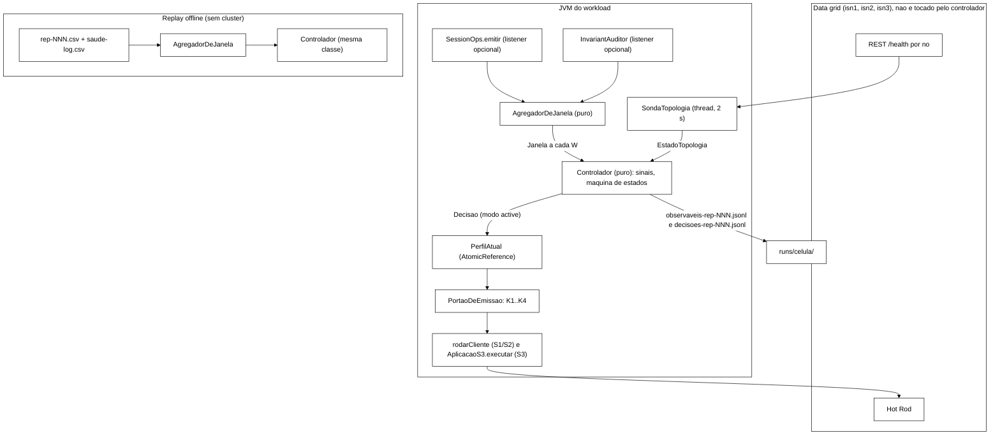
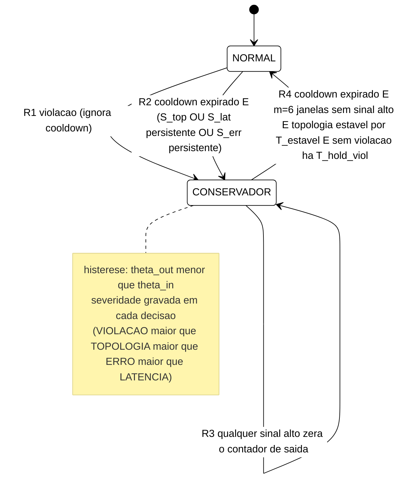
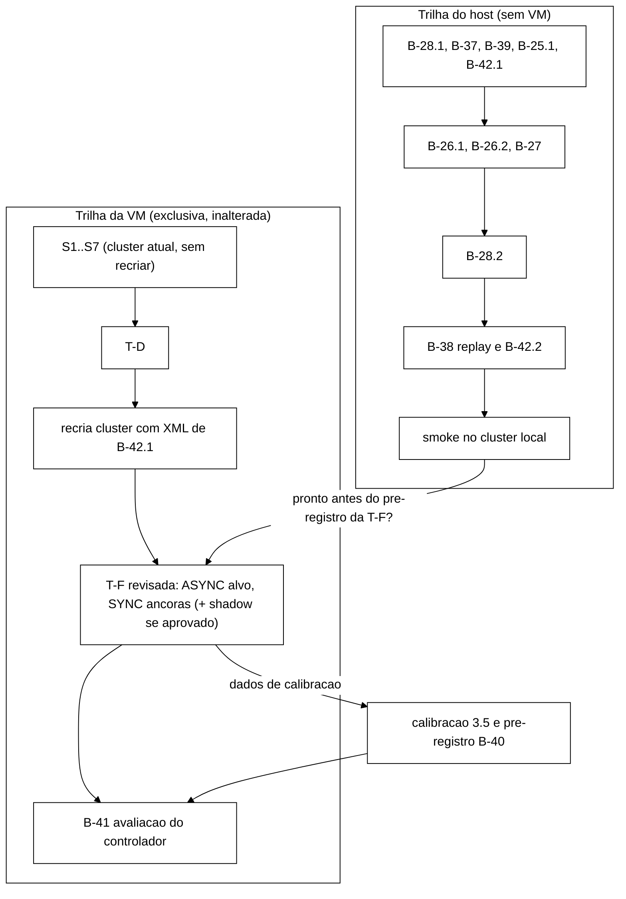

# Plano de implementação do controlador heurístico (B-25..B-28) e do perfil ASYNC (B-42)

> Elaborado pelo Senior em 2026-10-22. **Só planejamento**: nenhum arquivo de `workload/`,
> `scripts/`, `analysis/`, `cluster/` ou `spec/` foi alterado. Branch
> `docs/plano-implementacao-controlador`, criada de `feature/etapa-formal-integracao` (`6ba7e28`),
> worktree `../wt-plano-ctrl`. Substitui, para a implementação, as seções 5 e 6 de
> `docs/plano-controlador-heuristico-2026-09-24.md` (branch `docs/plano-controlador-heuristico`),
> que continua valendo como fundamentação (seções 3, 4 e 8). Commit local, sem push.
> Referências `caminho:linha` são da árvore de `feature/etapa-formal-integracao` em `6ba7e28`.

---

## 0. Decisões vinculantes que este plano aplica

| # | Decisão do Gestor (2026-10-22) | Consequência neste plano |
|---|---|---|
| G1 | O controlador começa agora, em paralelo à sequência de VM e à T-F. Revoga só para B-25..B-28 a trava de 15/10 (`docs/plano-fechamento-etapa-formal-2026-10-15.md:4`) | Todo o desenvolvimento roda sem VM (testes, *replay*, *cluster* local). A VM só entra na avaliação (seção 8) |
| G2 | Gatilho primário composto (p99 relativo ao *baseline*, taxa de `ERROR_TRANSPORT`/`ERROR_UNAVAILABLE`, topologia); violações como gatilho secundário de maior severidade | Seção 3.2 e 3.3 |
| G3 | Energia por *proxy* medido (CPU por *container*, eventualmente modelo de potência declarado) | Seção 5 |
| G4 | Restrição da seção 4 do plano de 24/09: só lado cliente | Seção 3.4 (cada *knob* é checado contra ela) |
| G5 | (achado do orquestrador, verificado nesta sessão) nenhum experimento rodou em `DIST_ASYNC`, que é o alvo do TCC | Seção 2 e bloco B-42. A avaliação do controlador é feita em ASYNC, com SYNC como referência |
| — | Limiares calibrados depois com dados da T-F; até lá, valores provisórios parametrizáveis | Seção 3.5; nenhum limiar é *hard-coded* |

---

## 1. Inventário verificado em disco

### 1.1 O que já existe e serve ao controlador

| Artefato | Caminho:linha | Serve como | Limitação para o controlador |
|---|---|---|---|
| Marcadores de falha e fases | `workload/.../Marcadores.java:71` (`ler`), `:137` (`faseDe`) | Rótulo de fase (`antes`, `durante`, `recuperacao`, ...) para **avaliação** por fase | O controlador **não** pode ler marcadores para decidir (seria informação privilegiada que um sistema real não tem). Uso só na análise |
| Coluna `phase` no CSV | `EventCsvWriter.java:45`, `:129` | Recorte por fase na análise | Gravação em lote ao fim da repetição (`flush`), não serve para observação ao vivo |
| Registro de evento | `EventCsvWriter.java:89` (`registrar`), chamado de `SessionOps.java:184` (`emitir`) | Ponto único por onde passa toda operação O1..O7 | Filtrado por *warm-up* (`politica.deveRegistrar()`); o controlador precisa de uma derivação própria |
| `LatencyRegistry` (HdrHistogram) | `LatencyRegistry.java:64`, `:81` | Agregado por operação | **`snapshot()` drena o intervalo** (`:81`) e é usado no resumo final (`WorkloadMain.java:181`). Se o controlador o chamar, o resumo em *stdout* fica errado. O controlador usa estrutura própria (achado A1) |
| `ERROR_UNAVAILABLE` × `ERROR_TRANSPORT` | `OpResult.java:27`, `:84`; `ClassificadorDeErro.java:62` | Sinal de erro com distinção recusa por partição × *timeout* (H-L7) | Pronto; marcas vindas de captura real (`ClassificadorDeErro.java` javadoc das marcas) |
| Auditor I1..I4 em linha | `SessionOps.java:215` (I1), `:219` (I4), `:277` (I2), `:347` (I3); `InvariantAuditor.java:56` | Gatilho secundário (violação) | Fila interna sem *listener*; I2 inclui violações `ESPERADA-POR-DESENHO` (bloqueio por limite, P-27), achado A3 |
| Classificação de I2 | `RastroCliente.java:207` (`classificarViolacaoI2`) | Separar I2 `REAL` de `ESPERADA-POR-DESENHO` em linha | `RastroCliente` só existe com `--marker` ou `--sweep` (`WorkloadMain.java:127`) |
| Convergência I5/I6 | `ConvergenciaLoop.java:101`; chamada em `WorkloadMain.java:169` **depois** da carga | Métrica de avaliação (`t_convergencia`, divergência persistente) | Não observável durante a carga (achado A2) |
| Saúde REST | `HealthRest.java:38` (`interpretar`), `:68` (`consultar`, via `curl --digest`) | Sinal de topologia (`number_of_nodes`, status por *cache*) | Uma URL só (`Cli.restUrl`); cada consulta cria um processo `curl` (custo de CPU a contabilizar); nomes `sessions`/`counters` fixos em `WorkloadMain.java:283-284` |
| Capturas reais de saúde | `workload/src/test/resources/captura-real/*.json` (4 arquivos, incluindo `rep3-isn3-degraded-1no.json`) | *Fixtures* para testes do sinal de topologia | — |
| Log de saúde a 2 s do gate | `runs/gate-b29/g1-rep3/saude-log.csv` (`t_epoch_ns,porta,http,status,size`) | *Replay* do sinal de topologia sob F2 real | Gate sem carga de *workload*, então não há eventos para cruzar |
| Parada por marcador | `ParadaPorMarcador.java:16`, `:33` | Padrão de *polling* barato (500 ms) reaproveitável | — |
| Laço de carga S1/S2 | `WorkloadMain.java:472` (`rodarCliente`), `:148` (pool fixo de `--threads`) | Ponto de inserção do portão de emissão (*knobs* K1, K2) | Laço fechado sem pausa; concorrência fixa na criação do pool |
| Aplicação S3 | `AplicacaoS3.java:46` (`executar`, retentativas e *backoff* em `:60`); `S3Simulacao.java:74`, `:84`, `:88` | Ponto único de todas as ações S3 (U, L, admin): inserção dos *knobs* K1..K4 | Parâmetros S3 lidos uma vez (`S3Parametros.java:37`, `:109`, `:113`) |
| Ação S3 colapsada | `AcaoS3.java:18` (`tentativas`, `falhaPercebida`) | Métricas de usuário e de retrabalho (retentativas) | Sem instante de fim: a latência percebida da ação precisa ser acrescentada (B-27) |
| Injetores F2/F4 com marcador | `scripts/inject-partition.sh:361`, `scripts/inject-netdegrade.sh:621` | Fases na avaliação | — |
| Pipeline estatístico | `analysis/bootstrap_ic.py:68`, `analysis/compare_scenarios.py:9` (Mann-Whitney) | Base para a análise pareada | Achado A8 |
| Dados brutos para *replay* | `tcc-desenvolvimento/runs/{S1,S2}-{none,F1}/rep-00{1,2,3}.csv` (fora do git, `.gitignore:20`) | *Replay* offline do núcleo de decisão | Achado A6 |

### 1.2 Achados que moldam o plano

- **A1. `LatencyRegistry.snapshot()` drena.** O observador do controlador recebe os eventos por
  um *listener* opcional em `SessionOps.emitir` (`SessionOps.java:173`) e mantém janelas próprias.
  Com o *listener* nulo o comportamento é idêntico ao atual (S1/S2 *golden*, `GoldenS1S2Test`).
- **A2. I5/I6 não são observáveis durante a carga.** A definição exige quiescência; a única
  rodada existente roda depois que a carga para (`WorkloadMain.java:161-174`). Uma auditoria
  periódica durante a carga marcaria divergência transitória normal como violação. Proposta: I5/I6
  ficam como **métrica de avaliação**, não como gatilho. Isso diverge da letra da decisão G2 e está
  na seção 10.
- **A3. I2 por limite é violação por desenho no S3** (P-27, `RastroCliente.java:216-219`). Se
  entrasse no gatilho, o controlador ficaria CONSERVADOR o tempo todo no S3. Regra: só I1, I4 e I2
  classificada `REAL` disparam. Sem `RastroCliente`, I2 fica fora do gatilho e isso é registrado
  no JSONL de decisões.
- **A4. F1 e F3 não gravam marcador e o log tem carimbo fixo.** `inject-crash.sh:32` captura
  `TIMESTAMP` uma vez; todas as linhas de `runs/S1-F1/inject-crash-rep001.log` têm `00:44:31Z`,
  inclusive a de `podman start` 50 s depois. Na rep-001 de S1-F1 o `podman start` **falhou**
  (`crun: cannot stat .../jgroups-tcp.xml`), então o nó não voltou nessa repetição. Corrigir é o
  resíduo de B-25 (B-25.1).
- **A5. F1 real teve zero erros.** Nas 6 repetições F1 brutas (S1 e S2), nenhuma linha com
  `ERROR_*` (contagem por `awk` sobre `return_code` nesta sessão). Sob F1 o sinal de erro é mudo;
  a detecção depende de latência e topologia. Isso justifica o gatilho composto.
- **A6. *Replay* tem base limitada.** Existem 12 CSVs brutos (S1/S2 × none/F1 × 3), cada um com
  66 s de janela de medição; o *crash* começa no primeiro segundo da janela (log 00:44:31Z, primeiro
  evento 00:44:32Z na rep-001), então não há fase `antes` dentro da repetição. Na S1-F1 rep-002 os
  `return_code` são só `NONE`, `COUNTED` e `BLOCKED` (nenhum `OK`/`VALID`): a mistura S1 antiga é
  degenerada (identidades bloqueadas por limite). Não existe CSV bruto de F3 em disco (só
  `summary.json`/`comparacao.json`). O *replay* serve para testar falso acionamento e atraso de
  detecção, não para estimar efeito.
- **A7. Execução em ASYNC nunca ocorreu.** Ver seção 2.
- **A8. O *bootstrap* atual trata eventos como independentes.** `bootstrap_ic.py:83-92` reamostra
  eventos de todas as repetições juntos. Eventos da mesma repetição são autocorrelacionados (mesma
  JVM, mesmo estado do *cluster*), o que estreita o IC artificialmente (pseudorreplicação). A
  unidade experimental tem de ser a repetição (seção 8.4).
- **A9. B-25 está coberto em parte por B-33.** B-33 E1 item 2 entregou leitura de marcadores,
  fases no CSV e nas violações (`plano-fechamento...:392`, "B-25, mínimo"); F2/F4 já gravam
  marcador. Falta F1/F3 (A4). Por isso B-25 vira B-25.1, pequeno.

---

## 2. Perfil ASYNC: o objeto de estudo nunca foi executado

### 2.1 Fatos verificados

| Fato | Evidência |
|---|---|
| O TCC define `DIST_ASYNC` como alvo e `DIST_SYNC` como controle | `tcc-escrita/Metodologia.tex:168` (linha T1: "DIST\_ASYNC (alvo) e DIST\_SYNC (controle) ... objeto de estudo é replicação assíncrona") |
| Os dois *caches* usados estão em SYNC | `cluster/infinispan-cluster.xml:22` (`sessions`, `mode="SYNC" owners="2"`), `:28` (`counters`, idem) |
| O *workload* abre nomes fixos | `SessionOps.java:94-95` e `:147-148` (`getCache("sessions")`, `getCache("counters")`); também `WorkloadMain.java:278`, `:283-284`, `:319-320`, `:381-382`, `:402-403` |
| O perfil ASYNC existe só numa branch remota nunca integrada | `origin/feature/cluster-async`, commit `2cc5e4e` (2026-05-26): acrescenta `sessions-async` em `mode="ASYNC"`, mantém `counters` em SYNC |
| A documentação do repositório ainda o trata como próximo passo | `docs/configuracao-infinispan.md:18`, `:101` (B-03 "próximo") |
| O modelo formal supõe canal assíncrono | `docs/relatorio-tlc-2026-07-09.md:282`, `:314` (`canal` = transporte assíncrono, "DIST/REPL ASYNC") |
| Divergência secundária | `Metodologia.tex` T4 fixa `numSegments=256`; o XML usa `segments="64"` (`infinispan-cluster.xml:22`, `:28`) |

Consequência: todo o *baseline* F1/F3 (Cap. 5, Tabela 5), os gates F2 e a hipótese H-L6
(`plano-fechamento...:528`, zero violações I1/I2/I4) se referem ao **controle** (SYNC). H-L6 tem
de ser reescrita como "H-L6 (SYNC)". O modelo TLA+ é, por construção, mais próximo do ASYNC do que
do sistema medido até aqui. Os agentes acadêmicos precisam saber disso antes de qualquer frase do
Cap. 4/5 ou do artigo que diga "replicação assíncrona" sobre esses dados (o Senior não edita
`tcc-escrita/`; vai para resumo em `docs/resumos-para-tcc/` depois da decisão do Gestor).

### 2.2 O que a documentação oficial do Infinispan 15 diz (lida nesta sessão)

Fonte: "Configuring Infinispan caches", Infinispan 15.0.x,
`https://infinispan.org/docs/15.0.x/titles/configuring/configuring.html`, obtida em 2026-10-22
(HTML com SHA-256 `e97575bf...6ca47ef`, cópia de trabalho no *scratchpad* do Senior, não
versionada). Trechos:

| Seção | O que afirma |
|---|---|
| 2.2 *Distributed caches*, "Synchronous or asynchronous replication" | "Asynchronous replication is not recommended because it can lose updates. In addition to losing updates, asynchronous distributed caches can also see a stale value when a thread writes to a key and then immediately reads the same key." |
| 2.1 *Replicated caches* | "Asynchronous replication performs replication in the background, and write operations return immediately. [...] errors that happen on remote nodes are not reported to the caller." |
| 2.4 *Asynchronous replication* | "the originator node does not receive any acknowledgement from the other nodes about the status of the operation" |
| 2.4.1 | com comunicação assíncrona o valor de retorno de `put`/`remove` pode estar incorreto |
| 7.1.1 *Data consistency in a split cluster* | escrita num nó da partição menor entre o *split* e sua detecção "is lost when Infinispan transfers state to that minor partition during the merge"; leituras desatualizadas são possíveis na partição menor antes de ela entrar em DEGRADED (o texto não restringe isso a um modo) |
| 7.2 | DEGRADED quando um segmento perde todos os donos **e** não há maioria (regra de topologia, sem menção a SYNC/ASYNC) |
| 7.3 | "Partition handling configuration applies only to replicated and distributed caches" (nenhuma exceção para ASYNC) |
| 7.4 / 7.5 | `DENY_READ_WRITES` permite operação só se todas as réplicas da entrada estão na partição; `PREFERRED_NON_NULL` usa o primeiro valor não nulo e "could restore deleted entries" |

**O que a documentação não diz, e portanto não se assume:**
1. Se `DENY_READ_WRITES` se comporta igual em ASYNC. A regra de DEGRADED é de topologia (7.2) e
   7.3 não exclui ASYNC, o que sugere que sim, mas isso é inferência, não afirmação da fonte.
2. **O que uma escrita Hot Rod confirma em ASYNC.** O guia do cliente Hot Rod 15.0.x
   (`.../titles/hotrod_java/hotrod_java.html`, baixado nesta sessão) não menciona replicação
   assíncrona. Pela seção 2.1/2.4 o servidor que recebe a escrita (dono primário, quando o cliente é
   *topology-aware*) responde sem esperar o dono de *backup*; com cliente `BASIC` pinado num nó que
   não é dono (S3, modo `pinned`), o caminho de encaminhamento ao dono e o momento da resposta não
   estão documentados. Tem de ser verificado no código-fonte (`infinispan-core` e
   `infinispan-server-hotrod` 15.0.21.Final, citando arquivo e linha, como foi feito em
   `docs/revisao-mecanismo-conflito-infinispan-2026-10-02.md`) **e** empiricamente (B-42.2).
3. Se `PREFERRED_NON_NULL` no *merge* atua sobre entradas cuja replicação assíncrona ainda estava
   em voo.

### 2.3 Hipóteses para ASYNC (a pré-registrar na T-F; expectativas, não resultados)

| ID | Hipótese | Mecanismo | Refuta-se por |
|---|---|---|---|
| H-A0 | Mesmo **sem falha**, violações de I1/I4 são possíveis no S3 `pinned` em ASYNC | leitura em nó não-dono pode ser atendida por um *backup* ainda sem a invalidação (doc 2.2, *stale read*) | zero violações em todas as repetições sem falha **com** limite superior abaixo de um valor fixado no pré-registro |
| H-A1 | Sob F2, I1/I2/I4 > 0 e mais frequentes que no SYNC | escrita assíncrona confirmada ao cliente e perdida no *merge* (doc 7.1.1, agravada por não haver *ack* do *backup*); é o mecanismo do contraexemplo TLA+ de I5/I6 | contagem ASYNC ≤ SYNC nas células F2 |
| H-A2 | Sob F4 (perda) e F3 (atraso), divergência I5/I6 pode ser **persistente** (não só atraso de convergência) | atualização assíncrona perdida não é reenviada (doc 2.2, "can lose updates") | todas as repetições convergem dentro do teto de 600 s |
| H-A3 | Sem falha e sob F3, p99 de escrita ASYNC < SYNC | escrita não espera o *backup* | p99 ASYNC ≥ SYNC |
| H-A4 | Sob F2, a minoria ainda recusa com `ERROR_UNAVAILABLE` (`DENY_READ_WRITES` independe do modo) | doc 7.2/7.3 | ausência de `ERROR_UNAVAILABLE` na minoria em ASYNC com presença em SYNC |
| H-L6 (SYNC) | inalterada, restrita ao SYNC | `plano-fechamento...:528` | idem |

Com H-A0..H-A2, o gatilho secundário por violação deixa de ser decorativo: em ASYNC ele tem chance
real de disparar, e "violações" passa a ser um desfecho em que o controlador pode mostrar efeito
(seção 8).

### 2.4 Como tornar ASYNC selecionável sem recompilar (B-42.1)

Recomendação: **caches irmãos no mesmo XML** (`sessions-async`, `counters-async`, mesmos
`owners`, `segments`, `partition-handling` e `merge-policy`), e uma opção
`--replication sync|async` no *workload* que só troca o sufixo dos nomes. O mesmo *cluster* serve
os dois braços; não há troca de descritor entre repetições.

| Alternativa | Prós | Contras |
|---|---|---|
| **A. Caches irmãos + flag (recomendada)** | sem reinício para trocar de modo; um descritor só; a branch `origin/feature/cluster-async` já seguiu essa linha | os quatro *caches* participam de toda partição (inofensivo: só dois recebem carga) |
| B. Descritor alternativo montado por variável | nomes iguais nos dois modos | troca exige recriar *cluster*; mais um arquivo a manter sincronizado |

Divergência com `2cc5e4e`: ali `counters` ficava SYNC "para isolar a hipótese" de `sessions`. O
alvo T1 é o modo de replicação do armazenamento como um todo; este plano propõe os dois *caches* em
ASYNC no perfil ASYNC, e deixa a escolha ao Gestor (seção 10).

Pontos a parametrizar (todos com teste): `SessionOps.java:94-95`, `:147-148`;
`WorkloadMain.java:278`, `:283-284` (nomes passados a `HealthRest.Estado.healthy`), `:319-320`,
`:381-382`, `:402-403`; `S3Clientes` (herda de `SessionOps`); `SondaHotrod` já aceita `--caches`
(`SondaHotrod.java:206`), só falta o *default* seguir o perfil; `scripts/run-baseline.sh` ganha
`--replication` e grava em `runs/<cenario>-<falha>-<sync|async>/`; `analysis/` não muda (o perfil
vai no nome do diretório e num `meta.json`).

**Restrição de ordem com a VM:** acrescentar *caches* ao XML exige recriar o *cluster* da VM. A S4
(REP=4B, `docs/decisoes-senior-2026-10-16.md` §5.5) exige o *cluster* **atual, com histórico**.
Portanto o XML novo só entra na VM **depois de S7**. Até lá B-42 é desenvolvido e testado no host
(*cluster* local rootless).

---

## 3. Revisão do desenho do controlador (seções 5.1-5.5 do plano de 24/09)

### 3.1 Arquitetura e mecanismo de comunicação

Recomendação: **núcleo de decisão puro, executado numa *thread* dentro da JVM do *workload*,
com JSON-lines como trilha de auditoria** (não como canal de controle).

Por que dentro da JVM e não processo externo com arquivo e *polling* (desenho de 24/09, §5.5):

1. O observável primário é por evento (centenas a milhares por segundo). Serializar isso para outro
   processo custa CPU, que é justamente uma métrica avaliada (seção 5).
2. Arquivo + *polling* introduz atraso e corrida de leitura parcial; dentro da JVM a troca de perfil
   é uma escrita atômica.
3. O mesmo núcleo, sem dependência de Infinispan, roda no *replay* sobre CSV. Ao vivo e offline usam
   o mesmo código, o que é condição para o *replay* valer como teste.
4. "Externo ao *data grid*" (texto do cronograma) continua verdadeiro: o controlador não roda no
   servidor nem usa API de servidor.

A separação de responsabilidades é garantida por pacote: `br.unipampa.tcc.controle` (núcleo) não
importa `org.infinispan` nem `br.unipampa.tcc.session`; um teste de arquitetura verifica isso
lendo os `import` das fontes. Se o Gestor preferir processo externo, só o adaptador muda.

Modos (`--controller off|shadow|active`, padrão `off`):

- `off`: nada novo é instanciado; saída byte a byte igual à atual.
- `shadow`: observa e decide, grava os JSONL, **não** altera o perfil (fica NORMAL). É o braço de
  *baseline* da avaliação (mesmo custo de observação nos dois braços) e serve para coletar
  comportamento de gatilho em execuções reais.
- `active`: idem, e aplica o perfil decidido.

### 3.2 Observáveis compostos: definição operacional

Janela: **W = 5 s, *tumbling*** (contígua, sem sobreposição), indexada por `end_ns` do evento.
Referência: arquivo `referencia-<cenario>-<sync|async>.json` com `p99_ref` por operação, gerado de
execuções **sem falha** do mesmo cenário e perfil (seção 6, B-39.1). Sem arquivo de referência o
modo `active` é recusado na validação da CLI.

| Sinal | Definição na janela j | Mínimo de amostra | Liga (entrada) | Desliga (saída) | Papel |
|---|---|---|---|---|---|
| `S_lat` (excedência de cauda) | `e_j = #{eventos com lat > p99_ref(op)} / #{eventos com op na referência}` | `n_lat ≥ 100` | `e_j ≥ θ_lat_in` em `k = 2` janelas seguidas | `e_j ≤ θ_lat_out` | primário |
| `S_err` | `(ERROR_TRANSPORT + ERROR_UNAVAILABLE) / total` | `total ≥ 50` | `≥ θ_err_in` em `k = 2` janelas seguidas | `≤ θ_err_out` | primário |
| `S_unav` (informativo) | fração de `ERROR_UNAVAILABLE` entre os erros | — | não decide sozinho; vai para o JSONL | — | distingue partição × perda (H-L7) |
| `S_top` | anômalo se algum nó: consulta REST falhou, `number_of_nodes < 3`, ou algum *cache* do perfil ≠ `HEALTHY` (`DEGRADED`, `HEALTHY_REBALANCING`, ...) | consulta a cada 2 s | 1 amostra anômala na janela | `T_estavel` sem nenhuma amostra anômala | primário |
| `S_viol` | `Δ(I1 + I4 + I2_REAL)` na janela | — | `> 0` | `T_hold_viol` desde a última | secundário, severidade alta |

Por que excedência e não "p99 da janela / p99 de referência": as duas coisas são equivalentes
(`p99_j > p99_ref` se e só se `e_j > 1 %`), mas a excedência agrega operações diferentes sem
normalizar cada uma, funciona com poucas amostras por operação e tem distribuição conhecida sob a
hipótese nula. Com `n = 100` e probabilidade 0,01 por evento, `P(X ≥ 5) ≈ 0,3 %` por janela; exigir
duas janelas seguidas reduz o falso acionamento a ordem de 10^-5 por par de janelas, **se** a
referência for do mesmo regime. Em produção a referência deriva, e é por isso que os limiares são
calibrados (seção 3.5). O p99 da janela por operação é gravado no JSONL para leitura humana.

Janela com amostra abaixo do mínimo: o sinal é **indeterminado** e conta como "não alto" na entrada
e "não impede" na saída. Risco conhecido: se o próprio perfil CONSERVADOR reduzir a carga abaixo
do mínimo, a saída fica dependente só de topologia e violação. O teste de núcleo cobre esse caso.

I5/I6: fora do gatilho (achado A2). Entram na avaliação (`convergencia-rep-NNN.csv`).

### 3.3 Combinação: máquina de estados com regras por sinal e severidade

Regras, avaliadas uma vez por janela fechada, na ordem:

- **R1 (secundário, severidade alta).** `S_viol` ligado → CONSERVADOR imediatamente, mesmo em
  *cooldown*; registra `ultimaViolacao = fim_j`. Racional: em segurança, reagir tarde custa mais do
  que oscilar uma vez.
- **R2 (primário).** Em NORMAL, com *cooldown* expirado: `S_top` anômalo na janela, ou `S_lat`
  alto em j e j-1, ou `S_err` alto em j e j-1 → CONSERVADOR. Topologia entra sem persistência
  porque já é um fato discreto e confirmado pelo servidor.
- **R3.** Em CONSERVADOR, qualquer sinal alto zera o contador de janelas calmas.
- **R4 (saída).** Volta a NORMAL só com todas: *cooldown* expirado; `m = 6` janelas calmas
  seguidas (30 s); nenhuma amostra de topologia anômala há `T_estavel`; `fim_j − ultimaViolacao ≥
  T_hold_viol`.
- Cada decisão grava: perfil, transição sim/não, conjunto de motivos, severidade máxima, valores de
  todos os sinais e os limiares em vigor.

O tempo do núcleo é o `fim_j` da janela, nunca o relógio de parede. Isso torna o núcleo
determinístico e testável sem *sleep*.

### 3.4 Perfis e *knobs* concretos

Dois perfis, como o texto do cronograma promete. A severidade não vira um terceiro perfil: vira
motivo e tempo de retenção (`T_hold_viol`). Um terceiro perfil (RESTRITO) dobraria o número de
condições a avaliar sem amostra para isso; fica como opção do Gestor (seção 10).

| *Knob* | Onde atua | NORMAL | CONSERVADOR (provisório) | Restrição §4 |
|---|---|---|---|---|
| K1 admissão: máximo de operações em voo | `PortaoDeEmissao` antes da chamada em `rodarCliente` e em `AplicacaoS3.executar` (semáforo redimensionável) | sem limite (`threads` ou nº de atores) | 50 % | só agenda o cliente |
| K2 ritmo | S1/S2: pausa entre operações; S3: multiplicador do tempo de pensar (`pensarMs`) | 0 ms; ×1,0 | 5 ms; ×1,5 | idem |
| K3 adiamento de escritas administrativas | S3: `Block`/`Unblock` do administrador e `IncrementFailure`/`ResetFailures` do pool L | executa já | adia até sair do CONSERVADOR ou até `T_adia_max = 30 s`, o que vier antes; **nunca descarta** | adia, não cria nem cancela operação |
| K4 *backoff* de retentativa (S3) | `AplicacaoS3.java:60` | base 500 ms, dobra | base ×2 com *jitter* uniforme ±50 %; **número de retentativas inalterado** | idem |
| K5 (opcional) desviar servidor de aplicação pinado de nó anômalo | `S3Clientes` | pinado | redireciona ao nó da maioria | não muta estado, mas muda o que o S3 expõe; decisão do Gestor |

Fora do espaço de ação, por violarem §4 ou exigirem reconstrução do cliente: *timeout* Hot Rod
(fixado na criação do `RemoteCacheManager`, `S3Clientes.java:72-73`), modo de replicação, qualquer
configuração do servidor, qualquer escrita feita pelo controlador.

K3 em S1/S2 não se aplica (não há `Block`); K1 e K2 são os únicos *knobs* em S1/S2. Toda ação de K3
gera linha no JSONL (adiada, liberada, motivo, espera).

### 3.5 Histerese, *cooldown* e valores provisórios

Todos lidos de `controlador-<nome>.json` (versão e SHA-256 do arquivo gravados no JSONL), nenhum
fixo no código:

| Parâmetro | Provisório | Origem |
|---|---|---|
| `W` | 5 s | plano de 24/09 |
| `n_lat`, `n_err` | 100, 50 | binomial acima |
| `θ_lat_in` / `θ_lat_out` | 0,05 / 0,02 | 5× e 2× a excedência esperada sem falha |
| `θ_err_in` / `θ_err_out` | 0,02 / 0,005 | sem dado de erro sob carga ainda (A5) |
| `k` (persistência) | 2 janelas | — |
| `m` (janelas calmas para sair) | 6 (30 s) | — |
| `T_cooldown` | 30 s | plano de 24/09 |
| `T_estavel` | 30 s | menor que o portão de 120 s da VM, que é para experimento, não para controle |
| `T_hold_viol` | 120 s | — |
| Período da sonda de topologia | 2 s | mesmo do log de saúde do gate |

**Regra de calibração (fixada antes de ver os dados).** Com os dados da T-F (*shadow* ou *replay*):
`θ_lat_in` = menor valor da grade {0,03; 0,05; 0,08; 0,12; 0,20} com **zero** entradas em todas as
repetições sem falha e atraso de detecção mediano ≤ 15 s nas células com falha; `θ_lat_out =
θ_lat_in / 2,5`; análogo para `θ_err`. Os dados de calibração **não** são reutilizados na avaliação
(execuções novas), para não medir o controlador nos dados com que foi ajustado.

### 3.6 Formatos gravados

`observaveis-rep-NNN.jsonl`, uma linha por janela:
`{"t_ini_ns","t_fim_ns","total","erros","unavailable","n_lat","exced","p99_ns":{op:..},"viol":{"I1","I4","I2_real","I2_esperada"},"top":{"amostras","anomalas","nos_min","status":{..}}}`

`decisoes-rep-NNN.jsonl`, uma linha por janela:
`{"t_fim_ns","modo","perfil","transicao","motivos":[..],"severidade","sinais":{..},"param_sha256"}`
mais linhas `{"tipo":"k3",...}` para cada adiamento.

`analysis/` ignora esses arquivos na contagem de execuções (padrão já usado para
`violacoes-rep-*.csv`, `analysis/README.md`).

---

## 4. Conformidade com a restrição §4

O controlador lê eventos que o próprio cliente gerou, contadores do auditor e a saúde REST
(leitura). Escreve só o perfil local. As ações K1..K4 escolhem **quando** o cliente emite uma
operação que ele já emitiria; nenhuma operação nova é criada, nenhuma é suprimida (K3 tem prazo
máximo), nenhum estado replicado é tocado e o servidor não é reconfigurado. No vocabulário do
plano de 24/09, isso é um subconjunto dos traços de `Next`. K5 é a única ação discutível e por isso
está fora do padrão.

---

## 5. *Proxy* de energia

### 5.1 O que coletar e com que cadência

| Fonte | Como | Cadência | Por quê |
|---|---|---|---|
| CPU de cada *container* Infinispan | cgroup v2 `cpu.stat` (`usage_usec`, acumulado) no caminho dado por `podman inspect --format '{{.State.CgroupPath}}'` | 1 s | contador do kernel, barato e exato; não depende de amostragem |
| Memória de cada *container* | `memory.current` do mesmo cgroup | 1 s | contexto (GC, *heap*) |
| CPU da JVM do *workload* (inclui o controlador) | `/proc/<pid>/stat` (`utime+stime`, em `CLK_TCK`) | 1 s | o custo do próprio controlador entra na conta |
| CPU total da VM | `/proc/stat` agregado, com `steal` separado | 1 s | teto e verificação de soma; `steal` mostra disputa com o host |
| Verificação cruzada | `podman stats --no-stream --format json` | 10 s | confere a leitura de cgroup; seu custo é medido e declarado |
| Custo do coletor | `/proc/<pid>/stat` do próprio coletor no fim | fim | honestidade sobre a sobrecarga de medir |
| Opcional, host Windows | `Enable-VMResourceMetering` + `Measure-VM` antes/depois da repetição | por repetição | visão de fora da VM (média de MHz); exige ação do Gestor como administrador |

Gravação: `runs/<celula>/recursos-rep-NNN.csv` com
`t_epoch_ns,fonte,cpu_usec_acum,mem_bytes,steal_ticks` e `recursos-meta-rep-NNN.json`
(caminhos de cgroup, nº de vCPU, `uname -r`, `CLK_TCK`, versão do coletor, modelo de potência
declarado). O relógio é o mesmo `t_epoch_ns` dos marcadores, então a CPU é recortada por fase.

### 5.2 Como reportar

Por repetição e por fase (`analysis/energia_proxy.py`, B-39.2):

- **Medido:** CPU-segundos por fonte; utilização `u = CPU-s / (Δt × nº vCPU)`;
  **CPU-segundos por 1000 operações bem-sucedidas** (S1/S2) e **por 1000 ações S3 sem falha
  percebida**; retrabalho = retentativas (`tentativas − 1` em `AcaoS3`) e operações com erro por
  ação útil. Esta é a métrica principal: é medida, não estimada.
- **Estimado, com modelo declarado:** modelo linear de utilização `P(u) = P_ocioso + (P_max −
  P_ocioso)·u`, prática comum em estimativa de potência de servidores (a referência bibliográfica
  fica a cargo do Bibliotecário; não é citada aqui sem conferência). `P_ocioso` e `P_max` vêm da
  especificação da CPU do host (dado do Gestor). Reporta-se energia estimada por operação em duas
  partes: **dinâmica** (proporcional a CPU-s, quase independente do modelo na razão entre braços) e
  **total** (inclui a parcela ociosa, que depende da duração e da vazão), com faixa de
  sensibilidade `P_ocioso/P_max ∈ {0,3; 0,5; 0,7}`.
- Conclusões só **relativas entre braços** (controlador ÷ *baseline*), nunca joules absolutos.

### 5.3 Limitações (vão escritas no relatório, não escondidas)

1. Sem RAPL na VM Hyper-V: nada aqui é medição de energia; é tempo de CPU convertido por modelo.
2. Tempo de vCPU ≠ trabalho do núcleo físico (SMT, frequência, *turbo*, escalonamento do host).
3. Energia de memória, disco, rede e da plataforma não é contada; a rede é virtual (os três nós e o
   *workload* estão na mesma VM de 4 vCPU), então "energia de rede" não existe neste ensaio.
4. Os quatro processos disputam 4 vCPU; reduzir carga (K1/K2) reduz CPU por definição. Por isso a
   métrica é **por operação útil**, e a vazão útil é desfecho com margem de não-inferioridade
   (seção 8.3). Um controlador que só derruba a vazão não "economiza energia".
5. `steal` alto numa repetição invalida a comparação de CPU daquela repetição (critério de exclusão
   pré-registrado: `steal > 5 %` do tempo).

---

## 6. Backlog ordenado

Numeração: B-25..B-28 mantêm o sentido do plano de 24/09 (marcadores, observáveis, *hook*,
controlador), com subdivisão; B-29..B-36 já estão usados; itens novos a partir de B-37; o perfil
ASYNC é B-42 (B-03 original, nunca integrado). Base de todas as branches:
`feature/etapa-formal-integracao` (`6ba7e28`). Integração local numa branch nova
`feature/controlador-integracao`, por `rebase` + `merge --ff-only`, na ordem da tabela.
Testes Java: JUnit 5 (`workload/pom.xml:56-58`); Python: `unittest`
(`python -m unittest discover -s analysis -p "test_*.py"`); *shell*: suítes `*.test.sh` com
*shims* (padrão de `inject-jitter.test.sh`). Contagem de referência: `mvn test` 275/0/0 na
integração (informado pelo orquestrador; cada Worker registra a sua contagem do Surefire antes de
começar). **Nenhum teste existente pode ser enfraquecido**; S1/S2 *golden* continuam idênticos com
`--controller off`.

| ID | Branch | Arquivos | Testes exigidos | Aceite | Depende de | Sem VM? |
|---|---|---|---|---|---|---|
| **B-28.1** núcleo de decisão puro | `feature/b28-1-nucleo-controlador` | `workload/src/main/java/br/unipampa/tcc/controle/{Janela,EstadoTopologia,Perfil,Motivo,Decisao,ParametrosControlador,Controlador}.java`; testes em `.../controle/` | tabelas de casos para R1..R4; histerese (sinal entre `θ_out` e `θ_in` não muda perfil); *cooldown*; persistência k; amostra insuficiente; violação ignora *cooldown*; sequência alternada não oscila mais que 1 vez por `T_cooldown`; propriedade com 1000 sequências aleatórias de semente fixa (transições espaçadas ≥ `T_cooldown`, exceto R1); leitura de parâmetros JSON com rejeição de valores inválidos (`θ_out ≥ θ_in`, negativos); teste de arquitetura (sem `import org.infinispan`/`br.unipampa.tcc.session` no pacote) | todos verdes; Surefire 275 + novos, 0 falha; determinismo (mesma entrada, mesma saída) | — | sim |
| **B-26.1** agregador e observador de janela | `feature/b26-1-observador-janela` | `controle/AgregadorDeJanela.java`, `controle/Referencia.java`; *listener* opcional em `SessionOps.emitir` e em `InvariantAuditor.registrarViolacao`; classificação I2 via `RastroCliente` | agregação por janela com relógio falso (fronteiras, evento na borda, janela vazia); excedência por operação; erros por código; violações separadas (`I2_real` × `I2_esperada`); *listener* nulo ⇒ CSV e violações byte a byte iguais (`GoldenS1S2Test` e um teste novo comparando arquivos); concorrência (N *threads* emitindo, total conservado) | idem; nenhuma mudança de domínio em `SessionOps` além da chamada ao *listener* | B-28.1 (tipo `Janela`) | sim |
| **B-26.2** sonda de topologia | `feature/b26-2-sonda-topologia` | `controle/SondaTopologia.java` (adaptador sobre `HealthRest`), URLs por nó derivadas de `--servers` | *fixtures* `captura-real/*.json` (HEALTHY 3 nós, DEGRADED 1 nó, REBALANCING); falha de consulta conta como anômalo; nomes de *cache* vêm do perfil (prepara B-42.1); *thread* encerra no `close` | idem; custo: no máximo 3 processos `curl` a cada 2 s, documentado | B-28.1 | sim |
| **B-27** portão de emissão e *knobs* | `feature/b27-portao-emissao` | `controle/PortaoDeEmissao.java`, `controle/PerfilAtual.java`; chamadas em `WorkloadMain.rodarCliente`, `AplicacaoS3.executar`, atores admin/L; instante de fim em `AcaoS3` (coluna nova `t_fim_ns`, opcional, ao fim do cabeçalho) | K1: semáforo reduz e aumenta permissões sem perder nem duplicar; K2 com relógio falso; K3: adia, libera na saída, libera no prazo, nunca descarta, ordem preservada por ator; K4: retentativas iguais, espera no intervalo; NORMAL ⇒ comportamento idêntico (`S3SimulacaoTest` determinístico inalterado); teste de contrato do novo CSV S3 em `analysis/` | idem; S1/S2 *golden* iguais | B-28.1 | sim |
| **B-28.2** integração na JVM | `feature/b28-2-integracao-controlador` | `Cli.java` (`--controller`, `--controller-config`, `--controller-reference`), `WorkloadMain.executarRepeticao`, `controle/LacoDeControle.java`, gravação dos JSONL | `--controller off` sem nenhum objeto novo; `shadow` nunca muda o perfil; `active` exige referência; JSONL válido linha a linha; `CliTest` estendido; teste ponta a ponta com `FakeCaches` (sinal de erro forçado ⇒ transição registrada) | idem; `--dry-run` mostra os parâmetros | B-26.1, B-26.2, B-27 | sim |
| **B-38** *replay* offline | `feature/b38-replay-controlador` | `controle/ReplayControlador.java` (lê `rep-NNN.csv`, opcionalmente `saude-log.csv` e marcadores; usa as mesmas classes de B-26.1/B-28.1); `analysis/replay_resumo.py` | *fixture* pequena com resultado conhecido; *replay* de um CSV produzido pelo próprio teste ponta a ponta reproduz as mesmas decisões que o modo `shadow` gravou (equivalência ao vivo × offline); leitura em *streaming* (não carregar 60 MB em memória) | rodado sobre os 12 CSVs locais: relatório com falsos acionamentos em `none` (com referência *leave-one-out*) e atraso de detecção em F1 relativo ao início da janela, com as ressalvas de A4/A6 | B-26.1, B-28.1 | sim |
| **B-37** coletor de recursos | `feature/b37-coletor-recursos` | `scripts/collect-resources.sh`, `scripts/collect-resources.test.sh` | *shims* para `podman inspect`, cgroup e `/proc` em diretório falso; cadência; formato CSV; encerra por sinal sem deixar processo; custo do coletor registrado | suíte verde em Git Bash e Linux; `--dry-run` | — | sim (smoke real no *cluster* local) |
| **B-39** análise | `feature/b39-analise-pareada` | `analysis/referencia_p99.py` (B-39.1, gera `referencia-*.json` com origem e SHA-256 dos CSVs), `analysis/energia_proxy.py` (B-39.2), `analysis/comparar_bracos.py` (B-39.3, seção 8.4) | `unittest` com dados sintéticos de efeito conhecido: IC cobre o efeito verdadeiro em ≥ 90 % de 200 simulações; permutação exata confere com enumeração manual para n = 4; regra de três; exclusão por `steal` | idem | — | sim |
| **B-25.1** marcadores F1/F3 | `fix/b25-1-marcadores-f1-f3` | `scripts/inject-crash.sh`, `scripts/inject-jitter.sh`, `scripts/inject-crash.test.sh` (novo) | linha `fault=F1 node=<no> event=start|end t_epoch_ns=<n>` legível por `Marcadores.parse` (teste Java com a saída real do *shim*); carimbo de log por linha (corrige `inject-crash.sh:32`); `podman start` com erro ⇒ código de saída ≠ 0 e marcador `end` não escrito | suítes verdes | — | sim |
| **B-42.1** perfil ASYNC selecionável | `feature/b42-1-perfil-async` | `cluster/infinispan-cluster.xml` (caches irmãos), `SessionOps`, `WorkloadMain`, `S3Clientes`, `SondaHotrod` (padrão de `--caches`), `Cli` (`--replication`), `docs/configuracao-infinispan.md` | TDD: nome do *cache* resolvido pelo perfil em todos os pontos de 2.4 (teste que falha se algum `getCache("sessions")` literal sobrar fora da resolução); `sync` ⇒ *golden* iguais; XML validado por teste que confere modo, `owners`, `segments`, `partition-handling` e `merge-policy` idênticos entre irmãos | idem; smoke no *cluster* local com os dois perfis | — | sim (VM só depois de S7) |
| **B-42.2** verificação ASYNC | `docs/verificacao-async-infinispan` | `docs/verificacao-async-infinispan-<data>.md`; teste empírico curto no *cluster* local (escrita via nó A, leitura imediata via nó B, em SYNC e ASYNC) | — | cada afirmação com fonte: documentação 15.0.x (seção) ou código-fonte 15.0.21 (arquivo:linha); resultado empírico com bruto em `runs/async-verificacao/` | B-42.1 (para o empírico) | sim |
| **B-42.3** `run-baseline.sh --replication` | `feature/b42-3-baseline-replicacao` | `scripts/run-baseline.sh`, teste de `--dry-run` por ramo | diretório `runs/<cen>-<falha>-<perfil>/`; `meta.json` com perfil | `--dry-run` de todos os ramos | B-42.1 e **T-D** (mesmo arquivo; entra depois) | sim, exceto o smoke |
| **B-40** pré-registro e smoke | `test/b40-smoke-controlador` | `docs/preregistro-avaliacao-controlador-<data>.md`; smoke local (1 repetição curta por modo) | — | pré-registro commitado **antes** de qualquer execução da avaliação | todos acima; calibração (3.5) | local sim; smoke VM curto não |
| **B-41** avaliação | `test/b41-avaliacao-controlador` | `runs/ctrl-*`, `docs/relatorio-b41-<data>.md` | — | seção 8 | B-40, T-F concluída | **não** |

Paralelismo: B-28.1, B-37, B-39, B-25.1 e B-42.1 começam juntos (arquivos disjuntos). B-26.1,
B-26.2 e B-27 começam assim que B-28.1 publica os tipos (podem partir da branch de B-28.1).
B-27 e B-28.2 tocam `WorkloadMain` e são sequenciais. B-26.1 e B-42.1 tocam `SessionOps` em
pontos diferentes; integrar B-42.1 primeiro.

---

## 7. Encaixe com a sequência de VM

Regras de convivência:

1. Nenhuma tarefa do controlador usa a VM antes de B-41 (e do smoke curto de B-40, que só entra
   num intervalo liberado pelo Gestor).
2. **A regra da seção 5.1 de `decisoes-senior-2026-10-16.md` vale para estes Workers:** nada de
   `mvn test`, *replay* pesado ou TLC no host durante uma janela de injeção na VM e nos 5 min antes
   e depois. O orquestrador avisa as janelas; os Workers do controlador pausam.
3. O XML com *caches* ASYNC só vai à VM depois de S7 (seção 2.4).
4. A T-F ainda não tem pré-registro commitado; a matriz é revista (seção 8.1) antes dele.

---

## 8. Avaliação

### 8.1 Rebaseline em ASYNC e matriz da T-F revisada (B-42 → T-F)

Custos usam a estimativa da T-F (`plano-fechamento...` §8.1: 12 a 20 min por execução, incluindo
convergência) e, para S1/S2, a duração das execuções de junho (1,5 a 3 min por repetição, pelos carimbos de `runs/S1-F1/inject-crash-rep00{1,2,3}.log`).

| Bloco | Conteúdo | Execuções | Horas de máquina |
|---|---|---|---|
| Rebaseline S1/S2 ASYNC | {S1, S2} × {none, F1, F3} × 3 rep, para pôr ao lado da Tabela 5 (SYNC) | 18 | ≈ 1 a 1,5 |
| T-F ASYNC, matriz cheia | 27 células × 3 rep (S3) | 81 | ≈ 16 a 27 |
| T-F SYNC, só âncoras | R0 (3 células) + P `isn3` 90 s + L N3 + L N5 + LA saída 20 % = 7 células × 3 | 21 | ≈ 4 a 7 |
| **Total T-F revisada** | | **120** | **≈ 21 a 35** (contra 16 a 27 da T-F original só em SYNC) |

Corte alternativo, se o tempo apertar: ASYNC sem LC, X e M (−4 células, −12 execuções, −2,5 a
−4 h). As âncoras SYNC não devem ser cortadas: sem elas não há controle para H-A1..H-A4.

### 8.2 Desenho mínimo baseline × controlador (B-41, **em ASYNC**, SYNC como referência)

- **Braços:** A = `--controller shadow`; B = `--controller active`. Mesmo código e mesmo custo de
  observação; só a atuação muda.
- **Células (ASYNC, S3):** C0 sem falha (sobrecarga e falso acionamento); C1 F2 `isn3` 90 s;
  C2 perda N3 20 % (ou a severidade que a T-C2/T-F fixar); C3 F1 queda `isn2`.
  **Referência SYNC:** C1 e C2 com 4 blocos (sem pretensão de teste; só para dizer se o efeito do
  controlador depende do modo).
- **Blocos pareados:** cada bloco = uma execução A e uma B na mesma célula, mesma semente de carga,
  ordem dentro do bloco sorteada (semente registrada), reinício limpo do *cluster* entre execuções
  (portão de estabilidade de §5.1 das decisões de 16/10).
- **Tamanho:** piloto de 3 blocos por célula (estima a variabilidade do p99 por execução); alvo de
  **8 blocos por célula ASYNC**. Com 8 pares o teste de permutação exato por troca de sinal tem
  2^8 = 256 arranjos e p bilateral mínimo de 2/256 ≈ 0,008; com 6 pares o mínimo é 2/64 ≈ 0,031, o
  que deixa sem margem a correção para múltiplos desfechos.
- **Custo:** ASYNC 4 × 8 × 2 = 64 execuções; SYNC 2 × 4 × 2 = 16; piloto incluído nos blocos
  (os 3 primeiros contam se o protocolo não mudar). ≈ 80 execuções × 12 a 20 min ≈ **16 a 27 h**.
  Corte possível: C3 com 4 blocos (−8 execuções).

### 8.3 Desfechos (pré-registrados em B-40)

| Tipo | Desfecho | Unidade |
|---|---|---|
| **Primário** (um por célula) | p99 da latência percebida da ação S3 (inclui retentativas; `t_fim_ns − t_ns` de `AcaoS3`) nas fases `durante` + `recuperacao` | por execução |
| Secundário | p99 por operação (eventos), taxa de erro, falhas percebidas por 1000 ações, violações I1/I2_real/I4 por fase, `t_convergencia` e divergência persistente (I5/I6), CPU-s por 1000 ações úteis, energia estimada (dinâmica e total), retrabalho | por execução |
| Não-inferioridade | vazão útil (ações S3 sem falha percebida por segundo) do braço B ≥ (1 − δ) × braço A, δ proposto = 10 % | por execução |
| Comportamento do controlador | nº de transições, tempo em CONSERVADOR, atraso de entrada relativo ao marcador `start` e a `t_split`, entradas em C0 (falso acionamento), adiamentos K3 e espera média | por execução |
| Controle negativo | p99 na fase `antes`: deve ser igual nos dois braços (só observação ligada) | por execução |

### 8.4 Estatística: por que não Mann-Whitney e o que usar

O revisor tem razão. Mann-Whitney testa se uma amostra tende a ser maior que a outra em toda a
distribuição; com 10^5 a 10^6 eventos por grupo ele dá "significativo" para diferenças de corpo
irrelevantes e pode não ver uma diferença só na cauda. Além disso, aplicado a eventos, ele trata
como independentes observações da mesma execução (A8). O p99 é uma estatística por execução, e a
execução é a unidade experimental.

Procedimento (implementado em `analysis/comparar_bracos.py`, B-39.3):

1. Por execução e fase, calcular o p99 (método `lower`, igual ao `bootstrap_ic.py`).
2. Por bloco, `d_b = ln(p99_B / p99_A)`.
3. Estimativa: média de `d_b`, reportada como razão `exp(média)`.
4. IC 95 %: *bootstrap* percentil sobre **blocos** (10 000 reamostragens), e, como sensibilidade,
   *bootstrap* hierárquico (reamostra blocos e, dentro de cada execução, eventos) e intervalo t
   sobre `d_b`. Com n = 8 os três têm de contar a mesma história; se não contarem, isso é relatado.
5. Teste: permutação exata por troca de sinal sobre `d_b` (desfecho primário, α = 0,05 por célula).
6. Secundários: mesmo procedimento, correção de Holm dentro da célula.
7. Violações: contagens por braço; com zero, "não observado em N ações; limite superior 95 % ≈ 3/N"
   (regra de três), nunca "não ocorre". Em ASYNC, se houver violações nos dois braços, razão de
   taxas com IC por *bootstrap* de blocos.
8. Não-inferioridade da vazão útil: limite inferior do IC 95 % da razão B/A ≥ 1 − δ.

Ameaças registradas no pré-registro: deriva da VM (mitigada por blocos e ordem sorteada),
contaminação por histórico do *cluster* (reinício limpo), calibração e avaliação com dados
diferentes, `steal` (exclusão > 5 %), o controlador reduzir carga e com isso "melhorar" a cauda
(controlada pela não-inferioridade e pelas métricas por ação útil).

---

## 9. Critérios de aceite deste plano

1. Inventário com `caminho:linha` conferido em `6ba7e28` (seção 1).
2. Achado ASYNC verificado com evidência e trechos da documentação oficial com seção e data
   (seção 2); o que a fonte não diz está marcado como não assumido.
3. Cada observável com definição, janela, normalização, amostra mínima e limiares parametrizáveis
   (3.2, 3.5); regras de combinação determinísticas (3.3).
4. Cada *knob* checado contra a restrição §4 (3.4, 4).
5. *Proxy* de energia com fonte, cadência, arquivo, métrica e limitações (5).
6. *Backlog* com branch, arquivos, testes, aceite, dependência e necessidade de VM (6).
7. Desenho de avaliação com unidade experimental, pareamento, tamanho, desfechos e teste adequado
   para percentil (8).
8. Nenhum uso da VM antes de B-41/B-40 e ordem com S4/S7 respeitada (7).

---

## 10. Pontos que precisam de validação do Gestor

1. **ASYNC como objeto de estudo daqui em diante:** aceitar a revisão da T-F (ASYNC matriz cheia,
   SYNC só âncoras, ≈ 21 a 35 h) e a avaliação do controlador em ASYNC. Decidir se `counters`
   também fica ASYNC no perfil ASYNC (recomendado) ou só `sessions` (como em `2cc5e4e`). Autorizar
   o aviso aos agentes acadêmicos de que o *baseline* atual é SYNC (controle).
2. **I5/I6 fora do gatilho** (não observáveis durante a carga, A2); ficam como desfecho. Gatilho
   secundário = I1, I4 e I2 `REAL`.
3. **Controlador dentro da JVM do *workload*** com JSONL só como trilha, em vez do processo externo
   com arquivo do plano de 24/09.
4. **Dois perfis** (recomendado) ou um terceiro RESTRITO.
5. **K5** (desviar servidor de aplicação pinado de nó anômalo): fora (recomendado) ou dentro.
6. **Modo *shadow* na campanha da T-F**, se estiver pronto antes do pré-registro dela: dá dado de
   calibração sem VM extra, mas muda o *bundle* e o custo de CPU da T-F.
7. **Orçamento e margens da avaliação:** 4 células ASYNC × 8 blocos + referência SYNC (≈ 16 a
   27 h); δ = 10 % de não-inferioridade da vazão útil.
8. **Modelo de potência:** informar a CPU do host (para `P_ocioso`/`P_max`) e se autoriza
   `Enable-VMResourceMetering` no Hyper-V.

---

## 11. Próxima tarefa para o Worker

B-28.1 (núcleo de decisão puro): não depende de nada, destrava B-26.x, B-27 e B-38, e não toca
nenhum arquivo existente. O prompt completo está no relatório de entrega do Senior.
