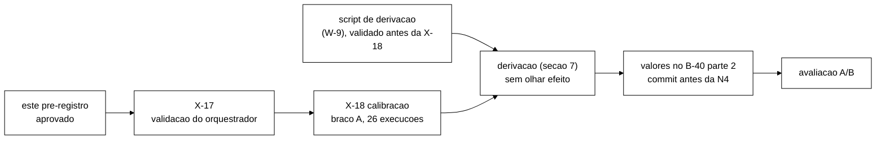

# Pré-registro da calibração do controlador na campanha S3: APROVADO (2026-11-05)

> Senior, 2026-11-05, escrito com o *host* em silêncio (segmento 2 da noite 1 do *rebaseline* na VM): só leitura e
> escrita de documentos, nenhum teste, Maven ou Podman. Branch `docs/pre-registro-calibracao-s3` (worktree
> `wt-prc-s3`, base `afd9cf5`). **Aprovado** pelo coordenador em nome do Gestor em 2026-11-05 (decisões finais de
> ~22:30Z; os demais itens pela regra permanente do Gestor, só os que têm origem rastreável, seção 10) e registrado como
> **DT-020 (PRÉ-REGISTRO)** em `docs/decisoes-tecnicas.md`. Pela regra do cabeçalho daquele arquivo, nada daqui muda
> depois de ver dados da calibração, e uma mudança vira entrada nova. Sem push.
>
> Autorizado pelo coordenador em nome do Gestor na resposta à V-W6 (`wt-w6/docs/validacao-w6-2026-11-05.md`, item 5).
> O B-40 parte 1 (avaliação) está à parte, em `docs/b40-pre-registro-avaliacao` (DT-021), e usa as regras de derivação da
> seção 7 daqui.

> **Nota de remissão (2026-11-05, ~23:00Z, antes de qualquer dado da calibração):** as leituras das regras da seção 7
> estão fixadas no **complemento 1** (`docs/pre-registro-calibracao-s3-complemento-1-2026-11-05.md`, DT-022): θ_out e
> `lag_out` pelo menor valor (A-3), m sem θ_out (A-4, A-5), grade do W derivado e W_min estrito (A-1, A-17), regra de
> reserva de W para o AC-5 caber em 39,8 s, e as demais leituras do W-9. Onde divergirem, vale o complemento. O texto
> abaixo não foi editado.
>
> **Nota de remissão (2026-11-05):** o efeito da regra de memória da §5 está no **complemento 2**
> (`docs/pre-registro-calibracao-s3-complemento-2-2026-11-05.md`, DT-023): recriar e rodar com o mesmo i e a mesma
> semente, sem parar a fase.

## Siglas

| Sigla | Significado |
|---|---|
| braço A | controlador em `shadow`: decide e registra, nunca chama a API |
| braço B | controlador em `active` (não roda na calibração) |
| P0, P1, P2 | política de reação: nenhuma ação; parar o nó suspeito (AC-5); suspender o rebalanceamento (AC-2, fora) |
| S_lag | sonda de defasagem: escreve num `canario*` por um nó e lê pelos outros dois (W-4) |
| W | janela do controlador, em segundos |
| T_det | tempo entre o corte da rede e a vista nova do JGroups |
| h4 | execução com travamento de I/O ou pausa da VM (complemento 3 do pré-registro do *rebaseline*, "C3") |
| D-12 | decisão "calibração derivada": todo parâmetro do controlador sai de regra escrita aplicada aos dados da calibração |
| IU | regra de interseção-união (Berger, 1982) |

## 0. Decisões que este documento aplica

| Decisão | Fonte | Onde |
|---|---|---|
| Desfechos co-principais: taxa de violações (I1 + I4 + I2 real, por mil ações S3) e p99 da ação S3 | G-1, `plano-alinhamento-objetivos-2026-11-04.md` §0.2 e §3.1 | o que a calibração precisa estimar (seção 6) |
| Interseção-união | D-1, plano de 04/11 §0 | só no B-40; aqui entra o q̂ que o poder usa |
| Calibração derivada | D-12, plano de 04/11 §0; regras do plano de alinhamento §3.3-3.6 | seção 7 |
| Braço único B com o controlador completo; P1 = AC-5; P2 fora (`p2Habilitada = false`) | coordenador em nome do Gestor (05/11); D-B (05/11); `opcoes-arquitetura-configuracao-2026-11-05.md` §9.1 | arquivo do controlador (seção 4.2); o orquestrador recusa `p2Habilitada ≠ false` |
| `kLag` ≤ 5, pela viabilidade `kLag·W + 13,3 s < 39,8 s` | P-42 (`t_parada` = 13,3 s, I-3 do B-44.2); menor T_det da VM, 39,8 s (`wt-gate-v4/runs/vm-s7-2026-11-04/V-S7r.md:45`) | regra 7.4 |
| W ≥ teto da leitura + maior atraso de início | R4 da V-W4 (`validacao-w4-2026-11-05.md:213`) | regra 7.3 |
| Energia: razão ociosa 0,3 central e 0,5 de sensibilidade | decisão do Gestor de 05/11; Barroso e Hölzle (2007), p. 36 e 34; P_max 181 W (ficha do i5-14600KF) | só no B-40; a calibração coleta CPU (seção 6) |
| Religamento depois do fim da carga, com `convergencia_estado` | coordenador, 05/11, depois do I-3b; W-6 | sem efeito no braço A (nenhum AC-5 executado) |
| h4 do C3, com a regra de memória da noite 1 | C3; DT-018; DT-019; G-3 de `validacao-noite1-2026-11-05.md:647` (aprovada pelo Gestor em 05/11; origem medida do 1 GiB na seção 5) | seção 5 |
| Célula SYNC F2 com a limitação declarada (R3) | `wt-w4/docs/relatorio-w4-2026-11-05.md:203` | seção 3 |
| Regra dos números | R-N, plano de alinhamento §0.2 | todo número abaixo cita a origem |
| h4 do S3 com `--id diag-<UTC>`, sem mexer no amostrador | P-47 da V-W6, decisão de 05/11 | seção 5 |

## 1. Objeto

A calibração é uma campanha S3 só com o braço A. Ela serve para medir, com o mesmo jar, o mesmo XML e os mesmos JSON
de *cache* da avaliação, as grandezas de que as regras da seção 7 precisam: distribuições sem falha dos sinais
(latência, erro, defasagem), vazão de eventos, duração das oscilações depois da falha, retorno a HEALTHY, intervalo
entre violações, maior Δ_conv, q̂ por célula (para o poder) e o tempo real e o volume de cada execução. **Nenhum dado
da calibração entra na avaliação** (D-12; plano de alinhamento §3.6, última frase).

## 2. Onde e com quê

| Item | Valor | Origem |
|---|---|---|
| Máquina | VM `tcc-f3`, *cluster rootful* de 3 nós Infinispan 15.0.21 | roteiro da VM de 04/11 |
| Configuração do *cluster* | `cluster/infinispan-sem-caches.xml` + `cluster/podman-compose-sem-caches.yml`; os seis *caches* (`sessions`, `counters`, `sessions-async`, `counters-async`, `canario`, `canario-async`) criados pela REST a partir de `cluster/caches/*.json` antes de **cada** execução | decisão D-G e §6 de `acoes-controlador-cluster-2026-11-05.md`; TD-015 do W-6 |
| Mudança de infraestrutura a declarar | o *rebaseline* usou *caches* no XML; aqui são criados pela REST. A configuração é a mesma, com `remote-timeout` = 17 500 explícito nos SYNC, o valor efetivo do XML antigo (B-44.1 §5) | `acoes-controlador-cluster-2026-11-05.md` §6, itens 2 e 9 |
| Orquestrador | `scripts/run-campanha-s3.sh` da ponta integrada **depois** do *merge* do W-2b e do W-6 com o I-1. O W-6b já está feito (`bef758e`, relatório `6f366ac`, V-W6b `081e1c4`) e inclui a correção B2 (referência por perfil) | V-W6; V-W6b |
| Jar, matriz, parâmetros, controlador e as **duas** referências de p99 | SHA-256 de cada um registrado antes do X-18; as referências vão por `--referencia-async` e `--referencia-sync`, cada uma com o seu SHA-256 | regra do *bundle* do W-6 (retomada recusa *bundle* mudado); B2 do W-6b (V-W6b §6) |
| Perfil do *host* | H1 se o M-0 aprovar, senão H0 | `plano-execucao-continua-2026-11-04.md` §2 e §3.1 (X-18) |
| GO | `go calibracao <AAAA-MM-DD>` por *tty*; `go rede <i>` antes da primeira F2/F4, mantido pelo menos até o X-17 e depois conforme decisão do Gestor | decisão 6 de 05/11 |

## 3. Células e tamanhos

| Célula | Execuções | Por quê | Origem |
|---|---|---|---|
| ASYNC sem falha | 5 | distribuições sem falha de latência, erro e defasagem (θ, `lag_in`, `kLag`), vazão (W), p99 de referência ASYNC | plano de 04/11 §5.1 |
| ASYNC F1 (`isn2`) | 5 | oscilação depois da queda (m), `T_estavel` e **controle negativo do P1**: com a condição da política (regra 7.13), o P1 não pode aparecer enquanto o `isn2` está morto. No B-40 a F1 é descritiva (decisão do Gestor, 05/11), então não precisa de q̂ | plano §5.1; decisão de 05/11 |
| ASYNC F2 (`isn3` isolado) | 5 | P1 previsto (`acao` PREVISTA), q̂, `T_hold_viol`, maior Δ_conv | plano §5.1 |
| SYNC F2 | 3 | comportamento do P1 em SYNC (R3, limitação declarada), q̂ da célula de referência | plano §5.1; R3 |
| **SYNC sem falha** | **3** | **p99 de referência SYNC**, sem o qual o braço B das células SYNC não roda | **nova (Senior)**: o programa recusa referência de outro perfil (`LigacaoControlador.java:204`), e o `referencia_p99.py` exige n ≥ 1000 por operação (decisão D2 de 27/10). Nenhuma outra célula da calibração dá eventos SYNC sem falha |
| ASYNC F4 (`isn3`, perda 20 %) | 5 | q̂, P1 previsto sob perda, oscilações | plano §5.1 (intermediário e completo); S5 aprovado |
| **Total** | **26** | | plano §5.1 (26 no intermediário), com SYNC sem falha × 3 no lugar de SYNC F1 × 3 |

**SYNC F1 sai da calibração.** No plano ela dava o q̂ de uma célula de referência SYNC F1 da avaliação. O desenho do
B-40 segue o da `Metodologia.tex:347` (células SYNC de referência: F2 e F4), sem SYNC F1, e célula de referência não
tem teste, então não precisa de q̂. A SYNC F2 × 3 fica, porque mede o R3.

**F3 fica fora da calibração (C-1, aprovado).** A célula ASYNC F3 do B-40 é descritiva e mede
falso alarme: quantas vezes a defasagem passa do limiar e quantas vezes o AC-5 para o `isn2` sem necessidade. Os
limiares que ela testa (`lag_in`, θ, `kLag`) saem só de execuções sem falha e sem partição (seção 7). Rodar F3 na
calibração não alimentaria nenhuma regra. Só daria a chance de olhar a distribuição de S_lag sob *jitter* antes de
fixar os limiares, que é exatamente o que torna a medida de falso alarme da avaliação enviesada. O custo evitado é
pequeno (3 execuções, cerca de 25 min de VM pela estimativa da seção 8), e a medida de especificidade fica limpa.
A alternativa (ASYNC F3 × 3 no braço A, com a regra de que nada dela entra em derivação) foi considerada e não é
recomendada, porque a garantia dependeria de disciplina, não de desenho.

**Matriz.** `scripts/campanha_s3_matriz.py gerar --modo calibracao` com as células acima, `--ordem-seed 20261105`,
`--s0 300000`, `--passo-semente 100`, `--i0 0`.

| Número | Valor | Origem |
|---|---|---|
| `--ordem-seed` | 20261105 | regra: a data deste pré-registro em AAAAMMDD, declarada antes de qualquer dado |
| `--s0`, `--passo-semente` | 300 000 e 100 | faixa disjunta da do *rebaseline* (S0 = 50 000, passo 100, `run-rebaseline.sh:49`; o maior índice usado é o do piloto, i = 1011, semente 151 100) e da avaliação (400 000, B-40); o passo é o do *rebaseline* (PR §4) |
| `--i0` | 0 | primeiro índice do diretório de saída próprio `runs/campanha-s3-calibracao/` |

## 4. Parâmetros fixos

### 4.1 Arquivo `campanha-s3/1`

| Parâmetro | Valor | Origem | Situação |
|---|---|---|---|
| `duracao_s` | 300 | PR do *rebaseline* §2 (`run-rebaseline.sh:48`) | fixo |
| `warmup_min_s` | 30 | PR §2 | fixo |
| `inj_offset_s` | 49 | DT-011 (+49 s da âncora, depois do início da medição em +44 s) | fixo |
| `f1_no`, `f1_dur_s` | `isn2`, 60 | PR §2 (T17) | fixo |
| `f2_no`, `f2_dur_s` | `isn3`, 90 | plano §5.2; padrão do `inject-partition.sh` (B-29) | fixo |
| `f4_no` | `isn3` | alvo do S5 validado (`wt-gate-v4/runs/gate-netdegrade/l1.sh:7`) | aprovado (C-3) |
| `f4_severidade` | N3 (perda de 20 %) | plano §5.2; S5 usou `--loss 20`, que é o N3 (`inject-netdegrade.sh:291`) | fixo |
| `f4_direcao` | `out` | direção do S5 validado (`04-l1.log`: "direcao out"; `both` só no *dry-run* do L-0) | aprovado (C-3) |
| `f4_dur_s` | 90 | igual ao `f2_dur_s`, para F2 e F4 terem a mesma exposição; acima do aviso do injetor (45 s) e da verificação por *ping* (200 × 0,2 s = 40 s, `inject-netdegrade.sh:71-72`) | aprovado (C-3) |
| `hotrod_timeout_ms` | 2000 | `S3Parametros.java:117`; igual a `tetoLagMs` (R7 da V-W2a) | fixo |
| `convergencia_teto_s` | 600 | **limite de censura, não decide desfecho**: a execução que bate no teto é reportada como "não convergiu em 600 s" (censurada), nunca descartada nem imputada. Origem por medição: a fusão do MERGE3 cai em até ~96 s depois da cura (B-44.3: 20 de 21 fusões medidas a ≤ 12 ms de 48 s ou 96 s depois da última troca de vista do líder; `opcoes-arquitetura-configuracao-2026-11-05.md` §9.5, `wt-b44-3/docs/b44-3-ac6-jgroups.md`, `d73b01d`), e o maior Δ_conv medido no projeto é 35,3 s (I-3b `ativo-religar`). 600 s ≥ 6 × 96 s, o que torna improvável censurar uma fusão normal, e cabe no `exec_teto_s` de 1010 s. Na avaliação, o teto sai da regra 7.10 | aprovado (fechamento de 05/11) |
| `convergencia_periodo_s` | 5 | **derivação: igual a W**, a mesma grade das janelas do controlador, de modo que cada janela tem no máximo uma amostra de convergência; 5 s = o W provisório da calibração (`wNs` de `controlador-calibracao-s3.json`). Na avaliação, acompanha o W da regra 7.3 (parte 2 do B-40) | aprovado (fechamento de 05/11) |
| `w_recovery_s` | 191 | derivação: cobre do fim da falha ao fim da carga em toda célula com falha da calibração (300 − 49 − 60, o F1 é a falha mais curta) e passa dos ~96 s da janela de fusão do MERGE3 depois da cura (`opcoes-arquitetura-configuracao-2026-11-05.md` §9.5) | aprovado (C-4) |
| `religamento_prazo_s` | 60 | `T_reb` (`acoes-controlador-cluster-2026-11-05.md` §5.1); no I-3b o nó voltou em 4,5 s | fixo |
| `exec_teto_s` | 1010 | derivação abaixo, corrigida pela R2 da V-W6b | aprovado (C-6) |
| `encerramento_folga_s` | 2 | `T_cham` = 2 s (B-26.2; ações §5.1): uma chamada REST a mais além do `T_enc` | aprovado (C-5) |
| `volume_exec_mb` | 14 | maior volume por execução no I-3b com o stderr descomprimido (13,6 MB, `wt-w4/runs/i3b/ativo-religar`); o X-17 mede de novo e vale o maior | aprovado (C-7) |

**`exec_teto_s` (derivação).** O processo vive o tempo até a âncora, a carga, o `T_enc` antes da linha `Fim da
carga:`, a espera do religamento, o laço de convergência (que confere o teto depois de dormir um período, então
pode passar dele em até `convergencia_periodo_s`) e o fim (leitura final e gravação). Então
`exec_teto_s = duracao_s + T_enc + religamento_prazo_s + convergencia_teto_s + convergencia_periodo_s + 1,5 × (t_pre + t_pos)`
= 300 + 21 + 60 + 600 + 5 + 1,5 × (2,4 + 13,5) = 1009,85 → **1010 s** (R2 da V-W6b, `wt-w6/docs/validacao-w6b-2026-11-05.md`
§5, `081e1c4`; a primeira versão, sem o período, dava 1005 s).
`T_enc` = 21 s (contrato JSONL v1.2, P-42). `t_pre` ≤ 2,4 s é o maior intervalo possível entre o fim do `cria-caches.sh`
(10:25:05,1Z) e a âncora vista pelo *harness* (10:25:07,5Z) no I-3b `ativo-religar`. `t_pos` = 13,5 s é o intervalo
entre `t_convergencia_abs_ns` (10:30:42,47Z) e o fim do processo (10:30:55,94Z) na mesma execução
(`wt-w4/runs/i3b/ativo-religar/fases.tsv` e `convergencia-resumo-rep-001.json`). O fator 1,5 é o mesmo do limite de
disco (plano de 04/11 §9, W-6 item 4). O mínimo que o código confere (`campanha_s3_conferir.py parametros
--t-enc-pior-s`) é 300 + 21 + 60 + 600 + 5 = 986 s. **Fator real sobre o medido (V-W6b §5):** com o período somado, os
1005 s da primeira versão davam ~1,19 × (`t_pre` + `t_pos`), não os 1,5 declarados; os 1010 s restabelecem o 1,5. O
`t_pos` de 13,5 s mede o caso convergente, e o pior caso que estoura o teto é outro: braço B com o nó parado que não
volta, laço inválido até o teto e leitura final com o nó ausente (7,3 s no I-3b `ativo-sem-religar`). A soma medida
desse caso é ≈ 995,8 s (V-W6b §5), com folga de ~14 s sobre 1010 s, apoiada em medidas de n = 1. Na calibração (só
braço A, sem espera de religamento), o pior caso é ≈ 936 s. Depois do X-17, o valor é recalculado com o maior `t_pre`
e o maior `t_pos` medidos ali, se forem maiores (regra 7.17).

> **Correção da V-W6 (M1).** O parecer da V-W6 disse que o tempo até a âncora no I-3b era "cerca de 20 s". Está
> errado: os 20 s incluíam a recriação do *cluster* pelo *harness*. O tempo do programa até a âncora é ≤ 2,4 s. A
> conclusão da M1 não muda: a coerência do código não conta `T_enc` nem `t_pre`/`t_pos`, e o teto precisa delas.

### 4.2 Arquivo do controlador e referência

- **Controlador:** `cluster/controlador/controlador-calibracao-s3.json` como está em `17f2bd4` (W, θ, k, m, `kLag` e
  `lag_in` provisórios; `p2Habilitada = false`; `tetoLagMs = 2000`). No braço A os valores do núcleo só mudam as
  linhas `decisao` e `acao` (PREVISTA) gravadas. As regras da seção 7 usam os **sinais brutos** (janelas, amostras de
  defasagem, topologia), nunca as decisões registradas, para que os valores provisórios não contaminem a derivação.
  Duas exceções medem o próprio arquivo e precisam dele fixo: `passoLeituraMs` (20 ms, `wada_consistency_cloud_2011`
  §2) e `tetoLagMs` (2000 ms).
- **Referência de p99:** inerte (p99 = 10 s em todas as operações), uma por perfil. A ASYNC é a do I-3b
  (`wt-w4/runs/i3b/config/referencia-S3-async.json`, copiada do W-2a), cujo LEIAME diz que o sinal de latência nunca
  fica alto. A SYNC é a mesma com `"perfil": "sync"`: arquivo de entrada com o seu SHA-256, passado em
  `--referencia-sync` e conferido pelo `campanha_s3_conferir.py referencia` (esquema `referencia-p99/1`, cenário S3,
  perfil `sync`); o orquestrador a põe no *bundle* (W-6b, B2; V-W6b §6). A ASYNC vai em `--referencia-async`, do mesmo
  jeito. No braço A isso só zera o sinal de latência nas decisões gravadas; a regra 7.5 recalcula a excedência a partir
  do CSV de eventos com a referência derivada.

## 5. Critérios por execução

São os do orquestrador (TD-015 do W-6, mais W-6b e I-1): ACEITA, RECUSADA, DESCARTADA-INFRA, PULADA (não ocorre na
calibração, que não tem blocos).

| Situação | Veredito | Origem |
|---|---|---|
| sem âncora em 120 s, ou carga que termina sem âncora | RECUSADA | K6 do *rebaseline*; P-51 |
| carga com exit ≠ 0 ou teto do processo estourado | RECUSADA | W-6 |
| injetor com exit 1 ou 4 (F1), ou 1, 4 ou 6 (F2/F4) | RECUSADA | C2 do *runner*; W-6 |
| h4a, h4b ou h4c | DESCARTADA-INFRA | C3 §4.1; adaptador `campanha_s3_h4.py` com a janela da linha `Warm-up` |
| configuração de *cache* lida depois da execução diferente do JSON | DESCARTADA-INFRA | camada 3 (W-6) |
| interrompida antes do lançamento / depois | abortada e refeita com o mesmo i e a mesma semente / RECUSADA | DT-014 |
| `convergencia_estado = sem_rodada_valida` | ACEITA com aviso; Δ_conv fora da regra 7.10 | coordenador, 05/11 |
| nó parado sem AC-5 na linha de fim (O8) | DESCARTADA-INFRA, com o nó religado | P-53 do W-6b (V-W6b §4) |
| carga sem a linha `Fim da carga:` | religamento dos nós parados e DESCARTADA-INFRA, sem parar a fase | S3 da V-W6, feito no W-6b |

**Paradas da fase (exit 10):** as do orquestrador (K1 que não passa em 600 s, nó do F1 que não volta em 180 s,
*cluster* sem 3 HEALTHY, disco, `boot_id` mudado) e as do h4 (C3 §4.3: 5 execuções h4 entre as últimas 12, ou 4
seguidas; uma h4c; a unit do amostrador inativa). **Pré-voo (exit 4):** *timer* `tcc-heal-cs-*` sobrando de outra
invocação (S2 da V-W6, feito no W-6b), além das recusas que já existiam.

**Regra de memória (G-3, aprovada pelo Gestor em 05/11, "aprovo as recomendações", plano de retomada G-1..G-8).**
Na noite 1 do *rebaseline* ela foi aplicada pelo supervisor, e o Gestor estendeu a guarda a todo portão K1, junto com o
*watchdog* de 600 s. No S3 o *cluster* já é recriado antes de toda execução, o que libera as JVMs dos servidores. A regra
vira: **no K1 de cada execução, depois da recriação, *swap* ≥ 1 GiB para a fase (exit 10)**, porque a recriação deveria
ter liberado a memória e algo fora do *cluster* a está ocupando. O orquestrador ainda não lê o *swap*: é item do W-6c
(seção 9).

> **Nota de remissão (2026-11-05, antes de qualquer dado):** o efeito da regra acima está **substituído pelo
> complemento 2** (`docs/pre-registro-calibracao-s3-complemento-2-2026-11-05.md`, DT-023), alinhado à C-10 aprovada:
> com *swap* ≥ 1 GiB no portão, o *cluster* é recriado e a execução roda com o mesmo i e a mesma semente, sem recusa e
> **sem parar a fase** (`--swap-limite-kb 1048576`, W-6c). O texto acima não foi editado.

**Origem medida do 1 GiB** (1 048 576 kB, o `LIM_swap_kB` do supervisor):
- execução normal: no portão K1, *swap* de 44 240 kB a 404 344 kB (≈ 395 MiB) antes de cada salto (log do supervisor,
  K1 de i = 26 a 32, e K1 de i = 39 nas notas do vigia);
- nos *clusters* A, B e C da noite 1, o *swap* no portão foi a 2 042 596 kB (K1 de i = 33), 1 704 320 kB (i = 40) e
  1 651 268 kB (i = 50) numa única passagem de execução, isto é, ≈ 1,57 a 1,95 GiB. O salto vem do fim da carga (leitura
  final por réplica): +870 MB em ~20 s, medido pelo Senior vigia na i = 39 (344 → 1750 MB entre 19:41:54 e 19:42:14Z),
  antes de o *workload* sair;
- a i = 17 falhou no `clear()` com a VM em *swap*. O que está no *host*: 1 980 MB de *swap* no fim da fase, 42 min depois
  da parada (`validacao-noite1-2026-11-05.md`, §3.2). O coordenador informa ~2,5 GB no instante da falha, valor lido na
  VM e não conferido no *host*.

Logo 1 GiB fica acima do ruído de uma execução normal e abaixo do nível em que a falha ocorreu. Fontes: `dados-vm/rebaseline-2026-11/noite1-completa-20261105/rebaseline-infra/supervisor-n1s2b.log` (cópia de `~/rebaseline-infra/supervisor-n1s2b.log` da VM) e
`C:\Users\FRANCE~1\AppData\Local\Temp\claude\98c9abffb040f610\0786b06c-748d-4829-8e8b-152396a994ac\scratchpad\vigia-senior\notas.md` (notas do vigia, fora do repositório).

**Reposições.** Cada execução perdida é reposta uma vez, com o próximo i livre e semente nova
(`campanha_s3_matriz.py repor`). Uma segunda perda da mesma reposição pede decisão do Gestor. Teto de reposições h4 na
calibração: **6** (25 % das 26, arredondado para baixo, a mesma fração do C3 §4.4: 30 de 120). Uma célula que fechar com menos execuções
aceitas que o planejado entra nas regras com o que tem, e o relatório diz quantas.

**Amostrador h4:** `amostrador-infra.sh iniciar --id diag-<UTC>` antes da fase (P-47); o orquestrador exige a unit
ativa no pré-voo e antes de cada execução.

## 6. O que a calibração registra (sem teste de hipótese)

Por execução, dos brutos que o orquestrador já guarda: CSV de eventos (`rep-001.csv`), `observaveis-rep-001.jsonl`
(janelas, topologia, defasagem), `decisoes-rep-001.jsonl`, resumo de convergência, marcadores, `recursos-rep-001.csv`
(CPU), `execucao.json` (tempos de lançamento, âncora, fim, recriação), `checagem.json` e o volume do diretório.

Por célula: q̂ = fração de execuções aceitas com ao menos uma violação (I1 + I4 + I2 real, fases `durante` +
`recuperacao`), com intervalo de Clopper-Pearson (Decisão 022 do Bibliotecário, REF-098); taxa de violações por mil
ações; p99 da ação S3; vazão útil; acionamentos previstos do P1 (linhas `acao` PREVISTA) e transições previstas; Δ_conv.
São descritivos. **Nenhuma comparação entre braços**, porque só há o braço A.

## 7. Regras de derivação (aplicadas depois da calibração, antes da avaliação)

Executadas por um *script* determinístico (`analysis/calibracao_s3.py`, item W-9 da seção 9), escrito e validado
**antes** do X-18, com testes sobre dados sintéticos. A saída é um JSON com cada valor, a regra e os dados usados, que
o Senior confere contra os brutos e leva ao B-40 parte 2. Nenhuma regra olha diferença entre braços nem o efeito do
controlador.

**Notação.** D = duração da medição (de +44 a +300 s da âncora, 256 s; janela do PR, C3 §3.1). Para uma janela W, há
cerca de D/W pares de janelas por execução. Alvo de falso acionamento por par de janelas: **a = 0,05·W/D**
(Bonferroni sobre os pares, α = 0,05 do projeto; plano de alinhamento §3.6). N = número de janelas usadas.

**Critério de falso acionamento: zero ocorrências, com 3/N reportado (C-8, decisão do Gestor, 05/11).** Com 5
execuções sem falha e W de alguns segundos, N fica entre 250 e 500, e a = 0,05·W/256 fica perto de 10⁻³, abaixo de 1/N.
"Frequência empírica ≤ a" equivale então a **nenhuma ocorrência nas N janelas**. O limite superior de 95 % ("regra de
três", 3/N) vai ao lado de cada limiar como incerteza, sem decidir nada; com N = 250 a 500, ele fica entre 0,6 % e
1,2 % por par de janelas, cerca de 6 a 12 vezes o alvo.

Registro pedido pelo Gestor: **validar o alvo de ~10⁻³ por par de janelas exigiria cerca de 60 execuções sem falha**
(N ≥ 3/a = 3072 janelas; com W = 5 s, a ≈ 9,8 × 10⁻⁴ e ~51 janelas por execução), **~8 h de VM, um custo grande
demais para o tempo disponível no trabalho**. A taxa de acionamento indevido é **medida de novo na avaliação**, nas
células sem falha e F3 do B-40 (e também na F1, descritiva), com o braço B atuando.

| # | Parâmetro | Regra | Dados |
|---|---|---|---|
| 7.1 | p99 de referência, ASYNC e SYNC | `analysis/referencia_p99.py --cenario S3 --perfil async|sync --n-min 1000` sobre os CSV das execuções sem falha do perfil (população: todos os eventos de cada operação, decisão D2 de 27/10; operação com n < 1000 vai para `omitidas`) | ASYNC sem falha × 5; SYNC sem falha × 3 |
| 7.2 | λ₅ | quantil de 5 % do número de eventos elegíveis à latência por segundo, contado em janelas de 5 s da fase de medição | ASYNC sem falha |
| 7.3 | W | `W = max(⌈n_lat/λ₅⌉, ⌈tetoLag + atraso_max⌉)` em segundos inteiros, com `n_lat` = 100 (plano de 22/10 §3.2) e `atraso_max` = maior `t_inicio_ns` − início da janela nas linhas `defasagem` (R4 da V-W4) | todas as execuções aceitas |
| 7.4 | viabilidade do AC-5 | se `W ≥ 26,5 s` (`kLag` = 1 deixaria de caber em 39,8 − 13,3), o AC-5 é declarado **inviável antes da avaliação** e o B-40 é revisto (ações §3.1, último item) | — |
| 7.5 | excedência por janela | recalculada do CSV de eventos com a referência 7.1 e a janela 7.3 (o sinal gravado na calibração usou a referência inerte) | todas |
| 7.6 | k (núcleo) | **2**, pela derivação binomial do plano de 22/10 §3.2 (com n = 100 e p = 0,01, duas janelas seguidas levam o falso acionamento a ~10⁻⁵ por par sob a hipótese nula). θ é derivado para esse k | — |
| 7.7 | θ_lat_in, θ_err_in | menor valor tal que "k janelas seguidas ≥ θ_in" tem zero ocorrências (critério C-8; 3/N reportado) nas janelas das execuções ASYNC sem falha | ASYNC sem falha |
| 7.8 | m, θ_lat_out, θ_err_out, `T_cooldown` | m = 1 + o maior número de janelas calmas seguidas que foi seguido de nova janela alta depois do marcador `end`, nas execuções com falha (uma saída nesse intervalo produziria reentrada); θ_out = maior valor tal que nenhuma janela das execuções sem falha fica entre θ_out e θ_in por mais de m janelas seguidas; `T_cooldown` = m·W (plano de alinhamento §3.6) | F1, F2, F4 (θ_out: sem falha) |
| 7.9 | `n_err` | = `n_lat` (100). Derivação: com W escolhido para ter ≥ n_lat eventos por janela, o sinal de erro fica determinado em toda janela em que o de latência fica; θ_err é derivado empiricamente para esse n | — |
| 7.10 | teto da convergência | 600 s se o maior Δ_conv das execuções de calibração que convergiram for < 600/1,5 = 400 s; senão 1,5 × esse maior Δ_conv (fator 1,5 do plano §9, W-6 item 4) | F1, F2, F4 aceitas |
| 7.11 | `lag_in` | quantil de 99 % das amostras de defasagem (ms) das execuções ASYNC sem falha (plano de 04/11 §4.6) | ASYNC sem falha |
| 7.12 | `lag_out` | como θ_out (7.8), sobre as amostras de defasagem | ASYNC sem falha |
| 7.13 | `kLag` | menor k ≥ 1 com zero ocorrências (critério C-8; 3/N reportado), nas execuções sem partição (sem falha e F1), contando as janelas em que vale **a mesma condição da política P1**; limitado por `kLag·W + 13,3 < 39,8`. Se o menor k que cumpre o critério passar do limite, o AC-5 é declarado inviável (7.4). Condição exata e contagem à parte: abaixo da tabela | ASYNC sem falha, ASYNC F1 |
| 7.14 | `T_estavel` | maior duração de um trecho com 3 nós HEALTHY que terminou em nova amostra anômala depois do marcador `end`, mais `P_sonda` (2 s); sem nenhuma recaída, `T_estavel` = `P_sonda` | F1, F2, F4 |
| 7.15 | `T_hold_viol` | maior intervalo entre duas violações seguidas na mesma execução; sem execução com duas violações, `T_hold_viol` = W | todas |
| 7.16 | número de blocos | **n = 12, fixo** (decisão do Gestor, 05/11, B-40 §7); a calibração só mede `T_exec` para o calendário | todas |
| 7.17 | `volume_exec_mb`, `exec_teto_s` da avaliação | maior volume medido; `exec_teto_s` pela fórmula de 4.1, **com o `convergencia_periodo_s`** (R2 da V-W6b), o teto da convergência da regra 7.10 e o maior `t_pre` e `t_pos` medidos; nunca abaixo de 1010 s | todas |
| 7.18 | q̂ e curva de poder | `poder.py` (W-5) com as taxas do braço A por célula de teste, 12 blocos (fixo), reduções de 0 a 100 %, m das células de teste do B-40. **Só informativo** para o Gestor | ASYNC F2 e F4 (m = 2) |

**Condição da regra 7.13 (correção de 05/11, defeito apontado pelo coordenador).** A primeira versão dizia "com a
vista completa", sem dizer qual. Lida como "o JGroups ainda vê 3 membros", ela contaria as janelas do F1 em que o `isn2`
já está morto (`eth0` derrubada e `kill`) e os outros dois ainda informam 3 membros, cerca de 40 s até o FD_ALL3. Nelas,
pela regra do mínimo dos pares da `SondaDefasagem`, o `isn2` fica no teto como suspeito único por ~8 janelas de 5 s. O
menor k com zero ocorrências passaria de 5, e o AC-5 seria declarado inviável por uma situação em que ele nunca
dispararia. A contagem passa a usar a condição do código, em `PoliticaPorAssinatura.java:158` (`17f2bd4`):

`top.vistaCompleta() && suspeito != null && persistencia >= p.kLag() && top.respondeuEmTodas(suspeito)`

Uma janela w conta como ocorrência para k quando valem, em w:

1. **persistência ≥ k**: S_lag no teto (`lagMaxMs ≥ tetoLagMs`) com o mesmo `noSuspeito` em k janelas seguidas,
   terminando em w; a sequência zera numa janela abaixo do teto ou sem `noSuspeito`, e quando falta uma janela
   (`atualizarPersistencia`, `:198-214`);
2. **`vistaCompleta()`**: cada um dos n nós de `--controller-admin` respondeu à REST em **todas** as amostras de saúde
   da janela (`Resposta.TODAS`) e informou n membros na menor e na maior amostra (`EstadoTopologia.java:118-129`);
3. **`respondeuEmTodas(suspeito)`**: o suspeito respondeu à REST em todas as amostras da janela (`:186-189`). Com 2,
   ela já vale; fica explícita porque o código a escreve.

O perfil CONSERVADOR, que o código também exige (`:152`), **não** entra na contagem: ele depende de θ e `lag_in`, que
são derivados ao mesmo tempo, e ignorá-lo só torna a contagem mais conservadora. As janelas em que 1 vale e 2 ou 3 não
são contadas e **reportadas à parte**, como "assinatura sem resposta". No F1, é o esperado enquanto o `isn2` está morto.
Elas não entram no critério, porque a política não age nelas. Os dados vêm das linhas `defasagem` e `topologia` do
`observaveis-rep-001.jsonl` (amostras por nó com `respondeu` e `numero_de_nos`), agrupadas pela janela W da regra 7.3.
As linhas `acao` PREVISTA do braço A, gravadas com o `kLag` provisório de 2, servem só de conferência.

**As outras regras não têm o mesmo problema** (conferido): só a 7.13 depende da assinatura do P1. A 7.7, a 7.11 e a
7.12 usam só execuções sem falha. A 7.8 e a 7.14 começam no marcador `end` e usam os sinais como o núcleo os vê
(defasagem indeterminada conta como calma, R4 do plano de 04/11 §4.5), sem condição de política. A 7.3 só lê o atraso
de início das rodadas. Nenhuma usa F3, que não roda aqui.

**Um só arquivo de controlador para os dois modos.** O orquestrador passa o mesmo `--controller-config` a todas as
execuções da fase. W, θ, k, m, `lag_in` e `kLag` saem das execuções ASYNC (as células de teste são ASYNC) e valem
também nas células SYNC, que são de referência, sem teste. Só a referência de p99 é por perfil (7.1).

## 8. Tempo estimado

Por execução: recriação (~18 s no I-3b, do início do *harness* ao fim do `cria-caches.sh`), K1 (60 s), processo
(~2 + 300 + religamento + convergência + ~14 s; no I-3b `ativo-religar`, 349 s do primeiro dado à saída) e pós-checagem
com h4 (estimativa de 20 s, não medida). Cerca de **8 min por execução**, 26 execuções ≈ **3,5 h**, mais reposições.
O pior caso do `--dry-run` (recriação de 180 s + K1 + teto) é 1250 s por execução, 9,0 h para 26. O X-17 mede o tempo
real; a estimativa não decide nada.

## 9. Pré-requisitos (todos antes do X-18)

| # | Item | Quem | Por quê |
|---|---|---|---|
| 1 | W-6b **feito** (`bef758e`; V-W6b `081e1c4`, aprovado com ressalvas); falta o *merge* W-2b → W-6 com a renumeração (P-51..P-53 do W-6b passam a P-53..P-55) e o I-1 | coordenador | V-W6; V-W6b §9 |
| 2 | **B2 feito no W-6b**: `--referencia-async` e `--referencia-sync` com os SHA-256, referência escolhida pelo modo da linha da matriz, pré-voo com o `--dry-run` do programa em cada perfil presente na fase | Worker (feito) | adenda à V-W6; V-W6b §6 |
| 3 | W-6c: leitura do *swap* no K1 de cada execução, gravada em `execucao.json`, com parada ≥ 1 GiB (seção 5), depois da aprovação da G-3 | Worker | regra de memória |
| 4 | W-9: `analysis/calibracao_s3.py` com as regras 7.1 a 7.17, testado com dados sintéticos, validado pelo Senior | Worker | regras fixadas em código antes dos dados |
| 5 | *Smoke* local (cria-caches dos seis JSON, P-48 da topologia do `rcm`) e, se a topologia estiver velha, a mitigação | Worker | V-W6 §7 |
| 6 | X-17 aprovado, com `t_pre`, `t_pos`, volume e tempo medidos | coordenador + Senior | 4.1 |
| 7 | `--dry-run` com a matriz e o arquivo `campanha-s3/1` deste documento; ele confere também o arquivo do controlador (S1) e as duas referências | coordenador | V-W6; V-W6b §6 |
| 8 | Referência SYNC inerte criada e passada em `--referencia-sync` (o orquestrador a põe no *bundle*) | coordenador | 4.2; V-W6b §6 |

> **Nota de remissão (2026-11-05):** no item 3 acima, "com parada ≥ 1 GiB" está substituído pelo complemento 2:
> recriação do *cluster* e a mesma execução com o mesmo i e a mesma semente (`--swap-limite-kb 1048576`, W-6c).

## 10. Decisões do Gestor e origem de cada item

Decisões finais do Gestor (05/11, ~22:30Z): C-8 (zero ocorrências) e o número de blocos do B-40 (12). Os demais itens
ficam aprovados pela regra permanente do Gestor ("aceite as recomendações do Senior, desde que venham de uma
bibliografia do projeto e não de algum número aleatório"), **só os que têm origem rastreável**. A última coluna diz qual.

| # | Item | Valor aprovado | Origem | Situação |
|---|---|---|---|---|
| C-1 | F3 na calibração | **fora** (seção 3) | derivação do desenho: os limiares saem só de execuções sem falha e sem partição (plano de alinhamento §3.6; D-12), e a F3 mede falso alarme na avaliação | aprovado (regra permanente) |
| C-2 | SYNC sem falha × 3 no lugar de SYNC F1 × 3 | **sim** | código (`LigacaoControlador.java:204`); D2 de 27/10 (`referencia_p99.py`, n ≥ 1000); 3 execuções, o mesmo número das células SYNC do plano de 04/11 §5.1; SYNC F1 fora do B-40 (`Metodologia.tex:347`) | aprovado (regra permanente) |
| C-3 | `f4_no`, `f4_direcao`, `f4_dur_s` | `isn3`, `out`, 90 s | S5 validado (`l1.sh:7`, `04-l1.log`); 90 s = `f2_dur_s` (plano de 04/11 §5.2) | aprovado (regra permanente) |
| C-4 | `w_recovery_s` | **191 s** | derivação (4.1): 300 − 49 − 60, acima da janela de fusão de ~96 s (`opcoes-arquitetura-configuracao-2026-11-05.md` §9.5) | aprovado (regra permanente) |
| C-5 | `encerramento_folga_s` | **2 s** | `T_cham` (B-26.2; ações §5.1) | aprovado (regra permanente) |
| C-6 | `exec_teto_s` | **1010 s**, recalculado depois do X-17 pela 7.17 | derivação (4.1) com a R2 da V-W6b; medidas do I-3b; fator 1,5 do plano de 04/11 §9 | aprovado (R2 aceita pelo coordenador) |
| C-7 | `volume_exec_mb` | **14 MB**, substituído pelo maior do X-17 | medida (I-3b, 13,6 MB) | aprovado (regra permanente) |
| C-8 | critério de falso acionamento | **zero ocorrências, 3/N reportado** | decisão do Gestor (05/11), com o registro da seção 7 | **decidido** |
| C-9 | k do núcleo = 2 e `n_err` = `n_lat` | **sim** | derivação binomial do plano de 22/10 §3.2; derivação 7.9 | aprovado (regra permanente) |
| C-10 | regra de memória da seção 5 (*swap* ≥ 1 GiB) | **sim** | G-3 aprovada pelo Gestor (05/11); origem medida do 1 GiB na seção 5 (log do supervisor e notas do vigia da noite 1) | aprovado (fechamento de 05/11) |

**Itens que estavam sem origem rastreável, fechados pelo coordenador em 05/11** (sob a autorização do Gestor de
~22:30Z): C-10, com a origem medida do 1 GiB (seção 5); `convergencia_periodo_s` = 5 s, por derivação (= W); e
`convergencia_teto_s` = 600 s, como limite de censura com origem na espera de fusão medida (seção 4.1). Nenhum item
ficou sem origem. Valores de semente (`--ordem-seed`, `--s0`) não são limiares: a única exigência é a disjunção das
faixas, e ela está derivada na seção 3. As estimativas de tempo da seção 8 não decidem nada.
