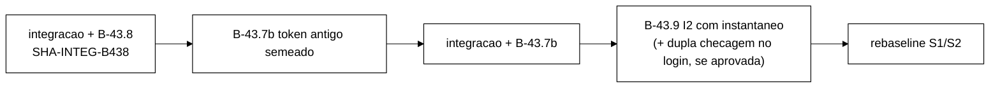

# Prompt do B-43.7b: *token* antigo por sorteio de Bernoulli semeado (2026-10-22)

> Senior, 2026-10-22. Implementa DT-008 (`decisoes-tecnicas.md`): o *token* antigo da mistura v3 deixa
> de ser o contador determinístico do B-43.7 ("1 em cada 20, por *thread*") e passa a ser um sorteio de
> Bernoulli com p = 0,05, com um `Random` próprio por *thread*, semeado a partir da semente da execução
> e do índice da *thread*, sem consumir o `Random` da mistura. C3 passa a ser julgado pelo IC binomial
> de 99,9 %. Nenhuma outra tolerância de DT-004 muda.
>
> **Base a confirmar no despacho:** `<SHA-INTEG-B438>`, a ponta de `feature/controlador-integracao`
> depois da integração do B-43.8. Se o B-43.8 for integrado por *fast-forward*, será `0215964`. Os
> números de linha deste prompt foram tirados de `0215964` (os arquivos citados são os mesmos de
> `e599818`; o B-43.8 não os tocou).

## 1. Onde isto entra



O B-43.7b mexe em `MisturaV3` e em uma linha de `WorkloadMain.rodarCliente`. O B-43.9 mexe em
`SessionOps`. A ordem acima mantém o histórico linear; os dois não têm arquivo de produção em comum,
salvo `WorkloadMain` (linhas distantes).

## 2. Prompt para o Worker

````md
Você é o WORKER. Uma entrega, B-43.7b, com commits só locais. **Não faça push.** Não use a VM.
Branch `fix/b43-7b-token-antigo-semeado` a partir de `<SHA-INTEG-B438>` (confirmar no despacho; será
`0215964` se o B-43.8 tiver sido integrado por fast-forward). Worktree nova `wt-b43-7b`. Subdiretório
PRÓPRIO do scratchpad (`b437b/`) desde o primeiro comando.

Contexto obrigatório: `wt-plano-ctrl/docs/decisoes-tecnicas.md` (DT-004, DT-007, DT-008),
`wt-plano-ctrl/docs/validacao-b43-7-2026-10-22.md` (O3) e o relatório do B-43.7.

Não edite: `tcc-escrita/`, `scripts/`, `analysis/`, `spec/`, o golden `golden-8e2e815/`, `OpResult`,
`Armazem`, `ArmazemVersionado`, `SessionOps`, `FakeCaches`, `KeyGenerator`, `Scenario`, `SlotsGeracao`,
`CargaSlots`, nem nada em `runs/` que já exista (os scripts e manifestos de smokes anteriores são
artefatos selados). Testes existentes: SÓ as edições da lista da seção 4, autorizadas pelo Gestor no
despacho, num commit `test:` próprio, com o diff no relatório. Qualquer outro teste existente que
falhar: PARE e relate. TDD com o vermelho registrado (commit `test:` vermelho separado sempre que a
regra puder ser testada contra a classe já existente). Mensagens `feat:|fix:|test:|docs:`. Diagramas
em Mermaid. Comando: `mvn -f workload/pom.xml clean test`, somando os `TEST-*.xml` antes e depois de
CADA commit. Registre o "antes" medido na base.

Desenho exigido:
1. Derivação da semente do token (em `MisturaV3`, `static`, package-private, documentada):
     SAL_TOKEN = 0x544F4B454E414E54L            // "TOKENANT" em ASCII
     static long sementeToken(long sementeThread) { return mix64(sementeThread ^ SAL_TOKEN); }
     static long mix64(long z) {                 // finalizador SplitMix64 (Steele, Lea, Flood 2014)
         z = (z ^ (z >>> 30)) * 0xBF58476D1CE4E5B9L;
         z = (z ^ (z >>> 27)) * 0x94D049BB133111EBL;
         return z ^ (z >>> 31);
     }
   `sementeThread` é EXATAMENTE o valor que a produção já calcula em `WorkloadMain` (hoje linha 398):
   `cli.seedBase + tid + rep * 1_000_003L`. Extraia esse cálculo para
   `static long sementeThread(long seedBase, int tid, int rep)` em `WorkloadMain` e use-o na linha 398
   (refatoração sem mudança de valor, com teste). Motivo do sal e do misturador: o B-43.5
   (reprodutibilidade por `--seed`) vai semear o `Random` da mistura com `sementeThread`. O token NÃO
   pode usar a mesma semente, nem uma semente linearmente relacionada, senão as duas sequências ficam
   iguais ou correlacionadas.
2. `MisturaV3`: troque `PERIODO_TOKEN_ANTIGO` por `static final double P_TOKEN_ANTIGO = 0.05`, e mantenha
   `Q` (= `P_TOKEN_ANTIGO`) e `rotuloQ()` com a saída `"0.05"` (dry-run e stdout não mudam).
   `cliente()` sem argumento sai. Novo `Cliente cliente(long sementeThread)`: cada `Cliente` tem o seu
   `java.util.Random tokens = new Random(sementeToken(sementeThread))`, campo privado, nunca
   compartilhado. `proximoEhTokenAntigo()` faz UM sorteio por Validate isolado:
   `tokens.nextDouble() < P_TOKEN_ANTIGO`. O sorteio acontece SEMPRE, dentro e fora da janela de medição
   (a política de warm-up só decide se conta), para que a sequência não dependa da janela.
3. `WorkloadMain.rodarCliente`: `misturaV3.cliente(seed)`, com o `seed` que o método já recebe (é o
   `sementeThread`). Nada mais muda no laço. O `Random` da mistura (`ThreadLocalRandom` hoje; semeado no
   B-43.5) e o `KeyGenerator` NÃO são tocados pelo token.
4. Linha `Mistura v3:` do stdout, CSV, contadores e lógica de `validateV3`/`logoutV3`: inalterados.
5. Javadoc de `MisturaV3`, `WorkloadMain.executarOperacao` e `validateV3`: trocar "1 em cada 20 por
   thread" por "sorteio de Bernoulli p = 0,05 com Random próprio por thread (DT-008)".

Testes novos (arquivo novo `TokenAntigoSemeadoTest`, mais o que precisar):
 U1 derivação congelada: `sementeToken(s) == mix64(s ^ SAL_TOKEN)` para s em {0, 1, 42, -1,
    Long.MIN_VALUE}; o valor de `sementeToken(42)` e as 40 primeiras decisões de `cliente(42)` gravados
    como constantes no teste (registre-as no relatório). `sementeToken(s) != s` e sem colisão para
    s em [0, 10^5).
 U2 mesma semente → mesma sequência: dois `cliente(42)` dão as mesmas 10^4 decisões; `cliente(42)` e
    `cliente(43)` diferem em pelo menos uma das 1000 primeiras. Com dois clientes da MESMA `MisturaV3`
    intercalados (A, B, A, B, ...), a sequência de A é igual à de um `cliente(42)` sozinho (mata
    Random compartilhado).
 U3 o Random da mistura NÃO é consumido: um `Random` gravador (subclasse que registra cada `next(bits)`)
    passado a `executarOperacoes` com N = 5000, S1 e S2, semente 42: a sequência de chamadas é
    IDÊNTICA com `v3 = cliente(42)` e com `v3 = null` (caminho v1/v2). E as posições de token antigo
    (índice entre os Validate isolados) são iguais com `new Random(1)` e `new Random(2)` como Random
    da mistura, para o mesmo `cliente(42)`.
 U4 `SequenciaMisturaV3Test` e `GoldenS1S2Test` verdes SEM edição (prova de que a sequência de
    operações e de chaves com `Random(42)`/`KeyGenerator(42)` não mudou).
 U5 fração no IC binomial: 10^6 decisões de `cliente(42)`, e 4 clientes `cliente(sementeThread(42, t,
    0))`, t = 0..3, com 2,5·10^5 cada: `|k/n − 0,05| ≤ 3,2905 · √(0,05·0,95/n)`.
 U6 threads independentes: para os 4 clientes de U5, as sequências diferem duas a duas, e a fração de
    posições em que dois clientes sorteiam `true` ao mesmo tempo fica no IC de 99,9 % de p² = 0,0025
    (com sementes iguais ela seria 0,05).
 U7 rep: `sementeThread(42, 0, 0) != sementeThread(42, 0, 1)` e `sementeThread` reproduz a fórmula
    antiga para uma grade de (seedBase, tid, rep).
 U8 warm-up: com uma `WarmupPolicy` que nunca registra e com `always()`, a sequência de decisões do
    mesmo `cliente(42)` é igual; só os contadores mudam.
 U9 guarda de fonte (`DetectorFonte`, fonte sem comentários): `rodarCliente` chama `cliente(seed)`;
    não há `cliente()` sem argumento em produção; `MisturaV3` não referencia `ThreadLocalRandom`,
    `Math.random` nem o `Random` recebido por `executarOperacao`; a linha 398 usa `sementeThread(`.

Mutações (todas precisam morrer, com a lista dos testes que mataram cada uma):
 M1 o token usa o Random da mistura (`r.nextDouble() < Q` em `executarOperacao`) → U3, U4.
 M2 volta ao contador (`posicao++ % 20 == 19`) → U1, U2, U6.
 M3 p errado: 0,04; 0,06; 1/19 → U5.
 M4 semente igual para todas as threads (`cliente` ignora o argumento, ou `new Random(SAL_TOKEN)`)
    → U2, U6.
 M5 sem sal e sem misturador (`new Random(sementeThread)`) → U1.
 M6 `nextInt(20) == 19` no Random próprio (outro Bernoulli com p = 0,05) → U1 (sequência congelada).
 M7 sorteio só dentro da janela (`politica.deveRegistrar() && ...`) → U8.
 M8 um Random único em `MisturaV3`, compartilhado pelos clientes → U2 (intercalado).
 M9 `sementeThread` com outra fórmula (por exemplo sem `rep`) → U7.
Script de mutantes no scratchpad, Surefire completo por mutante, fonte restaurado no fim.

Análise do smoke: NÃO edite `runs/b43-7-smoke/analise.py` nem `runs/b43-8-smoke/analise.py`
(selados). Crie `runs/b43-7b-smoke/analise.py`, adaptado da parte S1/S2 de
`runs/b43-8-smoke/analise.py`, com C3 por IC:
   n = validate_isolados (stdout), k = token_antigo (stdout), p0 = 0,05, z = 3,2905
   meia = z * sqrt(p0 * (1 - p0) / n);  C3_ok = |k/n - p0| <= meia  e  |n - n_csv| <= threads (DT-007)
   se n * p0 * (1 - p0) < 100: C3 = FALHA de sanidade ("n insuficiente para o IC")
Grave no JSON: k, n, fração (%), meia-largura (p.p.), desvio (p.p.), z, e a diferença stdout − CSV.
C1, C2 e C4..C9 com as MESMAS definições de `runs/b43-8-smoke/analise.py`. Inclua no próprio diretório
um `test_analise_c3.py` (`unittest`) com casos de borda: dentro, fora por cima, fora por baixo, n
insuficiente, e a meia-largura para n = 245 204 (≈ 0,145 p.p.).

Smoke local (Podman `b437b-isnN`, portas que não colidam com outro cluster ativo, `podman ps -a` e
`podman network ls` antes e depois, máquina Podman devolvida ao estado inicial, SEM VM,
`$JAVA_HOME/bin/java`, jar construído com a árvore limpa e SHA-256 em `jars.json`):
 R1 S1 sync v3 120 s; R2 S1 async v3 120 s; R3 S2 sync v3 120 s; R4 S2 async v3 120 s
    (`--mix v3 --threads 4 --reset-state on --duration 120 --warmup-min-sec 10`);
 R5 S1 sync v3 600 s (warm-up padrão, como L1/P5).
Critérios (DT-004 com DT-007 e DT-008): C1..C9 em todas, com C3 pelo IC; `invalidacao_perdida =
conflito_esgotado = 0`; exit 0. Relate também a fração INVALID − fração de token antigo (a parte da
corrida Validate × Logout) ao lado dos valores do B-43.7 e do B-43.8, como dado documental.
Brutos em `runs/b43-7b-smoke/` com `MANIFEST.sha256`. Destaque: "smoke local: as latências NÃO são
evidência".

Relatório `docs/relatorio-b43-7b-<data>.md`: resultado, Surefire por commit, arquivo:linha antes e
depois, testes, diff das edições autorizadas, constantes congeladas de U1, mutações, smoke (tabela C1..C9
com k, n, meia-largura), desvios, pontos para o Gestor. Ao terminar, liste os SHAs, a worktree e o
`git status`, e pare. Não integre nem faça push.
````

## 3. Por que essa derivação

- **Da semente da execução e do índice da *thread*:** `sementeThread = seedBase + tid + rep·1 000 003`
  já é o que a produção passa ao `KeyGenerator` de cada *thread*. Reaproveitá-lo amarra o *token* a
  `--seed`, à *thread* e à repetição sem criar um parâmetro novo.
- **Sal e misturador:** o B-43.5 vai semear o `Random` da mistura com `sementeThread`. Sem o sal, o
  *token* teria a mesma sequência da mistura. Sem o misturador, as sementes de *threads* vizinhas
  (`s`, `s+1`, ...) entrariam no LCG do `java.util.Random` quase iguais. O finalizador do SplitMix64
  espalha os bits, e o sal separa o domínio do *token* de qualquer outro uso futuro da mesma semente.
- **Um sorteio por Validate isolado, sempre:** a sequência de decisões depende só da semente e da
  ordem dos Validate isolados da *thread*, e não da janela de medição nem do `Random` da mistura.
- **Reprodutibilidade real:** com o B-43.7b sozinho, a sequência de *tokens* é reprodutível por
  semente, mas a ordem das operações em produção ainda não é (o `Random` da mistura é
  `ThreadLocalRandom` até o B-43.5). O relatório e a Metodologia não podem afirmar mais do que isso.

## 4. Edições de testes existentes que o B-43.7b exige (cada uma precisa de autorização do Gestor)

Linhas em `0215964`. "Assinatura" = troca mecânica de `cliente()` por `cliente(<semente>)`, sem mudar
o que o teste verifica.

| # | Arquivo:linha | Asserção ou trecho atual | Edição proposta | Tipo |
|---|---|---|---|---|
| E1 | `TokenAntigoTest.java:16-17` | javadoc "exatamente 1 de cada 20 ... `contador % 20 == 19`" | descrever o Bernoulli semeado | doc |
| E2 | `TokenAntigoTest.java:22-36` (`contadorPorThread`) | `:25-26` `m.cliente()`; `:27` `assertEquals(20, MisturaV3.PERIODO_TOKEN_ANTIGO)`; `:31` `assertEquals(i % 20 == 19, a.proximoEhTokenAntigo())`; `:33` `assertFalse(b.proximoEhTokenAntigo())` para i < 19 | reescrever como "um sorteio por chamada, mesma semente → mesma sequência, sementes diferentes → sequências diferentes"; `:28` (`Q == 0.05`) e `:29` (`rotuloQ() == "0.05"`) ficam | semântica |
| E3 | `TokenAntigoTest.java:72-88` (`naoDependeDoRandom`) | `:80` posições iguais com sementes 42 e 4242; `:82` e `:85` `assertEquals(20 * j + 19, ...)` | reescrever: com o mesmo `cliente(42)` e Random da mistura diferentes, as posições são iguais (a semente do *token* fica fixa e só a da mistura varia); retirar `20j + 19` | semântica |
| E4 | `MundoV3.java:48` | `c[t] = mistura.cliente();` | `c[t] = mistura.cliente(semente + t);` (espelha a produção: cada *thread* com a sua semente) | assinatura |
| E5 | `MisturaV3Test.java:45` | `assertEquals(0.05, frac, 0.001, "fracao INVALID " + frac)` | tolerância pelo IC: `3.2905 * Math.sqrt(0.05 * 0.95 / val.size())` | semântica |
| E6 | `MisturaV3Test.java:57` | `assertTrue(max - min <= 0.005, "tercos: ...")` | tolerância do IC da diferença de duas proporções: `3.2905 * Math.sqrt(2 * 0.05 * 0.95 / terco)` | semântica |
| E7 | `MisturaV3Test.java:19` e `:39` | javadoc e comentário "q = 5 %", "5 % +- 0,1 p.p." | texto do Bernoulli e do IC | doc |
| E8 | `MisturaV3Test.java:99` e `:128` | `w.mistura.cliente()` | `w.mistura.cliente(42)` | assinatura |
| E9 | `MisturaV3ConcorrenciaTest.java:133`, `:136`, `:142`, `:154`, `:156` | `w.mistura.cliente()` | `w.mistura.cliente(42)` (o *token* não é usado: `validateV3` recebe `antigo = false` explícito, e `logoutV3` não sorteia) | assinatura |
| E10 | `MisturaV3ConcorrenciaTest.java:201` | `w.mistura.cliente()` dentro do laço por `tid` | `w.mistura.cliente(42 + tid)` | assinatura |

O que **não** muda e tem de continuar verde sem edição: `MisturaV3Test.java:43` (INVALID =
`token_antigo`, sem corrida, continua exato com o sorteio), `MisturaV3Test.java:115` (linha `Mistura
v3:`), `CliMisturaV3Test.java:69`, `:78`, `:79`, `:85` (`q=0.05`), `SequenciaMisturaV3Test`,
`GoldenS1S2Test`, `SequenciaMisturaV2Test`, `MisturaV2Test`.

**Alternativa que reduz E4, E8, E9 e E10 a zero:** manter `cliente()` sem argumento como atalho de
teste (`cliente(0L)`). Não recomendo: deixa em produção um método que dá a mesma semente a todas as
*threads*, que é exatamente o mutante M4, protegido só por uma guarda de fonte.

## 5. Critérios de aceite do B-43.7b

1. Surefire = base + testes novos, 0 falhas, 0 erros, o mesmo ignorado; só as edições E1..E10
   aprovadas, num commit `test:` próprio.
2. M1..M9 mortos; `SequenciaMisturaV3Test` e `GoldenS1S2Test` verdes sem edição.
3. *Smoke* R1..R5 com exit 0 e C1..C9 atendidos (C3 pelo IC de DT-008, com k, n e meia-largura no
   relatório); `test_analise_c3.py` verde.
4. Nada de `SessionOps`, `OpResult`, CSV ou linha de stdout alterado.
