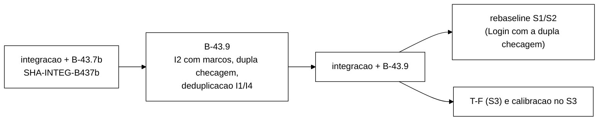
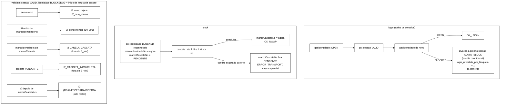

# Prompt atualizado do B-43.9: I2 com instantâneo, dupla checagem no `login` e deduplicação na cascata (2026-10-22)

> Senior, 2026-10-22. Substitui a seção 3 de `validacao-b43-6-adendo-b43-8-b43-9-2026-10-22.md` (o
> prompt original do B-43.9), que fica como histórico. Incorpora as decisões do Gestor de 22/10 sobre
> os pontos da V-B43.8 e as recomendações da V-B43.7b (`validacao-b43-7b-2026-10-22.md`, seção 6):
>
> - dupla checagem no `login` contra o TOCTOU `login` × `block`, em todos os cenários, com o W8 do
>   B-43.8 (`ToctouLoginBlockTest`) reescrito para demonstrar a correção;
> - no máximo uma I1 e uma I4 por (operação, `sid`) na cascata, mantendo as duas checagens; edição de
>   `CascataCondicionalTest.java:106` já autorizada;
> - `invalidacao_perdida` na cascata com a contagem atual;
> - conflito esgotado no `block` termina a cascata parcial com `ERROR_TRANSPORT`, mais um teste de
>   que um `validate` posterior a um `block` em erro não é classificado REAL (DT-002);
> - textos obsoletos do B-43.7b (ponto 3 da V-B43.7b), se o Gestor aprovar;
> - *smoke* com v3 (C1..C9, C3 pelo IC de DT-008) e S3, com sementes pela regra R-S1..R-S3;
> - mutantes para cada regra nova.
>
> Só o prompt. Nada foi despachado. Commit local, sem push.
>
> **Base a confirmar no despacho:** `<SHA-INTEG-B437b>`, a ponta de `feature/controlador-integracao`
> depois da integração do B-43.7b. Se for por *fast-forward*, será `5e1084f`. Os números de linha deste
> documento foram tirados de `5e1084f` (`SessionOps` e os testes citados são os mesmos de `0215964`).

## 1. Onde isto entra



O *rebaseline* S1/S2 passa a depender do B-43.9, porque a dupla checagem acrescenta um `get` de
identidade a cada Login OK em todos os cenários, e o *rebaseline* tem de medir esse Login.

## 2. As quatro regras novas



**Por que a dupla checagem fecha o TOCTOU em SYNC.** O `login` faz escrita da sessão e depois leitura
da identidade. O `block` faz escrita da identidade e depois leitura das sessões. É o padrão de Dekker:
com operações linearizáveis, ao menos um dos dois vê a escrita do outro. Se o `login` releu OPEN, a
escrita da identidade BLOCKED veio depois dessa releitura, e portanto depois do `put` da sessão, e a
varredura do `block` encontra a sessão. Se a releitura vê BLOCKED, o próprio `login` invalida a
sessão. Dois limites ficam registrados: a varredura usa `entrySet`, que no Infinispan não é uma leitura
linearizável; e em ASYNC a releitura pode ver uma réplica atrasada. O que sobrar nesses casos é medida
do *grid* (H-A0), não defeito da aplicação.

## 3. Edições de testes existentes que o B-43.9 exige

Levantadas pelo Senior com um protótipo descartável das regras B (dupla checagem) e C (deduplicação)
sobre `5e1084f`, com o Surefire completo: **só dois testes existentes falham**,
`CascataCondicionalTest.controlePositivo` e `ToctouLoginBlockTest.loginEscapaDaCascata` (713 testes,
2 falhas, 0 erros). O protótipo ficou numa worktree descartável e foi removido.
A versão do W8 proposta abaixo passou contra o protótipo. As regras A (marcos) e a janela de medição
dos contadores não foram prototipadas; se elas quebrarem outro teste existente, o Worker para e relata.

| # | Arquivo:linha (`5e1084f`) | Atual | Edição | Autorização |
|---|---|---|---|---|
| B9-E1 | `CascataCondicionalTest.java:106` | `assertEquals(List.of("I1:s1", "I1:s1"), invariantes(a));` | `List.of("I1:s1")` | **já autorizada** |
| B9-E2 | `CascataCondicionalTest.java:104-105` | comentário "Duas leituras distintas ... cada uma e acusada." | "Duas leituras distintas da sessao, as duas depois da confirmacao; a operacao registra no maximo uma I1 por sid (B-43.9)." | a autorizar (comentário) |
| B9-E3 | `ToctouLoginBlockTest.java:13-23` | Javadoc "diagnostico ... SEM corrigir ... sessao VALID permanente ... I2 REAL" | descrever o mesmo roteiro com a correção: a releitura vê BLOCKED, o `login` invalida a própria sessão e devolve BLOCKED | a autorizar (doc) |
| B9-E4 | `ToctouLoginBlockTest.java:29-30` | `@DisplayName("W8: ... sessao VALID sob BLOCKED; I2 REAL")`, `void loginEscapaDaCascata()` | `"W8 (B-43.9): login le OPEN, block completo, releitura ve BLOCKED => login revertido, sem I2"`, `void loginRevertidoPelaDuplaChecagem()` | a autorizar (nome) |
| B9-E5 | `ToctouLoginBlockTest.java:52` | `assertEquals(OpResult.Code.OK_LOGIN, login.code(), ...)` | `assertEquals(OpResult.Code.BLOCKED, login.code(), "a dupla checagem reverte o login")` | a autorizar (semântica) |
| B9-E6 | `ToctouLoginBlockTest.java:53` | `String sid = login.sessionId();` | o `sid` passa a vir do *grid* (a única chave de `w.sessoes.copia()` diferente de `sid-antiga`), porque BLOCKED não tem `sessionId` | a autorizar (semântica) |
| B9-E7 | `ToctouLoginBlockTest.java:55` | `assertEquals(VALID, ...estado(), "sessao VALID sob BLOCKED")` | `INVALID`, mais `assertEquals(ADMIN_BLOCK, w.sessoes.valor(sid).motivo())` | a autorizar (semântica) |
| B9-E8 | `ToctouLoginBlockTest.java:58` | `assertTrue(!w.invalidacoes.containsKey(sid), "a cascata nao viu a sessao nova")` | `assertEquals(ADMIN_BLOCK, w.invalidacoes.get(sid), "confirmada pelo proprio login")` (o mapa é compartilhado em `MundoS3Versionado`) | a autorizar (semântica) |
| B9-E9 | `ToctouLoginBlockTest.java:61` | comentário "permanente: nada no workload volta a invalidar essa sessao" | retirar ou trocar por "leituras posteriores veem INVALID" | a autorizar (comentário) |
| B9-E10 | `ToctouLoginBlockTest.java:65-70` | `List.of("I2", "I2")` e o laço que exige REAL | `List.of()`; o laço sai | a autorizar (semântica) |
| B9-E11 | `ToctouLoginBlockTest.java:74-77` | a varredura acha 1 I2 REAL para `sid` | `assertEquals(List.of(), r.achados(), ...)`; `:76-77` saem | a autorizar (semântica) |
| B9-E12 | `ToctouLoginBlockTest.java` (linha nova depois de `:59`) | não existe | `assertEquals(1, w.apps.get(0).loginRevertidoPorBloqueio())` | a autorizar (asserção nova em teste existente) |
| B9-E13 | `ToctouLoginBlockTest.java:11` | `import static ...assertTrue;` | sai (fica sem uso depois de B9-E8) | a autorizar (consequência de B9-E8) |
| E11 | `MisturaV3Test.java:47` | comentário "diferenca <= 0,5 p.p." | "diferenca no IC de 99,9 % da diferenca de duas proporcoes (DT-008)" | a autorizar (ponto 3 da V-B43.7b) |

Ficam verdes **sem edição** e provam o escopo das regras: `AuditorCorridaTest.java:266` e `:353`
(duas I1 vindas de duas operações distintas, `validate` e `logout`: a deduplicação é por operação),
`CascataCondicionalTest.java:133` (`invalidacao_perdida` inalterada), `conflitoEsgotadoNaCascata`
(`:166-183`), `SessionOpsBlockTest.cascataParcialFicaRegistradaComoErro`, `AuditorDiagnosticoS3Test`
(D4a/D4b como deixados pelo B-43.8), `AuditorLinhaTest.java:48, 71`, `InvalidacaoProducaoTest.java:66,
81`, `SessionOpsRastroTest`, `VarreduraFinalTest`, `GoldenS1S2Test`, `SequenciaMisturaV3Test`.

## 4. Prompt para o Worker

````md
Você é o WORKER. Uma entrega, B-43.9, com commits só locais. **Não faça push.** Não use a VM.
Branch `fix/b43-9-i2-instantaneo` a partir de `<SHA-INTEG-B437b>` (confirmar no despacho; será
`5e1084f` se o B-43.7b tiver sido integrado por fast-forward). Worktree nova `wt-b43-9`.
Subdiretório PRÓPRIO do scratchpad (`b439/`) desde o primeiro comando.

Contexto obrigatório: `wt-plano-ctrl/docs/decisoes-tecnicas.md` (DT-001, DT-002, DT-003, DT-008),
`wt-plano-ctrl/docs/validacao-b43-6-2026-10-22.md` (seção 5.2), `validacao-b43-8-2026-10-22.md`
(seções 5 e 6), `validacao-b43-7b-2026-10-22.md` (seção 6), este documento (seções 2 e 3) e os
relatórios do B-43.6 (seção 7.2, D4a/D4b) e do B-43.8 (diagnóstico TOCTOU).

Não edite: `tcc-escrita/`, `scripts/`, `analysis/`, `spec/`, o golden, `OpResult`,
`ClassificadorDeErro`, `Armazem`, `ArmazemVersionado`, `FakeCaches`, `FakeVersionado`, `MundoS3`,
`MundoS3Versionado`, `RastroCliente`, `VarreduraFinal`, a mistura (`MisturaV3`, `CargaSlots`,
`KeyGenerator`, `Scenario`, `SlotsGeracao` salvo a linha 17 se autorizada), o plano do controlador,
nem nada que já exista em `runs/`. Testes existentes: SÓ as edições da seção 3 autorizadas no
despacho, num commit `test:` próprio, com o diff no relatório. Qualquer outro teste existente que
falhar: PARE e relate. Mensagens `refactor:|feat:|fix:|test:|docs:`. Diagramas em Mermaid. Comando:
`mvn -f workload/pom.xml clean test`, somando os `TEST-*.xml` antes e depois de CADA commit. Registre
o "antes" medido na base.

Ordem dos commits (todo commit compila; o vermelho fica versionado):
 1. `refactor:` assinaturas e acessores novos com o comportamento antigo (contadores que devolvem 0,
    construtores com o mapa de marcos, linha nova do stdout com zeros, o conjunto de deduplicação como
    parâmetro sem efeito). Surefire igual à base.
 2. `test:` edições autorizadas da seção 3 (vermelhas onde a regra ainda não existe; registre quais).
 3. `test:` testes novos, vermelhos, um commit por regra quando der.
 4. `feat:` uma regra por commit (A marcos, B dupla checagem, C deduplicação, D bloco em erro).
 5. `docs:` linha 17 de `SlotsGeracao.java` e E11 (se autorizadas), num commit próprio.
 6. `test:` análise do smoke, `test:` brutos do smoke, `docs:` relatório.

Regra A, I2 por marcos (DT-002). Uma leitura de sessão VALID cuja identidade é lida BLOCKED (o
candidato a I2 de hoje, `SessionOps.java:396`) é classificada pelo instante `t0Sessao`, tomado com
`System.nanoTime()` imediatamente antes de `sessions.get(sid)` (`SessionOps.java:385`), contra os
marcos daquela identidade:
 - `marcoIdentidadeNs`: gravado DEPOIS de `identities.put(BLOCKED)` reconhecido, no `block`
   (`:641`, tipo ADMIN) e no `incrementFailure` que atinge o limite (`:588`, tipo LIMITE);
 - `marcoCascataNs`: no `block`, nasce PENDENTE (`Long.MAX_VALUE`) junto com `marcoIdentidadeNs` e
   recebe o instante DEPOIS da última invalidação da cascata, logo antes de `block_ok` (`:671`). No
   LIMITE (sem cascata), é igual a `marcoIdentidadeNs`;
 - `block` que lança DEPOIS do `put(BLOCKED)` reconhecido (cascata parcial, inclusive conflito
   esgotado): `marcoCascataNs` fica PENDENTE. `block` cujo `put(BLOCKED)` lança (efeito
   desconhecido): grava, no `catch`, `marcoIdentidadeNs` = instante do `catch` e `marcoCascataNs`
   PENDENTE, para que leituras posteriores não caiam em "sem marco";
 - um `block` sobre identidade cujo marco já tem cascata concluída e não teve `unblock` depois NÃO
   substitui o marco (o período de bloqueio já teve cascata concluída);
 - `unblock`: remove o marco DEPOIS do `put(OPEN)` reconhecido (`:713`).
 Classes:
 - sem marco ⇒ I2 como hoje, mais o contador `i2_sem_marco` (em produção tem de dar 0; existe para os
   testes antigos que montam BLOCKED direto no fake);
 - `t0Sessao < marcoIdentidadeNs` ⇒ `i2_concorrentes` (contador; NÃO é violação, DT-001);
 - `marcoIdentidadeNs ≤ t0Sessao < marcoCascataNs` com cascata concluída ⇒ registro
   `I2_JANELA_CASCATA` no auditor (sai em `violacoes-rep-NNN.csv` com esse rótulo e a fase, FORA de
   `S_viol`);
 - `marcoIdentidadeNs ≤ t0Sessao` com cascata PENDENTE ⇒ registro `I2_CASCATA_INCOMPLETA` (idem,
   FORA de `S_viol`);
 - `t0Sessao ≥ marcoCascataNs` (concluída) ⇒ I2, como hoje (o rastro continua classificando
   REAL/ESPERADA/INCERTA).
 Mapa NOVO `ConcurrentHashMap<String, MarcoBloqueio>` (record `tipo`, `marcoIdentidadeNs`,
 `marcoCascataNs`), com o ciclo de vida do mapa de invalidações: um por repetição em S1/S2 e um
 compartilhado por `S3Clientes` entre servidores e admin. Construtores novos; os existentes continuam
 valendo (mapa próprio). Os marcos usam `System.nanoTime()`, o mesmo relógio de `t0Sessao`.

Regra B, dupla checagem no `login` (todos os cenários). Depois de `sessions.put(sid, s)`
(`SessionOps.java:366`) e antes de `latency.record("login_ok")` (`:367`), releia
`identities.get(identidade)`:
 - OPEN ou ausente ⇒ OK_LOGIN, como hoje (um `get` a mais por Login OK, dentro da latência
   `login_ok`);
 - BLOCKED ⇒ invalide a própria sessão com ADMIN_BLOCK pelo MESMO caminho da cascata (com armazém
   versionado, `invalidarPorBloqueio(sid)`, isto é, leitura versionada, checagem I1/I4 e escrita
   condicional; sem armazém versionado, `put` INVALID e só depois a confirmação no mapa, ordem do
   B-43.6), conte `login_revertido_por_bloqueio`, registre a latência em `login_blocked`, emita Login
   com BLOCKED e devolva `OpResult.blocked()`;
 - a releitura lança ⇒ `catch` atual (`login_err`, código pelo classificador). A sessão fica no grid,
   VALID e órfã (o `sid` não foi devolvido nem entrou no rastro). Registre isso no relatório;
 - conflito esgotado na auto-invalidação ⇒ `IllegalStateException`, `conflito_esgotado` + 1, login
   em `ERROR_TRANSPORT` (mesma regra do `block`).
 `reporSessao` (v3) NÃO ganha releitura: não é Login medido, e as identidades dos slots não são
 bloqueadas em S1/S2.

Regra C, deduplicação de I1/I4 por (operação, sid). Dentro de UMA operação, a mesma (invariante,
`sid`) é registrada no auditor no máximo uma vez. Vale para o `block` (varredura + `lerComVersao` +
releituras de `invalidarCondicional`), para o `logoutVersionado` (primeira leitura + releituras) e
para a auto-invalidação do `login`. As duas checagens da cascata continuam (a da varredura pega a
reversão vista no `entrySet` mesmo quando a leitura versionada já vê INVALID). Implemente com um
conjunto local criado no início da operação e passado como parâmetro a `verificarI1I4`; nada de campo
de instância nem `ThreadLocal`. `validate` e o `logout` não versionado (uma leitura só) não mudam. Os
contadores `*_concorrentes` não são deduplicados (diagnóstico, DT-001).

Regra D, `block` em erro e `invalidacao_perdida`.
 - Conflito esgotado na cascata: o `block` termina em `ERROR_TRANSPORT` com cascata parcial, como
   hoje. Não mude `OpResult` nem `ClassificadorDeErro`. Com a regra A, o marco fica com cascata
   PENDENTE.
 - `invalidacao_perdida` conta só "invalidação que perdeu a escrita condicional e releu INVALID",
   como hoje (`CascataCondicionalTest.java:133` continua verde). A auto-invalidação do login entra na
   mesma definição.

Stdout. `Auditor:` (`AuditorLinhaTest.java:48, 71`) e `Invalidacao:` (`InvalidacaoProducaoTest.java:66,
81`) são fixadas inteiras e NÃO mudam. Linhas NOVAS, impressas logo depois delas:
   Auditor I2: concorrentes=<n> janela_cascata=<m> cascata_incompleta=<c> sem_marco=<k>
   Auditor total: i1_concorrentes=<a> i4_concorrentes=<b> i2_concorrentes=<n'>
   Login: revertido_por_bloqueio=<r>
 Os contadores das duas primeiras linhas e de `Auditor:` passam a contar SÓ na janela de medição
 (`WarmupPolicy.deveRegistrar()`, a mesma política do CSV); `Auditor total:` conta sem janela, para
 conferência (fecha o D11 do B-43.6). Se isso quebrar teste existente: PARE e relate.

Testes novos (arquivos novos):
 Z1 D4a convertido (o de B-43.6 não muda): sessão lida antes de o `block` confirmar a identidade ⇒
    0 I2, `i2_concorrentes == 1`.
 Z2 D4b convertido: `validate` inteiro dentro da cascata ⇒ 1 `I2_JANELA_CASCATA`, 0 I2.
 Z3 controle positivo: cascata concluída; leitura iniciada depois vê a sessão VALID (fake "velho") ⇒
    1 I2, REAL pelo rastro.
 Z4 LIMITE: `incrementFailure` atinge o limite; sessão VALID lida depois ⇒ I2 ESPERADA-POR-DESENHO.
 Z5 `unblock` remove os marcos; um novo `block` grava marcos novos.
 Z6 sem marco (BLOCKED montado no fake) ⇒ I2 como hoje, `i2_sem_marco == 1`.
 Z7 S3: marcos compartilhados entre servidores e admin (o admin bloqueia, um servidor classifica).
 Z8 janela de medição: corridas no warm-up não contam nos contadores com janela, só em `total`.
 Z9 W8 reescrito (edições B9-E3..B9-E13): roteiro do B-43.8 termina em BLOCKED, sessão
    INVALID(ADMIN_BLOCK), `login_revertido_por_bloqueio == 1`, 0 I2, varredura sem achados.
 Z10 login normal: releitura OPEN ⇒ OK_LOGIN; exatamente 2 `get` de identidade no fake por Login OK
    (identidade existente) e 0 escrita condicional de sessão.
 Z11 login revertido sem armazém versionado (FakeCaches): sessão INVALID(ADMIN_BLOCK), confirmação no
    mapa só depois do `put` (gancho que observa o mapa no `put`), latência em `login_blocked` e não em
    `login_ok`, CSV com Login/BLOCKED.
 Z12 login revertido com armazém versionado: a auto-invalidação passa por escrita condicional
    (`FakeVersionado.tentativasCondicionais == 1`).
 Z13 releitura que lança: código do classificador, `login_err`, o rastro não mapeia o `sid`, a sessão
    fica VALID no fake (documenta a órfã).
 Z14 deduplicação na cascata: (a) duas leituras VALID do mesmo `sid` depois da confirmação ⇒ uma I1
    (é o B9-E1); (b) I1 na varredura e I4 na leitura versionada do MESMO `sid` ⇒ as duas registradas
    (a chave é invariante + sid); (c) varredura VALID e `lerComVersao` INVALID com o motivo confirmado
    ⇒ 1 I1, vinda da varredura (prova que a checagem da varredura continua); (d) dois `sid` da mesma
    identidade ⇒ uma I1 para cada.
 Z15 deduplicação no `logout` versionado: primeira leitura VALID com confirmação anterior, escrita
    condicional falha, releitura VALID ⇒ uma I1. Um `validate` e um `logout` seguidos do mesmo `sid`
    continuam dando duas (como `AuditorCorridaTest.java:266`).
 Z16 conflito esgotado no `block`: código `ERROR_TRANSPORT` explícito, CSV Block/ERROR_TRANSPORT,
    marco com cascata PENDENTE; um `validate` posterior de outra sessão VALID da mesma identidade ⇒
    1 `I2_CASCATA_INCOMPLETA`, 0 I2, e `rastro.classificarViolacaoI2` dá INCERTA, nunca REAL.
 Z17 `put(BLOCKED)` que lança: marco gravado no `catch`; leitura posterior VALID sob BLOCKED ⇒
    `I2_CASCATA_INCOMPLETA`, `i2_sem_marco == 0`.
 Z18 `block` repetido sobre identidade com cascata concluída, sem `unblock` no meio: o marco antigo
    fica; uma leitura VALID depois ⇒ I2 (não `I2_CASCATA_INCOMPLETA`), mesmo que o segundo `block`
    termine em erro.
 Z19 existentes e golden verdes sem edição além das autorizadas (lista da seção 3 deste documento).

Mutações (todas precisam morrer, com a lista dos testes que mataram cada uma):
 K1 `t0Sessao` depois da leitura da sessão (Z1). K2 `marcoIdentidadeNs` antes do `put(BLOCKED)` (Z1
 com latch). K3 `marcoCascataNs` no início da cascata (Z2). K4 `I2_JANELA_CASCATA` registrado como I2
 (Z2). K5 `unblock` sem remover marcos (Z5). K6 mapa de marcos por instância no S3 (Z7). K7 contador
 concorrente sem janela (Z8).
 K8 login sem releitura (Z9). K9 releitura ANTES do `put` da sessão (Z9). K10 releitura BLOCKED
 devolve BLOCKED sem invalidar a sessão (Z9, Z11). K11 releitura BLOCKED invalida mas devolve
 OK_LOGIN (Z9). K12 contador `login_revertido_por_bloqueio` não incrementado (Z9). K13 auto-invalidação
 por `put` incondicional com armazém versionado (Z12). K14 latência do revertido em `login_ok` (Z11).
 K15 deduplicação pela chave `sid` só, sem a invariante (Z14b). K16 conjunto de deduplicação como campo
 da instância, nunca limpo (Z15 e `AuditorCorridaTest`). K17 deduplicação removendo a checagem da
 varredura (Z14c). K18 `block` em erro marca a cascata como concluída (Z16). K19 conflito esgotado
 engolido, `block` em OK_NOOP (Z16). K20 `put(BLOCKED)` que lança sem marco (Z17). K21 segundo `block`
 substitui marco concluído (Z18).
Script de mutantes no scratchpad, Surefire completo por mutante, fonte restaurado no fim.

Smoke local (Podman `b439-isnN`, portas que não colidam com outro cluster, `podman ps -a`, `podman
network ls` e `podman machine list` antes e depois, máquina devolvida ao estado inicial, SEM VM,
`$JAVA_HOME/bin/java`, jar construído com a árvore limpa e SHA-256 em `jars.json`). Sementes pela
regra R-S1..R-S3 da V-B43.7b: `--seed = 43900 + 100·i`, `--rep 1`, i na ordem abaixo, gravadas no
`smoke.sh.txt`.
 Q1 (i=0, 43900) S3 sync 300 s;  Q2 (i=1, 44000) S3 async 300 s  (`--scenario S3 --sweep`, padrões
    de B-33);
 Q3 (i=2, 44100) S1 sync v3 120 s;  Q4 (i=3, 44200) S1 async v3 120 s;  Q5 (i=4, 44300) S2 sync v3
    120 s  (`--mix v3 --threads 4 --reset-state on --duration 120 --warmup-min-sec 10`);
 Q6 (i=5, 44400) S1 sync v3 600 s (warm-up padrão).
Análise: crie `runs/b43-9-smoke/analise.py` a partir de `runs/b43-7b-smoke/analise.py` (NÃO edite os
selados), com C1..C9 de DT-004, C3 pelo IC de DT-008 (recusa se n·p·(1−p) < 100) e uma checagem nova
de sanidade: lê `seed=` e `rep=` da linha `Configuracao:` de cada execução e falha se dois pares
coincidirem. `test_analise_c3.py` copiado e um teste novo para a checagem de sementes.
Critérios:
 - exit 0 em Q1..Q6; `ISPN006010` no máximo 1 por nó;
 - `sem_marco = 0` em todas (prova de que a produção grava os marcos);
 - SYNC (Q1, Q3, Q5, Q6): I1 = I4 = 0; I2 pós-cascata classificada REAL = 0;
 - Q1/Q2: `concorrentes`, `janela_cascata`, `cascata_incompleta` e `Login: revertido_por_bloqueio`
   relatados por fase; I2 REAL em ASYNC relatado, sem critério (H-A0);
 - Q3..Q6: C1..C9 com C3 pelo IC, `invalidacao_perdida = conflito_esgotado = 0`,
   `revertido_por_bloqueio = 0` e `Auditor I2:` toda em zero (I2 não ocorre em S1/S2);
 - documental, não critério: `login_ok` p50/p99 de Q3/Q4 ao lado de R1/R2 do B-43.7b (o `get` a mais).
Brutos em `runs/b43-9-smoke/` com `MANIFEST.sha256`. Destaques: "smoke local, não é a T-F" e "as
latências NÃO são evidência".

Relatório `docs/relatorio-b43-9-<data>.md`: resultado, Surefire por commit, arquivo:linha antes e
depois, testes, diff das edições autorizadas, mutações, smoke por classe de I2 e por fase, desvios,
pontos para o Gestor (incluindo a mudança no agregador do controlador para `S_viol` ignorar
`I2_JANELA_CASCATA`, `I2_CASCATA_INCOMPLETA` e os `*_concorrentes`). Ao terminar, liste os SHAs, a
worktree e o `git status`, e pare. Não integre nem faça push.
````

## 5. Critérios de aceite do B-43.9

1. Surefire = base + testes novos, 0 falhas, 0 erros, o mesmo ignorado; só as edições da seção 3
   autorizadas, num commit `test:` próprio; todo commit compila.
2. K1..K21 mortos; *golden* e `SequenciaMisturaV3Test` verdes sem edição.
3. *Smoke* Q1..Q6 com os critérios da seção 4, `test_analise_c3.py` e o teste de sementes verdes.
4. `OpResult`, `ClassificadorDeErro`, CSV de eventos e as linhas `Auditor:`/`Invalidacao:` sem
   mudança de formato.

## 6. Pontos que dependem do Gestor no despacho

1. Base `<SHA-INTEG-B437b>` (depende da integração do B-43.7b).
2. Autorizar B9-E2..B9-E13 (`CascataCondicionalTest.java:104-105`, `ToctouLoginBlockTest.java`) e,
   se aprovado o ponto 3 da V-B43.7b, E11 (`MisturaV3Test.java:47`) e a linha 17 de `SlotsGeracao`.
3. Classe nova `I2_CASCATA_INCOMPLETA` para leituras depois de um `block` em erro. Alternativa: tratar
   como `I2_JANELA_CASCATA` com a cascata nunca concluída. Recomendo a classe própria: a janela mede
   uma duração finita, e a cascata parcial pode deixar sessões VALID por tempo indeterminado, o que
   distorceria a métrica da janela.
4. Deduplicação também no `logout` versionado e na auto-invalidação do `login`, além da cascata.
   Recomendo sim (é a regra "por operação"; a V-B43.8 já a propunha para as releituras do `logout`).
5. Seis execuções de *smoke* (Q1..Q6), com Q6 de 600 s para os décimos de C1.
