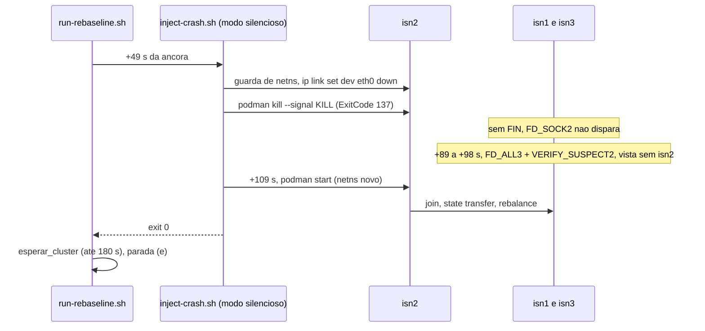
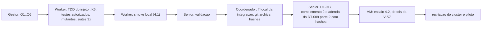

# F1 como *crash* de verdade: levantamento, plano e prompt do Worker (2026-10-27)

> Senior, 2026-10-27. Origem: decisão do Gestor de 27/10, transmitida pelo coordenador. O F1 deixa
> de ser `podman stop` (SIGTERM, saída ordenada do Infinispan com *leave* explícito) e passa a ser
> *crash* com `podman kill` (SIGKILL), para coincidir com a Metodologia ("*crash* silencioso", "sem
> aviso prévio", detecção pelo FD_ALL3, T16/T17), **antes** do *rebaseline*. Tudo o que foi medido
> como F1 até hoje (bateria de junho, gates) foi parada ordenada.
>
> Base lida: `feature/controlador-integracao` em `c055399` (*worktree* `wt-ctrl-integ`). Fontes do
> Infinispan 15.0.21.Final e do JGroups 5.3.16.Final (versão que o `pom` de configuração do
> Infinispan 15.0.21 fixa) lidas no GitHub, nas *tags* das versões, nesta sessão.
>
> **Estado: aguarda as decisões Q1..Q6 da seção 9.** O prompt da seção 7 só vale depois delas. O
> rascunho do complemento 2 e da DT-017 está em
> `docs/pre-registro-rebaseline-complemento-2-2026-10-27.md`. Sem VM, sem código, sem push.

## 1. Achado principal: `podman kill` sozinho não é detectado pelo FD_ALL3

A pilha do *cluster* (`cluster/jgroups-tcp.xml:56-61`) tem **FD_SOCK2**, FD_ALL3 e
VERIFY_SUSPECT2 (`timeout="1000"`). A Metodologia (T16, `Metodologia.tex:183`) só menciona o FD_ALL3.

- O FD_SOCK2 mantém uma conexão TCP de cada membro com o vizinho no anel. Quando a conexão fecha, o
  vizinho é suspeito na hora. Documento de projeto, `doc/design/FD_SOCK2.txt:27-28` (JGroups
  5.3.16): "When the client receives a connectionClosed(ping-dest) callback (emitted by the
  NioServer), it considers ping-dest to have crashed and emits a SUSPECT event". No código,
  `FD_SOCK2.java:287-297` (`connectionClosed`) e `:372-394` (`connectToNextPingDest`, que difunde o
  `SUSPECT`).
- SIGKILL mata a JVM, mas o *kernel* fecha os *sockets* do processo e envia FIN ou RST aos pares
  enquanto o *netns* do contêiner ainda existe. O vizinho de `isn2` recebe o fechamento, suspeita,
  o VERIFY_SUSPECT2 confirma em cerca de 1 s e o coordenador instala a vista sem `isn2`.
- **Previsão (a confirmar no *smoke*): com `podman kill`, a vista nova sai em 1 a 3 s, pelo
  FD_SOCK2, e não em cerca de 40 s pelo FD_ALL3.** Com `podman stop` a vista também sai em poucos
  segundos, por *leave*. A diferença entre os dois é o caminho (suspeita contra *leave* ordenado,
  operações em voo abortadas, conexões Hot Rod com RST), não o tempo de detecção.
- O FD_ALL3 só decide quando o nó some **sem** fechar conexões: máquina que cai, cabo cortado,
  processo congelado. É o caso que T16 descreve e o que o PR §2 pressupõe quando diz "60 s >
  FD_ALL3 de 40 s (T16/T17)". Com `podman stop` essa justificativa já não valia em junho, e com
  `podman kill` também não vale.

Consequência: `podman kill` cumpre "sem saída ordenada" e "sem aviso prévio" (nenhum *leave*), mas
**não** cumpre "silencioso, detectado pelo FD_ALL3". Para cumprir os três é preciso calar o nó antes
de matá-lo (opção B, seção 3).

## 2. Levantamento do que muda com SIGKILL

### 2.1 Processo e contêiner

| Ponto | `podman stop` (junho, gates) | `podman kill` |
|---|---|---|
| Sinal | SIGTERM, SIGKILL depois de 10 s se preciso | SIGKILL (padrão do `podman kill`; o prompt pede `--signal KILL` explícito) |
| Saída do Infinispan | *shutdown hook*: *leave* dos *caches* e do JGroups, `ISPN000390` ("Persisted state") e `ISPN080002` no *log* da vida antiga | nenhuma linha de saída; o *log* da vida antiga termina no meio |
| `State.ExitCode` | 143 (complemento 1, §1.4 item 2) | 137 (128 + 9) |
| Estado depois | `exited` | `exited`. O PID 1 do contêiner morre e o *kernel* mata o resto do *namespace* de PID |
| Volta | `podman start` | `podman start` do mesmo contêiner. **`podman rm` é proibido**: muda `Created`, quebra `--cluster-criado-apos`, a contagem de K8 (DT-013 conta desde a criação) e a regra (h) do complemento 1 |
| `State.StartedAt` / `FinishedAt` | lidos pelo *runner* (K8, C5) | iguais em forma. `FinishedAt` passa a ser o instante da morte, sem os segundos do *shutdown* ordenado |

### 2.2 `___global.lck` e `___global.state` depois do SIGKILL

O *server* usa estado global persistente em `/opt/infinispan/server/data/` (a V-S1 e o relatório do
S2 acharam `___global.lck` de 0 byte e `___global.state` de 126 bytes nos três contêineres). Depois
de um SIGKILL os dois arquivos ficam na camada gravável do contêiner, e `podman start` reaproveita
essa camada. Leitura do código da 15.0.21.Final:

- `GlobalStateConfiguration.java:20`: `unclean-shutdown-action` tem padrão **FAIL**.
- `GlobalStateManagerImpl.java:77-101` (`acquireGlobalLock`): a ação só é consultada se
  `FileSystemLock.tryLock()` devolver `false`. Com FAIL, a subida falha com `ISPN000693` ("Dangling
  lock file ... probably left behind by an unclean shutdown", `Log.java:2362`).
- `FileSystemLock.java:121-133` (`commons`): `tryLock()` abre o arquivo com `new FileOutputStream`
  (cria ou trunca) e pede `FileChannel.tryLock()`, um *lock* do sistema operacional. **Não testa se
  o arquivo existe**, apesar do *javadoc* dizer o contrário. O *lock* do SO morre com o processo.
  Portanto um `.lck` deixado por um SIGKILL não impede a subida, e o FAIL não dispara.
- `loadGlobalState` lê o `___global.state` antigo (`ISPN000389`, "Loaded global state") e restaura o
  UUID persistente. Isso já acontecia depois do `stop`, que reescreve o arquivo na saída
  (`ISPN000390`). Estado de *cache* por *cache* (`<cache>.state`) só é gravado num *shutdown* do
  *cluster* inteiro (`LocalTopologyManagerImpl.java:848-852`, `handleCacheShutdown`) e é apagado a
  cada topologia estável (`:636-639`). Uma queda de um nó não deixa CH persistido. A reentrada é um
  *join* comum, com *state transfer*, nos dois casos.
- **Conclusão pela fonte:** o *lock* sujo não bloqueia a reentrada nem muda o *state transfer*. Fica a
  confirmar no *smoke* (ausência de `ISPN000693`, presença de `ISPN000389` e `ISPN080001` na vida
  nova, *cluster* a 3 nós HEALTHY). Isso também responde à pergunta aberta da V-S1 e do P-28 sobre o
  `.lck` pendente; o registro no P-28 fica para depois do *smoke*.

### 2.3 Efeito no *runner*, na análise e nas regras pré-registradas

| Item | Efeito | Muda código? |
|---|---|---|
| **K6** (`analysis/rebaseline.py:526-532`) | exige `\bstop isn2\b` no `injetor.log`. Com `kill`, todo F1 seria RECUSADO por K6 | **sim**, a regra de F1 e o rótulo `log_stop` |
| **K8 / DT-013** | conta `ISPN006010` por vida (`--since StartedAt`) e vidas por `ISPN080001`. SIGKILL também cria vida nova; nada muda na substância. Um aviso perdido na cauda do *log* da vida morta só pode reduzir a contagem | não |
| **C5** `falha_efetiva` (`run-rebaseline.sh:679-687`) | lê `FinishedAt`/`StartedAt`; funciona igual. Na opção B o início real da falha é o isolamento, alguns ms antes da morte: vem do `injetor.log` com carimbo por linha | não |
| **DT-014** | interrupção antes/depois do lançamento do *workload*; independe do sinal | não |
| **Parada (e)** | `esperar_cluster` depois que o injetor sai; igual | não |
| **Trap do *runner*** (`run-rebaseline.sh:234-239`) | `podman start` se F1 em curso; serve para `kill`. Na opção B, o injetor precisa do próprio *trap* (seção 7, item 6) | não |
| **h3 do complemento 1** | `start` de `isn2` dentro de uma execução F1; igual. Ganha uma conferência barata: o evento `died` de `isn2` de cada F1 com código 137, nunca 143 (complemento 2) | não (parecer) |
| **Complemento 1, §1.4 item 2** | o texto diz "O F1 é `podman stop` ... A JVM sai com 143". Fica superado pelo complemento 2, sem edição do aprovado | não |
| **`run-rebaseline.sh`** | só chama `inject-crash.sh --node --duration`. Se o modo novo for o padrão do injetor, o *runner* fica **byte a byte igual** (SHA-256 `d95305fe…` mantido) | não |

### 2.4 Testes

- **Não existe `scripts/inject-crash.test.sh`.** O B-25.1 previa criá-lo. Ele nasce nesta entrega.
- `scripts/run-rebaseline.test.sh` roda o injetor real contra *shims*. O *shim* do `podman`
  (linhas 107-151) não conhece `kill` (cai em `*) exit 0`), então o contêiner nunca "morre" e o
  `start` seguinte não cria vida nova. Asserções que procuram `podman|stop`: linhas 367, 396,
  420-428 (R4), 445, 533, 537-538 (R8). Não há *shim* de `ip`.
- `analysis/test_rebaseline.py:169-172` (*fixture* do `injetor.log` de F1) e `:611` (caso de K6)
  usam `podman stop isn2`.
- Isso obriga a **editar testes existentes**, o que exige autorização do Gestor (Q2). A lista exata
  está no prompt; nenhuma outra linha de teste existente pode mudar.

### 2.5 *Jar* e *bundle*

- **Jar novo não é necessário.** O jar sai só de `workload/`, e esta entrega não toca `workload/`
  nem `cluster/`. O jar congelado `5eced136…` (G2) continua sendo o da campanha. O prompt manda
  conferir `git diff --name-status c055399 HEAD -- workload/ cluster/` vazio.
- **O *bundle* muda:** `scripts/inject-crash.sh` e `analysis/rebaseline.py` ganham SHA-256 novos;
  `run-rebaseline.sh`, `inject-jitter.sh`, `rebaseline_matriz.py`, `matriz.tsv` e o jar ficam
  iguais. O SHA-256 da lista (`e304ba4b…`) muda. Entra uma **adenda à DT-009 parte 2** com a ponta
  nova e a tabela nova, preenchida depois da integração (modelo no complemento 2).
- Lacuna anterior: a parte 2 registra a ponta `988fd3c`, mas a integração está em `c055399`
  (`3c9db71` pôs `matriz.tsv` no git; a própria parte 2 previa adenda para isso e ela não foi
  escrita). A adenda nova registra a ponta final e fecha as duas coisas.

### 2.6 B-25.1: juntar o mínimo agora

Recomendo trazer **só** o que mexe no mesmo arquivo e ajuda a medir o F1 novo:

1. carimbo por linha, com milissegundos (corrige `inject-crash.sh:32`, achado A4: em junho todas as
   linhas têm o mesmo carimbo, inclusive a do `start` 60 s depois);
2. `podman start` com erro ⇒ saída diferente de 0 (hoje já sai por `set -e`, com o código do podman;
   passa a ser 5, testado).

Ficam no B-25.1, depois da campanha (D4): a linha `fault=F1 node=<no> event=start|end
t_epoch_ns=<n>` para o `Marcadores.parse`, o teste Java e tudo de `inject-jitter.sh`. Quando o
B-25.1 vier, o `event=start` do F1 é o instante do isolamento (opção B) ou do `kill` (opção A).

## 3. Opções de mecanismo

| | Mecanismo | Detecção prevista | Cumpre a Metodologia? | Custo e risco |
|---|---|---|---|---|
| **A** | `podman kill --signal KILL isn2`, 60 s, `podman start isn2` | FD_SOCK2 + VERIFY_SUSPECT2, cerca de 1 a 3 s | *crash* sem aviso, sim. "Silencioso" e "detectado pelo FD_ALL3", não. T16 deixa de justificar a duração de F1 | baixo; *smoke* local basta |
| **B** | `sudo nsenter -t <pid> -n ip link set dev eth0 down` em `isn2`, logo em seguida `podman kill --signal KILL isn2`, 60 s, `podman start isn2` (*netns* novo, `eth0` de pé) | FD_ALL3: 40 a 48 s (*timeout* 40 s, verificação a cada 8 s) + 1 s do VERIFY_SUSPECT2 | sim nos três pontos (T16, T17, F1 de `Metodologia.tex:87`) e no "60 s > FD_ALL3" do PR §2 | médio. Usa `nsenter` e `iproute2`, já exigidos pelo F3; o *netns* morre com o contêiner, então não há resíduo para limpar; precisa de guarda de *netns* e de *trap* |
| C | `podman kill` com o FD_SOCK2 retirado da pilha | FD_ALL3 | sim | **rejeitada**: muda `jgroups-tcp.xml`, fixo do PR §2, e a configuração medida |
| D | `podman pause` / `unpause` | FD_ALL3 | não: a JVM não morre, a volta é *merge* com estado velho, não *crash-recovery* com *state transfer* | **rejeitada** |

**Recomendação: B.** É a única que coincide com o que a Metodologia escreve e com a justificativa já
aprovada no PR §2, que é a motivação declarada da decisão do Gestor. A escolha é feita agora pela
semântica, não pelo resultado: o *smoke* e o ensaio só verificam se o mecanismo funciona e se o
*cluster* volta.

O que muda na leitura dos dados com B: durante cerca de 40 s o *cluster* ainda conta `isn2` como
membro. Escritas SYNC com `isn2` como dono esperam o `remote-timeout` (15 s, padrão) e podem falhar;
o cliente Hot Rod do *workload* (S1/S2 usam os padrões do cliente: `socketTimeout` de 60 s,
`maxRetries` de 10) pode ficar preso numa conexão com `isn2` até o *timeout* e só então tentar outro
nó. Esperam-se latências de dezenas de segundos para algumas operações, queda de vazão no laço
fechado e possivelmente erros. É o fenômeno que a Metodologia quer medir, e é também o maior risco
para K3 (seção 6).



## 4. Validação empírica

### 4.1 *Smoke* local (obrigatório, sem VM)

*Cluster* local Podman (máquina WSL `podman-machine-default`, *rootful*), `cluster/` de `c055399`
(XML do B-42.1, quatro *caches*), injetor da branch nova rodando **dentro** da máquina Podman
(`podman machine ssh`), onde estão `nsenter`, `ip` e os *netns*. Medir:

| Medida | Como | Esperado |
|---|---|---|
| Δdet = vista sem `isn2` − instante da injeção | `podman logs -t isn1` e `isn3`: primeira `ISPN000094` depois da injeção sem `isn2`; instante da injeção pelo `injetor.log` (carimbo por linha) | `stop` < 5 s; `kill` < 5 s; `silencioso` em [38, 55] s |
| Código de saída | `podman inspect -f '{{.State.ExitCode}}' isn2` antes do `start`, e `podman events --filter event=died` (campo do código de saída) | 143, 137, 137 |
| Saída ordenada | `ISPN000390` e `ISPN080002` na vida antiga de `isn2` | presentes só em `stop` |
| *Lock* sujo | `podman cp isn2:/opt/infinispan/server/data/___global.lck` com o contêiner parado; na vida nova, `ISPN000693` ausente, `ISPN000389` e `ISPN080001` presentes | `.lck` presente depois de `kill`/`silencioso`; nenhuma falha de subida |
| Volta | 3 nós HEALTHY sem `HEALTHY_REBALANCING`, tempo desde o `start` | < 180 s (parada (e)) |
| Rede depois da volta | `ip -br link` no *netns* novo de `isn2`; IP de `isn2` igual ou diferente do antigo (registrar) | `eth0` UP |

Ensaios: 2 por modo (6) sem carga; depois 1 `silencioso` e 1 `kill` com o jar congelado, S1, sync,
180 s, 4 *threads*, para registrar erros e latências máximas na janela (só para avaliar o risco de
K3; não é dado de campanha). **Parar e reportar** se `silencioso` der Δdet < 30 s (o isolamento não
é silencioso) ou se `kill` der Δdet > 30 s (a análise da seção 1 está errada). Nada é ajustado para
"fazer passar".

### 4.2 Ensaio na VM (recomendado para B, antes do piloto)

Na VM `tcc-f3`, **depois da V-S7 e antes da recriação final do *cluster* do *rebaseline***, para não
consumir o *cluster* novo: 2 F1 `silencioso` sem carga e 2 com carga (S1 sync e S1 async, 300 s,
mesma invocação do *runner*, semente fora da faixa da matriz), com o *bundle* novo. Medir o mesmo da
4.1, mais o veredito do `VerificadorSanidade` e as contagens de erro. Uma sessão de VM aprovada, com
`go` do Gestor; brutos em `runs/ensaio-f1-silencioso-<data>/`. Se o ensaio mostrar recusa
sistemática de K3 sob F1, o caminho é o do PR §8 (entrada nova aprovada antes da noite 1), não a
troca do mecanismo.

Sem o ensaio, o piloto (rodada 0, 4 execuções F1) faz o papel dele, mas uma parada (e) no piloto
custa o piloto inteiro e uma rodada nova de correção e validação.

## 5. Ordem e custo



| Etapa | Estimativa |
|---|---|
| Worker: implementação, `inject-crash.test.sh`, K6, edições autorizadas, mutantes | 4 a 6 h |
| Worker: suíte do *runner* 3× seguidas (≈ 9 a 15 min cada) + `unittest` | ≈ 1 h de relógio |
| Worker: *smoke* local | 1 a 1,5 h |
| Senior: validação e documentos finais | 2 a 3 h |
| Coordenador: integração local e *hashes* | 0,5 h |
| VM: ensaio (opção B) | 1,5 a 2 h, uma sessão |
| **Total** | **≈ 1,5 a 2 dias de calendário**; acrescenta uma sessão de VM antes do piloto |

Com a opção A, o ensaio na VM é dispensável e a implementação cai para 2 a 3 h.

## 6. Riscos

1. **K3 sob F1 silencioso (B).** Operações presas até 60 s no cliente e escritas SYNC com
   `TimeoutException` podem derrubar regras do `VerificadorSanidade` (Validate ausente ≤ 5 %, Login
   OK/(OK+BLOCKED) ≥ 0,95) e dar recusa sistemática nas células F1. Mitigação: *smoke* com carga e
   ensaio na VM antes do piloto; PR §8 se acontecer.
2. **Janela entre isolar e matar.** Se o injetor morrer por SIGKILL entre o `link down` e o `kill`
   (alguns ms), `isn2` fica vivo e isolado. O *trap* não cobre SIGKILL. O portão K1 e a parada (e)
   pegam o caso. Risco residual baixo, declarado.
3. **Guarda de *netns*.** Um PID errado faria `ip link set dev eth0 down` no *netns* do *host* e
   derrubaria a rede da VM. A guarda (PID > 1, *netns* do alvo diferente do de PID 1, contêiner
   `running`) é obrigatória e testada antes de qualquer `ip`.
4. **IP de `isn2` na volta.** Se o netavark der outro IP, o TCPPING resolve por nome. Registrar no
   *smoke*; junho voltou com `stop`/`start`.
5. **Comparabilidade com junho.** O F1 de junho e o novo medem coisas diferentes. A Tabela 5 de
   junho não pode ser lida como *crash* silencioso (seção 8).
6. **Previsão da seção 1 errada.** Se o *smoke* mostrar `kill` detectado só pelo FD_ALL3, a opção A
   passa a cumprir a Metodologia e B fica desnecessária. O plano para nesse ponto e volta ao Gestor.
7. **Edição de testes existentes.** Necessária e restrita à lista do prompt; qualquer outra é desvio.

## 7. Prompt para o Worker

````text
Você é o WORKER. Uma entrega: F1 como crash silencioso (opção B do plano
docs/prompt-f1-kill-2026-10-27.md da branch docs/plano-implementacao-controlador). Commits só locais.
NÃO faça push. NÃO use a VM. NÃO use tc/netem. NÃO toque workload/ nem cluster/. NÃO construa jar
novo (o jar congelado 5eced136... continua sendo o da campanha).

BASE: c055399 (ponta de feature/controlador-integracao). Branch fix/f1-crash-silencioso, worktree
../wt-f1-kill:
  git worktree add ../wt-f1-kill -b fix/f1-crash-silencioso c055399

Leia antes: scripts/inject-crash.sh, scripts/inject-jitter.sh e inject-jitter.test.sh (estilo,
shims, exit codes), scripts/run-rebaseline.sh (linhas 186-240, 386-400, 640-690, 775-835),
scripts/run-rebaseline.test.sh (shims 50-270, R3, R4, R8), analysis/rebaseline.py (k6, 513-540),
analysis/test_rebaseline.py (169-172, 611), cluster/jgroups-tcp.xml, e as seções 1 a 4 do plano.

CONTEXTO EM UMA FRASE. Hoje o F1 é `podman stop` (saída ordenada com leave). Ele passa a ser: calar
o eth0 de isn2 no netns dele e matar o contêiner com SIGKILL logo em seguida, esperar 60 s e dar
`podman start`, para que os pares só percebam a falha pelo FD_ALL3 (~40 s), sem FIN nem leave.

1. INJETOR (scripts/inject-crash.sh)
   a. Nova opção --modo silencioso|kill|stop, padrão `silencioso`. `kill` = só o SIGKILL (sem
      isolar). `stop` = o comportamento de junho, mantido para reprodução; não é usado no rebaseline.
      Nova opção --iface (padrão eth0). --node, --duration, --dry-run, --help e a variável PODMAN
      continuam com o mesmo sentido. O run-rebaseline.sh NÃO muda: ele chama só --node e --duration.
   b. Modo silencioso, nesta ordem:
      - validar argumentos (exit 2), dependências (podman; e para silencioso também sudo, nsenter,
        ip; exit 3), contêiner existe e está running (exit 4);
      - PID=$(${PODMAN} inspect -f '{{.State.Pid}}' <no>), inteiro > 1, senão exit 4;
      - GUARDA DE NETNS antes de qualquer `ip`: `sudo readlink /proc/<PID>/ns/net` diferente de
        `sudo readlink /proc/1/ns/net`, senão exit 4 sem chamar `ip`;
      - `sudo nsenter -t <PID> -n ip link show dev <iface>` existe, senão exit 4;
      - armar o trap (item 6) ANTES do isolamento;
      - log "isolando <no>: ip link set dev <iface> down (pid <PID>)";
        `sudo nsenter -t <PID> -n ip link set dev <iface> down`;
        conferir com `ip -o link show dev <iface>` que a interface não está UP; se estiver, tentar
        `link set ... up`, log, exit 1;
      - log "${PODMAN} kill <no>" (a linha tem de conter "kill <no>");
        `${PODMAN} kill --signal KILL <no>`;
      - esperar o contêiner sair de running (até 10 s, poll curto; senão exit 5);
      - ler `{{.State.ExitCode}}` e logar "<no> ExitCode=<n>". Se n != 137, marcar anomalia
        (seguir com a espera e o start para devolver o cluster, e sair com 1 no fim);
      - log "aguardando <D>s"; espera com `sleep <D> & wait $!` (o trap tem de rodar durante a espera);
      - log "${PODMAN} start <no>" (contém "start <no>"); `${PODMAN} start <no>`; erro => exit 5;
      - log "OK: F1 (modo=silencioso) ..." e exit 0 (ou 1 se houve anomalia de ExitCode).
   c. Modo kill: igual sem isolamento, guarda e ip (dependência só podman). Modo stop: o de hoje.
   d. Primeira linha de log: "Plano: NODE=<no> MODO=<modo> DURACAO=<D>s IFACE=<iface> DRY_RUN=<0|1>"
      e uma linha "modo=<modo>" isolada (a análise procura `\bmodo=silencioso\b`).
   e. CARIMBO POR LINHA (B-25.1 mínimo): cada linha com `date -u +%Y-%m-%dT%H:%M:%S.%3NZ` no momento
      da escrita. Não use o formato +%s%3N (o shim de date do runner o acelera).
   f. --dry-run imprime o plano do modo (inclusive "nsenter -t <pid> -n ip link set dev eth0 down"
      com <pid> literal) e não exige podman, sudo, nsenter nem ip.
   g. Exit codes (mantém o contrato C2 do runner: 1 e 4 => recusa K6; 2, 3, 5 => exit 6 do runner):
      0 ok; 1 falha da injeção com o cluster devolvido (isolamento não confirmado, ExitCode != 137);
      2 argumento; 3 dependência; 4 alvo ausente, não running, PID inválido ou guarda de netns;
      5 infraestrutura (kill não terminou, start falhou); 130/143 sinal.
   h. Cabeçalho e --help atualizados: o mecanismo, por que o isolamento vem antes do kill (FD_SOCK2
      detecta o FIN de um processo morto; o FD_ALL3 só decide se o nó some sem fechar conexões), e
      que o netns morre com o contêiner (não há resíduo para limpar).

2. TRAP DO INJETOR (TERM, INT, HUP), por fase:
   - antes do isolamento: nada a desfazer;
   - isolado e ainda running: `podman kill --signal KILL` e depois `podman start` (a execução está
     sendo abortada; o objetivo é devolver 3 nós);
   - morto (durante a espera): `podman start`;
   - depois do start: nada.
   Idempotente; registra o que fez; sai com 130/143/129. O trap do runner também dá `podman start`;
   os dois juntos têm de ser inofensivos.

3. TESTES NOVOS (TDD: escreva primeiro, rode contra o inject-crash.sh de c055399, VEJA FALHAR, e
   commite os testes vermelhos num commit `test:` antes do `fix:`/`feat:`; o relatório mostra a saída
   vermelha). Arquivo novo scripts/inject-crash.test.sh, no estilo do inject-jitter.test.sh, com shims
   próprios de podman, sudo, nsenter, ip e sleep num diretório temporário, sem podman real:
   C1 padrão é silencioso: ordem exata das chamadas = readlink alvo, readlink 1, ip link show,
      ip link set down, ip -o link show, podman kill --signal KILL, inspect ExitCode, sleep, podman start;
   C2 `stop` nunca é chamado nos modos silencioso e kill;
   C3 guarda: PID com netns igual ao do PID 1 => exit 4 e NENHUMA chamada de ip nem kill;
      PID 0, vazio ou não numérico => exit 4;
   C4 iface inexistente => exit 4 sem kill;
   C5 ip link set down "não pega" (shim continua UP) => tentativa de up, exit 1, sem kill;
   C6 ExitCode 143 no shim => start feito, exit 1, linha "ExitCode=143";
   C7 kill não termina em 10 s (shim fica running) => exit 5;
   C8 podman start falha => exit 5;
   C9 TERM depois do isolamento e antes do kill (shim de kill que bloqueia até um arquivo existir, ou
      ponto de parada equivalente) => kill e start chamados, exit 143;
   C10 TERM durante a espera => start chamado uma vez, exit 143, sem esperar a duração toda;
   C11 carimbo por linha: duas linhas separadas por uma espera real >= 1,1 s têm carimbos diferentes
      e formato AAAA-MM-DDTHH:MM:SS.mmmZ;
   C12 --dry-run sem podman/sudo/nsenter/ip no PATH => exit 0 e plano com "link set dev eth0 down" e
      "kill";
   C13 modo kill: sem readlink/ip, com kill e start; modo stop: stop e start (comportamento de junho);
   C14 argumentos inválidos (--modo x, --duration 0, --iface vazio) => exit 2;
   C15 o log contém as linhas que K6 procura: "modo=silencioso", "eth0 down", "kill isn2",
      "ExitCode=137", "start isn2".

4. ANÁLISE (analysis/rebaseline.py, só a função k6, ramo F1). Para F1, K6 passa a exigir no
   injetor.log, além do disparo na tolerância, injetor exit 0 e cluster de volta: `\bmodo=silencioso\b`,
   `\beth0 down\b`, `\bkill isn2\b`, `\bExitCode=137\b` e `\bstart isn2\b`. Um log com `stop isn2` e
   sem `kill isn2` RECUSA. Renomeie a chave `log_stop` para `log_kill` e acrescente `log_modo`,
   `log_isolamento`, `log_exit137`; atualize o texto do limite. Nada mais em rebaseline.py muda
   (confira com git diff). Testes novos em analysis/test_rebaseline.py (só ADICIONAR casos): log
   completo ACEITA; cada uma das 5 linhas ausente RECUSA (5 casos); log de junho (stop/start) RECUSA;
   ExitCode=143 RECUSA.

5. EDIÇÕES AUTORIZADAS EM TESTES EXISTENTES (só valem se o Gestor tiver aprovado a Q2 do plano; sem
   aprovação, PARE e reporte). Exatamente estas, e nenhuma outra:
   analysis/test_rebaseline.py
     - 169-172: o injetor_log da fixture de F1 passa a ter as 5 linhas do item 4 (com os carimbos no
       formato novo);
     - 611: o caso que usa "sudo podman stop isn2" passa a usar a linha de kill (mantendo o que o
       teste verifica: falta de start => recusa).
   scripts/run-rebaseline.test.sh
     - shim do podman (107-151): acrescentar `kill` (status exited, registra parou-, parado-ms- e
       exitcode 137) e `{{.State.ExitCode}}` no inspect; nada mais muda no shim;
     - novo shim `ip` (estado link-<pid> up/down; `link show`, `-o link show`, `link set ... up|down`),
       criado em criar_shims;
     - 367 e 445: 'podman|stop' => 'podman|kill';
     - 396: ' podman|stop|isn2' => ' podman|kill|isn2' (e o rótulo);
     - 420-428 (R4): a medida passa a ser do `podman|kill|isn2`; o rótulo e o AVISO trocam "stop" por
       "kill"; o limite de N + 48 s e a tolerância NÃO mudam;
     - 533 e 537-538 (R8): 'podman|stop|isn2' => 'podman|kill|isn2' e os rótulos.
   Toda outra asserção fica byte a byte igual. O relatório traz `git diff c055399 -- <os dois
   arquivos>` inteiro, para conferência linha a linha.

6. MUTANTES (cada um aplicado numa cópia, rodado e revertido; tabela no relatório com o caso que
   mata cada um): M1 stop no lugar de kill; M2 sem isolamento; M3 isolamento depois do kill;
   M4 sem guarda de netns; M5 sem trap; M6 sem checagem de ExitCode; M7 regex de K6 aceitando stop;
   M8 TIMESTAMP fixo (o de hoje); M9 erro do start ignorado; M10 padrão de --modo = stop; M11 sleep
   em primeiro plano (sem & wait). Mutante sobrevivente = caso novo ou justificativa de equivalência.

7. REVALIDAÇÃO. Em Git Bash: scripts/inject-crash.test.sh, scripts/inject-jitter.test.sh,
   scripts/inject-netdegrade.test.sh, scripts/inject-partition.test.sh e scripts/run-rebaseline.test.sh
   (esta 3 vezes SEGUIDAS, todas verdes, com tempo de cada uma); `python -I -m unittest` de
   analysis/test_rebaseline.py, analysis/test_contrato_csv*.py e scripts/test_rebaseline_matriz.py.
   Conferências: `git diff --name-status c055399 HEAD -- workload/ cluster/` vazio;
   `git show HEAD:scripts/run-rebaseline.sh | sha256sum` = d95305fee402b1f882d387a40e81d4f83df72d7fe4b6daf810516e0627267366
   (o runner não muda); SHA-256 novos de scripts/inject-crash.sh e analysis/rebaseline.py tirados de
   `git archive` (blobs LF), não do worktree.

8. SMOKE LOCAL (seção 4.1 do plano), dentro da máquina Podman, com o cluster local de c055399.
   2 ensaios por modo (stop, kill, silencioso) sem carga; depois 1 silencioso e 1 kill com o jar
   congelado (S1, sync, 180 s, 4 threads). Para cada ensaio: Δdet (primeira ISPN000094 sem isn2 em
   isn1 e isn3, menos o instante do isolamento/kill/stop no injetor.log), ExitCode, presença de
   ISPN000390/ISPN080002 na vida antiga, ___global.lck antes do start (podman cp), ISPN000693 ausente
   e ISPN000389/ISPN080001 presentes na vida nova, tempo até 3 nós HEALTHY, IP de isn2 antes e
   depois, `ip -br link` no netns novo. Com carga: contagens por return_code na janela, latência
   máxima e p99 por operação, veredito do VerificadorSanidade. PARE E REPORTE (sem ajustar nada) se
   silencioso der Δdet < 30 s, se kill der Δdet > 30 s, ou se o cluster não voltar em 180 s.
   Brutos em runs/smoke-f1-silencioso-2026-10-27/ (logs dos 3 nós por ensaio, injetor.log, inspect,
   events), com MANIFEST.sha256.

9. DOCUMENTOS da branch: docs/implementacao.md (linha do inject-crash.sh), docs/testes.md (casos
   C1..C15), README.md (linha T17), docs/configuracao-infinispan.md (linha T17: mecanismo e o papel do
   FD_SOCK2). Relatório docs/relatorio-f1-silencioso-2026-10-27.md com: commits, saída vermelha dos
   testes, diff das edições autorizadas, tabela de mutantes, as suítes (3x) com tempos, SHA-256 do
   bundle (tabela no formato da DT-009 parte 2 e SHA-256 da lista), resultados do smoke em tabela,
   desvios e perguntas.

Commits: `test:` (vermelho), `fix:` (injetor + K6), `test:` (edições autorizadas e mutantes, se
separados), `docs:`. Cada mensagem termina com
"Co-Authored-By: Claude Opus 5.5 <noreply@anthropic.com>". Sem push, sem merge.

Se o Gestor escolher a OPÇÃO A em vez de B: o padrão de --modo é `kill`; os itens de isolamento,
guarda, ip, iface e o trap "isolado" saem; K6 exige `\bmodo=kill\b`, `\bkill isn2\b`,
`\bExitCode=137\b` e `\bstart isn2\b`; casos C3, C4, C5, C9 e mutantes M2..M4 saem; o shim `ip` não é
criado; o smoke continua com os três modos (a comparação é a evidência da escolha).
````

## 8. Impacto no texto acadêmico e na leitura dos dados de junho (só lista, nada editado)

Para o Escritor, via `docs/resumos-para-tcc/`, depois da decisão e do *smoke*:

- `Metodologia.tex:226` (o coordenador citou ~223): "F1 interrompe o *container* com `podman stop`,
  comando que inclui a saída ordenada do processo do nó, e o reinicia com `podman start` 60 s
  depois". Passa a descrever o mecanismo escolhido (B: isolamento da interface e SIGKILL; A: SIGKILL).
- `Metodologia.tex:87` (definição de F1, "deixa de responder sem aviso prévio"): fica correto com B;
  com A, "silencioso" precisa de ressalva (os pares percebem o fechamento das conexões).
- `Metodologia.tex:183-184` (T16, T17) e `:196` ("duração mínima alinhada ao *timeout* de 40 s ...
  condição necessária para que o evento de falha seja registrado"): corretos com B. Com A, T16 deixa
  de ser o caminho de detecção. Nos dois casos, o texto precisa dizer que a pilha tem FD_SOCK2 e
  VERIFY_SUSPECT2, hoje omitidos.
- `Desenvolvimento.tex:41`: "O *crash* de F1 seguiu por `podman stop` e `podman start`". Junho foi
  **parada ordenada**, não *crash*. Também `:48-50` e `:102` ("F1 quase não perturba a cauda"), a
  legenda da Tabela 5 em `:55` ("sob *crash* silencioso (F1)") e `:141` (limitações): o resultado de
  junho vale para saída ordenada com *leave*, em que o *cluster* reconfigura antes de qualquer
  suspeita. Não é evidência sobre *crash*. Os TODO de `:47` e `:52` já preveem a troca da Tabela 5.
- `Desenvolvimento.tex:104` ("valor superior ao *timeout* padrão do FD_ALL3 ..., o que garante a
  detecção"): correto com B; com A, falso. Em junho, falso (a detecção foi por *leave*).
- `Desenvolvimento.tex:130`: `inject-crash.sh` "para a falha F1 conforme T17", acrescentar o mecanismo.
- `ConclusoesParciais.tex:18` ("cenários de *crash* silencioso (F1) ... executados"): junho foi
  parada ordenada. `:26` (o que será medido) fica certo com B.
- Fora de `tcc-escrita`, mesmo problema: `errc26/paper-sbc/paper.tex:117` e `:140`,
  `ucc26/paper/paper.tex:251` e `:274`, e a cópia em `errc26/The_Problem_.../paper.tex:274`
  ("*silent node crash*", "*node failover*"). `ucc26/workshop-paper/paper.tex:259` já diz "F1 (*node
  stop*)", que está certo para junho.
- Leitura dos dados de junho e dos *gates*: todo F1 medido foi SIGTERM com *leave*. A conclusão
  "F1 quase não perturba a cauda" passa a ser "a saída ordenada de um nó quase não perturba a cauda".
  A comparação entre junho e o *rebaseline* em F1 deixa de ser a mesma falha e tem de ser declarada
  assim.

## 9. Perguntas ao Gestor

| # | Pergunta | Recomendação |
|---|---|---|
| **Q1** | Mecanismo do F1: **A** (`podman kill`; *crash* sem *leave*, detecção em 1 a 3 s pelo FD_SOCK2) ou **B** (calar o `eth0` de `isn2` e `podman kill` em seguida; detecção em 40 a 48 s pelo FD_ALL3)? | **B**. É a única que cumpre T16/T17, a definição de F1 e o "60 s > FD_ALL3" já aprovado no PR §2. A só elimina o *leave* |
| **Q2** | Autoriza editar os testes existentes listados no item 5 do prompt (2 trechos de `test_rebaseline.py`, *shim* do podman, *shim* novo `ip` e 9 asserções de `run-rebaseline.test.sh`, só trocando `stop` por `kill`, sem mudar limites)? | **Sim**. Sem isso, o K6 novo não tem como ficar verde nem a suíte do *runner* continuar significativa |
| **Q3** | B-25.1: trazer agora só o carimbo por linha e o exit 5 no `start` com erro, deixando marcadores `fault=F1` e `inject-jitter.sh` para depois da campanha (D4 mantida)? | **Sim**. Mesmo arquivo, sem custo extra de *hash*, e o carimbo é necessário para medir o instante real do F1 |
| **Q4** | Ensaio na VM (seção 4.2) antes do piloto, depois da V-S7 e antes da recriação final do *cluster*? | **Sim com B** (1 sessão). Com A, dispensável |
| **Q5** | Registro: **complemento 2** novo + **DT-017** + adenda da DT-009 parte 2 com os *hashes* novos (rascunhos em `docs/pre-registro-rebaseline-complemento-2-2026-10-27.md`), sem editar o PR nem o complemento 1? | **Sim**. O F1 muda o PR §2 e o K6 do PR §6 e contradiz o §1.4 do complemento 1; adenda dentro do complemento 1 misturaria assuntos |
| **Q6** | Manter `--modo stop` no injetor (não usado no *rebaseline*) para reproduzir junho e para o *smoke* comparativo? | **Sim**. Rastreabilidade de junho e evidência da escolha; `run-baseline.sh` passa a usar o padrão novo, o que é declarado |

### 9.1 Decisões do Gestor (2026-10-28)

Q1 = **B**, Q2 = Sim, Q3 = Sim, Q4 = Sim (1 sessão), Q5 = Sim, Q6 = Sim, todas pela recomendação.
Complemento 2 aprovado; DT-017 e adenda da DT-009 parte 2 (hashes a preencher após a entrega do
Worker) em `docs/decisoes-tecnicas.md`.
