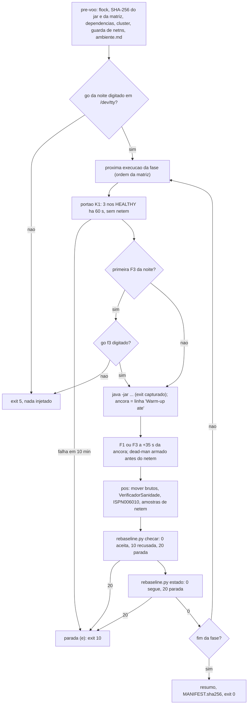

# Prompt do *runner* e da análise do *rebaseline* (2026-10-23)

> Senior, 2026-10-23. Implementa a parte operacional e analítica da DT-009
> (`docs/pre-registro-rebaseline-aprovado-2026-10-23.md`, abreviado **PR** abaixo, com seções §n).
> Decisões do Gestor aplicadas: R5 (*runner* e análise novos, sem tocar `scripts/run-baseline.sh`),
> R6 (`go` presente no início de cada noite e antes da primeira F3), R7, R8, R9 e R10.
> Referências `arquivo:linha` lidas em `96c8045`. Sem push.

## 1. Escopo, base e paralelismo

**Arquivos, todos novos:** `scripts/run-rebaseline.sh`, `scripts/run-rebaseline.test.sh`,
`scripts/rebaseline_matriz.py`, `scripts/test_rebaseline_matriz.py`, `analysis/rebaseline.py`,
`analysis/test_rebaseline.py` e *fixtures* em `analysis/fixtures/rebaseline/`. Nenhum arquivo
existente é editado: nem `run-baseline.sh`, nem `inject-*.sh`, nem `percentis.py`,
`compare_scenarios.py`, `bootstrap_ic.py`, nem nada de `workload/`.

**Paralelo ao B-43.5: sim.** Os conjuntos de arquivos são disjuntos (B-43.5 só mexe em
`workload/src/main` e cria testes e `runs/b43-5-smoke/`). Nenhum dos dois depende do outro em tempo
de desenvolvimento: o B-43.5 não muda stdout, CSV nem *dry-run*, e o *runner* e a análise só leem
esses formatos. Duas worktrees, a mesma base, integração em qualquer ordem por *fast-forward* depois
de *rebase* trivial. Recursos do *host*: o B-43.5 usa um *cluster* Podman local no *smoke*; o *runner*
é testado só com *shims*, sem *cluster*, então os dois não disputam portas.

**Base:** `<BASE>` = ponta de `feature/controlador-integracao` depois da integração do B-43.9 com a
correção F-1 (a mesma base do B-43.5). Motivo: a análise lê as linhas `Auditor I2:`, `Auditor total:`
e `Login:` criadas pelo B-43.9, e o oráculo de regressão é `runs/b43-9-smoke/` (seção 5, A12). Começar
antes da integração exigiria basear numa branch não integrada e refazer a base depois; não recomendo.

## 2. Fluxo de uma noite



## 3. Prompt para o Worker

````text
Você é o WORKER. Uma entrega: runner e análise do rebaseline. Commits só locais. NÃO faça push.
NÃO use a VM: tudo é testado no host com shims e fixtures. Leia antes:
docs/pre-registro-rebaseline-aprovado-2026-10-23.md (PR) e a DT-009/DT-010 de
docs/decisoes-tecnicas.md. O que o PR fixa NÃO é parâmetro livre: valores do PR entram como
constantes nomeadas, com a seção do PR no comentário.

Base: <BASE> (o Senior informa o SHA). Branch feature/rebaseline-runner-analise, worktree
../wt-rebaseline. Arquivos NOVOS apenas (lista no topo do prompt); se precisar editar qualquer
arquivo existente, PARE e reporte. `git diff --quiet <BASE> HEAD -- scripts/run-baseline.sh
scripts/inject-crash.sh scripts/inject-jitter.sh analysis/percentis.py analysis/compare_scenarios.py
analysis/bootstrap_ic.py workload` tem de valer no fim.

==================================================================== A. scripts/rebaseline_matriz.py
Python 3, só biblioteca padrão.
  gerar --ordem-seed 231023 --s0 50000 --saida <tsv>
Lista canônica (PR §2): para cenario em (S1, S2), modo em (sync, async), falha em (none, F1, F3), nessa
ordem de aninhamento; rótulo "<cenario>-<modo>-<falha>". Rodada r: lista = canônica copiada;
random.Random(ORDEM_SEED * 1000 + r).shuffle(lista). Rodada 0 = piloto (i = 1000 + posição); rodadas
1..10 = campanha (i = 12*(r-1) + posição). seed = S0 + 100*i. Colunas do TSV, nesta ordem:
  i  fase(piloto|campanha)  noite(piloto|noite1|noite2)  rodada  posicao  celula  cenario  modo  falha  seed
noite1 = rodadas 1..5, noite2 = rodadas 6..10. Linhas ordenadas pela ordem de execução (piloto
primeiro). Imprime o SHA-256 do arquivo gerado. Testes (scripts/test_rebaseline_matriz.py, unittest):
  M1 cada rodada é uma permutação das 12 células; 132 linhas; i únicos; seeds = S0 + 100*i;
  M2 determinismo: duas gerações dão bytes idênticos;
  M3 a ordem das rodadas 0..10 é CONGELADA no teste como constante (calcule-a uma vez e registre-a no
     relatório; o teste falha se uma versão do Python mudar o shuffle);
  M4 ORDEM_SEED diferente muda a ordem de pelo menos uma rodada;
  M5 R-S2: nenhum par sementeThread = seed + tid + 1*1_000_003 coincide entre linhas, tid 0..3.

==================================================================== B. scripts/run-rebaseline.sh
Bash, `set -euo pipefail`, roda DENTRO da VM em tmux com o cluster rootful. Sem `|| true` no workload,
no verificador, nos injetores nem no checar/estado: todo exit é capturado com `rc=0; cmd || rc=$?` e
tratado. Opções:
  --matriz <tsv> --matriz-sha256 <hex>   (recusa se o sha256 do arquivo for outro: exit 4)
  --jar <jar> --jar-sha256 <hex>         (idem: exit 4)
  --fase piloto|noite1|noite2|reposicoes
  --saida <dir>                          (padrão runs/rebaseline; uma subpasta por execução)
  --cluster-criado-apos <ISO-8601>       (recusa se algum isn1..3 tiver .Created anterior: exit 4;
                                          garante que o cluster é o recriado depois do S7, PR §5)
  --servers, --username, --password      (padrão 127.0.0.1:11222,11223,11224 / admin / da env)
  --dry-run                              (só lista o plano; não exige jar, podman, sudo nem tty)
Constantes do PR (§2): DURACAO=300, WARMUP_MIN=30, THREADS=4, INJ_OFFSET=35, F1_DUR=60,
F3_DELAY=20ms, F3_JITTER=13ms, F3_DIST=normal, F3_DUR=265, NO_ALVO=isn2, IFACE=eth0. Não são
opções de linha de comando.
Variáveis: PODMAN (padrão "sudo podman", exportada aos injetores), JAVA (padrão java).
Exit codes: 0 fase concluída; 2 uso; 3 dependência ausente; 4 pré-voo recusado; 5 go não dado;
6 erro de infraestrutura (injetor com exit inesperado, netem residual que não sai, dead-man que não
arma); 10 parada automática por critério (PR §6). Imprima o exit e o motivo na última linha do log.

Pré-voo, nesta ordem, gravando <saida>/<fase>/ambiente.md:
  1. Reexecutar-se sob `flock -n /var/lock/tcc-vm.lock` (lock ocupado: exit 4).
  2. sha256 de matriz e jar; dependências (java, python3, curl, sudo -n true, nsenter, tc,
     systemd-run, systemctl, flock); containers isn1..isn3 running; --cluster-criado-apos.
  3. Guarda de netns (padrão R4 de inject-netdegrade.sh:540-551): o netns de cada isnN difere do
     netns do PID 1; senão exit 4 (não degradar a NIC da VM).
  4. Linha de base de ISPN006010 por nó (podman logs), para K8.
  5. ambiente.md: date -u, uname -a, java -version, podman version, `ip -br addr`, `ip -br link`
     (MAC do eth0), sha256 do jar e da matriz, versão do python3, lista de execuções da fase.
Gate da noite (R6), gravado em gates.json: imprime o plano (i, célula, semente, hora estimada de cada execução e da
primeira F3) e lê UMA linha de /dev/tty; aceita só `go <fase> <AAAA-MM-DD do dia>`; outra coisa:
exit 5 sem injetar nada. Antes da PRIMEIRA execução F3 da fase, outro gate: `go f3 <i>`. Grave os dois
com o instante UTC em <fase>/gates.json. Leitura de outro arquivo no lugar de /dev/tty só com
RB_MODO_TESTE=1, e nesse modo o script recusa (exit 4) um PODMAN que não seja shim do diretório de
teste.
Por execução (diretório <saida>/exec-<iiii>-<celula>/):
  a. Portão K1: os 3 health endpoints (porta 11222..11224, /rest/v2/cache-managers/default/health)
     com cluster_health.health_status HEALTHY e number_of_nodes = 3 em todas as amostras dos últimos
     60 s (amostra a cada 5 s), e `tc qdisc show dev eth0` sem netem nos 3 netns. Até 10 min; senão
     parada (e). Grave portao.json com as amostras.
  b. Workload: exatamente a invocação de PR §2 (--seed da matriz, --csv-dir num scratch próprio),
     stdout+stderr em stdout.log. O runner mantém em execucao.json, por execução, os exits
     (workload, injetor, verificador), os instantes UTC (lançamento, âncora, disparo, fim) e as
     amostras de netem; os nomes abaixo entre chaves são campos desse JSON.
  c. Âncora: o instante em que a linha "Warm-up ate +" aparece no stdout.log (polling ≤ 200 ms;
     timeout 120 s: mata o workload e registra recusa K6 por "sem âncora"). O +35 s do PR é contado
     da âncora (o início do aquecimento, PR §2). No smoke B-43.9 o processo S1/S2 durou de 11 a 23 s
     além de --duration (JVM, reset e carga de 200 000 entradas antes do aquecimento, auditor e
     gravação depois; wt-b43-9/runs/b43-9-smoke/tempos.txt, não versionado), e o run-baseline.sh
     antigo contava o atraso do lançamento do processo (run-baseline.sh:151-152), o que deslocaria a
     falha por um valor variável.
  d. F1: em +35 s, `inject-crash.sh --node isn2 --duration 60` (log em injetor.log, exit em
     {injetor_exit}). Depois do exit do injetor, espere 3 nós HEALTHY por até 180 s; senão parada
     (e). F3: ANTES do injetor, arme o dead-man `systemd-run --unit tcc-heal-rb-<i> --on-active=<F3_DUR
     + 90>s` com `nsenter -t <pid de isn2> -n tc qdisc del dev eth0 root`; em +35 s,
     `inject-jitter.sh --node isn2 --iface eth0 --delay 20ms --jitter 13ms --distribution normal
     --duration 265`; amostre `tc qdisc show` em +60 s e +280 s ({netem_amostras}); depois do
     exit do injetor, confirme ausência de netem, então desarme o dead-man (systemctl stop
     tcc-heal-rb-<i>.timer; confirme que não sobra timer tcc-heal-rb-*). netem residual: tente
     remover uma vez; se continuar, exit 6.
     Grave {inj_inicio_offset_s} = (instante do disparo − âncora) em segundos com 3 casas.
  e. Pós: mova rep-001.csv, violacoes-rep-001.csv, meta-csv-rep-001.json, estado-rep-001.json,
     carga-rep-001.json e o que mais o workload escrever para o diretório da execução; rode
     `$JAVA -cp <jar> br.unipampa.tcc.session.VerificadorSanidade --csv rep-001.csv --scenario
     <S1|S2> --saida sanidade.json` (exit em {verificador_exit}); conte ISPN006010 por nó
     (ispn006010.json, contagem desde a criação do cluster).
  f. `python3 -I analysis/rebaseline.py checar --exec <dir> --matriz <tsv>`: 0 aceita, 10
     recusada (o script continua), 20 parada (exit 10). Depois `python3 -I analysis/rebaseline.py
     estado --saida <saida> --matriz <tsv>`: 0 segue, 20 parada (exit 10). Outro exit: 6.
Fase reposicoes: lê a lista de reposições pendentes de `rebaseline.py estado --listar-reposicoes`,
atribui i = 120, 121, ... na ordem das recusas, grava reposicoes.tsv (mesmas colunas da matriz,
fase=reposicao) e imprime o seu sha256 antes do gate.
trap EXIT INT TERM: mata o injetor em segundo plano; se havia F3 ativa, remove o netem e só então
desarma o dead-man; se o runner parou isn2 (F1 em curso), `podman start isn2`; nunca apaga brutos.
Fim da fase: resumo.json e resumo.md (execuções aceitas/recusadas e motivos) e MANIFEST.sha256 da
fase, cobrindo TODOS os arquivos, inclusive os .csv/.log/.txt que o .gitignore:20-22 deixa fora do
git. O que tem de ser versionável (execucao.json, checagem.json, estado.json, portao.json, ispn006010.json,
sanidade.json, resumo.*, MANIFEST.sha256, matriz.tsv, reposicoes.tsv) não usa .txt nem .log.

Testes (scripts/run-rebaseline.test.sh, auto-contido como inject-jitter.test.sh, shims em PATH para
java, podman, sudo, nsenter, tc, curl, systemd-run, systemctl, flock e sleep, com relógio acelerado
por shim; sem cluster, sem rede):
  R1 --dry-run lista as 12 execuções do piloto na ordem da matriz, com seeds 50000 + 100*i, e não
     chama java/podman/sudo.
  R2 matriz ou jar com sha256 errado: exit 4, nenhum java chamado.
  R3 gate: texto errado → exit 5 e nenhum injetor chamado; texto certo → segue; gate f3 pedido uma
     única vez por fase, antes da primeira F3 (e não antes de F1 ou none).
  R4 âncora: o java falso imprime "Warm-up ate" após N s; o disparo do injetor ocorre em
     N + 35 s (± 1 s de relógio do shim); sem a linha em 120 s → workload morto, recusa K6.
  R5 exits do workload 0, 2, 3 e 5 chegam a execucao.json sem `|| true` (e grep prova que não há
     `|| true` nas linhas que chamam java, VerificadorSanidade, inject-*, rebaseline.py).
  R6 F3: systemd-run chamado ANTES do inject-jitter; systemctl stop depois da remoção; netem
     residual persistente → exit 6.
  R7 F1: cluster não volta em 180 s → exit 10 com motivo (e).
  R8 trap: SIGTERM durante F1 → `podman start isn2`; durante F3 → `tc qdisc del` e depois
     systemctl stop.
  R9 checar com 10 → segue para a próxima; checar com 20 ou estado com 20 → exit 10.
  R10 guarda de netns: isn2 com o netns do PID 1 → exit 4.
  R11 RB_MODO_TESTE ausente → leitura só de /dev/tty; PODMAN real com RB_MODO_TESTE=1 → exit 4.
  R12 os comandos java montados batem, argumento por argumento, com a invocação de PR §2.

==================================================================== C. analysis/rebaseline.py
Python 3. Subcomandos `checar` e `estado` só com biblioteca padrão (rodam na VM); `tabelas` e
`piloto` podem usar numpy/scipy (rodam no host; analysis/requirements.txt já os tem). Constantes do
PR com a seção no comentário: P0 = 0.05, Z = 3.2905, THREADS = 4, S0 = 50000, BOOT_SEED = 231024,
N_BOOT = 10000, N_MIN_P99 = 1000, N_MIN_P999 = 10000, MIN_EXEC_CONTRASTE = 8, ALFA = 0.05,
INJ_OFFSET = 35, INJ_TOL = (34.0, 37.0).
Definições de C1..C9 iguais às de runs/b43-9-smoke/analise.py (parte S1/S2), que você COPIA para
funções novas (o arquivo selado não é editado nem importado), com estas mudanças do PR:
  - R7: com falha, C1/C2 usam como denominador os Validate isolados (chave sid-) com return_code
    VALID ou INVALID; os outros desfechos de Validate isolado são contados à parte. Sem falha a
    definição coincide com a antiga (teste A3).
  - C4, C5 e B438 (invalidacao_perdida = conflito_esgotado = 0) são recusa em `none` e só reportados
    em F1/F3 (PR §6, K5).
  - Violações: de violacoes-rep-001.csv; I2 conta só com invariante == "I2" e classificacao ==
    "REAL"; `Violacoes detectadas:` do stdout é lido e gravado só como informação, nunca usado.
checar --exec <dir> --matriz <tsv>: avalia K1..K10 (PR §6) da execução e grava checagem.json com
cada critério {valor, limite, ok, papel: recusa|parada|reportado}, o veredito (ACEITA, RECUSADA,
PARADA) e os motivos. K6 usa {injetor_exit}, injetor.log, {netem_amostras} e
{inj_inicio_offset_s} de execucao.json (fora de INJ_TOL: recusa). K7: seed= e rep= da linha Configuracao: iguais aos
da matriz para aquele i (rep = 1). K8: >1 ISPN006010 por nó desde a criação do cluster → PARADA. K9:
SYNC sem falha com I1, I4, qualquer I2 (qualquer classe), `Auditor I2:` não zerada (inclusive
sem_marco, DT-010) ou revertido_por_bloqueio > 0 → PARADA; SYNC com falha → reportado. K10: ASYNC,
reportado. Exit 0/10/20; 2 para uso inválido ou arquivo obrigatório ausente (que é tratado como
infraestrutura pelo runner).
estado --saida <dir> --matriz <tsv> [--listar-reposicoes]: lê todos os checagem.json da campanha
(fase campanha e reposicao; o piloto é avaliado à parte e nunca conta) e aplica as paradas (a), (b),
(c), (d) do PR §6: duas recusas na mesma célula; mais de 6 recusas no total; qualquer PARADA; duas
reprovações de C3 ou o C3 agregado (soma de k e de n das execuções aceitas) fora do IC. Também
R-S3 da matriz inteira (par seed/rep repetido → PARADA). Grava estado.json; exit 0 ou 20. Com
--listar-reposicoes imprime as células com recusa isolada ainda não reposta (no máximo uma por
célula), na ordem do i recusado.
tabelas --saida <dir> --matriz <tsv> --destino <dir>: só execuções ACEITAS.
  - Por execução e operação (Login OK; Validate VALID|INVALID; Logout NONE; IncrementFailure
    COUNTED; ResetFailures NONE, só S1; Validate e Logout também separados em isolado (sid-) e
    tríade): n, p50, p95, p99 (posto mais próximo: ordenado[ceil(p*n) - 1]), p99,9 se n ≥ 10 000,
    taxa por return_code, vazão (eventos válidos / duração da janela, primeiro a último start_ns).
    p99 = None se n < 1000.
  - Por célula: n de execuções com p99, média, mediana, mínimo e máximo dos p99.
  - Contrastes (PR §7): F1 − none e F3 − none por (cenário, modo, operação); ASYNC − SYNC por
    (cenário, falha, operação). Diferença das médias; IC 95 % por bootstrap percentil reamostrando
    execuções com reposição, independentemente nas duas células, N_BOOT reamostragens, gerador
    numpy.random.default_rng(numpy.random.SeedSequence([BOOT_SEED, k])) com k = índice do
    contraste na lista ordenada de rótulos "<tipo>|<cenario>|<modo ou falha>|<operacao>";
    Mann-Whitney bilateral (scipy.stats.mannwhitneyu, alternative="two-sided", method="auto")
    sobre os p99 por execução. Menos de 8 execuções com p99 em qualquer das duas células:
    "não estimado".
  - Saídas: rebaseline-resultados.json (tudo acima), por-execucao.csv, contrastes.csv,
    tabela5-f1.tex e tabela6-f3.tex (linhas cenário × operação como as Tabelas 5 e 6 antigas;
    colunas Sem falha, F, Variação [IC 95 %] para SYNC e para ASYNC; ms com 2 casas e vírgula
    decimal no formato {,} do LaTeX; "(n.s.)" quando p ≥ 0,05; "—" quando não estimado) e
    tabela-async-sync.tex. Cabeçalho de cada .tex com o SHA-256 do jar e da matriz e a data.
piloto --saida <dir> --matriz <tsv>: para a rodada 0, por célula: veredito, motivos, n por operação,
n de Validate isolados por terço (e a chance aproximada de falsa recusa de C1 pela aproximação
normal da diferença de duas proporções), operações sem p99, duração real de cada execução. Saída
piloto.json e piloto.md, insumo do parecer do Senior (PR §8).
Testes (analysis/test_rebaseline.py, unittest; fixtures pequenas geradas no próprio teste em tmp ou
versionadas em analysis/fixtures/rebaseline/, nenhuma maior que 200 kB):
  A1 percentil por posto mais próximo em listas conhecidas; n = 999 → p99 None; n = 1000 → valor.
  A2 só desfechos válidos entram: ERROR_TRANSPORT, NOT_FOUND e BLOCKED ficam fora dos percentis e
     entram nas taxas.
  A3 R7: fixture F1 com Validate isolados ERROR_*: C1/C2 pelo denominador VALID|INVALID; a mesma
     fixture sem os erros dá o mesmo resultado que a definição antiga.
  A4 C3 pelo IC (casos de runs/b43-9-smoke/test_analise_c3.py: dentro, fora por cima, fora por
     baixo, n insuficiente, meia-largura 0,145 p.p. para n = 245 204).
  A5 K5 em none recusa; em F1/F3 só reporta.
  A6 K7: seed ≠ S0 + 100*i → RECUSADA; dois exec com o mesmo par → estado PARADA.
  A7 K9: SYNC none com sem_marco = 1 → PARADA; ASYNC none com sem_marco = 1 → ACEITA com reportado;
     SYNC F1 com I1 = 1 → ACEITA com reportado.
  A8 violações: violacoes CSV com I2_JANELA_CASCATA e I2 classificacao ESPERADA-POR-DESENHO não
     contam; stdout com `Violacoes detectadas: 7` e CSV vazio → 0 violações.
  A9 K6: offset 33,9 s → recusa; 35,2 s → ok; F3 sem netem na amostra de +60 s → recusa; F1 com
     injetor exit 4 → recusa.
  A10 estado: (a) duas recusas na mesma célula → 20; (b) 7 recusas em células diferentes → 20;
     (d) duas reprovações de C3 → 20; agregado de C3 fora → 20; piloto nunca conta.
  A11 bootstrap: mesmo resultado em duas chamadas; mesmo resultado com a lista de contrastes
     embaralhada antes do cálculo; 7 execuções numa célula → "não estimado"; caso sintético
     com diferença conhecida tem a diferença dentro do IC.
  A12 regressão opt-in: os CSV e stdout do smoke B-43.9 NÃO estão no git (.gitignore:20-22 ignora
     runs/**/*.csv, *.log e *.txt); o teste lê o diretório dado por REBASELINE_ORACULO_DIR (no host:
     C:/Users/Francesco/Development/tcc/wt-b43-9/runs/b43-9-smoke, só leitura) e pula com aviso se a
     variável não existir. Para Q3, Q4 e Q5 (S1/S2 v3, sem falha), C1, C2, C3 e C5 calculados pelas
     funções novas batem com o analise.json desse diretório (mesmas contagens; frações na 4ª casa).
  A13 tabelas: fixture de 2 células × 8 execuções sintéticas gera tabela5-f1.tex com vírgula
     decimal, "(n.s.)" e "—" nos lugares certos.

==================================================================== Ordem dos commits
Todo commit deixa os testes que já existem passando; cada commit `test:` traz os testes vermelhos da
peça seguinte (registre os vermelhos no relatório).
  1. test: test_rebaseline_matriz.py (vermelho)        2. feat: rebaseline_matriz.py
  3. test: test_rebaseline.py, A1..A10 e A12 (vermelho) 4. feat: rebaseline.py checar/estado
  5. test: A11, A13 (vermelho)                          6. feat: rebaseline.py tabelas/piloto
  7. test: run-rebaseline.test.sh (vermelho)            8. feat: run-rebaseline.sh
  9. docs: docs/relatorio-rebaseline-runner-<data>.md (inclui a ordem congelada de M3, a saída do
     --dry-run do piloto e da noite 1 e o resultado de A12).
Mutantes (script no scratchpad, suíte completa por mutante, fonte restaurado; todos morrem):
  X1 runner com `|| true` no java → R5;   X2 disparo contado do lançamento do processo → R4;
  X3 gate f3 omitido → R3;   X4 dead-man armado depois do inject-jitter → R6;
  X5 R7 desligado (denominador com erros) → A3;   X6 I2 contada sem filtrar REAL → A8;
  X7 K9 só reportado em SYNC → A7;   X8 bootstrap reamostrando eventos em vez de execuções → A11
  (caso sintético com execuções heterogêneas, em que o IC por eventos fica estreito demais);
  X9 percentil interpolado (numpy padrão) em vez de posto mais próximo → A1;
  X10 shuffle com semente sem o *1000 + r → M3.
Ao terminar: SHAs, worktree, `git status`, Surefire inalterado (rode `mvn -q -o -f workload/pom.xml
test` uma vez no fim só para provar que nada em workload mudou) e pare. Não integre, não faça push.
````

## 4. Critérios de aceite

1. Só arquivos novos; o `git diff --quiet` da lista de protegidos vale.
2. M1..M5, R1..R12 e A1..A13 verdes (A12 executado de fato, não pulado, no *host* do Worker); X1..X10
   mortos, com os testes que mataram cada um.
3. `--dry-run` do piloto e da noite 1 mostrando, na ordem da matriz, i, célula e semente; o comando
   `java` montado bate com PR §2.
4. A ordem congelada (M3) registrada no relatório; o Senior a confere antes do complemento da DT-009.
5. Nenhum `|| true` nas chamadas de medição, injeção, verificação e checagem.

## 5. Como isso se encaixa no restante

| Momento | O que acontece |
|---|---|
| Integração do *runner*/análise e do B-43.5 | o Senior valida as duas entregas e propõe o *fast-forward* |
| Complemento da DT-009 | SHA da ponta, SHA-256 do jar, do *bundle* e de `matriz.tsv` (gerada por `rebaseline_matriz.py gerar`), instante de criação do *cluster* |
| *Bundle* da VM | inclui o jar, `scripts/run-rebaseline.sh`, `scripts/rebaseline_matriz.py`, `scripts/inject-crash.sh`, `scripts/inject-jitter.sh`, `analysis/rebaseline.py` e `matriz.tsv`, conferido por *hash* |
| Depois do S7 | *cluster* recriado; `--cluster-criado-apos` recebe esse instante |
| Noite 0 | `--fase piloto`; gate da noite e gate F3 com o Gestor; `rebaseline.py piloto` de dia; parecer do Senior; liberação pelo Gestor |
| Noites 1 e 2 | `--fase noite1` e `--fase noite2`; reposições ao fim da noite 2 ou numa noite curta |
| Depois | `rebaseline.py tabelas` no *host*; validação do Senior contra os brutos; resumo para os agentes acadêmicos |
