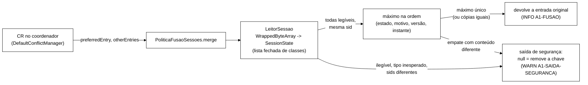

# Relatório da A1: política de fusão própria do `sessions-async`, com a remoção como saída de segurança (2026-11-06)

Branch `feature/merge-policy-semirreticulado` (worktree `wt-a1`), a partir da tag `int/2026-11-06-bench` (`cc2b71c`).
Sem *push* e sem integração. Base da tarefa: `wt-plano-ctrl/docs/alternativas-tratamento-cluster-2026-11-06.md`
(Senior, `d4b9c2a`), seções 2.1 (A1) e 2.2 (A2), e a decisão do Gestor de 06/11. Decisão técnica: TD-020 em
`docs/implementacao.md`; testes em `docs/testes.md` (seção "A1").

## 1. Problema

Numa partição que isola o isn3 (`ASYNC`, `DENY_READ_WRITES`, `PREFERRED_NON_NULL`), o isn3 continua confirmando
escritas das chaves de que é dono primário até detectar o corte (~42 a 47 s). Se a sessão existia nos dois lados antes
do corte e o *logout* é confirmado pelo isn3, a cópia da maioria fica `VALID`. Na fusão, a resolução de conflitos (CR)
do coordenador entrega a cópia da maioria em `preferredEntry` e a do isn3 em `otherEntries`; `PREFERRED_NON_NULL`
devolve a da maioria e o *logout* se perde (I1 da varredura).

## 2. O que foi implementado

- **Módulo `extensao-servidor/`** (JAR `tcc-extensao-servidor.jar`, Infinispan 15.0.21 `provided`), com
  `META-INF/services/org.infinispan.conflict.EntryMergePolicy` e a classe
  `br.unipampa.tcc.servidor.PoliticaFusaoSessoes` (guia *Configuring Infinispan* 15.0, §7.6).
- **Regra.** Entre a preferida e as outras, a entrada máxima na ordem (posto do estado, posto do motivo, versão,
  `atualizadaEm`), com os postos do T2 do B-45 (`fix/b45-desempate-ts`, `spec/SessionStore.tla:233-235`):
  `VALID` 1 < `INVALID` 2 e `NONE` 0 < `LOGOUT` 1 < `EXPIRADA` 2 < `ADMIN_BLOCK` 3. Conteúdo antes da versão. A chave
  ausente é o menor valor. Devolve a entrada original (valor e metadados intactos, sem reserializar); com cópias
  iguais, a preferida.
- **Formato do valor.** Os *caches* não declaram `encoding` (`ISPN000599` no log do servidor), então o valor chega
  como `WrappedByteArray` com a serialização Java que o cliente Hot Rod grava (`JavaSerializationMarshaller` do
  commons 15.0.0, um `ObjectOutputStream`). A política desserializa só para decidir, com `resolveClass` restrito a
  `SessionState`, aos dois `enum`, a `java.lang.Enum` e a `java.time.Ser`, e com o filtro da JVM (limites e
  `java.time.Instant` só como resultado do `readResolve`). O JAR leva uma cópia idêntica de `SessionState`.
- **Saída de segurança (A2) dentro da política.** Valor ilegível, tipo inesperado, empate que a ordem não resolve,
  sids diferentes sob a mesma chave ou erro interno: devolve `null` (a CR remove a chave), com uma linha
  `A1-SAIDA-SEGURANCA motivo=...` em WARN. A política nunca lança.
- **Escopo.** Só o `sessions-async` (`cluster/caches/sessions-async.json`). O `counters-async` fica com
  `PREFERRED_NON_NULL`, porque `desbloquear` e `resetar` quebram o semirreticulado do `IdentityState` (escolher um
  registro inteiro desfaria um desbloqueio legítimo ou faria o contador descer). O `canario-async` e os SYNC também
  ficam como estavam. `cluster/podman-compose-sem-caches.yml` monta o JAR em `server/lib` nos três nós.

## 3. Testes

| Onde | Resultado |
|---|---|
| `extensao-servidor` (`mvn -f extensao-servidor/pom.xml test`) | vermelho em `f5da120` (esqueleto da API: 46 testes, 38 falhas); verde em `04719ee`: **47 testes, 0 falhas** |
| *Workload* (`mvn -f workload/pom.xml test`) | `ValoresServidorA1Test` (novo), `CachesCargaJsonTest` e `ClusterSemCachesXmlTest` ajustados; suíte completa **1177 testes, 0 falhas, 1 ignorado** (o mesmo de antes) |

Destaques: valores reais serializados como o cliente faz (arquivo gerado com as classes e o *marshaller* do cliente e
conferido nos dois módulos); todas as combinações de preferida (ou nula) com até três outras, em todas as ordens
(8 200 casos); semirreticulado; saída de segurança por motivo; entrada nula; parser e leitura de volta da REST
(`?action=config`) iguais ao arquivo, byte a byte. Detalhe em `docs/testes.md`.

## 4. Teste no *cluster* local

Harness em `runs/a1-smoke/` (comandos, desvios e manifesto em `runs/a1-smoke/comandos.md`), no estilo do W-10 e do
W-2b: projeto Podman próprio `a1`, portas 12801 a 12803, máquina Podman do WSL, sem VM. O Worker da A4 usava ao mesmo
tempo o projeto `a4` (12901 a 12903) na mesma máquina. Os dois braços montam o mesmo JAR; só o `merge-policy` do
`sessions-async` muda (`caches-a1/` × `caches-controle/`, este igual à tag). O programa de carga é o *jar* do *bundle*
da recalibração (`7d5fc2fe…`), com a carga L+, `--s3-replay-probe --sweep`, `--controller off`; o isn3 é cortado por
`nftables` no *netns* (o WSL não tem `tc`) por 90 s.

### 4.1 Configuração e formato confirmados no servidor

- `cria-caches.sh --conferir` passou nos três nós e `GET /rest/v2/caches/sessions-async?action=config` devolveu
  `"merge-policy":"br.unipampa.tcc.servidor.PoliticaFusaoSessoes"` em isn1, isn2 e isn3 (`config-sessions-async-isnN.json`
  de cada execução A1); `counters-async` com `PREFERRED_NON_NULL` nos três.
- `A1-POLITICA carregada` nos três nós em todas as execuções A1 (no isn1 duas vezes: o parser da REST e a criação).
  A CR de fusão rodou no coordenador da vista unida, que variou: isn1 (`a1-s700400`, `mecanismo-a1`) e isn3
  (`a1-s701300`). Por isso o JAR tem de estar nos três.
- **Formato real.** A linha `A1-FORMATO` registrou `classe=org.infinispan.commons.marshall.WrappedByteArray bytes=575`
  (ou 552) com o hexadecimal; desserializado com as classes e o *marshaller* do próprio cliente
  (`scripts/LerFormato.java`), dá o `SessionState` gravado pela carga (`formato-decodificado.out`). É o formato que os
  testes unitários usam.
- `ISPN000599` (sem `encoding`) no `sessions-async`, como previsto.

### 4.2 Execução de preparo (fora da comparação)

`preparo-a1-s700400-d300`, com 300 s como a recalibração: a cura levou 38 s no `podman machine ssh` e a fusão não
aconteceu antes da varredura (nenhuma CR do `sessions-async` nos logs). O laço de convergência só confere I5/I6
(contadores), não a vista do *cluster*, então a varredura rodou com o isn3 fora. As quatro execuções da comparação
usaram **480 s** (desvio declarado; o programa escala o aquecimento e o corte cai em +80 s), e o *harness* passou a
registrar o relógio da máquina do Podman em volta do `nft`. Nas quatro, a CR de fusão veio 38 a 49 s depois da cura,
bem antes do fim da carga.

### 4.3 Tabela A1 × controle (carga L+, 480 s, mesmas sementes)

"Pré-existentes" são os *logouts* confirmados pelo isn3 isolado (depois das regras e antes do `DEGRADED`) em sessões
que já existiam antes do corte: só nelas a maioria tem a cópia `VALID` e `PREFERRED_NON_NULL` desfaz o *logout*. Os
demais são sessões criadas no próprio isn3 durante o corte; a maioria não tem cópia, a preferida chega nula e as duas
políticas ficam com o `INVALID` do isn3.

| Execução | Política | Semente | Corte efetivo | isn3 `DEGRADED` | CR de fusão depois da cura (nó) | *Logouts* confirmados pelo isn3 isolado (pré-existentes) | Decisões da A1 | A1 escolheu `INVALID` onde o PNN daria `VALID` | Saída de segurança | I1 REAL da varredura | I1 online na recuperação | I1 da sonda, sids: durante / recuperação | `ISPN000466` |
|---|---|---|---|---|---|---|---|---|---|---|---|---|---|
| `a1-s700400` | A1 | 700400 | 94,5 s | +47,3 s | 48,1 s (isn1) | 4 (0) | 74 | 0 | 0 | **0** | 0 | 1 / 0 | 0 |
| `controle-s700400` | PNN | 700400 | 94,5 s | +47,2 s | 48,7 s (isn2) | 6 (1) | — | — | — | 0 | **1** | 3 / 0 | 0 |
| `a1-s701300` | A1 | 701300 | 93,9 s | +47,4 s | 49,4 s (isn3) | 6 (2) | 82 | **2** | 0 | **0** | 0 | 2 / 0 | 0 |
| `controle-s701300` | PNN | 701300 | 102,6 s | +43,7 s | 38,0 s (isn3) | 5 (2) | — | — | — | **1** | **1** | 2 / 1 | 0 |

PNN = `PREFERRED_NON_NULL`. Fonte: `runs/a1-smoke/analise.out` e `analise.json`; linhas da política em
`linhas-politica.out`.

- **Perda permanente (I1).** Pré-existentes: 2 na A1 e 3 no controle. Na A1, a política escolheu o `INVALID` do isn3
  contra o `VALID` da maioria nas 2 (`4c2891d6`, `5ea22de4`; linha `A1-FUSAO ... vencedora=outra igual_pnn=nao
  pnn=VALID/NONE/v1`), e nenhuma leitura depois da fusão viu `VALID`. No controle, as 3 voltaram a `VALID` na fusão:
  `9b7bb12d` ficou `VALID` até a varredura (I1 REAL, e a sonda tardia também leu `VALID`); `0a5b779b` e `9a761f13`
  foram lidas `VALID` depois da fusão por operações da carga (I1 online, fase de recuperação) e `INVALID` mais tarde pela
  sonda tardia e pela varredura. **A varredura sozinha subconta a perda no controle** (1 de 3); o teste dirigido (4.4)
  mostra por quê.
- **Exposição na janela (não muda com a A1).** A sonda de *replay* leu `VALID` noutro nó logo depois de um *logout*
  confirmado em 1 e 2 sids nas execuções A1, contra 3 e 2 no controle (fase `durante`). É a leitura da cópia velha
  enquanto os lados divergem, antes de qualquer fusão; a política só age na fusão. A diferença que a A1 faz na sonda é
  depois da fusão: 0 leituras `VALID` na recuperação, contra 1 no controle.
- **Saída de segurança: 0 usos** em 182 decisões (156 sob carga e 26 no teste dirigido; todos os valores legíveis,
  nenhum empate, sids iguais). O caminho da A2 foi exercitado só nos testes unitários.
- **Erros.** `ISPN000466` = 0 em todas as execuções; nenhuma linha ERROR ou WARN da classe da política. Os erros dos
  logs são os mesmos nos dois braços: `ISPN000136`/`ISPN005003` (tempo esgotado durante o corte) e `ISPN000319` no
  isn3 isolado ao detectar (`ISPN000317` quando o isn3 era o coordenador).
- Em `controle-s701300` o isn3 era o coordenador antes do corte; a maioria elegeu o isn1 e rodou uma CR só entre isn1 e
  isn2 (troca de coordenador, `ISPN100007`), sem o isn3. A CR de fusão veio depois da cura, no isn3.

### 4.4 Teste dirigido do mecanismo

A carga produz poucos casos pré-existentes por execução (0 a 2), então rodei também um teste sem acaso
(`scripts/mecanismo.sh` + `scripts/MecanismoA1.java`, com o *jar* da carga no *classpath* e a configuração de cliente
do `S3Clientes.base`): 60 sessões `VALID` criadas pelo isn1; corte do isn3; *logout* de cada uma **pelo isn3** com a
mesma sequência do programa (`getWithMetadata` + `replaceWithVersion` com `invalidar(LOGOUT)`), que o isn3 só confirma
nas chaves de que é dono primário; cura depois de 90 s; leitura das confirmadas pelos três nós depois do fim da CR.

| Execução | Política | *Logouts* confirmados pelo isn3 | CR de fusão depois da cura (nó) | Lidas `VALID` depois da fusão via isn1 / isn2 / isn3 | Decisões da A1 nessas chaves | Saída de segurança |
|---|---|---|---|---|---|---|
| `mecanismo-a1` | A1 | 26 | 51,0 s (isn1) | **0 / 0 / 0** (26 `INVALID` nos três) | 26, todas `INVALID` sobre `VALID` | 0 |
| `mecanismo-controle-r1` | PNN | 23 | 44,9 s (isn1) | **21 / 23 / 21** | — | — |

Na A1 a CR entregou a cada chave `P=VALID` (primário da maioria), `O1=VALID` (outra cópia da maioria) e
`O2=INVALID/LOGOUT/v2` (isn3); a política devolveu `O2`. No controle, o `PREFERRED_NON_NULL` devolveu `P`: 23 de 23
*logouts* desfeitos, e em 2 chaves as réplicas ficaram diferentes (`VALID` no isn2, `INVALID` no isn1 e no isn3). Isso é
compatível com a escrita assíncrona do isn3 para o *backup* chegando depois da cura e só a uma das cópias, e explica o
que se viu na carga: depois de uma fusão com `PREFERRED_NON_NULL`, o valor lido depende do nó. Com a A1 a CR já grava
`INVALID` em todos os donos, e uma escrita atrasada do isn3 traz o mesmo conteúdo.

A primeira tentativa do controle (`mecanismo-controle-falha-infra`) abortou na criação dos *caches*
(`ISPN000476`, o isn2 não respondeu em 15 s ao criar o `canario`, enquanto o *cluster* `a4` reiniciava na mesma máquina).
Nada foi medido nela; foi repetida.

## 5. Veredito

**A A1 funciona para a perda permanente.** Em todos os casos em que a CR recebeu a cópia `VALID` da maioria e a cópia
`INVALID` do isn3, a política ficou com a `INVALID`: 2 de 2 sob carga e 26 de 26 no teste dirigido, sem saída de
segurança e sem `ISPN000466`. Com `PREFERRED_NON_NULL`, os mesmos casos voltaram a `VALID`: 3 de 3 sob carga e 23 de 23
no teste dirigido.

**Por quê.** (1) Com `DENY_READ_WRITES` a CR roda na fusão e lê também o isn3 (união dos *hashes*); a cópia dele chega
em `otherEntries`, como o Senior leu no código. (2) O valor chega no formato que a política entende (`WrappedByteArray`
com a serialização Java do cliente, conferido no servidor). (3) A escolha pelo máximo de conteúdo não depende de qual
lado é a maioria; a entrada devolvida é gravada em todos os donos. (4) A classe carrega nos três nós, e a CR rodou em
nós diferentes conforme o coordenador.

**O que a A1 não faz.** Não reduz a exposição na janela (a maioria serve `VALID` desde o *logout* no isn3 até a fusão:
no teste dirigido, ~5 s depois do corte até ~45 a 51 s depois da cura, uns 135 s) nem impede o isn3 de confirmar
escritas antes da detecção. Não cobre o `counters-async`.

**Limites do teste.** Ambiente local (WSL, Podman), não a VM; 2 + 2 execuções com carga e 1 + 1 dirigidas; duração de
480 s em vez de 300 s; a máquina era dividida com o Worker da A4. O número pequeno de casos sob carga é compensado pelo
teste dirigido, que reproduz o mecanismo sem acaso. A saída de segurança não ocorreu no *cluster*.

## 6. Achados para o Senior

1. **A varredura subconta o I1 do controle.** Depois de uma fusão com `PREFERRED_NON_NULL`, réplicas da mesma sessão
   podem ficar diferentes (teste dirigido: 2 de 23). A varredura lê uma cópia por chave; leituras online e a sonda
   tardia por outro nó viram `VALID` onde a varredura viu `INVALID` (2 de 3 casos sob carga). Para comparar A1 ×
   regra atual, a perda permanente deveria somar a varredura, o I1 online da recuperação e a sonda tardia, por sid.
2. **O laço de convergência não espera a fusão.** Ele só confere I5/I6; se a fusão demorar (cura lenta, recuo do TCP),
   a varredura roda antes da CR. A análise deste *smoke* confere a CR de fusão antes do fim da carga; o orquestrador da
   VM não confere.
3. **Integração.** Quem sobe o `podman-compose-sem-caches.yml` precisa do JAR construído antes
   (`mvn -f extensao-servidor/pom.xml package`); o *bundle* por `git archive` não leva `target/`. O orquestrador não foi
   tocado.

## 7. Pontos para validação do Gestor

- **D-1.** A A1 muda a configuração do `sessions-async`. Entra como condição nova pré-registrada (regra atual × A1),
  separada do *rebaseline*, ou substitui a configuração da avaliação? Nesta branch o `cluster/caches/sessions-async.json`
  já está com a A1; o controle usou a cópia da tag.
- **D-2.** `counters-async` continua com `PREFERRED_NON_NULL` (registrado aqui e no TD-020).
- Aprovar a integração da branch (sem *push*) e o passo de construção do JAR no *bundle* da VM.
- Se a medida de perda permanente da avaliação passa a somar varredura, I1 online da recuperação e sonda tardia
  (achado 1).

## 8. Commits

| Commit | Tipo | Conteúdo |
|---|---|---|
| `f5da120` | `test:` | testes antes da implementação (vermelho), arquivo de valores do cliente, esqueleto da API |
| `04719ee` | `feat:` | política, leitura restrita, saída de segurança, serviço, `sessions-async.json`, compose |
| `60817f3` | `test:` | *harness* e brutos do *smoke* local (`runs/a1-smoke/`) |
| este *commit* | `docs:` | TD-020, seção da A1 em `testes.md`, este relatório |
