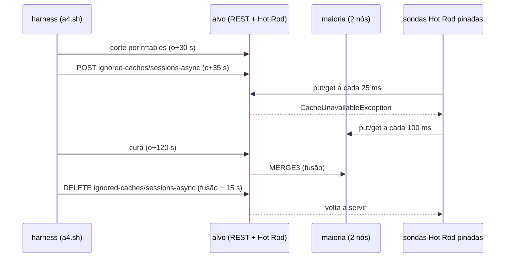
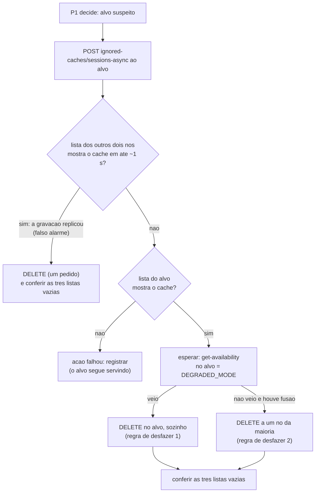

# Relatório A4: mandar o nó suspeito ignorar o cache (`ignored-caches`), medido no cluster local (06/11/2026)

Autor: Worker. Branch `test/a4-ignored-caches`, criada da tag `int/2026-11-06-bench` (`cc2b71c`) na worktree `wt-a4`.
Brutos em `runs/a4-teste/` (`comandos.md`, `MANIFEST.sha256`, `tabela-a4.tsv`, uma pasta por execução). **Só medição**:
nenhum código do controlador, do programa de carga ou dos injetores mudou; não toquei na VM, no h4 nem no runner do
*rebaseline*. Base de leitura: `wt-plano-ctrl/docs/alternativas-tratamento-cluster-2026-11-06.md` (`d4b9c2a`), seção 2.4.

| Termo | Significado |
|---|---|
| alvo | o nó suspeito, que recebe a ação (o `isn3`, ou o `isn2` quando o `isn3` era o coordenador) |
| ignorar | `POST /rest/v2/server/ignored-caches/{cache}` mandado à REST do alvo |
| desfazer | `DELETE` no mesmo caminho |
| parar | `POST /rest/v2/server?action=stop` (o AC-5 de hoje) |
| recusa | a primeira operação Hot Rod do alvo que volta com erro depois do pedido (sonda pinada no alvo, a cada 25 ms) |
| t | segundos desde o envio do pedido da ação (antes do 401 do Digest) |

## 0. Resposta curta

1. **Sob corte, a recusa é imediata e fica só no alvo.** Nas seis execuções com corte em que o `sessions-async` foi
   o único ou o primeiro pedido, a primeira operação Hot Rod recusada no alvo (`CacheUnavailableException`) veio entre
   **16 e 70 ms** depois do pedido, e o alvo não confirmou nenhuma escrita desse cache depois disso (0 a 2 escritas
   iniciadas depois do envio, todas terminadas até 42 ms, antes de o pedido chegar ao servidor). A maioria não recusou
   nada, e a lista dela ficou vazia nas oito execuções com corte e ação de ignorar. O pedido HTTP responde **500 depois
   de 15 s** (`ISPN000476`), com o efeito já valendo.
2. **A parada (AC-5) sob o mesmo corte leva 13,1 s.** O alvo confirmou escritas até 13,107 e 13,118 s e recusou a
   partir de 13,140 e 13,151 s (n = 2; ~470 escritas confirmadas por cache depois do pedido). Bate com os 13,1 a 13,3 s
   do I-3. Sem ação, o alvo confirmou escritas até a detecção, 44,3 s depois (1 610 escritas no `sessions-async`).
3. **Sem corte, o falso alarme se espalha em milissegundos.** O `sessions-async` passou a ser recusado nos três nós
   entre 19 e 51 ms depois do pedido (n = 2), e a carga S3 falhou em quase todas as operações nos três servidores de
   aplicação (172 de 174 e 223 de 232) até o `DELETE`. O `DELETE` devolveu o serviço nos três nós em 13 a 72 ms.
4. **A fusão não desfaz a ação.** Depois da cura e da fusão, o alvo continuou recusando o cache até um `DELETE`, nas
   sete execuções com corte e desfazer depois da fusão. O `DELETE` de um cache só, no alvo, respondeu 204 em 11 a 40 ms,
   o alvo voltou a servir em 14 a 52 ms, e a maioria não foi afetada (n = 3).
5. **Achado que muda a forma da ação:** a lista de caches ignorados é **uma chave só, gravada inteira**, e cada pedido
   publica a lista do nó a todos. Pedidos simultâneos perdem atualização: dois POST viraram um cache só nos três nós, e
   dois DELETE deixaram o `sessions-async` **recusado no cluster inteiro** até o fim da execução. Com dois caches
   ignorados no alvo, o primeiro `DELETE` depois da fusão publicou o outro cache à maioria por ~0,1 s.
6. **Veredito: serve como a ação do P1, no lugar do AC-5, com quatro cuidados** (seção 8): um cache só
   (`sessions-async`), um pedido por vez no cluster, efeito conferido pela lista e não pelo HTTP, e guarda de falso
   alarme (se a lista da maioria mostrar o cache, desfazer na hora). **Regra de desfazer:** no próprio alvo, assim que
   ele se vê sozinho (`get-availability` = `DEGRADED_MODE`, leitura local); se esse momento passar, depois da fusão, com
   um `DELETE` mandado a um nó da maioria, que zera a lista do alvo de uma vez. As duas regras foram medidas uma vez
   cada (n = 1) e funcionaram.

## 1. Caminho e método no Infinispan 15.0.21

Conferido no código da *tag* `15.0.21.Final` (`server/rest/src/main/java/org/infinispan/rest/resources/ServerResource.java:135-152`)
e no guia *Using the Infinispan REST API* 15.0, §2.5.3 a §2.5.5 (`leituras/CAND-091-Infinispan15-REST-API.txt`):

| Operação | Caminho | Resposta documentada |
|---|---|---|
| ignorar | `POST /rest/v2/server/ignored-caches/{cache}` | 204, ou 404 se o cache não existe |
| desfazer | `DELETE /rest/v2/server/ignored-caches/{cache}` | 204, ou 404 |
| listar | `GET /rest/v2/server/ignored-caches` | lista JSON dos caches ignorados **deste nó** |

As formas com `{cache-manager}` no caminho continuam aceitas, marcadas como obsoletas. Exigem permissão `ADMIN` (o
`admin` do laboratório tem). Um pedido leva um cache só. A REST checa só se o cache existe
(`ServerResource.java:198-216`); o resto é do `ServerStateManagerImpl` (`server/runtime/.../state/ServerStateManagerImpl.java`):

- `ignoreCache`/`unignoreCache` (`:94-112`) mudam o conjunto em memória do nó **e depois gravam o conjunto inteiro** no
  cache interno de estado (`org.infinispan.CONFIG`, REPL_SYNC), na mesma chave para todos os caches;
- um ouvinte clusterizado (`:282-296`) copia o conjunto gravado para a memória dos outros nós;
- o Hot Rod confere o conjunto em memória a cada pedido e responde `CacheUnavailableException`
  (`server/hotrod/.../HotRodServer.java:398-401`).

Sob corte, a gravação no cache de estado não alcança os outros nós e o pedido responde **500 depois de 15 s**
(`ISPN000476: Timed out waiting for responses for request ... after 15 seconds`, o `remote-timeout` do cache interno),
mas o conjunto em memória já mudou.

## 2. Como foi medido

- **Cluster local** `a4` (portas 12901 a 12903), mesmo XML sem caches, mesma pilha JGroups e os mesmos seis caches da
  base (criados pelo `scripts/cria-caches.sh`). Uma encarnação por execução.
- **Carga:** S3 ASYNC sem controlador (`--controller off`), para medir o mecanismo sem nenhuma política reagindo.
- **Corte:** nftables no netns do alvo, nos dois sentidos, só para os pares JGroups (cópia do `particao-w2b.sh`, o mesmo
  mecanismo do I-3/I-3b; o `inject-partition.sh` usa `tc`, que a máquina WSL não tem). A REST e o Hot Rod do host
  continuam alcançando o alvo.
- **Sondas:** uma JVM por nó, cliente Hot Rod pinado (BASIC, sem retentativa, prazo 1 s), `put` e `get` nos dois caches
  ASYNC, a cada 25 ms no alvo e 100 ms nos outros. O `put` é o sinal de "confirma escrita": sob corte, em ASYNC, o alvo
  confirma o `put` sozinho; o `get` de chave de outro dono espera o prazo, por isso não serve de sinal.
- **Vigia:** lista de caches ignorados de cada nó a cada 100 ms e disponibilidade dos caches ASYNC a cada 500 ms.
- **Casos:** ver `runs/a4-teste/comandos.md`. Os casos com um cache só e em sequência foram criados durante a sessão,
  depois de ver que pedidos simultâneos se perdem (seção 6.1).

## 3. Com o corte: do pedido à recusa no alvo

Instantes em segundos desde o envio do POST do `sessions-async`. "Escritas confirmadas" conta os `put` do
`sessions-async` na sonda do alvo iniciados depois do envio e respondidos com sucesso. Vistas pelo log dos servidores
(`ISPN000094`). As execuções marcadas com (\*) rodaram com o vigia antigo (seção 7.1).

| Execução | Alvo | Corte | Resposta do POST | 1ª recusa no alvo | Escritas confirmadas depois do envio | Recusas na maioria | Vista de 1 no alvo | Vista de 2 na maioria |
|---|---|---|---|---|---|---|---|---|
| `corte-sessoes-r1` | isn3 | −5,13 | 500 em 15,015 s | **0,016** | 0 | 0 | 38,86 | 38,40 |
| `corte-sessoes-r2` | isn3 | −6,00 | 500 em 15,014 s | **0,036** | 1 (terminou em 0,006) | 0 | 44,95 | 44,16 |
| `corte-sessoes-r3` | isn3 | −5,33 | 500 em 15,013 s | **0,020** | 0 | 0 | 38,83 | 38,65 |
| `corte-sequencial-r1` | isn3 | −5,31 | 500 em 15,014 s | **0,018** | 0 | 0 | 45,33 | 44,19 |
| `corte-seq-detec-r1` | isn2 | −4,75 | 500 em 15,014 s | **0,024** | 0 | 0 | 44,27 | 43,43 |
| `corte-seq-maioria-r1` | isn3 | −5,12 | 500 em 15,050 s | **0,070** | 2 (a última terminou em 0,042) | 0 | 40,81 | 40,77 |
| `corte-ignorar-r1` (\*) | isn2 | −5,11 | 500 em 15,019 s | 0,020 | 0 | 0 | sem log (seção 7.2) | sem log |
| `corte-ignorar-r2` (\*) | isn2 | −5,18 | 500 em 15,031 s | 0,033 | 1 (terminou em 0,003) | 0 | 39,46 | 46,23 |

- A recusa é a `CacheUnavailableException` do Hot Rod, a mesma em `put` e `get`. O corpo do 500 é
  `ISPN000476: Timed out waiting for responses for request ... after 15 seconds`: a gravação da lista no cache de estado
  não alcançou a maioria, e o efeito local já valia.
- A lista da maioria (vigia de 100 ms) ficou vazia do pedido até o desfazer nas oito execuções, e as sondas da maioria
  não viram nenhuma `CacheUnavailableException` no mesmo intervalo.
- O cache que não foi ignorado continuou confirmando escritas no alvo até a detecção, como sem ação (o
  `counters-async` em `corte-sessoes-r1..r3` só foi recusado em 38,90, 44,97 e 38,86 s, com `AvailabilityException`).
- Na carga, o servidor de aplicação fixado no alvo errou **todas** as operações do pedido até a vista de 1 (147 de 147,
  63 de 65 e 77 de 77 em `corte-sessoes-r1..r3`), porque quase toda ação do S3 passa pelo `sessions-async`. Os dois
  outros servidores de aplicação seguiram como sem ação.

**Segundo cache.** O `counters-async` mandado depois do `sessions-async`:

| Execução | Forma | 2º POST enviado em | Resposta | 1ª recusa | Escritas confirmadas até |
|---|---|---|---|---|---|
| `corte-ignorar-r1` (\*) | paralelo | 0,000 | 204 em 46,665 s | **46,684** (na detecção) | 46,657 (1 730 escritas) |
| `corte-ignorar-r2` (\*) | paralelo | 0,000 | 500 em 15,013 s | 0,033 | 0,003 |
| `corte-sequencial-r1` | em sequência | 15,217 | 500 em 15,028 s | 15,253 | 15,225 |
| `corte-seq-detec-r1` | em sequência | 15,319 | 500 em 15,019 s | 15,355 | 15,328 |
| `corte-seq-maioria-r1` | em sequência | 15,224 | 500 em 15,026 s | 15,256 | 15,229 |

Em sequência, o segundo pedido só sai depois do 500 do primeiro e vale assim que chega (~30 ms). Em paralelo, os dois
valeram juntos na `corte-ignorar-r2`, mas na `corte-ignorar-r1` o segundo ficou preso até a detecção (46,7 s), o que
atribuo ao vigia antigo (seção 7.1).

## 4. Comparação com a parada (AC-5) e com o controle sem ação

| Execução | Ação | Resposta | Último `put` confirmado no alvo | 1ª recusa no alvo | Escritas confirmadas depois do envio (sessões / contadores) | Recusa | Vista de 1 no alvo | Saída do processo |
|---|---|---|---|---|---|---|---|---|
| `corte-parar-r1` | parar | 204 em 0,008 s | 13,107 | **13,140** | 471 / 473 | conexão abortada, depois recusada | 39,82 | 42,1 |
| `corte-parar-r2` | parar | 204 em 0,022 s | 13,118 | **13,151** | 470 / 472 | idem | 44,51 | 87,3 (junto da tentativa de cura) |
| `corte-controle-r1` | nenhuma | — | 44,29 | 44,32 | 1 610 / 1 618 até a vista de 1 | `AvailabilityException` (`ISPN000306`) | 44,30 | — |
| seis execuções da seção 3 | ignorar | 500 em 15,0 s | — | **0,016 a 0,070** | 0 a 2 / (não ignorado) | `CacheUnavailableException` | 38,8 a 45,3 | o nó segue no cluster |

- Na parada, o servidor anuncia `ISPN080002` (parando) em +3,0 s nas duas execuções, mas o conector Hot Rod segue
  confirmando escritas até ~13,1 s. É o mesmo número que o I-3 mediu pela saúde REST (13,1 a 13,3 s). A sonda Hot Rod
  confirma que a recusa do cliente vem no mesmo instante.
- No controle, o instante zero é a marca "sem-acao", 4,9 s depois do corte, para alinhar com os outros casos.
- Na carga, até a vista de 1, o servidor de aplicação do alvo errou 100 de 133 e 91 de 113 operações com a parada, e
  40 de 80 no controle (as leituras de chave de outro dono esperam o prazo sob corte).
- **Na escala do corte:** o P1 previu a ação 13,2 s depois do corte no smoke do W-4. Com a parada, a recusa viria em
  ~26,3 s; com o `ignored-caches`, em ~13,2 s. A detecção veio entre 44,0 e 51,0 s depois do corte nestas execuções
  (a vista de 1 no alvo somada ao corte). O ganho é de ~13 s na janela em que o alvo confirma escritas sozinho.

## 5. Sem corte: o falso alarme

| Execução | Caches (forma) | Resposta do POST | Lista com o cache, vigia (isn1 / isn2 / isn3) | 1ª recusa, sonda (isn1 / isn2 / isn3) | Erros da carga do pedido ao `DELETE` (alvo; outros) | `DELETE` | Volta a servir (isn1 / isn2 / isn3) |
|---|---|---|---|---|---|---|---|
| `semcorte-sessoes-r1` | `sessions-async` | 204 em 0,020 s | 0,032 / 0,157 / 0,141 | 0,051 / 0,036 / 0,025 | 73 de 79; 72 de 73 e 78 de 80 | 204 em 0,010 s | 0,013 / 0,072 / 0,029 |
| `semcorte-sessoes-r2` | `sessions-async` | 204 em 0,020 s | 0,030 / 0,157 / 0,030 | 0,049 / 0,050 / 0,019 | 54 de 54; 47 de 49 e 71 de 71 | 204 em 0,020 s | 0,048 / 0,048 / 0,035 |
| `piloto-semcorte` | os dois, em paralelo | 204 em 0,015 e 0,017 s | 0,104 / 0,074 / 0,108 | 0,031 a 0,060 / 0,022 a 0,028 / 0,016 | 51 de 51; 111 de 111 e 94 de 94 | 204 em 0,009 e 0,011 s | até 0,084 |
| `semcorte-ignorar-r1` | os dois, em paralelo | 204 em 0,018 e 0,020 s | **só o `counters-async`**: 0,071 / 0,038 / 0,109 | `counters-async` 0,033 / 0,033 / 0,029; `sessions-async` nunca | 82 de 83; 69 de 71 e 72 de 72 | 204 em 0,008 e 0,009 s | até 0,107 |

- O alvo era o `isn3` nas quatro. A lista é lida a cada 100 ms, então a coluna do vigia é um limite superior; a sonda
  dá a primeira recusa de fato.
- **Espalha para os três nós em menos de 60 ms** e vira indisponibilidade do cache no cluster inteiro: a carga errou
  96 % a 100 % das operações nos três servidores de aplicação durante os ~19,5 s até o `DELETE`.
- **Desfazer é rápido e vale para todos:** o `DELETE` no alvo publica a lista vazia, e os três nós voltam a servir em
  até ~0,1 s.
- A lista da maioria mostra o cache em 30 a 157 ms. Sob corte, nunca mostrou (seção 3). **É um teste de isolamento:**
  se a gravação replicou, o alvo não estava isolado. Daí vem a guarda da seção 8.
- O `semcorte-ignorar-r1` é a perda de atualização da seção 6.1: os dois POST responderam 204, mas só um cache ficou na
  lista, e nos três nós.

## 6. Cura, fusão e desfazer

### 6.1 A lista é uma chave só, gravada inteira

Pelo código (seção 1), cada POST ou DELETE muda o conjunto em memória do nó e grava **o conjunto inteiro** numa chave
única do cache de estado. O ouvinte dos outros nós copia o valor gravado para a memória deles. O próprio nó também
recebe o evento quando a chave tem dono primário em outro nó, e então sobrescreve a sua memória. Três consequências,
todas medidas:

1. **Pedidos simultâneos perdem atualização.** Na `semcorte-ignorar-r1`, dois POST simultâneos responderam 204, e só
   o `counters-async` ficou ignorado, nos três nós. Na `corte-ignorar-r2`, dois DELETE simultâneos depois da fusão
   deixaram o `sessions-async` ignorado **nos três nós**, e a carga perdeu o cache de sessões no cluster inteiro até o
   fim da execução (todas as operações das sondas dos três nós no `sessions-async` recusadas depois do DELETE).
2. **Desfazer um de dois caches no alvo publica o outro.** Na `corte-sequencial-r1`, o primeiro DELETE no alvo, depois
   da fusão, gravou `{counters-async}`, e a maioria passou a recusar o `counters-async` por ~0,1 s, até o segundo
   DELETE (vigia: `isn2` de 158,337 a 158,463 s; `isn1` de 158,415 a 158,544 s; uma recusa em cada sonda da maioria).
3. **Um DELETE mandado a um nó da maioria zera a lista do alvo.** Na `corte-seq-maioria-r1`, um DELETE do
   `sessions-async` mandado ao `isn1` (cuja lista estava vazia) gravou a lista vazia, e o alvo largou **os dois**
   caches de uma vez (seção 6.2).

### 6.2 Depois da fusão

| Execução | Caches ignorados no alvo 15 s depois da fusão | Forma do desfazer | Resposta | Alvo volta a servir | Efeito na maioria |
|---|---|---|---|---|---|
| `corte-sessoes-r1` | `sessions-async` | 1 DELETE no alvo | 204 em 0,011 s | 0,014 s | nenhum |
| `corte-sessoes-r2` | `sessions-async` | 1 DELETE no alvo | 204 em 0,038 s | 0,052 s | nenhum |
| `corte-sessoes-r3` | `sessions-async` | 1 DELETE no alvo | 204 em 0,040 s | 0,028 s | nenhum |
| `corte-ignorar-r1` (\*) | os dois | 2 DELETE simultâneos no alvo | 204 em 1,059 e 1,061 s | 2,479 / 1,804 s | nenhum |
| `corte-ignorar-r2` (\*) | os dois | 2 DELETE simultâneos no alvo | 204 em 0,017 e 0,019 s | `counters-async` 0,032 s; `sessions-async` nunca | **`sessions-async` ignorado nos três nós até o fim** |
| `corte-sequencial-r1` | os dois | 2 DELETE em sequência no alvo | 204 em 0,013 e 0,010 s | 0,022 / 0,142 s | `counters-async` recusado na maioria por ~0,1 s |
| `corte-seq-maioria-r1` | os dois | 1 DELETE do `sessions-async` ao `isn1` | 204 em 0,036 s | 1,079 s (os dois caches) | nenhum |

- **A fusão não desfaz a ação** nas sete: da fusão ao DELETE, todas as operações das sondas do alvo nos caches
  ignorados foram recusadas (por exemplo, 599, 598 e 640 `put` em `corte-sessoes-r1..r3`), e a lista da maioria
  continuou vazia. A fusão veio de 8,7 a 55,2 s depois da cura (`ISPN000093`).
- Na `corte-seq-maioria-r1`, o 1,079 s é limite superior: o alvo ficou ~1 s sem responder a Hot Rod e REST a partir de
  0,2 s **antes** do DELETE (um `put` iniciado em −0,2 s esperou o prazo de 1 s; o GET da lista em −0,17 s também). A
  lista do alvo apareceu vazia na primeira leitura depois disso (0,976 a 1,018 s).

### 6.3 Desfazer na detecção, no próprio alvo

Na `corte-seq-detec-r1`, o harness leu `?action=get-availability` do `sessions-async` no alvo a cada 200 ms (leitura
local) até `DEGRADED_MODE` (visto em +44,44 s; vista de 1 no alvo em +44,27 s) e mandou os dois DELETE em sequência ao
alvo, já sozinho, em +44,93 e +45,10 s: 204 em 0,023 e 0,011 s. Depois disso:

- o alvo recusou com `AvailabilityException` (o `DENY_READ_WRITES` de sempre) até a fusão: 3 519 `put` do
  `sessions-async`;
- o primeiro `put` servido veio com a fusão (`ISPN000093` em +139,44 s), sem atraso de desfazer;
- as listas ficaram vazias nos três nós depois da fusão, e a maioria não recusou nada em momento nenhum. Entre os dois
  DELETE (0,17 s), só a lista do próprio alvo teve o `counters-async`, sem ninguém para receber.

## 7. Outros achados

### 7.1 Um GET de administração no nó isolado prende a REST dele (P-A4.3)

O despejo de threads do alvo 3 s depois do pedido (`corte-ignorar-r2/threads-alvo-mais3s.txt.gz`, pela própria REST
do alvo) mostra threads `non-blocking-thread--p2-*` paradas em `CacheManagerInfo.isRebalancingEnabled` →
`CompletionStages.join`, chamadas pelo `GET /rest/v2/container` do vigia, esperando o cluster. Essas threads são os
laços de eventos que também atendem os pedidos de `ignored-caches`. É a explicação mais provável do segundo POST preso
até a detecção na `corte-ignorar-r1` (não reproduzi de propósito). A partir da `corte-ignorar-r2`, o vigia só faz
leituras locais (lista e `get-availability`). **Para o atuador:** nenhuma chamada ao nó suspeito que dependa do
cluster perto da ação.

### 7.2 Log e `journald` (P-A4.2)

Cada operação Hot Rod recusada grava um ERROR com pilha (`ISPN005003`). Com o log padrão da máquina do Podman
(`journald`), o `piloto-semcorte`, a `corte-ignorar-r1` e a `semcorte-ignorar-r1` estouraram o limite de taxa do
`podman.service` (até 164 869 linhas suprimidas por 30 s), que vale para **todos** os contêineres da máquina. Os logs
dessas três execuções não têm as vistas do corte. Depois disso, o projeto `a4` passou a `k8s-file`. Com o log
completo, o alvo teve de 11 483 a 19 641 `ISPN005003` por execução com a ação, e 13 694 no controle sem ação (recusas
do `DEGRADED`).

### 7.3 A carga conta a recusa como erro de transporte (P-A4.4)

O `ClassificadorDeErro` não tem marca para `CacheUnavailableException`, então a recusa da ação vira `ERROR_TRANSPORT`.
Se a A4 entrar, os sensores que contam erros e indisponíveis por janela leem a própria ação como falha de transporte no
nó suspeito.

### 7.4 Violações vistas pela carga (descritivo)

O auditor da carga registrou violações em algumas execuções (`tabela-a4.tsv`, coluna `violacoes_carga`): `I2` em
`corte-sessoes-r2` e `-r3` e na `semcorte-ignorar-r1`, e 4 × `I1` mais `I2` em `corte-sequencial-r1` e
`corte-seq-detec-r1`. Os `I1` são, em cada uma, uma sessão só lida quatro vezes como VALID depois de um logout feito
pelo servidor de aplicação **da maioria** em +44,8 s e +45,1 s, junto da troca de vista da maioria (+43,4 e +44,2 s);
o alvo não aparece nesses traços. Com n = 1 por caso e sem controle pareado, nada disso é atribuível à ação.

## 8. Veredito e regras para o controlador

**Serve como a ação do P1, no lugar da parada (AC-5).** Mesma decisão, recusa no alvo em dezenas de milissegundos em
vez de 13,1 s, sem saída do nó, sem rebalanceamento e com desfazer em milissegundos. Não ataca o que o alvo confirmou
entre o corte e a ação, nem a leitura de valor velho na maioria. O custo está no falso alarme, que vira
indisponibilidade do cache no cluster inteiro, e por isso a guarda (R4) é parte da ação, não um opcional.

| Regra | O quê | Base |
|---|---|---|
| R1 | Um cache só: `sessions-async`. O `counters-async`, se o Gestor quiser, só **depois** da resposta do primeiro pedido: vale ~15,3 s depois da ação, perto dos 13,1 s da parada | seções 3 e 6.1 |
| R2 | Fila única: nunca dois pedidos de `ignored-caches` (POST ou DELETE) ao mesmo tempo no cluster | seção 6.1 |
| R3 | Efeito conferido pela lista (`GET /rest/v2/server/ignored-caches`, local), não pelo HTTP: sob corte, o 500 depois de 15 s é o resultado normal; o 204 não garante o efeito | seções 1, 3 e 6.1 |
| R4 | Guarda de falso alarme: logo depois do POST, ler a lista dos outros dois nós por até ~1 s (medido: 30 a 157 ms quando replica; nunca sob corte, n = 8). Se algum mostrar o cache, DELETE imediato. Sinal auxiliar: 204 em menos de 1 s (sob corte, 500 em 15 s); não basta sozinho, porque o alvo já sozinho também responde 204 | seções 3 e 5 |
| R5 | Nenhuma chamada ao alvo que dependa do cluster (`/rest/v2/container`, `?action=distribution`) perto da ação | seção 7.1 |
| R6 | Desfazer, corte verdadeiro: no alvo, assim que `get-availability` der `DEGRADED_MODE` no alvo; dali até a fusão o `DENY_READ_WRITES` recusa por conta própria, e o alvo volta a servir na fusão | seção 6.3 (n = 1) |
| R7 | Se o momento da R6 passar: depois da fusão, **um** DELETE a um nó da maioria. Nunca desfazer no alvo um de dois caches ignorados depois da fusão | seções 6.1 e 6.2 (n = 1) |
| R8 | Conferência final das três listas; na subida do controlador, ler as listas e desfazer o que for dele | seção 6.1 |

**Riscos que não medi.** (1) O cache de estado pode divergir depois da fusão: o alvo pode guardar localmente o valor
com o cache ignorado, e a política de fusão do cache interno não é definida (`InternalCacheRegistryImpl.java:66`, "TODO:
choose a merge policy"). As listas em memória ficaram certas nas medições; uma gravação nova a partir da maioria (R7)
sobrescreve o valor em todos. (2) Pausa longa do alvo em vez de corte: o POST só seria atendido na volta e
replicaria, o que a guarda R4 só pega se olhar até a resposta do POST. (3) Corte assimétrico, em que o alvo nunca se vê
sozinho: a R6 não dispara, e o prazo para cair na R7 precisa de um teto (proposta, não medido).

## 9. Limitações

- n pequeno: 3 execuções do caso principal com corte (mais 3 com o `sessions-async` primeiro), 2 de falso alarme com um
  cache, 2 de parada, 1 controle e 1 por regra de desfazer. As diferenças que sustentam o veredito são de ordem de
  grandeza (milissegundos contra 13 s; 0 contra ~470 escritas).
- Cluster local no WSL. A partir de 16:49Z, o cluster `a1` de outro Worker e um TLC rodavam na mesma máquina. Os
  tempos absolutos podem mudar na VM.
- A ação foi mandada num instante fixo (5 s depois do corte), com a carga sem controlador: mede o mecanismo, não a
  decisão do P1.
- Resolução: a sonda do alvo opera a cada 25 ms mais a latência da operação; o instante zero inclui o 401 do Digest
  (alguns milissegundos).
- `corte-ignorar-r1` e `-r2` com o vigia antigo (seção 7.1); `piloto-semcorte`, `corte-ignorar-r1` e
  `semcorte-ignorar-r1` com log incompleto (seção 7.2). Quatro execuções inválidas ficam em `runs/a4-teste/invalidas/`
  (erro do harness, `comandos.md`).

## 10. Pontos para validação do Gestor

- **G-1.** Trocar a ação do P1 (parar o nó) por `ignored-caches` do `sessions-async`, com as regras R1 a R8?
- **G-2.** O `counters-async` entra (em sequência, ~15 s depois) ou fica de fora? A parada hoje cobre os dois caches.
- **G-3.** Regra de desfazer: R6 (na detecção, no alvo) como principal e R7 (pela maioria, depois da fusão) como reserva?
  Pede mais 2 execuções de cada (~25 min no cluster local) antes de valer para a avaliação?
- **G-4.** P-A4.4: marca nova no `ClassificadorDeErro` para a recusa do cache ignorado, ou o sensor desconta o nó sob
  ação?
- **G-5.** P-A4.2: os harnesses locais com sondas passam a usar `k8s-file`?

## 11. Arquivos

- `runs/a4-teste/comandos.md`: ambiente, casos, ordem das execuções, mudanças no harness e comandos.
- `runs/a4-teste/tabela-a4.tsv`: uma linha por execução válida (`scripts/tabela_a4.py`).
- `runs/a4-teste/<execução>/`: `fases.tsv`, `acoes.tsv`, `sonda-isnN.tsv.gz`, `vigia-*.tsv`, `ignorados-instantaneos.tsv`,
  `resumo.json`, `servidores/isnN.log.gz`, saídas da carga.
- `runs/a4-teste/MANIFEST.sha256`: SHA-256 de todos os arquivos, inclusive os que o `.gitignore` deixa fora do git.
- `docs/registro-de-problemas.md`: P-A4.1 a P-A4.4.
