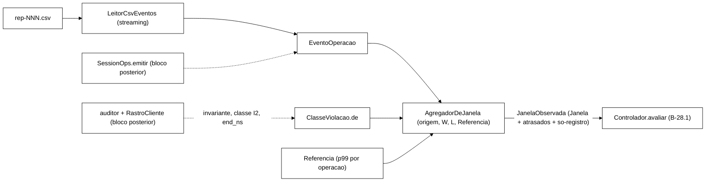

# Relatório B-26.1: agregador e observador de janela do controlador (2026-10-22)

> Worker, branch `feature/b26-1-observador-janela`, worktree `../wt-b26-1`, criada de
> `feature/b28-1-nucleo-controlador` em `dfcdb67` (validada, 387/0/0). Commits locais, sem push.
> O *cluster* não foi rodado. Referências: plano `docs/plano-implementacao-controlador-2026-10-22.md`
> (seções 3.1 a 3.6 e linha B-26.1 da seção 6) e validação `docs/validacao-b28-1-2026-10-22.md`
> (seção 6), ambos na branch `docs/plano-implementacao-controlador`; relatório B-28.1, seção 7.

## 1. Resultado

| Medida | Antes (`dfcdb67`) | Depois (`b90a5bc`) |
|---|---|---|
| Surefire, soma dos `TEST-*.xml` (`mvn -f workload/pom.xml test`, `surefire-reports` apagado antes) | **387 tests, 0 failures, 0 errors, 0 skipped** | **443 tests, 0 failures, 0 errors, 0 skipped** |
| Testes do pacote `controle` | 112 | 168 (+56) |
| `test-compile` de cada commit, a partir de `git archive` em diretório limpo | — | 0 nos 7 commits (seção 6) |

Nenhum teste existente foi enfraquecido. O único teste existente alterado é
`ArquiteturaControleTest`, que passou a exigir também a presença dos 6 tipos novos na lista de
fontes lidas, ou seja, ficou mais forte.

## 2. Decisões do Gestor aplicadas (2026-10-22)

1. **Evento atrasado, regra C+A.** A janela só fecha depois de uma tolerância `L` além de `fimNs`
   (padrão 10 ms). O que chega depois disso é descartado e contado em `atrasados`. A janela fechada
   nunca muda, e o tempo de decisão continua sendo `fimNs`.
2. **Escopo só com as partes puras.** Os *listeners* em `SessionOps.emitir`/`InvariantAuditor.registrarViolacao`,
   o uso de `RastroCliente` e o teste *golden* de *listener* nulo ficam para um bloco posterior,
   depois da validação de B-42.1. Este é o desvio aprovado em relação à linha B-26.1 do plano
   (seção 7, item 1).
3. **Tempo das violações.** O agregador recebe cada violação com o `end_ns` do evento que a
   revelou, informado por quem chama. O auditor, que carimba `Instant.now()`
   (`InvariantAuditor.java:57`), não foi alterado.

## 3. O que foi implementado

Todos os tipos ficam no pacote `br.unipampa.tcc.controle` e nenhum importa `org.infinispan` nem
`br.unipampa.tcc.session`, o que o teste de arquitetura verifica.

| Arquivo | Papel |
|---|---|
| `controle/Referencia.java` | p99 de referência por operação (record imutável, operações em ordem de nome). Rejeita p99 ≤ 0, nome vazio ou valor nulo. Só construção em memória (ver 7.2) |
| `controle/EventoOperacao.java` | Evento com o contrato `operation,start_ns,end_ns,return_code` e mais `latenciaNs()`, `erro()` (TRANSPORT ou UNAVAILABLE) e `indisponivel()` (só UNAVAILABLE). Rejeita código fora do contrato de `OpResult.toCsvCode` e `end_ns < start_ns` |
| `controle/ClasseViolacao.java` | Mapeia a string `(invariante, classe I2)` para `SEGURANCA` (I1, I4, I2 `REAL`), `I2_ESPERADA` (`ESPERADA-POR-DESENHO`), `I2_FORA_DO_GATILHO` (`INCERTA`, `INEXPLICADA`, `DESCONHECIDA-SEM-LOGIN`, sem rastro) e `FORA_DO_GATILHO` (I3, I5, I6 e outros). `gatilho()` é verdadeiro só para `SEGURANCA` |
| `controle/JanelaObservada.java` | `Janela` (a entrada do núcleo) mais os contadores que não decidem e vão para o JSONL: `atrasados`, `violacoesAtrasadas`, `violacoesI2ForaDoGatilho` e `violacoesForaDoGatilho` |
| `controle/AgregadorDeJanela.java` | O agregador (semântica abaixo) |
| `controle/LeitorCsvEventos.java` | Leitura do CSV de eventos em *streaming*, com colunas achadas pelo nome e colunas extras (`phase`) ignoradas. Fica como base para B-38 |
| `test/resources/controle/amostra-s1-f1-rep001-200.csv` | Cabeçalho mais as 200 primeiras linhas de `runs/S1-F1/rep-001.csv`, usado **só como fixture de formato**: 100 % dos Login dessa execução são BLOCKED e não há OK, VALID nem ERROR_* |

### 3.1 Semântica do agregador

- **Janelas.** A janela `j ≥ 0` é `[origem + j·W, origem + (j+1)·W)`, e o evento entra pela janela
  do seu `end_ns`. Um `end_ns` exatamente em `fimNs` pertence à janela seguinte. Toda janela é
  emitida, inclusive vazia, em ordem e sem buraco (`inicioNs(j) = fimNs(j−1)`), como pede o
  contrato V-B28.1 §6.
- **Tempo.** A marca d'água é o maior `end_ns` já visto, de eventos ou de violações, e começa em
  `origem`. A janela `j` fecha quando `marca − L ≥ fimNs(j)`. Nada lê relógio de parede.
- **Atrasados (C+A).** Um evento (ou uma violação) cuja janela já foi emitida, ou que é anterior à
  origem, é descartado. A contagem aparece em `JanelaObservada.atrasados` (ou `violacoesAtrasadas`)
  da **próxima janela emitida** e nos totais `atrasadosTotal()` e `violacoesAtrasadasTotal()`.
  Violações atrasadas têm contador próprio para que um I1 descartado não suma em silêncio.
- **Excedência.** É estrita, `latência > p99_ref(op)`, como na seção 3.2 do plano. Só são
  elegíveis eventos cuja operação está na `Referencia`.
- **Encerramento.** `encerrar()` emite todas as janelas completas (`fimNs ≤ marca`) sem esperar
  `L`, porque não vai chegar mais nada. A janela parcial que contém a marca não é emitida, e o
  conteúdo dela vai para `descartadosNoEncerramento()` e `violacoesDescartadasNoEncerramento()`.
  Depois disso, registrar algo lança `IllegalStateException`.
- **Concorrência.** Os métodos públicos são `synchronized` e devolvem, em ordem, as janelas que a
  chamada fechou.

### 3.2 Onde ficou `L` (pedido do Gestor: justificar)

`L` é parâmetro do **construtor do agregador**, e não de `ParametrosControlador`. O padrão fica na
constante `AgregadorDeJanela.TOLERANCIA_PADRAO_NS = 10 ms`, usada pelo construtor de conveniência
`AgregadorDeJanela(origem, ParametrosControlador, Referencia)`, que lê `W` dos parâmetros. Há três
razões.

1. **Coesão.** `L` diz como a entrada é ordenada, não como a decisão é tomada. Nenhuma regra R1..R4
   depende dele, e o tempo de decisão continua sendo `fimNs`. O `ParametrosControlador` documenta
   que todos os campos dele são insumos do `Controlador`.
2. **Compatibilidade.** `deJson` exige exatamente os campos de `CAMPOS` e rejeita os
   desconhecidos (decisão aceita em V-B28.1 §5.4). Um campo novo obrigatório tornaria inválido
   qualquer `controlador-*.json` já escrito e obrigaria a alterar `ParametrosControladorTest`. Um
   campo opcional abriria exceção à regra de "sem ausentes".
3. **Valor medido.** Em 4 CSVs reais completos (seção 5.2), com `W = 5 s`, `L = 0` já dá zero
   atrasados. `L` é proteção e não um parâmetro de calibração, então não precisa entrar na
   calibração da seção 3.5.

Custo da escolha: `L` não entra no SHA-256 do arquivo de parâmetros. **B-28.2 deve gravar
`toleranciaNs` no JSONL de observáveis.** Se o Gestor preferir `L` no arquivo, a migração é
pequena: acrescentar o campo, validar `L ≥ 0` em `deJson` e passar `p.toleranciaNs()` ao construtor.

## 4. Testes (56 novos)

| Classe | Testes | O que fixa |
|---|---|---|
| `ReferenciaTest` | 4 | p99 por operação, operação fora da referência, cópia defensiva, ordem, rejeições |
| `ClassificacaoTest` | 23 | cada `return_code` (7 casos, inclusive `ERROR_UNAVAILABLE`), conjunto exato de códigos, evento inválido; violações (13 casos: só I1, I4 e I2 REAL disparam; I2 esperada, incerta, inexplicada, sem login e sem rastro não disparam; I3, I5 e I6 fora); `gatilho()` |
| `AgregadorDeJanelaTest` | 19 | janelas vazias contíguas; primeira janela na origem; contiguidade em 2.000 eventos aleatórios; **evento exatamente em `fimNs`**; bordas `[ini, fim)`; `L` adia o fechamento e a decisão continua em `fimNs`; **evento atrasado** (descartado, contado, janela fechada intacta, contador zera a cada emissão); evento antes da origem; violação atrasada; **excedência no limite** (`=` p99 não excede, p99+1 excede); contagem por código; **I2 esperada fora de `violacoesSeguranca`**; violação avança a marca; encerramento; **determinismo** (5.000 entradas com semente fixa, com atrasados); construtor por parâmetros (`L` padrão = 10 ms); rejeições |
| `AgregadorDeJanelaConcorrenciaTest` | 3 (`@RepeatedTest`) | 8 *threads* × 20.000 eventos e uma violação a cada 97: eventos e violações conservados (janelas + atrasados + descarte no encerramento = enviados), janelas únicas e contíguas |
| `LeitorCsvEventosTest` | 4 | **leitura da fixture real** (200 eventos; NONE 135, BLOCKED 50, COUNTED 15; operações; primeiro evento; latências entre 296.500 e 9.153.000 ns); agregação da fixture em janelas de 5 ms com `L = 10 ms` comparada a um cálculo independente em Python (totais 20, 46, 60 e 58; elegíveis 18, 32, 46 e 45; excedências 9, 2, 0 e 1; 16 descartados na parcial); colunas pelo nome, `phase` extra, linha em branco; rejeições |
| `AgregadorControladorIntegracaoTest` | 3 | **roteiro com `Controlador.avaliar`** e parâmetros padrão: erro alto em 2 janelas seguidas leva a R2 (`NNCC`, decisão em `fimNs`); janela vazia entre duas janelas de erro quebra a persistência (`NNN`); I2 esperada não dispara e I1 dispara R1 (`NNC`) |
| `ArquiteturaControleTest` (alterado) | 2 (já existiam) | os 6 tipos novos têm de estar entre as fontes lidas; nenhum `import org.infinispan`/`br.unipampa.tcc.session` |

Os valores esperados da fixture vieram de um script Python independente (o mesmo algoritmo,
reescrito, sobre o mesmo arquivo). Ele foi rodado também com `L = 0` e deu as mesmas janelas e
zero atrasados.

### 4.1 Os testes conseguem falhar (mutação manual)

Cada mutante foi aplicado com `sed` em `AgregadorDeJanela.java` (ou com a inclusão de um `import`).
A suíte do pacote rodou com `mvn -o test -Dtest='br.unipampa.tcc.controle.*Test'` (168 testes) e o
arquivo foi restaurado com `git checkout`. `git status` ficou limpo ao fim.

| Mutante | Alteração | Resultado | Mensagem principal |
|---|---|---|---|
| **M1** (pedido) | excedência `latenciaNs() > p99` → `>=` | 1 falha (`excedenciaNoLimite`) | `expected: <2> but was: <4>` |
| **M2** (pedido) | remove a emissão de janela vazia (só emite se `total > 0`) | 4 falhas + 5 erros, incluindo `janelasVaziasContiguas` e a integração `janelaVaziaQuebraPersistencia` | `expected: <3> but was: <1>` e `expected: <NNN> but was: <NC>`: sem a janela vazia o controlador vê duas janelas de erro "seguidas" e entra em CONSERVADOR |
| M3 | ignora `L` (`marca >= fimNs`) | 3 falhas (`toleranciaAdiaFechamento`, `encerrar`, `agregaAmostraReal`) | `14 < 10 + 5: [0,10) segue aberta` |
| M4 | não descarta atrasados (`j < proxima && false`) | 4 falhas (`eventoAtrasado`, `antesDaOrigem`, `violacaoAtrasada`, `determinismo`) | `expected: <1> but was: <0>` |
| M5 | tira `synchronized` de `registrar`/`registrarViolacao` | 3 erros (as 3 repetições da concorrência) | `ConcurrentModificationException` e NPE no `TreeMap` |
| M6 | `import org.infinispan.client.hotrod.RemoteCache;` no agregador | 1 falha (`ArquiteturaControleTest`) | `but was: <[AgregadorDeJanela.java: import org.infinispan.]>` |

Com o código restaurado, os 168 testes do pacote passam.

### 4.2 Rastro de TDD

Em cada par, o teste foi escrito antes e a compilação falhou por símbolo ausente: 32 erros
`cannot find symbol` em `ClassificacaoTest`, 56 em `AgregadorDeJanelaTest`, 8 em
`LeitorCsvEventosTest` (medido movendo a implementação para fora temporariamente) e um vermelho
análogo em `ReferenciaTest`. Depois a implementação foi escrita e o par foi commitado já verde. Os
3 testes do roteiro de integração falharam na primeira execução por **erro do próprio teste**: a
última janela do roteiro ficava parcial e era descartada no encerramento, que é o comportamento
especificado. O teste foi corrigido com um evento em `fimNs` da última janela. O código de produção
não mudou.

## 5. Medições sobre dados reais

### 5.1 Desordem de `end_ns` (diagnóstico de 22/10)

`runs/S1-F1/rep-001.csv` está na ordem de registro, porque `EventCsvWriter` grava a lista
`synchronized` sem ordenar. São 642.629 eventos. Em 1.431 deles (0,22 %) o `end_ns` é menor que o
maior já visto, e o atraso máximo é de cerca de 530 µs. Esses números vêm de `awk` em ponto
flutuante, então têm erro da ordem de 256 ns.

### 5.2 Atrasados com `LeitorCsvEventos` + `AgregadorDeJanela`, CSVs completos

Medição feita por um programa descartável no *scratchpad* (fora do repositório), com
`W = 5 s`, origem no segundo inteiro anterior ao primeiro `end_ns` e `Referencia.vazia()`:

| CSV | eventos | janelas emitidas | nas janelas | atrasados com L = 0 / 1 ms / 10 ms | descartados no encerramento |
|---|---|---|---|---|---|
| S1-F1 rep-001 | 642.629 | 13 | 630.886 | 0 / 0 / 0 | 11.743 |
| S1-F1 rep-002 | 666.657 | 13 | 650.312 | 0 / 0 / 0 | 16.345 |
| S1-none rep-001 | 757.789 | 13 | 736.395 | 0 / 0 / 0 | 21.394 |
| S2-F1 rep-001 | 931.946 | 13 | 906.977 | 0 / 0 / 0 | 24.969 |

Em todos, eventos = nas janelas + descartados. A desordem real (≤ ~0,5 ms) não cruzou nenhuma
fronteira de 5 s nesses arquivos, então o padrão de 10 ms tem folga de cerca de 20×. A janela
parcial final tem até 5 s de eventos (as repetições duram ~66 s, ou 13 janelas e uma fração).

## 6. Commits

Histórico linear sobre `dfcdb67`, sem merge e sem push. Cada commit passa em `test-compile` a
partir de `git archive <sha> workload` extraído em diretório limpo (`mvn -q -o test-compile`,
código 0 nos 7).

| SHA | Mensagem |
|---|---|
| `cf72d5e` | feat: Referencia, p99 de referencia por operacao (B-26.1) |
| `e5409d5` | feat: EventoOperacao e ClasseViolacao, classificacao pura de return_code e violacoes (B-26.1) |
| `bc8b748` | feat: AgregadorDeJanela, janelas tumbling por end_ns com tolerancia L e atrasados (B-26.1) |
| `188ebfd` | test: concorrencia do AgregadorDeJanela, N threads com total conservado (B-26.1) |
| `b780c6d` | feat: LeitorCsvEventos e fixture real de 200 linhas de S1-F1 rep-001 (B-26.1) |
| `2068827` | test: integracao AgregadorDeJanela com Controlador.avaliar num roteiro curto (B-26.1) |
| `b90a5bc` | test: teste de arquitetura cobre os tipos do agregador (B-26.1) |
| (este) | docs: relatorio B-26.1 |

## 7. Desvios e interpretações (para validação)

1. **Desvio aprovado (Gestor, 22/10): escopo reduzido às partes puras.** Ficam fora deste bloco,
   apesar da linha B-26.1 do plano: os *listeners* opcionais em `SessionOps.emitir` e
   `InvariantAuditor.registrarViolacao`, a chamada a `RastroCliente.classificarViolacaoI2` e o
   teste de *listener* nulo com CSV e violações byte a byte iguais (`GoldenS1S2Test` e um teste
   novo comparando arquivos). Eles entram num bloco posterior, depois da validação de B-42.1, que
   também toca `SessionOps`. Neste bloco a classificação de I2 é só o mapeamento puro de strings
   (`ClasseViolacao.de`).
2. **`Referencia` sem leitura de arquivo.** O esquema de `referencia-<cenario>-<sync|async>.json` é
   produzido por B-39.1 (`analysis/referencia_p99.py`) e ainda não está fixado. Não inventei um
   esquema; a leitura entra com B-39.1 ou B-28.2.
3. **p99 por operação na janela não é calculado.** A seção 3.6 põe `"p99_ns":{op:..}` no
   `observaveis-rep-NNN.jsonl` "para leitura humana". O núcleo não usa esse valor e calculá-lo exige
   guardar latências por janela (ou um histograma próprio, já que `LatencyRegistry` drena). Fica
   para B-28.2, que grava o JSONL. Se o Gestor quiser aqui, é um acréscimo isolado.
4. **Destino da contagem de atrasados.** O evento atrasado não pertence à janela em que é
   contado. `atrasados` é registrado na próxima janela emitida (para o JSONL), e os totais ficam em
   `atrasadosTotal()`. Atrasados que chegam depois da última emissão ficam só no total.
5. **Violação atrasada tem contador próprio** (`violacoesAtrasadas`), em vez de se misturar com
   eventos de operação. Uma violação de segurança descartada fica visível no JSONL. Ela **não**
   dispara R1 na janela seguinte, porque a regra C+A manda descartar. Se o Gestor preferir que um
   I1 atrasado ainda dispare R1, isso é uma mudança de regra.
6. **Encerramento descarta a janela parcial.** Emitir a parcial apresentaria ao controlador uma
   janela de largura menor que `W` como se fosse completa, e com taxas de base menor. A perda
   medida é de até 5 s por repetição (seção 5.2), e o efeito sobre a avaliação fica a cargo de B-38.
7. **Código de retorno fora do contrato é rejeitado** (`IllegalArgumentException`). Ao vivo, isso
   lançaria exceção na *thread* de carga; o adaptador de B-28.2 deve decidir entre registrar e
   ignorar. No *replay*, rejeitar é o comportamento desejado.
8. **`origem` é explícita.** Quem cria o agregador informa a origem (por exemplo, o fim do
   *warm-up* ao vivo ou o segundo inteiro anterior ao primeiro evento no *replay*). O plano não
   fixa esse ponto. Eventos anteriores à origem contam como atrasados.
9. **Progresso do tempo sem eventos.** Como o tempo vem só de `end_ns`, um período sem nenhum
   evento (por exemplo, todas as *threads* presas em *timeout* numa partição) não fecha janela
   até o próximo evento chegar. Quando ele chega, todas as janelas vazias intermediárias são
   emitidas de uma vez, contíguas, e o atraso de detecção fica limitado pelo *timeout* do cliente.
   Isso decorre da decisão "tempo dos eventos" e deve ser considerado em B-28.2 e B-38.
10. **Documentação geral.** `docs/implementacao.md` e `docs/testes.md` não foram atualizados neste
    bloco, para evitar conflito com as outras branches em paralelo, seguindo o precedente de
    B-28.1 (seção 4, item 12). A entrada fica para `feature/controlador-integracao`.

## 8. Próximo passo sugerido

Validar este bloco. Em seguida, depois de B-42.1 validado, abrir o bloco do adaptador ao vivo:
*listeners* em `SessionOps.emitir`/`InvariantAuditor`, classificação via `RastroCliente` e teste
*golden* de *listener* nulo. B-38 (*replay*) já pode usar `LeitorCsvEventos` +
`AgregadorDeJanela` + `Controlador` sem tocar `session`.
