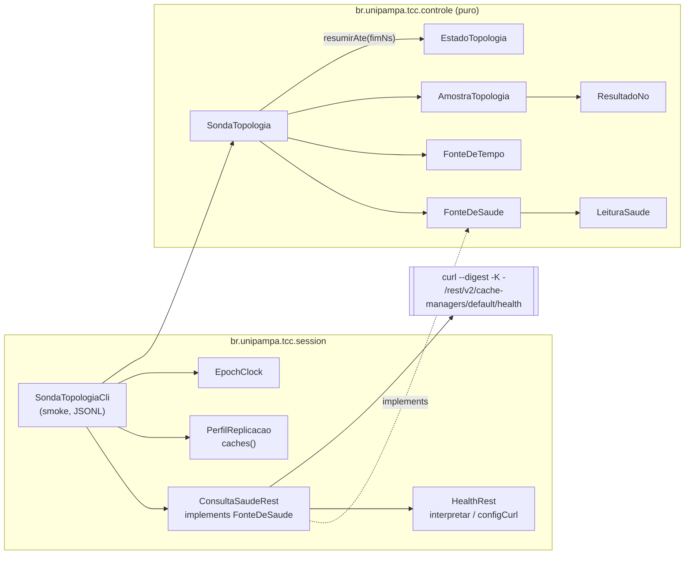

# Relatório do B-26.2: sonda de topologia (2026-10-27)

> Worker, 2026-10-27. Prompt: `docs/prompt-b26-2-sonda-topologia-2026-10-27.md` (commit `afa33c8`,
> branch `docs/plano-implementacao-controlador`). Base `c055399` (ponta de
> `feature/controlador-integracao`). Branch `feature/b26-2-sonda-topologia`, worktree
> `../wt-b26-2`. Commits só locais; sem push, sem VM, sem tc/netem.

## 1. Resumo

A sonda de topologia (`S_top`) ficou dividida como o prompt pede. Em `controle/` está a parte pura:
classificação de uma leitura, rodada paralela com prazo, agenda periódica e resumo por janela para o
núcleo, sem processo nem rede. Em `session/` ficam o adaptador REST (`curl --digest`, credenciais só por
stdin) e a CLI de *smoke*. O contrato da V-B28.1 está coberto: falha de consulta vira amostra anômala
com `EstadoTopologia.disponivel = true`, e a sonda nunca devolve `disponivel = false`.

Surefire final: 112 arquivos, 819 testes (761 + 58 novos), 0 falhas, 0 erros, 1 ignorado. Nenhum teste
existente foi editado. Mutantes: M1..M16 todos mortos (seção 7). *Smoke* local: P1 e P2 sem anomalia; a queda de
`b262-isn3` foi detectada em 3,6 s (P3a) e 2,2 s (P3b), dentro do limite de 5,5 s; a volta só coube na
janela no P3b (180 s), porque no P3a o `podman start` local levou 27,5 s (seção 8).

## 2. Passo 0

| Item | Resultado |
|---|---|
| `mvn -q -o -f workload/pom.xml clean test` em `c055399` | 106 arquivos, 761/0/0/1 (igual ao esperado) |
| `ArquiteturaControleTest.java:28-30` (padrão de import proibido) e `:32-36` (`TIPOS_DO_NUCLEO`) | conferem |
| `EstadoTopologia.java:13` (record) e `:33-35` (`anomala()`) | conferem |
| `HealthRest`: `interpretar` público, `configCurl` package-private, `consultar` com `--max-time 5` e `waitFor(10 s)` | conferem (`:62`, `:70-71`, `:77`) |
| `PerfilReplicacao.caches()` | confere (`:48-50`) |
| `NomesDeCacheSoNoResolvedorTest` (`LITERAL`, `CHAMADA`, `ARG_OK`) | conferem |
| `PerfilFixoForaDoResolvedorTest` (`PERMITIDOS` só `Cli.java` e `SondaHotrod.java`) | confere |
| `Cli.java --servers` padrão `127.0.0.1:11222,127.0.0.1:11223,127.0.0.1:11224` | confere (`:109-111`) |
| `captura-real/*.json` | 4 arquivos |

## 3. Desenho



```mermaid
sequenceDiagram
    participant A as agenda (thread sonda-topologia)
    participant S as SondaTopologia
    participant P as executor (sonda-topologia-no-0..n-1)
    participant F as FonteDeSaude
    participant B as buffer / ouvinte
    participant N as nucleo (B-28.2)
    A->>A: instante k; consulta da rodada anterior em voo? entao pula e conta
    A->>S: executarRodada()
    S->>P: submete n consultas (paralelo)
    P->>F: consultar(i, prazo)
    S->>S: espera ate prazoRodadaNs no total; no atrasado vira timeout e e interrompido
    S->>S: classificar cada no; tNs = tempo.agoraNs() no FIM da rodada
    S->>B: buffer + ouvinte (excecao do ouvinte contada)
    N->>S: resumirAte(fim_j)
    S-->>N: EstadoTopologia(true, consumidas, anomalas, nosMin)
```

Decisões de implementação dentro do que o prompt fixou:

- **Executor.** Um `newFixedThreadPool(nos())` com *threads daemon* `sonda-topologia-no-<i>` (o índice é o
  da *thread*, não o do nó). O tamanho do *pool* garante no máximo `nos()` consultas em voo, mesmo que
  uma consulta interrompida demore a ceder.
- **Rodada em curso.** Um contador `emVoo` soma as consultas submetidas e ainda não terminadas, inclusive
  as canceladas por prazo que não cederam à interrupção. A agenda pula o instante se `emVoo > 0` ou se a
  própria rodada passou do instante seguinte. Uma consulta cancelada antes de começar é "reivindicada"
  pelo cancelador para o contador nunca vazar.
- **Interrupção.** `rodada()` chamada com a *thread* interrompida (caso do `close()` durante a rodada)
  cancela as consultas, não entrega amostra, mantém o sinal e lança `IllegalStateException`. A agenda
  apenas termina.
- **Amostra atrasada.** É a consumida por `resumirAte(fim)` com `tNs` menor que o `fimNs` da chamada
  anterior (ou seja, pertencia a uma janela já resumida). Conta na janela em que é consumida, inclusive
  como anômala.
- **`resumirAte` com o mesmo `fimNs`** é aceito (não recua) e devolve o que chegou entre as duas
  chamadas.
- **Adaptador.** `--max-time = ceil(prazo em s)`, mínimo 1. A espera do processo é em passos de 10 ms
  drenando o stdout disponível, até o prazo da consulta; ao passar dele lança
  `java.util.concurrent.TimeoutException` e chama `destroyForcibly`; na interrupção também destrói o
  processo e propaga `InterruptedException`. O stdin é fechado depois da configuração (o `curl` lê `-K -`
  até EOF).
- **CLI.** `nosEsperados` = número de servidores em `--servers`. Erro de uso (inclusive senha ausente ou
  vazia, `--duracao-s` < 1, `prazo >= periodo`, opção desconhecida ou sem valor): exit 2. Stdout no esquema
  exato do prompt; em stderr, uma linha de cabeçalho e uma de custo (`curl_lancados`, `rodadas`,
  `cpu_jvm_ms`, `erros_ouvinte`).

## 4. Commits, compilação e Surefire

| # | SHA | Tipo | `test-compile` | Surefire (arquivos / testes / falhas / erros / ignorados) |
|---|---|---|---|---|
| base | `c055399` | | 0 | 106 / 761 / 0 / 0 / 1 |
| 1 | `e88bf49` | refactor: tipos e esqueletos | 0 | 106 / 761 / 0 / 0 / 1 |
| 2 | `735020e` | test: testes novos (vermelhos) | 0 | 112 / 819 / 47 / 6 / 1 |
| 3 | `03a06c8` | feat: `controle/` | 0 | 112 / 819 / 13 / 4 / 1 |
| 4 | `7d154f3` | feat: adaptador e CLI | 0 | 112 / 819 / 0 / 0 / 1 |
| 5 | `b3a838f` | test: smoke local | n/a (só `runs/`) | igual ao commit 4 |
| 6 | `92614e2` | test: evidências do smoke em JSON | n/a (só `runs/`) | igual ao commit 4 |
| 7 | (este) | docs: relatório | n/a (só `docs/`) | igual ao commit 4 |

O Surefire do commit 3 rodou numa cópia `git archive 03a06c8 workload cluster` fora da worktree (a
primeira tentativa exportou só `workload/` e quebrou `ClusterXmlBaselineSyncTest` e
`ClusterXmlIrmaosTest`, que leem `cluster/`; refeita com os dois diretórios). Os demais rodaram na
worktree. Em todos, os vermelhos estão só nas classes novas; os 761 existentes ficaram verdes.

Por commit, os 58 testes novos ficaram verdes assim:

| Classe | Testes | Verdes no commit 2 | Verdes no commit 3 | Verdes no commit 4 |
|---|---|---|---|---|
| `SondaTopologiaClassificacaoTest` | 18 | 3 (só *records*) | 18 | 18 |
| `SondaTopologiaRodadaTest` | 16 | 1 (`janelaVazia`, T9) | 16 | 16 |
| `SondaTopologiaAgendaTest` | 6 | 0 | 6 | 6 |
| `ArquiteturaSondaTest` | 1 | 1 (T15) | 1 | 1 |
| `ConsultaSaudeRestTest` | 11 | 0 | 0 | 11 |
| `ConsultaSaudeRestCliTest` | 6 | 0 | 0 | 6 |

Tempo da suíte nova no commit 4: 2,9 s (Agenda 1,59 s; CLI 1,03 s; Rodada 0,19 s; adaptador 0,12 s;
Classificação 0,02 s; Arquitetura 0,004 s).

### 4.1 Vermelhos do commit 2 (53, com a mensagem)

Os cinco verdes do commit 2 são `leituraSaude`, `resultadoNo` e `amostra` (só exercitam os *records*,
completos desde o commit 1), `sondaPura` (T15: as fontes já existiam sem import proibido) e
`janelaVazia` (T9: o corpo provisório de `resumirAte` devolve exatamente o valor neutro esperado; é
neutro por desenho, ver a seção 6). Na primeira execução do commit 2 o teste `paralelo` também passou
por vacuidade (a amostra vazia do esqueleto não era anômala); reforcei-o antes do commit para exigir os
três motivos `ok` e repeti o Surefire: os números da tabela acima são os da segunda execução.

| Classe | Teste | Tipo | Mensagem |
|---|---|---|---|
| SondaTopologiaAgendaTest | `closeLimpaThreads` | failure | `a primeira rodada nao comecou ==> expected: <true> but was: <false>` |
| SondaTopologiaAgendaTest | `taxaFixa` | failure | `0 rodadas em 1020 ms ==> expected: <true> but was: <false>` |
| SondaTopologiaAgendaTest | `iniciarDuasVezes` | failure | `Expected java.lang.IllegalStateException to be thrown, but nothing was thrown.` |
| SondaTopologiaAgendaTest | `pulaSemSobrepor` | failure | `rodadas: 0 ==> expected: <true> but was: <false>` |
| SondaTopologiaAgendaTest | `ouvinteQueLancaNaoParaAgenda` | failure | `rodadas: 0 ==> expected: <true> but was: <false>` |
| SondaTopologiaAgendaTest | `closeSemIniciar` | failure | `Expected java.lang.IllegalStateException to be thrown, but nothing was thrown.` |
| SondaTopologiaClassificacaoTest | `realDoisNos` | failure | `expected: <ResultadoNo[no=isn1, respondeu=true, numeroDeNos=2, motivo=nos:2<3, anomalo=true]> but was: <Result...` |
| SondaTopologiaClassificacaoTest | `fronteiraDeNos` | failure | `expected: <ResultadoNo[no=a, respondeu=true, numeroDeNos=3, motivo=ok, anomalo=false]> but was: <ResultadoNo[n...` |
| SondaTopologiaClassificacaoTest | `realRebalanceando` | failure | `expected: <ResultadoNo[no=isn1, respondeu=true, numeroDeNos=3, motivo=cache:sessions=HEALTHY_REBALANCING, anom...` |
| SondaTopologiaClassificacaoTest | `primeiroCacheDaLista` | failure | `expected: <cache:sessions=DEGRADED> but was: <ok>` |
| SondaTopologiaClassificacaoTest | `asyncRebalanceando` | failure | `expected: <ResultadoNo[no=isn1, respondeu=true, numeroDeNos=3, motivo=cache:counters-async=HEALTHY_REBALANCING...` |
| SondaTopologiaClassificacaoTest | `realSaudavel` | failure | `expected: <ResultadoNo[no=isn1, respondeu=true, numeroDeNos=3, motivo=ok, anomalo=false]> but was: <ResultadoN...` |
| SondaTopologiaClassificacaoTest | `falhaDeConsulta` | failure | `expected: <ResultadoNo[no=isn2, respondeu=false, numeroDeNos=-1, motivo=falha:IOException, anomalo=true]> but ...` |
| SondaTopologiaClassificacaoTest | `realDegradadoUmNo` | failure | `expected: <ResultadoNo[no=isn1, respondeu=true, numeroDeNos=1, motivo=nos:1<3, anomalo=true]> but was: <Result...` |
| SondaTopologiaClassificacaoTest | `asyncIgnoraIrmaoSync` | failure | `expected: <ResultadoNo[no=isn1, respondeu=true, numeroDeNos=3, motivo=ok, anomalo=false]> but was: <ResultadoN...` |
| SondaTopologiaClassificacaoTest | `ausenteAntesDeStatus` | failure | `expected: <cache-ausente:counters> but was: <ok>` |
| SondaTopologiaClassificacaoTest | `asyncCacheAusente` | failure | `expected: <ResultadoNo[no=isn1, respondeu=true, numeroDeNos=3, motivo=cache-ausente:counters-async, anomalo=tr...` |
| SondaTopologiaClassificacaoTest | `asyncSaudavel` | failure | `expected: <ResultadoNo[no=isn1, respondeu=true, numeroDeNos=3, motivo=ok, anomalo=false]> but was: <ResultadoN...` |
| SondaTopologiaClassificacaoTest | `nosAntesDeCache` | failure | `expected: <nos:2<3> but was: <ok>` |
| SondaTopologiaClassificacaoTest | `soHealthyExato` | failure | `status 'healthy' ==> expected: <true> but was: <false>` |
| SondaTopologiaClassificacaoTest | `asyncCacheInternoIgnorado` | failure | `expected: <ResultadoNo[no=isn1, respondeu=true, numeroDeNos=3, motivo=ok, anomalo=false]> but was: <ResultadoN...` |
| SondaTopologiaRodadaTest | `construtorRejeita` | failure | `Expected java.lang.IllegalArgumentException to be thrown, but nothing was thrown.` |
| SondaTopologiaRodadaTest | `depoisDoClose` | failure | `Expected java.lang.IllegalStateException to be thrown, but nothing was thrown.` |
| SondaTopologiaRodadaTest | `janelas` | failure | `expected: <EstadoTopologia[disponivel=true, amostras=2, anomalas=0, nosMinimo=3]> but was: <EstadoTopologia[di...` |
| SondaTopologiaRodadaTest | `agregacaoAnomala` | failure | `expected: <true> but was: <false>` |
| SondaTopologiaRodadaTest | `falhaDeConsultaEAnomalaDisponivel` | error | `Index 1 out of bounds for length 0` |
| SondaTopologiaRodadaTest | `nosMinimo` | failure | `expected: <2> but was: <0>` |
| SondaTopologiaRodadaTest | `prazoDaRodada` | error | `Index 1 out of bounds for length 0` |
| SondaTopologiaRodadaTest | `instanteDoFim` | failure | `expected: <7000000000> but was: <0>` |
| SondaTopologiaRodadaTest | `ouvinteQueLanca` | failure | `expected: <2> but was: <0>` |
| SondaTopologiaRodadaTest | `paralelo` | failure | `expected: <[ok, ok, ok]> but was: <[]>` |
| SondaTopologiaRodadaTest | `todosFalhando` | failure | `expected: <true> but was: <false>` |
| SondaTopologiaRodadaTest | `fimQueRecua` | failure | `Expected java.lang.IllegalArgumentException to be thrown, but nothing was thrown.` |
| SondaTopologiaRodadaTest | `atrasadaPromovida` | failure | `expected: <2> but was: <0>` |
| SondaTopologiaRodadaTest | `atrasadaAnomala` | failure | `expected: <EstadoTopologia[disponivel=true, amostras=1, anomalas=0, nosMinimo=3]> but was: <EstadoTopologia[di...` |
| SondaTopologiaRodadaTest | `ouvinteNaOrdem` | failure | `expected: <[AmostraTopologia[tNs=0, anomala=false, nosMinimo=0, porNo=[]], AmostraTopologia[tNs=0, anomala=fal...` |
| ConsultaSaudeRestCliTest | `replicationInvalida` | failure | `expected: <2> but was: <0>` |
| ConsultaSaudeRestCliTest | `padroes` | error | `Cannot invoke "br.unipampa.tcc.session.SondaTopologiaCli$Args.perfil()" because "a" is null` |
| ConsultaSaudeRestCliTest | `saidaJsonl` | failure | `expected: <true> but was: <false>` |
| ConsultaSaudeRestCliTest | `semReplication` | failure | `expected: <2> but was: <0>` |
| ConsultaSaudeRestCliTest | `semSenha` | failure | `expected: <2> but was: <0>` |
| ConsultaSaudeRestCliTest | `outrosErrosDeUso` | failure | `expected: <2> but was: <0>` |
| ConsultaSaudeRestTest | `invalidos` | failure | `h ==> Expected java.lang.IllegalArgumentException to be thrown, but nothing was thrown.` |
| ConsultaSaudeRestTest | `interrupcao` | failure | `java.lang.UnsupportedOperationException: B-26.2: esqueleto ==> expected: <true> but was: <false>` |
| ConsultaSaudeRestTest | `processoTravado` | failure | `Unexpected exception type thrown, expected: <java.util.concurrent.TimeoutException> but was: <java.lang.Unsupp...` |
| ConsultaSaudeRestTest | `espacos` | failure | `expected: <[http://h:1, http://g:2]> but was: <[]>` |
| ConsultaSaudeRestTest | `corpoReal` | error | `B-26.2: esqueleto` |
| ConsultaSaudeRestTest | `exitNaoZero` | failure | `Unexpected exception type thrown, expected: <java.io.IOException> but was: <java.lang.UnsupportedOperationExce...` |
| ConsultaSaudeRestTest | `comandoSemSenha` | error | `B-26.2: esqueleto` |
| ConsultaSaudeRestTest | `maxTime` | error | `B-26.2: esqueleto` |
| ConsultaSaudeRestTest | `corpoInvalido` | failure | `Unexpected exception type thrown, expected: <java.lang.IllegalArgumentException> but was: <java.lang.Unsupport...` |
| ConsultaSaudeRestTest | `nosERotulos` | failure | `expected: <3> but was: <0>` |
| ConsultaSaudeRestTest | `urlsDoPadraoDaCli` | failure | `expected: <[http://127.0.0.1:11222, http://127.0.0.1:11223, http://127.0.0.1:11224]> but was: <[]>` |

## 5. Testes novos e o que cobrem

| Id | Teste(s) | Arquivo |
|---|---|---|
| T1 | `falhaDeConsulta`; `falhaDeConsultaEAnomalaDisponivel`, `todosFalhando` | Classificação; Rodada |
| T2 | `realSaudavel`, `realDoisNos`, `realDegradadoUmNo`, `realRebalanceando` | Classificação |
| T3 | `asyncSaudavel`, `asyncIgnoraIrmaoSync`, `asyncRebalanceando`, `asyncCacheAusente`, `asyncCacheInternoIgnorado` | Classificação |
| T4 | `fronteiraDeNos` | Classificação |
| T5 | `nosAntesDeCache`, `primeiroCacheDaLista`, `ausenteAntesDeStatus`, `soHealthyExato` | Classificação |
| T6 | `agregacaoAnomala`, `nosMinimo` | Rodada |
| T7 | `prazoDaRodada` (relógio real, prazo 150 ms, limite 250 ms, *latch* de interrupção); `paralelo` | Rodada |
| T8 | `janelas`, `atrasadaPromovida`, `atrasadaAnomala`, `fimQueRecua` | Rodada |
| T9 | `janelaVazia` | Rodada |
| T10 | `taxaFixa` (100 ms, 1 s, 8..12 rodadas), `pulaSemSobrepor` (consulta de 150 ms que ignora a interrupção) | Agenda |
| T11 | `closeLimpaThreads`, `iniciarDuasVezes`, `closeSemIniciar`; `depoisDoClose` | Agenda; Rodada |
| T12 | `ouvinteNaOrdem`, `ouvinteQueLanca`; `ouvinteQueLancaNaoParaAgenda` | Rodada; Agenda |
| T13 | `comandoSemSenha`, `maxTime`, `exitNaoZero`, `processoTravado`, `interrupcao`, `corpoReal`, `corpoInvalido`, `nosERotulos` | `ConsultaSaudeRestTest` |
| T14 | `urlsDoPadraoDaCli`, `espacos`, `invalidos` | `ConsultaSaudeRestTest` |
| T15 | `sondaPura` | `ArquiteturaSondaTest` |
| T16 | `semReplication`, `replicationInvalida`, `semSenha`, `outrosErrosDeUso`, `padroes`; `saidaJsonl` | `ConsultaSaudeRestCliTest` |
| M16 | `instanteDoFim` (relógio falso avançado durante a consulta) | Rodada |
| *records* | `leituraSaude`, `resultadoNo`, `amostra`; `construtorRejeita` | Classificação; Rodada |

Notas:

- T10 observa 1 s de agenda real; a espera é feita em passos de 20 ms (`esperar`), então nenhum *sleep*
  individual passa de 200 ms, mas o teste dura ~1 s. A suíte nova inteira fica em 2,9 s.
- T13 testa a senha com aspas (`s3cr3t"x`), para conferir que o *stdin* é exatamente
  `HealthRest.configCurl(u, s)` com escape, e que nenhum argumento contém a senha, `s3cr3t` ou `admin:`.
- `saidaJsonl` roda a CLI de ponta a ponta por 1 s com o `LancadorCurl` falso: valida o JSONL, o resumo,
  `t_epoch_ns` crescente em epoch, 3 `curl` por rodada e que a senha não aparece em stdout/stderr. Como a
  captura real só tem os *caches* do perfil sync, no perfil async todos os nós ficam
  `cache-ausente:sessions-async`.
- As guardas existentes `NomesDeCacheSoNoResolvedorTest`, `PerfilFixoForaDoResolvedorTest` e
  `ArquiteturaControleTest` varrem os arquivos novos de `main` e continuam verdes: nenhum literal de nome
  de *cache*, nenhum `PerfilReplicacao.SYNC/ASYNC`, nenhum `porRotulo("...")`, nenhuma chamada
  `healthy(...)`, nenhum import de `session`/`org.infinispan` em `controle/`.

### 5.1 Capturas sintéticas (T3)

Todas em `workload/src/test/resources/captura-sintetica/`, derivadas de
`captura-real/rep3-isn3-healthy-3nos.json` (mesmo `cluster_health`, 3 nós, `health_status` HEALTHY, mesmos
`node_names`), com os dois *caches* async acrescentados ao fim de `cache_health`. São SINTÉTICAS: nenhuma
saiu de um servidor.

| Arquivo | O que mudou em relação à captura real |
|---|---|
| `sint-async-healthy-3nos.json` | + `counters-async` e `sessions-async` HEALTHY |
| `sint-async-sessions-degraded-3nos.json` | idem, com `sessions` (sync) DEGRADED |
| `sint-async-counters-async-rebalancing-3nos.json` | idem, com `counters-async` HEALTHY_REBALANCING |
| `sint-async-sem-counters-async-3nos.json` | só `sessions-async` acrescentado (`counters-async` ausente) |
| `sint-async-protobuf-rebalancing-3nos.json` | os quatro HEALTHY e `___protobuf_metadata` HEALTHY_REBALANCING |

O `health_status` do cluster ficou HEALTHY em todas, mesmo com um *cache* DEGRADED ou
HEALTHY_REBALANCING; a sonda não lê esse campo.

## 6. Janela sem amostra (T9)

`resumirAte` numa janela sem amostra devolve `EstadoTopologia(true, 0, 0, 0)`, com `anomala() == false`.
É neutro por desenho: sem informação nova, `S_top` não liga. Com `prazo < período` cada rodada termina
antes do instante seguinte, e com `W` = 5 s e período de 2 s há ao menos duas rodadas por janela; uma
janela vazia só acontece se a agenda for pulada (consulta que não cede à interrupção) ou parada. O caso
fica registrado nos contadores (`rodadasPuladas()`), e o B-28.2 pode gravá-lo no JSONL (`top.amostras =
0`).

## 7. Mutantes

Script `mutantes.py` no scratchpad do Worker, sobre cópia `git archive 92614e2 workload cluster` (fora da
worktree): aplica um mutante por vez (troca textual exata, contada uma vez no fonte), roda o Surefire
completo (`mvn -q -o clean test`), lista os testes vermelhos e regrava o fonte original, conferindo o
SHA-256 antes e depois. Todos compilaram, todos os 16 morreram e o fonte foi restaurado em todos.

| Mutante | Descrição | Esperado | Testes que mataram | Surefire |
|---|---|---|---|---|
| M1 | falha de consulta vira nao anomala | T1 | `falhaDeConsulta`, `falhaDeConsultaEAnomalaDisponivel`, `prazoDaRodada`, `todosFalhando` | 819 testes, 4 vermelhos |
| M2 | falha de consulta vira EstadoTopologia(false, ...) | T1 | `falhaDeConsultaEAnomalaDisponivel`, `todosFalhando` | 819 testes, 2 vermelhos |
| M3 | limiar de nos com <= | T2, T4 | `saidaJsonl`, `asyncCacheAusente`, `asyncCacheInternoIgnorado`, `asyncIgnoraIrmaoSync`, `asyncRebalanceando`, `asyncSaudavel`, `ausenteAntesDeStatus`, `fronteiraDeNos`, `primeiroCacheDaLista`, `realRebalanceando`, `realSaudavel`, `soHealthyExato`, `agregacaoAnomala`, `atrasadaAnomala`, `atrasadaPromovida`, `depoisDoClose`, `falhaDeConsultaEAnomalaDisponivel`, `janelas`, `paralelo`, `prazoDaRodada` | 819 testes, 20 vermelhos |
| M4 | status aceito por startsWith(HEALTHY) | T2, T3 | `asyncRebalanceando`, `primeiroCacheDaLista`, `realRebalanceando`, `soHealthyExato` | 819 testes, 4 vermelhos |
| M5 | cache ausente aceito | T3 | `saidaJsonl`, `asyncCacheAusente`, `ausenteAntesDeStatus` | 819 testes, 3 vermelhos |
| M6 | classificar olha todos os caches da resposta | T3 | `asyncCacheInternoIgnorado`, `asyncIgnoraIrmaoSync`, `primeiroCacheDaLista`, `realRebalanceando` | 819 testes, 4 vermelhos |
| M7 | amostra anomala so se TODOS os nos anomalos | T6 | `agregacaoAnomala`, `falhaDeConsultaEAnomalaDisponivel`, `prazoDaRodada` | 819 testes, 3 vermelhos |
| M8 | nosMinimo = maximo | T6 | `nosMinimo` | 819 testes, 1 vermelhos |
| M9 | tNs == fimNs entra na janela | T8 | `instanteDoFim`, `janelas` | 819 testes, 2 vermelhos |
| M10 | amostra atrasada descartada em vez de promovida | T8 | `atrasadaAnomala`, `atrasadaPromovida` | 819 testes, 2 vermelhos |
| M11 | rodada sequencial sem prazo por no | T7 | `closeLimpaThreads`, `closeSemIniciar`, `paralelo`, `prazoDaRodada` | 819 testes, 4 vermelhos |
| M12 | close() nao interrompe/aguarda as threads | T11 | `closeLimpaThreads`, `closeSemIniciar` | 819 testes, 2 vermelhos |
| M13 | rodadas sobrepostas permitidas (sem pular) | T10 | `pulaSemSobrepor` | 819 testes, 1 vermelhos |
| M14 | senha passada por -u usuario:senha no comando | T13 | `comandoSemSenha` | 819 testes, 1 vermelhos |
| M15 | urlsDe ignora a porta (sempre 11222) | T14 | `padroes`, `saidaJsonl`, `espacos`, `invalidos`, `nosERotulos`, `urlsDoPadraoDaCli` | 819 testes, 6 vermelhos |
| M16 | tNs = inicio da rodada | teste novo | `instanteDoFim` | 819 testes, 1 vermelhos |

Observações:

- **M16** só é morto por `instanteDoFim` (escrito de antemão, desvio 3); nenhum outro teste fixa o
  instante de fim com relógio falso, então o teste novo era necessário.
- **M9** é morto por `janelas` (T8) e também por `instanteDoFim`, que consome em `resumirAte(7 s)` a
  amostra carimbada em 7 s.
- **M11** foi escrito como rodada sequencial na própria *thread* chamadora e espera sem prazo; T7 morre
  por `assertTimeoutPreemptively` (3 s) e T11 porque a consulta passa a rodar na *thread* da agenda.
- **M12** (sem interrupção, sem espera) deixa `sonda-topologia` e `sonda-topologia-no-0` vivas: T11.
- **M13** só é morto por `pulaSemSobrepor` (T10). O teto de `nos()` consultas simultâneas continua valendo
  no mutante (é o tamanho do *pool*), então o que mata é `rodadasPuladas() >= 1`.
- **M3** derruba 20 testes porque todo nó com 3 de 3 vira `nos:3<3`.

## 8. Smoke local (Podman, não a VM)

*Smoke local: tempos não são evidência de detecção na VM.*

- Ambiente: Podman 5.7.0 (máquina WSL `podman-machine-default`, já em execução antes e depois; não foi
  parada nem reiniciada), podman-compose 1.5.0, projeto `b262`, contêineres `b262-isn1..3`, portas
  12262..12264, imagem `quay.io/infinispan/server:15.0.21.Final`, `cluster/*.xml` da base copiados para
  `runs/b26-2-smoke/cluster/` (iguais a `c055399`). Antes de subir, `podman ps` sem nenhum outro *smoke*
  em execução.
- Jar: `git archive 7d154f3` (árvore limpa do commit 4) + `mvn clean package -DskipTests` fora da
  worktree; SHA-256 `8db45f1c...6669` em `runs/b26-2-smoke/jars.json`. JDK 22.0.2. O `ProcessBuilder` do
  Windows resolve `curl` para `C:\Windows\System32\curl.exe` (curl 8.21.0, Schannel); `--digest` com `-K -`
  funcionou contra o Infinispan 15.0.21.
- CLI com os padrões (período 2000 ms, prazo 1500 ms); `--servers 127.0.0.1:12262,127.0.0.1:12263,127.0.0.1:12264`.
- `podman ps -a`, `podman network ls` e `podman machine list` antes e depois: iguais
  (`podman-estado.json`, `igual: true`).

| Caso | Perfil | Duração | Rodadas | Anômalas | Puladas | `curl` | CPU da JVM | Resultado |
|---|---|---|---|---|---|---|---|---|
| P1 | sync | 30 s | 15 | 0 | 0 | 45 (3,0/rodada) | 671 ms | passou |
| P2 | async | 30 s | 15 | 0 | 0 | 48 (3,2/rodada) | 687 ms | passou |
| P3a | async | 120 s | 60 | 44 | 0 | 183 (3,05/rodada) | 1500 ms | detecção ok; volta não observada |
| P3b | async | 180 s | 90 | 19 | 0 | 273 (3,03/rodada) | 2437 ms | passou |

Tempos do P3, contados a partir do carimbo `date +%s%N` imediatamente antes do `podman stop b262-isn3`
(limite de detecção = 2 períodos + prazo = 5,5 s):

| | P3a | P3b |
|---|---|---|
| `podman stop` (duração) | 2,0 s | 1,9 s |
| Primeira amostra anômala | +3,62 s | +2,20 s |
| Motivos do nó parado na queda | `timeout` | `falha:IOException`, `timeout`, `falha:TimeoutException` |
| Motivos dos outros dois na queda | `nos:2<3` em todas as 30 respostas | `nos:2<3` em todas as 30 respostas |
| `podman start` (duração) | 27,5 s | 0,8 s |
| Volta a 0 anômalas | não observada até o fim (+90 s) | +8,36 s depois do início do start (+7,53 s depois do fim) |
| Amostras com HEALTHY_REBALANCING | 0 | 0 |

Observações:

- **P3a, volta não observada.** O `podman start b262-isn3` levou 27,5 s nesta execução (o contêiner só
  ficou de pé em 18:49:47 UTC) e o servidor ainda precisou subir. A CLI terminou em +90 s com o isn3
  ainda recusando conexão (`falha:IOException`) e os outros em `nos:2<3`. Quando conferi logo depois, o
  isn3 já estava HEALTHY e o cluster com 3 nós. Para medir a volta repeti o caso com 180 s de observação
  (P3b), mantendo o *stop* em +30 s e o *start* em +60 s; nele o `podman start` levou 0,8 s. Os brutos
  do P3a ficam no repositório.
- **P3a, nós sobreviventes lentos durante o start.** Entre +39 s e +66 s, em 6 rodadas, isn1 e/ou isn2
  também estouraram o prazo (`timeout` ou `falha:TimeoutException`); 4 dessas amostras ficaram com
  `nos_min = 0`. O intervalo coincide com o `podman start` em curso (de +32 s a +60 s). Não apareceu no P3b. A amostra continuou
  anômala, então não muda a decisão de `S_top`; vale para o B-28.2 como lembrete de que a anomalia pode
  vir de todos os nós ao mesmo tempo.
- **HEALTHY_REBALANCING não foi visto.** Com os *caches* vazios, o rebalanceamento na volta do isn3 leva
  milissegundos (log do servidor: "Finished rebalance" ~3 ms depois de "Starting rebalance"), menos que o
  período de 2 s. A duração medida é 0 amostras.
- **Dois motivos para o mesmo atraso.** No P3b o nó parado aparece às vezes como `timeout` (o prazo da
  rodada venceu primeiro) e às vezes como `falha:TimeoutException` (o prazo do adaptador venceu
  primeiro; os dois são de 1,5 s). Ambos são anômalos. Ver o ponto 4 da seção 11.
- **Custo.** 3 `curl` por rodada em todos os casos; os excedentes (P2 48 = 3 × 16, P3a 183 = 3 × 61,
  P3b 273 = 3 × 91) são da rodada em curso que o `close()` interrompeu no fim da duração (lançada, não
  entregue). O CPU da JVM inteira da CLI, inclusive a partida, foi de 671 ms em 30 s a 2437 ms em 180 s
  (de 2,2 % de um núcleo em 30 s, com a partida pesando mais, a 1,4 % em 180 s). O CPU dos processos `curl` não entra nessa conta (no Windows não há
  `/usr/bin/time` para os filhos); não medi.

Arquivos em `runs/b26-2-smoke/`: `P1|P2|P3a|P3b/amostras.jsonl` (stdout da CLI), `*/stderr.json`
(stderr, com a linha de custo), `P3a|P3b/marcos.json` (carimbos do stop/start e saída do podman),
`health-antes|depois-1226{2,3,4}.json`, `podman-estado.json`, `cluster/`, `jars.json`, `rodar.sh`,
`analise.py`, `test_analise.py` (12 testes, `python test_analise.py`), `analise.json` e
`MANIFEST.sha256` (25 arquivos). `python analise.py` sai com 0 (P1, P2 e P3b passam; P3a falha só em
`volta_observada`).

## 9. Diff contra a base

`git diff --name-status c055399 HEAD`:

```
A	runs/b26-2-smoke/MANIFEST.sha256
A	runs/b26-2-smoke/P1/amostras.jsonl
A	runs/b26-2-smoke/P1/stderr.json
A	runs/b26-2-smoke/P2/amostras.jsonl
A	runs/b26-2-smoke/P2/stderr.json
A	runs/b26-2-smoke/P3a/amostras.jsonl
A	runs/b26-2-smoke/P3a/marcos.json
A	runs/b26-2-smoke/P3a/stderr.json
A	runs/b26-2-smoke/P3b/amostras.jsonl
A	runs/b26-2-smoke/P3b/marcos.json
A	runs/b26-2-smoke/P3b/stderr.json
A	runs/b26-2-smoke/analise.json
A	runs/b26-2-smoke/analise.py
A	runs/b26-2-smoke/cluster/infinispan-cluster.xml
A	runs/b26-2-smoke/cluster/jgroups-tcp.xml
A	runs/b26-2-smoke/cluster/podman-compose.b262.yml
A	runs/b26-2-smoke/health-antes-12262.json
A	runs/b26-2-smoke/health-antes-12263.json
A	runs/b26-2-smoke/health-antes-12264.json
A	runs/b26-2-smoke/health-depois-12262.json
A	runs/b26-2-smoke/health-depois-12263.json
A	runs/b26-2-smoke/health-depois-12264.json
A	runs/b26-2-smoke/jars.json
A	runs/b26-2-smoke/podman-estado.json
A	runs/b26-2-smoke/rodar.sh
A	runs/b26-2-smoke/test_analise.py
A	workload/src/main/java/br/unipampa/tcc/controle/AmostraTopologia.java
A	workload/src/main/java/br/unipampa/tcc/controle/FonteDeSaude.java
A	workload/src/main/java/br/unipampa/tcc/controle/LeituraSaude.java
A	workload/src/main/java/br/unipampa/tcc/controle/ResultadoNo.java
A	workload/src/main/java/br/unipampa/tcc/controle/SondaTopologia.java
A	workload/src/main/java/br/unipampa/tcc/session/ConsultaSaudeRest.java
A	workload/src/main/java/br/unipampa/tcc/session/SondaTopologiaCli.java
A	workload/src/test/java/br/unipampa/tcc/controle/ArquiteturaSondaTest.java
A	workload/src/test/java/br/unipampa/tcc/controle/SondaTopologiaAgendaTest.java
A	workload/src/test/java/br/unipampa/tcc/controle/SondaTopologiaClassificacaoTest.java
A	workload/src/test/java/br/unipampa/tcc/controle/SondaTopologiaRodadaTest.java
A	workload/src/test/java/br/unipampa/tcc/session/ConsultaSaudeRestCliTest.java
A	workload/src/test/java/br/unipampa/tcc/session/ConsultaSaudeRestTest.java
A	workload/src/test/resources/captura-sintetica/sint-async-counters-async-rebalancing-3nos.json
A	workload/src/test/resources/captura-sintetica/sint-async-healthy-3nos.json
A	workload/src/test/resources/captura-sintetica/sint-async-protobuf-rebalancing-3nos.json
A	workload/src/test/resources/captura-sintetica/sint-async-sem-counters-async-3nos.json
A	workload/src/test/resources/captura-sintetica/sint-async-sessions-degraded-3nos.json
A	docs/relatorio-b26-2-2026-10-27.md
```

`git diff --stat c055399 HEAD -- workload/src/test`: só arquivos adicionados (A). Nenhum teste existente
foi editado.

## 10. Desvios em relação ao prompt

1. **Construtores de `ConsultaSaudeRest`.** O construtor com `LancadorCurl` é package-private, porque o
   tipo `LancadorCurl` é package-private (como o prompt pede); acrescentei um construtor público
   `(urls, usuario, senha)` com o lançador padrão, para o B-28.2 criar o adaptador fora do pacote se
   precisar. Também acrescentei `lancamentos()` (contador de `curl` lançados) para o custo do *smoke*.
2. **stderr da CLI.** Além do JSONL em stdout (esquema exato do prompt), a CLI escreve em stderr uma
   linha de cabeçalho e uma de custo.
3. **Teste para o M16 escrito de antemão.** O `instanteDoFim` entrou no commit 2, junto com os demais,
   em vez de depois da rodada de mutantes; nenhum outro teste mata o M16 (seção 7).
4. **Testes além de T1..T16**: `paralelo`, `atrasadaAnomala`, `soHealthyExato`, `ausenteAntesDeStatus`,
   `depoisDoClose`, `closeSemIniciar`, `interrupcao`, `corpoInvalido`, `nosERotulos`, `padroes`,
   `saidaJsonl` e os de *records*/construtor.
5. **Commit 2 com Surefire repetido** (o `paralelo` passava por vacuidade; reforçado antes do commit).
6. **Smoke P3 em duas execuções.** P3a seguiu o protocolo (120 s) e não observou a volta; P3b usou
   180 s. `rodar.sh` recebeu os parâmetros de diretório de saída e duração.
7. **Sete commits em vez de seis.** O commit 5 deixou de fora os `.txt` e `.log` do *smoke* (a D-005
   exclui `runs/**/*.txt` e `*.log` do git). Não forcei o `git add`: consolidei stderr, carimbos e
   estado do Podman em JSON num commit `test:` adicional (`92614e2`), sem `--amend`, e refiz o MANIFEST.
8. **Vez no Podman.** Segui a instrução do coordenador: conferi com `podman ps` que nenhum outro *smoke*
   estava rodando antes de subir o `b262` (não havia contêiner em execução).
9. **Fim de linha.** Os `.jsonl` saíram com CRLF (`println` da JVM no Windows) e o MANIFEST foi
   calculado sobre a cópia de trabalho; numa *checkout* no Linux os hashes desses arquivos não batem
   (mesma situação dos *smokes* anteriores).

## 11. Pontos para o Gestor/Senior

1. **Protocolo do P3 na máquina local.** O `podman start` variou de 0,8 s a 27,5 s entre duas execuções.
   Se o P3 for repetido (B-28.2 ou integração), sugiro 180 s de observação ou esperar a saúde do isn3
   antes de encerrar a CLI.
2. **`S_top` sem HEALTHY_REBALANCING no smoke.** Com *caches* vazios o rebalanceamento é invisível a um
   período de 2 s. A classificação de HEALTHY_REBALANCING está coberta pelas capturas reais e sintéticas
   (T2, T3), não pelo *smoke*. Na VM, com carga, deve aparecer; vale conferir no primeiro piloto.
3. **Contrato de interrupção de `rodada()`.** Interrompida, ela não entrega amostra e lança
   `IllegalStateException`. O B-28.2 não chama `rodada()` direto (usa `iniciar()`), mas fica registrado.
4. **Motivo do atraso em duas grafias.** Hoje o adaptador recebe o prazo inteiro da rodada, então às
   vezes o `curl` estoura antes (`falha:TimeoutException`) e às vezes a rodada (`timeout`). As duas são
   anômalas e o núcleo só vê a contagem. Se o JSONL do B-28.2 for agregado por motivo, pode convir dar ao
   adaptador uma folga (prazo da consulta ligeiramente maior que o da rodada) para que o motivo seja
   sempre `timeout`. Não mudei sem aprovação.
5. **Custo dos `curl` no Windows.** O CPU dos processos filhos não foi medido; na VM (Linux) o B-28.2
   pode medir com `/usr/bin/time` ou `pidstat`.
6. **`nosEsperados` = número de servidores** na CLI. Para o B-28.2 (seção 12) a mesma regra parece
   natural; se o *cluster* da campanha puder ter mais nós do que os listados em `--servers`, precisa de
   um parâmetro próprio.

## 12. O que fica para o B-28.2 (do prompt, seção 5)

- `LacoDeControle` chama `sonda.resumirAte(fim_j)` a cada janela fechada e passa o resultado ao núcleo;
  sem sonda configurada, `EstadoTopologia.indisponivel()`.
- O ouvinte grava as amostras no JSONL (`top.amostras`, `top.anomalas`, `top.nos_min`, `top.status`) e,
  para *replay*, uma linha `{"tipo":"topologia",...}` por amostra (o formato de `SondaTopologiaCli`
  serve de ponto de partida).
- Opções `--controller-topology-period-ms` e `--controller-topology-deadline-ms` (padrões 2000 e 1500),
  URLs de `ConsultaSaudeRest.urlsDe(cli.servidores)`, *caches* de `cli.replicacao.caches()`.
- CA-T4 da V-B26.1 com esta API e relógio falso.
