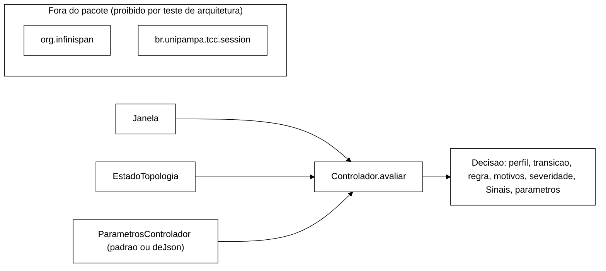

# Relatório B-28.1: núcleo de decisão puro do controlador (2026-10-22)

> Worker, 2026-10-22. Branch `feature/b28-1-nucleo-controlador`, criada de
> `feature/etapa-formal-integracao` (`6ba7e28`), worktree `../wt-b28-1`. Commits locais, **sem
> push**. Referência de desenho: `docs/plano-implementacao-controlador-2026-10-22.md` (branch
> `docs/plano-implementacao-controlador`), seções 0, 3.2, 3.3 e 3.5.

## 1. Resultado

| Medida | Antes (`6ba7e28`) | Depois (`5225e3f`) |
|---|---|---|
| Surefire `tests` | 275 | 384 |
| `failures` | 0 | 0 |
| `errors` | 0 | 0 |
| `skipped` | 0 | 0 |
| Arquivos existentes alterados | — | 0 (`git diff --diff-filter=MDR 6ba7e28..HEAD` vazio) |

Os dois números vêm da soma dos atributos `<testsuite>` de `workload/target/surefire-reports/TEST-*.xml`
após `mvn -f workload/pom.xml test`, com o diretório de relatórios apagado antes da segunda medição.
São 109 testes novos (detalhes na seção 3) e nenhum teste existente foi tocado.

Dependências usadas: `jackson-databind` 2.17.0 (escopo compile) e `junit-jupiter` 5.10.2, que já
estavam em `workload/pom.xml`. O pom não foi alterado.

## 2. O que foi implementado

Pacote novo `br.unipampa.tcc.controle` em `workload/src/main/java/br/unipampa/tcc/controle/`:

| Tipo | Papel |
|---|---|
| `Janela` (record) | agregado de uma janela tumbling `[inicioNs, fimNs)`; valida coerência (`erros ≤ total`, `indisponiveis ≤ erros`, `elegiveisLat ≤ total`, `excedencias ≤ elegiveisLat`, nada negativo, `fimNs > inicioNs`) |
| `EstadoTopologia` (record) | contagem de amostras da sonda na janela; `anomala()` = `disponivel && anomalas > 0`; `indisponivel()` é o estado neutro |
| `Perfil` (enum) | `NORMAL`, `CONSERVADOR` |
| `Motivo` (enum) | `VIOLACAO > TOPOLOGIA > ERRO > LATENCIA > ESTAVEL` (ordem de declaração = severidade) |
| `Decisao` (record) | `fimNs`, `perfil`, `transicao`, `regra`, `motivos`, `severidade`, `sinais`, `parametros` |
| `ParametrosControlador` (record) | parâmetros da seção 3.5, `padrao()` e `deJson(Path)` com SHA-256 do arquivo |
| `Controlador` | `Decisao avaliar(Janela, EstadoTopologia)`; máquina de estados R1..R4 |

O `Controlador` usa como "agora" sempre `janela.fimNs()` e não lê relógio de parede, não faz E/S e
não guarda estado estático. Ele exige `fimNs` estritamente crescente entre chamadas e não é
thread-safe; o laço de controle (B-28.2) o chama de uma única thread.

### 2.1 Como cada regra foi codificada

Por janela, na ordem:

1. Sinais. `taxaLatencia = excedencias / elegiveisLat`, determinada só se `elegiveisLat ≥ nLat` e
   `elegiveisLat > 0`. `taxaErro = erros / total`, determinada só se `total ≥ nErr` e `total > 0`.
   Sinal **alto** quando a taxa é `≥ θ_in`. Janela **calma** quando não há violação nem topologia
   anômala e cada taxa é `≤ θ_out` ou indeterminada. Quem fica entre `θ_out` e `θ_in` não é alto nem calmo.
2. Contadores. `persistenciaLat` e `persistenciaErr` contam janelas altas seguidas, separadamente,
   em qualquer perfil. `ultimaViolacao` e `ultimaTopologiaAnomala` recebem `fimNs`.
3. Em NORMAL:
   - R1: com violação, passa a CONSERVADOR, com ou sem cooldown.
   - R2: com o cooldown expirado e topologia anômala, `persistenciaLat ≥ k` ou `persistenciaErr ≥ k`, passa a CONSERVADOR.
4. Em CONSERVADOR, `janelasCalmas` soma 1 se a janela for calma e volta a 0 se não for. Depois:
   - Com violação, aplica-se R1: fica em CONSERVADOR e a `ultimaViolacao` é renovada.
   - Com outro sinal alto, aplica-se R3.
   - Sem sinal alto, aplica-se R4 se valerem juntas estas condições: cooldown expirado,
     `janelasCalmas ≥ m`, `fimNs − ultimaTopologiaAnomala ≥ estavelNs` e
     `fimNs − ultimaViolacao ≥ holdViolNs`.
5. Toda transição grava `ultimaTransicao = fimNs` e zera `janelasCalmas`.

`motivos` lista os sinais altos da janela em ordem de severidade, ou só `[ESTAVEL]` quando nenhum
está alto. `severidade` é o primeiro motivo da lista. `Sinais` guarda as taxas (nulas quando
indeterminadas), `fracaoIndisponivel` (S_unav, informativo), os campos de topologia, as
violações (I1+I4+I2 real e I2 esperada), os contadores e o estado do cooldown.

## 3. Testes (109 novos)

| Classe | Testes | Cobre |
|---|---|---|
| `TiposBasicosTest` | 9 | Perfil, ordem de severidade de Motivo, `maisSevero`, validação de `Janela` (13 rejeições) e `EstadoTopologia`, topologia indisponível neutra |
| `ParametrosControladorTest` | 34 | `padrao()` com os 12 valores da 3.5. `deJson` válido, com SHA-256 conferido contra `sha256sum` externo. Valores fora do padrão (k = m = 1, tempos 0). SHA que muda com o conteúdo. 27 rejeições parametrizadas: `θ_out = θ_in`, `θ_out > θ_in` (lat e err), cada campo negativo, `wNs = 0`, `k = 0`, `k < 0`, `m = 0`, campo ausente, campo desconhecido, `sha256` no arquivo, inteiro fracionário, inteiro fora da faixa, número como texto, `versao` não textual. JSON malformado, raiz não-objeto, arquivo inexistente, validação no construtor |
| `ControladorRegrasTest` | 44 | Tabelas por regra, com uma letra por janela (`Roteiro`). **R1** (5): entrada imediata, durante o cooldown, I2 esperada não decide, renovação do hold. **R2** (13): topologia sem persistência, latência e erro com k = 2, janela alta isolada, sinais diferentes não se somam, `θ_in` exato com amostra mínima exata, logo abaixo de `θ_in`, `n_err` exato, cooldown que bloqueia topologia e persistência e libera ao expirar. **Amostra insuficiente** (8): 10, 49 e 99 eventos e janela vazia em NORMAL; em CONSERVADOR não impede a saída; topologia indisponível. **R3** (4): latência, erro, topologia e janela intermediária zeram o contador. **R4** (6): saída com m calmas, m − 1 não basta, `θ_out` exato é calmo, logo acima não é, hold de violação de 120 s. **Parâmetros alternativos** (8): saída bloqueada por `T_estavel` = 60 s, anomalia mais recente define a estabilidade, saída bloqueada por cooldown de 60 s, hold zero, k = 1, k = 3, m = 1 contra m = 6 |
| `ControladorComportamentoTest` | 19 | **Histerese**: faixa intermediária não entra em NORMAL nem sai de CONSERVADOR, e as calmas depois dela saem. **Alternância** a cada janela de L, E, B, T e V: espaçamento ≥ cooldown com contagem exata (0 para L, E e B; 1 para T e V). Topologia a cada 7 janelas: várias transições, nenhuma a menos de um cooldown, instantes exatos `5, 35, 75, 105 s`. Conteúdo da `Decisao`: calma, todos os sinais, indeterminado e regra registrada (R2, R3, R4 e NENHUMA bloqueada). **Tempo** vindo de `fimNs`: um salto de 1 h expira cooldown e estabilidade. `fimNs` não crescente rejeitado. Nulos. Perfil inicial. **Determinismo**: mesma entrada, mesma lista de `Decisao` (com `equals` dos records) e duas instâncias intercaladas sem interferência |
| `ControladorPropriedadeTest` | 1 | 1000 sequências de semente fixa (`20261022`), de 60 a 299 janelas cada, com regimes calmo e de falha em cadeia de Markov e parâmetros sorteados por sequência. Asserções: transições separadas por ≥ cooldown, exceto entradas por R1. `transicao` ⇔ mudança de perfil. Entradas só por R1 ou R2, saídas só por R4. Saída respeita hold, `T_estavel` e `janelasCalmas ≥ m`. Violação ⇒ CONSERVADOR. Para não ser vacuo, exige mais de 100 transições por R1, R2 e R4 e mais de 10 entradas R1 dentro do cooldown |
| `ArquiteturaControleTest` | 2 | Lê as fontes de `controle/` e falha com `import` (inclusive `static`) de `org.infinispan` ou `br.unipampa.tcc.session`. Confere que as 7 fontes do núcleo foram lidas e testa o próprio detector com fontes sintéticas |

`Roteiro.java` é só apoio de teste: monta uma janela por letra, com volumes que caem exatamente
nos limiares do `padrao()`.

### 3.1 Os testes conseguem falhar

- **TDD.** Cada bloco teve o teste commitado antes da implementação (`09dad93`, `6d9f88c` e
  `ad5d6dd` são os commits vermelhos, que não compilavam sem as classes). No primeiro ciclo verde de
  `ParametrosControlador`, o teste `construtorValida` pegou um `NullPointerException` no lugar de
  `IllegalArgumentException` para `versao` nula, e a implementação foi corrigida.
- **Mutação manual do `Controlador`.** Foram 11 mutantes, aplicados um por vez e todos mortos. A
  tabela mostra quantos testes de `Controlador*` cada um derrubou.

| Mutante | Testes derrubados |
|---|---|
| R1 passa a respeitar o cooldown | 2 |
| R2 sem cooldown | 6 |
| Persistência ignora k | 9 |
| Calma de latência usa `θ_in` no lugar de `θ_out` | 5 |
| Calma de erro usa `θ_in` | 1 |
| Hold de violação ignorado | 3 |
| `T_estavel` ignorado | 3 |
| Janela intermediária congela o contador em vez de zerar | 1 |
| Mínimo de amostra ignorado | 5 |
| Topologia indisponível passa a contar | 2 |
| R4 sem cooldown | 6 |

- **Teste de arquitetura.** Com `import br.unipampa.tcc.session.SessionOps;` injetado em
  `Perfil.java`, ele falhou com `Perfil.java: import br.unipampa.tcc.session.`. O arquivo foi
  restaurado em seguida.

## 4. Desvios e interpretações (para validação)

Nenhuma regra R1..R4 foi alterada. Os pontos abaixo são de nomenclatura ou acréscimo, ou são
leituras de texto que o plano não detalha. Estão listados para o Gestor confirmar ou corrigir.

1. **Nome `W` → `wNs`.** O componente do record chama-se `wNs`, em nanossegundos, como os demais
   tempos (`cooldownNs`...). As chaves do JSON são os nomes dos componentes, em ns:
   `versao, wNs, nLat, nErr, thetaLatIn, thetaLatOut, thetaErrIn, thetaErrOut, k, m, cooldownNs,
   estavelNs, holdViolNs`. O plano não fixava o esquema do arquivo.
2. **Campos a mais em `ParametrosControlador`.** Foram acrescentados `versao` e `sha256`, porque a
   seção 3.5 pede "versão e SHA-256 do arquivo gravados no JSONL". Em `padrao()`, `sha256` é nulo e
   `versao` vale `"provisorio-2026-10-22"`.
3. **Validações além das pedidas.** Exige `wNs > 0`, limiares finitos, inteiros na faixa de `int`
   (`nLat`, `nErr`, `k`, `m`) e `versao` presente e textual. Rejeita campo ausente, campo
   desconhecido e `sha256` vindo do arquivo. JSON malformado vira `IllegalArgumentException`, e
   falha de leitura continua `IOException`.
4. **Campos a mais em `Decisao`.** Foram acrescentados `regra` (`Decisao.Regra`: R1, R2, R3, R4 e
   NENHUMA) e o record aninhado `Decisao.Sinais`. Taxa indeterminada é `null`, não NaN, porque o
   JSONL de B-28.2 não aceita NaN. `regra` existe porque o teste de propriedade precisa distinguir
   as entradas por R1.
5. **Janela intermediária em CONSERVADOR zera o contador de calmas.** Seguiu-se a letra de R4, "m
   janelas calmas seguidas": uma janela entre `θ_out` e `θ_in` não é calma e quebra a sequência.
   Com isso, R3 vira um caso particular. A leitura alternativa seria a janela intermediária
   congelar o contador sem zerar, o que a frase "qualquer sinal alto zera" poderia sugerir. Ela
   torna a saída mais rápida sob carga oscilante. O comportamento está fixado por um teste
   nomeado em `ControladorRegrasTest.r3`, e o mutante "congela" é morto por ele. **Precisa de
   confirmação do Gestor.**
6. **Origem do cooldown.** O cooldown conta da última transição de qualquer tipo (entrada por R1,
   entrada por R2 ou saída por R4) e começa expirado. O plano diz só "cooldown expirado". Isso
   torna verdadeira a propriedade pedida, de transições espaçadas ≥ cooldown exceto R1.
7. **Instante da anomalia de topologia.** É registrado como o `fimNs` da janela, porque
   `EstadoTopologia` não traz o horário de cada amostra. O efeito é conservador: a estabilidade
   começa a contar no fim da janela, e não no instante exato da amostra anômala.
8. **Critério de anomalia.** `EstadoTopologia.anomala()` é `disponivel && anomalas > 0`. O campo
   `nosMinimo` serve só para registro: classificar a amostra como anômala, inclusive por
   `number_of_nodes < 3`, cabe à sonda (B-26.2). Isso bate com a coluna "Liga" de S_top ("1
   amostra anômala na janela").
9. **Persistência durante o cooldown.** `persistenciaLat` e `persistenciaErr` continuam contando
   com o cooldown ativo. Se j−1 e j forem altas quando o cooldown expira, R2 dispara já em j. Há
   um caso de tabela para isso.
10. **Violação em CONSERVADOR.** A decisão sai com `regra = R1`, sem transição, e renova o hold.
11. **Ordem dos commits.** Os commits `test:` vermelhos vêm antes dos `feat:` (rastro de TDD). Por
    isso `09dad93`, `6d9f88c` e `ad5d6dd` não compilam isoladamente. Se o Gestor preferir que
    todo commit compile, dá para fundir cada par antes da integração.
12. **Documentação existente.** `docs/implementacao.md` e `docs/testes.md` não foram atualizados,
    porque a tarefa proibia alterar arquivos existentes. A entrada fica para a integração
    (`feature/controlador-integracao`) ou para B-28.2.

## 5. Commits

| SHA | Mensagem |
|---|---|
| `09dad93` | test: tipos básicos do núcleo do controlador (vermelho) |
| `6dbbe20` | feat: tipos de valor do núcleo do controlador |
| `6d9f88c` | test: parâmetros do controlador, `padrao()` e `deJson` (vermelho) |
| `a89b54c` | feat: `ParametrosControlador` com `padrao()` e `deJson` |
| `ad5d6dd` | test: regras R1-R4, histerese, oscilação, propriedade e determinismo (vermelho) |
| `f102e21` | feat: `Controlador` e `Decisao`, núcleo de decisão puro |
| `5225e3f` | test: teste de arquitetura do pacote `controle` |

Histórico linear sobre `6ba7e28`, sem merge. Não houve push.

## 6. Próximo passo sugerido

Os tipos `Janela`, `EstadoTopologia` e `Decisao` já estão publicados nesta branch. B-26.1
(agregador), B-26.2 (sonda) e B-27 (portão) podem partir dela, depois que o Gestor validar os
pontos 5 e 6 da seção 4.
