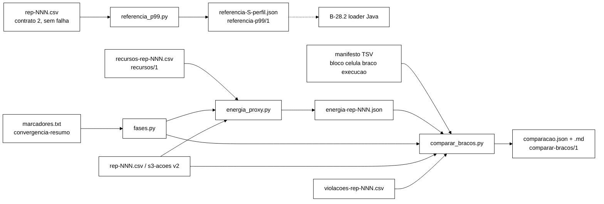

# Relatório do B-39: referência de p99, *proxy* de energia e análise pareada (2026-10-27)

> Worker, 2026-10-27. Prompt `docs/prompt-b39-analise-pareada-2026-10-27.md` (`afa33c8`, na branch
> `docs/plano-implementacao-controlador`), com as decisões D2 e D3 do Gestor (`e70b1cf`). Base
> `c055399`, branch `feature/b39-analise-pareada`, worktree `wt-b39`. Só arquivos novos em
> `analysis/` e este relatório. Sem push, sem VM, sem tc/netem.

## 1. Ambiente e base (passo 0)

| Item | Valor |
|---|---|
| Python | 3.12.6 |
| numpy / scipy | 2.2.0 / 1.16.0 (no *site* do usuário: `python -I` não os enxerga, ver seção 9, item 2) |
| `python -m unittest discover -s analysis -p "test_*.py"` na base | Ran 78 tests, OK (skipped=1) |
| `python -I scripts/test_rebaseline_matriz.py` na base | Ran 8 tests, OK |
| `mvn -q -o -f workload/pom.xml clean test` na base | 106 arquivos, 761/0/0/1 |

Conferências do passo 0d, todas sem divergência:

- `analysis/rebaseline.py:60-61` (`VALIDOS`), `:75-83` (`percentil`, posto mais próximo com `Fraction`),
  `:86-88` (`p99` com `n >= 1000`).
- `AgregadorDeJanela.java:126-129`: elegível = `operation` na referência, qualquer `return_code`;
  excedência `latenciaNs() > p99Ns(op)` (estrita).
- `Marcadores.java:78-117` (parse: primeiro `start` e `split`, último `end`, `#` e vazias ignoradas,
  malformada lança) e `:137-155` (`faseDe`). Os casos de `MarcadoresTest.java:58-106` foram copiados
  para F1.
- `ConvergenciaLoop.escreverResumo` (`:187-201`): `t_convergencia_abs_ns` e `divergencia_persistente`,
  gravados em `convergencia-resumo-rep-NNN.json` (`WorkloadMain.java:565-566`).
- `docs/contrato-csv-v2.md` e `MetaCsv.java:31-40`: `meta-csv-rep-NNN.json` com `{"contrato_csv": 2}`.
- Fase de um evento no CSV = fase do `start_ns` (`EventCsvWriter.java:126`, `:157`).

## 2. Commits

| # | SHA | Tipo | Conteúdo |
|---|---|---|---|
| 1 | `b5ec779` | refactor | quatro módulos com funções e CLIs declaradas; corpos `NotImplementedError`, CLI exit 3 |
| 2 | `9187925` | test | `test_fases.py` (F1, F2) e `test_referencia_p99.py` (R1..R7) |
| 3 | `7f7bd7b` | feat | `fases.py` e `referencia_p99.py` |
| 4 | `f965eb1` | test | `test_energia_proxy.py` (E-a..E-f) |
| 5 | `6017a99` | feat | `energia_proxy.py` |
| 6 | `c9b577a` | test | `test_comparar_bracos.py` (C1..C6, E1..E3, violações, guardas) e a fixture de violações |
| 7 | `fc298bb` | feat | `comparar_bracos.py` |
| 8 | (este) | docs | este relatório |

Histórico linear, sem `--amend`. Em todo commit, `python -I -c "import ast, sys; ..." analysis/*.py`
saiu com 0 e a suíte rodou sem `ImportError`/`SyntaxError`.

## 3. Suítes por commit

Suíte = `python -m unittest discover -s analysis -p "test_*.py"` (base + novos).

| Commit | Resultado da suíte | Vermelho dos testes novos |
|---|---|---|
| 1 `b5ec779` | (só esqueleto; nenhum teste novo) ast OK, CLIs exit 3 | — |
| 2 `9187925` | Ran 115, FAILED (failures=12, errors=80, skipped=1) | 37 testes; 35 falham (`NotImplementedError` em `fase_de`, `intervalos_de_fase`, `ler_marcadores`, `ler_convergencia`, `expandir_fases`, `percentil`, `gerar_referencia`, `excedencia`; CLI exit 3 ≠ 2/0). Passam já no vermelho `test_rotulos` e `test_validos_iguais` (constantes do esqueleto) |
| 3 `7f7bd7b` | Ran 115, OK (skipped=1) | — |
| 4 `f965eb1` | Ran 140, FAILED (failures=9, errors=29, skipped=1) | 25 testes, 25 falham (`NotImplementedError`, `AttributeError: VALIDOS` ainda inexistente, CLI exit 3) |
| 5 `6017a99` | Ran 140, OK (skipped=1) | — |
| 6 `c9b577a` | Ran 172, FAILED (failures=5, errors=33, skipped=1) | 32 executados (o `setUpClass` de C6 falha com exit 3 e os 6 testes da classe não rodam); 38 falhas/erros por `NotImplementedError`, `AttributeError` (`instante_ns`, `quantil_reamostrado`) e exit 3; nenhum `ImportError` |
| 7 `fc298bb` | Ran 177, OK (skipped=1), 35 s | — |

Suíte nova sozinha (4 arquivos, 99 testes): Ran 99 tests in 20,1 s, OK (orçamento: 120 s).

## 4. Mutantes Y1..Y16

Cada mutante numa cópia de `analysis/`, `scripts/` e `workload/src/` no *scratchpad*, um por vez, com a
suíte completa (`discover`, 177 testes). "Morto" = suíte com falha.

| Mutante | Alvo previsto | Resultado | Testes que caíram |
|---|---|---|---|
| Y1 percentil `lower` | R3 | morto | R1 paridade, R3 |
| Y2 referência só com válidos | R2 | morto | R2 (2), R6, R7 |
| Y3 n_min com `>` | R4 | morto | R4 (2), R2, R5 `phase antes` |
| Y4 aceita phase `durante` | R5 | morto | R5 `test_phase_durante` |
| Y5 excedência `>=` | R7 | morto | R7 (H0 na origem e excedência estrita) |
| Y6 amostra mais próxima | E-a | morto | E-a (2) |
| Y7 steal `>=` 0,05 | E-c | morto | E-c 5 % exato |
| Y8 úteis com BLOCKED | E-d | morto | E-d (2) |
| Y9 permutação sem identidade | C1 | morto | C1 (4) |
| Y10 permutação unilateral | C1 | morto | C1 (4), E2 nível |
| Y11 Bonferroni no lugar de Holm | C2 | morto | C2 (3) |
| Y12 regra de três = 3/N | C3 | morto | C3 (2), C6 violações |
| Y13 não-inferioridade pela média | C4 | morto | C4 limite inferior |
| Y14 *bootstrap* reamostra eventos | E1 curta ou C6 | morto | C6 `boot_de_blocos_so_depende_de_d_b`, E3 |
| Y15 `d_b = y_B − y_A` | E2 | morto | E2 (2), E1, E3, C4, C6, exclusões |
| Y16 rótulos fora de `S_viol` contados | teste novo | morto | `Violacoes.test_fixture_formato_do_auditor` |

16 de 16 mortos, cada um pelo teste previsto. Suíte de cada mutante: Ran 177 (Y15: 172, porque o
`setUpClass` de C6 cai).

## 5. Cobertura (E1) e larguras (E3)

E1: 1 000 simulações (sempre; `B39_LONGO=1` sobe para 5 000), n = 8 blocos, IC de 95 %, alvo 0,9.
(a) `d_b ~ Normal(ln 0,9; 0,15)`, 10 000 reamostragens de blocos. (b) eventos log-normais (σ = 0,5;
2 000 por execução), efeito de execução N(0; 0,15/√2) por braço (desvio de `d_b` ≈ 0,16), 2 000
reamostragens hierárquicas; "eventos" = uma reamostragem de todos os eventos de cada braço juntos, como
`bootstrap_ic.py`.

| Intervalo | Cobertura medida | Limiar |
|---|---|---|
| t sobre `d_b` (primário, D3) | 0,944 | ≥ 0,93 (aprovado) |
| *bootstrap* percentil sobre blocos | 0,883 | só reportado (esperado ≈ 0,88) |
| hierárquico (blocos + eventos) | 0,914 | só reportado |
| eventos juntos (pseudorreplicação, A8) | 0,505 | exigido < t − 0,15 (aprovado) |

Conferência fora da suíte, com 200 simulações e outra semente: t 0,97; percentil 0,895; hierárquico
0,93; eventos 0,52. Os números batem com a simulação do Senior (0,95 t; 0,88 percentil).

E3 (média de 10 conjuntos por caso, razão das larguras em escala log, hierárquico ÷ blocos): só
variabilidade dentro da execução (sem efeito de execução, 1 000 eventos, σ = 1) = **1,754**
(exigido > 1,15); só entre execuções (efeito de execução 0,3, 20 000 eventos) = **0,994** (exigido
|razão − 1| < 0,08).

H0 (teste adicional): o sorteio do p99 de uma reamostra pelo atalho Beta (`V_(k) ~ Beta(k, n−k+1)`,
valor `ordenado[ceil(n·V_(k)) − 1]`) tem a mesma distribuição da reamostragem ingênua (n = 50, 200 e
1 000; diferença máxima de frequência < 0,015 em 20 000 sorteios).

## 6. R7: calibração sob H0

20 CSVs i.i.d. (5 operações log-normais, 1 000 eventos por operação e CSV); referência com 10, excedência
nos outros 10 e nos 10 de origem.

| Operação | Fora da amostra (exc./eleg.) | Fração | Limite 1 % + 3,29·√(0,01·0,99/n) | Na origem |
|---|---|---|---|---|
| Login | 104 / 10 000 | 1,04 % | 1,327 % | 100 / 10 000 = 1,00 % |
| Validate | 107 / 10 000 | 1,07 % | 1,327 % | 1,00 % |
| Logout | 107 / 10 000 | 1,07 % | 1,327 % | 1,00 % |
| IncrementFailure | 95 / 10 000 | 0,95 % | 1,327 % | 1,00 % |
| ResetFailures | 65 / 10 000 | 0,65 % | 1,327 % | 1,00 % |

Na origem a fração é exatamente ≤ 1 % pelo posto mais próximo (n − ⌈0,99 n⌉ = 100 valores acima). Com
`>=` (Y5) ela vira 101/10 000 e o teste cai.

## 7. Esquemas de saída

### 7.1 `referencia-p99/1` (B-39.1; o *loader* Java do B-28.2 lê `p99_ns` e `n`)

```json
{
 "cenario": "S1",
 "esquema": "referencia-p99/1",
 "gerado_por": {"script": "analysis/referencia_p99.py", "sha256": "<sha256 do script>"},
 "metodo": "posto-mais-proximo",
 "n": {"Login": 1200, "Validate": 1200},
 "n_min": 1000,
 "omitidas": {"ResetFailures": 40},
 "origem": [{"arquivo": "rep-001.csv", "linhas": 2440, "sha256": "bb8c7ae8..."}],
 "p99_ns": {"Login": 6260848, "Validate": 6470133},
 "perfil": "sync",
 "populacao": "todos-os-eventos-por-operation"
}
```

Chaves ordenadas, indentação 1, inteiros como inteiros, LF final; `arquivo` relativo ao diretório
corrente (absoluto se estiver em outro volume). `n` lista só as operações de `p99_ns`.

### 7.2 `energia-proxy/1` (B-39.2; recorte de um exemplo sintético com marcadores, W = 2 s, P_max 100 W)

```json
{
 "agregados": {
  "vm": {"durante": {"cpu_s": 4.000000002, "cpu_s_por_1000_uteis": 39.6039604, "marca": "ok", "utilizacao": 0.5},
         "total": {"cpu_s": 19.960000004, "cpu_s_por_1000_uteis": 39.920000008, "marca": "ok", "utilizacao": 0.5}},
  "soma_cg": {"...": "..."}, "pid:workload": {"...": "..."}
 },
 "cenario": "S1",
 "cpu_s": {"cg:isn1": {"durante": {"cpu_s": 2.000000001, "marca": "ok"}}, "vm": {"...": "..."}},
 "energia": {"calculada": true, "modelo": "P(u) = P_ocioso + (P_max - P_ocioso) * u, ...", "p_max_w": 100,
             "razoes_ocioso": [0.5],
             "por_razao": {"0.5": {"vm": {"durante": {"e_dinamica_j": 50.0, "e_dinamica_j_por_1000_uteis": 495.05,
                                                      "e_total_j": 150.0, "e_total_j_por_1000_uteis": 1485.15}}}},
             "nota": "estimativa por modelo declarado; so comparacoes relativas entre bracos (plano 5.2)"},
 "esquema": "energia-proxy/1",
 "execucao": ".",
 "fases": [{"duracao_s": 2.0, "rotulo": "antes", "t_fim_ns": 1700000003000000000, "t_ini_ns": 1700000001000000000},
           {"duracao_s": 2.000000001, "rotulo": "durante", "...": "..."},
           {"rotulo": "recuperacao", "...": "..."}, {"rotulo": "pos-convergencia", "...": "..."}],
 "gerado_por": {"script": "analysis/energia_proxy.py", "sha256": "..."},
 "janela": {"origem": "eventos", "t0_ns": 1700000001000000000, "t1_ns": 1700000010980000002},
 "parametros": {"convergencia": null, "marcadores": "marcadores.txt", "w_recovery_s": 2.0},
 "recursos": {"clk_tck": 100, "csv_sha256": "...", "intervalo_ms": 1000, "nproc": 4},
 "rep": 1,
 "retrabalho": null,
 "steal": {"excluida": false, "frac": 0.0025, "limiar": 0.05},
 "uteis": {"antes": 100, "durante": 101, "pos-convergencia": 199, "recuperacao": 100, "total": 500}
}
```

Sem `--p-max-w`: `"energia": {"calculada": false, "motivo": "sem --p-max-w: so CPU (energia nao
estimada)"}`. Em S3, `retrabalho` = `{acoes, acoes_uteis, acoes_com_falha, retentativas,
retentativas_por_util, falhas_por_util}`. `marca` ∈ {`ok`, `fora-das-amostras`, `lacuna`, `ausente`}.

### 7.3 `comparar-bracos/1` (B-39.3) e a tabela Markdown

```json
{
 "celulas": {"C1": {
   "blocos": ["1", "2", "...", "8"],
   "blocos_excluidos_por_steal": [],
   "desfechos": {"acao_s3_p99_com_espera": {
      "blocos_excluidos": [], "d_b": {"1": "<ln(y_B/y_A) do bloco 1>", "...": "..."}, "estimativa": 0.97185,
      "familia": "primario", "ic_boot_blocos": [0.91505, 1.02874], "ic_hierarquico": [0.88622, 1.04347],
      "ic_t": [0.89944, 1.05008], "indice_semente": 0, "n_blocos": 8,
      "n_por_bloco": {"1": {"A": 1200, "B": 1200}, "...": "..."}, "p_holm": null, "p_permutacao": 0.4453125},
     "vazao_util": {"familia": "nao-inferioridade", "nao_inferioridade": {"delta": 0.1, "limite": 0.9,
                    "limite_inferior_ic_t": 0.9925, "resultado": "nao-inferior"}, "...": "..."},
     "...": "..."},
   "execucoes": {"1": {"A": "C1/b01A", "B": "C1/b01B"}, "...": "..."},
   "n_secundarios_holm": 5, "primario": "acao_s3_p99_com_espera", "primario_presente": true,
   "violacoes": {"I1": {"contagem": {"A": 0, "B": 1}, "n_base": {"A": 9600, "B": 9600},
                        "regra_de_tres": {"A": {"limite_superior_95": 0.000312, "rotulo": "≈ 3/N = 0.0003125 (N = 9600)"}}},
                 "I4": {"razao_de_taxas": {"estimativa": 1.0, "ic_boot_blocos": [1.0, 1.0], "reamostras_indefinidas": 0}, "...": "..."},
                 "presente": true, "blocos_com_arquivo": 8}}},
 "esquema": "comparar-bracos/1",
 "gerado_por": {"script": "analysis/comparar_bracos.py", "sha256": "..."},
 "manifesto": {"arquivo": "manifesto.tsv", "sha256": "..."},
 "parametros": {"delta": 0.1, "fases": ["durante", "recuperacao"], "ic_primario": "t (decisao D3)",
                "marcadores_nome": "marcadores.txt", "n_boot": 10000, "n_hier": 2000,
                "p99": "posto-mais-proximo, n >= 1000",
                "permutacao": "exata, troca de sinal, bilateral, identidade incluida",
                "primario": "acao_s3_p99_com_espera", "rep": 1, "semente_boot": 231027, "w_recovery_s": 60.0}
}
```

Tabela gerada ao lado (`comparacao.md`), mesmo exemplo sintético (8 blocos, efeito 0,9 no p99 de B,
espera no portão de 10 % só em B):

| Desfecho | Familia | n blocos | Razao B/A | IC t 95 % | IC boot blocos | IC hierarquico | p (permutacao) | p Holm | Excluidos |
|---|---|---|---|---|---|---|---|---|---|
| `acao_s3_p99_com_espera` | primario | 8 | 0.9718 | [0.8994; 1.0501] | [0.9150; 1.0287] | [0.8862; 1.0435] | 0.4453 | — | 0 |
| `acao_s3_p99_sem_espera` | secundario | 8 | 0.8835 | [0.8177; 0.9546] | [0.8304; 0.9361] | [0.8037; 0.9486] | 0.0156 | 0.0469 | 0 |
| `cpu_por_1000_uteis` | secundario | 8 | 0.9181 | [0.8740; 0.9644] | [0.8824; 0.9532] | — | 0.0078 | 0.0391 | 0 |
| `evento_p99:Login` | secundario | 8 | 0.8848 | [0.8199; 0.9550] | [0.8340; 0.9369] | [0.8232; 0.9490] | 0.0156 | 0.0469 | 0 |
| `falhas_percebidas_por_1000` | secundario | 8 | 1.0713 | [0.8058; 1.4243] | [0.8434; 1.2999] | — | 0.5938 | 0.5938 | 0 |
| `taxa_erro` | secundario | 8 | 2.5367 | [1.8098; 3.5556] | [1.9890; 3.3238] | — | 0.0078 | 0.0391 | 0 |
| `vazao_util` | nao-inferioridade | 8 | 0.9986 | [0.9925; 1.0048] | [0.9945; 1.0038] | — | 0.6016 | — | 0 |

O exemplo mostra por que a leitura do desfecho S3 (com ou sem espera) importa: com a espera no portão o
efeito de 0,9 some na média (0,97, p = 0,45); sem ela aparece (0,88, p = 0,016).

### 7.4 Fluxo dos três módulos



## 8. Diff, Surefire e Python final

`git diff --name-status c055399 HEAD` (todas A):

```
A	analysis/comparar_bracos.py
A	analysis/energia_proxy.py
A	analysis/fases.py
A	analysis/fixtures/b39/violacoes-rep-001.csv
A	analysis/referencia_p99.py
A	analysis/test_comparar_bracos.py
A	analysis/test_energia_proxy.py
A	analysis/test_fases.py
A	analysis/test_referencia_p99.py
A	docs/relatorio-b39-2026-10-27.md
```

- Surefire final: `mvn -q -o -f workload/pom.xml clean test`, 106 arquivos, 761/0/0/1 (inalterado).
- Python final: Ran 177 tests, OK (skipped=1) (78 da base + 99 novos); `python -I scripts/test_rebaseline_matriz.py`: Ran 8 tests, OK.

## 9. Desvios e interpretações

1. **R3 com n = 1 002, não 1 001.** Para p = 0,99 os dois métodos coincidem em n = 1 001
   (`floor(0,99·1000) = 990 = ceil(0,99·1001) − 1`). O menor n ≥ 1 000 em que diferem é 1 002. O
   teste usa 1 002 e fixa a coincidência em 1 001, para registro.
2. **`comparar_bracos.py` não roda com `python -I` neste host.** Ele precisa de numpy/scipy, que estão
   no *site* do usuário (`C:\Users\Francesco\AppData\Roaming\Python\Python312\site-packages`), e `-I`
   desliga esse *site*. Segue o arranjo de `rebaseline.py tabelas` (`test_rebaseline.py:191-193`): roda
   sem `-I`, no host. `fases.py`, `referencia_p99.py` e `energia_proxy.py` são só biblioteca padrão e
   rodam com `-I` (os testes chamam as CLIs assim). Os módulos que importam irmãos (`fases`,
   `referencia_p99`) põem o próprio diretório no `sys.path` de forma explícita, porque `-I` não o põe.
3. **Y16 sem rótulo `*_concorrentes` no CSV.** No formato atual do auditor os `*_concorrentes` só
   existem como contadores do stdout (`SessionOps.java:211-213` conta sem `registrarViolacao`;
   `:246-260` imprime). A fixture usa o formato real (`InvariantAuditor.dumpCsv`, `:251-278`, com
   `fase` e a coluna `classificacao` de `WorkloadMain.java:460-467`) e traz os rótulos que existem fora
   de `S_viol`: `I2_JANELA_CASCATA`, `I2_CASCATA_INCOMPLETA` e I2 de classe diferente de `REAL`. O
   mutante Y16 foi operacionalizado como "rótulos fora de `S_viol` contados como I2_REAL".
4. **Fase de cada item.** Evento pela fase do `start_ns` (como a coluna `phase`), ação S3 pela do
   `t_ns`, violação pela do `instante`. Janela da execução: do menor início ao maior fim (+1 ns).
   `--fases durante` inclui `durante-pre-split` e `durante-pos-split`. O desfecho é calculado sobre a
   união das fases pedidas (o primário do plano 8.3 é "nas fases durante + recuperação").
5. **Família de Holm.** Ficam fora o primário (`--primario`, obrigatório na CLI) e `vazao_util`, que
   tem o próprio teste (não-inferioridade, plano 8.3 trata como outra família). Os demais desfechos com
   p entram.
6. **IC hierárquico.** Gerador `SeedSequence([semente, indice, 1])`, fluxo separado do *bootstrap* de
   blocos (`[semente, indice]`, como o prompt fixa). O p99 de cada reamostra de eventos é sorteado pelo
   atalho Beta exato (seção 5, H0), sem materializar 10⁵ a 10⁶ eventos por execução e réplica.
7. **Valores zero.** `d_b = ln(y_B/y_A)` não existe com y = 0. Bloco com taxa zero num braço (comum em
   `taxa_erro` e `falhas_percebidas_por_1000` sem falha) sai daquele desfecho com motivo
   "valor zero (log indefinido)". Ponto para o B-40 (ver 10.3).
8. **Steal sem medida.** Execução sem fonte `vm` ou com lacuna no steal tem `excluida = null`; o bloco
   sai dos desfechos de CPU com motivo "steal-indisponivel" (conservador).
9. **`cpu_por_fase`** devolve `{fonte: {fase: {"cpu_s", "marca"}}}` em vez de `{fonte: {fase: cpu_s}}`,
   para carregar a marca `lacuna`/`fora-das-amostras` junto do valor nulo.
10. **`cpu_por_1000_uteis` usa o agregado `vm`** (inclui o *workload* e o controlador). Os agregados
    `soma_cg` e `pid:workload` estão no `energia-rep-NNN.json`, mas não viram desfechos para não
    inflar a família de Holm sem decisão do B-40.
11. **Retrabalho só em S3**, como o prompt define; em S1/S2 o JSON traz `retrabalho: null`.
12. **E1 roda 1 000 simulações sempre** (cabe no orçamento); `B39_LONGO=1` sobe para 5 000.
13. **Mutantes com a suíte completa numa cópia** de `analysis/`, `scripts/` e `workload/src/` (os
    testes de contrato leem o Java), não no worktree.

## 10. Pontos para o Gestor

1. Item 9.2: aceitar que `comparar_bracos.py` rode sem `-I` no host (numpy/scipy no *site* do
   usuário), como `rebaseline.py tabelas`; a alternativa é instalar numpy/scipy no Python do sistema.
2. Item 9.5: `vazao_util` fora da família de Holm. Se o B-40 quiser a vazão também como secundário de
   superioridade, basta mudar a família.
3. Item 9.7: desfechos de taxa com zeros (erros, falhas percebidas). Opções para o B-40: manter a
   exclusão do bloco (atual), usar diferença de taxas em vez de razão, ou somar meio evento (correção de
   continuidade) declarada no pré-registro.
4. Escolhas que seguem para o B-40, sem default implícito no código: execuções-fonte da referência,
   intervalo primário (D3 já fixou o t; o JSON traz os três), leitura do desfecho S3 (com ou sem espera;
   `--primario` é obrigatório) e `--semente-boot` (obrigatório).
5. B-28.2: o *loader* Java lê `p99_ns` e `n` do esquema `referencia-p99/1` e deve recusar esquema
   diferente e operação com `n < n_min`. B-38: `excedencia()` é o oráculo do *replay*.

## 11. Estado

- Worktree `C:\Users\Francesco\Development\tcc\wt-b39`, branch `feature/b39-analise-pareada`.
- `git status`: limpo depois do commit deste relatório.
- Não integrado, sem push.
