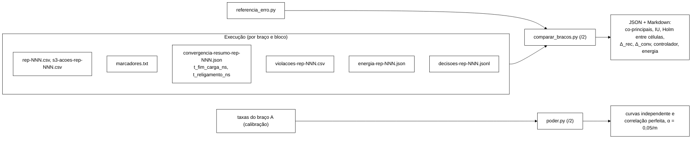

# Relatório do B-39.4 (W-5): `comparar-bracos/2`, guarda G4, poder e correções da V-W5 (2026-11-05)

Worker, branch `feature/w5-desfechos-coprincipais` sobre `e869a31` (`feature/controlador-integracao`), worktree
`wt-w5`. Sem push. Código escrito com o *host* em H0 estrito (só `py_compile`); suíte e mutantes rodados na janela H2
aberta pelo coordenador em 2026-11-05, a partir de 08:32Z.

Especificação: prompt W-5 de `docs/plano-execucao-2026-11-04.md` §9; Prompt 2 e §3.1-3.5 de
`docs/plano-alinhamento-objetivos-2026-11-04.md`; validação `docs/validacao-w5-2026-11-05.md` (`a2e14a8`, APROVADO
COM RESSALVAS) e as decisões P-1..P-7, A-2..A-4 e pontos 1..6 do coordenador em nome do Gestor (05/11).

## 1. Commits

| Commit | Tipo | O quê |
|---|---|---|
| `0ffb7a4` | test | G4 de 28/10: B39-R1 (W, marcadores e fases da energia) e B39-R2 (`sem-amostra-valida`), 12 testes |
| `87ff066` | fix | `conferir_parametros_energia` e a marca `sem-amostra-valida` |
| `34f119a` | test | W-5: `test_desfechos_coprincipais.py`, `test_poder.py`, `test_referencia_erro.py` (com esqueletos de `poder.py` e `referencia_erro.py`, para o vermelho cair por asserção) |
| `347670b` | feat | `comparar-bracos/2`, `poder.py`, `referencia_erro.py`, energia 0,3/0,5 |
| `7182a92` | docs | `testes.md` e README de `analysis` |
| `a2e14a8` | docs | validação V-W5 (Senior) |
| `0380d26` | test | correções R-2..R-11 da V-W5, vermelhos |
| `c7dfac4` | fix | correções R-2..R-11 |
| `1f9ac5f`, `0255a9d` | docs | README e `testes.md`; desenho do `t_religamento_ns` |
| `6ec46c8` | test | patch autorizado (P-1) em `test_comparar_bracos.py` |



## 2. O que mudou na análise

- **Desfechos co-principais** (G-1): `taxa_violacoes_por_1000` (I1 + I4 + I2 `REAL`, por mil ações S3, nas fases
  selecionadas) em diferença `y_B − y_A`, e `acao_s3_p99_com_espera` no log da razão.
- **Regra de interseção-união** (D-1, Berger 1982): H_V por troca de sinal exata bilateral com média de d_b < 0; H_L
  pelo limite superior do IC t 95 % da razão do p99 ≤ 1 + δ_L; `p_IU = max(p_V, p_L)`, com p_L na escala bilateral
  (2·F_t) e p_V = 1 se a média de d_b ≥ 0 (ponto 2 da V-W5); "melhoria" exige ainda vazão não inferior e trilha do
  braço B íntegra; Holm entre as células de teste sobre `p_IU`, com célula não avaliável entrando com p = 1 (ponto 3).
- **Escalas** (G3 de 28/10, P-4): diferença para taxa de violações, `taxa_erro`, `falhas_percebidas_por_1000`, Δ_rec,
  Δ_rec da Metodologia, Δ_conv e divergência; razão com exclusão dos zeros das duas taxas de erro como
  `<taxa>:razao` (sensibilidade, sem Holm).
- **Δ_rec** (plano 3.4, P-2, P-3): última operação **iniciada** depois do marcador `end` que terminou em anomalia;
  censura nos últimos W_c = `--w-analise-s` antes de `t_fim_carga_ns`; sem `t_fim_carga_ns`, ausente. Sensibilidade da
  Metodologia: primeira janela de W s na linha de base (quantil 95 % de Binomial(n_j, p_ref⁺); p_ref⁺ de
  `referencia_erro.py`, Clopper-Pearson unilateral).
- **Δ_conv** (plano 3.4, P-6): `t_convergencia_abs_ns − t_religamento_ns` quando a trilha mostra AC-5 `APLICADA`;
  sem nó parado, `− t_fim_carga_ns`; AC-5 aplicado sem `t_religamento_ns` deixa Δ_conv e divergência não avaliáveis
  (ponto 1); `t_religamento_ns` anterior a `t_fim_carga_ns` é inválido (ponto 2).
- **Controlador** (W-5 item 1): transições, tempo em CONSERVADOR, ações por tipo e resultado, tempo ativo por tipo
  (ação ativa no fim até `t_fim_carga_ns`, R-5), reversões por resultado e por origem, atrasos a partir do `start`,
  rastreabilidade.
- **Guardas**: G4 (B39-R1/R2); célula sem tipo; braços trocados; trilha obrigatória nos dois braços da célula de
  teste com `atuador` ≠ `nulo`, `politica` ≠ `nenhuma` e `param_sha256` igual (A-3); célula sem evento nas fases
  pedidas (A-2); mais de 16 blocos numa célula de teste, antes de ler as execuções.
- **Poder** (plano 3.3, P-7): curvas `independente` (pior caso com ρ ≥ 0) e `correlacao-perfeita` (limite superior),
  α = 0,05/m do primeiro passo do Holm, m obrigatório.

## 3. Parâmetros e origem

| Parâmetro | Valor no código | Origem |
|---|---|---|
| α, IC | 0,05; 95 % | `Metodologia.tex:229, :326` |
| δ_L (`--delta-latencia`) | sem padrão | B-40 (a Proposta dá 10 %, `Metodologia.tex:229`) |
| W_c (`--w-analise-s`) | sem padrão | B-40, derivada da vazão da calibração (plano 3.5) |
| W_recovery (`--w-recovery-s`) | sem padrão | B-40, derivado do protocolo do W-6 (P-5) |
| δ da vazão (`--delta`) | 0,10 | decisão do Gestor de 22/10 |
| quantil da linha de base; confiança de p_ref⁺ | 0,95; 0,95 | plano 3.4 |
| blocos e reduções da curva de poder | 8/10/12; 0..1 em 0,1 | plano 3.3, item 2 |
| m da curva de poder (`--m-celulas`) | sem padrão | pré-registro (plano de execução §5.2) |
| P_max; razão ociosa | 181 W (passado na CLI); 0,3 central e 0,5 sensibilidade (`RAZOES_OCIOSO_PADRAO`) | decisão do Gestor de 05/11; ficha `intel_i5_14600kf`; Barroso e Hölzle 2007, p. 36/34 |
| `t_religamento_ns` | nome do campo | desenho do coordenador (05/11), a levar ao W-6 |

## 4. Testes medidos

Comandos, na raiz de `wt-w5` (Python 3.12.6, numpy 2.2.0, scipy 1.16.0 do *site* do usuário):

```text
python -E -P -m unittest discover -s analysis
```

| Momento | Resultado | Tempo |
|---|---|---|
| base `e869a31` (worktree temporária completa, *detached*, removida depois) | **Ran 235 tests, OK (skipped=1)** | 46,6 s (08:42:17Z a 08:43:05Z) |
| ponta `6ec46c8` (`wt-w5`) | **Ran 370 tests, OK (skipped=1)** | 255,9 s (4 min 22 s de parede, a partir de 08:32:46Z) |

Uma primeira medida da base numa cópia `git archive` só de `analysis/` deu 235 testes com 56 falhas e 6 erros: artefato
da cópia, porque os testes de contrato e do *rebaseline* leem `workload/src/` e `scripts/` (`FileNotFoundError` em
`EventCsvWriter.java`, `OpResult.java`, `run-rebaseline.sh`...). Refeita na worktree completa, como acima.

370 = 235 + 135 novos: `test_guarda_energia.py` 12, `test_desfechos_coprincipais.py` 96, `test_poder.py` 18,
`test_referencia_erro.py` 9 (métodos `test_*`; os `subTest` contam como um). `test_comparar_bracos.py` continua com
37 testes, agora sob o patch autorizado.

Números reproduzidos das simulações antigas (sementes fixas), iguais aos da V-B37/B39 §3.4, o que mostra que o
`/2` não mudou a estatística herdada: E1 com 1 000 simulações, cobertura t 0,944, *bootstrap* percentil de blocos
0,883, hierárquico 0,914, eventos juntos 0,505; E3, razão das larguras hierárquico ÷ blocos 1,754 (só dentro) e 0,994
(só entre).

## 5. Mutantes

Cada mutante numa cópia de `analysis/` no *scratchpad* (a árvore não foi tocada), com `sed` conferido por SHA-256
antes e depois e `diff` gravado. Roteiro: `mutantes-w5.sh` (*scratchpad* da sessão), 08:37:29Z a 08:39:23Z.

| Mutante | Mudança | Suíte | Resultado | Testes que caíram |
|---|---|---|---|---|
| M1, diferença trocada por razão | `DESFECHO_V` fora de `ESCALA_DIFERENCA` | `test_desfechos_coprincipais` (96); `test_comparar_bracos` (37) | **morto**: 8 falhas; 1 falha | `TaxaViolacoes.test_diferenca_e_nao_razao`, `ComparacaoCompleta` (`test_melhoria_na_celula_1`, `test_nao_avaliavel_e_zeros_nos_dois_bracos`, `test_sensibilidades_da_taxa`, `test_holm_entre_celulas`, `test_markdown`), `RastreabilidadeQuebradaNaComparacao.test_acao_sem_decisao_no_braco_b_impede_melhoria`, `CelulaSemEventoNasFases.test_chamada_propria_com_antes`; `C6Determinismo.test_boot_de_blocos_so_depende_de_d_b` (escala esperada por nome, correção do Senior) |
| M2, censura esquecida | `if ultimo > fim_medicao_ns - w_c_ns:` → `if False:` | `test_desfechos_coprincipais` (96) | **morto**: 2 falhas | `DeltaRec.test_censurado`, `DeltaRec.test_fronteira_da_censura` |
| M3, `t_fim_ns` no Δ_conv | origem sem nó parado = `t_fim_ns` do resumo | `test_desfechos_coprincipais` (96) | **morto**: 6 falhas | `DeltaConv.test_a_partir_do_fim_da_carga`, `Religamento.test_origem_na_celula`, `Religamento.test_sem_ac5_conta_do_fim_da_carga` (4 `subTest`) |
| M4, fim em vez de início da operação | `e[0]`, `a[0]` → `e[1]`, `a[1]` nos anômalos | `test_desfechos_coprincipais` (96) | **morto**: 4 falhas | `DeltaRec.test_instante_e_o_inicio_da_operacao`, `test_ultimo_erro_conhecido`, `test_falha_percebida_s3_e_unavailable`, `test_fronteira_da_censura` |

## 6. Patch autorizado (P-1)

`autorizacao-test_comparar_bracos-v2.patch`, SHA-256
`2232afe2ea73822f86c310e56a653398750892b3718d9faa0c7841943b3095bb`, aplicado com `git apply` em `6ec46c8`
(+58/−15 linhas). Conteúdo: chamada do `/2` (`ARGS_V2` com `--w-recovery-s 60` como valor de teste;
`w_recovery_s=60` em `ExclusoesERegistro`), *fixture* `energia_min` com `janela` e `parametros` (B39-R1),
`escrever_trilha` mínimo nas células de teste de `C6Determinismo` e `ExclusoesERegistro` (A-3), esquema `/2`, família
`co-principal-L`, conjunto de desfechos com os `:razao`, escala esperada por nome numa lista explícita e secundários
sem p iguais a `{delta_rec_s, delta_conv_s, divergencia_persistente}`. Nenhuma linha de asserção saiu.

## 7. SHA-256 na ponta `6ec46c8` (*blobs* do git)

```text
9213b0fcf2b623a27a335afaad8f51c5553efacd724fd52ad7ee035627c172f0  analysis/comparar_bracos.py
a4de825bd86b1fbb4bf0773cb2ee4279c88f9c771691d405e3e3c30eee8041a9  analysis/poder.py
b2fff6267f22b66c13da6c5c1160032d656a0e9334ccd951b3ecca423ecf61d7  analysis/referencia_erro.py
fac605fe7a02558f041865fc5d475856c05cc2d7d2309b42c70e3fb662eacb32  analysis/energia_proxy.py
29ef6b80e93225b7fc079700f5901650dee0038cbd53b62a6deab777adc9c740  analysis/test_comparar_bracos.py
9c93b8ff2a27f841725ad4d3a36438ed68c4df72dabeab8a85bb2b6bf5f7d9eb  analysis/test_desfechos_coprincipais.py
34576670160c12e3158fc8ad22642c116553df51fa4b72f2a43927c11deb6a7c  analysis/test_poder.py
b93b67df385f9759e90b6be838524af92a524fab1010f440933286da80b5e920  analysis/test_referencia_erro.py
06a7a43838344ab047b94ae4e6818f4adce8dd986005d8e9a7745b81081193a9  analysis/test_guarda_energia.py
```

`energia_proxy.py` não está na lista congelada do *rebaseline* (`003814e9…`, DT-009 parte 2) nem na do h4
(`e9c44819…`); a mudança de `RAZOES_OCIOSO_PADRAO` não toca *bundle* congelado.

## 8. Desvios e pendências

- Durante o H0 estrito rodei o Python duas vezes além do `py_compile`: um *script* vazio e uma substituição de texto
  num arquivo de teste. Ambos instantâneos, sem teste. Relatado ao coordenador na hora.
- O vermelho dos `test:` não foi medido (H0): os commits `0ffb7a4`, `34f119a` e `0380d26` foram escritos contra o
  código da época e só a ponta foi rodada.
- **Requisito para o W-6 e o programa de carga**: gravar `t_religamento_ns` no resumo de convergência (ao fim da carga,
  se houve AC-5, sinalizar o fim, esperar o `podman start` do orquestrador e a topologia completa, com prazo, antes
  do laço de convergência). Até lá, toda execução com AC-5 aplicado sai com Δ_conv e divergência não avaliáveis.
- A-5 (ii), família de secundários fixa com p = 1 para quem ficar sem dado: fica para o B-40 (ponto 6).
- Para o B-40: fixar δ_L, W_c, W_recovery e m; a célula sem falha roda em chamada própria com `--fases antes`.
- Integração na `feature/controlador-integracao`: pendente de liberação do Senior e do coordenador.
