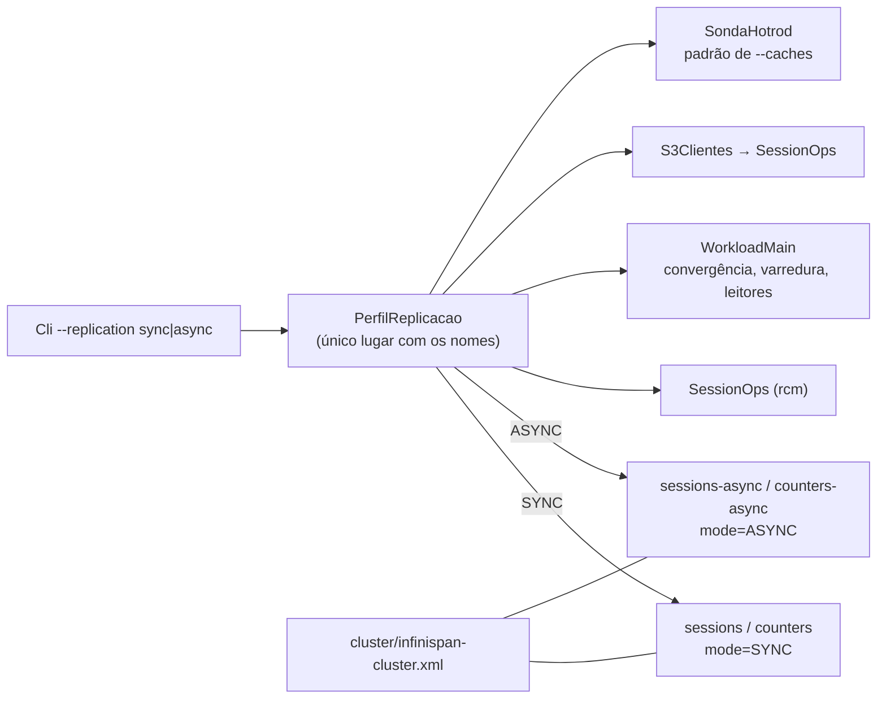

# Relatório B-42.1: perfil ASYNC selecionável (2026-10-22)

Branch `feature/b42-1-perfil-async`, base `feature/etapa-formal-integracao` (`6ba7e28`),
worktree `wt-b42-1`. Commits só locais, **sem push**. Referência: plano
`docs/plano-implementacao-controlador-2026-10-22.md` (branch `docs/plano-implementacao-controlador`),
seções 2.1, 2.4 e 6 (linha B-42.1). Pré-condição: o Gestor confirmou em 2026-10-22 que no perfil ASYNC
o cache `counters` também fica ASYNC (item 10.1 do plano).

## 1. Resultado em uma linha

`--replication sync|async` (padrão `sync`) escolhe entre `sessions`/`counters` (`mode="SYNC"`) e os
irmãos novos `sessions-async`/`counters-async` (`mode="ASYNC"`, demais parâmetros idênticos). Surefire
foi de 275/0/0 para 296/0/0, os *goldens* S1/S2 não mudaram, e o smoke local nos dois perfis passou com os
quatro caches HEALTHY nos três nós.



## 2. Surefire (soma dos `TEST-*.xml`)

| Momento | tests | failures | errors | skipped | arquivos |
|---|---|---|---|---|---|
| Antes (`6ba7e28`, `mvn -f workload/pom.xml test`) | 275 | 0 | 0 | 0 | 33 |
| `69352c1` | 280 | 0 | 0 | 0 | 34 |
| `4147c40` | 284 | 0 | 0 | 0 | 35 |
| `771744f` | 290 | 0 | 0 | 0 | 35 |
| `83f0bbd` | 296 | 0 | 0 | 0 | 36 |
| Depois (`a6fa048`/`09f2434`, `mvn clean test`) | **296** | **0** | **0** | **0** | 36 |

Cada commit intermediário foi verificado com `mvn clean test` completo numa worktree destacada temporária
(removida depois): nenhum commit vermelho no grafo.

Os 21 testes novos são `PerfilReplicacaoTest` (+5), `ClusterXmlIrmaosTest` (+4), `CliTest` (+6, de 9
para 15), `NomesDeCacheSoNoResolvedorTest` (+4) e `SondaHotrodTest` (+2, de 10 para 12). Nenhum teste
existente foi alterado nem removido: as modificações em `CliTest` e `SondaHotrodTest` só acrescentam
linhas, e `GoldenS1S2Test` e seus recursos estão byte a byte iguais a `6ba7e28`.

## 3. Pontos parametrizados (arquivo:linha antes → depois)

As linhas "antes" foram conferidas no disco em `6ba7e28` e batem com a seção 2.4 do plano.

| Ponto | Antes (`6ba7e28`) | Depois (`HEAD`) |
|---|---|---|
| `SessionOps`, construtor público com rastro | `SessionOps.java:94-95` `getCache("sessions")`, `getCache("counters")` | `SessionOps.java:98-99` `getCache(perfil.cacheSessoes())`, `getCache(perfil.cacheContadores())` |
| `SessionOps`, construtor do S3 | `SessionOps.java:147-148` | `SessionOps.java:151-152` (idem) |
| `SessionOps`, construtores públicos de 3 e 5 argumentos (não listados no plano) | `:70`, `:84` sem perfil | recebem `PerfilReplicacao` e repassam |
| `WorkloadMain`, `SessionOps` da carga | `WorkloadMain.java:128` | `:129` `new SessionOps(rcm, cli.replicacao, ...)` |
| `WorkloadMain`, topologia do laço de convergência | `:278` `rcm.getCache("sessions")` | `:279` `rcm.getCache(cli.replicacao.cacheSessoes())` |
| `WorkloadMain`, `HealthRest.Estado.healthy` | `:283-284` `h.healthy("sessions"), h.healthy("counters")` | `:284-285` `h.healthy(cli.replicacao.cacheSessoes()), h.healthy(cli.replicacao.cacheContadores())` |
| `WorkloadMain`, varredura final | `:319-320` | `:320-321` |
| `WorkloadMain`, leitores multi-réplica (cliente *topology-aware*) | `:381-382` | `:382-383` |
| `WorkloadMain`, leitores multi-réplica (cliente BASIC por nó) | `:402-403` | `:403-404` |
| `WorkloadMain`, cabeçalho da execução (novo) | — | `:85` imprime `Replicacao: replicacao=<p> caches=<a>,<b>` |
| `WorkloadMain`, `--dry-run` | `:66` imprime só `Cli{...}` | `:66` imprime `cli.textoDryRun()`: a linha histórica inalterada e mais `dry-run, replicacao=<p> caches=...` |
| `S3Clientes` (herda via `SessionOps`) | `S3Clientes.java:108`, `:115`, `:123`, `:126` sem perfil | mesmas linhas, com `cli.replicacao` |
| `SondaHotrod`, padrão de `--caches` | `SondaHotrod.java:73` `List.of("sessions")` | `:69` (campo `perfil` em `Args`), `:74`, `:87`, `:102-104`: `--replication sync\|async` e, sem `--caches`, `List.of(perfil.cacheSessoes())`, que em `sync` continua `sessions` |
| `SondaHotrod.valorDeTeste` (não listado no plano; o teste de varredura o exigiu) | `:112-113` `case "sessions"`, `case "counters"` | `:118-123` `PerfilReplicacao.ehCacheDeSessoes/ehCacheDeContadores` (aceita os nomes dos dois perfis) |
| `Cli` | — | `Cli.java:215-222` opção `--replication` (padrão `sync`, conversor rejeita outro valor); `textoDryRun()` |
| Resolvedor (novo) | — | `PerfilReplicacao.java:28-29`, os **únicos** literais `"sessions"`/`"counters"` em `workload/src/main` |

## 4. Testes novos

| Teste | O que garante |
|---|---|
| `NomesDeCacheSoNoResolvedorTest` | Varre todos os `.java` de `workload/src/main` e falha (a) com literal `"sessions"`, `"counters"`, `"sessions-async"` ou `"counters-async"` fora de `PerfilReplicacao.java`, ou com qualquer `getCache("…")`; (b) com chamada `getCache(...)`/`healthy(...)` cujo argumento não seja `perfil.cacheX()`/`cli.replicacao.cacheX()` (ou o parâmetro do adaptador da sonda). Tem um teste de não-vacuidade (≥ 30 fontes, ≥ 12 chamadas) e um autoteste do detector com formas conhecidas. |
| `ClusterXmlIrmaosTest` | Lê `cluster/infinispan-cluster.xml` com DOM, com *namespaces* e DOCTYPE proibido. Confere que os quatro caches dos dois perfis existem com o `mode` do perfil (e que são só esses quatro); que, para cada par irmão, o modo é SYNC × ASYNC e `owners`, `segments`, `when-split` e `merge-policy` são iguais; que os irmãos só diferem em `name`/`mode` (atributos e filhos `locking`, `state-transfer` e `partition-handling` idênticos); e que os SYNC mantêm os valores do *baseline* (2/64/`DENY_READ_WRITES`/`PREFERRED_NON_NULL`). |
| `CliTest` (+6) | padrão `sync`; `--replication sync`; `--replication async` (também com `--scenario S3`); valor inválido (`asinc`, `repl`, vazio, `dist_async`, opção sem valor) dá `ParameterException`; `textoDryRun` mostra perfil e nomes; `WorkloadMain.main --dry-run --replication async` imprime o perfil sem conectar. |
| `PerfilReplicacaoTest` | nomes por perfil, rótulo, conversão, descrição e papel do cache pelo nome. |
| `SondaHotrodTest` (+2) | o padrão de `--caches` segue `--replication`, `--caches` explícito prevalece, valor inválido é rejeitado; `valorDeTeste` reconhece os caches `-async`. |
| `GoldenS1S2Test` (inalterado) | com `sync`, as sequências S1/S2 continuam idênticas ao *golden*. |

**TDD.** Cada par teste+implementação está num único commit que compila. O vermelho foi exercitado
explicitamente para o XML: com o descritor de `6ba7e28`, `ClusterXmlIrmaosTest` deu 4 testes, 3 falhas
(`cache ausente no XML: sessions-async (presentes: [sessions, counters])`). Esse mesmo teste também pegou um
defeito meu antes do commit: o comentário de cabeçalho que escrevi continha `--replication`, e `--` não é
permitido dentro de comentário XML (`SAXParseException`). O servidor recusaria esse descritor. Corrigi o
comentário. Para `PerfilReplicacao` e `Cli` o vermelho seria erro de compilação, por isso não foi
registrado em separado.

## 5. Mutações manuais

Ambas foram feitas na árvore de trabalho, executadas e revertidas com `git checkout --`. Nenhuma foi commitada.

**M1, literal reintroduzido.** `WorkloadMain.java:279`:
`rcm.getCache(cli.replicacao.cacheSessoes())` → `rcm.getCache("sessions")`.
`mvn -f workload/pom.xml test -Dtest=NomesDeCacheSoNoResolvedorTest` terminou com exit 1, 4 testes, 2 falhas:

```
NomesDeCacheSoNoResolvedorTest.chamadasUsamOPerfil:141 getCache/healthy sem o nome do perfil:
WorkloadMain.java:279: RemoteCache<String, SessionState> sessoesTopologia = rcm.getCache("sessions"); ==> expected: <[]> but was: <[WorkloadMain.java:279: ...getCache("sessions");]>
NomesDeCacheSoNoResolvedorTest.semLiteralForaDoResolvedor:133 nome de cache literal fora de PerfilReplicacao (use o perfil):
WorkloadMain.java:279: RemoteCache<String, SessionState> sessoesTopologia = rcm.getCache("sessions"); ...
```

**M2, `owners` divergente.** `counters-async` com `owners="3"`.
`mvn -f workload/pom.xml test -Dtest=ClusterXmlIrmaosTest` terminou com exit 1, 4 testes, 2 falhas:

```
ClusterXmlIrmaosTest.irmaosSoDiferemNoModo:152 counters ==> expected: <{owners=2, segments=64, statistics=true}> but was: <{owners=3, segments=64, statistics=true}>
ClusterXmlIrmaosTest.irmaosTemOwnersSegmentsEPartitionHandlingIguais:135 owners: counters x counters-async ==> expected: <2> but was: <3>
```

**M3 (extra), `merge-policy` divergente.** `sessions-async` com `merge-policy="REMOVE_ALL"` deu exit 1:
`irmaosTemOwnersSegmentsEPartitionHandlingIguais:141 merge-policy: sessions x sessions-async ==> expected: <PREFERRED_NON_NULL> but was: <REMOVE_ALL>` e a falha correspondente em `irmaosSoDiferemNoModo`.

## 6. Smoke no cluster local (sem VM)

Bruto em `runs/b42-1-smoke/` (77 MB, 42 arquivos mais `MANIFEST.sha256` com o SHA-256 de cada um).
Ficam versionados só os JSON e o manifesto. CSV, `.txt` e `.log` ficam no disco por causa do `.gitignore`
(`runs/**/*.csv|*.txt|*.log`).

Ambiente: Podman 5.7.0 (máquina WSL, rootless), imagem `quay.io/infinispan/server:15.0.21.Final`, três
nós com o `cluster/infinispan-cluster.xml` **desta branch**, JDK 22.0.2. O cluster foi derrubado ao fim.
Ver o desvio D1 sobre os nomes dos containers.

| Verificação | Resultado | Bruto |
|---|---|---|
| REST `/rest/v2/cache-managers/default/health` em 11222, 11223 e 11224, antes das cargas | `HEALTHY`, `number_of_nodes=3`; `sessions`, `counters`, `sessions-async` e `counters-async` todos `HEALTHY` nos três nós | `health-antes-1122{2,3,4}.json` |
| idem, depois das cargas | idem | `health-depois-1122{2,3,4}.json` |
| config efetiva no servidor (`?action=config`) | `sessions`/`counters`: `SYNC`, owners 2, segments 64, `DENY_READ_WRITES`/`PREFERRED_NON_NULL`; `-async`: `ASYNC` com os mesmos valores | `config-*.json`, `tamanhos-antes.txt` |
| `--dry-run` sync / async / `asinc` | mostra `replicacao=sync caches=sessions,counters` / `replicacao=async caches=sessions-async,counters-async`; `asinc` dá exit 2 com `valor invalido 'asinc' para --replication` | `dryrun-*.txt` |
| S1 sync: 40 s, 4 *threads*, `--convergence --sweep` | exit 0; 571.359 operações; 0 violações; convergência em 3 rodadas; varredura com 185 sessões, 4 identidades, 0 achados | `S1-sync/`, `S1-sync.out.txt` |
| tamanhos após S1 sync | `sessions=185`, `counters=4`, `sessions-async=0`, `counters-async=0` | `tamanhos-apos-S1-sync.txt` |
| S1 async: mesmos parâmetros | exit 0; 652.413 operações; 0 violações; convergência em 3 rodadas; varredura com 101 sessões, 4 identidades, 0 achados | `S1-async/`, `S1-async.out.txt` |
| tamanhos após S1 async | `sessions=185`, `counters=4` (sem mudança), `sessions-async=101`, `counters-async=4` | `tamanhos-apos-S1-async.txt` |
| S3 async (`pinned`, 30 s, `--sweep`), exercita `S3Clientes` | exit 0; 533 ações; 0 violações; varredura com 0 achados | `S3-async/`, `S3-async.out.txt`, `tamanhos-apos-S3-async.txt` |
| `SondaHotrod --no isn2=127.0.0.1:11223 --replication async` (sem `--caches`) | todas as linhas em `sessions-async`, `put/get/entrySet/remove` OK | `sonda-async.csv` |
| logs dos três servidores | 0 `ERROR`. Os WARN são ISPN012026 (desafio *digest* do *healthcheck*), ISPN000599 (*encoding* não declarado, igual nos quatro caches, SYNC e ASYNC), ISPN080059 e ISPN080072 | `isn{1,2,3}.log` |

O smoke mostra que a seleção funciona de ponta a ponta. A carga `async` só povoou os caches `-async`, e
os SYNC ficaram com os mesmos tamanhos. As latências e contagens deste smoke **não** servem de evidência
para H-A0..H-A3: são uma repetição curta, sem falha, no host. A varredura do S3 inclui as chaves deixadas
pelo S1 async (o mesmo cluster, sem limpeza entre os dois).

## 7. Desvios e observações

- **D1, nomes dos containers no smoke.** Havia containers parados `isn1..3` (projeto `cluster`), criados
  a partir de `tcc-desenvolvimento/cluster/` com o XML antigo montado. Para não tocá-los, subi o cluster
  com uma cópia temporária do `podman-compose.yml`, idêntica a não ser por `container_name: b421-isnN`,
  como projeto `-p b421`. Imagem, comando, portas, *healthcheck*, *hostnames*/aliases DNS (`isn1..3`, que
  o TCPPING usa) e os montes `./infinispan-cluster.xml` e `./jgroups-tcp.xml` são os mesmos. A cópia
  ficou em `cluster/podman-compose.b421-smoke.yml`, porque o caminho absoluto `C:/...` quebra o
  *parser* de montagem do `podman-compose`. Ela nunca foi commitada e foi apagada depois do `down`. Os
  `isn1..3` antigos continuam como estavam.
- **D2, máquina Podman.** Estava parada. Iniciei-a para o smoke e parei-a de novo ao fim, voltando ao
  estado em que estava.
- **D3, pontos além da lista da seção 2.4.** O teste de varredura obrigou a parametrizar também
  `SondaHotrod.valorDeTeste` (antes `:112-113`) e os construtores públicos de 3 e 5 argumentos de
  `SessionOps`. Os construtores de `SessionOps` que recebem `RemoteCacheManager` passaram a **exigir**
  o perfil, sem padrão implícito. Os únicos chamadores são `WorkloadMain` e `S3Clientes`.
- **D4, linha nova no stdout.** A execução real imprime `Replicacao: ...` logo depois de
  `Configuracao: Cli{...}`. `Cli.toString()` não mudou. Nenhum CSV, JSON ou nome de arquivo mudou.
- **D5, `java` no PATH é 8.** O smoke usou `$JAVA_HOME/bin/java` (JDK 22.0.2, o mesmo do Maven).
- **D6, horário.** O smoke rodou por volta de 02:50 (horário local), no host e sem VM. Não havia janela
  de injeção avisada.
- **D7, `ClusterXmlIrmaosTest` exige exatamente quatro caches.** É intencional, porque o escopo proíbe
  alterar o servidor além dos irmãos. Um cache novo no futuro terá de atualizar esse teste.
- **D8, doc.** Em `docs/configuracao-infinispan.md` alterei só as duas linhas que citam B-03 (T1 e
  "Variantes pendentes"). A linha 10 ("Define os caches `sessions` e `counters` em modo distribuído
  síncrono") ficou desatualizada, conforme a instrução de mexer só na seção B-03.

## 8. Commits (locais, sem push)

| SHA | Mensagem |
|---|---|
| `69352c1` | feat: PerfilReplicacao resolve os nomes de cache por perfil SYNC/ASYNC (B-42.1) |
| `4147c40` | feat: caches irmaos sessions-async e counters-async em ASYNC no descritor (B-42.1) |
| `771744f` | feat: opcao --replication sync\|async no Cli, mostrada no --dry-run (B-42.1) |
| `83f0bbd` | refactor: nomes de cache vem do PerfilReplicacao em SessionOps, WorkloadMain, S3Clientes e SondaHotrod (B-42.1) |
| `a6fa048` | docs: configuracao-infinispan marca o perfil DIST_ASYNC (B-03) como implementado em B-42.1 |
| `09f2434` | test: smoke local B-42.1 nos perfis sync e async (cluster Podman, 3 nos) |
| este relatório | docs: relatorio B-42.1 |

## 9. Pontos para validação do Gestor

1. Aceitar D1 (smoke com containers renomeados, para não recriar os `isn1..3` de outra worktree).
2. Decidir se a linha 10 de `docs/configuracao-infinispan.md` também deve ser atualizada (D8).
3. Integração: o plano manda integrar B-42.1 antes de B-26.1, porque ambos tocam `SessionOps`. B-26.2 deve
   ler os nomes de `PerfilReplicacao`. O XML novo só vai para a VM depois de S7.
4. Próximos itens dependentes: B-42.2 (verificação ASYNC, empírico no cluster local) e B-42.3
   (`run-baseline.sh --replication`, depois de T-D).
