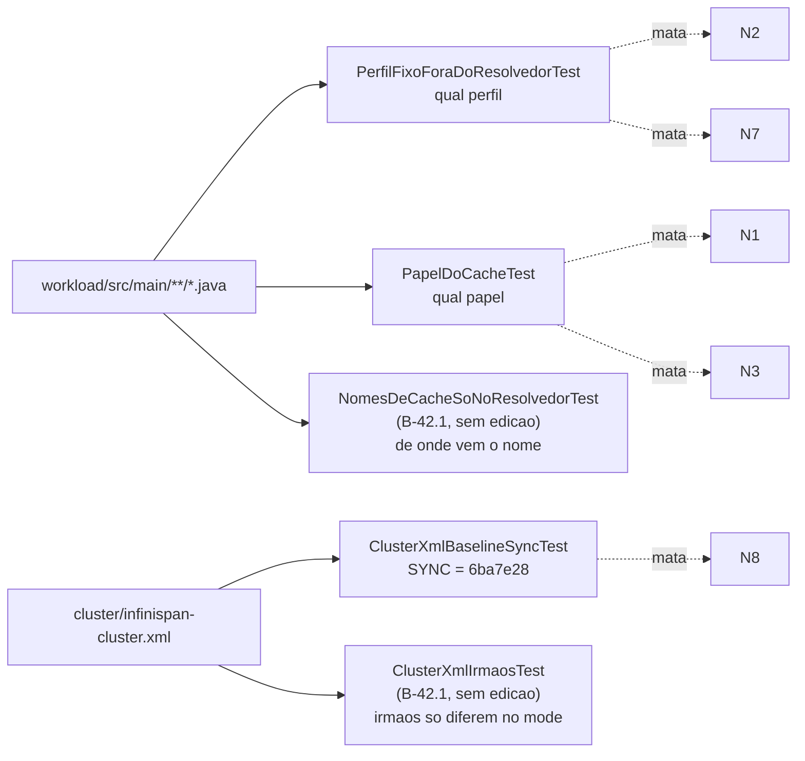

# Relatório B-42.1, adendo: Tarefa 0 (endurecimento das guardas) — 2026-10-22

> Adendo ao relatório de B-42.1 (`docs/relatorio-b42-1-2026-10-22.md`, commit `cdfa989`), que não foi editado.
> Origem: validação V-B42.1 (`wt-plano-ctrl/docs/validacao-b42-1-2026-10-22.md`), seção 5 (mutantes
> sobreviventes N1, N2, N3, N7, N8), seção 6 (desvio D8) e Apêndice A, Tarefa 0. As partes B-43.1 e
> B-43.3a do mesmo apêndice **não** foram executadas, por decisão do Gestor.

## 1. Resultado

| Item | Situação |
|---|---|
| Branch / worktree | `feature/b42-1-perfil-async` em `wt-b42-1`, base `cdfa989` |
| Commit 0.1 `test:` | `85326f7`, três testes novos (9 casos) |
| Commit 0.2 `docs:` | `be9091e`, linha 10 de `docs/configuracao-infinispan.md` |
| Surefire | 296 → **305** / 0 / 0 / 0 (k = 9) |
| Testes existentes editados | nenhum (`git diff --name-status cdfa989 85326f7` só lista `A` nos três arquivos novos) |
| *Golden* `workload/src/test/resources/golden-8e2e815/` | idêntico a `6ba7e28` (`git diff 6ba7e28 HEAD -- <golden>` vazio) |
| Mutantes N1, N2, N3, N7, N8 | **os cinco morrem** (seção 4) |
| Push | nenhum |

## 2. Surefire por commit

Comando: `mvn -f workload/pom.xml clean test`. As contagens são a soma dos `TEST-*.xml` de
`workload/target/surefire-reports/`.

| Momento | exit | tests | failures | errors | skipped | arquivos `TEST-*.xml` |
|---|---|---|---|---|---|---|
| antes de 0.1 (`cdfa989`) | 0 | 296 | 0 | 0 | 0 | 36 |
| depois de 0.1 (`85326f7`) | 0 | 305 | 0 | 0 | 0 | 39 |
| antes de 0.2 (árvore com a linha 10 editada) | 0 | 305 | 0 | 0 | 0 | 39 |
| depois de 0.2 (`be9091e`) | 0 | 305 | 0 | 0 | 0 | 39 |

## 3. Testes novos

| Arquivo | Casos | O que verifica |
|---|---|---|
| `PerfilFixoForaDoResolvedorTest` | 3 | (a) Nenhuma referência `PerfilReplicacao.SYNC`/`.ASYNC` fora de `PerfilReplicacao.java`. A varredura também pega `import static …PerfilReplicacao.…` e `PerfilReplicacao.valueOf("…")`/`porRotulo("…")` com literal. A *allow-list* é por (arquivo, linha exata sem espaços nas pontas): `Cli.java` → `public PerfilReplicacao replicacao = PerfilReplicacao.SYNC;` e `SondaHotrod.java` → `PerfilReplicacao perfil = PerfilReplicacao.SYNC;`. Não-vacuidade: ≥ 30 fontes, presença de `WorkloadMain`, `S3Clientes`, `SessionOps`, `Cli`, `SondaHotrod` e do resolvedor, e cada entrada da *allow-list* encontrada exatamente uma vez, o que impede que ela fique obsoleta. O autoteste do detector usa as formas N2, N7 e N5, o *default* do `Cli` copiado para outro arquivo, o *default* trocado para ASYNC, import estático, `valueOf`/`porRotulo` literal e formas corretas que não podem ser apontadas. |
| `PapelDoCacheTest` | 4 | (b) Todo `getCache(...)` tipado com `SessionState` (pelo argumento de tipo explícito `<String, SessionState>getCache` ou pela declaração `RemoteCache<String, SessionState> x =` na mesma linha) recebe `….cacheSessoes()`, e todo `getCache(...)` tipado com `IdentityState` recebe `….cacheContadores()`. As chamadas `.healthy(...)` (com receptor, para que a declaração do método não conte) formam pares na ordem do arquivo, sessões e depois contadores. Não-vacuidade: ≥ 4 chamadas tipadas de cada papel, incluindo `SessionOps` e `WorkloadMain`, e ≥ 1 par `healthy`, todos em `WorkloadMain`. O autoteste cobre N1, a declaração com papel trocado, espaçamentos variados, a chamada sem tipo (fora do escopo), comentário, N3, a ordem invertida, a chamada sem par e o par quebrado em duas linhas. |
| `ClusterXmlBaselineSyncTest` | 2 | (c) Para `sessions` e `counters`, compara TODOS os atributos do `distributed-cache` (exceto `name`) e TODOS os filhos, com todos os seus atributos, com o instantâneo literal de `6ba7e28`: `mode=SYNC owners=2 segments=64 statistics=true`; `locking{concurrency-level=1000, acquire-timeout=15000, striping=false}`; `state-transfer{enabled=true, timeout=60000}`; `partition-handling{when-split=DENY_READ_WRITES, merge-policy=PREFERRED_NON_NULL}`. Também falha com filho repetido ou com neto novo. O autoteste gera nove variantes em XML temporário (N8, `striping`, atributo novo, atributo removido, filho novo, filho removido, `state-transfer.timeout`, `merge-policy`, `mode`) e uma cópia idêntica: a cópia idêntica não diverge, e cada variante diverge só em `sessions`. |

Os três testes reutilizam, sem editar, os auxiliares *package-private* `NomesDeCacheSoNoResolvedorTest.raizMain()` e `ClusterXmlIrmaosTest.lerCaches()/localizarXml()`.

**Vermelho antes do verde.** As guardas descrevem código que já estava correto em `cdfa989`, então
passaram verdes na primeira execução. O vermelho que registra a eficácia é o dos mutantes da seção 4,
em que cada guarda é a única que falha.

## 4. Prova de eficácia: mutantes N1, N2, N3, N7 e N8

Procedimento para cada mutante, sobre `85326f7`: `sed -i` na árvore, `mvn -f workload/pom.xml clean test`
completo, soma dos `TEST-*.xml` e `git checkout -- <arquivo>`. Depois de cada reversão, `git status --short` ficou vazio. Nenhum mutante foi commitado.

| ID | Mutação aplicada | exit | Surefire | Asserção que falhou |
|---|---|---|---|---|
| N1 | `SessionOps.java:98`: `rcm.<String, SessionState>getCache(perfil.cacheSessoes())` → `…getCache(perfil.cacheContadores())` | 1 | 305 / **1** / 0 / 0 | `PapelDoCacheTest.papelCasaComOTipo:183`, "papel do cache trocado: SessionOps.java:98: SessionState com getCache(perfil.cacheContadores())" |
| N2 | `WorkloadMain.java:129`: `new SessionOps(rcm, cli.replicacao, …)` → `new SessionOps(rcm, PerfilReplicacao.SYNC, …)` | 1 | 305 / **1** / 0 / 0 | `PerfilFixoForaDoResolvedorTest.semPerfilFixoForaDoResolvedor:122`, "perfil fixo fora de PerfilReplicacao: WorkloadMain.java:129: SessionOps ops = new SessionOps(rcm, PerfilReplicacao.SYNC, …)" |
| N3 | `WorkloadMain.java:285`: `h.healthy(cli.replicacao.cacheContadores())` → `h.healthy(cli.replicacao.cacheSessoes())` | 1 | 305 / **1** / 0 / 0 | `PapelDoCacheTest.healthyEmParSessoesDepoisContadores:190`, "par WorkloadMain.java:285 / WorkloadMain.java:285: healthy(cli.replicacao.cacheSessoes()), healthy(cli.replicacao.cacheSessoes()) (esperado sessoes e depois contadores)" |
| N7 | `S3Clientes.java:115`: `c.admin = new SessionOps(rcmAdmin, cli.replicacao, …)` → `…(rcmAdmin, PerfilReplicacao.SYNC, …)` | 1 | 305 / **1** / 0 / 0 | `PerfilFixoForaDoResolvedorTest.semPerfilFixoForaDoResolvedor:122`, "S3Clientes.java:115: c.admin = new SessionOps(rcmAdmin, PerfilReplicacao.SYNC, …)" |
| N8 | `cluster/infinispan-cluster.xml:23` e `:36`: `acquire-timeout="15000"` → `"5000"` em `sessions` **e** `sessions-async` | 1 | 305 / **1** / 0 / 0 | `ClusterXmlBaselineSyncTest.baselineSyncIdenticoA6ba7e28:104`, "baseline SYNC alterado: sessions: filhos {locking={acquire-timeout=5000, …}} != {locking={acquire-timeout=15000, …}}". `ClusterXmlIrmaosTest` continua verde, como esperado, porque os irmãos seguem iguais entre si |

Em todos os casos a falha é única e vem da guarda nova correspondente. Nenhum teste preexistente
passou a falhar, o que confirma que N1, N2, N3, N7 e N8 sobreviviam ao conjunto de `cdfa989`, como a
seção 5 da validação registrou.

## 5. Commit 0.2: linha 10 de `docs/configuracao-infinispan.md`

Antes:

> `| cluster/infinispan-cluster.xml | Define os *caches* sessions e counters em modo distribuído síncrono, com partição tratada por DENY_READ_WRITES. |`

Depois (célula de descrição = texto do Apêndice A):

> Define os *caches* `sessions`/`counters` (DIST_SYNC, controle) e os irmãos `sessions-async`/`counters-async` (DIST_ASYNC, alvo), com partição tratada por `DENY_READ_WRITES`; o *workload* escolhe o par por `--replication sync|async`.

## 6. Desvios

| Desvio | Motivo |
|---|---|
| **T0-D1**: a linha 10 continua sendo uma linha da tabela `Arquivo \| Função`. O texto do apêndice entrou na célula de descrição, e não como linha solta | Uma linha solta quebraria a tabela da seção "Arquivos" |
| **T0-D2**: o `\|` de `sync\|async` foi escapado no fonte Markdown | Em GFM, um `\|` sem escape dentro de célula, mesmo em *code span*, abre uma terceira coluna. O texto renderizado é o do apêndice. O primeiro commit 0.2 (`7b1739c`) saiu sem o escape porque o `sed` falhou; ele foi corrigido com `--amend` local antes de qualquer outra coisa, e o SHA final é `be9091e`. Nada foi publicado |
| **T0-D3**: o relatório é um terceiro commit `docs:` | O apêndice fala em "dois commits" (0.1 e 0.2) e pede o relatório num arquivo novo. Para que as branches de B-43 partam de uma ponta que já contenha o adendo, ele foi versionado em commit próprio, só de documentação |
| **T0-D4**: a guarda (a) também pega import estático e `valueOf`/`porRotulo` com literal | São formas equivalentes de fixar o perfil que escapariam ao padrão `PerfilReplicacao.SYNC`. Hoje não há nenhuma ocorrência delas |
| **T0-D5**: a guarda (b) só cobre `getCache` cujo tipo aparece na mesma linha | É o escopo pedido. As chamadas sem tipo (`WorkloadMain.java:320-321`, `materializarTudo(rcm.getCache(...))`) ficam fora; o papel delas vem do tipo do `Map` à esquerda, que está na mesma linha mas não tem a forma `RemoteCache<…> x =`. Pode ser ampliado se o Senior quiser |

## 7. Pontos para o Gestor/Senior

1. Validar a Tarefa 0 (V-B42.1-T0) antes de despachar B-43.1 e B-43.3a. As duas partem de `be9091e` ou do commit do relatório.
2. Aceitar ou não T0-D1/T0-D2 (formato da linha 10) e T0-D3 (terceiro commit, só de relatório).
3. Push e integração continuam pendentes de aprovação explícita.
