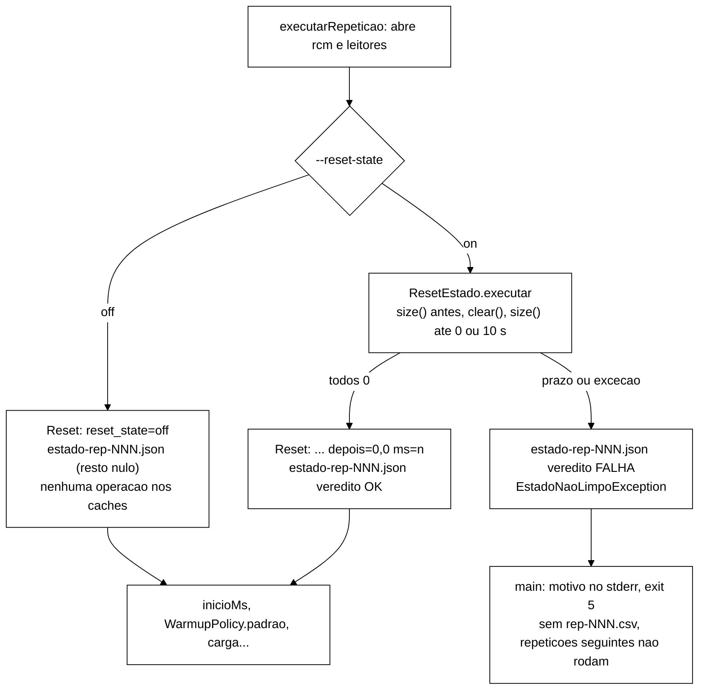

# Relatório B-43.1: reset de estado entre execuções (2026-10-22)

> Worker, 2026-10-22. Branch `fix/b43-1-reset-estado-entre-execucoes` (worktree `wt-b43-1`), a partir
> de `8296270`, conforme o Apêndice A de `wt-plano-ctrl/docs/validacao-b42-1-2026-10-22.md` com os
> ajustes da seção 5 de `validacao-b42-1-tarefa0-2026-10-22.md`. A Tarefa 0 não foi refeita. Commits só
> locais, sem push. Sem VM. B-43.3a (`wt-b43-3`) não foi tocado.

## 1. Resultado

Antes do *warm-up* de cada repetição (S1, S2 e S3), o *workload* esvazia os dois *caches* **do perfil
em uso** (`cli.replicacao`) e prova que ficaram vazios, consultando `size()` até todos darem 0 ou um
prazo de 10 s vencer. Se não esvaziarem, aborta com código de saída **5** e não grava `rep-NNN.csv`.
`--reset-state off` reproduz o fluxo anterior e não faz nenhuma operação nos *caches*.

O *smoke* local confirma pela identidade aritmética do diagnóstico: com o *reset* ligado houve logins
OK (R1, R3 e R4); desligado, depois de R1, nenhum (R2). A tarefa **não** corrige a mistura (C1/C2
continuam até B-43.2).

> **Com a mistura atual (C1/C2), os números de operações, latências e violações destas execuções NÃO
> servem como evidência; o *smoke* prova apenas o *reset*.**

Os mutantes X1 e X5 da V-B42.1-T0 e B1..B4 do prompt morrem. O Surefire foi de 305/0/0/0 (39
arquivos) para 327/0/0/0 (43), verde em cada commit.

## 2. Commits e Surefire

Comando: `mvn -f workload/pom.xml clean test`, somando os `TEST-*.xml` (tests/failures/errors/skipped,
arquivos). O "antes" foi medido numa cópia `git archive 8296270` (`workload` + `cluster`) no
*scratchpad*. O vermelho de cada par TDD é o estado com o teste novo e sem a implementação.

| Commit | Mensagem (resumo) | Vermelho registrado | Surefire depois |
|---|---|---|---|
| `8296270` (base) | ponta da Tarefa 0 | | 305/0/0/0, 39 |
| `f854c80` | `test:` guarda complementar de papel na varredura e perfil por `values()` (T0-D5) | X1 e X5 aplicados: 309/1/0/0 cada | 309/0/0/0, 40 |
| `890caf8` | `feat:` `CacheLimpavel` e `ResetEstado` | `testCompile` (classes inexistentes) | 315/0/0/0, 41 |
| `3c8cc76` | `feat:` `--reset-state on\|off` no `Cli` e no `--dry-run` | `testCompile` (`resetEstado` inexistente) | 321/0/0/0, 42 |
| `5f0350c` | `fix:` reset antes do *warm-up*, saída 5 | `testCompile` (`prepararEstado`/`codigoDeSaida` inexistentes) | 327/0/0/0, 43 |
| `93a609f` | `test:` *smoke* local R1..R4 | (sem código) | 327/0/0/0, 43 |
| este | `docs:` este relatório | (sem código) | 327/0/0/0, 43 |

Todos com exit 0. Nenhum teste existente foi editado: `git diff --name-status 8296270 HEAD -- workload/src/test`
só tem `A`. O *golden* (`GoldenS1S2Test` e `workload/src/test/resources`) é idêntico a `8296270`. Nada
mudou em `scripts/`, `analysis/`, `spec/`, `cluster/` nem `tcc-escrita/`.

## 3. Arquivo:linha

| Item | Antes (`8296270`) | Depois (HEAD) |
|---|---|---|
| `WorkloadMain.main` | `:46`; `System.exit(3)` em `:74` | `:59`, Javadoc com os códigos 0/2/3/4/5 em `:46-58`; `catch (EstadoNaoLimpoException)` com `System.exit(codigoDeSaida(e))` em `:86`; genérico em `:90` |
| `WorkloadMain.codigoDeSaida` | não existia | `:95` (percorre a cadeia de causas) |
| `WorkloadMain.prepararEstado` | não existia | `:114` (padrões) e `:121` (prazo/relógio/sono injetáveis); `gravarEstado` em `:155` |
| chamada do reset | não existia | `:213-215`, antes de `long inicioMs` (`:216`, antes `:114`) |
| varredura (X1) | `:320-321` | `:422-423` (sem mudança de conteúdo) |
| `S3Clientes` admin (X5) | `:115` | `:115` (inalterado) |
| `Cli.resetEstado` / opção / conversor | não existiam | `:242`, `:247-261`, `:267`; `textoDryRun` em `:290` |
| `ResetEstado`, `CacheLimpavel`, `EstadoNaoLimpoException` | não existiam | arquivos novos (168, 30 e 24 linhas) |

## 4. Testes novos

| Teste | Arquivo | O que prova |
|---|---|---|
| X1/X5 (T0-D5) | `PapelDoCacheComplementarTest` | `Tipo<String, T> x = ...getCache(arg)` na mesma linha usa `cacheSessoes()` para `SessionState` e `cacheContadores()` para `IdentityState` (pega `Map<String, SessionState> = materializarTudo(...)`); `PerfilReplicacao.values()`/`class.getEnumConstants()` fora do resolvedor. Não-vacuidade (as duas linhas de `materializarTudo` são vistas) e autoteste do detector |
| T1 | `ResetEstadoTest.limpaEDesbloqueia` | 10 sessões e `user-0` BLOCKED; depois do reset os dois ficam com 0 e um `SessionOps` sobre os MESMOS *fakes* dá `OK_LOGIN` (antes dava `BLOCKED`) |
| T2 | `ResetEstadoTest.cacheQueNaoEsvaziaEstouraOPrazo` | `clear` ignorado: `EstadoNaoLimpoException` exatamente no prazo do relógio falso (100 esperas de 100 ms), mensagem com `counters=1`, resultado parcial |
| T3 | `ResetEstadoTest.cacheAsyncChegaAZeroDepoisDeEsperar` | cache que só zera na 4ª consulta: OK, `tamanhos_depois` = 0,0, 3 esperas |
| T4 | `ResetEstadoTest.clearQueLancaPreservaCausa` e `sizeQueLancaPreservaCausa` | exceção em `clear`/`size` vira `EstadoNaoLimpoException` com a causa preservada |
| T5 | `WorkloadMainResetEstadoTest.codigoDeSaida` | 5 direta, embrulhada e em dois níveis; 3 para o resto e para `null` |
| T6 | `WorkloadMainResetEstadoTest.falhaGravaJsonEInterrompe` | lança; `estado-rep-001.json` com `"veredito":"FALHA"` e o motivo; `rep-001.csv` não existe |
| T7 | `WorkloadMainResetEstadoTest.offNaoTocaNosCaches` | `off`: 0 chamadas a `clear`/`size`, linha `Reset: reset_state=off`, JSON com o resto nulo |
| extra | `WorkloadMainResetEstadoTest.onGravaJsonOk`, `semCsvDir`, `resetAntesDoWarmup` | linha `Reset:` e JSON OK; sem `--csv-dir` nada é gravado; no fonte, o reset recebe sessões e contadores (forma literal exigida) e vem antes de `inicioMs`/`WarmupPolicy.padrao` |
| T8 | `CliResetEstadoTest` | padrão `on`; `on`/`off`/`--reset-state=off`; `ligado`, vazio, `true`, `ON`, `false`, `1` e opção sem valor dão `ParameterException`; `toString()` igual; `textoDryRun` com a 3ª linha; `main --dry-run --reset-state off` sem conectar |
| T9 | guardas existentes | `NomesDeCacheSoNoResolvedorTest`, `PapelDoCacheTest`, `PerfilFixoForaDoResolvedorTest`, `ClusterXml*` e `GoldenS1S2Test` verdes sem edição |

Nenhum teste dorme de verdade: `ResetEstado.Sono` e o relógio em ns são injetados.

## 5. Mutações

Aplicadas na árvore de trabalho, Surefire completo, revertidas com `git checkout --`. Nenhuma commitada.

| ID | Mutação | Surefire | Testes que matam |
|---|---|---|---|
| X1 | `WorkloadMain.java:422-423` (antes `:320-321`): varredura com sessões e contadores trocados | 309/1/0/0 em `f854c80`; 327/1/0/0 na ponta | `PapelDoCacheComplementarTest.papelCasaComOTipoNaDeclaracao` |
| X5 | `S3Clientes.java:115`: admin com `PerfilReplicacao.values()[0]` | 309/1/0/0 em `f854c80`; 327/1/0/0 na ponta | `PapelDoCacheComplementarTest.semPerfilPorPosicao` |
| B1 | `ResetEstado`: `if (vazios)` vira `if (true)` (só `clear` e uma leitura, sem esperar 0) | 327/3/0/0 | T2, T3, T6 |
| B2 | `ResetEstado`: `clear()` só no primeiro cache (sessões) | 327/2/2/0 | T1, T2, T3, `onGravaJsonOk` |
| B3 | `codigoDeSaida` devolve 3 para tudo | 327/2/0/0 | T5, T6 |
| B4 | `off` chama `size()` em cada cache | 327/1/0/0 | T7 |
| B2w (extra) | `WorkloadMain`: a lista do reset só com o cache de sessões | 327/1/0/0 | `resetAntesDoWarmup` |

A primeira tentativa de B2 e B4 não aplicou a mutação (defeito no meu *script* de substituição, que não
convertia `\n`). Na de B4 o código nem compilou. Corrigido o *script*, as duas foram reaplicadas e são
as linhas da tabela.

## 6. *Smoke* local

Ambiente: Podman 5.7.0 (máquina WSL, rootless), imagem `quay.io/infinispan/server:15.0.21.Final`, três
nós com o `cluster/infinispan-cluster.xml` desta branch (igual a `8296270`), JDK 22.0.2 por
`$JAVA_HOME/bin/java` (o `java` do PATH é o 8). Containers `b431-isn1..3`, projeto `-p b431`, a partir
de uma cópia temporária `cluster/podman-compose.b431-smoke.yml` que só muda `container_name`; a cópia
nunca foi versionada e foi apagada depois do `down`. A máquina Podman estava **parada**: foi iniciada
para o *smoke* e parada de novo no fim.

`podman ps -a` antes (`podman-ps-antes.txt`) e depois (`podman-ps-depois.txt`): os mesmos 11
containers, com IDs, nomes e imagens idênticos (`isn1..3` antigos incluídos, `Exited`). Os `b431-*` e a
rede `b431_infinispan-net` foram removidos.

Saúde antes e depois (`health-{antes,depois}-1122{2,3,4}.json`): `HEALTHY`, `number_of_nodes=3`,
os quatro *caches* `HEALTHY` nos três nós. Logs dos servidores com 0 linhas ` ERROR `.

Sequência no mesmo *cluster*, S1, `--duration 30 --ops 0 --rep 1 --threads 4 --warmup-min-sec 10`,
`--csv-dir runs/b43-1-smoke/Rn`:

| Exec. | Parâmetros | exit | linha `Reset:` | registrados + descartados − operações | logins OK | tamanhos REST antes → depois |
|---|---|---|---|---|---|---|
| R1 | `sync on` | 0 | `antes=0,0 depois=0,0 ms=22` | 327 072 + 142 777 − 469 487 = **362** | 181 | 0/0 → `sessions=181 counters=4` |
| R2 | `sync off` | 0 | `reset_state=off` | 320 097 + 172 635 − 492 732 = **0** | 0 | 181/4 → 181/4 |
| R3 | `sync on` | 0 | `antes=181,4 depois=0,0 ms=9` | 184 533 + 115 312 − 299 411 = **434** | 217 | 181/4 → `sessions=217 counters=4` |
| R4 | `async on` | 0 | `caches=sessions-async,counters-async antes=0,0 depois=0,0 ms=6` | 375 644 + 98 793 − 474 259 = **178** | 89 | `-async` 0/0 → `sessions-async=89 counters-async=4` |

Critério do prompt:

- R2 dá **0**: as quatro identidades de R1 continuam BLOCKED sem o *reset*, o estado residual C3 fica
  demonstrado (os tamanhos não mudam: nenhum login criou sessão);
- R1, R3 e R4 dão **> 0**, e o número de logins OK casa exatamente com o tamanho final de `sessions`
  (181, 217 a partir de 0 depois do *reset*) e de `sessions-async` (89);
- `R3/estado-rep-001.json`: `tamanhos_antes` = `[181,4]`, `tamanhos_depois` = `[0,0]`, `veredito` OK;
- todos com exit 0.

No CSV (janela de medição) as quatro execuções têm `Login OK = 0` e `Validate VALID = 0`: os logins OK
aconteceram todos no *warm-up*, antes do bloqueio por C1, como o diagnóstico (§2.3) previa. R4 também
mostra que o *reset* async esvazia só o par `-async` (os SYNC continuam 217/4).

Os `--dry-run` (`dryrun-padrao.txt`, `dryrun-off.txt`, `dryrun-invalido.txt`) mostram
`dry-run, reset_state=on`, `dry-run, reset_state=off` e, para `--reset-state ligado`, exit 2 com
`valor invalido 'ligado' para --reset-state (aceitos: on, off)`.

Brutos em `runs/b43-1-smoke/` (102 MB, 45 arquivos mais `MANIFEST.sha256`, `sha256sum -c` 45/45 OK).
Ficam versionados os JSON (`estado-rep-001.json` de cada execução, *health*, `identidade.json` com as
contagens `operation × return_code` e a identidade por execução) e o manifesto. CSV, `.txt` e `.log`
ficam no disco por causa do `.gitignore`.

## 7. Códigos de saída

| Código | Significado |
|---|---|
| 0 | execução concluída, `--help` ou `--dry-run` |
| 2 | parâmetro inválido (Picocli ou `Cli.validar()`), inclusive `--reset-state` diferente de `on`/`off` |
| 3 | falha de execução (qualquer outra exceção) |
| 4 | **reservado** para a guarda de sanidade da mistura (B-43.3a, parte ii); ainda não emitido |
| 5 | o *reset* não provou que os *caches* do perfil ficaram vazios (`EstadoNaoLimpoException`, direta ou como causa); sem `rep-NNN.csv` da repetição, e as seguintes não rodam |

## 8. Desvios

- **D1, `--reset-state` por *setter* com *record*.** O prompt pede o campo `public boolean resetEstado = true`
  com conversor. O campo existe, mas a anotação `@Option` está num *setter* que recebe o *record*
  `Cli.LigaDesliga`. Com `@Option` direto no campo `boolean`, o Picocli 4.7.6 reaplicava o padrão como
  `"true"` (`Interpreter.applyDefault`), o conversor estrito rejeitava, e 5 testes de
  `CliInstrumentacaoTest` ficavam vermelhos. É o mesmo padrão de `Cli.Escolha` para `--scenario`. O
  comportamento externo é o pedido.
- **D2, sobrecarga de `prepararEstado`.** Além de `prepararEstado(Cli, List<CacheLimpavel>, int)`, existe
  uma sobrecarga package-private com prazo, intervalo, relógio e sono. Sem ela, T6 dormiria 10 s de
  verdade. A versão de 3 argumentos usa os padrões (10 s, 100 ms, `System::nanoTime`, `Thread.sleep`).
- **D3, retorno com `off`.** `prepararEstado` devolve `null` com `off`, porque não há `Resultado`. No JSON,
  com `off`, até `replicacao` fica nulo ("o resto nulo", lido ao pé da letra).
- **D4, testes além da lista.** T4b (`size()` que lança), parâmetros inválidos de `ResetEstado`,
  `onGravaJsonOk`, `semCsvDir` e `resetAntesDoWarmup` (posição do reset no fonte, que mata B2w). Nos
  inválidos de T8 entraram também `ON`, `false` e `1`.
- **D5, guarda X5 um pouco mais larga.** Além de `PerfilReplicacao.values()`, a guarda pega
  `PerfilReplicacao.class.getEnumConstants()`, que é a mesma evasão.
- **D6, *smoke* sem `--convergence`/`--sweep`.** O prompt não pedia, e o *smoke* só prova o *reset*.
- **D7, máquina Podman.** Estava parada, foi iniciada e parada de novo (estado restaurado).
- **D8, *scratchpad* compartilhado.** O *scratchpad* da sessão é o mesmo do outro Worker. O meu *script*
  `sf.sh` foi sobrescrito na primeira medição, e passei a usar um subdiretório próprio (`b431/`). Não
  toquei nos arquivos do outro Worker. A medição do "antes" foi refeita na cópia `git archive 8296270`
  e deu 305/0/0/0, 39.

## 9. Pontos para o Gestor

1. Aceitar D1 (opção num *setter*; o campo continua a fonte da verdade).
2. O prazo de 10 s e o intervalo de 100 ms são constantes, sem opção na CLI. No *smoke* o *reset* levou
   de 6 a 22 ms. Se a VM sob F2/F3 precisar de mais, vale abrir uma opção num item futuro.
3. O *reset* roda também antes de S3 (o mesmo caminho em `executarRepeticao`), o que fecha os três
   caminhos de C3 no S3 (§3.3 do diagnóstico) desde que a T-F rode com `--reset-state on` (padrão).
4. `run-baseline.sh` não foi tocado: o tratamento do código 5 no *runner* fica para B-43.3b, dentro de
   B-42.3.
