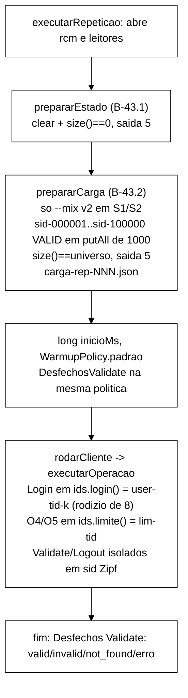

# Relatório B-43.2: mistura S1/S2 v2 com sessões reais (2026-10-22)

> Worker, 2026-10-22. Branch `fix/b43-2-mistura-s1-s2-sessoes-reais` (worktree `wt-b43-2`), a partir de
> `65d237b` (ponta de B-43.1). Especificação: seção 7 de `validacao-b43-1-2026-10-22.md` (`503278d`),
> com as decisões P-a..P-e do Gestor de 2026-10-22 e o §4.3 de `diagnostico-login-blocked-2026-10-22.md`.
> Commits só locais, **sem push**. Nenhuma outra worktree foi alterada (o verificador foi construído de
> uma cópia `git archive a8f5549` no *scratchpad*). Sem VM.

## 1. Resultado

A mistura v2 funciona no *cluster* real. Em Q1..Q4 do *smoke*, 100 % dos `Login` deram `OK`, nenhum
`Validate` caiu em chave ausente e a tríade expandiu (eventos/operações de 1,06 a 1,50). Em Q5 (v1), o
bloqueio absorvente C1 continua reproduzível de propósito. O reset de B-43.1 foi medido pela primeira vez
com dados: cerca de 1,8 × 10⁵ entradas, 33 ms em SYNC e 13 ms em ASYNC. A carga de 10⁵ sessões levou de
0,7 a 1,1 s, antes do *warm-up* e fora do CSV.

**Smoke local, 60 s, 4 threads: as latências NÃO são evidência. O smoke prova a mistura v2, a carga e o
reset com dados.**

Há dois achados para o Gestor (seção 9). O primeiro: com dados reais, o auditor acusou 2 violações I1 em
Q1, que são muito provavelmente falso positivo do observador. O segundo: cerca de metade dos `Validate`
lê sessão `INVALID`, e o CSV grava `VALID` (C4).

## 2. Commits e Surefire por commit

Comando: `mvn -o -f workload/pom.xml clean test`. Soma dos `TEST-*.xml` (tests/failures/errors/skipped,
arquivos). O vermelho de cada commit `feat:` foi registrado antes da implementação. Em todos ele foi
falha de compilação do teste novo, porque as classes ou métodos ainda não existiam (logs
`c2..c7-vermelho.log` no *scratchpad*). No commit 6, para registrar o vermelho, o `WorkloadMain` de
`da9d2fb` foi restaurado por um momento.

| Commit | Mensagem (resumo) | Surefire | Arquivos |
|---|---|---|---|
| `65d237b` | base (B-43.1) | 327/0/0/0 | 43 |
| `c742c77` | test: guarda de execução do reset e padrões de prazo (V-B43.1 R1, R2) | 334/0/0/0 | 44 |
| `cc0497e` | feat: `IdentidadesMistura` e `VersaoMistura` (T1) | 340/0/0/0 | 45 |
| `a3be995` | feat: `--mix v1\|v2`, 4ª linha do dry-run e linha `Mistura` (T7) | 349/0/0/0 | 46 |
| `177ad87` | feat: `CacheCarregavel` e `CargaInicial` (T3, T5) | 360/0/0/0 | 47 |
| `da9d2fb` | feat: mistura v2 em `rodarCliente` via `executarOperacoes` (T2, T4, T6) | 364/0/0/0 | 50 |
| `8e47bda` | feat: carga inicial em `executarRepeticao` (T5, T8) | 370/0/0/0 | 51 |
| `6137cf8` | feat: contador de desfechos de Validate (P-d, T9) | 373/0/0/0 | 52 |
| `b10bfa6` | test: *smoke* Q1..Q5 (só `runs/`) | 373/0/0/0 | 52 |
| este | docs: relatório | 373/0/0/0 | 52 |

Garantias conferidas com `git diff 65d237b HEAD`. Em `workload/src/test` só há arquivos `A`, nenhum
teste existente editado. O `GoldenS1S2Test.java` e `workload/src/test/resources` estão idênticos
(`git diff --quiet` sai com 0). Não há mudança em `scripts/`, `analysis/`, `spec/`, `cluster/`,
`OpResult.java` nem `tcc-escrita/`.

## 3. Arquivo:linha antes e depois

| Item | Antes (`65d237b`) | Depois (`6137cf8`) |
|---|---|---|
| identidade única por thread | `WorkloadMain.java:581` `String identidade = "user-" + tid;` | removida. `IdentidadesMistura` por thread em `rodarCliente` (`WorkloadMain.java:648`) |
| Login | `:590` `ops.login(identidade, ...)` | `:687` `ops.login(ids.login(), ...)` |
| O4/O5 | `:598-599` `identidade` | `:695-696` `ids.limite()` |
| corpo do laço | dentro de `rodarCliente` | `executarOperacao` `:680` (uma operação) e `executarOperacoes` `:668` (n operações, para testes) |
| carga | não existia | `:281`, entre `prepararEstado` (`:276`) e `long inicioMs` (`:282`). `prepararCarga` em `:155/:163` |
| contador de Validate | não existia | `:300` liga e `:354` imprime. `SessionOps.java:70` (*setter*), `:291/:302/:307` (contagem) |
| dry-run | `:79` `textoDryRun()` | `:82` `textoDryRunComMistura()` |
| linha `Mistura:` | não existia | `:245` |
| mensagem de saída 5 | só reset | `:89` distingue `Carga inicial falhou (mix=v2)` (o `codigoDeSaida` não mudou) |
| CLI | sem `--mix` | `Cli.java:291` campo, `:300` padrão `v2`, `:325` 4ª linha, `:384` regra P-b |

Classes novas: `VersaoMistura`, `IdentidadesMistura`, `CacheCarregavel`, `CargaInicial`,
`CargaInicialException` e `DesfechosValidate`. `CacheLimpavel`, `Armazem` e `OpResult` não mudaram.

## 4. Testes (arquivos novos)

| Teste | Arquivo | O que prova |
|---|---|---|
| R1 | `ResetEstadoPosicaoTest` + `DetectorFonte` | Reset como *statement* executável: fonte sem comentários, linha anterior não vazia em `{`/`;`, único bloco envolvente `try (RemoteCacheManager rcm`, os dois `CacheLimpavel` dentro dos argumentos e antes de `long inicioMs`/`WarmupPolicy.padrao(`/`if (cli.scenarioS3)`. `catch (EstadoNaoLimpoException` fora de `main` só se relançar. Autoteste com 13 formas de código morto |
| R2 | `ResetEstadoPosicaoTest` | `PRAZO_PADRAO = 10 s` e `INTERVALO_PADRAO = 100 ms`, ordem no fonte e comportamento real da sobrecarga de 3 argumentos (2 × 100 ms; não desiste antes de 1 s) |
| T1 | `IdentidadesMisturaTest` | rodízio de 8, `lim-<tid>`, disjunção para tid < 64, v1 em `user-<tid>`, `identidadeDaCarga` cobre exatamente 8 × threads (1, 4, 8), conversão estrita de rótulo |
| T2 | `MisturaV2Test` (S1 e S2) | 4 *threads* simuladas e 10⁴ operações sobre o *fake* carregado. Nenhum login BLOCKED, `Login OK / Login = 1`, `Validate NOT_FOUND = 0`, O4/O5 só em `lim-*`, `lim-<tid>` BLOCKED em S1, eventos − ops = 2 × logins OK, razão > 1 |
| T3 | `CargaInicialTest` | `sid-000001` VALID (`validate` ⇒ `OK_VALIDATE`/VALID); `size == TAMANHO_PADRAO_UNIVERSO`; `sid-000000` e `sid-100001` ausentes; as 10⁴ primeiras chaves de `KeyGenerator(42)` carregadas |
| T4 | `SequenciaMisturaV2Test` | v1 e v2 com `Random(42)`/`KeyGenerator(42)` executam as 2000 operações de S1 e de S2 e as 500 chaves do *golden* (lido como recurso) |
| T5 | `CargaInicialTest`, `WorkloadMainCargaTest` | ASYNC chega na 4ª consulta ⇒ OK. Nunca chega ⇒ exceção no prazo do relógio falso, `codigoDeSaida == 5`, `carga-rep-001.json` com FALHA e sem `rep-001.csv`. `putAll`/`size` que lançam ⇒ causa preservada. Tamanho maior ⇒ falha imediata |
| T6 | `MisturaV1RegressaoTest`, `WorkloadMainCargaTest` | v1 em `user-<tid>` nas três operações. Em S1 a identidade BLOCKED, mais de 90 % dos logins recusados, `NOT_FOUND > 0`. v1 e S3 sem carga e sem JSON |
| T7 | `CliMisturaTest` | padrão v2; v1; `V2`/`2`/vazio/`v3`/`V1`/sem valor ⇒ `ParameterException`; `toString()` igual; 4ª linha; P-b; `main --dry-run --mix v1` sem conectar; `--help` |
| T8 | `WorkloadMainCargaTest` | posição e forma literal da carga com o detector do commit 1, mais autoteste com 7 mutantes |
| T9 | `DesfechosValidateTest` | `Logout` isolado invalida um sid carregado. O contador separa valid=1, invalid=2, not_found=1, erro=1; o CSV continua `VALID`/`NONE`. Fora da janela não conta; a tríade conta |
| T10 | (suíte existente) | guardas de B-42.1, Tarefa 0 e B-43.1 e o `GoldenS1S2Test` verdes **sem edição** |

Dublês novos: `FakeCarregavel` (sobre `FakeCaches.Cache`) e `OpsGravadas` (subclasse de `SessionOps`
que grava cada chamada).

## 5. Mutações

Script `mutar.py` que exige exatamente 1 ocorrência de cada trecho. Cada mutante roda numa cópia da
árvore (sem `.git`, `runs/` e `target/`) com o Surefire completo. Nenhuma mutação foi *commitada*. O
mutante nulo (cópia sem mutação) deu 373/0/0/0, o que prova que a cópia equivale à worktree.

| ID | Mutação | Resultado | Teste que mata |
|---|---|---|---|
| M6 | `if (false) prepararEstado(...)` | morta (em `c742c77`: 334/1; na ponta: 373/2) | `resetExecutaAntesDoWarmup` (+ `posicaoDaCarga` na ponta) |
| M7 | `try { prepararEstado(...) } catch (EstadoNaoLimpoException ignorada) { }` | morta (334/1; 373/2) | idem |
| M8 | `if (!cli.scenarioS3) prepararEstado(...)` | morta (334/1; 373/2) | idem |
| B2w-c | linha do cache de contadores **comentada** | morta (334/2; 373/3) | `resetExecutaAntesDoWarmup`, `detectorPegaCodigoMorto` |
| M2c | sobrecarga de 3 argumentos com prazo e intervalo trocados | morta (334/3; 373/3) | `sobrecargaDeProducaoNaOrdem`, `...Comportamento`, `...NaoDesisteCedo` |
| G1 | v2 com Login em `ids.limite()` | morta (373/2) | `MisturaV2Test` (S1 e S2) |
| G2 | carga de `sid-000000` a `universo−1` | morta (373/3) | `CargaInicialTest.cargaPadrao`, `.loteParcial`, `WorkloadMainCargaTest.v2GravaJsonOk` |
| G3 | carga sem verificar `size()` | morta (373/6) | 5 de `CargaInicialTest` (T5) + `falhaGravaJson` |
| G4 | carga depois de `long inicioMs` | morta (373/2) | `posicaoDaCarga`, `detectorDaCarga` (T8) |
| G5 | o Login consome `r.nextInt(8)` | morta (373/1) | `SequenciaMisturaV2Test` (T4): `S1 V1 op 2` |
| G6 | v1 com identidades v2 | morta (373/2) | `IdentidadesMisturaTest.v1`, `MisturaV1RegressaoTest` (T6) |
| G7 | `--mix` com padrão `v1` | morta (373/9) | 6 de `CliMisturaTest` (T7) + 3 de `WorkloadMainCargaTest` |
| G8a | carga também em v1 | morta (373/1) | `semCargaEmV1NemS3` |
| G8b | carga também em S3 | morta (373/1) | `semCargaEmV1NemS3` |

Os cinco mutantes da V-B43.1 (M6, M7, M8, B2w-c, M2c) morrem no commit 1 e de novo na ponta, e G1..G8
morrem todos.

## 6. *Smoke* local

Ambiente: Podman 5.7.0 (máquina WSL), imagem `quay.io/infinispan/server:15.0.21.Final`, três nós com o
`cluster/infinispan-cluster.xml` desta branch (cópia em `runs/b43-2-smoke/cluster/`). JDK 22.0.2 por
`$JAVA_HOME/bin/java` (o `java` do PATH é o 8). Jar `6137cf8` (SHA-256 em `jars.json`). Containers
`b432-isn1..3`, projeto `-p b432`, a partir de uma cópia temporária `cluster/podman-compose.b432-smoke.yml`
que só muda `container_name`. A cópia não foi versionada e foi apagada depois do `down`. A máquina Podman
estava **parada**: foi iniciada para o *smoke* e parada no fim. `podman ps -a` antes e depois idênticos
**byte a byte** (11 containers). A rede `b432_infinispan-net` foi removida. Saúde antes e depois:
`HEALTHY`, 3 nós, os quatro *caches* do projeto `HEALTHY` nos três nós. Logs dos servidores com 0 linhas
` ERROR ` (os ` WARN ` são `ISPN012026`, de *endpoint* REST obsoleto no *healthcheck*, mais 4
`ISPN000599` e 2 `ISPN0800xx` de inicialização).

Mesmo *cluster*, nesta ordem, `--threads 4 --ops 0 --rep 1 --warmup-min-sec 10 --reset-state on`,
`--csv-dir runs/b43-2-smoke/Qn`. Todos com **exit 0**.

| Exec. | Parâmetros | Login OK / Login | Validate NONE / Validate | Validate VALID (CSV) | (reg + desc) / ops | reg + desc − ops | logins OK (REST) |
|---|---|---|---|---|---|---|---|
| Q1 | S1 sync v2, 60 s | 68 443 / 68 443 = **1,0000** | 0 / 205 979 = **0** | 205 979 | 498 343 / 332 381 = **1,499** | 165 962 = 2 × 82 981 | 182 981 − 100 000 = 82 981 |
| Q2 | S2 sync v2, 60 s | 14 689 / 14 689 = **1,0000** | 0 / 473 576 = **0** | 473 576 | 641 137 / 604 343 = **1,061** | 36 794 = 2 × 18 397 | 118 397 − 100 000 = 18 397 |
| Q3 | S1 async v2, 60 s | 65 723 / 65 723 = **1,0000** | 0 / 196 948 = **0** | 196 948 | 484 672 / 323 390 = **1,499** | 161 282 = 2 × 80 641 | 180 641 − 100 000 = 80 641 |
| Q4 | S2 async v2, 60 s | 15 269 / 15 269 = **1,0000** | 0 / 497 840 = **0** | 497 840 | 679 816 / 641 346 = **1,060** | 38 470 = 2 × 19 235 | 119 235 − 100 000 = 19 235 |
| Q5 | S1 sync v1, 30 s | 0 / 85 319 = **0** | 171 310 / 171 310 = 1 | 0 | 516 914 / 516 688 = 1,000 | 226 = 2 × 113 | 113 (todos no *warm-up*) |

Critérios do §4.3 (B-43.2, item 4):

- **Q1..Q4: todos atendidos.** `Validate VALID > 0`, `Login OK / Login = 1,0 ≥ 0,99`,
  `Validate NONE / Validate = 0 ≤ 0,01`, eventos/operações > 1 e identidade > 0. O número de logins OK
  dado pela identidade bate exatamente com o tamanho final de `sessions`/`sessions-async` no REST,
  descontadas as 10⁵ sessões da carga.
- **Q5: Login OK = 0 na janela.** C1 reproduzido com v1: os 113 logins OK aconteceram todos no
  *warm-up*, antes do bloqueio.
- **Nenhum evento de carga no CSV.** As operações do CSV são só as da mistura: as cinco em S1, e em S2
  só `Login`, `Validate`, `Logout` e `IncrementFailure`, sem nenhum `ResetFailures` (peso 0). A carga
  usa `putAll` direto no cache, sem `SessionOps`, antes de `long inicioMs`.

Contagem `operation × return_code` completa em `runs/b43-2-smoke/analise.json`, gerado por
`runs/b43-2-smoke/analise.py` a partir dos CSV.

### 6.1 Tempo do reset com dados (condição da seção 5 da V-B43.1)

| Exec. | Perfil | `antes` (sessões, contadores) | `depois` | `ms=` |
|---|---|---|---|---|
| Q1 | SYNC | 0, 0 | 0, 0 | 18 |
| Q2 | SYNC | **182 981**, 36 | 0, 0 | **33** |
| Q3 | ASYNC | 0, 0 | 0, 0 | 5 |
| Q4 | ASYNC | **180 641**, 36 | 0, 0 | **13** |
| Q5 | SYNC | **118 397**, 36 | 0, 0 | 13 |

Q4 é a primeira prova do reset ASYNC com dados. Com 1,8 × 10⁵ entradas, o reset fica em 33 ms (SYNC) e
13 ms (ASYNC), duas ordens de grandeza abaixo do limiar de 2 s (20 % do prazo). Pelo critério da V-B43.1,
**não se abre** o item `--reset-timeout` com base no *host*. A medição na VM continua pendente.

### 6.2 Custo da carga inicial (critério 5)

| Exec. | Cache | `tamanho_final` | lotes | `ms=` |
|---|---|---|---|---|
| Q1 | `sessions` | 100 000 | 100 | 1 110 |
| Q2 | `sessions` | 100 000 | 100 | 1 012 |
| Q3 | `sessions-async` | 100 000 | 100 | 834 |
| Q4 | `sessions-async` | 100 000 | 100 | 702 |

A carga (10⁵ `put` em 100 `putAll`) roda antes do *warm-up* e fora do CSV, com `veredito` OK nos quatro
`carga-rep-001.json`. Q5 (v1) não tem carga nem JSON de carga.

### 6.3 Desfechos reais de Validate (P-d)

| Exec. | valid | invalid | not_found | erro | fração INVALID | soma = Validate do CSV? |
|---|---|---|---|---|---|---|
| Q1 | 111 158 | 94 821 | 0 | 0 | **46,0 %** | 205 979 = 205 979 |
| Q2 | 225 255 | 248 321 | 0 | 0 | **52,4 %** | 473 576 = 473 576 |
| Q3 | 106 788 | 90 160 | 0 | 0 | **45,8 %** | 196 948 = 196 948 |
| Q4 | 230 894 | 266 946 | 0 | 0 | **53,6 %** | 497 840 = 497 840 |
| Q5 | 0 | 0 | 171 310 | 0 | 0 | 171 310 = 171 310 |

A soma do contador bateu **exatamente** com o número de `Validate` no CSV nas cinco execuções, sem
diferença de fronteira na janela. Quase metade dos `Validate` (S1) e mais da metade (S2) leem sessão
`INVALID`, e o CSV grava todos como `VALID` (C4). É a previsão do P-d: o `Logout` isolado sobre chaves
Zipf invalida as chaves quentes em segundos. Isso reforça o B-43.4, já aprovado.

## 7. Verificador offline (B-43.3a-i), só registro

Jar construído de `git archive a8f5549 workload` (branch `fix/b43-3-guarda-sanidade-mistura`, descendente
de `6ce301a`), `mvn -o clean package -DskipTests`, SHA-256 em `jars.json`. Executado com
`VerificadorSanidade --csv Qn/rep-001.csv --scenario S1|S2 --saida verificador-a8f5549/Qn.sanidade.json`.
Limiares do próprio jar (`login_ok_min 0,95`, `validate_valid_min_exclusivo 0`, `validate_ausente_max 0,05`,
`mistura_tolerancia_pp 2,0`, PROVISÓRIOS), **sem nenhum ajuste**.

| Exec. | Cenário | exit | Veredito | `login_ok_frac` | `validate_ausente_frac` | maior desvio da mistura | Motivos |
|---|---|---|---|---|---|---|---|
| Q1 | S1 | 0 | OK | 1,0 | 0,0 | 0,110 p.p. (Validate) | — |
| Q2 | S2 | 0 | OK | 1,0 | 0,0 | 0,040 p.p. (Login) | — |
| Q3 | S1 | 0 | OK | 1,0 | 0,0 | 0,162 p.p. (Logout) | — |
| Q4 | S2 | 0 | OK | 1,0 | 0,0 | 0,014 p.p. (Logout) | — |
| Q5 | S1 | 4 | FALHA | 0,0 | 1,0 | 0,083 p.p. | `LOGIN_OK_BAIXO` (0,0 % < 95 %), `VALIDATE_VALID_ZERO`, `VALIDATE_AUSENTE_ALTO` (100 % > 5 %) |

Nenhum CSV deu exit 2. Isso confirma, pelo próprio verificador, que não há operação fora da mistura (nem
`ResetFailures` em S2) nem linha vazia. Como primeira calibração do `loginOkMin`: na v2 sem falha o valor
observado é 1,0 (folga de 5 p.p. sobre 0,95), e o maior desvio da mistura é 0,16 p.p. (folga de mais de
10 vezes sobre 2 p.p.). O verificador não distingue `VALID` de `INVALID` (C4): `validate_valid` é 100 % em
Q1..Q4, embora o contador da seção 6.3 mostre de 46 % a 54 % de `INVALID`.

## 8. Desvios

- **D1, a 4ª linha do dry-run vem de `textoDryRunComMistura()`, e `textoDryRun()` continua com 3 linhas.**
  O teste existente `CliResetEstadoTest.textoDryRun` exige `assertEquals(3, l.length)` e
  `off.endsWith("dry-run, reset_state=off")`, e não pode ser editado. O `main --dry-run` imprime as 4
  linhas pedidas. T7 verifica as duas coisas.
- **D2, a regra P-b (v2 exige `--reset-state on`) é dispensada no `--dry-run` e em S3.** O teste existente
  `CliResetEstadoTest.workloadMainDryRun` chama `main --dry-run --reset-state off` com a mistura padrão.
  Sem a dispensa, `main` faria `System.exit(2)` e derrubaria o *fork* do Surefire. No *dry-run* a 4ª linha
  avisa: `dry-run, mix=v2 (invalido com reset_state=off: a execucao sai com 2; ...)`. Em S3 a mistura
  não tem efeito, e rejeitar `S3 --reset-state off` (aceito em B-43.1) seria uma restrição sem motivo.
  Fora desses dois casos, `--reset-state off` sem `--mix v1` sai com 2 (medido com o jar, `v2-off.txt`).
- **D3, a regra "`catch (EstadoNaoLimpoException` só em `main`" passou a aceitar também a captura que
  relança.** `prepararEstado` já tinha (B-43.1) um `catch` que grava o JSON de FALHA e faz `throw e`, e
  `prepararCarga` segue o mesmo padrão. O detector aceita um `catch` fora de `main` só se o bloco terminar
  em `throw <var>;`. O M7 (bloco vazio) morre.
- **D4, "linha anterior não vazia" foi lida como a última linha não vazia antes da chamada.** Sem
  comentários, a linha imediatamente anterior ao reset é um comentário que vira branco. A última linha não
  vazia é o `try (...) {`.
- **D5, além de `executarOperacoes(..., n)` existe `executarOperacao(...)` (uma operação).** A produção
  chama esta última dentro do laço de `rodarCliente`, para manter a checagem de prazo e de
  `--stop-at-fault-end` a cada operação.
- **D6, o prazo da carga conta do fim dos `putAll`, não do início.** O tempo de gravar 10⁵ entradas
  depende do *host* e não deve consumir a espera pela replicação ASYNC. A duração relatada (`ms=`) cobre
  a carga inteira.
- **D7, tamanho maior que o universo falha na hora, sem esperar o prazo.** Só pode acontecer com estado
  não vazio antes da carga, e esperar não corrige isso.
- **D8, T2 usa sementes `42 + tid` por *thread* simulada.** Com `Random(42)` igual nas 4 *threads*, as
  quatro fariam a mesma sequência. T4 usa exatamente `Random(42)` e `KeyGenerator(42)`.
- **D9, forma de alguns mutantes.** G5: `IdentidadesMistura` não tem acesso a `Random`, então o mutante
  faz o Login consumir `r.nextInt(8)` em `executarOperacao`, que é o efeito que T4 precisa pegar. G2
  precisou de 3 trocas (laço, índice de `identidadeDaCarga` e fim de lote) para compilar e rodar. G8 foi
  dividido em G8a (v1) e G8b (S3).
- **D10, a mensagem de `main` para a saída 5 distingue carga e reset.** Mudou só o texto do `catch` em
  `main`. `codigoDeSaida` não mudou.
- **D11, em S3 a linha é `Mistura: mix=<v> (sem efeito em S3)`,** e a linha `Desfechos Validate` não é
  impressa em S3 (o S3 usa seus próprios clientes).
- **D12, `DetectorFonte` ganhou `problemasDaCarga` no commit 6.** É arquivo novo deste bloco (commit 1),
  não um teste pré-existente.
- **D13, a máquina Podman foi iniciada e parada.** Estado restaurado e `podman ps -a` idêntico.
- **D14, só o relatório foi escrito.** `docs/implementacao.md`, `docs/testes.md` e
  `docs/configuracao-infinispan.md` não foram atualizados nesta entrega.

## 9. Pontos para o Gestor

1. **Achado: 2 violações I1 em Q1 (S1 SYNC), muito provavelmente falso positivo do observador.**
   `Q1/violacoes-rep-001.csv` tem `I1` em `sid-000004` e `sid-000188`, ambas "invalidacao confirmada
   (LOGOUT) revertida para VALID". Durante a medição, nenhum código escreve `VALID` num `sid-NNNNNN`: o
   `Login` grava sessões com UUID e só a carga, antes do *warm-up*, grava `sid-*`. Uma ressurreição real
   exigiria um escritor de `VALID`, que não existe. A explicação compatível é uma corrida no auditor de
   B-23. O `invalidacoesConfirmadas` é compartilhado pelas 4 *threads*. A *thread* B lê a sessão `VALID`,
   a *thread* A faz o `Logout` (grava `INVALID` e registra a confirmação), e só depois B compara a leitura
   antiga com a confirmação nova e acusa I1. Antes de B-43.2 isso não aparecia, porque as chaves Zipf
   nunca existiam. Isso **não é defeito de B-43.2**, mas atinge o poder do auditor em S1/S2 a partir de
   agora. Recomendo um item próprio, com análise do Senior, antes do *rebaseline*. Não corrigi.
2. **Fração INVALID de 46 % (S1) a 54 % (S2)** entre os `Validate` (seção 6.3). O critério
   "Validate VALID > 0" do §4.3 é atendido, mas por chave existente em cerca de metade dos casos. Reforça
   o B-43.4 (aprovado, entrega separada). O CSV e o `OpResult` não mudaram aqui.
3. **Reset com dados: 33 ms (SYNC) e 13 ms (ASYNC) com cerca de 1,8 × 10⁵ entradas** no *host*. Abaixo do
   limiar de 2 s, então não se abre o `--reset-timeout` por enquanto. Falta medir na VM.
4. **Calibração do verificador (`a8f5549`)**: v2 sem falha dá `login_ok_frac = 1,0` e desvio de mistura
   ≤ 0,16 p.p.; v1 dá FALHA com os três motivos esperados. Nenhum limiar foi ajustado.
5. Desvios D1 e D2 (testes existentes que fixam o dry-run em 3 linhas e o `main --dry-run --reset-state
   off`) precisam de aceite explícito.
6. Integração e push continuam pendentes de aprovação. Nada foi publicado.

Brutos em `runs/b43-2-smoke/` (195 MB no disco). `MANIFEST.sha256` com 66 arquivos e `sha256sum -c`
66/66 OK. Versionados: JSON, `analise.py`, XML do *cluster*, `.gitattributes` (`* -text`, bytes
preservados) e o manifesto. CSV, `.txt` e `.log` ficam no disco por causa do `.gitignore`.
