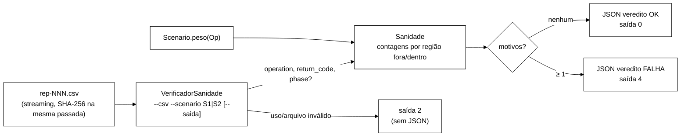

# Relatório B-43.3a, parte i: verificador OFFLINE de sanidade da mistura (2026-10-22)

> Worker, 2026-10-22. Branch `fix/b43-3-guarda-sanidade-mistura`, worktree `wt-b43-3`, a partir de
> `8296270` (ponta da Tarefa 0 de B-42.1, conforme a seção 5 de `validacao-b42-1-tarefa0-2026-10-22.md`).
> Prompt: Apêndice A de `validacao-b42-1-2026-10-22.md`, bloco "B-43.3a, PARTE i". Commits só locais,
> sem push. Sem *cluster*, sem VM. Nada foi ligado no `WorkloadMain`, em `run-baseline.sh` nem em
> `percentis.py` (parte ii, depois de B-43.2). B-43.1 corre em paralelo em `wt-b43-1` e não foi tocado.

## 1. Resultado

O verificador `VerificadorSanidade` (modo *strict*, sem modo leniente) decide só pelas contagens
`operation × return_code` do CSV de eventos e sai com **0 = OK, 4 = FALHA, 2 = uso/arquivo inválido**.
Os limiares provisórios (Login OK ≥ 0,95; Validate VALID > 0; Validate ausente ≤ 0,05; mistura ±2 p.p.)
vão gravados no JSON de cada execução, marcados como `PROVISORIOS`.

- A regressão de junho (`runs/S1-F1/rep-001.csv`) foi o primeiro teste e o primeiro vermelho. Agora sai
  com **4**, motivos `LOGIN_OK_BAIXO`, `VALIDATE_VALID_ZERO` e `VALIDATE_AUSENTE_ALTO`.
- Na execução documental, **20 de 20 CSVs saem com 4**: o de junho, o *smoke* S1-sync de B-42.1 e os
  18 do baseline da VM de 2026-06-23.
- Os mutantes V1 a V4 morreram.
- Surefire: de 305/0/0/0 (39 arquivos) para **337/0/0/1 (44 arquivos)**. O único *skip* é o teste S2,
  que só roda com `-Dsanidade.csvJunho`.

## 2. Surefire por commit

Comando `mvn -f workload/pom.xml clean test`, com os `TEST-*.xml` somados. Cada commit foi conferido
de novo no fim, a partir de uma cópia `git archive <sha>` no *scratchpad* (removida depois).

| Commit | Conteúdo | tests/failures/errors/skipped | Arquivos | Exit |
|---|---|---|---|---|
| `8296270` (antes) | ponta da Tarefa 0 | 305/0/0/0 | 39 | 0 |
| `b568f2c` | `Sanidade`, `VerificadorSanidade`, S1/S2, S6 | 315/0/0/1 | 41 | 0 |
| `728c85c` | `Scenario.peso`, `MISTURA_DESVIO`, S3/S4 | 331/0/0/1 | 43 | 0 |
| `6e67807` | `DENTRO_SEM_VALID`, S5 | 337/0/0/1 | 44 | 0 |
| (este commit) | `docs:` relatório e JSON da execução documental | não toca `workload/` | | |

O *skip* é `SanidadeRegressaoJunhoTest.s1F1Rep001CompletoContagensExatas` (S2), por
`@EnabledIfSystemProperty(named = "sanidade.csvJunho")`.

## 3. Vermelhos registrados (TDD)

| Ordem | Teste | Vermelho | Implementação que o fez passar |
|---|---|---|---|
| 1 | `SanidadeRegressaoJunhoTest.s1F1Rep001DaFalha` | Contra o *stub* `executar` → 0: `regressao de junho tem de sair com 4 ==> expected: <4> but was: <0>` (`:57`) | `b568f2c` |
| 2 | `SanidadeMisturaTest` (13 casos) | 3 falhas: `fixtureSaOpsDescontaOsDoisEventosExtrasDoLoginOk` [S1, S2] `expected: <20000> but was: <null>`; `validateDeslocadoTresPpDaMisturaDesvio` `expected: <FALHA> but was: <OK>`. Os outros 10 já passavam com as regras de `b568f2c` | `728c85c` |
| 2b | `ScenarioPesoTest` | não compila (`peso(Op)` não existe) | `728c85c` |
| 3 | `SanidadeFaseTest.dentroSemValidComEventosNaoErrorDaDentroSemValid` | `rodar:55 expected: <4> but was: <0>` (1 de 6) | `6e67807` |

Os testes de uso (S6, `SanidadeUsoTest`) entraram no mesmo commit do CLI e já nasceram verdes.

## 4. Desenho

### 4.1 `Scenario` (único arquivo existente alterado)

Só o acessor `public int peso(Op op)`, com 15 linhas acrescentadas e 0 removidas. Pesos e sorteio não
mudaram. `GoldenS1S2Test` e `workload/src/test/resources/golden-8e2e815` estão idênticos a `8296270`
(`git diff --quiet` sai com 0).

### 4.2 `Sanidade` (lógica pura)

- `registrar(operation, returnCode, fase)` acumula por região. A região "fora" vale para `fase` nula
  ou vazia (CSV sem `phase`), `antes` e `pos-convergencia`. A região "dentro" vale para `durante`,
  `durante-pre-split`, `durante-pos-split` e `recuperacao`. Outro rótulo lança
  `IllegalArgumentException`, e o CLI devolve 2.
- `Limiares(loginOkMin, validNotFoundMax, misturaToleranciaPp)`, com `provisorios()` = (0,95; 0,05; 2,0).
  A regra Validate VALID > 0 é fixa e vai no JSON como `validate_valid_min_exclusivo: 0`.
- `avaliar(Scenario, Limiares)` devolve um `Resultado(veredito, motivos, contagens, metricas)`. Regras na
  região "fora":

| Código | Condição |
|---|---|
| `JANELA_VAZIA` | nenhum evento fora (as demais regras de fora não rodam) |
| `LOGIN_AUSENTE` | Login = 0 |
| `LOGIN_OK_BAIXO` | Login > 0 e OK/(OK+BLOCKED) < `loginOkMin`. Se OK+BLOCKED = 0 (só `ERROR_*`), a fração é 0 |
| `VALIDATE_VALID_ZERO` | contagem(Validate, VALID) = 0, com texto `Validate VALID = 0` |
| `VALIDATE_AUSENTE_ALTO` | Validate > 0 e (NONE + NOT_FOUND)/Validate > `validNotFoundMax` |
| `MISTURA_DESVIO` | `ops = eventos − 2·loginOk`. Frações Validate=(V−loginOk)/ops, Logout=(L−loginOk)/ops, Login/ops, IncrementFailure/ops, ResetFailures/ops contra `peso/100`. Um motivo por operação com \|desvio\| > tolerância (p.p.) |

  Na região "dentro", se houver eventos: `DENTRO_SEM_VALID` quando Validate VALID = 0 e há eventos que
  não são `ERROR_*`.

### 4.3 `VerificadorSanidade` (CLI offline)

`--csv <arquivo> --scenario S1|S2 [--saida <json>]`. O CSV é lido em *streaming* por um
`DigestInputStream`, e o SHA-256 sai na mesma passada. As colunas são localizadas pelo nome no
cabeçalho, com `phase` opcional. O JSON tem `arquivo`, `sha256`, `cenario`, `modo`, `limiares`,
`contagens`, `metricas`, `veredito`, `motivos` e `versao` (`b43-3a-i/1`). Sem `--saida`, o JSON vai
para o *stdout*. Uma linha-resumo `Sanidade: veredito=… cenario=… motivos=…` vai sempre para o *stdout*.

A saída é 2 nestes casos: argumento ausente ou desconhecido (`--lenient` inclusive), cenário diferente
de `S1`/`S2` (`S3` com a mensagem "S3: guarda propria na parte ii"; `s1` minúsculo também é recusado),
arquivo inexistente ou vazio, cabeçalho sem `operation`/`return_code`, linha com número de colunas
diferente do cabeçalho, rótulo de fase desconhecido e erro de E/S. Com saída 2 não se grava JSON.

`static int executar(String[] args, PrintStream out)` é o ponto de teste, e `main` chama
`System.exit(executar(args, System.out))`.

## 5. Testes

Todos em arquivos novos. Nenhum teste existente foi editado.

| ID do prompt | Arquivo / método | O que verifica |
|---|---|---|
| S1 | `SanidadeRegressaoJunhoTest.s1F1Rep001DaFalha` | recorte de 5 000 linhas → 4, FALHA, contém `LOGIN_OK_BAIXO` e `VALIDATE_VALID_ZERO` |
| S2 | `SanidadeRegressaoJunhoTest.s1F1Rep001CompletoContagensExatas` | arquivo completo (opt-in): 4, motivos, SHA-256 e contagens exatas |
| S3 | `SanidadeMisturaTest.fixtureSaDaZeroOkSemMotivos` [S1, S2] | fixture sã (`Random(42)`, 20 000 ops) → 0, OK, sem motivos, limiares no JSON |
| S3 | `SanidadeMisturaTest.fixtureSaOpsDescontaOsDoisEventosExtrasDoLoginOk` [S1, S2] | `ops` = 20 000 exatamente |
| S4 | `noventaPorCentoDeLoginOkDaLoginOkBaixo` | 90 % de OK → `LOGIN_OK_BAIXO`, sem `MISTURA_DESVIO` |
| S4 | `loginOkNaFronteiraExataNaoDispara` | 19/20 = 0,95 → não dispara (fronteira para V1) |
| S4 | `loginAusenteDaLoginAusente` | `LOGIN_AUSENTE` |
| S4 | `nenhumValidDaValidateValidZero` | `VALIDATE_VALID_ZERO`, texto exato |
| S4 | `seisPorCentoDeValidateAusenteDaValidateAusenteAlto` [NONE, NOT_FOUND] | 6 % → `VALIDATE_AUSENTE_ALTO`, nas duas grafias |
| S4 | `cincoPorCentoDeValidateAusenteNaFronteiraNaoDispara` | 5/100 → não dispara |
| S4 | `validateDeslocadoTresPpDaMisturaDesvio` | +~3 p.p. em Validate → exatamente um motivo, `MISTURA_DESVIO` de Validate |
| S4 | `csvSoComCabecalhoDaJanelaVazia` | só cabeçalho → 4, `JANELA_VAZIA` |
| S5 | `SanidadeFaseTest.regioes` | mapeamento das 6 fases e recusa de rótulo desconhecido |
| S5 | `falhaSoEmDuranteNaoDerrubaFora` | dentro ruim (com algum VALID) e fora são → 0 |
| S5 | `dentroSemValidComEventosNaoErrorDaDentroSemValid` | → 4, motivos = `[DENTRO_SEM_VALID]` |
| S5 | `dentroTodoErrorNaoDaDentroSemValid` | dentro 100 % `ERROR_*` → 0 |
| S5 | `semEventosDentroNaoAvaliaDentro`, `foraRuimNaoEMascaradoPorDentroBom` | dentro bom não mascara fora ruim |
| S6 | `SanidadeUsoTest` (8 métodos) | sem `return_code`/`operation`, `S3`, cenário inválido, argumentos, arquivo inexistente ou vazio, colunas erradas, fase desconhecida → 2 |
| | `ScenarioPesoTest` (3) | pesos de S1/S2 e soma 100 |

Recurso novo: `workload/src/test/resources/sanidade/S1-F1-rep-001-head.csv`, o cabeçalho mais as
primeiras 5 000 linhas (`head -n 5001`) do original. O SHA-256 do completo é `5ea464ae…a198`, e o do
recorte é `3fd92d2c8b47aeb8238ac59a811fce580fb72485d2157d70b408cee41ed794f8`. Origem e hashes estão
em `LEIAME.md`, ao lado.

**Saída do S2** (rodado uma vez, com
`mvn -f workload/pom.xml test -Dtest=SanidadeRegressaoJunhoTest -Dsanidade.csvJunho=C:/Users/Francesco/Development/tcc/tcc-desenvolvimento/runs/S1-F1/rep-001.csv`):
exit 0, `tests="2" errors="0" skipped="0" failures="0"`, com `s1F1Rep001CompletoContagensExatas` em
0,467 s e `s1F1Rep001DaFalha` em 0,011 s. As contagens que o teste exige (Login BLOCKED 161 064, Validate
NONE 320 336, Logout NONE 64 922, IncrementFailure COUNTED 63 905, ResetFailures NONE 32 402, total
642 629, Login OK 0, Validate VALID 0) aparecem literalmente em `runs/b43-3a-verificador/S1-F1-rep-001.sanidade.json`.

## 6. Mutantes

Cada mutante foi aplicado na árvore de trabalho e testado com o Surefire completo
(`mvn -f workload/pom.xml clean test`). Depois foi revertido com `git checkout --`. Nenhum foi commitado.

| ID | Mutação | Resultado | Exit | Surefire | Teste que mata |
|---|---|---|---|---|---|
| V1 | `Sanidade`: `fracLoginOk < lim.loginOkMin()` vira `<=` | **morto** | 1 | 337/1/0/1 | `SanidadeMisturaTest.loginOkNaFronteiraExataNaoDispara:94` (`Login OK = 95,0 % (minimo 95,0 %)`) |
| V2 | `Sanidade`: `ops = total(f)`, sem `− 2L * loginOk` | **morto** | 1 | 337/10/0/1 | `fixtureSaDaZeroOkSemMotivos` [S1, S2] (`expected <0> but was <4>`), `fixtureSaOps…`, 4 de `SanidadeFaseTest` e outros |
| V3 | `Sanidade`: ausente = só `NONE`, sem `NOT_FOUND` | **morto** | 1 | 337/1/0/1 | `seisPorCentoDeValidateAusenteDaValidateAusenteAlto[NOT_FOUND]:130` |
| V4 | `VerificadorSanidade`: FALHA devolve `SAIDA_OK` | **morto** | 1 | 337/3/0/1 | `SanidadeRegressaoJunhoTest.s1F1Rep001DaFalha:57`, `csvSoComCabecalhoDaJanelaVazia:168`, `dentroSemValid…:89` |

Depois das quatro reversões, `git status` ficou limpo.

## 7. Execução documental

O *jar* foi gerado com `mvn -f workload/pom.xml package -DskipTests` e copiado para o *scratchpad*. A
execução usou `$JAVA_HOME/bin/java` (OpenJDK 22.0.2), porque o `java` do PATH é o 8. O diretório de
trabalho foi `C:\Users\Francesco\Development\tcc`: por isso o campo `arquivo` dos JSON é relativo a
ele. Os CSVs foram lidos no lugar, em *streaming*, sem cópia para o repositório (`runs/**/*.csv` está no
`.gitignore`). Só os JSON foram versionados, em `runs/b43-3a-verificador/`.

| CSV | Cenário | Eventos | Login BLOCKED | Login OK | Validate VALID | Saída | Motivos |
|---|---|---|---|---|---|---|---|
| `tcc-desenvolvimento/runs/S1-F1/rep-001.csv` | S1 | 642 629 | 161 064 | 0 | 0 | **4** | LOGIN_OK_BAIXO, VALIDATE_VALID_ZERO, VALIDATE_AUSENTE_ALTO |
| `wt-b42-1/runs/b42-1-smoke/S1-sync/rep-001.csv` | S1 | 435 398 | 109 687 | 0 | 0 | **4** | idem |
| baseline VM `S1-none/rep-001` | S1 | 1 728 800 | 432 219 | 0 | 0 | **4** | idem |
| `S1-none/rep-002` | S1 | 1 722 235 | 429 767 | 0 | 0 | **4** | idem |
| `S1-none/rep-003` | S1 | 1 712 546 | 429 346 | 0 | 0 | **4** | idem |
| `S1-F1/rep-001` | S1 | 1 569 274 | 391 628 | 0 | 0 | **4** | idem |
| `S1-F1/rep-002` | S1 | 1 452 796 | 363 142 | 0 | 0 | **4** | idem |
| `S1-F1/rep-003` | S1 | 1 520 945 | 378 971 | 0 | 0 | **4** | idem |
| `S1-F3/rep-001` | S1 | 69 073 | 17 159 | 0 | 0 | **4** | idem |
| `S1-F3/rep-002` | S1 | 64 603 | 16 170 | 0 | 0 | **4** | idem |
| `S1-F3/rep-003` | S1 | 74 684 | 18 776 | 0 | 0 | **4** | idem |
| `S2-none/rep-001` | S2 | 2 544 939 | 76 382 | 0 | 0 | **4** | idem |
| `S2-none/rep-002` | S2 | 2 616 122 | 78 426 | 0 | 0 | **4** | idem |
| `S2-none/rep-003` | S2 | 2 641 204 | 79 134 | 0 | 0 | **4** | idem |
| `S2-F1/rep-001` | S2 | 2 211 240 | 66 333 | 0 | 0 | **4** | idem |
| `S2-F1/rep-002` | S2 | 2 225 676 | 66 902 | 0 | 0 | **4** | idem |
| `S2-F1/rep-003` | S2 | 2 421 615 | 72 664 | 0 | 0 | **4** | idem |
| `S2-F3/rep-001` | S2 | 77 414 | 2 325 | 0 | 0 | **4** | idem |
| `S2-F3/rep-002` | S2 | 78 396 | 2 445 | 0 | 0 | **4** | idem |
| `S2-F3/rep-003` | S2 | 57 784 | 1 764 | 0 | 0 | **4** | idem |

Os caminhos do baseline são relativos a `dados-vm/baseline-2026-06-23/runs/`. Nenhum dos 20 tem coluna
`phase`, então toda a janela cai na região "fora" (`eventos_dentro = 0`).

Conferência independente (Python, *streaming*, sem passar pelo verificador): os 20 SHA-256 e as 20
tabelas `operation × return_code` batem com os JSON (20/20). As contagens do *smoke* S1-sync conferem
com a tabela da seção 4 da V-B42.1 (Login BLOCKED 109 687), e o total de 435 398 é o "registrados" do
*stdout* daquele *smoke*.

**Achado.** Em nenhum dos 20 aparece `MISTURA_DESVIO`. O maior |desvio| é 0,19 p.p. (Login, *smoke*
S1-sync). O sorteio das operações está certo, e o defeito está todo no resultado das operações (C1/C2):
0 Login OK e 100 % de Validate ausente. `VALIDATE_AUSENTE_ALTO` aparece nos 20, como consequência
direta de C2.

Artefatos em `runs/b43-3a-verificador/`:

- `S1-F1-rep-001.sanidade.json`, `b42-1-smoke-S1-sync-rep-001.sanidade.json` e
  `baseline-2026-06-23/<célula>-rep-NNN.sanidade.json` (18);
- `FONTES.sha256`, com o SHA-256 dos 20 CSVs de origem e os caminhos relativos a `tcc/`. Não é
  verificável dentro do repositório, porque os CSVs ficam fora dele;
- `MANIFEST.sha256`, que cobre os 20 JSON e o `FONTES.sha256` (21 linhas; `sha256sum -c` dá 21 OK);
- `.gitattributes` (`*.json`/`*.sha256 -text`), para o `core.autocrlf=true` do Windows não converter
  os fins de linha no *checkout* e quebrar o manifesto.

## 8. Desvios

| ID | Desvio | Justificativa |
|---|---|---|
| D1 | O commit 1 foi corrigido com `--amend` local (`833ceef` → `b568f2c`), antes de qualquer publicação | O comentário do `.gitattributes` e o `LEIAME.md` diziam "LF", mas o original de junho tem fim de linha **CRLF**, e o recorte é um prefixo byte a byte dele. Só documentação do recurso mudou. Não houve *force-push* nem reescrita de histórico publicado |
| D2 | O Surefire passou a ter `skipped = 1` | É o S2, opt-in por `@EnabledIfSystemProperty`, como o prompt pede |
| D3 | Dois `.gitattributes` novos e locais (`workload/src/test/resources/sanidade/` e `runs/b43-3a-verificador/`) | Preservam os bytes do recorte (SHA-256 no `LEIAME.md`) e do manifesto. O `.gitattributes` da raiz não foi editado ("só arquivos novos") |
| D4 | O JSON tem campos além dos pedidos: `modo: "strict"`, `limiares.validate_valid_min_exclusivo`, `limiares.status: "PROVISORIOS…"` e métricas auxiliares (`ops`, frações, `mistura` por operação) | Auditoria. Os campos pedidos estão todos lá |
| D5 | A saída 2 é mais estrita do que o prompt enumera: colunas por linha ≠ cabeçalho, rótulo de fase desconhecido, arquivo vazio, argumento desconhecido e `s1` minúsculo (sem o *fallback* de `Scenario.porNome`) | Coerente com "strict". Um arquivo malformado não pode produzir um veredito |
| D6 | `LOGIN_AUSENTE` e `LOGIN_OK_BAIXO` são mutuamente exclusivos. Com Login > 0 e OK+BLOCKED = 0 (só `ERROR_*`), a fração vale 0 e `LOGIN_OK_BAIXO` dispara | O prompt não define o denominador zero. Escolhi o lado que falha |
| D7 | `FONTES.sha256` acrescentado ao lado do `MANIFEST.sha256` | Amarra cada JSON ao CSV de origem, que não é versionado |
| D8 | Commits `feat:` com o teste e a implementação juntos | É o par TDD por commit que o prompt exige. O vermelho de cada par está na seção 3 |

## 9. Pontos para o Gestor

1. **Operações desconhecidas.** Hoje um nome de operação fora dos cinco (por exemplo, `Unblock` de um
   CSV S3 passado como `--scenario S1`) entra em `contagens` e em `ops`, sem regra própria. Na prática
   isso dilui as frações e pode gerar `MISTURA_DESVIO`. Alternativa *strict*: tratar como arquivo
   inválido (saída 2). Fica para decidir na parte ii.
2. **Limiares** (0,95 / VALID > 0 / 0,05 / 2 p.p.) continuam provisórios e estão gravados em cada JSON.
   A execução documental não ajuda a calibrá-los: os 20 CSVs reais ficam longe de qualquer limiar
   (0 % de Login OK e 100 % de Validate ausente). A calibração precisa da primeira execução pós-B-43.2.
3. A **região "fora"** com marcadores segue provisória (ponto 4 da seção 8 da V-B42.1). Os 20 CSVs da
   execução documental não têm `phase`, então essa parte só está coberta pelos testes sintéticos (S5).
4. Nada foi ligado *online*. `percentis.py` continua aceitando os CSVs de junho. Isso fica para a
   parte ii, depois de B-43.2.
