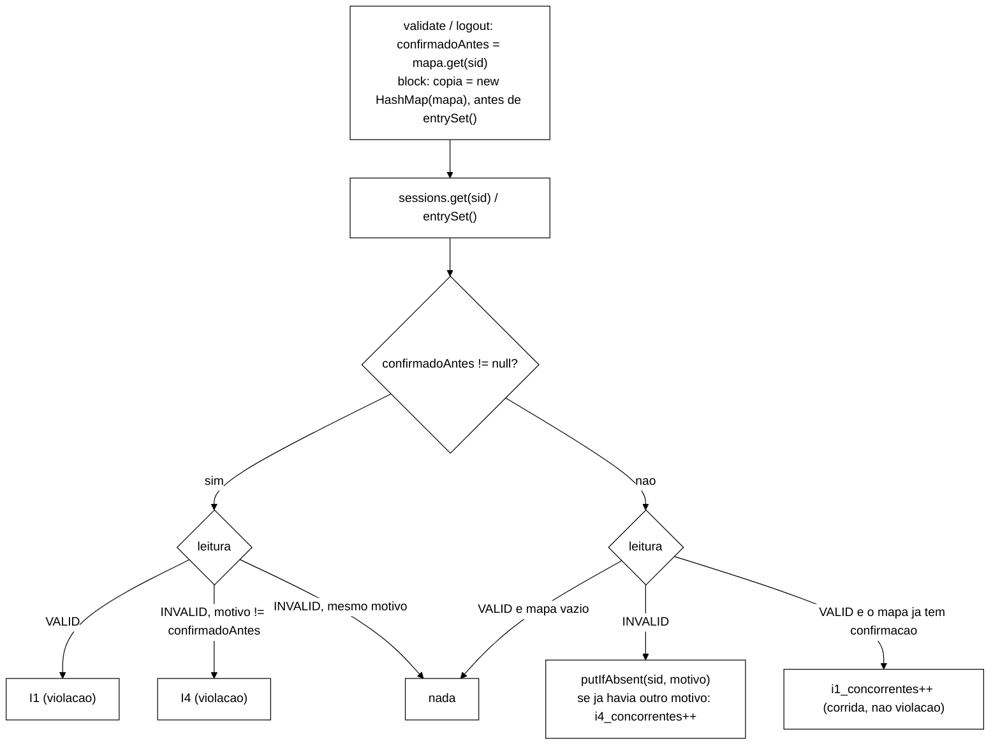

# Relatório B-43.6: auditor I1/I4 sem corrida (2026-10-22)

> Worker, 2026-10-22. Branch `fix/b43-6-auditor-i1-concorrencia` (worktree `wt-b43-6`), a partir de
> `8ee2deb` (ponta de B-43.2). Especificação: prompt da seção 9.1 de
> `wt-plano-ctrl/docs/validacao-b43-2-2026-10-22.md` (`a6fc0e4`), achado A1 (seção 5), e os
> sobreviventes N1 e N9 da seção 8. **Renumeração:** no documento o bloco se chama "B-43.5", número que
> já pertence a outro item aprovado (reprodutibilidade de `--seed`). Aqui ele é **B-43.6**. Aprovado
> pelo Gestor em 2026-10-22. Commits só locais, **sem push**. Nenhuma outra worktree foi alterada (o
> B-43.4 roda em paralelo em `wt-b43-4`). Sem VM.

## 1. Resultado

O auditor deixou de acusar a corrida do observador. Uma leitura só é acusada de I1/I4 contra uma
confirmação de invalidação que já existia **antes** de ela começar. A reprodução determinística de A1
virou teste: em `8ee2deb` ela dá 1 I1 (vermelho registrado), e agora dá 0 violações e
`i1_concorrentes = 1`. O controle positivo (leitura velha iniciada depois da confirmação) continua
dando I1 e I4. Todos os testes existentes ficaram verdes sem edição, os mutantes U1..U5 morrem, e N1 e
N9 da V-B43.2 morrem.

No *smoke* local (S1 v2 60 s, 3 × SYNC e 1 × ASYNC, 4 *threads*, *cluster* Podman `b436`), as quatro
execuções deram **0 violações** e exit 0. A corrida de A1 aconteceu de novo no *cluster* real, uma vez
em R2 (SYNC) e uma vez em R4 (ASYNC), e apareceu como `i1_concorrentes=1`, não como I1.

O diagnóstico A7 (seção 7) mostra que a atualização perdida `logout` × `block` no S3 muda o motivo de
uma invalidação confirmada e é **quase invisível** para o auditor, e que o I2 tem a mesma forma de
corrida que A1. Os dois ficam para decisão do Gestor.

**O smoke não prova ausência de I1 real. Prova que a corrida do observador não gera mais violações.**

A ordem `sessions.put(...)` e depois `invalidacoesConfirmadas.put(...)` em `logout` e `block` ficou como
estava, agora com um comentário explicando por que ela importa: uma confirmação visível no mapa implica
uma escrita INVALID já reconhecida pelo *cluster*, e o `ConcurrentHashMap` dá a relação
*happens-before* entre essa escrita do mapa e o instantâneo do leitor. Por isso uma leitura velha real,
iniciada depois da confirmação (o fenômeno de H-A0/H-A1 em ASYNC e sob falha), continua sendo acusada.

## 2. Commits e Surefire por commit

Comando: `mvn -o -f workload/pom.xml clean test` (o `-o` só evita a rede; a árvore de dependências já
estava no repositório local). Soma dos `TEST-*.xml` (tests/failures/errors/skipped, arquivos).

| Commit | Mensagem (resumo) | Surefire | Arquivos |
|---|---|---|---|
| `8ee2deb` | base (B-43.2) | 373/0/0/0 | 52 |
| `2335d29` | test: guarda do laço de repetições e `ERROR_UNAVAILABLE` no contador (N1, N9) | 377/0/0/0 | 54 |
| `7b085b9` | fix: auditor I1/I4 contra as confirmações anteriores à leitura (A1) | 386/0/0/0 | 55 |
| `eb45006` | feat: linha `Auditor:` no stdout do fim da repetição | 389/0/0/0 | 56 |
| `9de1881` | test: diagnóstico A7 no `MundoS3` | 394/0/0/0 | 57 |
| `bf8a398` | test: *smoke* R1..R4 (só `runs/`) | 394/0/0/0 | 57 |
| este | docs: relatório | 394/0/0/0 | 57 |

Vermelhos (TDD), registrados antes do verde, logs no *scratchpad* `b436/`:

- **`7b085b9`** (`c2-vermelho.log`): `AuditorCorridaTest` sobre `2335d29` (código de `SessionOps` igual
  ao de `8ee2deb`), com dois acessores *stub* `i1Concorrentes()`/`i4Concorrentes()` devolvendo 0, só para
  compilar, não versionados. 9 testes, **4 falhas, todas pela violação espúria**:
  `validateConcorrenteComLogoutNaoEViolacao` e `logoutsConcorrentesNaoSaoViolacao` com
  `expected: <[]> but was: <[I1:sid-000004]>`, `motivoConcorrenteNaoEViolacao` com `[I4:sid-000004]` e
  `blockComLeituraConcorrenteNaVarredura` com `[I1:sid-000004]`. É a reprodução de A1. Os controles
  positivos (A3, A4 com confirmação anterior, A5) passam no código antigo, como devem.
- **`eb45006`** (`c3-vermelho.log`): `AuditorLinhaTest` sobre `7b085b9`, 1 falha
  (`workloadMainImprime`, "linha Auditor ausente em executarRepeticao").
- `2335d29` e `9de1881` só acrescentam testes que passam no código atual: a guarda de N1/N9 e o
  diagnóstico do comportamento atual. A prova de que a guarda funciona são os mutantes N1 e N9 (seção 5).

Garantias conferidas com `git diff 8ee2deb HEAD`: em `workload/src/test` só há arquivos `A` (nenhum
teste existente editado ou removido, nem `DetectorFonte`). `scripts/`, `analysis/`, `spec/`,
`cluster/`, `OpResult.java` e `workload/src/test/resources` (o *golden*) sem mudança
(`git diff --quiet` sai com 0). Em `WorkloadMain` só mudaram `executarRepeticao` e `executarS3`;
`rodarCliente`, `executarOperacao` e a mistura não foram tocados. O tipo do mapa compartilhado
(`ConcurrentHashMap<String, SessionState.Motivo>`), os construtores e `invalidacoesConfirmadasSnapshot()`
não mudaram.

## 3. Arquivo:linha antes e depois

| O quê | Antes (`8ee2deb`) | Depois (`9de1881`) |
|---|---|---|
| `verificarI1I4` | `SessionOps.java:226-243`, `(sid, atual)`, lia `invalidacoesConfirmadas.get(sid)` depois da leitura | `SessionOps.java:276`, `(sid, atual, confirmadoAntes)` |
| instantâneo em `validate` | não havia | `SessionOps.java:342`, antes do `sessions.get` |
| instantâneo em `logout` | não havia | `SessionOps.java:373`, antes do `sessions.get` |
| ordem put → confirmação em `logout`, com comentário | `SessionOps.java:340-341` | `SessionOps.java:399-404` |
| cópia do mapa em `block` | não havia (`:417` iterava e lia o mapa vivo por entrada) | `SessionOps.java:482`, antes de `sessions.entrySet()` |
| contadores `i1Concorrentes`/`i4Concorrentes` (`LongAdder`, acessores *package-private*) | não havia | `SessionOps.java:82-94` |
| `linhaAuditor(Iterable<SessionOps>)` | não havia | `SessionOps.java:99` |
| linha `Auditor:` | não havia | `WorkloadMain.java:356`, logo depois de `Violacoes detectadas`, para S1/S2 e S3 |
| instâncias somadas | não havia | `WorkloadMain.java:316` (S1/S2: o `SessionOps` único), `:416-417` (S3: `clientes.instancias()`) |
| `S3Clientes.instancias()` | não havia | `S3Clientes.java:144`, servidores de aplicação + admin |

## 4. Testes novos

Todos em arquivos novos, sem *cluster* e sem `sleep`: a ordem dos eventos é forçada com
`CountDownLatch`, `Thread.join` e ganchos de `Armazem`.

| Teste | Arquivo | O que prova |
|---|---|---|
| N1 `lacoSemCaptura`, `detectorPegaEvasoes` | `LacoDeRepeticoesTest` | `executarRepeticao(cli, rep);` é *statement* único no `for (int rep ...)` de `executar`, fora de `try`/`if`, sem comentário, e `executar` não tem `catch`. O autoteste pega 6 formas de evasão (o N1 literal, `catch (Throwable)` em várias linhas, `if (false)` sem chaves, `if` com bloco, chamada comentada, `catch` em outro ponto do método) |
| N9 `indisponivelContaComoErro`, `doisCodigosDeErro` | `DesfechosValidateIndisponivelTest` | Validate recusado com `AvailabilityException` (classificado `ERROR_UNAVAILABLE`) conta em `erro` e só em `erro`, pelo caminho real do `SessionOps` e pelo contador isolado |
| A1 `validateConcorrenteComLogoutNaoEViolacao` | `AuditorCorridaTest` | B pausa logo depois do `get` (lê VALID), A faz `logout` completo, B retoma: 0 violações, `i1Concorrentes == 1`. Uma leitura posterior (INVALID/LOGOUT) também não acusa |
| A2 `logoutsConcorrentesNaoSaoViolacao` | idem | o mesmo com B em `logout` (dois *logouts* concorrentes): 0 violações, `i1Concorrentes == 1`, estado e mapa finais em LOGOUT |
| A2b `motivoConcorrenteNaoEViolacao` | idem | B lê INVALID(LOGOUT) e, durante a pausa, outra instância confirma ADMIN_BLOCK: 0 violações, `i4Concorrentes == 1`, o `putIfAbsent` não sobrescreve. Cobre a regra para I4 (mata U2) |
| A3 `leituraVelhaPosteriorEI1`, `leituraVelhaPosteriorEI4` | idem | **controle positivo.** A confirma numa *thread* própria (`join`); depois disso B, com um `Armazem` "velho", lê a versão VALID antiga (I1) ou INVALID com motivo diferente (I4), por `validate` e por `logout`: 2 I1 e 2 I4, contadores de corrida em 0 |
| A4 `blockComLeituraConcorrenteNaVarredura` | idem | um `logout` concorrente confirma a sessão logo depois de `entrySet()` produzir a vista: sem I1, `i1Concorrentes == 1` |
| A4 `blockComConfirmacaoAnteriorEI1` | idem | confirmação anterior à varredura e entrada VALID: 1 I1 |
| A5 `sequencialB23` | idem | o caso de B-23 numa *thread* só: `logout`, depois `validate` e `logout` que leem VALID por um *fake* velho: 2 I1 |
| `primeiraObservacaoRegistra` | idem | INVALID sem confirmação prévia registra o motivo (`putIfAbsent`) e não conta corrida |
| `formatoZerado`, `somaInstanciasDoMapaCompartilhado`, `workloadMainImprime` | `AuditorLinhaTest` | formato `Auditor: i1_concorrentes=<n> i4_concorrentes=<m>`; soma de duas instâncias que compartilham o mapa (uma corrida em cada: `i1_concorrentes=2`); `executarRepeticao` imprime a linha uma vez, fora de `if` (vale para S1/S2 e S3), e o S3 preenche a lista com `clientes.instancias()` |
| A7 D1..D4b | `AuditorDiagnosticoS3Test` | diagnóstico, seção 7 |
| A6 | (existentes) | os testes existentes de I1/I4/I2, `MundoS3`/`S3SimulacaoTest`, `VarreduraFinalTest`, `SessionOpsRastroTest`, `SessionOpsBlockTest`, `InvariantAuditorTest` e o *golden* `GoldenS1S2Test` ficaram verdes **sem edição** em todos os commits |

Uma armadilha de teste, registrada para quem for mexer nisso: o `FakeCaches.Cache.entrySet()` devolve as
entradas **vivas** do `LinkedHashMap`. Uma escrita concorrente durante a varredura muda o valor que o
`block` vai ler na entrada, e a corrida de A4 some no *fake*. O `ArmazemComVarredura` do teste copia os
valores no instante do `entrySet()`, como faz a iteração remota do Hot Rod, que entrega o valor lido.

## 5. Mutantes

Método da V-B43.1/V-B43.2: um *script* exige exatamente 1 ocorrência do trecho, aplica a troca numa
cópia `git archive <commit> workload cluster` no *scratchpad* e roda o Surefire completo com
`-Dsurefire.timeout=240`. N1/N9 sobre `2335d29`, U1..U5 sobre `7b085b9`, e todos de novo sobre a
ponta `bf8a398` (código igual ao de `9de1881`).

| ID | Mutação | No commit de origem | Na ponta (`bf8a398`) | Testes que matam (na ponta) |
|---|---|---|---|---|
| N1 | `try { executarRepeticao(cli, rep); } catch (Exception ignorada) { }` no laço de `executar` | `2335d29`: 377/1 | 394/1 | `LacoDeRepeticoesTest.lacoSemCaptura` |
| N9 | `case ERROR_TRANSPORT -> erro.increment();` (sem `ERROR_UNAVAILABLE`) | `2335d29`: 377/2 | 394/2 | `DesfechosValidateIndisponivelTest` (os 2) |
| U1a | instantâneo tirado **depois** do `get` em `validate` (comportamento antigo) | `7b085b9`: 386/2 | 394/3 | `validateConcorrenteComLogoutNaoEViolacao`, `motivoConcorrenteNaoEViolacao`, `AuditorLinhaTest.somaInstanciasDoMapaCompartilhado` |
| U1b | o mesmo em `logout` | `7b085b9`: 386/1 | 394/1 | `logoutsConcorrentesNaoSaoViolacao` |
| U2 | regra aplicada a I1 mas não a I4 (a divergência de motivo concorrente volta a registrar I4) | `7b085b9`: 386/1 | 394/1 | `motivoConcorrenteNaoEViolacao` |
| U3 | `block` usando o mapa vivo (`invalidacoesConfirmadas.get`) em vez da cópia | `7b085b9`: 386/1 | 394/1 | `blockComLeituraConcorrenteNaVarredura` |
| U4 | `i1Concorrentes` não incrementado | `7b085b9`: 386/3 | 394/4 | A1, A2, A4 concorrente, `somaInstanciasDoMapaCompartilhado` |
| U5 | `confirmadoAntes` ignorado (sempre `null`) | `7b085b9`: 386/5 | 394/6 | **controle positivo** A3 (I1 e I4), A4 com confirmação anterior, A5, `S3SimulacaoTest.invalidacoesCompartilhadas` (existente), `leituraNaJanelaDoVencedorVeI4` |

Saldo: **8 de 8 mortos**, no commit de origem e na ponta. "377/1" quer dizer 377 testes com 1 falha;
nenhum mutante deu erro de compilação nem *timeout*. A primeira rodada de N1/N9 copiou só `workload/` e
deu erros espúrios em `ClusterXml*Test` (que leem `cluster/`); foi descartada e refeita com
`workload cluster`, que é o resultado da tabela.

## 6. *Smoke* local

Ambiente: Podman (máquina WSL `podman-machine-default`), imagem `quay.io/infinispan/server:15.0.21.Final`,
três nós com o `cluster/infinispan-cluster.xml` desta branch (cópia em `runs/b43-6-smoke/cluster/`). JDK
22.0.2 por `$JAVA_HOME/bin/java` (o `java` do PATH é o 8). Jar construído em `9de1881`, com código de
produção idêntico ao de `eb45006` (SHA-256 em `jars.json`). Containers `b436-isn1..3`, projeto `-p b436`,
a partir de uma cópia temporária `cluster/podman-compose.b436-smoke.yml` que só muda `container_name`,
as portas publicadas (**11232..11234**, para não colidir com um eventual *cluster* do B-43.4) e o
`external-port` do Hot Rod (igual à porta publicada). Os *hostnames* continuam `isn1..3`, porque o
TCPPING os usa. A cópia não foi versionada e foi apagada depois do `down`.

A máquina Podman estava **parada** no início: foi iniciada para o *smoke* e parada no fim, depois de
conferir que não havia nenhum container de outra worktree rodando. `podman ps -a` antes e depois
**idênticos** (11 containers, todos parados, nenhum `b436-*`; `podman-ps-antes.txt` e
`podman-ps-depois.txt`). A rede `b436_infinispan-net` saiu com o `down`. Saúde antes e depois:
`HEALTHY`, 3 nós, todos os *caches* `HEALTHY` nos três nós. Logs dos servidores com **0** linhas
` ERROR ` (os ` WARN ` são 239 `ISPN012026` do *healthcheck* REST obsoleto, 12 `ISPN000599` e 6
`ISPN0800xx` de inicialização). Sem VM.

Mesmo *cluster*, nesta ordem, `--scenario S1 --mix v2 --reset-state on --duration 60 --ops 0 --rep 1
--threads 4 --warmup-min-sec 10`, `--csv-dir runs/b43-6-smoke/Rn`:

| Exec. | Perfil | exit | Violações (stdout / CSV) | Linha `Auditor:` | Desfechos Validate | Validate no CSV | Reset (`antes`, ms) | Carga (ms) |
|---|---|---|---|---|---|---|---|---|
| R1 | SYNC | 0 | 0 / 0 | `i1_concorrentes=0 i4_concorrentes=0` | valid 111 694, invalid 94 445, erro 0 | 206 139 | 0,0, 22 | 1 077 |
| R2 | SYNC | 0 | 0 / 0 | `i1_concorrentes=1 i4_concorrentes=0` | valid 113 086, invalid 97 135, erro 0 | 210 221 | 182 410,36, 23 | 1 011 |
| R3 | SYNC | 0 | 0 / 0 | `i1_concorrentes=0 i4_concorrentes=0` | valid 112 627, invalid 96 573, erro 0 | 209 200 | 187 388,36, 16 | 871 |
| R4 | ASYNC | 0 | 0 / 0 | `i1_concorrentes=1 i4_concorrentes=0` | valid 129 279, invalid 116 193, erro 0 | 245 472 | 0,0, 5 | 750 |

Critérios do prompt:

- **I1 = I4 = 0 nas quatro.** Atendido: 0 violações no stdout e `violacoes-rep-001.csv` só com o
  cabeçalho.
- **Linha `Auditor:` presente, com os valores registrados.** Atendido. Em R2 (SYNC) e R4 (ASYNC) a corrida
  de A1 aconteceu de fato no *cluster*, uma vez em cada, e foi contada em `i1_concorrentes` em vez de
  virar I1. É a mesma ordem de grandeza das 2 I1 de Q1 em B-43.2 (≈ 1 por execução de 60 s em S1). O
  contador é um total da repetição (inclui o *warm-up*, como o contador de violações) e não tem instante.
  Por isso a concentração nos primeiros segundos não pode ser verificada pela linha. Ela continua sendo
  a expectativa do mecanismo (só a primeira invalidação de cada chave pode produzir a corrida).
- **Todos com exit 0.** Atendido.

Conferências laterais: a soma dos desfechos é igual ao número de `Validate` do CSV nas quatro, e
`linhas do CSV = registrados` nas quatro (`resumo.json`, gerado por `resumo.py` a partir dos brutos).

**O smoke não prova ausência de I1 real. Prova que a corrida do observador não gera mais violações.**
Com 60 s e uma corrida por execução, nem a ausência de I1 em quatro execuções nem o valor de
`i1_concorrentes` são estimativas de nada.

Brutos em `runs/b43-6-smoke/` (161 MB no disco). Os CSV, `stdout.log`, logs dos servidores e os `.txt` são
ignorados pelo `.gitignore` e ficam só na worktree. `MANIFEST.sha256` cobre os 40 arquivos, e
`sha256sum -c` dá 40 OK, 0 falhas.

## 7. Diagnóstico A7 (sem mudar comportamento)

`AuditorDiagnosticoS3Test`, sobre o `MundoS3` (três servidores de aplicação e o *admin* com o mapa de
confirmações compartilhado). Cada teste trava o comportamento **atual**. Nada foi corrigido.

### 7.1 `logout` × `block` na mesma sessão: atualização perdida da aplicação

`logout` e a cascata de `block` fazem `get` e depois `put` sem condição, e quem escreve por último vence.
O motivo de uma invalidação já confirmada muda no *grid*, o que é uma **I4 real nos dados**. Além disso,
os dois gravam a confirmação com `put` (não `putIfAbsent`), e o vencedor sobrescreve no mapa
compartilhado a confirmação do perdedor.

| Caso | Ordem forçada | Estado final do *grid* | Mapa | O que o auditor vê |
|---|---|---|---|---|
| D1 `blockVenceLogout` | `block` lê VALID na varredura; antes do `put` dele, um `logout` completo grava e confirma LOGOUT; o `block` grava ADMIN_BLOCK | ADMIN_BLOCK | ADMIN_BLOCK (LOGOUT sobrescrito) | **nada**: 0 violações, 0 corridas, e a varredura final (`VarreduraFinal.varrer` sobre o mesmo mapa) não acusa I4 |
| D2 `logoutVenceBlock` | `logout` lê VALID; antes do `put` dele, um `block` completo grava e confirma ADMIN_BLOCK; o `logout` grava LOGOUT | LOGOUT, identidade BLOCKED | LOGOUT (ADMIN_BLOCK sobrescrito) | **nada** |
| D3 `leituraNaJanelaDoVencedorVeI4` | como D2, e uma leitura de outro servidor cai entre o `sessions.put` do `logout` e a confirmação dele | LOGOUT | LOGOUT | **1 I4**, só para essa leitura. Uma leitura logo depois já não vê nada |

Conclusão: a atualização perdida existe e muda o motivo de uma invalidação confirmada, mas o auditor
quase não a enxerga. Ele só a acusa se uma leitura cair na janela estreita entre a escrita e a
confirmação do vencedor (D3), e a varredura final não a vê nunca, porque o mapa já foi sobrescrito. Em
número de violações, ela aparece como I4 esporádica e dependente do *timing*. A correção de B-43.6 não
muda nenhum desses três casos: em D1 e D2 a checagem do perdedor acontece antes da escrita do vencedor;
em D3 o instantâneo do leitor já contém a confirmação ADMIN_BLOCK, então a I4 é acusada contra uma
confirmação anterior à leitura, como a regra pede.

Duas leituras possíveis, para o Gestor decidir: (i) **efeito a medir.** É o comportamento de uma
aplicação real sem escrita condicional, e a I4 "nos dados" é real. Nesse caso o auditor deveria
detectá-la de forma estável (por exemplo, com `putIfAbsent` também na confirmação de `logout`/`block` e
uma checagem do vencedor contra a confirmação anterior). (ii) **defeito do *workload*.** Uma aplicação
correta usaria `replace(chave, versaoLida, nova)` (escrita condicional por versão) e uma das duas
operações viraria *no-op*. Nesse caso a correção é no `SessionOps`, e o I4 do S3 passa a medir só o que
o *grid* faz. Nenhuma das duas foi implementada.

### 7.2 I2: sessão e identidade lidas por dois `get` não atômicos

| Caso | Ordem forçada | Resultado atual |
|---|---|---|
| D4a `i2PorLeiturasNaoAtomicas` | `validate` lê a sessão VALID; antes de ler a identidade, um `block` completo roda (identidade BLOCKED, sessão INVALID/ADMIN_BLOCK) | **1 I2** ("valida sob bloqueio"), embora a sessão tenha sido lida antes de o `block` começar. Mesma forma da corrida de A1, aplicada a I2 |
| D4b `i2DentroDaCascata` | um `validate` inteiro roda dentro da cascata do `block`, depois de a identidade ser gravada BLOCKED e antes de a sessão ser invalidada | **1 I2**. Aqui o estado lido existiu no *grid* (a cascata não é atômica) |

O I2 tem as duas fontes misturadas. D4b é uma janela real da aplicação (o `block` grava a identidade
antes de invalidar as sessões). D4a é corrida do observador. Uma regra de instantâneo para I2 (por
exemplo, ler a identidade **antes** da sessão e acusar só se a identidade já estava BLOCKED antes de a
sessão ser lida) eliminaria D4a e manteria D4b. Não foi implementada: é decisão do Gestor. Isso pesa no
controlador, porque `S_viol` inclui `I2_REAL`. A classificação `REAL` do rastro de cliente (B-33) é
feita depois, sobre os instantes, e não foi analisada aqui.

## 8. Desvios

- **D1, renumeração.** O documento chama o bloco de B-43.5. Por decisão do orquestrador ele é **B-43.6**
  em branch (`fix/b43-6-auditor-i1-concorrencia`), worktree (`wt-b43-6`), *scratchpad* (`b436/`),
  containers (`b436-isnN`), brutos (`runs/b43-6-smoke/`), commits e relatório.
- **D2, `mvn -o`.** O comando do prompt foi rodado com `-o` (*offline*), como em B-43.2. Não muda nada no
  resultado.
- **D3, portas do *smoke*.** 11232..11234 em vez de 11222..11224, com o `external-port` do Hot Rod igual,
  para não colidir com o *cluster* do B-43.4. Os *hostnames* internos continuam `isn1..3` (TCPPING). Só
  a cópia temporária do *compose* mudou, e ela foi apagada.
- **D4, vermelho com *stub*.** O teste de `7b085b9` chama os acessores novos. Para registrar o vermelho do
  comportamento antigo foi preciso compilar contra `2335d29` com dois acessores *stub* que devolvem 0, numa
  cópia não versionada. O código de `SessionOps` dessa cópia é o de `8ee2deb`.
- **D5, testes além da lista.** `motivoConcorrenteNaoEViolacao` (A2b), para a regra valer também para I4
  (é o que mata U2), e `primeiraObservacaoRegistra`. U1 foi aplicado nos dois pontos (U1a em `validate`,
  U1b em `logout`).
- **D6, `linhaAuditor` entra no commit `fix:`.** O método estático nasceu em `7b085b9`, mas só é usado e
  testado em `eb45006`. Não altera comportamento entre os dois commits.
- **D7, linha `Auditor:` no mesmo ponto para S1/S2 e S3.** Em vez de imprimir dentro de `executarS3`, a
  lista `instanciasAuditor` é preenchida lá (`clientes.instancias()`) e a linha sai uma vez, logo depois
  de `Violacoes detectadas`. Para isso `executarS3` ganhou um parâmetro e `S3Clientes` ganhou
  `instancias()`.
- **D8, D3 do diagnóstico fora do `MundoS3` puro.** O `MundoS3` só tem ganchos "antes" e não pode ser
  editado. O caso D3 usa um `SessionOps` extra sobre o **mesmo** grid, o mesmo mapa e o mesmo auditor do
  `MundoS3`, com um `Armazem` que tem gancho "depois do put".
- **D9, custo da cópia em `block`.** A cópia do mapa é O(tamanho do mapa) por `block`. No S3 o `block` é
  raro (admin), e em S1/S2 ele não é usado. Não foi medido. Se o S3 acumular muitas confirmações numa
  execução longa, vale medir.
- **D10, N9 sobrepõe o R5 do B-43.4.** O prompt do B-43.4 também pede um Validate com `ERROR_UNAVAILABLE`
  contado em `erro`. Aqui ele está em `DesfechosValidateIndisponivelTest`, arquivo novo; se o B-43.4
  acrescentar o mesmo caso noutro arquivo, fica redundante, sem conflito de arquivo.
- **D11, contador sem janela.** `i1_concorrentes`/`i4_concorrentes` contam a repetição inteira (inclui o
  *warm-up*), como o contador de violações. Não há instante por corrida.
- **D12, máquina Podman iniciada e parada.** Estava parada; foi devolvida parada, `podman ps -a`
  idêntico.
- **D13, documentação de integração.** `docs/implementacao.md`, `docs/testes.md` e
  `docs/configuracao-infinispan.md` não foram tocados, pela mesma regra do D14 da V-B43.2: entram no
  commit `docs:` de integração do B-43, depois de A2 decidido.

## 9. Pontos para o Gestor

1. **Aprovar B-43.6.** Commits `2335d29..` (seção 2), sem push. Integração e push continuam
   pendentes de aprovação explícita.
2. **A7 (i), atualização perdida `logout` × `block` no S3** (seção 7.1): efeito a medir (e então o
   auditor precisa detectá-la de forma estável) ou defeito do *workload* (e então `SessionOps` passa a
   escrever com condição de versão). Hoje ela muda o motivo de uma invalidação confirmada e quase nunca
   aparece como I4.
3. **A7 (ii), I2** (seção 7.2): aplicar ou não uma regra de instantâneo a I2. Hoje o I2 mistura uma
   janela real da cascata (D4b) com a corrida do observador (D4a), e `S_viol` do controlador consome
   `I2_REAL`.
4. **`i1_concorrentes` / `i4_concorrentes` não devem entrar em `S_viol`.** São medida do observador, não
   do *grid*. Sugiro só registrá-los (stdout e, se o B-26 quiser, na janela do controlador).
5. **Números já escritos.** Nenhum número publicado muda: v1 não tinha sessões `sid-*`, e o S3 ainda não
   rodou. As 2 I1 de Q1 em B-43.2 passam a ser lidas como corrida do observador, que é o que a V-B43.2
   já concluiu.
6. **Texto acadêmico:** quando a mistura for fixada (A2), a Metodologia precisa descrever a regra do
   auditor ("uma leitura só é acusada contra confirmações anteriores ao seu início") e o motivo dela.
