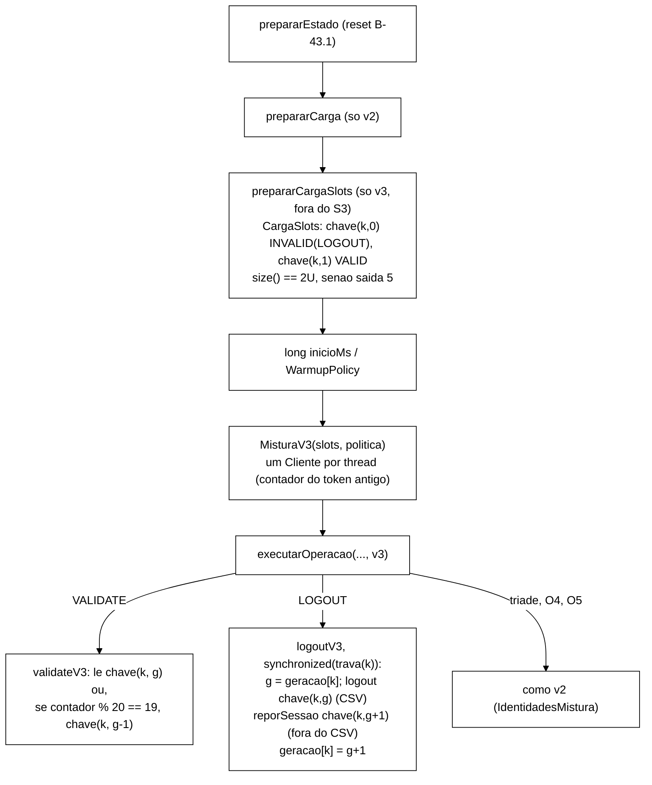

# Relatório B-43.7: mistura S1/S2 v3 "slot-geração" (2026-10-22)

> Worker, 2026-10-22. Branch `fix/b43-7-mistura-v3-slot-geracao` a partir de `7977f8f` (ponta de
> `feature/controlador-integracao`, com B-42.1, B-28.1, B-26.1, B-43.3a-i, B-43.1, B-43.2, B-43.6 e
> B-43.4), worktree `wt-b43-7`. Prompt: seção 3 de `validacao-b43-2-adendo-b43-7-2026-10-22.md`
> (`ecc79cf`). Decisões do Gestor de 22/10: c1..c4, trava por faixa de slot, geração 0 INVALID,
> DT-004 (pré-registro de C1..C3) e DT-005 (padrão `v2`). Commits só locais, **sem push**.

**Smoke local, 4 threads: as latências NÃO são evidência. O smoke prova a mistura v3 estacionária,
com q = 5 % de token antigo como premissa declarada e a reposição fora do CSV.**

## 1. Resultado

- A mistura v3 foi implementada como desenhada no adendo. A v2 continua sendo o padrão de `--mix` e
  continua coberta pelos testes de regressão, que passaram sem edição.
- Surefire: 643/0/0/1 na base, 675/0/0/1 no fim. Python: 15 testes OK.
- Os 10 mutantes V1..V10 morreram.
- Smoke: as 6 execuções v3 (Q1..Q4, L1, L2) saíram com exit 0 e atenderam C1..C9 com as tolerâncias
  pré-registradas em DT-004, sem nenhum ajuste.
  - A fração INVALID entre os Validate isolados ficou entre **5,03 % e 5,25 %**.
  - A maior diferença entre o 1º e o 3º terço foi **0,060 p.p.**
  - Entre os décimos, máximo − mínimo foi **0,039 p.p.** em L1 e **0,034 p.p.** em L2.
- O contraste L0 (v2) reproduziu a deriva prevista na V-B43.2: **85,4 %** de INVALID na janela,
  **77,2 % → 90,0 %** do 1º ao último décimo.
- Desvio de escopo: houve uma edição de testes existentes antes do bloco, autorizada pelo Gestor
  (P1, opção a; seção 8).

## 2. Commits e Surefire por commit

Comando: `mvn -f workload/pom.xml clean test`, somando os `TEST-*.xml` (testes/falhas/erros/ignorados).

| Commit | Tipo | Conteúdo | Antes | Depois |
|---|---|---|---|---|
| `cd7e6db` | test | P1: `"v3"` → `"v4"` em `CliMisturaTest:58/60` e `IdentidadesMisturaTest:109` (únicas edições autorizadas) | 643/0/0/1 | 643/0/0/1 |
| `1e9f925` | feat | `SlotsGeracao`, `CargaSlots` (T1, T4) | 643/0/0/1 | 653/0/0/1 |
| `8c08b24` | feat | `VersaoMistura.V3`, `IdentidadesMistura` (pools de v2 em v3), `MisturaV3`, `SessionOps.reporSessao`, `executarOperacao(..., v3)`, `validateV3`, `logoutV3` (T2, T3, T5, T6, T9) | 653/0/0/1 | 665/0/0/1 |
| `5a07d54` | feat | CLI `--mix v3`, `rotuloMistura`, P-b em v3, `prepararCargaSlots` em `executarRepeticao`, linha `Mistura v3:` (T4, T7, T8) | 665/0/0/1 | 675/0/0/1 |
| `b0caeb0` | test | brutos do smoke (`runs/b43-7-smoke/`) | 675/0/0/1 | 675/0/0/1 |
| (este) | docs | este relatório | 675/0/0/1 | 675/0/0/1 |

O ignorado é o mesmo da base. O vermelho foi registrado antes de cada `feat:`, com os testes novos
contra o código de produção sem a mudança: falha de compilação nos 3 casos (50, 40 e 6 símbolos
ausentes). O vermelho comportamental de cada regra está nos mutantes da seção 5. Python
(`analysis/`, `python -m unittest discover`): 15 testes OK.

## 3. Arquivo:linha, antes e depois

| Ponto | Antes (`7977f8f`) | Depois (`5a07d54`) |
|---|---|---|
| Validate isolado | `WorkloadMain.java:695` `case VALIDATE -> ops.validate(sid);` | `WorkloadMain.java:786-793` (v3 → `validateV3`, `:823`) |
| Logout isolado | `WorkloadMain.java:704` `case LOGOUT -> ops.logout(sid);` | `WorkloadMain.java:802-808` (v3 → `logoutV3`, `:839`, trava em `:841`) |
| Carga | `WorkloadMain.java:283` (só `prepararCarga`) | `:347` `prepararCarga` (inalterada) e `:348` `SlotsGeracao slots = prepararCargaSlots(...)`; método em `:192/:200` |
| Política e mistura da repetição | ausente | `WorkloadMain.java:368-370` (`definirPoliticaReposicao`, `new MisturaV3`) |
| Linha `Mistura:` | `WorkloadMain.java:245` `mix.rotulo()` | `:307` `cli.rotuloMistura()` (`v3 q=0.05`) |
| Mensagem de carga na `main` | `:89` `"(mix=v2)"` fixo | `:89` `"(mix=" + cli.mix.rotulo() + ")"` |
| Linha `Mistura v3:` | ausente | `WorkloadMain.java:431` |
| Reposição | ausente | `SessionOps.java:447` `reporSessao` (contadores e política em `:419-445`) |
| CLI | `Cli.java:295` `paramLabel = "v1\|v2"`; `:333` P-b só v2 | `:296` `v1\|v2\|v3`; `:340` `rotuloMistura()`; `:348` P-b v2 e v3; `:401` mensagem própria de v3 |
| Enum | `VersaoMistura` V1, V2 | `VersaoMistura.java:23` `V3("v3")` |
| Identidades | `IdentidadesMistura` só V2 com pools | `IdentidadesMistura.java:32` V2 **ou V3** com pools (só V1 é caso especial) |

Arquivos novos de produção: `SlotsGeracao.java`, `CargaSlots.java`, `MisturaV3.java`. Não foram
tocados: `KeyGenerator`, `Scenario`, `OpResult`, `CargaInicial`, `Armazem`, `FakeCaches`,
`EventCsvWriter`, o golden `golden-8e2e815/`, `scripts/`, `analysis/`, `spec/` e `tcc-escrita/`.

### 3.1 Decisões de implementação (dentro do desenho)

- `SlotsGeracao.chave(k, g)`: `g == 0` dá `sid-%06d` (formato do `KeyGenerator`) e `g ≥ 1` dá
  `sid-%06d~g`. `slotDe` e `geracaoDe` são os inversos. Há 1024 faixas de trava (`floorMod(k, 1024)`),
  e a identidade do slot é `identidadeDaCarga(k, threads)`.
- `CargaSlots` devolve `CargaInicial.Resultado` (universo = slots), para reaproveitar
  `CargaInicialException` sem mudá-la. O lote é de 1000 entradas, ou seja, 200 lotes para U = 10⁵.
- `reporSessao` devolve `boolean`. **Se a reposição falhar, a geração não avança**: os Validate seguem
  na geração `g`, já invalidada, até o próximo Logout do slot, e a falha conta em `reposicao_erro`. O
  prompt só fixava o caso do logout em `ERROR_*`, e este é o complemento que evita `NOT_FOUND`. Teste:
  `MisturaV3Test.reposicaoComErro`.
- Contadores da janela: `validate_isolados`, `token_antigo`, `logout_isolados` e `reposicao_omitida`
  ficam na `MisturaV3`. `reposicoes` e `reposicao_erro` ficam no `SessionOps`. Todos usam a mesma
  `WarmupPolicy` da repetição. O contador do token antigo é por thread (`MisturaV3.Cliente`) e conta
  todos os Validate isolados, inclusive os do *warm-up*.
- A v3 completa está nas sobrecargas `executarOperacao(..., MisturaV3.Cliente)` e
  `executarOperacoes(..., n, v3)`. O caminho antigo de 5 argumentos (chave Zipf crua) não mudou e
  continua sendo o que `SequenciaMisturaV2Test`/`MisturaV2Test` exercitam, inclusive com `V3`.
- A JSON `carga-rep-NNN.json` da v3 tem `mix`, `replicacao`, `cache`, `universo`,
  `entradas_por_slot = 2`, `entradas`, `tamanho_final`, `lotes`, `duracao_ms`, `q`, `veredito` e
  `motivo`.

## 4. Testes novos (arquivos novos)

| T | Arquivo | Casos |
|---|---|---|
| T1 | `SlotsGeracaoTest` | 4: formato/inverso (g = 0, 1, 12; 1000 chaves do `KeyGenerator`), gerações em 1, 1024 faixas, identidade igual em todas as gerações |
| T2 | `TokenAntigoTest` | 2: contador por thread (posições 19, 39, ...); sementes 42 e 4242, S1 e S2, posições de token antigo = `20j + 19` reconstruídas pela sequência |
| T3 | `SequenciaMisturaV3Test` | 1: 2000 operações de S1 e S2 = golden; slots das 500 primeiras chaves = golden |
| T4 | `CargaSlotsTest`, `WorkloadMainCargaSlotsTest` | 6 + 2: 2U entradas (g0 INVALID(LOGOUT), g1 VALID), k-ésima consulta, prazo, tamanho maior, lote parcial, `putAll` falha; JSON OK e FALHA (saída 5, sem `rep-001.csv`) |
| T5 | `MisturaV3Test` | 4: S1/S2 com 10⁴ operações (INVALID = `token_antigo`, 5 % ± 0,1 p.p., terços ≤ 0,5 p.p., `logout_noop` = 0, reposições = logouts, invariante do fim); V9 (logout em `ERROR_*`); reposição com erro |
| T6 | `MisturaV3ConcorrenciaTest` | 3: (a) latch na reposição; (b) dois Logouts no mesmo slot (o segundo fica BLOCKED e invalida g+1); (c) 4 threads × 2,5·10⁴ em S1: NOT_FOUND = 0, I1 = I4 = 0, gerações monotônicas (gancho no `put`), invariante do fim |
| T7 | `CliMisturaV3Test` | 4: `v3` aceito (`V3`, `3`, ` v3` rejeitados), padrão v2, P-b em v3 com mensagem própria, dry-run `mix=v3 q=0.05`, `toString()` igual, `--help` |
| T8 | `WorkloadMainCargaSlotsTest`, `DetectorCargaSlots` | 4: v1/v2/S3 sem carga de slots; v3 sem `CargaInicial`; posição (detector novo sobre o `DetectorFonte` inalterado); autoteste do detector com 8 mutantes de fonte |
| T9 | `CsvMisturaV3Test` | 2: S1/S2, `registrados = operações + 2 × logins OK`, só operações da mistura, nenhum Login com chave de slot, Logout `sid-` no CSV = `logout_isolados`, `VerificadorSanidade` OK |
| T10 | todos os existentes | verdes sem edição (exceto as 3 linhas de P1), inclusive `GoldenS1S2Test`, `SequenciaMisturaV2Test`, `MisturaV2Test`, `CliMisturaTest` e os de B-43.6/B-43.4 |

Auxiliar de teste novo: `MundoV3` (fakes, carga de slots e N threads simuladas).

## 5. Mutações

Script em Python, fora do repositório. Cada mutante exige exatamente 1 ocorrência, roda o Surefire
completo e é revertido com `git checkout`. Nenhum foi commitado, e a árvore ficou limpa no fim.

| V | Mutação | Surefire | Testes que mataram |
|---|---|---|---|
| V1 | token antigo por `r.nextInt(20) == 19` | 675/4 | `MisturaV3Test` S1/S2, `SequenciaMisturaV3Test`, `TokenAntigoTest.naoDependeDoRandom` |
| V2 | período 10 | 675/6 | `TokenAntigoTest` (2), `MisturaV3Test` S1/S2, `CliMisturaV3Test` (2, `q=0.10`) |
| V3 | `reporSessao` emite `emitir(OP_LOGIN, ...)` | 675/2 | `CsvMisturaV3Test` S1/S2 |
| V4 | `definirGeracao` antes da reposição | 675/3 | `MisturaV3ConcorrenciaTest.validateDepoisDoAvanco` e `.estocastico`, `MisturaV3Test.reposicaoComErro` |
| V5 | sem a trava (`synchronized (new Object())`) | 675/2 | `MisturaV3ConcorrenciaTest.logoutsSerializados` e `.estocastico` |
| V6 | geração 0 da carga gravada VALID | 675/5 | `CargaSlotsTest` (2), `MisturaV3Test` S1/S2, `MisturaV3ConcorrenciaTest.estocastico` |
| V7 | token antigo lê `g` em vez de `g − 1` | 675/3 | `MisturaV3Test` S1/S2, `TokenAntigoTest.naoDependeDoRandom` |
| V8 | geração por thread (`new Cliente(new SlotsGeracao(...))`) | 675/6 | `MisturaV3Test` (3), `MisturaV3ConcorrenciaTest` (3) |
| V9 | reposição mesmo com o logout em `ERROR_*` | 675/1 | `MisturaV3Test.logoutComErroNaoRepoe` |
| V10 | carga v3 também com `--mix v2` | 675/1 | `WorkloadMainCargaSlotsTest.soComV3ForaDoS3` |

Os 10 morreram.

## 6. Smoke local

### 6.1 Ambiente

- Podman 5.7.0 (máquina WSL `podman-machine-default`) e podman-compose 1.5.0. Imagem
  `quay.io/infinispan/server:15.0.21.Final`, 3 nós com o `cluster/infinispan-cluster.xml` e o
  `jgroups-tcp.xml` da base, copiados em `runs/b43-7-smoke/cluster/`.
- Projeto `podman-compose -p b437`, containers `b437-isn1..3`, portas Hot Rod 12352..12354 (com
  `external-port` igual). Nenhuma colisão com os projetos `b434`/`b436i`. O
  `cluster/podman-compose.yml` versionado não mudou.
- JDK 22.0.2 por `$JAVA_HOME/bin/java`. Sem VM.
- Jar construído em `5a07d54`, com a árvore limpa: SHA-256 `dfd25645…67ed78`, em `jars.json`. O
  verificador e o `LeitorCsvEventos` são os da própria base, no mesmo jar.
- **Máquina Podman:** estava parada antes. Foi iniciada, e depois do `down` foi **parada** de novo
  (nenhum container de outro projeto estava rodando).
- `podman ps -a` antes e depois: **idênticos byte a byte** (11 containers). As redes também ficaram
  iguais, e a `b437_infinispan-net` foi removida.
- Saúde antes e depois: `HEALTHY`, 3 nós, todos os caches `HEALTHY` nas 3 portas.
- Logs dos servidores: **0** linhas ` ERROR `. Os ` WARN ` foram `ISPN012026` (1249, endpoint REST
  obsoleto do *healthcheck*), `ISPN000599` (12) e `ISPN080059`/`ISPN080072` (3 + 3). É o mesmo perfil
  de B-43.4.

Parâmetros comuns: `--mix v3 --reset-state on --ops 0 --rep 1 --threads 4`, `--csv-dir` por
execução, no mesmo cluster, na ordem Q1, Q2, Q3, Q4, L1, L2, L0. Q1..Q4 usaram `--duration 120
--warmup-min-sec 10` (*warm-up* até +12 s, medição a partir de +18 s). L0/L1/L2 usaram
`--duration 600` com o *warm-up* padrão. O L0 rodou com `--mix v2`.

### 6.2 Critérios por execução

Fração = INVALID / Validate isolados (chave `sid-`), no CSV de contrato v2, na janela de medição.
Terços e décimos são intervalos iguais de `start_ns`.

| Exec. | Cenário | Validate isolados (CSV) | INVALID | **C2** fração | **C1** terços (1º / 2º / 3º) | dif. 1º−3º | **C3** `token_antigo` | stdout − CSV |
|---|---|---|---|---|---|---|---|---|
| Q1 | S1 sync | 245 204 | 12 866 | **5,247 %** | 5,230 / 5,214 / 5,291 | 0,060 p.p. | 5,0003 % | 0 |
| Q2 | S2 sync | 974 990 | 49 204 | **5,047 %** | 5,052 / 5,043 / 5,045 | 0,007 p.p. | 5,0001 % | 0 |
| Q3 | S1 async | 329 008 | 17 074 | **5,190 %** | 5,207 / 5,189 / 5,173 | 0,033 p.p. | 4,9999 % | 0 |
| Q4 | S2 async | 1 022 086 | 51 435 | **5,032 %** | 5,030 / 5,034 / 5,032 | 0,002 p.p. | 5,0001 % | 0 |
| L1 | S1 sync 600 s | 1 338 556 | 70 049 | **5,233 %** | 5,241 / 5,231 / 5,228 | 0,013 p.p. | 4,9999 % | 0 |
| L2 | S1 async 600 s | 1 552 017 | 80 475 | **5,185 %** | 5,182 / 5,187 / 5,187 | 0,006 p.p. | 4,9999 % | 0 |

Tolerâncias de DT-004: C1 ≤ 1,0 p.p. (décimos ≤ 2,0 p.p.), C2 em [4,5 %; 6,5 %], C3 = 5,00 % ±
0,10 p.p. Todas foram atendidas. O excesso de INVALID sobre q, que é a corrida Validate × Logout no
mesmo slot, ficou em 0,25 p.p. em S1 sync, 0,19 p.p. em S1 async e 0,03 a 0,05 p.p. em S2. Fica
dentro da estimativa do adendo (≤ 0,6 p.p. em S1 e ≤ 0,1 p.p. em S2).

| Exec. | **C4** Validate NOT_FOUND | Login OK/Login | (reg.+desc.)/oper. | reg.+desc.−oper. = 2 × logins OK | **C5** logout_isolados = reposições + omitidas | `reposicao_erro` | Logout `sid-` no CSV | `logout_noop` (janela) | Logout isolado NOT_FOUND | **C6** I1/I4 | `Auditor:` | **C7** verificador | **C8** carga | **C9** |
|---|---|---|---|---|---|---|---|---|---|---|---|---|---|---|
| Q1 | 0 | 1,0 | 1,4999 | 283 266 = 283 266 | 49 137 = 49 137 + 0 | 0 | 49 137 | 0 | 0 | 0 / 0 | i1_conc = 127, i4_conc = 0 | exit 0, OK | 200 000, 1733 ms; reset antes 0 (1ª execução), 23 ms | 0 |
| Q2 | 0 | 1,0 | 1,0601 | 71 256 = 71 256 | 10 189 = 10 189 + 0 | 0 | 10 189 | 0 | 0 | 0 / 0 | 69 / 0 | exit 0, OK | 200 000, 1892 ms; antes **398 352**, 38 ms | 0 |
| Q3 | 0 | 1,0 | 1,4985 | 384 048 = 384 048 | 65 279 = 65 279 + 0 | 0 | 65 279 | 0 | 0 | 0 / 0 | 361 / 0 | exit 0, OK | 200 000, 1356 ms; antes 0 (1º uso do cache async), 5 ms | 0 |
| Q4 | 0 | 1,0 | 1,0603 | 75 848 = 75 848 | 10 718 = 10 718 + 0 | 0 | 10 718 | 0 | 0 | 0 / 0 | 147 / 0 | exit 0, OK | 200 000, 1115 ms; antes **468 536**, 132 ms | 0 |
| L1 | 0 | 1,0 | 1,4992 | 1 553 814 = 1 553 814 | 267 638 = 267 638 + 0 | 0 | 267 638 | 0 | 0 | 0 / 0 | 765 / 0 | exit 0, OK | 200 000, 1214 ms; antes **247 385**, 20 ms | 0 |
| L2 | 0 | 1,0 | 1,4999 | 1 822 070 = 1 822 070 | 310 271 = 310 271 + 0 | 0 | 310 271 | 0 | 0 | 0 / 0 | 1628 / 0 | exit 0, OK | 200 000, 1150 ms; antes **250 474**, 133 ms | 0 |

- **Como medi C5.** O `logout_noop` é um limite superior aprovado pelo Gestor: ele soma os no-ops
  isolados, os da tríade e os erros. O histograma `logout_noop` não teve **nenhuma** amostra na janela
  em nenhuma execução v3 (a linha nem aparece no stdout), então nenhum Logout isolado foi no-op.
  Contei à parte os NOT_FOUND dos Logouts isolados no CSV: foram 0 em todas.
- **Identidade de C4.** `registrados + descartados − operações = 2 × logins OK` deu igualdade
  exata nas 6 execuções. Isso prova que a reposição não gerou nenhum evento, porque `logins OK` vem do
  histograma `login_ok` (janela + descartados).
- **Fronteira.** As diferenças stdout − CSV foram 0 tanto nos Validate isolados quanto nos Logout
  isolados. A fronteira de janela não apareceu.
- **C6.** I1 = I4 = 0 em `violacoes-rep-001.csv` e `Violacoes detectadas: 0`. Os
  `i1_concorrentes` (69 a 1628) são diagnóstico do observador (DT-001) e não entram em critério.
- **C7.** As métricas do verificador (`verificador/Qn.sanidade.json`): `login_ok_frac` = 1,0,
  `validate_ausente_frac` = 0,0, `VALIDATE_VALID_ZERO` não disparou, e o maior |desvio| da mistura foi
  0,083 p.p. (Q3, Validate). Nenhum exit 2 e nenhuma operação fora da mistura. Limiares sem ajuste.
- **`LeitorCsvEventos`** (`leitor-csv-eventos.json`, com `LerCsvV2.java` sobre o jar): leu os 7 CSV
  inteiros com `status` OK e 0 erros. O total de eventos bate com `registrados` em todos: 735 033,
  1 088 065, 984 346, 1 140 910, 4 011 530, 4 652 498 e 3 422 470.

### 6.3 Décimos de L1 e L2 (C1, máximo − mínimo ≤ 2,0 p.p.)

| Décimo | 1 | 2 | 3 | 4 | 5 | 6 | 7 | 8 | 9 | 10 | máx − mín |
|---|---|---|---|---|---|---|---|---|---|---|---|
| L1 S1 sync (%) | 5,243 | 5,240 | 5,241 | 5,244 | 5,231 | 5,242 | 5,205 | 5,212 | 5,241 | 5,232 | **0,039 p.p.** |
| L2 S1 async (%) | 5,196 | 5,166 | 5,177 | 5,199 | 5,199 | 5,181 | 5,180 | 5,189 | 5,179 | 5,187 | **0,034 p.p.** |

Cada décimo tem de 128 583 a 167 460 Validate isolados (a contagem por décimo está em `analise.json`).

### 6.4 Contraste L0 (v2, 600 s, documental, não é critério)

| | Na janela | 1º décimo | Último décimo | Terços | Logout isolado que escreve |
|---|---|---|---|---|---|
| L0 S1 sync v2 | **85,38 %** INVALID (972 402 de 1 138 855) | 77,15 % | **90,01 %** | 80,45 / 86,08 / 89,23 % | 33 354 de 227 969 (**14,6 %**) |

- A projeção da V-B43.2 era de cerca de 86 % na janela e 92 % no último décimo. O medido ficou em
  85,4 % e 90,0 %, e a fração cresce em todos os décimos.
- Na v2, `logout_noop` teve 194 616 amostras na janela e `logout_ok` teve 604 552 (dos quais 571 198
  são da tríade). Nas mesmas condições, a v3 ficou plana em 5,2 % e teve 0 no-ops.

### 6.5 Custo

- **Carga.** A carga de 2 × 10⁵ entradas levou de 1115 a 1892 ms no *host*, fora da janela e antes do
  *warm-up*. O reset que esvazia a carga anterior levou de 20 a 133 ms.
- **Reposição.** Cada Logout isolado vira 2 escritas: a invalidação, que é medida, e a reposição, que
  não é. Em relação às operações da janela, as escritas extras foram:
  - L1: 267 638 / 2 675 756 = **10,0 %**;
  - Q2: 10 189 / 1 026 301 = **0,99 %**.

  Isso confirma o +10 % (S1) e o +1 % (S2) do adendo. As escritas extras ficam fora do CSV e do
  `LatencyRegistry`, e precisam entrar na Metodologia.
- **Ritmo.** O ritmo do *host* não é critério. Q1 fez 566 667 operações em 120 s, e L1 fez
  3 112 691 em 600 s.

### 6.6 Brutos

- Os brutos estão em `runs/b43-7-smoke/`, com `MANIFEST.sha256` (88 arquivos, `sha256sum -c` com 0
  falhas).
- Ficam versionados os JSON (carga, estado, meta, sanidade, saúde, leitor, `analise.json`,
  `jars.json`), o compose e os XML do cluster, `analise.py` e `LerCsvV2.java`.
- CSV, `stdout.log`, logs dos servidores e `.txt` (exits, tempos, `podman ps -a`, o roteiro
  `smoke.sh.txt`) ficam fora do git pelo `.gitignore` e são conferidos pelo manifesto. Somam
  cerca de 1,5 GB.

## 7. Pontos para o Gestor

1. **Metodologia (já previsto no adendo):**
   - q = 5 % como premissa;
   - reposição fora do CSV, com +10 % de escritas em S1 e +1 % em S2, medidos;
   - trava por faixa de slot: Logouts no mesmo slot não são concorrentes entre si;
   - geração 0 invalidada na carga.
2. **Reposição que falha não avança a geração** (seção 3.1). É uma decisão local, coberta por teste,
   e não ocorreu no smoke (`reposicao_erro` = 0). Peço a confirmação.
3. **`i1_concorrentes` sobe com a v3** (até 1628 em L2), porque a v3 produz muitas leituras logo depois
   de invalidações. Pela DT-001 isso não entra em `S_viol`. Fica só registrado.
4. **Regra `INVALID_FORA_DE_Q`** (seção 5 do adendo, parte ii do B-43.3a). Os números deste smoke dão
   folga grande para a faixa proposta [q − 0,5; q + 1,5] p.p.: a fração medida fica entre q + 0,03 e
   q + 0,25 p.p.
5. **Integração.** Nada foi integrado e nada foi enviado com push.

## 8. Desvios

- **P1 (autorizado pelo Gestor em 22/10, opção a).** `CliMisturaTest:60` e `IdentidadesMisturaTest:109`
  fixavam `"v3"` como rótulo inválido, o que contradizia o T7. O commit `test:` próprio (`cd7e6db`),
  feito antes de qualquer `feat:`, trocou `"v3"` por `"v4"` nessas duas linhas e no `@DisplayName`
  da linha 58. Não houve nenhuma outra edição de teste existente.
- **`IdentidadesMistura` alterada** (pools de v2 também em v3; só V1 é caso especial), conforme
  aceito pelo Gestor. A classe não estava na lista de proibidas.
- **Mensagem de falha de carga na `main`.** Agora usa a versão (`mix=v3`) em vez do `mix=v2` fixo.
- **Tolerância de fronteira em `analise.py`.** O script aceita até 4 eventos (o número de threads)
  de diferença stdout × CSV em C3/C5, como margem de fronteira. A diferença medida foi 0 em todas as
  execuções, então essa margem não foi usada.
