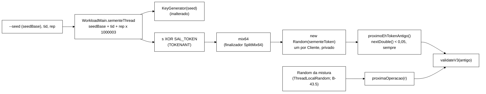

# Relatório B-43.7b: *token* antigo por sorteio de Bernoulli semeado (2026-10-22)

> Worker, 2026-10-22. Branch `fix/b43-7b-token-antigo-semeado` (worktree `wt-b43-7b`), a partir de
> `0215964` (ponta de `feature/controlador-integracao` com o B-43.8 integrado por *fast-forward*).
> Especificação: `wt-plano-ctrl/docs/prompt-b43-7b-token-antigo-semeado-2026-10-22.md` e DT-008 de
> `wt-plano-ctrl/docs/decisoes-tecnicas.md`, com as decisões do Gestor no despacho (edições E1..E10
> autorizadas, C3 pelo IC normal com recusa se n·p·(1−p) < 100, scripts selados intocados). Commits
> só locais. **Nenhum push, nada integrado.**
>
> **Smoke local: as latências NÃO são evidência.** O smoke prova o sorteio semeado e o C3 pelo IC.

## 1. Resultado

- O *token* antigo da mistura v3 deixou de ser o contador "1 em cada 20 por *thread*". Agora cada
  Validate isolado faz um sorteio `tokens.nextDouble() < 0.05` num `java.util.Random` próprio da
  *thread*, semeado com `sementeToken(sementeThread) = mix64(sementeThread ^ SAL_TOKEN)`. O sorteio
  acontece sempre, dentro e fora da janela de medição. O `Random` da mistura e o `KeyGenerator` não
  são consumidos.
- `sementeThread(seedBase, tid, rep)` foi extraído em `WorkloadMain`, com a mesma fórmula
  (`seedBase + tid + rep·1 000 003`). A linha 398 passa a usá-lo.
- Linha `Mistura v3:`, linha `Mistura: mix=v3 q=0.05`, *dry-run*, CSV, contadores, `validateV3` e
  `logoutV3` ficaram inalterados. A trava por faixa, a reposição fora do CSV, a reposição falha sem
  avanço e a escrita condicional do *logout* (B-43.8) também não mudaram.
- Surefire: **697/0/0/1 → 713/0/0/1** (95 → 98 arquivos `TEST-*.xml`). Os testes existentes
  editados foram só E1..E10, num commit `test:` próprio (`178e94b`). `SequenciaMisturaV3Test` e
  `GoldenS1S2Test` passaram sem edição.
- Mutantes: M1..M9 (M3 em 3 formas, M4 em 2), **12 de 12 mortos**, cada um pelo teste previsto no
  prompt (seção 6).
- Smoke (cluster Podman local `b437b`): R1..R5 com exit 0. C1..C9 e `invalidacao_perdida =
  conflito_esgotado = 0` foram atendidos nas 5 execuções, com C3 pelo IC de DT-008 (seção 7).
  `test_analise_c3.py` deu 8/8 OK.



## 2. Commits e Surefire por commit

`mvn -f workload/pom.xml clean test`, somando os `TEST-*.xml` (testes/falhas/erros/ignorados). Logs em
`scratchpad/b437b/mvn-*.log`, resumo em `scratchpad/b437b/surefire.txt`.

| Commit | Tipo | Conteúdo | Vermelho registrado | Surefire antes → depois |
|---|---|---|---|---|
| `0215964` | base | ponta de `feature/controlador-integracao` | n/a | **697/0/0/1** (95 arquivos) |
| `cbb9510` | `test:` | U9, `TokenAntigoFonteTest` (guardas de fonte) | 4 testes, 4 falhas contra a base | 697/0/0/1 → 701/4/0/1 |
| `ef4606a` | `feat:` | `WorkloadMain.sementeThread` (U7, `SementeThreadTest`) | compilação (método ausente) | 701/4/0/1 → 703/3/0/1 (as 3 falhas são do U9 ainda aberto) |
| `178e94b` | `test:` | edições autorizadas E1..E10 | compilação (`cliente(long)` ausente) | 703/3/0/1 → não compila (0 testes) |
| `85fd208` | `test:` | `TokenAntigoSemeadoTest` (U1..U3, U5, U6, U8) | compilação; semântico 713/**8**/0/1 (ver abaixo) | não compila → não compila |
| `0222764` | `feat:` | sorteio de Bernoulli semeado, `cliente(seed)`, Javadoc | n/a | não compila → **713/0/0/1** (98 arquivos) |
| `15c08c4` | `test:` | `runs/b43-7b-smoke/test_analise_c3.py` | `ModuleNotFoundError: analise` | 713/0/0/1 (sem Java) |
| `a4538d4` | `test:` | `runs/b43-7b-smoke/analise.py` (C3 pelo IC) | n/a | 713/0/0/1 (medido; *jar* do smoke construído aqui) |
| `88b6186` | `test:` | brutos do smoke (`runs/b43-7b-smoke/`) | n/a | 713/0/0/1 (medido) |
| (este) | `docs:` | este relatório | n/a | 713/0/0/1 |

**Vermelho semântico de `85fd208`.** Para mostrar que os testes novos reprovam o comportamento antigo, e
não só a assinatura, rodei o Surefire com um *shim* temporário em `MisturaV3`, sem versionar:
`SAL_TOKEN`, `sementeToken`, `mix64` já corretos e `cliente(long s) { return new Cliente(slots); }`
delegando ao **contador** antigo. O resultado foi 713/8/0/1, com estas falhas:
`decisoesCongeladas`, `mesmaSementeMesmaSequencia`, `posicoesIndependemDoRandomDaMistura`,
`threadsIndependentes`, `TokenAntigoTest.sorteioPorThread` e as 3 do U9. Depois, `MisturaV3.java` foi
restaurado byte a byte. Log: `scratchpad/b437b/mvn-c4-semeado-vermelho-semantico.log`.

## 3. Arquivo:linha, antes e depois

| O quê | Antes (`0215964`) | Depois (`88b6186`) |
|---|---|---|
| Período do contador | `MisturaV3.java:20` `static final int PERIODO_TOKEN_ANTIGO = 20;` | removido |
| p do sorteio | não havia | `MisturaV3.java:28` `static final double P_TOKEN_ANTIGO = 0.05;` |
| `Q` | `MisturaV3.java:23` `Q = 1.0 / PERIODO_TOKEN_ANTIGO` | `MisturaV3.java:31` `Q = P_TOKEN_ANTIGO` (`rotuloQ()` = `"0.05"`) |
| Sal | não havia | `MisturaV3.java:34` `SAL_TOKEN = 0x544F4B454E414E54L` |
| Derivação | não havia | `MisturaV3.java:41` `sementeToken`, `:46` `mix64` |
| Fábrica do cliente | `MisturaV3.java:45` `Cliente cliente()` | `MisturaV3.java:77` `Cliente cliente(long sementeThread)` |
| Estado do cliente | `MisturaV3.java:81` `private long posicao;` | `MisturaV3.java:113` `private final Random tokens;` |
| Decisão | `MisturaV3.java:97` `return c % PERIODO_TOKEN_ANTIGO == PERIODO_TOKEN_ANTIGO - 1;` | `MisturaV3.java:131` `return tokens.nextDouble() < P_TOKEN_ANTIGO;` |
| Semente da *thread* | `WorkloadMain.java:398` `cli.seedBase + (long) tid + (long) rep * 1_000_003L` | `WorkloadMain.java:398` `sementeThread(cli.seedBase, tid, rep)`; método em `:729` |
| `rodarCliente` | `WorkloadMain.java:738` `misturaV3.cliente()` | `WorkloadMain.java:748` `misturaV3.cliente(seed)` |
| Sorteio na operação | `WorkloadMain.java:791` `v3.proximoEhTokenAntigo()` | `WorkloadMain.java:801`, idem (sem argumento) |
| Texto do `--mix` no `--help` | `Cli.java:300` "1 em cada 20 Validate isolados ..." | `Cli.java:300..302` "cada Validate isolado le o token antigo com probabilidade q = 0.05, por sorteio semeado por thread" (desvio D4) |

`SessionOps`, `OpResult`, `Armazem`, `ArmazemVersionado`, `FakeCaches`, `KeyGenerator`, `Scenario`,
`SlotsGeracao`, `CargaSlots`, o *golden*, `scripts/`, `analysis/`, `spec/`, `cluster/`, `tcc-escrita/`
e os diretórios `runs/` existentes não mudaram (`git diff --stat 0215964 HEAD` não lista nenhum deles).

## 4. Testes novos

| ID | Arquivo (novo) | O que trava |
|---|---|---|
| U1 | `TokenAntigoSemeadoTest.derivacaoCongelada`, `decisoesCongeladas`, `semColisao` | `SAL_TOKEN` = "TOKENANT" em ASCII; âncora externa do SplitMix64 (`mix64(0x9E3779B97F4A7C15) = 0xE220A8397B1DCDAF`, primeira saída com estado 0); `sementeToken(s) == mix64(s ^ SAL_TOKEN)` e valores congelados para s ∈ {0, 1, 42, −1, `Long.MIN_VALUE`}; as 40 primeiras decisões e as posições nas 1000 primeiras de `cliente(42)`; `sementeToken(s) != s` e sem colisão em [0, 10⁵) |
| U2 | `mesmaSementeMesmaSequencia`, `intercaladosNaoCompartilhamRandom` | 2 × `cliente(42)` iguais em 10⁴; 42 e 43 diferem nas 1000 primeiras; A = `cliente(42)` e B = `cliente(43)` da mesma `MisturaV3`, intercalados, com cada um igual ao seu sozinho |
| U3 | `randomDaMisturaNaoConsumido`, `posicoesIndependemDoRandomDaMistura` | `Random` gravador de `next(bits)` (bits e valor), N = 5000, S1 e S2, semente 42: a mesma sequência com `v3 = cliente(42)` e com `v3 = null`; com `Random(1)` e `Random(2)` na mistura, as mesmas posições de *token* antigo, que são as congeladas |
| U4 | `SequenciaMisturaV3Test`, `GoldenS1S2Test` | verdes sem edição |
| U5 | `fracaoNoIc` | 10⁶ decisões de `cliente(42)` (k = 50 469, 5,0469 %) e 4 × 2,5·10⁵ de `cliente(sementeThread(42, t, 0))` no IC de 99,9 % |
| U6 | `threadsIndependentes` | 4 clientes de U5: sequências diferentes duas a duas; coincidências de `true` no IC de 99,9 % de p² = 0,0025, nos 6 pares |
| U7 | `SementeThreadTest` (2) | grade (seedBase ∈ {0, 1, 42, −1, 1 000 003, MAX, MIN}) × tid 0..7 × rep 0..4 igual à fórmula antiga; `rep` muda a semente em 1 000 003 e `tid` em 1 |
| U8 | `sorteioIndependeDaJanela` | `never()` e `always()` dão a mesma sequência e só os contadores mudam; com uma `WarmupPolicy.padrao` sobre um relógio manual que entra na medição no meio, a sequência é a mesma e só a metade medida conta |
| U9 | `TokenAntigoFonteTest` (4) | fonte sem comentários: `rodarCliente` com `misturaV3.cliente(seed)`; nenhum `cliente()` sem argumento em `src/main`; `MisturaV3` sem `ThreadLocalRandom`/`Math.random` e com `new Random(sementeToken(sementeThread))`; `proximoEhTokenAntigo()` sem parâmetro e `executarOperacao` sem `r.next*(`; linha 398 com `sementeThread(cli.seedBase, tid, rep)` |

### 4.1 Constantes congeladas de U1

Calculei os valores com uma emulação independente em Python do `java.util.Random` (LCG de 48 bits,
`nextDouble` com 26 + 27 bits) e do finalizador SplitMix64 (`scratchpad/b437b/constantes.py`). Não
foram copiados da saída da classe. A âncora `0xE220A8397B1DCDAF` é o valor publicado do SplitMix64.

| Constante | Valor |
|---|---|
| `SAL_TOKEN` | `0x544F4B454E414E54L` ("TOKENANT") |
| `sementeToken(0)` | `-7724996358903509638` |
| `sementeToken(1)` | `7880957947818844497` |
| `sementeToken(42)` | `2621948109880469469` (`0x246307EA0CEEA7DD`) |
| `sementeToken(-1)` | `143759986413465447` |
| `sementeToken(Long.MIN_VALUE)` | `7595910577557860251` |
| 40 primeiras decisões de `cliente(42)` | `0000100000000000000000000000000000100000` |
| posições de `true` nas 1000 primeiras | 4, 34, 56, 81, 100, 183, 207, 224, 262, 301, 322, 324, 325, 340, 355, 370, 375, 383, 426, 507, 515, 540, 586, 610, 616, 627, 654, 716, 725, 747, 769, 779, 794, 803, 814, 835, 845, 865, 866, 868, 887, 940, 942, 961 (44, ou seja 4,4 %) |

## 5. Diff das edições autorizadas (`178e94b`)

Só as linhas E1..E10 da seção 4 do prompt. As importações não mudaram. Em `TokenAntigoTest`, o E3
usa `java.util.Random` qualificado e um auxiliar novo, `posicoesComRandom`, dentro da faixa `:72-88`.
O auxiliar antigo `posicoes` (`:42-70`) ficou intocado e continua em uso.

```diff
--- MundoV3.java (E4)
-            c[t] = mistura.cliente();
+            c[t] = mistura.cliente(semente + t);
--- MisturaV3Test.java (E7 :19, :39; E5 :45; E6 :57; E8 :99, :128)
- * INVALID entre os Validate isolados e exatamente a do token antigo (q = 5 %), estacionaria; todo
+ * INVALID entre os Validate isolados e exatamente a do token antigo (Bernoulli p = 0,05, DT-008), estacionaria; todo
-        // INVALID entre os Validate isolados = token antigo, exatamente; 5 % +- 0,1 p.p.
+        // INVALID entre os Validate isolados = token antigo, exatamente; 5 % no IC binomial de 99,9 % (DT-008)
-        assertEquals(0.05, frac, 0.001, "fracao INVALID " + frac);
+        assertEquals(0.05, frac, 3.2905 * Math.sqrt(0.05 * 0.95 / val.size()), "fracao INVALID " + frac);
-        assertTrue(max - min <= 0.005, "tercos: " + min + " .. " + max);
+        assertTrue(max - min <= 3.2905 * Math.sqrt(2 * 0.05 * 0.95 / terco), "tercos: " + min + " .. " + max);
-        MisturaV3.Cliente c = w.mistura.cliente();
+        MisturaV3.Cliente c = w.mistura.cliente(42);
-        WorkloadMain.logoutV3(w.ops, w.mistura.cliente(), 7);
+        WorkloadMain.logoutV3(w.ops, w.mistura.cliente(42), 7);
--- MisturaV3ConcorrenciaTest.java (E9 :133, :136, :142, :154, :156; E10 :201)
-        ... w.mistura.cliente() ...                         (5 linhas)
+        ... w.mistura.cliente(42) ...
-                            new IdentidadesMistura(tid, VersaoMistura.V3), porThread, w.mistura.cliente());
+                            new IdentidadesMistura(tid, VersaoMistura.V3), porThread, w.mistura.cliente(42 + tid));
--- TokenAntigoTest.java (E1 :16-17)
- * B-43.7, T2: exatamente 1 de cada 20 Validate isolados por thread le a geracao anterior (token
- * antigo), na posicao {@code contador % 20 == 19}; a posicao nao depende do {@code Random} da mistura.
+ * B-43.7, T2 (B-43.7b, DT-008): cada Validate isolado le a geracao anterior (token antigo) por um sorteio
+ * de Bernoulli p = 0,05 com Random proprio por thread; a posicao nao depende do {@code Random} da mistura.
--- TokenAntigoTest.java (E2 :22-36): contadorPorThread -> sorteioPorThread
-        MisturaV3.Cliente a = m.cliente();
-        MisturaV3.Cliente b = m.cliente();
-        assertEquals(20, MisturaV3.PERIODO_TOKEN_ANTIGO);
+        MisturaV3.Cliente a = m.cliente(42);
+        MisturaV3.Cliente a2 = m.cliente(42);
+        MisturaV3.Cliente b = m.cliente(43);
         assertEquals(0.05, MisturaV3.Q, 1e-12);          (mantida)
         assertEquals("0.05", MisturaV3.rotuloQ());       (mantida)
-        for 200: assertEquals(i % 20 == 19, a.proximoEhTokenAntigo()); b falso para i < 19
+        for 2000: a == a2 em cada posicao; diferem |= a != b; conta os true
+        assertTrue(diferem, "sementes 42 e 43 deram a mesma sequencia");
+        assertTrue(verdadeiros > 0 && verdadeiros < 2000, "um sorteio por chamada: " + verdadeiros);
--- TokenAntigoTest.java (E3 :72-88): naoDependeDoRandom
-            List<Integer> b = posicoes(4242, s, 4000);
-            for j: assertEquals(20 * j + 19, a.get(j)); idem para b
+            List<Integer> b = posicoesComRandom(new java.util.Random(4242), s, 4000);   // mesmo cliente(42)
+            (a = posicoes(42, s, 4000), mantido: Random(42) e cliente(42) pelo MundoV3 de 1 thread)
+            assertEquals(a.subList(0, n), b.subList(0, n), s.name());                     (mantida)
+            assertEquals(esperado, a, ...)  // esperado = posicoes dos true de um cliente(42) sozinho
+    private static List<Integer> posicoesComRandom(java.util.Random r, Scenario s, int n)  // auxiliar novo
```

O diff completo (206 linhas com cabeçalhos) é `git show 178e94b`.

## 6. Mutantes

Script `scratchpad/b437b/mutantes.py`. Cada mutante exige o número exato de ocorrências do trecho,
roda o Surefire completo e restaura o fonte no fim. Base `0222764`. Resultado bruto em
`scratchpad/b437b/mutantes-*.json`. Depois da rodada, `git status` ficou limpo.

| ID | Mutação | Resultado | Quem mata |
|---|---|---|---|
| M1 | `boolean antigo = r.nextDouble() < MisturaV3.Q;` em `executarOperacao` | morto, 713/5 | **U3** (`randomDaMisturaNaoConsumido`, `posicoesIndependemDoRandomDaMistura`), **U4** (`SequenciaMisturaV3Test.sequenciaIntacta`), U9 (`misturaV3SemOutroRandom`), `TokenAntigoTest.naoDependeDoRandom` |
| M2 | contador `posicao++ % 20 == 19` | morto, 713/5 | **U1** (`decisoesCongeladas`), **U2** (`mesmaSementeMesmaSequencia`), **U6**, U3 (posições), `TokenAntigoTest.sorteioPorThread` |
| M3a | `nextDouble() < 0.04` | morto, 713/6 | **U5** (`fracaoNoIc`), U1, U3, U6, `MisturaV3Test.misturaV3` S1 e S2 |
| M3b | `nextDouble() < 0.06` | morto, 713/5 | **U5**, U1, U3, U6, `MisturaV3Test.misturaV3` S2 |
| M3c | `nextDouble() < 1.0 / 19` | morto, 713/4 | **U5**, U1, U3, U6 |
| M4a | `cliente` ignora o argumento (`new Cliente(slots, 0L)`) | morto, 713/7 | **U2**, **U6**, U1, U3, `sorteioPorThread`, `MisturaV3Test.misturaV3` S1 e S2 |
| M4b | `new Random(SAL_TOKEN)` | morto, 713/7 | **U2**, **U6**, U1, U3, U9, `sorteioPorThread`, `MisturaV3Test.misturaV3` S2 |
| M5 | `new Random(sementeThread)` (sem sal nem misturador) | morto, 713/3 | **U1** (`decisoesCongeladas`), U3 (posições), U9 |
| M6 | `tokens.nextInt(20) == 19` | morto, 713/2 | **U1** (`decisoesCongeladas`), U3 (posições) |
| M7 | `politica.deveRegistrar() && tokens.nextDouble() < P` | morto, 713/1 | **U8** (`sorteioIndependeDaJanela`) |
| M8 | um `Random` único em `MisturaV3`, criado pelo primeiro cliente e compartilhado | morto, 713/2 | **U2** (`intercaladosNaoCompartilhamRandom`), `sorteioPorThread` |
| M9 | `sementeThread` sem `rep` | morto, 713/2 | **U7** (os 2 de `SementeThreadTest`) |

Em negrito, o teste que o prompt previa para cada mutante. Todos os previstos mataram. O
`GoldenS1S2Test` não mata o M1, e isso era de se esperar: ele roda o caminho v1/v2 (`v3 = null`),
que o M1 não toca. O M1 morre pelo outro U4 (`SequenciaMisturaV3Test`) e pelo U3.

## 7. Smoke local

### 7.1 Ambiente

- Podman 5.7.0 (máquina WSL `podman-machine-default`) e podman-compose 1.5.0. Imagem
  `quay.io/infinispan/server:15.0.21.Final`, 3 nós com o `cluster/infinispan-cluster.xml` e o
  `jgroups-tcp.xml` da base (idênticos aos do B-43.8), copiados em `runs/b43-7b-smoke/cluster/`.
- Projeto `podman-compose -p b437b`, containers `b437b-isn1..3`, portas 12372..12374 (com
  `external-port` igual), rede `b437b_infinispan-net`. Não havia nenhum container rodando antes.
- JDK 22.0.2 por `$JAVA_HOME/bin/java`. Sem VM.
- Jar construído em `a4538d4`, sem alteração local em `workload/`: SHA-256 `370a5852…7a4410e4`
  (`jars.json`). O verificador e o `LeitorCsvEventos` são os da base, no mesmo jar.
- **Estado do Podman.** A máquina estava parada. Iniciei-a e, depois do `down`, parei-a de novo.
  `podman ps -a` e `podman network ls` antes e depois ficaram **idênticos** (`diff` vazio: 11
  containers de outros projetos, nenhum rodando, e a `b437b_infinispan-net` removida).
- Saúde antes e depois: `HEALTHY`, 3 nós, os 6 caches `HEALTHY` nas 3 portas.
- Logs dos servidores: **0** linhas ` ERROR `. WARN: `ISPN012026` (618, *endpoint* REST obsoleto do
  *healthcheck*), `ISPN000599` (12), `ISPN080059`/`ISPN080072` (3 + 3) e `ISPN006010` (3, um por nó).
  É o mesmo perfil do B-43.8.
- Script novo `runs/b43-7b-smoke/smoke.sh.txt`. Os de `runs/b43-7-smoke/` e `runs/b43-8-smoke/` não
  foram tocados. Ordem R1, R2, R3, R4, R5 no mesmo cluster, com `--mix v3 --reset-state on --ops 0
  --rep 1 --threads 4`. R1..R4 usaram `--duration 120 --warmup-min-sec 10`, e R5 `--duration 600` com
  o *warm-up* padrão.

### 7.2 C1..C3 (DT-004, DT-007, DT-008)

C3 usa n = `validate_isolados` e k = `token_antigo` do stdout. A meia-largura é
3,2905·√(0,05·0,95/n). Banda = 5 % ± meia-largura.

| Exec. | Cenário | n (stdout) | k | **k/n** | meia-largura | banda | desvio | n·p·(1−p) | stdout − CSV | **C3** |
|---|---|---|---|---|---|---|---|---|---|---|
| R1 | S1 sync 120 s | 269 713 | 13 306 | **4,9334 %** | ± 0,1381 p.p. | [4,8619; 5,1381] % | −0,0666 p.p. | 12 811 | 0 | OK |
| R2 | S1 async 120 s | 327 905 | 16 232 | **4,9502 %** | ± 0,1252 p.p. | [4,8748; 5,1252] % | −0,0498 p.p. | 15 575 | 0 | OK |
| R3 | S2 sync 120 s | 986 274 | 49 119 | **4,9803 %** | ± 0,0722 p.p. | [4,9278; 5,0722] % | −0,0197 p.p. | 46 848 | 0 | OK |
| R4 | S2 async 120 s | 1 028 585 | 51 303 | **4,9877 %** | ± 0,0707 p.p. | [4,9293; 5,0707] % | −0,0123 p.p. | 48 858 | 0 | OK |
| R5 | S1 sync 600 s | 1 323 932 | 66 221 | **5,0018 %** | ± 0,0623 p.p. | [4,9377; 5,0623] % | +0,0018 p.p. | 62 887 | 0 | OK |

| Exec. | Validate isolados (CSV) | INVALID | **C2** fração (em [4,5; 6,5] %) | **C1** terços 1º / 2º / 3º (%) | dif. 1º−3º (≤ 1,0) | décimos máx−mín (≤ 2,0) |
|---|---|---|---|---|---|---|
| R1 | 269 713 | 13 942 | **5,1692 %** | 5,1345 / 5,3059 / 5,0684 | 0,0661 p.p. | n/a |
| R2 | 327 905 | 16 883 | **5,1487 %** | 5,1419 / 5,0776 / 5,2245 | 0,0826 p.p. | n/a |
| R3 | 986 274 | 49 567 | **5,0257 %** | 5,0186 / 5,0352 / 5,0233 | 0,0047 p.p. | n/a |
| R4 | 1 028 585 | 51 602 | **5,0168 %** | 4,9880 / 5,0029 / 5,0615 | 0,0735 p.p. | n/a |
| R5 | 1 323 932 | 69 403 | **5,2422 %** | 5,1755 / 5,2515 / 5,3005 | 0,1250 p.p. | **0,2047 p.p.** |

Décimos de R5 (%): 5,138 · 5,257 · 5,182 · 5,228 · 5,232 · 5,174 · 5,317 · 5,311 · 5,343 · 5,242
(de 128 934 a 135 918 Validate isolados por décimo).

### 7.3 C4..C9

| Exec. | **C4** Validate NOT_FOUND; Login OK/Login; reg.+desc.−oper. = 2 × logins OK | **C5** logout_isolados = reposições (CSV; stdout − CSV) | `reposicao_erro` / omitida / `logout_noop` | **C6** I1 / I4 | `Auditor:` | `Invalidacao:` | **C7** | **C8** carga | **C9** |
|---|---|---|---|---|---|---|---|---|---|
| R1 | 0; 1,0; 308 730 = 308 730 | 54 288 = 54 288 (54 288; 0) | 0 / 0 / 0 | 0 / 0 | i1_conc = 132, i4_conc = 0 | perdida = 0, esgotado = 0 | exit 0, OK | 200 000, 1749 ms | 0 |
| R2 | 0; 1,0; 385 460 = 385 460 | 65 835 = 65 835 (65 835; 0) | 0 / 0 / 0 | 0 / 0 | 372 / 0 | 0 / 0 | exit 0, OK | 200 000, 1320 ms | 0 |
| R3 | 0; 1,0; 69 674 = 69 674 | 10 419 = 10 419 (10 419; 0) | 0 / 0 / 0 | 0 / 0 | 63 / 0 | 0 / 0 | exit 0, OK | 200 000, 1219 ms | 0 |
| R4 | 0; 1,0; 76 174 = 76 174 | 10 794 = 10 794 (10 794; 0) | 0 / 0 / 0 | 0 / 0 | 141 / 0 | 0 / 0 | exit 0, OK | 200 000, 1050 ms | 0 |
| R5 | 0; 1,0; 1 547 848 = 1 547 848 | 263 852 = 263 852 (263 852; 0) | 0 / 0 / 0 | 0 / 0 | 721 / 0 | 0 / 0 | exit 0, OK | 200 000, 1279 ms | 0 |

- O `LeitorCsvEventos` leu os 5 CSV inteiros com status OK e 0 erros: 810 911, 984 555, 1 100 221,
  1 148 248 e 3 963 980 eventos (`leitor-csv-eventos.json`).
- Nenhum Logout isolado deu NOT_FOUND no CSV. Os `i1_concorrentes` são diagnóstico do observador
  (DT-001), da mesma ordem do B-43.7 e do B-43.8.
- `Reset:` limpou os caches antes de cada execução (R3/R4/R5 começaram com 416 262 / 469 854 /
  246 425 sessões das anteriores).

### 7.4 Excesso INVALID − *token* antigo (documental, não é critério)

É a parte da fração INVALID que não vem do *token* antigo, ou seja, a corrida Validate × Logout no
mesmo slot. A conta é fração INVALID (CSV) menos k/n (stdout). As referências vêm dos `analise.json`
selados do B-43.7 e do B-43.8, lidos sem edição.

| Exec. | B-43.7b | B-43.7 (contador) | B-43.8 (contador) |
|---|---|---|---|
| R1 S1 sync 120 s | 0,2358 p.p. | Q1 0,2468 | P1 0,2485 |
| R2 S1 async 120 s | 0,1985 p.p. | Q3 0,1896 | P2 0,1955 |
| R3 S2 sync 120 s | 0,0454 p.p. | Q2 0,0465 | n/a |
| R4 S2 async 120 s | 0,0291 p.p. | Q4 0,0323 | n/a |
| R5 S1 sync 600 s | 0,2403 p.p. | L1 0,2333 | P5 0,2385 |

O excesso não mudou de ordem: cerca de 0,2 p.p. em S1 e 0,03 a 0,05 p.p. em S2. O sorteio altera a
fração INVALID só pela parte do *token*. A parte da corrida continua a mesma.

### 7.5 Brutos

`runs/b43-7b-smoke/` tem `MANIFEST.sha256` com 75 arquivos, e `sha256sum -c` deu 0 falhas, conferido
na worktree antes do commit. Ficam versionados os JSON (carga, estado, meta, sanidade, saúde, leitor,
`analise.json`, `jars.json`), o compose e os XML do cluster, `analise.py`, `test_analise_c3.py` e
`LerCsvV2.java`. CSV, `stdout.log`/`stderr.log`, logs dos servidores e os `.txt` (exits, tempos,
`podman ps -a`/`network ls`/`machine list` antes e depois, `smoke.sh.txt`, saídas do verificador)
ficam fora do git pelo `.gitignore` e são conferidos pelo manifesto. São cerca de 744 MB.

## 8. Desvios

- **D1, commits que não compilam.** `178e94b` (E1..E10) e `85fd208` (`TokenAntigoSemeadoTest`) não
  compilam sozinhos. É consequência direta de o Gestor ter pedido as edições num commit `test:`
  próprio antes do `feat:`, já que elas usam `cliente(long)`. Um `git bisect` nesse trecho tem de
  pular os dois.
- **D2, vermelho semântico com *shim*.** Foi medido com um *shim* temporário, sem versionar (seção 2),
  como no D4 do B-43.8.
- **D3, testes além do mínimo.** O U1 também congela as posições nas 1000 primeiras decisões e a
  âncora do SplitMix64. O U3 compara com essas posições. O U8 também cobre a troca de janela no meio
  da sequência. U7 e U9 ficaram em arquivos próprios (`SementeThreadTest`, `TokenAntigoFonteTest`).
- **D4, texto do `--help` e Javadoc de `VersaoMistura.V3`.** Além dos três Javadocs do item 5,
  troquei "1 em cada 20" nesses dois pontos (`Cli.java:300..302`, `VersaoMistura.java:20..22`). O
  `--help` não é o stdout de execução nem o *dry-run*, e nenhum teste o fixa. Se o Gestor preferir,
  dá para reverter num commit à parte.
- **D5, textos antigos que não pude tocar.** `SlotsGeracao.java:17` ainda diz "1 em cada 20 por
  thread", mas o arquivo está na lista de não editar. `MisturaV3Test.java:47` ainda tem o comentário
  "diferenca <= 0,5 p.p.", só que a linha 57 agora usa o IC (E6), e a 47 não está entre as edições
  autorizadas. Os dois ficaram como estavam (ponto 3).
- **D6, forma do M3 e do M8.** No M3 a mutação foi na comparação do sorteio, e `Q`/`rotuloQ` ficaram
  iguais, para isolar o p do sorteio. Sem isso, 0,04 também mudaria a linha `q=`. O M8 é um `Random`
  único em `MisturaV3`, criado pelo primeiro cliente e reaproveitado pelos outros.
- **D7, `analise.py` com exit 1 em falha.** O script do B-43.8 sempre sai com 0. O novo sai com 1 se
  algum critério falhar. A análise recebe os `analise.json` do B-43.7 e do B-43.8 como argumentos
  opcionais, só para a tabela 7.4.
- **D8, Maven online.** As rodadas foram sem `-o`, com o comando do prompt. O B-43.8 usou `-o`. O
  resultado não muda.
- **D9, documentação de integração.** `docs/implementacao.md`, `docs/testes.md` e
  `docs/configuracao-infinispan.md` não foram tocados. Pela regra do B-43.6/B-43.8, entram no commit
  `docs:` de integração.
- **D10, `MANIFEST.sha256` e fim de linha.** Vale o D10 do B-43.8: os JSON versionados podem ganhar
  CRLF num *checkout* com `core.autocrlf=true`. O manifesto vale para os bytes desta worktree.

## 9. Pontos para o Gestor

1. **As 5 execuções compartilham a mesma sequência de *tokens*.** Todas rodaram com `--seed` padrão
   (42) e `--rep 1`. Logo, a *thread* t usou `sementeThread(42, t, 1)` nas cinco, e o sorteio de cada
   *thread* é o mesmo (prefixos de comprimentos diferentes). Isso é a reprodutibilidade pedida por
   DT-008, mas tem uma consequência: o C3 de execuções com a mesma semente **não** é uma amostra
   independente. A chance de 0,1 % de reprovar por acaso vale por semente, não por execução. Para o
   *rebaseline* com várias repetições, a semente muda com `rep` (U7). Já execuções separadas com
   `--rep 1` e o mesmo `--seed` repetem o mesmo sorteio. Sugiro que a matriz varie `--seed` ou use
   `--rep N` numa única invocação. Por isso também não leio nada no fato de R1..R4 terem ficado abaixo
   de 5 %.
2. **Variabilidade de C1.** Com o sorteio, os terços e décimos oscilam mais do que com o contador
   (R1: 5,13 / 5,31 / 5,07 %; décimos de R5 com máx−mín de 0,205 p.p., contra 0,039 a 0,048 p.p. do
   contador). Mesmo assim, ficam longe dos limites de DT-004 (1,0 e 2,0 p.p.). Nada a mudar, só
   registro.
3. **Textos antigos fora da minha permissão** (D5): `SlotsGeracao.java:17` (Javadoc) e
   `MisturaV3Test.java:47` (comentário). Peço autorização para corrigi-los num bloco futuro, ou que o
   Senior os inclua no B-43.9.
4. **`--help`** (D4): aceitar a troca do texto ou revertê-la.
5. **Escopo da reprodutibilidade.** Com o B-43.7b, a sequência de *tokens* é reprodutível pela
   semente. A ordem das operações em produção ainda não é, porque o `Random` da mistura continua
   `ThreadLocalRandom` até o B-43.5. A Metodologia não deve afirmar mais do que isso.
6. **`ISPN006010`** continua aparecendo, um por nó, como no B-43.8 (ponto 1 daquele relatório, ainda
   pendente).
7. **Integração e push:** nada foi integrado nem enviado. Os SHAs estão na seção 2. A worktree é
   `C:\Users\Francesco\Development\tcc\wt-b43-7b`.
