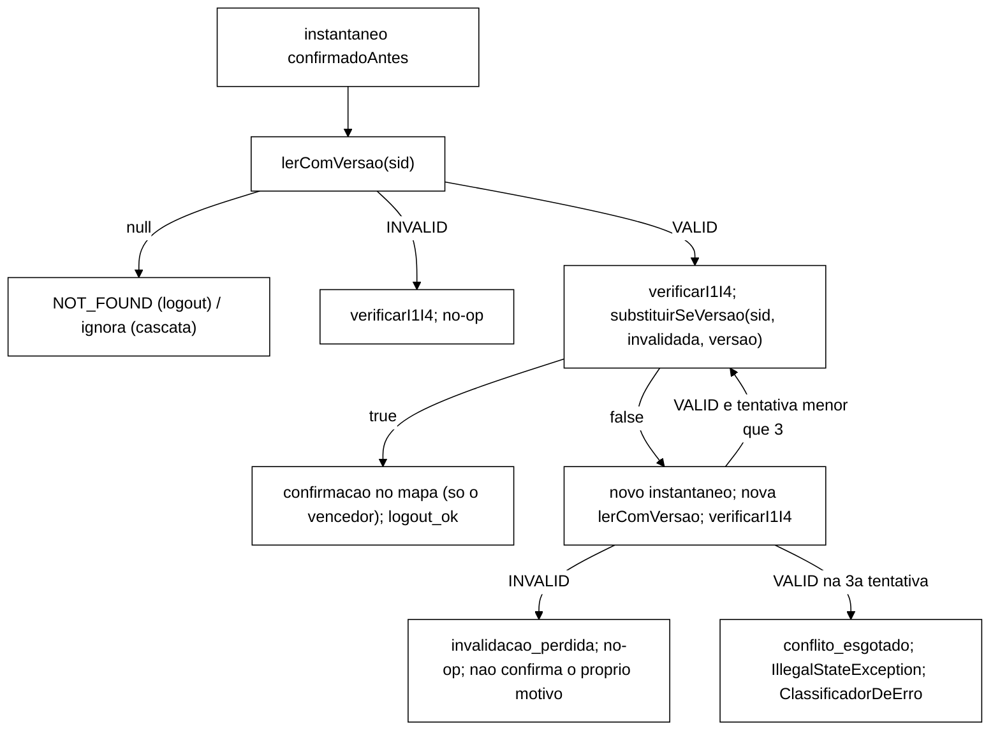
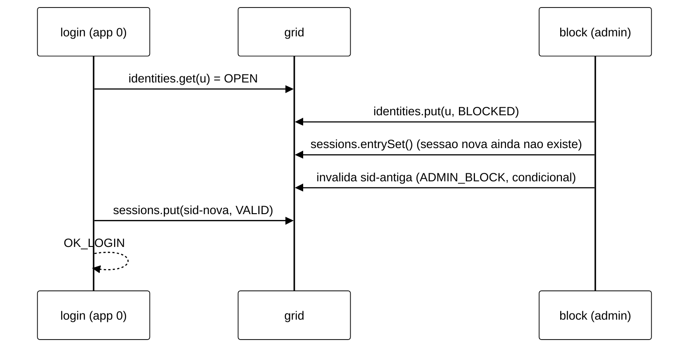

# Relatório B-43.8: invalidação condicional por versão (2026-10-22)

> Worker, 2026-10-22. Branch `fix/b43-8-invalidacao-condicional` (worktree `wt-b43-8`), a partir de
> `e599818` (ponta de `feature/controlador-integracao`, com B-43.6, B-43.4 e B-43.7). Especificação:
> seção 2 de `wt-plano-ctrl/docs/validacao-b43-6-adendo-b43-8-b43-9-2026-10-22.md`, DT-003 e DT-004 de
> `wt-plano-ctrl/docs/decisoes-tecnicas.md`, e o despacho do Gestor (base atualizada, smoke v3 de 120 s
> e de 600 s, diagnóstico do TOCTOU com números). Commits só locais. **Nenhum push, nada integrado.**
>
> **Smoke local: as latências NÃO são evidência. O smoke prova a invalidação condicional e é a
> primeira execução real do S3. Não é a T-F.**

## 1. Resultado

- `logout` e a cascata de `block` passam a invalidar com leitura versionada (`getWithMetadata`) e
  escrita condicional (`replaceWithVersion`) sempre que o armazém de sessões é um
  `ArmazemVersionado`. Em produção ele é sempre versionado (os dois construtores com
  `RemoteCacheManager`). A primeira invalidação vence. Quem perde a versão relê, encontra INVALID e vira
  no-op (`invalidacao_perdida`). Com VALID persistente e a versão mudando, são 3 tentativas no total e
  depois erro (`conflito_esgotado`). A confirmação no mapa do auditor só é escrita pelo vencedor, depois
  da escrita reconhecida, na mesma ordem de B-43.6.
- O caminho comum (`Armazem`, usado pelos testes antigos via `FakeCaches`) ficou com o comportamento de
  B-43.6, sem mudança de texto.
- Surefire: **675/0/0/1 → 697/0/0/1** (89 → 95 arquivos `TEST-*.xml`). Só um teste existente foi
  editado: `AuditorDiagnosticoS3Test`, nos três casos D1..D3 autorizados (DT-003), com o diff na
  seção 5.
- Mutantes: Y1..Y8 (Y6 nas duas formas) e E1/E2 da V-B43.6, **11 de 11 mortos**. E1 e E2 morrem pelo
  W1 (`OrdemConfirmacaoTest`), não só pelo diagnóstico (seção 6).
- Smoke (cluster Podman local `b438`, 5 execuções, todas com exit 0). Nas S1 v3 (P1 120 s sync, P2
  120 s async, P5 600 s sync), todas as tolerâncias de DT-004 e os C4..C9 do B-43.7 foram atendidos,
  com `invalidacao_perdida = conflito_esgotado = 0`. Nas S3 (P3 sync, P4 async, 300 s, `--sweep`), as
  primeiras execuções reais do S3, deu I1 = I4 = 0 inline e na varredura, `conflito_esgotado = 0` e
  `invalidacao_perdida = 0` (seção 7).
- Diagnóstico do TOCTOU `login` × `block`: o roteiro com latch deixa uma sessão VALID permanente sob
  identidade BLOCKED, e cada `validate` posterior gera uma I2 que o rastro classifica **REAL**. No smoke
  S3 não houve nenhuma sobreposição Login × Block da mesma identidade, e a exposição esperada medida é de
  cerca de 0,002 por execução de 300 s. A dupla checagem está proposta e **não foi implementada**
  (seção 8).
- Achado novo para o Gestor: o servidor registra `ISPN006010` ("conditional operation
  REPLACE_IF_UNMODIFIED should be used with transactional caches, otherwise data inconsistency issues
  could arise under failure situations"), uma vez por nó (seção 10, ponto 1).

## 2. Commits e Surefire por commit

`mvn -o -f workload/pom.xml clean test`, somando os `TEST-*.xml` (testes/falhas/erros/ignorados). O
"antes" de cada commit é o "depois" do anterior. A base foi medida antes de começar.

| Commit | Tipo | Conteúdo | Vermelho registrado | Surefire antes → depois | Arquivos |
|---|---|---|---|---|---|
| `e599818` | base | ponta de `feature/controlador-integracao` | n/a | **675/0/0/1** | 89 |
| `02e5f06` | `feat:` | `ArmazemVersionado` (interface e adaptador Hot Rod), duble `FakeVersionado` | compilação (interface ausente) | 675/0/0/1 → 678/0/0/1 | 90 |
| `00aef96` | `feat:` | `logout` versionado; contadores `invalidacaoPerdida`/`conflitoEsgotado` | 8 testes, 5 falhas (caminho versionado desligado) | 678/0/0/1 → 686/0/0/1 | 92 |
| `be07809` | `feat:` | cascata de `block` versionada | 18 testes, 6 falhas | 686/0/0/1 → 693/0/0/1 | 93 |
| `41e4ac0` | `test:` | reescrita de D1..D3 (autorizada, DT-003) e fixture `MundoS3Versionado` | 5 testes, 3 falhas (caminho versionado desligado) | 693/0/0/1 → 693/0/0/1 | 93 |
| `019fd20` | `feat:` | produção com `ArmazemVersionado.de`; linha `Invalidacao:` | 3 testes, 2 falhas | 693/0/0/1 → 696/0/0/1 | 94 |
| `4c29da0` | `test:` | W8, TOCTOU (comportamento atual) | não se aplica (documenta o atual) | 696/0/0/1 → 697/0/0/1 | 95 |
| `a210482` | `test:` | teto de segurança no `FakeVersionado` (Y6 sem trava do fork) | não se aplica | 697/0/0/1 → 697/0/0/1 | 95 |
| `8bcf50c` | `test:` | brutos do smoke (`runs/b43-8-smoke/`) | n/a | 697/0/0/1 (sem código) | 95 |
| (este) | `docs:` | este relatório | n/a | 697/0/0/1 (medido de novo na ponta `8bcf50c`) | 95 |

O vermelho de `be07809` foi medido rodando os testes novos sobre o código de `00aef96`, antes de
implementar a cascata. Os de `00aef96` e `41e4ac0` foram medidos com os testes finais sobre o código do
commit com o ramo versionado desligado por uma troca temporária de uma linha, sem versionar. Em
`00aef96` a troca foi `if (sessoesVersionadas != null)` → `if (false && ...)`, e em `41e4ac0` foi
`sessoesVersionadas = null`. É o comportamento de B-43.6 com os acessores novos presentes (desvio D4).
Logs em `scratchpad/b438/c*-vermelho.log`.

## 3. Arquivo:linha, antes e depois

| O quê | Antes (`e599818`) | Depois (`8bcf50c`) |
|---|---|---|
| Construtor de produção S1/S2 | `SessionOps.java:157` `Armazem.de(rcm.<String, SessionState>getCache(perfil.cacheSessoes()))` | `SessionOps.java:198` `ArmazemVersionado.de(...)` |
| Construtor de produção S3 | `SessionOps.java:210` `Armazem.de(...)` | `SessionOps.java:252` `ArmazemVersionado.de(...)` |
| Detecção do caminho | não havia | `SessionOps.java:233` `sessoesVersionadas = sessions instanceof ArmazemVersionado<SessionState> v ? v : null` |
| `logout` | `SessionOps.java:369..415`, `get` + `put` sem condição | `SessionOps.java:411..415` desvia para `logoutVersionado` (`:472`); o corpo antigo fica inalterado logo abaixo |
| Escrita condicional e confirmação | não havia | `invalidarCondicional`, `SessionOps.java:508`; confirmação só do vencedor em `:514` |
| Cascata de `block` | `SessionOps.java:529..541`, `forEach` com `put` | `SessionOps.java:646` (ramo versionado, seleção na varredura) e `invalidarPorBloqueio` (`:689`); o ramo comum fica inalterado (sem reindentar) |
| Tentativas | não havia | `SessionOps.java:100` `TENTATIVAS_CONDICIONAIS = 3` |
| Linha do stdout | não havia | `SessionOps.java:138` `linhaInvalidacao`; `WorkloadMain.java:427` |
| Interface nova | não havia | `ArmazemVersionado.java` (50 linhas) |

`Armazem`, `OpResult`, `FakeCaches`, `KeyGenerator`, `Scenario`, a mistura v3 (`MisturaV3`,
`SlotsGeracao`, `CargaSlots`, `logoutV3`), `MundoS3`, o golden, `scripts/`, `analysis/`, `spec/`,
`cluster/` e `tcc-escrita/` não mudaram (`git diff --stat e599818 HEAD` vazio para eles).



A semântica do Logout isolado da v3 (B-43.7) ficou como estava. O `logoutV3` chama `ops.logout` sob a
trava da faixa. Um Logout em `ERROR_*` (inclusive o de conflito esgotado, que o `ClassificadorDeErro`
classifica como `ERROR_TRANSPORT`) não faz reposição nem avanço. Os demais fazem a reposição
(`reporSessao`, um `put` incondicional de chave nova, fora do CSV), e a geração só avança se a
reposição foi reconhecida.

## 4. Testes novos

| ID | Arquivo (novo) | O que trava |
|---|---|---|
| W1 | `OrdemConfirmacaoTest` (4) | pausa ANTES de aplicar a escrita (latch), para `logout` e cascata, no caminho versionado (`substituirSeVersao`) e no comum (`put`). Durante a pausa, (a) o mapa não tem a confirmação e (b) um `validate` de outra thread lê VALID sem I1/I4 (na cascata, a I2 da janela D4b é esperada e não é checada aqui) |
| W2 | `AuditorDiagnosticoS3Test.blockPerdeParaLogoutAnterior` (D1 reescrito) | final LOGOUT, mapa LOGOUT, 0 violações, `admin.invalidacaoPerdida == 1`, varredura sem I4 |
| W3 | `AuditorDiagnosticoS3Test.logoutPerdeParaBlockAnterior` (D2 reescrito) | final ADMIN_BLOCK, mapa ADMIN_BLOCK, identidade BLOCKED, `invalidacaoPerdida == 1`, varredura sem I4 |
| W4 | `AuditorDiagnosticoS3Test.leituraNaJanelaDoVencedorNaoVeI4` (D3 reescrito) | leitura de outro servidor entre a escrita condicional do vencedor (o `block`) e a confirmação dele: 0 I4, 0 corridas |
| W5 | `LogoutCondicionalTest.conflitoEsgotado`, `conflitoUmaVez`; `CascataCondicionalTest.conflitoEsgotadoNaCascata` | 3 tentativas, `conflitoEsgotado == 1`, código do `ClassificadorDeErro` para `IllegalStateException`, nada no mapa, `logout_noop` como hoje; com 1 conflito só, a 2ª tentativa escreve |
| W6 | `ArmazemVersionadoTest.adaptadorUsaHotRodVersionado`, `InvalidacaoProducaoTest.producaoUsaVersionado` | fonte sem comentários (`DetectorFonte`): adaptador com `getWithMetadata`/`replaceWithVersion`; 2 construtores com `ArmazemVersionado.de(`, nenhum `Armazem.de(` para sessões |
| W7 | `LogoutCondicionalTest.controlePositivo`; `CascataCondicionalTest.controlePositivo`, `controlePositivoI4` | leitura velha iniciada depois da confirmação continua dando I1 e I4 no caminho versionado |
| W8 | `ToctouLoginBlockTest` | TOCTOU, comportamento atual (seção 8) |
| W9 | todos os existentes | verdes sem edição, exceto D1..D3; golden intacto |
| extra | `LogoutCondicionalTest.logoutSimples`, `ausenteEJaInvalida`, `logoutPerdeParaOutroLogout`; `CascataCondicionalTest.cascataSimples`, `corridaNaCascata`; `InvalidacaoProducaoTest.linhaInvalidacao`, `workloadMainImprime`; `ArmazemVersionadoTest` (contrato do duble) | caminho feliz; corrida Y8 na cascata; formato e posição da linha `Invalidacao:` |

Apoio de teste (novos): `FakeVersionado` (versão por escrita, ganchos `antes`/`depois`, teto de 50
tentativas), `MundoS3Versionado` (três servidores e admin sobre o mesmo grid versionado, mapa, auditor e
rastro) e `Concorrencia`.

## 5. Diff dos três testes reescritos (`41e4ac0`)

Só os métodos D1..D3, o trecho do javadoc da classe que os descrevia e dois `import` que deixaram de
ser usados (`Map`, `Set`). D4a/D4b, `mundo()` e os auxiliares ficaram como estavam. O auxiliar privado
`concorrentesI1` deixou de ser usado e não foi removido (desvio D7).

```diff
-    @DisplayName("D1: block le VALID, logout confirma LOGOUT, block grava ADMIN_BLOCK => LOGOUT perdido, sem I4")
-    void blockVenceLogout() {
-        MundoS3 w = mundo();
-        w.sessoes.antes = umaVez(Thread.currentThread(), "put", SID, () -> emOutraThread(() -> w.apps.get(0).logout(SID)));
+    @DisplayName("D1 (B-43.8): block le VALID, logout completo invalida, block perde a versao => LOGOUT mantido, no-op")
+    void blockPerdeParaLogoutAnterior() {
+        MundoS3Versionado w = mundoVersionado();
+        w.sessoes.antes = umaVez(Thread.currentThread(), "substituirSeVersao", SID,
+                () -> emOutraThread(() -> w.apps.get(0).logout(SID)));
         w.admin.block(U);
         w.apps.get(1).validate(SID);
         w.apps.get(2).logout(SID);
-        assertEquals(SessionState.Motivo.ADMIN_BLOCK, w.sessoes.dados.get(SID).motivo(), "o block venceu");
-        assertEquals(SessionState.Motivo.ADMIN_BLOCK, w.invalidacoes.get(SID), "a confirmacao LOGOUT foi sobrescrita");
-        assertEquals(List.of(), invariantes(w.auditor), "a mudanca de motivo nao aparece como I4");
-        assertEquals(0, concorrentesI1(w));
+        assertEquals(SessionState.Motivo.LOGOUT, w.sessoes.valor(SID).motivo(), "o primeiro invalidador venceu");
+        assertEquals(SessionState.Motivo.LOGOUT, w.invalidacoes.get(SID), "o perdedor nao escreveu no mapa");
+        assertEquals(IdentityState.Status.BLOCKED, w.identidades.dados.get(U).status());
+        assertEquals(List.of(), invariantes(w.auditor));
+        assertEquals(1, w.admin.invalidacaoPerdida(), "o block perdeu a versao e releu INVALID(LOGOUT)");
+        assertEquals(1, w.invalidacaoPerdida());
+        assertEquals(0, w.concorrentes());
         (varredura final sem I4: mantida, agora sobre w.sessoes.copia())

-    @DisplayName("D2: logout le VALID, block confirma ADMIN_BLOCK, logout grava LOGOUT => ADMIN_BLOCK perdido, sem I4")
-    void logoutVenceBlock() {
-        MundoS3 w = mundo();
-        w.sessoes.antes = umaVez(Thread.currentThread(), "put", SID, () -> emOutraThread(() -> w.admin.block(U)));
-        w.apps.get(0).logout(SID);
+    @DisplayName("D2 (B-43.8): logout le VALID, block completo invalida, logout perde a versao => ADMIN_BLOCK mantido")
+    void logoutPerdeParaBlockAnterior() {
+        MundoS3Versionado w = mundoVersionado();
+        w.sessoes.antes = umaVez(Thread.currentThread(), "substituirSeVersao", SID,
+                () -> emOutraThread(() -> w.admin.block(U)));
+        OpResult r = w.apps.get(0).logout(SID);
         w.apps.get(1).validate(SID);
-        assertEquals(SessionState.Motivo.LOGOUT, w.sessoes.dados.get(SID).motivo(), "o logout venceu");
-        assertEquals(SessionState.Motivo.LOGOUT, w.invalidacoes.get(SID), "a confirmacao ADMIN_BLOCK foi sobrescrita");
+        assertEquals(OpResult.Code.OK_NOOP, r.code());
+        assertEquals(SessionState.Motivo.ADMIN_BLOCK, w.sessoes.valor(SID).motivo(), "o primeiro invalidador venceu");
+        assertEquals(SessionState.Motivo.ADMIN_BLOCK, w.invalidacoes.get(SID), "o perdedor nao escreveu no mapa");
         assertEquals(IdentityState.Status.BLOCKED, w.identidades.dados.get(U).status());
         assertEquals(List.of(), invariantes(w.auditor));
-        assertEquals(0, concorrentesI1(w));
+        assertEquals(1, w.apps.get(0).invalidacaoPerdida());
+        assertEquals(1, w.invalidacaoPerdida());
+        assertEquals(0, w.concorrentes());
+        (varredura final sem I4: nova)

-    @DisplayName("D3: leitura na janela entre o sessions.put e a confirmacao do vencedor => I4 (unico ponto em que aparece)")
-    void leituraNaJanelaDoVencedorVeI4() {
-        (Armazem anonimo com gancho antes/depois do put; app extra; logout)
-        assertEquals(List.of("I4:" + SID), invariantes(w.auditor), "unico ponto em que a I4 aparece");
-        assertEquals(SessionState.Motivo.LOGOUT, w.sessoes.dados.get(SID).motivo());
-        assertEquals(SessionState.Motivo.LOGOUT, w.invalidacoes.get(SID));
+    @DisplayName("D3 (B-43.8): leitura de outro servidor entre a escrita e a confirmacao do vencedor nao ve motivo divergente")
+    void leituraNaJanelaDoVencedorNaoVeI4() {
+        (gancho antes da substituirSeVersao do logout roda o block inteiro; gancho depois da
+         substituirSeVersao do block, antes da confirmacao dele, roda um validate de outro servidor)
+        assertTrue(lido[0], "a leitura na janela do vencedor aconteceu");
+        assertEquals(List.of(), invariantes(w.auditor), "sem I4: o motivo lido e o do vencedor");
+        assertEquals(SessionState.Motivo.ADMIN_BLOCK, w.sessoes.valor(SID).motivo());
+        assertEquals(SessionState.Motivo.ADMIN_BLOCK, w.invalidacoes.get(SID));
+        assertEquals(1, w.apps.get(0).invalidacaoPerdida());
+        assertEquals(0, w.concorrentes());
         w.apps.get(2).validate(SID);
         assertEquals(0, w.auditor.total());
```

O diff completo (167 linhas) é `git show 41e4ac0 -- workload/src/test/java/br/unipampa/tcc/session/AuditorDiagnosticoS3Test.java`.
Os três testes rodam sobre o `MundoS3Versionado` porque o `MundoS3` monta o caminho comum, e
reescrever o `MundoS3` mudaria os outros testes do S3.

## 6. Mutantes

Script `scratchpad/b438/mutantes.py`. Cada mutante exige o número exato de ocorrências do trecho,
roda o Surefire completo (`-Dsurefire.timeout=240`) e restaura o fonte no fim. Base `4c29da0`/`a210482`.

| ID | Mutação | Resultado | Quem mata |
|---|---|---|---|
| Y1 | `substituirSeVersao` trocado por `put` incondicional | morto, 697/13 | W2, W3, W4, W1 versionado (2), W5 (2), `logoutPerdeParaOutroLogout`, `logoutSimples`, `cascataSimples`, `corridaNaCascata`, `linhaInvalidacao` |
| Y2 | confirmação ANTES da escrita no `logout` versionado | morto, 697/5 | **W1 `logoutVersionado`**, W3, W4, W5 `conflitoEsgotado`, `logoutPerdeParaOutroLogout` |
| Y3 | o mesmo na cascata | morto, 697/4 | **W1 `blockVersionado`**, W2, `conflitoEsgotadoNaCascata`, `corridaNaCascata` |
| Y4 | o perdedor também confirma o próprio motivo | morto, 697/4 | W2, W3, W4 (asserção do mapa), `corridaNaCascata` |
| Y5 | sem releitura depois do conflito (perdedor devolve `logout_ok`) | morto, 697/9 | W2, W3, W4, W5 (3), `logoutPerdeParaOutroLogout`, `corridaNaCascata`, `linhaInvalidacao` |
| Y6a | tentativas ilimitadas | morto, 697/3 | W5 `conflitoEsgotado`, `conflitoEsgotadoNaCascata`, `linhaInvalidacao` |
| Y6b | 1 tentativa em vez de 3 | morto, 697/3 | W5 `conflitoEsgotado`, `conflitoUmaVez`, `conflitoEsgotadoNaCascata` |
| Y7 | produção com `Armazem.de` comum (os 2 construtores) | morto, 697/1 | W6 `producaoUsaVersionado` |
| Y8 | instantâneo por entrada da cascata DEPOIS da `lerComVersao` | morto, 697/1 | `CascataCondicionalTest.corridaNaCascata` (caso de corrida na cascata) |
| E1 | caminho comum: confirmação antes do `put` no `logout` | morto, 697/2 | **W1 `logoutComum`**, `MisturaV3ConcorrenciaTest.estocastico` |
| E2 | o mesmo na cascata comum | morto, 697/2 | **W1 `blockComum`**, `AuditorDiagnosticoS3Test.i2DentroDaCascata` |

- **Y6a, primeira rodada.** Antes do `a210482`, o Y6a deixava a thread girando depois do
  `assertTimeoutPreemptively`, e o fork do Surefire travou (morto à mão, 434 testes com 1 falha). O
  teto de 50 tentativas no duble faz o mutante falhar rápido. A linha acima é a rodada depois do teto.
- **E1/E2.** Agora morrem pelo W1, independentemente do diagnóstico A7, como a V-B43.6 pediu.

## 7. Smoke local

### 7.1 Ambiente

- Podman 5.7.0 (máquina WSL `podman-machine-default`) e podman-compose 1.5.0. Imagem
  `quay.io/infinispan/server:15.0.21.Final`, 3 nós com o `infinispan-cluster.xml` e o `jgroups-tcp.xml`
  da base (idênticos aos do B-43.7), copiados em `runs/b43-8-smoke/cluster/`.
- Projeto `podman-compose -p b438`, containers `b438-isn1..3`, portas 12362..12364 (com
  `external-port` igual), rede `b438_infinispan-net`. O compose versionado não mudou.
- JDK 22.0.2 por `$JAVA_HOME/bin/java`. Sem VM.
- Jar construído em `a210482` com a árvore limpa: SHA-256 `d99eeabf…4627a006` (`jars.json`).
- **Estado do Podman.** A máquina estava parada antes. Foi iniciada, e depois do `down` foi parada de
  novo. `podman ps -a` antes e depois ficaram idênticos (11 containers de outros projetos, nenhum
  rodando). `podman network ls` também ficou idêntico, com a `b438_infinispan-net` removida.
- Saúde antes e depois: `HEALTHY`, 3 nós, todos os caches `HEALTHY` nas 3 portas.
- Logs dos servidores: **0** linhas ` ERROR `. WARN por nó: `ISPN012026` (388 a 389, endpoint REST
  obsoleto do healthcheck), `ISPN000599` (4), `ISPN080059`/`ISPN080072` (1 + 1), como no B-43.7, e
  **`ISPN006010` (1, novo)**, emitido às 22:59:11Z, logo na primeira escrita condicional de P1 (seção
  10, ponto 1).
- Ordem: P1, P2, P3, P4, P5, no mesmo cluster. P1/P2 com `--mix v3 --reset-state on --threads 4
  --duration 120 --warmup-min-sec 10`. P5 com `--duration 600` e o warm-up padrão (como o L1 do
  B-43.7). P3/P4 com `--scenario S3 --sweep --duration 300` e os padrões de B-33 (20 usuários, 10
  contas de limite, 1 admin, `pinned`, `admin-node isn1`, warm-up até +60 s, medição a partir de
  +72 s).

### 7.2 S1 v3 (P1, P2, P5): tolerâncias de DT-004

Fração = INVALID / Validate isolados (chave `sid-`) no CSV de contrato v2, na janela de medição.

| Exec. | Cenário | Validate isolados | INVALID | Fração (C2 em [4,5; 6,5] %) | Terços 1º / 2º / 3º (%) | dif. 1º−3º (≤ 1,0 p.p.) | Décimos máx−mín (≤ 2,0 p.p.) | `token_antigo` (5,00 ± 0,10 %) |
|---|---|---|---|---|---|---|---|---|
| P1 | S1 sync 120 s | 270 782 | 14 214 | **5,249 %** | 5,248 / 5,244 / 5,255 | 0,007 | n/a | 5,0007 % |
| P2 | S1 async 120 s | 338 185 | 17 571 | **5,196 %** | 5,213 / 5,174 / 5,200 | 0,014 | n/a | 5,0002 % |
| P5 | S1 sync 600 s | 1 323 706 | 69 342 | **5,239 %** | 5,232 / 5,233 / 5,251 | 0,019 | **0,048** | 5,0000 % |

Décimos de P5 (%): 5,243 · 5,243 · 5,213 · 5,219 · 5,237 · 5,236 · 5,238 · 5,253 · 5,241 · 5,262
(de 121 041 a 136 078 Validate isolados por décimo).

| Exec. | `logout_isolados` = `reposicoes` | `reposicao_erro` | `logout_noop` n (janela) | NOT_FOUND Logout isolado / Validate | I1 / I4 | `Auditor:` | `Invalidacao:` | C4 (2 × logins OK) | C7 verificador | C8 carga | exit |
|---|---|---|---|---|---|---|---|---|---|---|---|
| P1 | 54 293 = 54 293 (CSV 54 293) | 0 | 0 | 0 / 0 | 0 / 0 | i1_conc = 133, i4_conc = 0 | perdida = 0, esgotado = 0 | 310 210 = 310 210 | exit 0, OK | 200 000, 1719 ms | 0 |
| P2 | 67 951 = 67 951 (CSV 67 951) | 0 | 0 | 0 / 0 | 0 / 0 | 320 / 0 | 0 / 0 | 393 212 = 393 212 | exit 0, OK | 200 000, 1773 ms | 0 |
| P5 | 264 645 = 264 645 (CSV 264 645) | 0 | 0 | 0 / 0 | 0 / 0 | 651 / 0 | 0 / 0 | 1 555 430 = 1 555 430 | exit 0, OK | 200 000, 1237 ms | 0 |

- `reposicao_omitida` = 0 nas três. O stdout e o CSV dão a mesma contagem (diferença 0) de Validate
  isolados e de Logout isolados.
- O `LeitorCsvEventos` leu os 5 CSV inteiros com status OK e 0 erros: 811 726, 1 016 001, 3 975 138,
  3 075 e 3 022 eventos, iguais a `registrados` (`leitor-csv-eventos.json`).
- `invalidacao_perdida = conflito_esgotado = 0`, como esperado. A trava de faixa da v3 serializa os
  Logouts do mesmo slot, e o Logout da tríade usa uma sessão nova e exclusiva.
- Os `i1_concorrentes` (133, 320 e 651) são diagnóstico do observador (DT-001), da mesma ordem do
  B-43.7 (127, 361 e 765).

### 7.3 Custo da escrita condicional no Logout (documental, não é critério)

Comparação com o smoke do B-43.7 nas mesmas condições (Q1 com P1, Q3 com P2, L1 com P5). "stdout" é o
histograma `logout_ok`, que soma Logout isolado e o da tríade. "CSV" é `end_ns − start_ns` só dos
Logouts isolados.

| Par | stdout p50 (µs) B-43.7 → B-43.8 | stdout p99 (µs) | CSV isolado p50 (µs) | CSV isolado p99 (µs) |
|---|---|---|---|---|
| Q1 → P1 (sync 120 s) | 521,7 → 525,3 (+0,7 %) | 917,5 → 927,2 (+1,1 %) | 526,1 → 529,0 (+0,6 %) | 937,0 → 930,6 (−0,7 %) |
| Q3 → P2 (async 120 s) | 379,9 → 369,7 (−2,7 %) | 717,3 → 669,7 (−6,6 %) | 382,6 → 372,3 (−2,7 %) | 720,0 → 673,9 (−6,4 %) |
| L1 → P5 (sync 600 s) | 528,4 → 530,9 (+0,5 %) | 972,3 → 981,5 (+0,9 %) | 533,3 → 535,4 (+0,4 %) | 983,8 → 983,7 (0,0 %) |

A diferença fica dentro do ruído do host, nos dois sentidos. Isso é coerente com o desenho: o Logout
continua fazendo duas idas ao servidor (`getWithMetadata` + `replaceWithVersion` no lugar de `get` +
`put`). Volto a frisar que é um smoke local, sem nenhum valor como medida de latência.

### 7.4 S3 (P3 sync, P4 async): primeiras execuções reais

| | P3 S3 sync | P4 S3 async |
|---|---|---|
| exit | 0 | 0 |
| Ações S3 (stdout, execução inteira) | Login OK 136, Login BLOCKED 57, Validate VALID 3120 / INVALID 403, Logout 89, Block 8, Unblock 38, IncrementFailure 270, ResetFailures 41 | Login OK 134, BLOCKED 60, Validate 3093 / 383, Logout 82, Block 8, Unblock 38, IncrementFailure 271, ResetFailures 41 |
| Eventos S3 | AbandonoSilencioso 32, SessaoOrfa 32, **SessaoEncerradaNoServidor 4** | 36, 36, **6** |
| CSV (janela) | 3 075 eventos; Block 6, Logout 66, Login OK 96 | 3 022; Block 6, Logout 60, Login OK 93 |
| Violações (`violacoes-rep-001.csv`) | **0** (só cabeçalho) | **0** |
| `Auditor:` | i1_conc = 0, i4_conc = 0 | 0 / 0 |
| `Invalidacao:` | perdida = 0, conflito_esgotado = 0 | 0 / 0 |
| Varredura final (`--sweep`) | sessões 136, identidades 30, **achados 0**; BLOCKED por motivo: POR_LIMITE 7, ADMINISTRATIVO 0 | sessões 134, identidades 30, **achados 0**; POR_LIMITE 7 |
| Critérios (I4 = 0 inline e varredura; `conflito_esgotado` = 0; I1 = 0 em SYNC) | atendidos | atendidos (I1/I2 em ASYNC: 0, só registro) |

- `SessaoEncerradaNoServidor` conta os `validate` de um usuário que encontraram a própria sessão
  INVALID. No S3 só a cascata do `block` produz isso. Logo, a cascata versionada invalidou sessões
  reais no cluster (4 em P3, 6 em P4) e essas invalidações foram vistas pelos donos.
- `invalidacao_perdida = 0`: o caminho do perdedor não foi exercido no cluster real. Com 6 Blocks na
  janela e Logouts espaçados de segundos, a corrida `logout` × `block` na mesma sessão é rara. Esse
  caminho fica coberto pelos testes (W2..W4) e pelos mutantes Y1/Y4/Y5.
- ADMINISTRATIVO = 0 na varredura porque todo Block da execução teve Unblock depois
  (`--s3-admin-hold-*`). As 7 identidades BLOCKED no fim são contas de limite.

### 7.5 Brutos

`runs/b43-8-smoke/` com `MANIFEST.sha256`: 76 arquivos, e `sha256sum -c` dá 0 falhas (conferido na
worktree, antes do commit). Ficam versionados os JSON (carga, estado, meta, sanidade, saúde, resumo S3,
leitor, `analise.json`, `jars.json`), o compose e os XML do cluster, `analise.py` e `LerCsvV2.java`.
CSV, `stdout.log`/`stderr.log`, logs dos servidores e `.txt` (exits, tempos, `podman ps -a`/`network
ls` antes e depois, o roteiro `smoke.sh.txt`) ficam fora do git pelo `.gitignore` e são conferidos
pelo manifesto. São cerca de 549 MB. `analise.py` foi adaptado de `runs/b43-7-smoke/analise.py` e lê o
smoke do B-43.7 (worktree `wt-b43-7`) só para a tabela de latência.

## 8. Diagnóstico TOCTOU `login` × `block` (sem correção)

### 8.1 O roteiro (W8, `ToctouLoginBlockTest`)



Estado final medido no teste:

- o `login` devolve `OK_LOGIN` com a identidade já BLOCKED;
- `sid-nova` fica VALID sob identidade BLOCKED, de forma **permanente**. Nada no workload volta a
  invalidá-la, a não ser um `logout` explícito do usuário. A cascata invalidou `sid-antiga`, que já
  estava gravada;
- o `login` em si não gera violação;
- **cada** `validate` posterior de `sid-nova` gera uma I2 inline ("valida sob bloqueio"), e o rastro
  (`classificarViolacaoI2`) classifica todas como **REAL**, porque o último evento administrativo
  confirmado é Block e o bloqueio é ADMINISTRATIVO;
- a varredura final (`VarreduraFinal.varrer`) acusa 1 I2 REAL para `sid-nova`.

Com isso, um único TOCTOU vira uma rajada de I2 REAL no `S_viol`, uma por `validate` do dono da sessão.
Com os padrões do S3 (`--s3-think-ms 1000` e sessão com mediana de 20 s), a estimativa é de cerca de
20 I2 inline e mais 1 na varredura (estimativa, não medida). E nenhuma delas é anomalia do grid.

### 8.2 Números do smoke

`analise.json`, campos `toctou` e `toctou_exposicao`, na janela de medição do CSV (cerca de 225 s):

| | P3 sync | P4 async |
|---|---|---|
| Blocks (janela) / identidades com Block | 6 / 5 | 6 / 5 |
| Logins OK (janela) / de identidades com Block | 96 / 24 | 93 / 24 |
| Duração média do Block / p50 / máx. | 12,8 ms / 11,0 ms / 21,9 ms | 12,0 ms / 11,0 ms / 17,8 ms |
| Duração média do Login OK / p50 / máx. | 1,74 ms / 1,67 ms / 4,10 ms | 1,31 ms / 1,28 ms / 4,34 ms |
| Pares Login OK × Block da mesma identidade | 31 | 30 |
| **Login sobreposto a Block da mesma identidade (condição necessária)** | **0** | **0** |
| Sobreposições esperadas, Σ n_login·n_block·(d̄_block + d̄_login)/T | **0,0020** | **0,0018** |
| I2 inline / I2 na varredura | 0 / 0 | 0 / 0 |

A sobreposição dos intervalos [start, end] do Login e do Block da mesma identidade é condição
necessária, mas não suficiente. O TOCTOU exige ainda que o `identities.get` do login caia antes do
`identities.put(BLOCKED)` e que o `sessions.put` caia depois da varredura. Então 0,002 por execução de
300 s é um teto. Nesse ritmo, seria preciso algo como 500 execuções locais para esperar um caso.

A exposição cresce linearmente com a duração das duas operações, e a T-F vai alongá-las:

- a cascata faz `entrySet` remoto mais duas idas por candidata;
- o login faz duas ou três idas;
- com 100 ms de RTT injetado (F3, netem), um Block de cerca de 0,5 s e um Login de cerca de 0,3 s dão
  uma exposição perto de 60 vezes maior, por volta de 0,1 por execução, antes de qualquer aumento de
  `--s3-users`.

Somada à rajada de I2 REAL por ocorrência (8.1), a contaminação esperada de `S_viol` na T-F é pequena
em média, mas tem cauda pesada. Uma única ocorrência dispara R1 do controlador por um defeito da
aplicação. Esse número é estimativa, não medida, e os parâmetros da T-F ainda não foram pré-registrados.

### 8.3 Correção proposta (para o B-43.9; NÃO implementada)

Dupla checagem no `login`. Depois do `sessions.put(sid, VALID)` reconhecido, o login relê a identidade.
Se ela estiver BLOCKED, invalida a própria sessão com ADMIN_BLOCK pela escrita condicional deste bloco
(`invalidarCondicional`, que também resolve a corrida com uma cascata que já tenha alcançado a sessão)
e devolve `BLOCKED`. Fica um contador `login_revertido_por_bloqueio`.

- **Por que fecha a janela.** Qualquer `block` cujo `identities.put(BLOCKED)` foi reconhecido antes da
  releitura é visto pela releitura. Se o `put` dele vier depois da releitura, então a varredura dele
  também vem depois do `sessions.put` do login (a varredura vem depois do `identities.put` no mesmo
  thread), e a cascata vê a sessão. Em SYNC isso não deixa sessão VALID sob BLOCKED depois de as duas
  operações terminarem. Em ASYNC a releitura pode ler uma réplica atrasada, e o que sobrar volta a ser
  medida do grid, que é o que H-A0 quer.
- **Custo.** Uma leitura de identidade a mais por Login OK, em todos os cenários. Em S1/S2 v3 o Login
  é de pool próprio e nunca é bloqueado, então a releitura nunca dispara a reversão, mas o custo existe:
  um `get` a mais por Login OK, e em P1 houve 155 105 Logins OK para 620 245 operações da mistura
  (25 %). Isso muda o Login medido, e por isso a decisão
  tem de vir antes do *rebaseline*, como no B-43.8 com o Logout.
- **Alternativa mais barata, só no S3.** Fazer a dupla checagem apenas nas instâncias de servidor de
  aplicação do S3. Não recomendo: o Login mediria coisas diferentes entre cenários.
- **Alternativa sem mudar a aplicação.** Classificar no rastro (B-43.9) as I2 de sessões criadas por
  Login sobreposto a um Block da mesma identidade como `I2_TOCTOU_APLICACAO`, fora de `S_viol`. É mais
  complexa e só esconde o defeito.

## 9. Desvios

- **D1, `mvn -o`.** Todas as rodadas com `-o` (offline), como em B-43.2 e B-43.6. Não muda o resultado.
- **D2, releitura depois da 3ª falha.** Depois de cada falha de versão, inclusive a 3ª, o código relê.
  Assim uma 3ª falha causada por outra invalidação vira `invalidacao_perdida` (no-op), e não erro. O
  `conflito_esgotado` fica só para VALID persistente. Por isso W5 conta 4 leituras versionadas (a
  inicial e uma por falha) para 3 tentativas.
- **D3, "nada escrito no mapa" pelo perdedor.** O perdedor não grava a confirmação do próprio motivo
  (Y4 morre). Mas a releitura dele passa por `verificarI1I4`, e quando o mapa ainda não tem confirmação
  (o vencedor está entre a escrita e a confirmação) ela faz o `putIfAbsent` do motivo lido, que é o do
  vencedor. É a "primeira observação" de B-43.6, a mesma que qualquer `validate` faz. Mantive assim
  porque é a regra do auditor e não muda o motivo confirmado.
- **D4, vermelho com o ramo desligado.** Os testes de `00aef96` e `41e4ac0` usam acessores
  novos. Para registrar o vermelho do comportamento antigo, rodei os testes finais com o ramo versionado
  desligado por uma troca temporária de uma linha, sem versionar (seção 2). A reescrita D1..D3 entrou
  depois dos `feat:` da lógica, com o vermelho medido dessa forma.
- **D5, duas checagens de I1 na cascata.** Pelo item 3 do desenho, o valor da varredura é checado contra
  a cópia do mapa e a `lerComVersao` por entrada é checada contra o instantâneo por entrada. Uma sessão
  velha (confirmação anterior ao `block` e leitura VALID) dá então **2** I1, uma por leitura
  (`CascataCondicionalTest.controlePositivo`). Antes dava 1 (ponto 3 da seção 10).
- **D6, primeira `lerComVersao` INVALID na cascata.** A candidata vista VALID na varredura e INVALID na
  leitura versionada vira no-op **sem** contar `invalidacao_perdida`, como no ramo 2b do `logout`. O
  contador só sobe depois de uma falha de versão (ponto 4 da seção 10).
- **D7, código não reindentado e auxiliar órfão.** O ramo comum da cascata ficou dentro de um `else`
  sem reindentar, para o diff provar que o texto não mudou. O auxiliar privado `concorrentesI1` de
  `AuditorDiagnosticoS3Test` ficou sem uso depois da reescrita e não foi removido, para não editar o
  arquivo além de D1..D3.
- **D8, P5 a mais.** O despacho pediu v3 S1 de 120 s e de 600 s. P1 (e P2) cobrem os 120 s, e P5 é o de
  600 s (sync, warm-up padrão, como o L1 do B-43.7).
- **D9, latência do B-43.7 lida da outra worktree.** `analise.py` recebe `wt-b43-7/runs/b43-7-smoke`
  como argumento para a tabela 7.3. Sem o argumento, a tabela sai `null` e os critérios não mudam.
- **D10, `MANIFEST.sha256` e fim de linha.** Os JSON versionados podem ganhar CRLF num checkout com
  `core.autocrlf=true`, e então o `sha256sum -c` falha para eles fora desta worktree. Isso também vale
  para o B-43.7. O manifesto é válido para os bytes desta worktree.
- **D11, documentação de integração.** `docs/implementacao.md`, `docs/testes.md` e
  `docs/configuracao-infinispan.md` não foram tocados, pela mesma regra do D13 de B-43.6: entram no
  commit `docs:` de integração.

## 10. Pontos para o Gestor

1. **`ISPN006010` no servidor.** O Infinispan avisa que `REPLACE_IF_UNMODIFIED` (o `replaceWithVersion`)
   em cache não transacional "pode gerar inconsistência sob falha". Em operação normal o smoke não
   mostrou nada, mas sob partição ou queda de nó (T-F) a garantia "a primeira invalidação vence" pode
   falhar no grid: por exemplo, a escrita condicional é aplicada no primário e se perde no *failover*,
   ou o *merge* escolhe outra versão. Leio isso como **medida legítima do grid**: uma I4 que aparecer na
   T-F depois do B-43.8 é do grid, e não da aplicação. Mas a Metodologia tem de registrar que os caches
   não são transacionais e que o *workload* usa escrita condicional sobre eles. Tornar os caches
   transacionais mudaria o sistema medido, e não recomendo. Peço a decisão.
2. **TOCTOU `login` × `block`** (seção 8): aprovar ou não a dupla checagem no B-43.9 (item 4 do prompt
   do B-43.9). Ela custa um `get` a mais por Login OK em todos os cenários e, portanto, tem de ser
   decidida antes do *rebaseline*. Exposição local medida: cerca de 0,002 por execução, mas cada
   ocorrência gera uma rajada de I2 REAL.
3. **Duas I1 por sessão velha na cascata** (D5): aceitar, ou checar só uma das duas leituras (a
   versionada, que é a que decide a escrita). Em SYNC não deve ocorrer. Em ASYNC isso dobra a I1 de
   cascata no `S_viol`.
4. **Contagem de `invalidacao_perdida` na cascata** (D6): incluir também a candidata VALID na varredura
   e INVALID na leitura versionada? É uma invalidação perdida para um concorrente, só que sem falha de
   versão. A escolha não afeta violações, só o contador de diagnóstico.
5. **Conflito esgotado aborta o `block`**: a exceção sai da cascata, o `block` termina em
   `ERROR_TRANSPORT` e a cascata fica parcial, como qualquer erro na cascata desde B-33. No smoke deu 0.
6. **O caminho do perdedor não ocorreu no cluster real** (`invalidacao_perdida = 0` em P3/P4). A prova
   dele é dos testes. Se o Gestor quiser exercitá-lo no cluster, basta um S3 com `--s3-admin-mean-sec`
   bem menor, como smoke extra, fora deste bloco.
7. **Rebaseline:** o Logout medido mudou de implementação, mas não de custo no smoke local (seção 7.3).
   DT-003 continua valendo: o *rebaseline* tem de rodar sobre o B-43.8.
8. **Integração e push:** nada foi integrado nem enviado. Os SHAs estão na seção 2.
