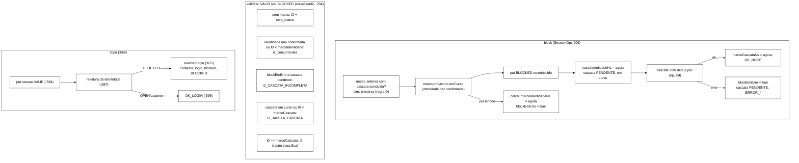

# Relatório B-43.9: I2 por marcos do bloqueio, dupla checagem no `login` e deduplicação I1/I4 (2026-10-23)

> Worker, 2026-10-23. Prompt: seção 4 de `wt-plano-ctrl/docs/prompt-b43-9-atualizado-2026-10-22.md`,
> com as decisões do Gestor de 22–23/10 no despacho. Base `5e1084f` (ponta de
> `feature/controlador-integracao`). Branch `fix/b43-9-i2-instantaneo`, worktree `wt-b43-9`. Commits só
> locais. **Nenhum push e nenhuma integração.**

## 1. Resultado

- As quatro regras estão implementadas, uma por commit `feat:`: A (I2 por marcos, DT-002), B (dupla
  checagem no `login`), C (no máximo uma I1 e uma I4 por operação e `sid`) e D (`block` em erro e
  `I2_CASCATA_INCOMPLETA`).
- Surefire: **713/0/0/1 na base, 738/0/0/1 na ponta** (98 → 102 arquivos, 25 testes novos). Todo
  commit compila. O vermelho de cada regra ficou versionado num commit `test:` próprio.
- Só as edições autorizadas em testes existentes: B9-E1..B9-E13 num `test:` próprio, e E11 com a
  linha 17 de `SlotsGeracao` num `docs:` próprio. Nenhum outro teste existente falhou em nenhum commit.
- K1..K21: **21 de 21 mutantes mortos**, com o Surefire completo por mutante e o fonte restaurado.
- *Smoke* local Q1..Q6: todos com exit 0 e `analise.py` com exit 0. Todos os critérios da seção 4 do
  prompt passaram, inclusive C3 pelo IC (DT-008), `sem_marco = 0` nas seis execuções e
  `ISPN006010` = 1 por nó. **Este é um *smoke* local, não é a T-F. As latências NÃO são
  evidência.**
- Houve desvios em relação ao texto do prompt. Os principais (D1, D2) são um marco provisório durante o
  `put(BLOCKED)` e um quarto campo no `MarcoBloqueio`. Estão na seção 8 e precisam de validação.

## 2. Commits e Surefire

Comando: `mvn -f workload/pom.xml clean test`, somando os `TEST-*.xml` (arquivos / testes / falhas /
erros / ignorados), medido com a árvore igual ao conteúdo de cada commit.

| # | SHA | Tipo | Conteúdo | Surefire |
|---|---|---|---|---|
| base | `5e1084f` | | `feature/controlador-integracao` | 98 / 713 / 0 / 0 / 1 |
| 1 | `35a1bca` | refactor | assinaturas novas com o comportamento antigo | 98 / 713 / 0 / 0 / 1 |
| 2 | `b21a3b6` | test | edições autorizadas B9-E1..B9-E13 | 98 / 713 / **2** / 0 / 1 |
| 3 | `3667e21` | test | regra A: `MundoMarcos`, `I2MarcosTest` (Z1..Z8) | 99 / 723 / 11 / 1 / 1 |
| 4 | `157bfc5` | test | regra B: `LoginDuplaChecagemTest` (Z10..Z13) | 100 / 728 / 16 / 1 / 1 |
| 5 | `e2be7ce` | test | regra C: `DeduplicacaoI1I4Test` (Z14, Z15) | 101 / 735 / 20 / 1 / 1 |
| 6 | `31cfb6f` | test | regra D: `BlockEmErroTest` (Z16..Z18) | 102 / 738 / 22 / 2 / 1 |
| 7 | `e0eea4e` | feat | regra A | 102 / 738 / 14 / 0 / 1 |
| 8 | `fe024fa` | feat | regra B | 102 / 738 / 8 / 0 / 1 |
| 9 | `3748fab` | feat | regra C | 102 / 738 / 3 / 0 / 1 |
| 10 | `beee0f0` | feat | regra D | 102 / 738 / **0** / 0 / 1 |
| 11 | `7360a80` | docs | `SlotsGeracao.java:17` e E11 (`MisturaV3Test.java:47`) | 102 / 738 / 0 / 0 / 1 |
| 12 | `414d2d3` | test | `runs/b43-9-smoke/analise.py` e testes Python | sem mudança em `workload/` |
| 13 | `a1d4888` | test | brutos do *smoke* com `MANIFEST.sha256` | 102 / 738 / 0 / 0 / 1 (medido na ponta) |
| 14 | este | docs | este relatório | |

Os vermelhos de cada commit `test:`:

- **2:** `CascataCondicionalTest.controlePositivo:106` (regra C) e
  `ToctouLoginBlockTest.loginRevertidoPelaDuplaChecagem:53` (regra B).
- **3:** os 10 testes de `I2MarcosTest`, com 9 falhas e 1 erro (NPE no Z3, sem marco).
- **4:** os 5 de `LoginDuplaChecagemTest`.
- **5:** Z14a, Z14d, Z14e e Z15a. Z14b, Z14c e Z15b já passam antes da regra C. Eles servem de guarda
  para os mutantes K15, K17 e K16.
- **6:** os 3 de `BlockEmErroTest`.
- Depois da regra A, ainda falham Z16 (janela em vez de incompleta), Z17 (marco provisório não
  convertido) e Z18 (marco substituído). Só a regra D os resolve.

Python: `test_analise_c3.py` 8/8 OK e `test_analise_sementes.py` 7/7 OK.

## 3. Implementação, arquivo:linha antes (`5e1084f`) e depois (`7360a80`)



| Item | Antes (`5e1084f`) | Depois (`7360a80`) |
|---|---|---|
| `t0Sessao` antes do `get` da sessão | `SessionOps.java:385` (`sessions.get`) | `:632` (`t0Sessao`), `:633` (`get`) |
| I2 no `validate` | `:396` (`registrarViolacao("I2")`) | `:644` → `classificarI2` `:204` (`I2_CASCATA_INCOMPLETA` `:217`, `I2_JANELA_CASCATA` `:222`) |
| `block`: `put(BLOCKED)` | `:641` | `:926`; preservação `:912`; marco `:930`; cascata concluída `:965`; `block_ok` `:967`; catch `:978` |
| `incrementFailure` LIMITE | `:588` (`put`) | `:850` (`put`), marco `:854`, catch `:868` |
| `unblock` | `:713` (`put(OPEN)`) | `:1028` (`put`), `marcos.remove` `:1030` |
| `login`: dupla checagem | `:366` (`put`), `:367` (`login_ok`) | `:584` (`put`), releitura `:587`, `login_ok` `:596`, `reverterLogin` `:615` |
| deduplicação | `verificarI1I4` `:318` | `:523`, `primeiraNaOperacao` `:555`; conjuntos locais em `logoutVersionado` `:723` e no `block` `:937` |
| mapa de marcos e contadores | não existiam | `:115` (mapa), `definirPoliticaAuditor` `:132`, `contar` `:177`, linhas novas `:235`, `:251`, `:264` |
| S3 | `S3Clientes` sem marcos | `S3Clientes.java:45` (mapa), `:114`, `:121`, `:129`, `:132` (`c.marcos`), `:158` |
| `WorkloadMain` | n/a | `:371` (política S1/S2), `:431`..`:433` (linhas novas), `:501` (política S3) |
| Record novo | n/a | `MarcoBloqueio.java` (tipo, `marcoIdentidadeNs`, `marcoCascataNs`, `blockEmErro`) |

Comportamento:

- **Stdout.** `Auditor:` e `Invalidacao:` estão com o formato inalterado (`AuditorLinhaTest` e
  `InvalidacaoProducaoTest` passam sem edição). Logo depois delas vêm três linhas novas:
  `Auditor I2: concorrentes= janela_cascata= cascata_incompleta= sem_marco=`,
  `Auditor total: i1_concorrentes= i4_concorrentes= i2_concorrentes=` e
  `Login: revertido_por_bloqueio=`.
  - `Auditor:`, `Auditor I2:` e `Login:` contam só na janela de medição (`WarmupPolicy.deveRegistrar()`).
  - `Auditor total:` conta sem janela, o que fecha o D11 do B-43.6.
- **Inalterados.** `OpResult`, `ClassificadorDeErro`, CSV de eventos, `Armazem`, `ArmazemVersionado`,
  dublês, `MundoS3`, `MundoS3Versionado`, `RastroCliente`, `VarreduraFinal` e a mistura (salvo a linha
  17 de `SlotsGeracao`, que é Javadoc). Nada mudou em `scripts/`, `analysis/`, `spec/`, no *golden* nem
  em `runs/` anteriores.
- **`reporSessao` (v3)** não ganhou releitura.

## 4. Testes novos

| Prompt | Teste | Arquivo |
|---|---|---|
| Z1 | `leituraAntesDaConfirmacao` | `I2MarcosTest` |
| (Z1b, novo) | `leituraDuranteOPutDaIdentidade`: leitura iniciada dentro do `put(BLOCKED)`, com *latch*. Mata o K2 | `I2MarcosTest` |
| Z2 | `leituraDentroDaCascata` | `I2MarcosTest` |
| Z3 | `leituraDepoisDaCascata` (I2 REAL) | `I2MarcosTest` |
| Z4 | `limite` (I2 ESPERADA-POR-DESENHO) | `I2MarcosTest` |
| Z5 | `unblockRemoveMarco` | `I2MarcosTest` |
| Z6 | `semMarco` | `I2MarcosTest` |
| Z7 | `marcosCompartilhados` (comportamento sobre `MundoMarcos` e fonte de `S3Clientes`) | `I2MarcosTest` |
| Z8 | `janelaDeMedicao`, `dentroDaJanela` | `I2MarcosTest` |
| Z9 | W8 reescrito (`loginRevertidoPelaDuplaChecagem`) | `ToctouLoginBlockTest` |
| Z10 | `loginNormal` | `LoginDuplaChecagemTest` |
| Z11 | `revertidoSemVersionado` | `LoginDuplaChecagemTest` |
| Z12 | `revertidoComVersionado` | `LoginDuplaChecagemTest` |
| (Z12b, novo) | `conflitoEsgotadoNaAutoInvalidacao` | `LoginDuplaChecagemTest` |
| Z13 | `releituraQueLanca` | `LoginDuplaChecagemTest` |
| Z14a..d | `duasLeiturasUmaI1`, `i1EI4DoMesmoSid`, `checagemDaVarreduraContinua`, `doisSids` | `DeduplicacaoI1I4Test` |
| (Z14e, novo) | `autoInvalidacaoDoLogin` (4 leituras, 1 I1) | `DeduplicacaoI1I4Test` |
| Z15 | `logoutVersionadoUmaI1`, `operacoesDistintas` | `DeduplicacaoI1I4Test` |
| Z16 | `conflitoEsgotado` | `BlockEmErroTest` |
| Z17 | `putDaIdentidadeLanca` | `BlockEmErroTest` |
| Z18 | `blockRepetidoNaoSubstitui` | `BlockEmErroTest` |
| Z19 | existentes e *golden* verdes sem edição além das autorizadas | Surefire 738/0/0/1 |

`MundoMarcos` é um *fixture* novo. Os `Mundo*` existentes não podiam ser editados. Ele tem o mapa de
marcos compartilhado entre os três servidores e o admin, e um gancho `depoisDoGet` sobre o
`FakeVersionado`.

## 5. Diff das edições autorizadas em testes existentes

`b21a3b6`, `CascataCondicionalTest.java` (B9-E1, B9-E2):

```diff
-        // Duas leituras distintas da sessao (o valor da varredura e a lerComVersao), as duas iniciadas
-        // depois da confirmacao: cada uma e acusada.
-        assertEquals(List.of("I1:s1", "I1:s1"), invariantes(a));
+        // Duas leituras distintas da sessao, as duas depois da confirmacao; a operacao registra no
+        // maximo uma I1 por sid (B-43.9).
+        assertEquals(List.of("I1:s1"), invariantes(a));
```

`b21a3b6`, `ToctouLoginBlockTest.java` (B9-E3..B9-E13). O Javadoc `:13-23` foi reescrito para o roteiro
com a correção. As asserções:

```diff
-import static org.junit.jupiter.api.Assertions.assertTrue;                                   (B9-E13)
-    @DisplayName("W8: login le OPEN, block completo, login grava VALID => sessao VALID sob BLOCKED; I2 REAL")
-    void loginEscapaDaCascata() {
+    @DisplayName("W8 (B-43.9): login le OPEN, block completo, releitura ve BLOCKED => login revertido, sem I2")
+    void loginRevertidoPelaDuplaChecagem() {                                                     (B9-E4)
-        assertEquals(OpResult.Code.OK_LOGIN, login.code(), "o login devolve OK_LOGIN com a identidade ja BLOCKED");
-        String sid = login.sessionId();
+        assertEquals(OpResult.Code.BLOCKED, login.code(), "a dupla checagem reverte o login");   (B9-E5)
+        String sid = w.sessoes.copia().keySet().stream().filter(k -> !k.equals("sid-antiga")).findFirst().orElseThrow(); (B9-E6)
-        assertEquals(SessionState.Estado.VALID, w.sessoes.valor(sid).estado(), "sessao VALID sob BLOCKED");
+        assertEquals(SessionState.Estado.INVALID, w.sessoes.valor(sid).estado(), "a sessao nova foi invalidada pelo login");
+        assertEquals(SessionState.Motivo.ADMIN_BLOCK, w.sessoes.valor(sid).motivo());          (B9-E7)
-        assertTrue(!w.invalidacoes.containsKey(sid), "a cascata nao viu a sessao nova");
+        assertEquals(SessionState.Motivo.ADMIN_BLOCK, w.invalidacoes.get(sid), "confirmada pelo proprio login"); (B9-E8)
+        assertEquals(1, w.apps.get(0).loginRevertidoPorBloqueio());                            (B9-E12)
-        // permanente: nada no workload volta a invalidar essa sessao (so um logout explicito)
+        // leituras posteriores veem INVALID                                                    (B9-E9)
-        assertEquals(List.of("I2", "I2"), ..., "cada validate posterior registra I2");
-        for (InvariantAuditor.Violacao x : v) { ... "REAL" ... }
+        assertEquals(List.of(), ..., "nenhum validate posterior registra I2");                  (B9-E10)
-        List<VarreduraFinal.Achado> i2 = r.achados().stream().filter(...).toList();
-        assertEquals(1, i2.size(), r.achados().toString());
-        assertEquals(sid, i2.get(0).chave());
-        assertEquals("REAL", i2.get(0).classificacao(), "a varredura final tambem conta como I2 REAL");
+        assertEquals(List.of(), r.achados(), r.achados().toString());                           (B9-E11)
```

`7360a80` (`docs:`). `SlotsGeracao.java:17`: "ou, 1 em cada 20 por thread," → "ou, por sorteio de
Bernoulli p = 0,05 por thread (DT-008),". `MisturaV3Test.java:47` (E11): "diferenca <= 0,5 p.p." →
"diferenca no IC de 99,9 % da diferenca de duas proporcoes (DT-008)".

## 6. Mutantes K1..K21

Os mutantes foram aplicados por script (`scratchpad/b439/mutantes.py`), um por vez, sobre a ponta
`7360a80`. Cada um rodou o Surefire completo, e o fonte foi restaurado depois de cada mutante. Ao fim,
`git status` estava limpo. Todos compilaram e todos morreram.

| K | Mutação | Falhas | Testes que mataram |
|---|---|---|---|
| K1 | `t0Sessao` depois do `get` da sessão | 4 | Z1, Z1b, Z8, Z8b |
| K2 | marco da identidade gravado antes do `put(BLOCKED)` | 1 | **Z1b** |
| K3 | `marcoCascataNs` no início da cascata | 4 | Z2, Z7, Z8, Z8b |
| K4 | `I2_JANELA_CASCATA` registrado como `I2` | 3 | Z2, Z7, Z8 |
| K5 | `unblock` sem `marcos.remove` | 1 | Z5 |
| K6 | `S3Clientes` com mapa por instância (`new ConcurrentHashMap<>()` no lugar de `c.marcos`) | 1 | Z7 |
| K7 | contador com janela sem janela (`if (true)`) | 1 | Z8 |
| K8 | `login` sem releitura | 7 | Z9 e Z10..Z13, Z12b, Z14e |
| K9 | releitura antes do `put` da sessão | 6 | Z9, Z11, Z12, Z12b, Z13, Z14e |
| K10 | releitura BLOCKED devolve BLOCKED sem invalidar | 5 | Z9, Z11, Z12, Z12b, Z14e |
| K11 | invalida mas devolve `OK_LOGIN` | 3 | Z9, Z11, Z12 |
| K12 | `login_revertido_por_bloqueio` não incrementado | 3 | Z9, Z11, Z12 |
| K13 | auto-invalidação por `put` incondicional com armazém versionado | 3 | Z12, Z12b, Z14e |
| K14 | latência do revertido em `login_ok` | 1 | Z11 |
| K15 | deduplicação só pelo `sid` | 1 | Z14b |
| K16 | conjunto de deduplicação como campo, nunca limpo | 1 | **Z15b** |
| K17 | sem a checagem I1/I4 da varredura | 2 | Z14b, Z14c |
| K18 | `block` em erro marca a cascata concluída | 2 | Z16, Z17 |
| K19 | conflito esgotado engolido na cascata (`OK_NOOP`) | 3 | Z16, Z18, `CascataCondicionalTest.conflitoEsgotadoNaCascata` |
| K20 | `put(BLOCKED)` que lança fica sem marco | 2 | Z17, Z18 |
| K21 | segundo `block` substitui o marco concluído (`preserva = false`) | 1 | Z18 |

Duas diferenças em relação ao que o prompt previa:

- **K2.** Z1 sozinho não mata o K2: no roteiro do D4a, o `block` inteiro acontece depois de
  `t0Sessao`. Por isso existe o Z1b, em que a leitura começa dentro do `put(BLOCKED)`.
- **K16.** `AuditorCorridaTest` não mata o K16. O `validate` e o `logout` não versionado não
  deduplicam (regra C), então um campo nunca limpo não muda o resultado deles. O Z15b mata o K16 com
  `validate` + `logout` versionado + `logout` versionado sobre o mesmo `sid`.

## 7. *Smoke* local (NÃO é a T-F; as latências NÃO são evidência)

### 7.1 Ambiente

- Podman 5.7.0 (máquina WSL `podman-machine-default`) e podman-compose 1.5.0. Imagem
  `quay.io/infinispan/server:15.0.21.Final`, 3 nós, com o `infinispan-cluster.xml` e o
  `jgroups-tcp.xml` da base (iguais aos do B-43.7b), copiados em `runs/b43-9-smoke/cluster/`.
- Projeto `podman-compose -p b439`, containers `b439-isn1..3`, portas 12392..12394, rede
  `b439_infinispan-net`. Sem VM. JDK 22.0.2 por `$JAVA_HOME/bin/java`.
- O jar foi construído em `414d2d3`, com `workload/` igual a `7360a80` e sem alteração local.
  SHA-256 `e556c024…3db010fb` (`jars.json`).
- **Estado do Podman.** A máquina estava parada. Iniciei-a, rodei o *smoke* e, depois do `down`,
  parei-a de novo (`podman machine inspect` → `stopped`). `podman ps -a` e `podman network ls` antes
  e depois ficaram **idênticos** (`diff` vazio).
- Saúde antes e depois: `HEALTHY`, 3 nós, nas 3 portas.
- Logs dos servidores: 0 linhas ` ERROR `. `ISPN006010` = **1 por nó** (isn1, isn2, isn3).
- Sementes: R-S1..R-S4, `--seed = 43900 + 100·i`, `--rep 1`. `analise.py` leu os pares da linha
  `Configuracao:`: (43900,1), (44000,1), (44100,1), (44200,1), (44300,1), (44400,1). Nenhum se repete,
  e todos conferem com o pré-registro.

### 7.2 S3 (Q1 sync, Q2 async, 300 s, `--sweep`), por classe de I2 e por fase

| | Q1 S3 sync | Q2 S3 async |
|---|---|---|
| exit | 0 | 0 |
| `Violacoes detectadas` | 0 | 0 |
| I1 / I4 inline; varredura | 0 / 0; achados = 0 | 0 / 0; achados = 0 |
| I2 (REAL / outras) inline | 0 | 0 |
| `I2_JANELA_CASCATA` / `I2_CASCATA_INCOMPLETA` | 0 / 0 | 0 / 0 |
| `Auditor I2:` (medição) | concorrentes=0 janela=0 incompleta=0 sem_marco=0 | idem, zeros |
| `Auditor total:` (sem janela) | i1=0 i4=0 i2=0 | i1=0 i4=0 i2=0 |
| `Login: revertido_por_bloqueio` (medição) | 0 | 0 |
| `Invalidacao:` | perdida=0 conflito_esgotado=0 | perdida=0 conflito_esgotado=0 |
| CSV (medição): Block / Login OK / Login BLOCKED | 4 / 93 / 44 | 5 / 94 / 50 |
| Varredura: BLOCKED por motivo | ADMIN 0, LIMITE 6 | ADMIN 1, LIMITE 7 |

Por fase, o CSV de violações das duas execuções está vazio. Não há nenhum registro antes, durante ou
depois da medição. Os critérios de Q1/Q2 passaram:

- exit 0 nas duas;
- `sem_marco = 0` nas duas;
- I1 = I4 = 0 e I2 REAL = 0 em SYNC;
- I2 REAL em ASYNC relatado: 0.

**Limite:** com cerca de 5 `block` por execução, o *smoke* não exercitou nenhuma das classes novas no
*cluster*. A prova das classes são os testes Z1..Z18 e os mutantes.

### 7.3 S1/S2 v3 (Q3..Q6): C1..C9 (DT-004), C3 pelo IC (DT-008)

| Exec. | n (stdout) | k | k/n | meia-largura | desvio | n·p·(1−p) | stdout − CSV | C3 |
|---|---|---|---|---|---|---|---|---|
| Q3 S1 sync 120 s | 119 230 | 5 835 | 4,8939 % | 0,2077 p.p. | −0,1061 p.p. | 5 663 | 0 | OK |
| Q4 S1 async 120 s | 156 469 | 7 609 | 4,8629 % | 0,1813 p.p. | −0,1371 p.p. | 7 432 | 0 | OK |
| Q5 S2 sync 120 s | 463 653 | 23 253 | 5,0152 % | 0,1053 p.p. | +0,0152 p.p. | 22 024 | 0 | OK |
| Q6 S1 sync 600 s | 631 058 | 31 460 | 4,9853 % | 0,0903 p.p. | −0,0147 p.p. | 29 975 | 0 | OK |

| Exec. | C2 fração INVALID | C1 terços (%) | dif. 1º−3º | décimos máx−mín |
|---|---|---|---|---|
| Q3 | 5,1086 % | 5,1321 / 5,0893 / 5,1048 | 0,0273 p.p. | n/a |
| Q4 | 5,0349 % | 5,0068 / 5,0544 / 5,0435 | 0,0367 p.p. | n/a |
| Q5 | 5,0633 % | 5,0862 / 5,0157 / 5,0882 | 0,0020 p.p. | n/a |
| Q6 | 5,2101 % | 5,1714 / 5,2458 / 5,2130 | 0,0416 p.p. | **0,2290 p.p.** |

Décimos de Q6 (%): 5,114 · 5,107 · 5,204 · 5,336 · 5,205 · 5,295 · 5,181 · 5,184 · 5,308 · 5,168. Cada
décimo tem de 62 483 a 63 804 Validate isolados.

| Exec. | C4 (NOT_FOUND; Login OK/Login; reg.+desc.−oper. = 2×logins OK) | C5 logout_isolados = reposições (stdout − CSV) | C6 I1/I4 | C7 | C8 | C9 | `Invalidacao:` | revertido | `Auditor I2:` | `Auditor:` / total i1 |
|---|---|---|---|---|---|---|---|---|---|---|
| Q3 | 0; 1,0; 137 104 = 137 104 | 23 959 = 23 959 (1) | 0/0 | OK | 200 000 | 0 | 0/0 | 0 | zeros | 59 / 69 |
| Q4 | 0; 1,0; 181 310 = 181 310 | 30 849 = 30 849 (0) | 0/0 | OK | 200 000 | 0 | 0/0 | 0 | zeros | 128 / 152 |
| Q5 | 0; 1,0; 34 022 = 34 022 | 4 738 = 4 738 (0) | 0/0 | OK | 200 000 | 0 | 0/0 | 0 | zeros | 22 / 27 |
| Q6 | 0; 1,0; 734 358 = 734 358 | 126 523 = 126 523 (1) | 0/0 | OK | 200 000 | 0 | 0/0 | 0 | zeros | 289 / 344 |

Para C5, `reposicao_erro`, `reposicao_omitida` e `logout_noop` deram 0 nas quatro execuções. O
`LeitorCsvEventos` leu os 6 CSV inteiros com status OK e 0 erros: 3 016, 3 024, 359 044, 469 614,
517 181 e 1 892 486 eventos.

`Auditor:` agora tem janela, e por isso os valores não são comparáveis com os do B-43.7b, que não
tinha janela. A comparação equivalente é com o total sem janela.

### 7.4 `login_ok` ao lado do B-43.7b (documental, não é critério)

| | `login_ok` p50 / p99 | `inc_failure` p50 (não mudou no B-43.9) | `validate` p50 | Total de operações |
|---|---|---|---|---|
| Q3 S1 sync | 1,527 / 2,820 ms | 1,117 ms | 0,371 ms | 274 597 |
| R1 B-43.7b | 0,519 / 0,949 ms | 0,511 ms | 0,175 ms | 616 452 |
| Q4 S1 async | 1,102 / 2,126 ms | 0,742 ms | 0,354 ms | 360 612 |
| R2 B-43.7b | 0,378 / 0,685 ms | 0,374 ms | 0,181 ms | 769 759 |

Todas as operações ficaram cerca de 2× mais lentas, inclusive as que o B-43.9 não tocou
(`inc_failure`, `validate`). A vazão caiu à metade. Isso é efeito do ambiente local (WSL e carga do
*host*) nesta sessão, não do código. Normalizado pela operação que não mudou, `login_ok/inc_failure`
passou de 1,02 para 1,37 em sync e de 1,01 para 1,48 em async. Isso é compatível com um `get` a mais
por Login OK. Fica o destaque: **as latências NÃO são evidência.**

### 7.5 Brutos

`runs/b43-9-smoke/MANIFEST.sha256` lista 87 arquivos, e `sha256sum -c` deu 0 falhas. O total é de
cerca de 304 MB.

- **Versionados no git:** os JSON (estado, meta, carga, resumo S3, sanidade, saúde, leitor,
  `analise.json`, `jars.json`), o compose, os XML, `analise.py`, os dois testes Python e `LerCsvV2.java`.
- **Fora do git pelo `.gitignore`, conferidos pelo manifesto:** os CSV, `stdout.log`/`stderr.log`, os
  logs dos servidores e os `.txt` (`smoke.sh.txt`, `exits.txt`, `tempos.txt`, o estado do Podman antes
  e depois e as saídas do verificador).

## 8. Desvios

| # | Desvio | Motivo |
|---|---|---|
| D1 | **Marco provisório** (`MarcoBloqueio.emCurso`, identidade não confirmada) gravado logo ANTES do `put(BLOCKED)`, no `block` e no `incrementFailure` que atinge o limite. Não estava no prompt | Sem ele, há uma corrida entre o `put` reconhecido e a escrita do marco. Um `validate` que lê a identidade BLOCKED nesse intervalo cairia em "sem marco" e viraria I2 com `sem_marco > 0` em produção, e o rastro poderia classificá-la REAL. Com o provisório, a leitura conta como `i2_concorrentes`, que é a classe correta pelo DT-002. O K2 continua sendo o "marco com o instante de antes do `put`" e morre |
| D2 | **Quarto campo `blockEmErro`** no `MarcoBloqueio` (o prompt fixava três) | O prompt diz "cascata PENDENTE ⇒ `I2_CASCATA_INCOMPLETA`", mas exige o Z2 ("`validate` inteiro dentro da cascata ⇒ `I2_JANELA_CASCATA`"). Nesse caso a cascata também está PENDENTE no instante da leitura. A decisão do Gestor restringe a classe incompleta às identidades "cujo último `block` terminou em `ERROR_*`". O campo distingue a cascata em curso (janela) da que terminou em erro (incompleta) |
| D3 | Um `block` sobre um marco de `block` anterior em erro mantém o `marcoIdentidadeNs` mais antigo (`identidadeDesde`, mínimo) | Desde o `block` anterior a identidade já estava confirmada BLOCKED |
| D4 | No LIMITE, a regra de não substituir marco concluído vale também para o `incrementFailure`. Um `put` de LIMITE que lança fecha o marco LIMITE no `catch` | O prompt não tratava o erro no LIMITE. Sem isso, o provisório de D1 ficaria preso como "identidade não confirmada" |
| D5 | `login_revertido_por_bloqueio` conta só na janela de medição e só quando a reversão termina. No conflito esgotado não conta, e o `login` vai para `login_err` | O prompt não definia nenhum dos dois |
| D6 | Testes extras Z1b, Z12b e Z14e | Z1b mata o K2. Z12b cobre o conflito esgotado da regra B. Z14e cobre a deduplicação na auto-invalidação do `login` |
| D7 | K16 morto pelo Z15b e não pelo `AuditorCorridaTest` | Ver a seção 6 |
| D8 | A parte de produção do Z7 é checagem do fonte de `S3Clientes` (as quatro chamadas a `new SessionOps(` recebem `c.marcos`) | Os testes de unidade não têm `RemoteCacheManager`. É o mesmo padrão do W6 do B-43.8 |
| D9 | `Violacoes detectadas:` e `violacoes-rep-NNN.csv` passam a incluir os registros `I2_JANELA_CASCATA` e `I2_CASCATA_INCOMPLETA`. A coluna `classificacao` só é preenchida para `I2` | É o que o prompt pede, mas o total do stdout deixa de ser só de invariantes do `S_viol`. Ver o ponto 2 da seção 9 |
| D10 | O ambiente local ficou cerca de 2× mais lento que no B-43.7b | Seção 7.4. Não afeta os critérios: C3 tem n·p·(1−p) ≥ 5 663 |
| D11 | O log do *driver* do *smoke* foi gravado por engano em `tcc/wt-b43-9-smoke-driver.log` (fora da worktree) | Movido para o *scratchpad* (`b439/`). Ele só continha o eco do *script* |

## 9. Pontos para o Gestor

1. **Validar D1 e D2.** O marco provisório e o campo `blockEmErro` mudam o desenho do prompt, embora
   sigam a decisão de 22–23/10 ("restrita às identidades cujo último `block` terminou em `ERROR_*`").
2. **Agregador do controlador (B-26.x/B-28.x).** `S_viol` tem de ignorar `I2_JANELA_CASCATA`,
   `I2_CASCATA_INCOMPLETA` e os `*_concorrentes`.
   - O `ClasseViolacao.de` atual já manda invariantes desconhecidas para `FORA_DO_GATILHO`, e por isso
     os dois rótulos novos já ficam fora de R1. Falta o teste que o DT-001/DT-002 pedem no agregador.
   - O total de `Violacoes detectadas:` agora inclui esses registros (D9). Quem ler esse total como
     "violações" precisa filtrar por invariante.
3. **Sessão órfã** (Z13). Quando a releitura do `login` lança, a sessão fica VALID no *grid*, nunca é
   devolvida e não entra no rastro. Não é violação (a identidade estava OPEN na primeira leitura), mas
   aparece como sessão a mais na varredura final.
4. **Motivo da auto-invalidação.** O prompt manda usar ADMIN_BLOCK sempre. Num `login` cuja releitura
   vê BLOCKED por LIMITE (contas `lim-*` do S3, que fazem `login`), o motivo também será ADMIN_BLOCK.
   Pode ser registrado na Metodologia ou trocado por um motivo próprio, o que mudaria `SessionState`
   (fora do escopo).
5. **ASYNC.** O `unblock` remove o marco. Uma leitura posterior que veja uma réplica atrasada com
   BLOCKED cai em "sem marco" (I2 e `sem_marco > 0`). Não ocorreu no Q2. Se ocorrer na T-F, é medida
   do *grid* (H-A0), e o critério `sem_marco = 0` precisaria ficar restrito a SYNC.
6. **O *rebaseline* S1/S2 depende deste jar** (o Login com a dupla checagem), como previsto na seção 1
   do prompt.
7. **Integração** de `fix/b43-9-i2-instantaneo` em `feature/controlador-integracao` (*fast-forward* de
   `5e1084f`). Não foi feita, aguarda aprovação. O `docs/implementacao.md`, o `docs/testes.md` e o
   `docs/registro-de-problemas.md` de integração devem receber os D1..D5 e a sessão órfã.

## 10. SHAs, worktree e estado

- Worktree: `C:\Users\Francesco\Development\tcc\wt-b43-9`. Branch: `fix/b43-9-i2-instantaneo`.
- Commits (base `5e1084f`): `35a1bca`, `b21a3b6`, `3667e21`, `157bfc5`, `e2be7ce`, `31cfb6f`,
  `e0eea4e`, `fe024fa`, `3748fab`, `beee0f0`, `7360a80`, `414d2d3`, `a1d4888`, e o deste relatório.
- Histórico linear, sem *merge*. Nenhum push e nenhuma integração.
